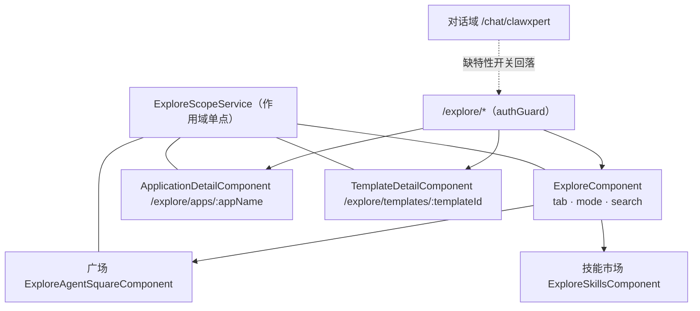

# C0 使用总览：探索广场专家

> 一句话定位：Xpert 前端的**市场与发现域**——`/explore/*` 一个壳承载「广场（专家 / 应用 / 模板）＋ 技能市场 ＋ 我的技能 ＋ 应用详情与受控初始化 ＋ 模板详情」，全部页面共享同一个作用域单点 `ExploreScopeService`。
> 范围：`apps/cloud/src/app/features/explore`（实测 **31 非 spec `.ts` / 13 spec**）；不含后端技能包/插件/市场实现（归后端「平台插件与技能专家」），也不含工作台内的技能与连接器管理页。

**本文引用的文件**
- [routes.ts](file://apps/cloud/src/app/features/explore/routes.ts)
- [features-routing.module.ts](file://apps/cloud/src/app/features/features-routing.module.ts)
- [explore.component.ts](file://apps/cloud/src/app/features/explore/explore.component.ts)
- [explore-route-state.ts](file://apps/cloud/src/app/features/explore/explore-route-state.ts)
- [explore-scope.service.ts](file://apps/cloud/src/app/features/explore/explore-scope.service.ts)
- [explore-scope.component.ts](file://apps/cloud/src/app/features/explore/explore-scope.component.ts)
- [explore-scope-dialog.component.ts](file://apps/cloud/src/app/features/explore/explore-scope-dialog.component.ts)
- [skills.component.ts](file://apps/cloud/src/app/features/explore/skills/skills.component.ts)
- [install.component.ts](file://apps/cloud/src/app/features/explore/skills/install/install.component.ts)
- [share-dialog.component.ts](file://apps/cloud/src/app/features/explore/skills/share/share-dialog.component.ts)
- [app-detail.component.ts](file://apps/cloud/src/app/features/explore/app-detail/app-detail.component.ts)
- [app-toolsets.component.ts](file://apps/cloud/src/app/features/explore/app-detail/app-toolsets.component.ts)
- [agent-square.component.ts](file://apps/cloud/src/app/features/explore/agent-square/agent-square.component.ts)
- [review-requests-list.component.ts](file://apps/cloud/src/app/features/xpert-access-requests/review-requests-list.component.ts)
- [agents.component.ts](file://apps/cloud/src/app/features/explore/agents/agents.component.ts)
- [template-detail.component.ts](file://apps/cloud/src/app/features/explore/template-detail/template-detail.component.ts)
- [routes.ts（对话域）](file://apps/cloud/src/app/features/chat/routes.ts)
- [xpert-marketplace.model.ts](file://packages/contracts/src/ai/xpert-marketplace.model.ts)
- file://.module-experts/前台专题/探索广场专家/C1-能力契约.md

## 目录

1. [定位与何时找](#1-定位与何时找)
2. [契约自足声明与资产基线](#2-契约自足声明与资产基线)
3. [能力清单](#3-能力清单)
4. [边界](#4-边界)
5. [已知问题与常见坑](#5-已知问题与常见坑)

## 1. 定位与何时找

### 1.1 定位

本域是「**一壳 + 作用域单点 + 四类市场内容**」的结构：壳 `ExploreComponent` 把 `tab`（`skills` / `agent-square`，`connectors` 是伪页签＝跳转）与 `mode`（`square` / `mine`）、`search` 全部映射到 URL query；广场组件再分 `experts` / `applications` / `templates` 三个目录（`catalog` 进 URL）。作用域 `ExploreScopeService` 被壳、广场、应用详情、模板详情共同消费，任何页面都不自行读取 `ScopeService`。后端的技能包、仓库索引、插件 App 编排与访问申请都是「被调用面」，前端只做展示与编排。

图表来源：[explore.component.ts](file://apps/cloud/src/app/features/explore/explore.component.ts)（关键符号：`ExploreComponent`、`setTab`）· [explore-scope.service.ts](file://apps/cloud/src/app/features/explore/explore-scope.service.ts)（关键符号：`ExploreScopeService.key`、`choose`）· [routes.ts（对话域）](file://apps/cloud/src/app/features/chat/routes.ts)（关键符号：`featureGate`）

### 1.2 何时找

1. **改入口/页签/搜索**：`/explore` 壳的 tab 合法性 → `explore-route-state.ts` 的 `normalizeExploreTab`；页签切换副作用（连接器跳转、技能广场重置）→ `ExploreComponent.setTab`。
2. **改作用域行为**（新增作用域级别、改切换入口、改 `key` 组成）→ `ExploreScopeService` + `explore-scope-dialog.component.ts`，并复核四个消费页的 `scope.key()` effect。
3. **技能市场列表/分页/热榜/筛选** → `ExploreSkillsComponent`（`getMarketplace`、`PAGE_SIZE=20`、`skillHotScore`）。
4. **技能安装**（装到哪个工作区、无工作区的兜底对话框）→ `install()` / `installToWorkspace()` 与 `ExploreSkillInstallComponent`。
5. **技能分享到组织市场** → `openShareDialog`（仅 `isLocalSkill`）与 `ExploreSkillShareDialogComponent`。
6. **应用详情与初始化**（preflight、模型与工具集选择、`operationId`、`setup=1` 深链）→ `ApplicationDetailComponent` 与 `ApplicationToolsetsComponent`。
7. **广场专家访问申请 / 审批** → `handleExpertAction` / `requestAccess`，审批入口 `openReviewDialog` 与共享组件 `XpertAccessRequestReviewListComponent`。
8. **模板详情与依赖就绪（readiness）** → `TemplateDetailComponent.loadRequirements` 与 `TemplateRequirementsComponent`。
9. **对话域回落排查**（进 ClawXpert 却跳到 `/explore`）→ 对话域 `canActivateChild: featureGate([...], ['/explore'])`。
10. **跑本域测试 / 处理 `@xpert-ai/store` 报错** → 先 `corepack pnpm install`；用例清单与基线见 `implementation/01-架构.md` 的「测试状态」。

章节来源：[explore-route-state.ts](file://apps/cloud/src/app/features/explore/explore-route-state.ts)（关键符号：`normalizeExploreTab`、`DEFAULT_EXPLORE_TAB`、`ExploreTab`）· [explore.component.ts](file://apps/cloud/src/app/features/explore/explore.component.ts)（关键符号：`setTab`、`openConnectorManagement`、`openInstallFromRepository`）· [skills.component.ts](file://apps/cloud/src/app/features/explore/skills/skills.component.ts)（关键符号：`install`、`installToWorkspace`、`openShareDialog`）· [app-detail.component.ts](file://apps/cloud/src/app/features/explore/app-detail/app-detail.component.ts)（关键符号：`primaryAction`、`initialize`）

## 2. 契约自足声明与资产基线

### 2.1 契约自足声明

`C0-使用总览.md` 与 [C1-能力契约.md](file://.module-experts/前端专题/探索广场专家/C1-能力契约.md) 两篇**自足可用**：读完即可完成「找到入口、判断边界、按契约使用 `ExploreScopeService` / 路由态解析 / 对话框 IO、识别已知坑」。所有符号均已在源码核实存在；后端 `skill-package` / `skill-repository` / `plugin-applications` 只作跨端引用，不展开实现。凡本文与会话契约未列出的能力或字段，一律视为「不承诺」。

章节来源：[explore-scope.service.ts](file://apps/cloud/src/app/features/explore/explore-scope.service.ts)（关键符号：`ExploreScopeService`、`activeScope`、`choose`）· [explore-scope-dialog.component.ts](file://apps/cloud/src/app/features/explore/explore-scope-dialog.component.ts)（关键符号：`ExploreScopeSelection`）

### 2.2 资产基线

| 项 | 值 |
| --- | --- |
| 资产版本 | **2026-10-16 重建**（ki 基线 `c07bb83d` / 2026-10-15） |
| 源码核对 | 仓库 `/root/xpert`；`apps/cloud/src/app/features/explore`（文件级实测 31 非 spec / 13 spec） |
| 入口路由 | `/explore`（壳）、`/explore/apps/:appName?plugin=…&setup=1`、`/explore/templates/:templateId`（后两者 `scopeContext: 'dual-scope'`） |
| 核心契约 | `ExploreScopeService`（`activeScope` / `isTenant` / `organizationName` / `key` / `choose`）＋ `explore-route-state`（`ExploreTab` / `normalizeExploreTab`） |
| 关联事实 | 对话域 `/chat/clawxpert` 缺特性开关时**回落 `/explore`**（`canActivateChild` 配置） |
| 测试状态 | ki 归档 **12 spec = 11 PASS / 1 FAIL**（环境级 `@xpert-ai/store` 缺依赖）；本次文件级盘点 13 spec（多 `template-detail` 一例） |
| 后端引用面 | 技能包/仓库/索引、插件 App 编排、市场索引查询 → 后端「平台插件与技能专家」 |

章节来源：[features-routing.module.ts](file://apps/cloud/src/app/features/features-routing.module.ts)（关键符号：`path: 'explore'`、`authGuard`）· [routes.ts](file://apps/cloud/src/app/features/explore/routes.ts)（关键符号：`scopeContext: 'dual-scope'`）· [routes.ts（对话域）](file://apps/cloud/src/app/features/chat/routes.ts)（关键符号：`featureGate`）

## 3. 能力清单

| 能力 | 入口（组件 / 服务 / 路由） | 一句话 |
| --- | --- | --- |
| 探索壳与路由态 | `ExploreComponent` / `/explore`；`explore-route-state.ts` | tab / mode / search 走 URL；`normalizeExploreTab` 决定合法页签 |
| 技能市场浏览 | `ExploreSkillsComponent`（`mode='square'`） | 仓库 × 索引分页（20/页）＋ 推荐位 ＋ 热榜（前端派生 Top3）＋ 角色/类型/热度筛选 |
| 我的技能与安装计数 | `ExploreSkillsComponent`（`mode='mine'`，`getAllByWorkspace`） | 按默认工作区取已装技能，`installedCountChange` 回传壳 |
| 技能安装 | `install()` / `ExploreSkillInstallComponent` → `SkillPackageService.installPackage` | 有工作区直装；无工作区弹对话框选工作区 |
| 技能详情与分享 | `ExploreSkillDetailDialogComponent` / `ExploreSkillShareDialogComponent` | 详情返回 `'install'` 触发安装；分享仅限工作区自建技能（快照语义） |
| 应用详情与受控初始化 | `ApplicationDetailComponent` / `/explore/apps/:appName?plugin=…` | preflight → 模型/工具集 → `initialize`（`operationId` 幂等）；就绪后跳 `/chat/x/:slug/c` |
| 工具集配置链 | `ApplicationToolsetsComponent` | `prepare` → 内置工具配置对话框 → `bindToolset`（仅可丢弃配置时） |
| 广场专家目录 | `ExploreAgentSquareComponent`（`catalog='experts'`） | `/api/xpert-marketplace` 按作用域过滤，带 `accessStatus` / `reviewableCount` |
| 访问申请 | `handleExpertAction` → `AgentSquareAccessRequestDialogComponent` → `requestAccess` | `reason === null` 视为取消；`requested` 时按钮固定为「待审批」 |
| 申请审批 | `openReviewDialog` → `AgentSquareReviewRequestsDialogComponent` → `XpertAccessRequestReviewListComponent` | `reviewable` 列表 → approve / reject → 本地移除并回传 `changed` |
| 应用目录与模板目录 | 广场 `catalog='applications'`（`getCatalog`）/ `catalog='templates'`（`getSummaries`） | 应用按状态与作用域筛选；模板按来源（plugin/builtin/shared…）与类型筛选 |
| 模板详情与依赖就绪 | `TemplateDetailComponent` / `/explore/templates/:templateId` | `getOverview` + **仅组织态** `getSetup` → `readiness`；`manageDependencies` 跳 `/plugins?category=agent-plugins` |
| 模板向导装配 | `createAgentTemplateWizardData` → `XpertNewBlankComponent` | 锁定 Agent 类型与模板起点，完成后 `/xpert/x/:id` |
| 作用域切换单点 | `ExploreScopeService.choose` / `ExploreScopeComponent` / `ExploreScopeDialogComponent` | 返回 `{kind:'tenant'}｜{kind:'organization', organization}`；`choose(true)` 只允许组织 |
| 回落入口 | 对话域 `canActivateChild: featureGate(…, ['/explore'])` | ClawXpert 缺开关时落到 `/explore`，因此本域不得加特性开关守卫 |

章节来源：[skills.component.ts](file://apps/cloud/src/app/features/explore/skills/skills.component.ts)（关键符号：`initializeSquare`、`loadMore`、`openWorkspaceSkills`）· [app-detail.component.ts](file://apps/cloud/src/app/features/explore/app-detail/app-detail.component.ts)（关键符号：`canSubmit`、`initialize`、`openApplication`）· [agent-square.component.ts](file://apps/cloud/src/app/features/explore/agent-square/agent-square.component.ts)（关键符号：`loadExperts`、`handleExpertAction`、`openReviewDialog`）· [template-detail.component.ts](file://apps/cloud/src/app/features/explore/template-detail/template-detail.component.ts)（关键符号：`loadRequirements`、`manageDependencies`）

## 4. 边界

1. **不含后端技能市场/插件实现**：技能包安装落盘、仓库与索引同步、插件 App 编排与并发认领归后端「平台插件与技能专家」。
2. **不含助手模板向导本体**：`XpertNewBlankComponent` 与 `BlankXpertWizardResult` 归 Xpert 工作台域；本域只提供装配参数并接结果。
3. **不含工作台管理页**：安装后的技能编辑与连接器管理在 `/xpert/w/:id/clawxpert-skills`、`/xpert/w/:id/clawxpert-connectors`；本域只做跳转与计数。
4. **不含插件市场安装页**：`/plugins` 与插件安装 UI 归平台设置域；本域仅复用 `PluginMarketplaceMcpProviderComponent` 展示运行时 MCP 组件。
5. **`agents/` 目录不承诺**：`ExploreAgentsComponent` 与 `ExploreXpertCardComponent` 当前**无任何消费者**（无路由、无外部引用），只有 `agent-template-wizard.ts` 被复用；不要以它作为「模板目录」的现状实现。
6. **不含访问申请的服务端裁决**：`accessStatus` / `canReview` / `reviewableCount` 全由服务端给出，前端不推断权限；审批动作只对 `reviewable` 数据生效。

章节来源：[agents.component.ts](file://apps/cloud/src/app/features/explore/agents/agents.component.ts)（关键符号：`ExploreAgentsComponent.install`、`openMineWorkspace`）· [agent-template-wizard.ts](file://apps/cloud/src/app/features/explore/agents/agent-template-wizard.ts)（关键符号：`createAgentTemplateWizardData`）· [xpert-marketplace.model.ts](file://packages/contracts/src/ai/xpert-marketplace.model.ts)（关键符号：`accessStatus`、`canReview`）

## 5. 已知问题与常见坑

1. **作用域切换的传播范围有限且各不相同**：壳（重取默认工作区）、广场（`resetScope()` 后重取三目录）、应用详情（重置全部本地状态 + 丢弃旧响应）、模板详情（重取 overview/readiness）**各自处理**；新增页面若忘记让 effect 依赖 `scope.key()`，切换作用域后会停留在旧数据。（来源：[agent-square.component.ts](file://apps/cloud/src/app/features/explore/agent-square/agent-square.component.ts)（关键符号：`resetScope`、`#scopeVersion`））
2. **租户态与组织态不是同一套可用性**：模板详情在 `isTenant()` 时**不请求** `readiness`；`install()` / 应用详情 `primaryAction()` 在 `organization_scope_required` 时先 `choose(true)`——取消则什么都不发生（不改数据、不导航）。（来源：[template-detail.component.ts](file://apps/cloud/src/app/features/explore/template-detail/template-detail.component.ts)（关键符号：`loadRequirements`、`install`）· [app-detail-scope.spec.ts](file://apps/cloud/src/app/features/explore/app-detail/app-detail-scope.spec.ts)（关键符号：`keeps tenant browsing unchanged…`））
3. **访问申请与审批的状态机在前端只有三分支**：`canUseExpert`（`owned｜accessible｜approved`）→ 可直接用；`requested` → 按钮禁用（`handleExpertAction` 直接 return）；其余 → 弹申请框。**注意**：`expertAccessLabel` 还区分 `rejected` 文案，但审批列表里的状态徽标是固定「Pending」文案，不要据此判断数据状态。（来源：[agent-square.component.ts](file://apps/cloud/src/app/features/explore/agent-square/agent-square.component.ts)（关键符号：`canUseExpert`、`expertAccessLabel`）· [review-requests-list.component.ts](file://apps/cloud/src/app/features/xpert-access-requests/review-requests-list.component.ts)（关键符号：`decide`、`setRequests`））
4. **审批列表关闭时的 `changed` 才是重取信号**：`AgentSquareReviewRequestsDialogComponent` 只有 `markChanged()` 过才把 `true` 回传，广场据 `changed` 决定是否刷新专家与推荐位；不点按钮直接关闭不会刷新。（来源：[review-requests-dialog.component.ts](file://apps/cloud/src/app/features/explore/agent-square/review-requests-dialog.component.ts)（关键符号：`changed`、`markChanged`））
5. **模板向导是「锁定起点 + 禁止关闭」的模态**：`createAgentTemplateWizardData` 设 `lockStartMode` / `lockType` / `skipTemplateSelectionStep`，对话框 `disableClose: true`、宽 1360px；用户中断即无结果（不写库），成功才回跳 `/xpert/x/:id`。（来源：[agent-template-wizard.ts](file://apps/cloud/src/app/features/explore/agents/agent-template-wizard.ts)（关键符号：`initialStartMode`、`completionMode`）· [template-detail.component.ts](file://apps/cloud/src/app/features/explore/template-detail/template-detail.component.ts)（关键符号：`install`））
6. **`@xpert-ai/store` 缺依赖是环境级失败**：ki 基线 12 spec = 11 PASS / 1 FAIL，失败原因不在本域代码；跑测前先 `corepack pnpm install`，并在复跑后重新标定。（来源：[app-detail-scope.spec.ts](file://apps/cloud/src/app/features/explore/app-detail/app-detail-scope.spec.ts)（关键符号：`jest.mock('@cloud/app/@core')`））
7. **回落入口与特性开关强耦合**：对话域 `clawxpert` 子树以 `['/explore']` 为回落目标；给 `/explore` 加特性开关守卫或改前缀会**同时**改掉对话域的兜底行为。（来源：[routes.ts（对话域）](file://apps/cloud/src/app/features/chat/routes.ts)（关键符号：`canActivateChild`、`featureGate`））
8. **市场开关关掉时语义会变**：`agentMarketplaceEnabled` 需要 `featureContextHydrated === true`，未水合即视为关闭；此时 tab 回落 `skills`、`agents` 会被归一为 `agent-square`、壳在构造时若发现 `tab=connectors` 会 `queueMicrotask` 跳去工作台连接器页（不是页签）。（来源：[explore.component.ts](file://apps/cloud/src/app/features/explore/explore.component.ts)（关键符号：`agentMarketplaceEnabled`、`setTab`））
9. **安装动作高度依赖「默认工作区」**：壳用 `getMyDefault({purpose:'authoring'})` 取默认工作区并随 `scope.key()` 重取；失败即置空——后果是「我的技能」为空、安装改为弹工作区选择框、管理入口回退 `/xpert/w?section=skills`。（来源：[explore.component.ts](file://apps/cloud/src/app/features/explore/explore.component.ts)（关键符号：`loadDefaultWorkspace`、`openSkillManagement`）· [install.component.ts](file://apps/cloud/src/app/features/explore/skills/install/install.component.ts)（关键符号：`workspaceOptions`、`install`））
10. **应用详情 `setup` 深链与作用域切换的交互**：带 `?setup=1` 进入时，若用户点「切换组织」并切换成功，会经 `#resumeSetupFromScope` 自动重开 setup；非切换场景下 `load()` 见到已就绪会直接 `openApplication` 并把 setup 关掉——排查「弹窗自己关掉」先看这一分支。（来源：[app-detail.component.ts](file://apps/cloud/src/app/features/explore/app-detail/app-detail.component.ts)（关键符号：`#resumeSetupFromScope`、`setupOpen`、`closeSetup`））

章节来源：[explore-scope.service.ts](file://apps/cloud/src/app/features/explore/explore-scope.service.ts)（关键符号：`key`、`choose`）· [skills.component.ts](file://apps/cloud/src/app/features/explore/skills/skills.component.ts)（关键符号：`loadInstalledSkills`、`isLocalSkill`）· [app-detail.component.ts](file://apps/cloud/src/app/features/explore/app-detail/app-detail.component.ts)（关键符号：`canSubmit`、`discardConfiguration`）
