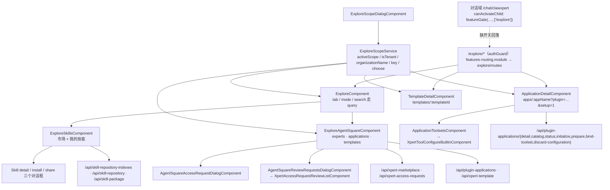

# 01 架构：探索广场专家（Xpert 前端 · 市场与发现域）

> 模块根：`apps/cloud/src/app/features/explore` —— 实测 **31 非 spec `.ts` / 13 spec**（ki 归档 29 / 12，差额见「测试状态」）
> 入口路由：`/explore/*`（挂载点 `path: 'explore'` + `canActivate: [authGuard]`）
> 技术底座：Angular standalone + signal + `@xpert-ai/headless-ui`（Zard 组件族）+ `ngxtension/injectQueryParams`
> 覆盖范围：仅前端探索域的「发现 / 市场 / 申请」面；技能市场、模板与访问申请的服务端实现只作引用面（归后端「平台插件与技能专家」与「Assistant 定义与运行时专家」）

**本文引用的文件**
- [routes.ts](file://apps/cloud/src/app/features/explore/routes.ts)
- [features-routing.module.ts](file://apps/cloud/src/app/features/features-routing.module.ts)
- [explore.component.ts](file://apps/cloud/src/app/features/explore/explore.component.ts)
- [explore-route-state.ts](file://apps/cloud/src/app/features/explore/explore-route-state.ts)
- [explore-scope.service.ts](file://apps/cloud/src/app/features/explore/explore-scope.service.ts)
- [explore-scope.component.ts](file://apps/cloud/src/app/features/explore/explore-scope.component.ts)
- [explore-scope-dialog.component.ts](file://apps/cloud/src/app/features/explore/explore-scope-dialog.component.ts)
- [skills.component.ts](file://apps/cloud/src/app/features/explore/skills/skills.component.ts)
- [skill-card.component.ts](file://apps/cloud/src/app/features/explore/skills/card/skill-card.component.ts)
- [skill-plaza.models.ts](file://apps/cloud/src/app/features/explore/skills/plaza/skill-plaza.models.ts)
- [detail-dialog.component.ts](file://apps/cloud/src/app/features/explore/skills/detail/detail-dialog.component.ts)
- [install.component.ts](file://apps/cloud/src/app/features/explore/skills/install/install.component.ts)
- [share-dialog.component.ts](file://apps/cloud/src/app/features/explore/skills/share/share-dialog.component.ts)
- [app-detail.component.ts](file://apps/cloud/src/app/features/explore/app-detail/app-detail.component.ts)
- [app-toolsets.component.ts](file://apps/cloud/src/app/features/explore/app-detail/app-toolsets.component.ts)
- [app-toolsets.util.ts](file://apps/cloud/src/app/features/explore/app-detail/app-toolsets.util.ts)
- [app-detail-model.util.ts](file://apps/cloud/src/app/features/explore/app-detail/app-detail-model.util.ts)
- [agent-square.component.ts](file://apps/cloud/src/app/features/explore/agent-square/agent-square.component.ts)
- [access-request-dialog.component.ts](file://apps/cloud/src/app/features/explore/agent-square/access-request-dialog.component.ts)
- [review-requests-dialog.component.ts](file://apps/cloud/src/app/features/explore/agent-square/review-requests-dialog.component.ts)
- [review-requests-list.component.ts](file://apps/cloud/src/app/features/xpert-access-requests/review-requests-list.component.ts)
- [agents.component.ts](file://apps/cloud/src/app/features/explore/agents/agents.component.ts)
- [xpert-card.component.ts](file://apps/cloud/src/app/features/explore/agents/xpert-card.component.ts)
- [agent-template-wizard.ts](file://apps/cloud/src/app/features/explore/agents/agent-template-wizard.ts)
- [template-detail.component.ts](file://apps/cloud/src/app/features/explore/template-detail/template-detail.component.ts)
- [template-requirements.component.ts](file://apps/cloud/src/app/features/explore/template-detail/template-requirements.component.ts)
- [routes.ts（对话域）](file://apps/cloud/src/app/features/chat/routes.ts)
- [app.constants.ts](file://apps/cloud/src/app/@core/constants/app.constants.ts)
- [xpert-marketplace.service.ts](file://apps/cloud/src/app/@core/services/xpert-marketplace.service.ts)
- [plugin-application.service.ts](file://apps/cloud/src/app/@core/services/plugin-application.service.ts)
- [skill-package.service.ts](file://apps/cloud/src/app/@core/services/skill-package.service.ts)
- [skill-repository.service.ts](file://apps/cloud/src/app/@core/services/skill-repository.service.ts)
- [skill-repository-index.service.ts](file://apps/cloud/src/app/@core/services/skill-repository-index.service.ts)
- [xpert-template.service.ts](file://apps/cloud/src/app/@core/services/xpert-template.service.ts)
- [app-detail-scope.spec.ts](file://apps/cloud/src/app/features/explore/app-detail/app-detail-scope.spec.ts)
- [xpert-marketplace.model.ts](file://packages/contracts/src/ai/xpert-marketplace.model.ts)
- file://.module-experts/后端专题/平台插件与技能专家/C1-能力契约.md

## 目录

- [职责与边界](#职责与边界)
- [目录结构与分层](#目录结构与分层)
- [依赖关系](#依赖关系)
- [关键不变量](#关键不变量)
- [架构总览图](#架构总览图)
- [组件详细分析](#组件详细分析)
- [测试状态](#测试状态)
- [结论](#结论)

## 职责与边界

**做什么**

1. **发现与市场页（`/explore/*`）**：一个壳 `ExploreComponent` ＋ 两个主目录（广场 `ExploreAgentSquareComponent`、技能市场 `ExploreSkillsComponent`）＋ 两个深链详情（`ApplicationDetailComponent`、`TemplateDetailComponent`）；`tab` / `mode` / `search` / `catalog` 全部经 URL query 参数承载（`linkedModel` + `replaceUrl`）。
2. **作用域语义（单点）**：`ExploreScopeService` 用 `ScopeService.activeScope` 暴露 `activeScope` / `isTenant` / `organizationName` / `key`，并统一经 `ExploreScopeDialogComponent` 发起「租户 ↔ 组织」切换；切换动作复用应用级作用域迁移，**不初始化任何资源**（服务注释明示）。
3. **技能市场面**：市场聚合（`ISkillMarketConfig` 官方推荐/热榜/筛选组）、仓库与索引分页（`/api/skill-repository-indexes`）、安装到工作区（`/api/skill-package/install`）、我的技能与「分享到组织市场」（仅工作区自建技能，`isLocalSkill = !item.skillIndex`）。
4. **应用（插件 App）受控初始化面**：`/explore/apps/:appName?plugin=…` 只做「可信 App 的市场详情 + 治理化初始化编排」（preflight 判定 → 模型/工具集选择 → `initialize`），凭据与目标作用域一律服务端持有。
5. **广场与访问申请**：专家目录（`/api/xpert-marketplace`）按作用域过滤并带 `accessStatus` / `canReview`；申请走 `requestAccess`，审批走 `AgentSquareReviewRequestsDialogComponent` → `XpertAccessRequestReviewListComponent`（approve / reject）。

**不做什么（逐条给出「谁家」）**

| 不在范围内 | 谁家（交叉引用） |
| --- | --- |
| 技能包 / 插件 / 索引的服务端实现与接入编排 | 后端「平台插件与技能专家」：[C1-能力契约.md](file://.module-experts/后端专题/平台插件与技能专家/C1-能力契约.md) |
| 助手（Assistant）定义、发布与运行时准入 | 「Assistant 定义与运行时专家」：`/api/xpert`, `/api/assistant-binding` 触发链 |
| 助手模板向导本体（`XpertNewBlankComponent`）与助手编辑页 | Xpert 工作台专家：`features/xpert/xpert`（本域只提供 `createAgentTemplateWizardData` 装配参数并接收 `BlankXpertWizardResult`） |
| 工作区内技能 / 连接器管理页（安装产物落地后的编辑） | Xpert 工作台专家：`/xpert/w/:id/clawxpert-skills`、`/xpert/w/:id/clawxpert-connectors`（本域只做跳转） |
| 插件市场与安装页（`/plugins`） | 平台设置域：`features/setting/plugins`（本域只消费 `PluginMarketplaceMcpProviderComponent` 的运行时 MCP 展示组件） |
| 对话域、认证与令牌 | 对话前端专家 / 认证与引导专家（本域只被对话域「回落」引用） |

章节来源：[routes.ts](file://apps/cloud/src/app/features/explore/routes.ts)（关键符号：`routes`、`templates/:templateId`、`apps/:appName`）· [explore-scope.service.ts](file://apps/cloud/src/app/features/explore/explore-scope.service.ts)（关键符号：`ExploreScopeService.choose`、`activeScope`、`key`）· [agent-square.component.ts](file://apps/cloud/src/app/features/explore/agent-square/agent-square.component.ts)（关键符号：`ExploreAgentSquareComponent.handleExpertAction`、`canUseExpert`）

## 目录结构与分层

| 目录 / 文件 | 层 | 职责（实测规模） |
| --- | --- | --- |
| `explore.component.ts`、`routes.ts`、`explore-route-state.ts` | **壳与路由态** | 3 个路由条目（`''` 壳、`apps/:appName`、`templates/:templateId`）；`ExploreTab` / `DEFAULT_EXPLORE_TAB` / `normalizeExploreTab` 是 tab 合法性的唯一判据 |
| `explore-scope.{service,component,dialog}.ts` | **作用域层（跨子页单点）** | 服务承载状态与切换；组件是纯展示触发器；对话框只返回 `ExploreScopeSelection` 联合值 |
| `skills/`（13 非 spec / 7 spec） | **技能市场层（最大块）** | `ExploreSkillsComponent` 聚合 4 个服务；`plaza/` 7 个零件（hero / tabs / featured / hot / all-list / filter-panel / models）；`card/`、`detail/`、`install/`、`share/`、`skill.utils.ts` |
| `app-detail/`（4 非 spec / 3 spec） | **应用详情与工具集层** | `ApplicationDetailComponent`（详情 + 初始化编排）、`ApplicationToolsetsComponent`、两个纯函数工具（`app-toolsets.util` / `app-detail-model.util`） |
| `agent-square/`（3 非 spec / 1 spec） | **广场与访问申请层** | `ExploreAgentSquareComponent`（experts / applications / templates 三目录，单体最大 32 KB）＋ 申请对话框 ＋ 审批对话框（内嵌共享审批列表组件） |
| `agents/`（3 非 spec / 0 spec） | **模板目录层（未接线）** | `ExploreAgentsComponent` + `ExploreXpertCardComponent` 当前无任何引用方（`ExploreAgentsComponent` 全仓库仅自身定义）；仅 `agent-template-wizard.ts` 被 agent-square 与 template-detail 复用 |
| `template-detail/`（2 非 spec / 1 spec） | **模板详情层** | `TemplateDetailComponent`（overview + readiness）＋ `TemplateRequirementsComponent`（纯输入输出） |

**分层与依赖方向（单向）**：页面组件（壳 / 广场 / 技能 / 详情）→ `@core` 服务（`XpertMarketplaceService` / `PluginApplicationService` / `XpertTemplateService` / `SkillPackageService` / `SkillRepositoryService` / `SkillRepositoryIndexService`）→ HTTP；作用域层被页面组件**消费**（`ExploreScopeComponent` 只 inject 服务，不下发状态）；对话框组件只经 `DIALOG_DATA` / `DialogRef` 通信，不引用页面组件。

章节来源：[explore-route-state.ts](file://apps/cloud/src/app/features/explore/explore-route-state.ts)（关键符号：`ExploreTab`、`DEFAULT_EXPLORE_TAB`、`normalizeExploreTab`）· [skills.component.ts](file://apps/cloud/src/app/features/explore/skills/skills.component.ts)（关键符号：`ExploreSkillsComponent`、`skillHotScore`）· [agents.component.ts](file://apps/cloud/src/app/features/explore/agents/agents.component.ts)（关键符号：`ExploreAgentsComponent`、`ExploreXpertCardComponent`）

## 依赖关系

**出向依赖（本域 → 外部）**

| 依赖面 | 具体符号 | 用途 |
| --- | --- | --- |
| `@core/services` | `XpertMarketplaceService`（`findMarketplace` / `requestAccess` / `findReviewableRequests` / `approveRequest` / `rejectRequest`）、`PluginApplicationService`（`getStatuses` / `getCatalog` / `getDetail` / `initialize` / `prepare` / `bindToolset` / `discardConfiguration`）、`XpertTemplateService`（`getAll` / `getSummaries` / `getOverview` / `getSetup` / `getSkillsMarket`）、`SkillPackageService`（`getAllByWorkspace` / `installPackage` / `sharePackage`）、`SkillRepositoryService.getAvailables`、`SkillRepositoryIndexService.getMarketplace` | 市场、应用、模板、技能四族控制面 HTTP（基址 `API_PREFIX`） |
| 端点常量 | `API_XPERT_MARKETPLACE = API_PREFIX + '/xpert-marketplace'`、`API_XPERT_ACCESS_REQUESTS = API_PREFIX + '/xpert-access-requests'` | 广场与访问申请的路径基址单点 |
| `@core` 状态与守卫 | `Store`（`user` / `selectedOrganization` / `hasFeatureEnabled` / `featureContextHydrated`）、`ScopeService`（`activeScope` / `switchToTenant` / `switchToOrganization` / `canUseTenantScope`）、`OrganizationsService`、`XpertWorkspaceService.getMyDefault({ purpose: 'authoring' })` | 作用域与特性开关、默认工作区 |
| 跨域组件 | `XpertNewBlankComponent`（`features/xpert/xpert`）、`XpertProjectInstallComponent`（`@shared/chat`）、`XpertToolConfigureBuiltinComponent`（`features/xpert/tools/builtin/configure`，动态 import）、`PluginMarketplaceMcpProviderComponent`（`features/setting/plugins/marketplace`） | 向导、项目安装、工具集配置、运行时 MCP 展示 |
| 共享契约 | `@xpert-ai/contracts`：`PluginApplicationDetail`、`PluginApplicationCatalogItem`、`PluginApplicationToolsetSelection`、`AssistantTemplateOverview`、`TemplateReadiness`、`TXpertMarketplaceAccessStatus`、`IXpertAccessRequest` | 类型与状态枚举（`accessStatus`、`initializationAccess`） |

**入向依赖（谁引用探索域）**

1. **对话域回落（唯一强耦合）**：`features/chat/routes.ts` 的 `clawxpert` 子树声明 `canActivateChild: [featureGate([FEATURE_XPERT, FEATURE_XPERT_CLAWXPERT], ['/explore'])]` —— 缺特性开关时**回落 `/explore`**；改 `/explore` 路由前缀会同步影响对话域准入配置。
2. **实体同源（语义耦合，非代码依赖）**：广场里的 Agent / 应用实体与 Xpert 工作台域同源（广场为已发布形态，工作台展示草稿优先形态），且广场按 `ExploreScopeService.activeScope/key` 过滤，与工作区 dual-scope 语义一致。
3. **无其他域直接 import**：`ExploreAgentsComponent` / `ExploreXpertCardComponent` 在 `apps/cloud` 内无外部消费者；`ExploreScopeComponent` 仅被本域三个页面组件（广场、应用详情、模板详情）复用。

章节来源：[xpert-marketplace.service.ts](file://apps/cloud/src/app/@core/services/xpert-marketplace.service.ts)（关键符号：`XpertMarketplaceService.requestAccess`、`findReviewableRequests`）· [app.constants.ts](file://apps/cloud/src/app/@core/constants/app.constants.ts)（关键符号：`API_XPERT_MARKETPLACE`、`API_XPERT_ACCESS_REQUESTS`）· [routes.ts（对话域）](file://apps/cloud/src/app/features/chat/routes.ts)（关键符号：`canActivateChild`、`featureGate`）

## 关键不变量

1. **作用域是单点**：任何页面都不得自行读取/改写作用域，只允许 `inject(ExploreScopeService)`；切换必须经 `choose(organizationOnly?)` → `ExploreScopeDialogComponent` → `{ kind: 'tenant' } | { kind: 'organization', organization }`，再由服务调用 `ScopeService.switchToTenant()` / `switchToOrganization(organization)`。`choose(true)` 表示「只允许组织」（用于 `organization_scope_required` 场景），返回 `false` 表示用户取消。
2. **`key` 是切换的唯一比对键**：`key = ${userId}:${tenantId}:${level}:${organizationId（仅组织态）}`；四个页面组件（壳、广场、应用详情、模板详情）都以 `scope.key()`（广场另拼 `language()`）为 effect 触发源，切换后**各自重新取数**（应用详情与广场额外做「旧响应丢弃」与状态重置）。
3. **`explore-route-state` 解析规则固定**：`normalizeExploreTab(value, agentMarketplaceEnabled)` —— `agent-square | agents` 且市场开关开 → `agent-square`；`connectors` → 原样（由壳转成跳转，不渲染页签）；`skills` → `skills`；其余回落 `agentMarketplaceEnabled ? DEFAULT_EXPLORE_TAB('agent-square') : 'skills'`。`tab` 与 `mode` 的默认值不写进 URL（`update` 时置 `null` 并 `replaceUrl`）。
4. **市场访问可见性三态由服务端裁决**：`IXpertMarketplaceItem.accessStatus ∈ { not_requested, requested, approved, rejected, accessible, owned }`；前端 `canUseExpert` 只认 `owned | accessible | approved` 为「可直接使用」，`requested` 为「待审批（按钮禁用）」，`rejected` / `not_requested` 仍可再次申请；`reviewableCount` / `canReview` 只作展示与入口开关，审批动作必须由 `/xpert-access-requests/reviewable` 数据驱动。
5. **回落入口的语义**：`/explore` 是对话域 ClawXpert 的**特性开关兜底目的地**，因此 `/explore` 必须保持无特性开关守卫（当前只挂 `authGuard`），且壳必须在「市场开关关闭」时仍可用——`ExploreComponent` 以 `featureContextHydrated === true && hasFeatureEnabled(FEATURE_XPERT_MARKETPLACE)` 计算 `agentMarketplaceEnabled`，未水合时按关闭处理（tab 回落 `skills`）。
6. **技能分享的边界**：`openShareDialog` 在 `!workspaceId || !item.id || !isLocalSkill(item)` 时直接返回——**只有工作区自建技能（无 `skillIndex`）可分享**，且分享是快照语义（对话框文案明示「后续文件变更不会自动同步」）。

章节来源：[explore-scope.service.ts](file://apps/cloud/src/app/features/explore/explore-scope.service.ts)（关键符号：`choose`、`organizationName`、`key`、`isTenant`）· [explore-route-state.ts](file://apps/cloud/src/app/features/explore/explore-route-state.ts)（关键符号：`normalizeExploreTab`、`DEFAULT_EXPLORE_TAB`）· [xpert-marketplace.model.ts](file://packages/contracts/src/ai/xpert-marketplace.model.ts)（关键符号：`TXpertMarketplaceAccessStatus`、`IXpertAccessRequest`、`canReview`）· [agent-square.component.ts](file://apps/cloud/src/app/features/explore/agent-square/agent-square.component.ts)（关键符号：`canUseExpert`、`expertActionLabel`、`openReviewDialog`）

## 架构总览图

图表来源：[explore.component.ts](file://apps/cloud/src/app/features/explore/explore.component.ts)（关键符号：`ExploreComponent.setTab`、`agentMarketplaceEnabled`、`openConnectorManagement`）· [agent-square.component.ts](file://apps/cloud/src/app/features/explore/agent-square/agent-square.component.ts)（关键符号：`catalog`、`handleApplicationAction`）· [skills.component.ts](file://apps/cloud/src/app/features/explore/skills/skills.component.ts)（关键符号：`install`、`openSkillDetail`、`openShareDialog`）· [plugin-application.service.ts](file://apps/cloud/src/app/@core/services/plugin-application.service.ts)（关键符号：`PluginApplicationService.initialize`、`prepare`、`bindToolset`）· [routes.ts（对话域）](file://apps/cloud/src/app/features/chat/routes.ts)（关键符号：`featureGate`）

章节来源：[explore.component.ts](file://apps/cloud/src/app/features/explore/explore.component.ts)（关键符号：`ExploreComponent`、`defaultWorkspace`、`installedSkillsCount`）· [routes.ts](file://apps/cloud/src/app/features/explore/routes.ts)（关键符号：`routes`、`scopeContext: 'dual-scope'`）

## 组件详细分析

### 作用域单点：`ExploreScopeService` ＋ 作用域对话框

服务只做三件事：暴露只读派生（`activeScope` 直通 `ScopeService.activeScope`；`isTenant` 比较 `RequestScopeLevel.TENANT`；`organizationName` 读 `Store.selectedOrganization?.name` 并显式依赖 `activeScope()` 以保证切换后重算；`key` 拼出跨页面统一的比对键），以及 `choose(organizationOnly)` 的对话框编排（`allowTenant: !organizationOnly && canUseTenantScope()`，`backdropClass: 'backdrop-blur-xs-black'`，`panelClass: 'xp-overlay-pane-dialog'`）。对话框自身按角色分两路取组织：`SUPER_ADMIN` 走 `OrganizationsService.getAll(['featureOrganizations', …], { isActive: true })`，其余走 `Store.user.organizations` 并过滤 `isActive !== false`；失败时给出重试按钮而非静默空列表。

章节来源：[explore-scope.service.ts](file://apps/cloud/src/app/features/explore/explore-scope.service.ts)（关键符号：`ExploreScopeService.choose`、`isTenant`、`organizationName`、`key`）· [explore-scope-dialog.component.ts](file://apps/cloud/src/app/features/explore/explore-scope-dialog.component.ts)（关键符号：`ExploreScopeSelection`、`load`、`selectOrganization`、`selectTenant`）· [explore-scope.component.ts](file://apps/cloud/src/app/features/explore/explore-scope.component.ts)（关键符号：`ExploreScopeComponent.scope`）

### 技能市场（`skills/`）：四服务聚合 ＋ 三页签 ＋ 三对话框

`ExploreSkillsComponent` 以 4 个输入（`search` / `mode` / `workspace` / `installFromRepositoryNonce`）和 2 个输出（`installedCountChange` / `searchChange`）与壳通信：`mode='square'` 时并行 `loadRepositories()`（`getAvailables`）与 `loadMarket()`（`getSkillsMarket`），列表按仓库过滤分页（`PAGE_SIZE = 20`，`IntersectionObserver` 触发 `loadMore`，按 `id` 去重）；`mode='mine'` 时按 `workspace().id` 取 `getAllByWorkspace`（`relations: ['skillIndex','skillIndex.repository']`），无工作区则不发请求。热榜是前端派生（`skillHotScore = downloads*2 + stars + versions` 取前 3）。三个对话框各自承担一段动作：详情（`closed === 'install'` 触发安装）、安装（无工作区时选择工作区后 `installPackage`）、分享（仅本地技能，成功后刷新已装列表）。

章节来源：[skills.component.ts](file://apps/cloud/src/app/features/explore/skills/skills.component.ts)（关键符号：`initializeSquare`、`resetAndLoad`、`loadMore`、`installToWorkspace`、`skillHotScore`、`isLocalSkill`）· [detail-dialog.component.ts](file://apps/cloud/src/app/features/explore/skills/detail/detail-dialog.component.ts)（关键符号：`ExploreSkillDetailDialogComponent.install`、`item`、`featured`）· [install.component.ts](file://apps/cloud/src/app/features/explore/skills/install/install.component.ts)（关键符号：`ExploreSkillInstallComponent.install`、`workspaceOptions`）· [share-dialog.component.ts](file://apps/cloud/src/app/features/explore/skills/share/share-dialog.component.ts)（关键符号：`ExploreSkillShareDialogData`、`form`）

### 应用详情与工具集（`app-detail/`）

`ApplicationDetailComponent` 是「详情 + 受控初始化」双面页：路由参数 `plugin` + `appName` 缺一即报错并停载；`setup` 深链（`?setup=1`）决定 `setupOpen`。作用域 effect 在 `scope.key()` 变化时**先重置全部本地状态**（detail / mcpProviders / toolsetSelections / 模型 / 各 busy 标志）再 `load()`，并用 `#loadVersion` 丢弃旧作用域响应；`#resumeSetupFromScope` 记录「因组织要求而切换」的场景，组织态加载完成后自动重开 setup。`canSubmit` 是纯派生：`preflight.canInitialize` + 模型要求 + 工具集全部选中 + 无进行中动作；`initialize()` 提交 `operationId`（`crypto.randomUUID()` 兜底）并只重写本地 `status`。工具集面板把 `prepare`（拿配置工作区）→ `XpertToolConfigureBuiltinComponent`（配置）→ `bindToolset`（仅 `canDiscardConfiguration` 时绑定，以保留已发布图的受管 ID）串成一条链。

章节来源：[app-detail.component.ts](file://apps/cloud/src/app/features/explore/app-detail/app-detail.component.ts)（关键符号：`ApplicationDetailComponent.load`、`primaryAction`、`initialize`、`canSubmit`、`openApplication`）· [app-toolsets.component.ts](file://apps/cloud/src/app/features/explore/app-detail/app-toolsets.component.ts)（关键符号：`ApplicationToolsetsComponent.configure`、`select`、`refresh`）· [app-toolsets.util.ts](file://apps/cloud/src/app/features/explore/app-detail/app-toolsets.util.ts)（关键符号：`applicationToolsetsSelected`、`reconcileApplicationToolsets`）

### 广场与访问申请（`agent-square/`）

广场是单体最大的组件：`catalog`（`experts` / `applications` / `templates`，默认 `experts`）与 `search` / 业务分类 / 状态 / 作用域筛选都进 URL；一个复合 effect 以 `${scope.key()}:${language()}:${catalog()}:${query}` 为触发源，作用域变化时 `resetScope()`（自增版本号 + 清空 5 组数据 + 停轮播）后重取。专家动作是「能用就跳转、申请中固定、否则申请」三分支：`canUseExpert` → `/chat/x/:slug/c`；`accessStatus === 'requested'` → 直接返回；否则打开申请对话框，`reason === null` 视为取消，成功提交后刷新专家与推荐位。审批入口只在需要时打开 `AgentSquareReviewRequestsDialogComponent`，内部委托共享的 `XpertAccessRequestReviewListComponent`（`findReviewableRequests` → `approveRequest` / `rejectRequest`，本地移除并 emit `changed`），关闭时把 `changed` 回传给广场以决定是否重取。应用动作按 `initializationAccess` 分派：`organization_required` 先 `scope.choose(true)` 再带 `setup=1` 进详情。

章节来源：[agent-square.component.ts](file://apps/cloud/src/app/features/explore/agent-square/agent-square.component.ts)（关键符号：`resetScope`、`loadFeaturedExperts`、`handleExpertAction`、`handleApplicationAction`、`openApplicationDetails`）· [review-requests-dialog.component.ts](file://apps/cloud/src/app/features/explore/agent-square/review-requests-dialog.component.ts)（关键符号：`AgentSquareReviewRequestsDialogComponent.changed`、`markChanged`）· [review-requests-list.component.ts](file://apps/cloud/src/app/features/xpert-access-requests/review-requests-list.component.ts)（关键符号：`XpertAccessRequestReviewListComponent.load`、`approve`、`reject`、`decide`）· [access-request-dialog.component.ts](file://apps/cloud/src/app/features/explore/agent-square/access-request-dialog.component.ts)（关键符号：`AgentSquareAccessRequestDialogComponent.submit`、`close`）

### 模板目录与模板详情（`agents/` / `template-detail/`）

`agents/` 是「模板目录」的旧实现：`ExploreAgentsComponent` 取 `XpertTemplateService.getAll()` 的 `recommendedApps` 并对照 `PluginApplicationService.getStatuses()`，`install()` 按四类分派（应用就绪 → `/chat/x/:slug/c`；应用未就绪 → `/explore/apps/:appName?plugin=…&setup=1`；Agent / Copilot → `XpertNewBlankComponent` 向导；`project` → `XpertProjectInstallComponent`），`mine` 模式取 `XpertAPIService.getAllByWorkspace`（`latest: true`，仅 Agent / Copilot）。当前它与其卡片 `ExploreXpertCardComponent` **无外部引用**，实际被线路由的模板面是 `template-detail/`：`TemplateDetailComponent` 以 `params + scope.key() + language()` 为触发源取 `getOverview`，**仅组织态**取 `getSetup` 得到 `readiness`；`install()` 在租户态先 `choose(true)` 再重载，应用模板跳 `/explore/apps/:appName?setup=1`，普通模板打开向导（`createAgentTemplateWizardData(id, null)`，结果回跳 `/xpert/x/:id`）。`TemplateRequirementsComponent` 是纯展示件（`readiness` 入、`manage` 出），依赖缺失项（`kind ∈ plugin|resource` 且 `status ∈ missing|incompatible`）才亮出「管理依赖」按钮。

章节来源：[agents.component.ts](file://apps/cloud/src/app/features/explore/agents/agents.component.ts)（关键符号：`ExploreAgentsComponent.loadTemplates`、`install`、`openMineItem`）· [agent-template-wizard.ts](file://apps/cloud/src/app/features/explore/agents/agent-template-wizard.ts)（关键符号：`createAgentTemplateWizardData`、`initialStartMode`、`lockStartMode`）· [template-detail.component.ts](file://apps/cloud/src/app/features/explore/template-detail/template-detail.component.ts)（关键符号：`TemplateDetailComponent.load`、`loadRequirements`、`install`、`openDesktop`）· [template-requirements.component.ts](file://apps/cloud/src/app/features/explore/template-detail/template-requirements.component.ts)（关键符号：`TemplateRequirementsComponent.needsDependencies`）

## 测试状态

| 项 | 值 |
| --- | --- |
| ki 归档（2026-10-15，commit `c07bb83d`） | **12 spec = 11 PASS / 1 FAIL**；失败为**环境级**（`@xpert-ai/store` 缺依赖，非本域代码缺陷） |
| 本次文件级盘点 | **13 spec**（差额 1 = `template-detail/template-detail.component.spec.ts`，ki 记数未含该目录）；用例级结论未复跑，沿用 ki 基线 |
| 分布 | `skills/` 7（主组件 + card + install + plaza 四件）· `app-detail/` 3（含 `app-detail-scope.spec.ts`）· `agent-square/` 1 · 根 1（`explore.component.spec.ts`）· `template-detail/` 1；`agents/` **0 spec** |
| 质量最好的用例集 | [app-detail-scope.spec.ts](file://apps/cloud/src/app/features/explore/app-detail/app-detail-scope.spec.ts)：4 例全为作用域切换竞态（取消选择不初始化、切到组织后继续 setup 且不自动 initialize、丢弃旧 detail 响应、丢弃旧 toolset 刷新） |
| 跑测前提 | 先 `corepack pnpm install`——`@xpert-ai/store` 缺依赖属环境级失败，重新安装后应复跑重新标定 PASS/FAIL |

章节来源：[app-detail-scope.spec.ts](file://apps/cloud/src/app/features/explore/app-detail/app-detail-scope.spec.ts)（关键符号：`describe('ApplicationDetail scope transitions')`、`keeps tenant browsing unchanged…`、`ignores an old scope detail response…`）· [app-detail.component.ts](file://apps/cloud/src/app/features/explore/app-detail/app-detail.component.ts)（关键符号：`#loadVersion`、`#resumeSetupFromScope`）

## 结论

- **一个壳 + 四类内容 + 一个作用域单点**：`/explore/*` 的全部页面共享 `ExploreScopeService`，页面之间没有互相依赖，扩展新目录只需在壳里挂一个 tab 组件并让 `explore-route-state` 认识该值。
- **URL 是路由态的唯一真源**：tab / mode / search / catalog / setup 都写 query（`replaceUrl` 避免污染历史），刷新与分享链接可复现视图；默认值不落 URL 是刻意约定。
- **作用域切换的传播靠 `key()` + 版本号**：四个页面（壳、广场、应用详情、模板详情）都以 `key` 为触发源并各自丢弃旧响应；`app-detail-scope.spec.ts` 把这条不变量固化为用例，改动此处务必连同用例一起评审。
- **市场/申请是「服务端裁决 + 前端只分级展示」**：`accessStatus` / `canReview` / `initializationAccess` / `preflight.reason` 全由后端给出，前端不做权限推断；审批列表复用工作台侧共享组件，避免第二套审批语义。
- **`agents/` 是未接线目录**：`ExploreAgentsComponent` 与 `ExploreXpertCardComponent` 当前无消费者，只有 `agent-template-wizard.ts` 被广场与模板详情复用；清理或接线前先确认无路由/模板引用。
- **回落语义必须保持**：`/explore` 是对话域缺特性开关时的兜底目的地，因此不能给它加特性开关守卫，也不能改路由前缀；技能市场与广场在「市场开关关闭」时仍需可用（tab 回落 `skills`）。
- 服务端对应面（技能包/仓库/索引、插件 App 编排、市场索引查询）见后端「平台插件与技能专家」的 [C1-能力契约.md](file://.module-experts/后端专题/平台插件与技能专家/C1-能力契约.md)，本域只负责调用面与展示面。

章节来源：[explore.component.ts](file://apps/cloud/src/app/features/explore/explore.component.ts)（关键符号：`ExploreComponent.agentMarketplaceEnabled`、`openSkillManagement`）· [routes.ts（对话域）](file://apps/cloud/src/app/features/chat/routes.ts)（关键符号：`featureGate([AiFeatureEnum.FEATURE_XPERT, AiFeatureEnum.FEATURE_XPERT_CLAWXPERT], ['/explore'])`）· [features-routing.module.ts](file://apps/cloud/src/app/features/features-routing.module.ts)（关键符号：`path: 'explore'`、`authGuard`）
