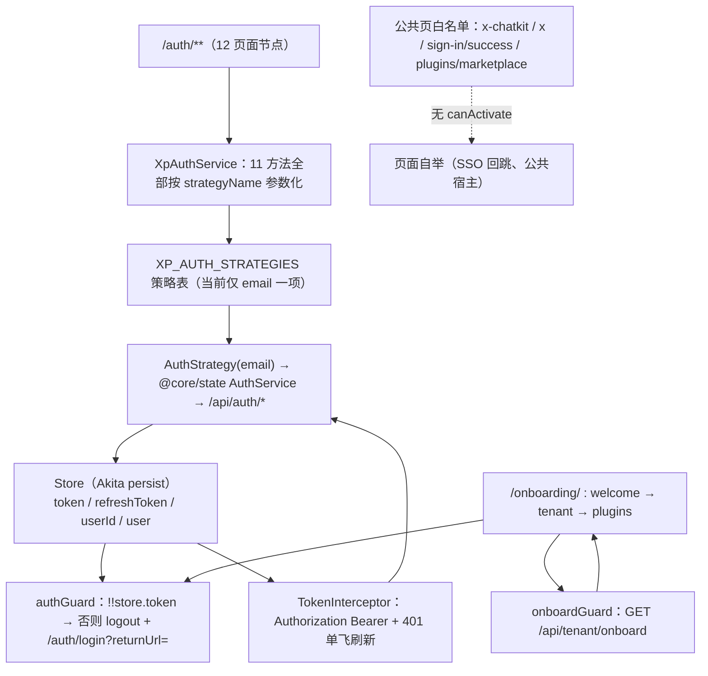

# C0 使用总览：认证与引导专家

> 一句话定位：Xpert 前端的**认证域 + 全站准入边界**——`/auth/**` 12 个页面节点的认证动作入口、`/onboarding/**` 首启三步向导，以及 `authGuard` / `NoAuthGuard` / `onboardGuard` / `inviteGuard` / `dirtyCheckGuard` 共同声明的「谁能进哪个页面」。
> 范围：`apps/cloud/src/app/auth/**`（实测 **43 非 spec / 9 spec**）＋ `apps/cloud/src/app/onboarding/**`（**7 非 spec / 2 spec**）＝ **50 非 spec / 11 spec**；引用面 `@core/auth`（email 策略 `AuthStrategy`、`authGuard`、`TokenInterceptor`）与 `@core/guards`。服务端 `/api/auth*`、`/api/invite/*`、`/api/tenant/*` 实现归**身份与权限专家**，本域只声明前端调用面。
> 口径修正：ki 归档「auth 51 非 spec / 11 spec」与实测不符（改造期文件合并/删除），**以实测 43 非 spec / 9 spec + onboarding 7 / 2 为准**。

**本文引用的文件**
- [auth-routing.module.ts](file://apps/cloud/src/app/auth/auth-routing.module.ts)
- [auth.module.ts](file://apps/cloud/src/app/auth/auth.module.ts)
- [auth.options.ts](file://apps/cloud/src/app/auth/auth.options.ts)
- [auth.service.ts](file://apps/cloud/src/app/auth/services/auth.service.ts)
- [auth-result.ts](file://apps/cloud/src/app/auth/services/auth-result.ts)
- [auth-strategy.ts](file://apps/cloud/src/app/auth/strategies/auth-strategy.ts)
- [password-strategy.ts](file://apps/cloud/src/app/auth/strategies/password/password-strategy.ts)
- [no-auth.guard.ts（auth 包）](file://apps/cloud/src/app/auth/guards/no-auth.guard.ts)
- [login.component.ts](file://apps/cloud/src/app/auth/login/login.component.ts)
- [register.component.ts](file://apps/cloud/src/app/auth/register/register.component.ts)
- [accept-invite.component.ts](file://apps/cloud/src/app/auth/accept-invite/accept-invite.component.ts)
- [logout.component.ts](file://apps/cloud/src/app/auth/logout/logout.component.ts)
- [sso-bind.component.ts](file://apps/cloud/src/app/auth/sso-bind/sso-bind.component.ts)
- [consent.component.ts](file://apps/cloud/src/app/auth/consent/consent.component.ts)
- [token.interceptor.ts](file://apps/cloud/src/app/@core/interceptors/token.interceptor.ts)
- [auth-strategy.service.ts](file://apps/cloud/src/app/@core/auth/auth-strategy.service.ts)
- [auth.guard.ts](file://apps/cloud/src/app/@core/auth/auth.guard.ts)
- [auth.module.ts（@core）](file://apps/cloud/src/app/@core/auth/auth.module.ts)
- [onboard.guard.ts](file://apps/cloud/src/app/@core/guards/onboard.guard.ts)
- [invite.guard.ts](file://apps/cloud/src/app/@core/guards/invite.guard.ts)
- [dirty-check.guard.ts](file://apps/cloud/src/app/@core/guards/dirty-check.guard.ts)
- [onboarding-routing.module.ts](file://apps/cloud/src/app/onboarding/onboarding-routing.module.ts)
- [tenant-details.component.ts](file://apps/cloud/src/app/onboarding/tenant-details/tenant-details.component.ts)
- [setup-plugins.component.ts](file://apps/cloud/src/app/onboarding/plugins/setup-plugins.component.ts)
- [app-routing.module.ts](file://apps/cloud/src/app/app-routing.module.ts)
- [features-routing.module.ts](file://apps/cloud/src/app/features/features-routing.module.ts)
- [store.service.ts](file://apps/cloud/src/app/@core/state/store.service.ts)
- [implementation/06-测试.md](file://.module-experts/前端专题/认证与引导专家/implementation/06-测试.md)
- [implementation/07-运维.md](file://.module-experts/前端专题/认证与引导专家/implementation/07-运维.md)
- [C1-能力契约.md](file://.module-experts/前端专题/认证与引导专家/C1-能力契约.md)

## 目录
1. [定位与何时找](#定位与何时找)
2. [契约自足声明与资产基线](#契约自足声明与资产基线)
3. [能力清单](#能力清单)
4. [边界](#边界)
5. [已知问题与常见坑](#已知问题与常见坑)

## 1. 定位与何时找

### 1.1 定位

本域是三段式的「**门面 + 策略表 + 守卫矩阵**」：页面只传 `strategyName` 表达意图（不直接发认证 HTTP），`XpAuthService` 在 `XP_AUTH_STRATEGIES` 表内定址后转交 `XpAuthStrategy` 子类，成功结果统一落 `Store`（Akita persist `_xpertStore`）的 `token` / `refreshToken` / `userId`；令牌再由 `TokenInterceptor` 注入全站请求，由 `authGuard` 一句话 `!!store.token` 供给 `features/**` 十余条受保护路由。引导侧 `/onboarding/**` 的「welcome → tenant → plugins」不可跳步，其结构性依据正是「步 3 挂 `authGuard`」与「步 2 的 `afterOnboard` 用刚建的管理员自动登录换取 token」。

图表来源：[auth.service.ts](file://apps/cloud/src/app/auth/services/auth.service.ts)（关键符号：`XpAuthService.authenticate`、`XpAuthService.getStrategy`）· [auth.module.ts（@core）](file://apps/cloud/src/app/@core/auth/auth.module.ts)（关键符号：`AuthStrategy.setup`、`XpAuthModule.forRoot`）· [auth.guard.ts](file://apps/cloud/src/app/@core/auth/auth.guard.ts)（关键符号：`authGuard`）· [token.interceptor.ts](file://apps/cloud/src/app/@core/interceptors/token.interceptor.ts)（关键符号：`TokenInterceptor.addAuthenticationToken`）· [app-routing.module.ts](file://apps/cloud/src/app/app-routing.module.ts)（关键符号：`routes`、`path: 'x-chatkit'`、`path: 'x'`）

### 1.2 何时找（12 条）

1. **改登录流程**（表单字段、`rememberMe` 回填、`returnUrl` 跳转、SSO 回调错误码文案）→ `UserLoginComponent.submit` / `resolveSsoErrors` 与 `AuthStrategy.login`。
2. **改注册与开户字段/门控**（`enablePublicSignup`、返利码、带 `ticket` 的 SSO 注册分支）→ `UserRegisterComponent.register` / `validateReferralCode`。
3. **改密码流程**（忘记密码不跳转、重置密码从 `?token=` 取令、密码长度与强度口径）→ `ForgotPasswordComponent` / `ResetPasswordComponent`。
4. **改邮箱验证链**（邮件链接落点、失败文案来源）→ `VarifyEmailComponent` 与 `GET /api/auth/verify?token=`。
5. **新增登录方式（策略）**→ 只加策略类 + `XpAuthOptions.strategies` 一行，**不动页面**（唯一扩展点）。
6. **改 OIDC consent / SSO 绑定确认**（整页 form POST、票据两跳、`mcpOAuthEnabled` 门控）→ `OidcConsentComponent` / `SsoBindComponent` / `CurrentUserSsoConfirmComponent`。
7. **改邀请接受**（链接语义 `?email=&token=`、已登录也能进的唯一例外、不自动登录）→ `/auth/accept-invite` 与 `NoAuthGuard.canAccessInviteRoute`。
8. **改 onboarding 向导**（三步顺序、自动登录前提、插件安装轮询与整页重载）→ `TenantDetailsComponent.onboard/afterOnboard` / `SetupPluginsComponent.monitor`。
9. **改路由准入（守卫矩阵）**→ `authGuard` / `NoAuthGuard` / `onboardGuard` / `inviteGuard` / `dirtyCheckGuard` 五处判据与跳转目标。
10. **评估新增公共页的安全性**→ 必须同时核对路由白名单与 `ANONYMOUS_AUTH_PATHS` 两处显式枚举。
11. **改令牌结构与刷新语义**（拦截器 401 单飞、socket 重连复用 `AuthStrategy.refreshToken`）→ 按**全站回归**对待。
12. **跑本域测试**（11 个 spec 的分布、环境级依赖）→ 见 [implementation/06-测试.md](file://.module-experts/前端专题/认证与引导专家/implementation/06-测试.md)。

章节来源：[auth-routing.module.ts](file://apps/cloud/src/app/auth/auth-routing.module.ts)（关键符号：`routes`、`NoAuthGuard`）· [auth.options.ts](file://apps/cloud/src/app/auth/auth.options.ts)（关键符号：`XpAuthOptions.strategies`、`defaultAuthOptions`）· [onboarding-routing.module.ts](file://apps/cloud/src/app/onboarding/onboarding-routing.module.ts)（关键符号：`routes`、`onboardGuard`、`authGuard`）

## 2. 契约自足声明与资产基线

### 2.1 契约自足声明

`C0-使用总览.md` 与 [C1-能力契约.md](file://.module-experts/前端专题/认证与引导专家/C1-能力契约.md) 两篇**自足可用**：读完即可完成「找到入口 → 判断边界 → 按契约调用服务/守卫/接口 → 识别已知坑」。全部口径与同目录 `implementation/{01..07}` 对齐；与 ki 归档的差异只有一处并已显式标注——**实测 43 非 spec / 9 spec（auth）+ 7 / 2（onboarding）**，ki 记 51 / 11。文中每个符号均已在源码核实存在；服务端 `/api/auth*` 明细只作跨端引用（指向 **身份与权限专家**），不展开。

章节来源：[implementation/06-测试.md](file://.module-experts/前端专题/认证与引导专家/implementation/06-测试.md)（关键符号：spec 分布表、14 spec 口径）· [auth.service.ts](file://apps/cloud/src/app/auth/services/auth.service.ts)（关键符号：`XpAuthService`）

### 2.2 资产基线

| 项 | 值 |
|---|---|
| 资产版本 | **2026-10-16 重建**；原基线 `c07bb83d` / 2026-10-15（实测口径取自 commit `80f5676fd`） |
| 源码核对 | 仓库 `/root/xpert`；`auth/**`（43 非 spec / 9 spec）＋ `onboarding/**`（7 / 2）＋ 引用面 `@core/auth`（8 / 2）、`@core/guards`（4 / 1） |
| 入口路由 | `/auth/**`（login、consent、register、register-result、request-password、reset-password、accept-invite、verify、logout、sso-bind、sso-confirm + 根壳）· `/onboarding/**`（`''` / tenant / plugins / unknown） |
| 技术底座 | Angular 17 模块化路由（`@cloud/app/auth` 为 NgModule，部分页面 standalone）＋ Nebular/Akveo auth 改造遗产（`Xp*` / `Nb*` 双前缀）＋ Akita persist（`_xpertStore`）＋ Nebular/ngx 系守卫与拦截器 |
| 核心契约 | `XpAuthService`（11 方法）· `XpAuthStrategy`（6 抽象动作）· `XpAuthOptions.strategies`（唯一扩展点）· 五守卫矩阵 · `TokenInterceptor` |
| 测试状态 | 本域相关 **14 spec**；ki 基线 13 PASS / 1 FAIL（**环境级** `@xpert-ai/store` 缺依赖），重跑前需 `corepack pnpm install` |
| 后端引用面 | `packages/server/src/auth/**`（含 `sso/`）、`invite/`、`tenant/`——归属**身份与权限专家 · 认证与凭据子专家** |

章节来源：[implementation/07-运维.md](file://.module-experts/前端专题/认证与引导专家/implementation/07-运维.md)（关键符号：环境变量表、依赖落盘状态）· [implementation/06-测试.md](file://.module-experts/前端专题/认证与引导专家/implementation/06-测试.md)（关键符号：13 PASS / 1 FAIL、`@xpert-ai/store`）

## 3. 能力清单

| 能力 | 入口（组件 / 服务 / token / 路由） | 一句话 |
|---|---|---|
| 登录（email 策略） | `UserLoginComponent` → `XpAuthService.authenticate('email', …)` | 表单值 + `returnUrl` 跳转，令牌落 `Store` |
| 自助注册 | `UserRegisterComponent.register` → `POST /api/auth/signup` | 成功后**不自动登录**，提示查收邮件 |
| 忘记 / 重置密码 | `ForgotPasswordComponent` / `ResetPasswordComponent` | 申请不跳转；重置从 `?token=` 取令、成功后回登录页 |
| 邮箱验证 | `VarifyEmailComponent` → `GET /api/auth/verify?token=` | 只读请求，成功/失败均留在本页 |
| 登出与本地清理 | `XpLogoutComponent` → `AuthStrategy._logout` | 先删 artifact 分享会话（5s 超时、吞错），再 `Store.clear()` |
| 邀请接受 | `AcceptInvitePageComponent` / `AcceptInviteFormComponent` | 校验 → 开户 → 提示 → 回 `/auth/login` |
| SSO 发现与登录入口 | `UserLoginComponent.openProvider` → `GET /api/auth/sso/providers` | 取 `startUrl` 后 `window.location.assign` 整页跳 |
| SSO 绑定（票据两跳） | `SsoBindComponent` → `/api/auth/sso/bind/{challenge,complete,register}` | 400 过期 / 401 凭据 / 409 冲突三态文案 |
| 当前用户 SSO 确认 | `CurrentUserSsoConfirmComponent` → `/api/auth/sso/bind/current-user/*` | 已登录态确认绑定，不签发新令牌 |
| OIDC consent | `OidcConsentComponent`（`mcpOAuthEnabled` 门控） | GET 详情 + 原生 form POST `decision=allow\|deny` |
| 策略内核 | `XpAuthStrategy` + `XpAuthOptions.strategies` | 6 抽象动作 + `createToken` 强校验 + `getActionEndpoint` |
| 令牌台账与注入 | `Store.token` / `Store.refreshToken` + `TokenInterceptor` | Bearer 注入全站；`auth/refresh` 用 refreshToken |
| 全站准入守卫 | `authGuard` / `NoAuthGuard` / `onboardGuard` / `inviteGuard` / `dirtyCheckGuard` | 「谁能进哪个页面」的权威声明处 |
| onboarding 三步向导 | `OnboardingComponent` + `TenantDetailsComponent` + `SetupPluginsComponent` | 建租户 → 自动登录 → 装插件后整页重载 |
| 返利码跨页保持 | `referral-registration-session.ts` | sessionStorage 键 `xpert.registration.referral-code` |
| 品牌 / 语言 / 租户壳 | `XpAuthComponent` | 标题与 logo 取自 `store.tenantSettings$`，非静态文案 |

章节来源：[auth.service.ts](file://apps/cloud/src/app/auth/services/auth.service.ts)（关键符号：`XpAuthService.authenticate`、`register`、`logout`、`refreshToken`）· [auth-strategy.service.ts](file://apps/cloud/src/app/@core/auth/auth-strategy.service.ts)（关键符号：`AuthStrategy.login`、`AuthStrategy._logout`）· [setup-plugins.component.ts](file://apps/cloud/src/app/onboarding/plugins/setup-plugins.component.ts)（关键符号：`SetupPluginsComponent.monitor`、`enterOrganization`）

## 4. 边界

1. **不含服务端认证实现**：`/api/auth*`、JWT 策略、SSO 票据校验、OIDC 授权码流全在服务端——归**身份与权限专家 · 认证与凭据子专家**；本域只记录前端发出的请求与前端契约。
2. **不含用户 / 组织 / 角色 / 权限模型与 CRUD**：租户与组织实体归**租户与平台设置专家**、**组织与成员子专家**；本域只消费 `Store.hasPermission` / `Store.selectedOrganization`。
3. **不含业务页权限与特性开关**：`NgxPermissionsGuard`、`featureGate` 挂在各业务域路由上；本域只提供 `authGuard` 这一层「已登录」判据。
4. **不含登录后的用户上下文水合**：bootstrap、组织状态、权限快照回填归 `AppInitService` / `CurrentUserHydrationService`；本域只在向导里调一次 `AppInitService` 之外的自动登录。
5. **不含 WebSocket 鉴权与重连**：对话域 socket 复用 `AuthStrategy.refreshToken`，但 `refreshTokening` 去重与重连策略属对话域，本域不兜底。
6. **不含插件安装引擎**：本域只用 `SetupPluginsService.status/start` 轮询进度，安装语义归**平台插件与技能专家**。

章节来源：[auth-routing.module.ts](file://apps/cloud/src/app/auth/auth-routing.module.ts)（关键符号：`routes`）· [@core/auth/auth-strategy.service.ts](file://apps/cloud/src/app/@core/auth/auth-strategy.service.ts)（关键符号：`AuthStrategy.refreshToken`）· [setup-plugins.service.ts](file://apps/cloud/src/app/@core/services/setup-plugins.service.ts)（关键符号：`SetupPluginsService.status`、`start`）

## 5. 已知问题与常见坑

1. **① 策略参数化：`XpAuthOptions` 是唯一扩展点**——新增登录方式 = 新增策略类 + 策略表一行 + 把 `forms.<form>.strategy` 指过去，**不改页面**；只写策略类不注册表则调用时**运行期**抛 `TypeError: There is no Auth Strategy registered under '<name>' name`，无编译期保护。（来源：[auth.service.ts](file://apps/cloud/src/app/auth/services/auth.service.ts)（关键符号：`XpAuthService.getStrategy`））
2. **② `Nb*` / `Xp*` 双前缀并存是改造遗产**——`NbAuthSimpleToken` / `NbAuthJWTToken` / `NbAuthIllegalTokenError` / `nbStrategiesFactory` / `NbStrategyToken` 与 `Xp*` 混用，`XpAuthStrategyOptions` 内仍引用 `NbStrategyToken`；改一处容易漏另一处。（来源：[auth-strategy-options.ts](file://apps/cloud/src/app/auth/strategies/auth-strategy-options.ts)（关键符号：`XpAuthStrategyOptions`、`NbStrategyToken`））
3. **③ token 存储与拦截器的失效竞态**——401 刷新窗口全局单飞（`refreshTokenInProgress` + `refreshTokenSubject`，策略侧另有 `refreshTokenReq` signal + `shareReplay(1)`），窗口外的第二条 401 会再发一次刷新；`AuthStrategy.refreshToken` 的共享 observable 在 `tap` 复位后即回收，改动这段等于全站回归（含对话 socket 重连）。（来源：[token.interceptor.ts](file://apps/cloud/src/app/@core/interceptors/token.interceptor.ts)（关键符号：`TokenInterceptor.intercept`））
4. **④ 守卫矩阵写错会死循环重定向**——每个守卫的「判据 → 不通过落点」必须成对核对：`authGuard` → `/auth/login?returnUrl=`；auth 包 `NoAuthGuard` → `/home`；`onboardGuard` → `/home/` 或 `/onboarding/unknown`；`inviteGuard` → `/`；`dirtyCheckGuard` → 弹框阻止离开。矩阵表见 [C1-能力契约.md](file://.module-experts/前端专题/认证与引导专家/C1-能力契约.md) §2。（来源：[auth.guard.ts](file://apps/cloud/src/app/@core/auth/auth.guard.ts)（关键符号：`authGuard`））
5. **⑤ 登录循环重定向的典型成因**——`authGuard` 只认 `store.token`；若 token 存在但服务端持续 401，拦截器刷新失败 → `auth.logout()` 清本地 → 下次导航又被送回 `/auth/login`，形成循环。处置：清 localStorage `_xpertStore`（必要时含遗留键）后重登、确认 `VITE_API_BASE_URL` 指向同一后端、确认 `/api/auth/refresh` 的 `Authorization` 头未被反代剥离。（来源：[implementation/07-运维.md](file://.module-experts/前端专题/认证与引导专家/implementation/07-运维.md)（关键符号：常见故障表））
6. **⑥ 邀请链接失效/过期语义**——`/auth/accept-invite` 需 query **同时**带 `email` 与 `token` 才命中「已登录也放行」的例外；缺参则退回常规判定。`GET /api/invite/validate` 失败或返回空即置 `inviteLoadErrorMessage = 'Invitation no longer valid'`，表单不再渲染，只剩回登录页一条路。（来源：[accept-invite.component.ts](file://apps/cloud/src/app/auth/accept-invite/accept-invite.component.ts)（关键符号：`AcceptInvitePageComponent.loadInvite`））
7. **⑦ OIDC state/nonce 与回调丢失**——前端**不生成也不校验** `state`/`nonce`，consent 页只透传 `interaction`（`withCredentials` cookie 由后端持有），`allow/deny` 走整页 form POST 离开 SPA；`interaction` 缺失即 `loadFailed` 且**无重试入口**。`/sign-in/success` 依赖 `jwt/refreshToken/userId` 齐全，`AppInitService.init()` 后 `user.id !== userId` 会**静默不跳转**。（来源：[consent.component.ts](file://apps/cloud/src/app/auth/consent/consent.component.ts)（关键符号：`OidcConsentComponent.submitDecision`））
8. **⑧ onboarding 不可跳步，但中途退出语义弱**——步 1/2 挂 `onboardGuard`、步 3 挂 `authGuard`；token 只能由步 2 的 `afterOnboard` 自动登录产生，因此「跳过 tenant 直接进 plugins」必被拦或落回 `/home/`。步骤进度**不入全局 store**（只在组件 signal 里），刷新即丢，回退能力只来自 stepper 本身。（来源：[tenant-details.component.ts](file://apps/cloud/src/app/onboarding/tenant-details/tenant-details.component.ts)（关键符号：`TenantDetailsComponent.afterOnboard`、`tenantCompleted`））
9. **⑨ 公共页与 auth 的关系是「显式白名单」**——`/x-chatkit/*`、`/x/*`、`sign-in/success`、`plugins/marketplace` 在 `app-routing.module.ts` 里**不挂 `canActivate`**，免登录靠后端准入而非前端兜底；同时请求侧还有一份 `ANONYMOUS_AUTH_PATHS`（登录、SSO providers/bind 三件套、`/api/tenant/onboard`）。**两处白名单必须同步维护**，新增公共页必须显式评审。（来源：[app-routing.module.ts](file://apps/cloud/src/app/app-routing.module.ts)（关键符号：`path: 'x-chatkit'`、`path: 'x'`、`path: 'plugins/marketplace'`））
10. **⑩ 环境级测试依赖缺失（`@xpert-ai/store`）**——ki 基线 14 spec = 13 PASS / 1 FAIL，唯一失败归因为环境级 `@xpert-ai/store` 未落盘（`apps/cloud/package.json` 固定 `"3.9.1"`，非 `catalog:`）；当前工作区 `node_modules/@xpert-ai` 整个作用域缺失，装依赖前**全部** spec 收集阶段即失败。修复：`corepack pnpm install`（`node-linker=hoisted`，勿用裸 pnpm）。（来源：[implementation/06-测试.md](file://.module-experts/前端专题/认证与引导专家/implementation/06-测试.md)（关键符号：失败归因表））
11. **⑪ `/api/auth/custom/*` 是记忆污染**——该前缀只存在于 `password-strategy.spec.ts` 的自定义 `baseEndpoint` 用例中（用于覆盖未注册的 `XpPasswordAuthStrategy` 模板），**生产源码零引用、服务端无该路由**；现役端点是 `/api/auth/{login,signup,register,refresh,request-password,reset-password,verify,authenticated}`。沿用错误前缀只会得到「静默 404 → 统一兜底文案」。（来源：[password-strategy.ts](file://apps/cloud/src/app/auth/strategies/password/password-strategy.ts)（关键符号：`XpPasswordAuthStrategy.setup`、`baseEndpoint`））
12. **⑫ 登出不通知后端**——`@core/state` 的 `AuthService.logout()` 是空实现（`patchState` 已被注释），整条登出只做「删 artifact 分享会话（5s 超时、吞错）+ `store.clear()` + `serverConnection = 200`」，**没有 `POST /api/auth/logout`**。（来源：[logout.component.ts](file://apps/cloud/src/app/auth/logout/logout.component.ts)（关键符号：`XpLogoutComponent.ngOnInit`））
13. **⑬ 同名不同物 + 未挂载死代码**——`@core/auth` 与 auth 包各有一份 `NoAuthGuard`（判据与跳转目标不同，@core 版跳已不存在的 `/pages/dashboard`），`xpert/routes.ts` 另有一个语义完全不同的 `authGuard`；`inviteGuard` 全仓**仅有定义、无任何路由引用**。（来源：[no-auth.guard.ts（auth 包）](file://apps/cloud/src/app/auth/guards/no-auth.guard.ts)（关键符号：`NoAuthGuard.canActivate`））
14. **⑭ 配置漂移**——密码最小长度三处不一致（注册页 `minLength(6)`、重置页与向导 `minLength(8)`、`defaultAuthOptions.forms.validation.password.minLength = 4`）；三种存储语义无统一约定（rememberMe 走 cookie、返利码走 sessionStorage、令牌走 localStorage `_xpertStore`）。（来源：[auth.options.ts](file://apps/cloud/src/app/auth/auth.options.ts)（关键符号：`defaultAuthOptions.forms.validation`））
15. **⑮ 双令牌容量不一致 + 多标签页不同步**——`AuthStrategy` 从不返回 token 对象，故 `XpAuthService.processResultToken` 永不触发、`localStorage.auth_app_token` 在生产路径上没有写入者；`XpAuthService.isAuthenticated()`（读另一套存储）在真实登录后仍为 `false`，只有 `store.token` 是真源。令牌存 localStorage 但**无 `storage` 事件监听**，A 标签登出后 B 标签仍持旧 token 直到下一次 401。（来源：[token.interceptor.ts](file://apps/cloud/src/app/@core/interceptors/token.interceptor.ts)（关键符号：`ANONYMOUS_AUTH_PATHS`、`addAuthenticationToken`））
16. **⑯ 脏检查新旧两形态 + `XP_AUTH_TOKENS` 工厂异常**——类式 `DirtyCheckGuard` 已标 `@deprecated`（仍被 `features/setting/integration/routing.ts` 使用），函数式 `dirtyCheckGuard` 是其精简重申；`XP_AUTH_TOKENS` 的工厂返回 `{}` 而非数组，若 `auth_app_token` 存在历史合法 JSON 包会走 `{}.find(...)` 抛 `TypeError`（当前因无写入方而未触发）。（来源：[dirty-check.guard.ts](file://apps/cloud/src/app/@core/guards/dirty-check.guard.ts)（关键符号：`dirtyCheckGuard`、`DirtyCheckGuard.canDeactivate`））

章节来源：[auth-strategy.service.ts](file://apps/cloud/src/app/@core/auth/auth-strategy.service.ts)（关键符号：`AuthStrategy._logout`、`refreshTokenReq`）· [invite.guard.ts](file://apps/cloud/src/app/@core/guards/invite.guard.ts)（关键符号：`inviteGuard`）· [onboard.guard.ts](file://apps/cloud/src/app/@core/guards/onboard.guard.ts)（关键符号：`onboardGuard`）· [store.service.ts](file://apps/cloud/src/app/@core/state/store.service.ts)（关键符号：`Store.token`、`Store.clear`）
