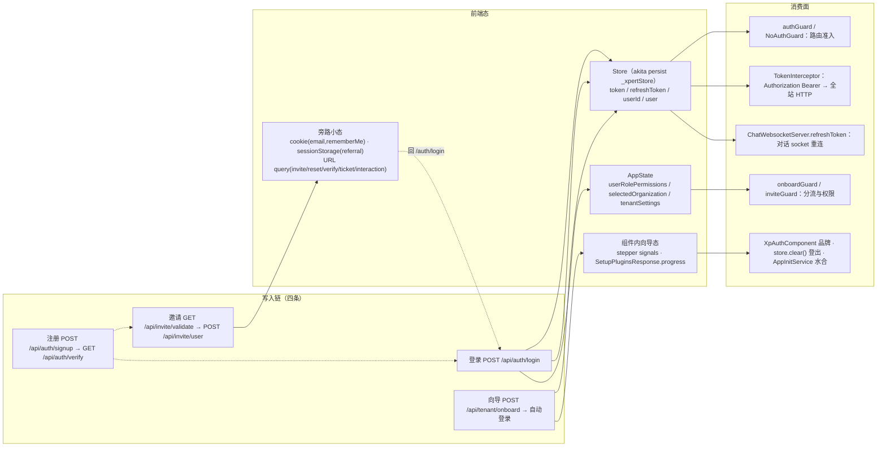

# C4 数据流向与消费：认证与引导专家

> 模块根：`apps/cloud/src/app/auth`（43 非 spec / 9 spec）＋ `apps/cloud/src/app/onboarding`（7 非 spec / 2 spec）（commit `80f5676fd` 实测）
> 口径：前端**无 DB / ORM**；持久化只有两处——Akita `persistState({ key: '_xpertStore' })`（含 token）与旁路小态（cookie / sessionStorage / URL query）；认证域对外只产出一件持久物：`Store` 的令牌与用户上下文
> ki 冲突已裁决：`/api/auth/custom/*` 只存在于 `password-strategy.spec.ts` 的自定义 `baseEndpoint` 用例，真实端点在 `C_API_AUTH = '/api/auth'` 下

**本文引用的文件**
- [auth-strategy.service.ts](file://apps/cloud/src/app/@core/auth/auth-strategy.service.ts)
- [token.interceptor.ts](file://apps/cloud/src/app/@core/interceptors/token.interceptor.ts)
- [store.service.ts（@core/state）](file://apps/cloud/src/app/@core/state/store.service.ts)
- [store.service.ts（@core/services 再导出）](file://apps/cloud/src/app/@core/services/store.service.ts)
- [auth.service.ts（auth）](file://apps/cloud/src/app/auth/services/auth.service.ts)
- [auth.strategy.ts / auth-strategy.ts](file://apps/cloud/src/app/auth/strategies/auth-strategy.ts)
- [token.ts](file://apps/cloud/src/app/auth/services/token/token.ts)
- [token.service.ts](file://apps/cloud/src/app/auth/services/token/token.service.ts)
- [token-storage.ts](file://apps/cloud/src/app/auth/services/token/token-storage.ts)
- [token-parceler.ts](file://apps/cloud/src/app/auth/services/token/token-parceler.ts)
- [auth.options.ts](file://apps/cloud/src/app/auth/auth.options.ts)
- [auth.module.ts（auth）](file://apps/cloud/src/app/auth/auth.module.ts)
- [auth.module.ts（@core）](file://apps/cloud/src/app/@core/auth/auth.module.ts)
- [login.component.ts](file://apps/cloud/src/app/auth/login/login.component.ts)
- [register.component.ts](file://apps/cloud/src/app/auth/register/register.component.ts)
- [reset-password.component.ts](file://apps/cloud/src/app/auth/reset-password/reset-password.component.ts)
- [accept-invite.component.ts](file://apps/cloud/src/app/auth/accept-invite/accept-invite.component.ts)
- [verify-email.component.ts](file://apps/cloud/src/app/auth/verify-email/verify-email.component.ts)
- [consent.component.ts](file://apps/cloud/src/app/auth/consent/consent.component.ts)
- [sso-bind.component.ts](file://apps/cloud/src/app/auth/sso-bind/sso-bind.component.ts)
- [sign-in-success.component.ts](file://apps/cloud/src/app/@core/auth/signin-success/sign-in-success.component.ts)
- [referral-registration-session.ts](file://apps/cloud/src/app/auth/referral-registration-session.ts)
- [invoice / invite.service.ts](file://apps/cloud/src/app/@core/state/invite.service.ts)
- [auth.guard.ts](file://apps/cloud/src/app/@core/auth/auth.guard.ts)
- [no-auth.guard.ts（auth 包）](file://apps/cloud/src/app/auth/guards/no-auth.guard.ts)
- [onboard.guard.ts](file://apps/cloud/src/app/@core/guards/onboard.guard.ts)
- [auth-routing.module.ts](file://apps/cloud/src/app/auth/auth-routing.module.ts)
- [onboarding-routing.module.ts](file://apps/cloud/src/app/onboarding/onboarding-routing.module.ts)
- [tenant-details.component.ts](file://apps/cloud/src/app/onboarding/tenant-details/tenant-details.component.ts)
- [setup-plugins.component.ts](file://apps/cloud/src/app/onboarding/plugins/setup-plugins.component.ts)
- [setup-plugins.service.ts](file://apps/cloud/src/app/@core/services/setup-plugins.service.ts)
- [user.model.ts](file://packages/contracts/src/user.model.ts)
- [invite.model.ts](file://packages/contracts/src/invite.model.ts)
- [令牌与准入上下文.md](file://CodeWikiHub/xpert/memory/数据流/认证与引导/令牌与准入上下文.md)

## 目录
1. [数据总览（Mermaid）](#数据总览mermaid)
2. [实体 A：令牌模型](#实体-a令牌模型)
3. [实体 B：用户 / 租户上下文](#实体-b用户--租户上下文)
4. [实体 C：策略配置（`XpAuthOptions` 策略表与表单配置）](#实体-c策略配置xpauthoptions-策略表与表单配置)
5. [实体 D：邀请与验证码](#实体-d邀请与验证码)
6. [实体 E：向导步骤态](#实体-e向导步骤态)
7. [前端态 vs 服务端态：对照表](#前端态-vs-服务端态对照表)

## 数据总览（Mermaid）

图表来源：[auth-strategy.service.ts](file://apps/cloud/src/app/@core/auth/auth-strategy.service.ts)（关键符号：`AuthStrategy.login`、`AuthStrategy._logout`）、[token.interceptor.ts](file://apps/cloud/src/app/@core/interceptors/token.interceptor.ts)（关键符号：`TokenInterceptor.addAuthenticationToken`、`ANONYMOUS_AUTH_PATHS`）、[store.service.ts（@core/state）](file://apps/cloud/src/app/@core/state/store.service.ts)（关键符号：`Store.token`、`Store.clear`）、[tenant-details.component.ts](file://apps/cloud/src/app/onboarding/tenant-details/tenant-details.component.ts)（关键符号：`TenantDetailsComponent.afterOnboard`）
章节来源：[令牌与准入上下文.md](file://CodeWikiHub/xpert/memory/数据流/认证与引导/令牌与准入上下文.md)（关键符号：`来源`、`去向`、`关键约束`）

## 实体 A：令牌模型
- **实体类型**：前端抽象（auth 包容量）+ 浏览器持久化（现场真源）**双轨并存**。
- **结构**：`XpAuthToken`（`getValue/isValid/getOwnerStrategyName/getCreatedAt`）、`NbAuthSimpleToken`（`isValid = !!getValue()`）、`NbAuthJWTToken`（`iat` 推 `createdAt`，`exp` 参与 `isValid`）、`NbAuthOAuth2*`（本域未用）、`NbTokenPack {name,ownerStrategyName,createdAt,value}`、`XpTokenLocalStorage`（key `auth_app_token`）、`XpAuthTokenService.token$`（`BehaviorSubject` + `filter(!!value)` + `share()`）；现场真源是 `Store.token` / `Store.refreshToken`（Akita persist `_xpertStore`）。
- **生产方**：`AuthStrategy.login`（`store.userId/token/refreshToken/user` + `restoreRememberedScope`）、`AuthStrategy.refreshToken`（`store.token/refreshToken` 轮换）、`SignInSuccessComponent`（`?jwt&refreshToken&userId` 三写）；`auth_app_token` 侧因 `XpAuthResult` 不带 token 对象而**无写入方**。
- **主要消费方**：`TokenInterceptor.addAuthenticationToken`（普通请求 `store.token`、`auth/refresh` 用 `store.refreshToken`）、`authGuard`（`!!store.token`）、`NoAuthGuard` 第一段、`ChatWebsocketServer.refreshToken`（socket 重连同源）。
- **业务用途**：全站请求凭据 + 「是否已登录」的第一判据；401 时以单飞刷新续期并重放原请求。
- **详细流向（见本文件总览图，链级时序见 03-数据流转 链①/⑥）**：`POST /api/auth/login` → `IAuthResponse{user,token,refreshToken}` → 三写 `Store` → 每请求拼 `Authorization: Bearer` → 401 → `refreshTokenInProgress` + `refreshTokenSubject` 排队重放（策略侧 `refreshTokenReq` + `shareReplay(1)` 合流）→ 刷新自身 401 → `logout()` 清库。
章节来源：[token.ts](file://apps/cloud/src/app/auth/services/token/token.ts)（关键符号：`XpAuthToken`、`NbAuthSimpleToken`、`NbAuthJWTToken`）、[token-storage.ts](file://apps/cloud/src/app/auth/services/token/token-storage.ts)（关键符号：`XpTokenLocalStorage`）、[token.interceptor.ts](file://apps/cloud/src/app/@core/interceptors/token.interceptor.ts)（关键符号：`ANONYMOUS_AUTH_PATHS`、`addAuthenticationToken`）

## 实体 B：用户 / 租户上下文
- **实体类型**：Akita 状态（`PersistState` 持久 + `AppState` 内存），由服务端 DTO 投影而来。
- **结构**：`PersistState`——`token`、`refreshToken`、`userId`、`organizationId`、`activeScopeLevel`、`lastOrganizationId`、`rememberedScopes`、`workspaceId`、`preferredLanguage/preferredTheme`、`preferences`；`AppState`——`user`、`userRolePermissions`（写入即触发 `loadPermissions/loadRoles`）、`selectedOrganization`、`selectedEmployee`、`selectedWorkspace`、`featureToggles/featureOrganizations/featureTenant`、`tenantSettings`。
- **生产方**：`AuthStrategy.login`（`store.user`）、`SignInSuccessComponent`（`userId`）、`TenantDetailsComponent.afterOnboard`（`setOrganizationScope`）、`Store.restoreRememberedScope`（登录回放）；权限/特性水合由 `CurrentUserHydrationService` 等域外服务完成（[推测] 触发链未在本域文件内定位）。
- **主要消费方**：`authGuard`、`inviteGuard`（`userRolePermissions$` + `selectedOrganization$.invitesAllowed`）；`XpAuthComponent.tenantSettings`（登录页品牌/标题）；全站业务域读 `selectedOrganization` / `hasPermission`。
- **业务用途**：把「谁、在哪个组织/工作区、有哪些权限」供全站读取；登出时 `store.clear()` 一次性清空并把 `activeScopeLevel` 降回 `TENANT`。
- **详细流向（见本文件总览图，链级时序见 03-数据流转 链①/⑦）**：`IAuthResponse.user` → `store.user` + `userId` → `userRolePermissions` → ngx-permissions；登录/向导两个入口写组织作用域，`restoreRememberedScope(userId)` 在下次登录时回放记忆作用域。
章节来源：[store.service.ts（@core/state）](file://apps/cloud/src/app/@core/state/store.service.ts)（关键符号：`PersistState`、`AppState`、`Store.clear`、`Store.setOrganizationScope`、`Store.restoreRememberedScope`）、[user.model.ts](file://packages/contracts/src/user.model.ts)（关键符号：`IAuthResponse`、`IUser`）

## 实体 C：策略配置（`XpAuthOptions` 策略表与表单配置）
- **实体类型**：构建期/启动期的 DI 配置对象（内存态，无服务端对应物）。
- **结构**：`XpAuthStrategies = [XpAuthStrategyClass, XpAuthStrategyOptions][]`；`defaultAuthOptions.forms.{login,register,requestPassword,resetPassword,logout,validation}`（`redirectDelay: 500`、`strategy: 'email'`、`showMessages.*`、`register.enablePublicSignup`、`validation.password.{required,minLength: 4,maxLength: 50}`）；注入令牌 `XP_AUTH_OPTIONS` / `XP_AUTH_USER_OPTIONS` / `XP_AUTH_STRATEGIES` / `XP_AUTH_TOKENS` / `XP_AUTH_INTERCEPTOR_HEADER` / `XP_AUTH_TOKEN_INTERCEPTOR_FILTER` / `XP_API_BASE_URL`。
- **生产方**：`@core/auth/auth.module.ts` 的 `XpAuthModule.forRoot({strategies:[AuthStrategy.setup({name:'email'})], forms:{login:{socialLinks}, register:{socialLinks, enablePublicSignup}}})` —— **全仓唯一写入方**；`enablePublicSignup = environment.deploymentTarget !== 'customer-onprem'` 在此计算。
- **主要消费方**：`XpAuthService.getStrategy`（表内定址）、各表单页 `getConfigValue('forms.*.strategy|redirectDelay|showMessages|enablePublicSignup')`、`XpLogoutComponent`（`forms.logout.*`）、`OidcConsentComponent`（`XP_API_BASE_URL`）。
- **业务用途**：以配置声明「用哪个策略 / 延迟多久跳 / 是否允许自助注册 / 校验口径」，页面不硬编码；新增登录方式的落点就是这张表加一行。
- **详细流向（见本文件 §实体 A 与 §对照表；链级时序见 03-数据流转 链①）**：`forRoot` → `nbOptionsFactory` 深合并 → `nbStrategiesFactory`（`injector.get(strategyClass)` + `setOptions`）→ `XP_AUTH_STRATEGIES` → 页面取 `strategyName` 调 `XpAuthService.<action>(strategyName, data)`。已知风险：`XP_AUTH_TOKENS` 工厂返回 `{}`，[推测] 若 `auth_app_token` 存在历史合法包会触发 `{}.find` 抛错（当前无写入方而未触发）。
章节来源：[auth.options.ts](file://apps/cloud/src/app/auth/auth.options.ts)（关键符号：`defaultAuthOptions`、`XpAuthOptions`、`XP_AUTH_STRATEGIES`、`XP_API_BASE_URL`）、[auth.module.ts（auth）](file://apps/cloud/src/app/auth/auth.module.ts)（关键符号：`nbStrategiesFactory`、`nbOptionsFactory`）、[auth.module.ts（@core）](file://apps/cloud/src/app/@core/auth/auth.module.ts)（关键符号：`AuthStrategy.setup`、`enablePublicSignup`）

## 实体 D：邀请与验证码
- **实体类型**：服务端持有的一次性凭据（邀请记录 / 重置记录 / 邮箱验证令牌 / SSO ticket / OIDC interaction），前端只以 URL query、cookie 与 sessionStorage **透传与二值化呈现**。
- **结构**：`IInvite`（`token`、`email`、`roleId/role`、`status`、`expireDate`、`actionDate`）、`IInviteAcceptInput`、`IPublicInviteFindInput{email,token}`（与 `NoAuthGuard.canAccessInviteRoute` 的 query 契约一致）、`InviteStatusEnum.INVITED|ACCEPTED`、`IEmailVerification{token,userId,validUntil}`（默认 2 天）、reset token（URL `?token=`）、SSO bind `ticket`、OIDC `interaction`、返利码（sessionStorage key `xpert.registration.referral-code`）。
- **生产方**：全部由服务端签发；前端唯一的写入方是 `saveRegistrationReferralCode`（`?ref=` 入参即存，`trim().toUpperCase()`）。
- **主要消费方**：`AcceptInvitePageComponent`（校验 + 开户）、`VarifyEmailComponent`、`ResetPasswordComponent`/`AuthStrategy.resetPassword`（令牌取自 route query）、`SsoBindComponent` / `CurrentUserSsoConfirmComponent`、`OidcConsentComponent`、`UserRegisterComponent`（票据与返利码）。
- **业务用途**：让「无需登录即可完成的一次性动作」通过邮件链接/回调链接进入 SPA；前端不派生新字段，只呈现「有效 / 失效」。
- **详细流向（见本文件总览图 W3 分支；链级时序见 03-数据流转 链④/⑤）**：邮件链接 → `/auth/accept-invite?email&token` → 校验 → `POST /api/invite/user` → 回登录；返利码经 `?ref=` → sessionStorage → 注册/S从绑定载荷 → 后端结算 → 注册或绑定成功后 `clear`。
章节来源：[invite.model.ts](file://packages/contracts/src/invite.model.ts)（关键符号：`IInvite`、`IInviteAcceptInput`、`IPublicInviteFindInput`）、[invite.service.ts](file://apps/cloud/src/app/@core/state/invite.service.ts)（关键符号：`InviteService.validateInvite`、`acceptUserInvite`）、[referral-registration-session.ts](file://apps/cloud/src/app/auth/referral-registration-session.ts)（关键符号：`saveRegistrationReferralCode`、`clearRegistrationReferralCode`）

## 实体 E：向导步骤态
- **实体类型**：**纯前端易失态** + 服务端可观察量（路由表是步骤的唯一事实源，没有服务端步骤字段）。
- **结构**：路由（`''` / `tenant` / `plugins` / `unknown`）＋ 组件 signal（`tenantCompleted`、`aiModelSetupRequested`、`primaryCopilotCreatedInOnboarding`、`navigating`、`loading`）＋ `SetupPluginsResponse.progress`（`phase: idle|installing|completed|attention`，`items[].status`）＋ 派生态（`processed`、`progressPercent`、`failed`）。
- **生产方**：`TenantService.onboard`（`POST /api/tenant/onboard`）、`SetupPluginsService.status/start`（`GET`/`POST /api/system/setup/plugins`）、`ZardStepperComponent` 的步进事件。
- **主要消费方**：`tenant-details` 模板（`z-stepper [linear]`、`z-step [stepControl]`）、`onboardGuard` / `authGuard`（页间分流）、`store.setOrganizationScope`（把组织作用域交给后续会话）。
- **业务用途**：把首启过程切成不可跳的三步；安装进度靠后端持久化 job 可续跑，页面刷新安全。
- **详细流向（见本文件总览图 W4 分支；链级时序见 03-数据流转 链⑦）**：`onboard()` → `tenantCompleted` → `afterOnboard` 自动登录（token 落地 = 能进 `plugins` 的前提）→ `stepper.next()` → `onStepChange(2)` → `navigateHome()` → plugins 2s 轮询 → `completed` → `location.assign('/')`。
章节来源：[tenant-details.component.ts](file://apps/cloud/src/app/onboarding/tenant-details/tenant-details.component.ts)（关键符号：`TenantDetailsComponent.onboard`、`onStepChange`、`skipAiModelSetup`）、[setup-plugins.component.ts](file://apps/cloud/src/app/onboarding/plugins/setup-plugins.component.ts)（关键符号：`SetupPluginsComponent.load`、`monitor`、`progressPercent`）、[setup-plugins.service.ts](file://apps/cloud/src/app/@core/services/setup-plugins.service.ts)（关键符号：`SetupPluginsService.status`、`start`）、[onboarding-routing.module.ts](file://apps/cloud/src/app/onboarding/onboarding-routing.module.ts)（关键符号：`routes`）

## 前端态 vs 服务端态：对照表
| 数据 | 前端态（位置 / 载体） | 服务端态（真源） | 生命周期与约束 |
| --- | --- | --- | --- |
| 访问令牌 `token` | Akita persist `_xpertStore`（localStorage），启动回填遗留键 `token` | JWT 签发（无服务端会话表） | 只在 401 时刷新；改动 = 全站回归 |
| 刷新令牌 `refreshToken` | 同上 persist | 落库且**刷新即轮换** | 仅 `GET /api/auth/refresh` 使用（`Bearer <refreshToken>`） |
| 令牌包裹体 `auth_app_token` | `XpTokenLocalStorage`（JSON `{name,ownerStrategyName,createdAt,value}`） | ❌ 无对应 | 只在 `XpAuthResult` 带 token 时写；现役链路无写入方 |
| 用户 / 组织上下文 | `PersistState.userId` + `AppState.user` + `selectedOrganization` | 用户、组织成员关系、角色权限实体 | `store.clear()` 一次性清空；`activeScopeLevel` 降回 `TENANT` |
| 作用域记忆 | `organizationId / activeScopeLevel / rememberedScopes` | ❌（服务端只按 `organizationId` 解释） | `restoreRememberedScope(userId)` 登录时回放 |
| 记住我 | cookie `email` / `rememberMe`（`ngx-cookie-service`） | ❌ | 未勾选即删除；失败结果也会执行写/删（策略 `tap`） |
| 返利码 | sessionStorage `xpert.registration.referral-code` | 注册 / 校验接口内结算 | 注册、绑定时透传，成功后 `clear`；新标签即失效 |
| 邀请 / 重置 / 验证令 | 仅 URL query（`email`、`token`） | 邀请记录、重置记录、邮箱验证令牌（默认 2 天） | 一次性；邀请 `expireDate` 过期即校验失败 |
| 邀请状态 `INVITED/ACCEPTED` | 只呈现「有效 / 失效」二态 | `IInvite.status` 服务端持有 | 前端不写；失效后表单不再渲染 |
| SSO ticket / OIDC interaction | URL query `ticket` / `interaction`（OIDC 另靠 `withCredentials` cookie） | 服务端 bind 会话（`expiresAt`）与 identity interaction | 400 即过期需重走；consent 提交后离开 SPA |
| 策略配置（策略表 / `forms.*`） | DI 配置对象（启动期内存） | ❌ 无服务端投影 | 改配置即改全站表单行为；表是新增登录方式的唯一扩展点 |
| 向导步骤态 | 组件 signal（无持久化） | 仅「租户是否已建」可由 `GET /api/tenant/onboard` 反推 | 刷新即回守卫判定；`plugins` 步需已登录 |
| 插件安装进度 | signal（来自响应 `progress`） | 后端持久化 job + db 锁 | 刷新/重进会按 `items` 续跑 `start()` |

结论：本域的「真源」分裂为三处——**令牌与用户上下文的真源是 `Store`（前端）**，**邀请/验证/票据的真源是服务端**，**策略行为真源是 DI 配置**；`auth_app_token` 这一支容量在生产链路上没有写入方，唯一权威登录态请以 `Store.token` 为准。
章节来源：[store.service.ts（@core/state）](file://apps/cloud/src/app/@core/state/store.service.ts)（关键符号：`createInitialPersistState`、`PersistState`）、[token-storage.ts](file://apps/cloud/src/app/auth/services/token/token-storage.ts)（关键符号：`XpTokenLocalStorage.key`）、[token-parceler.ts](file://apps/cloud/src/app/auth/services/token/token-parceler.ts)（关键符号：`XpAuthTokenParceler.wrap`）、[令牌与准入上下文.md](file://CodeWikiHub/xpert/memory/数据流/认证与引导/令牌与准入上下文.md)（关键符号：`关键约束：公共页免登录是显式白名单`）
