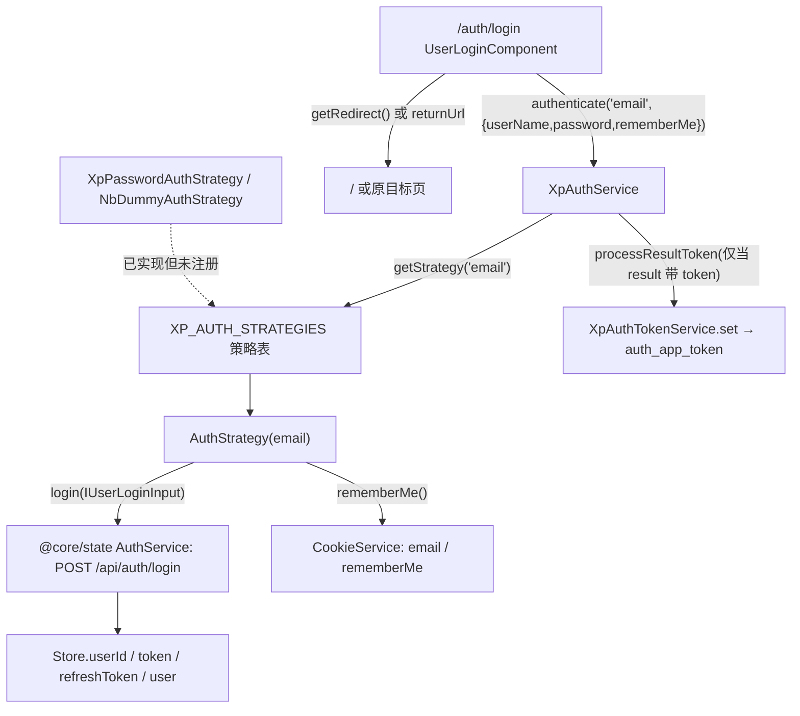
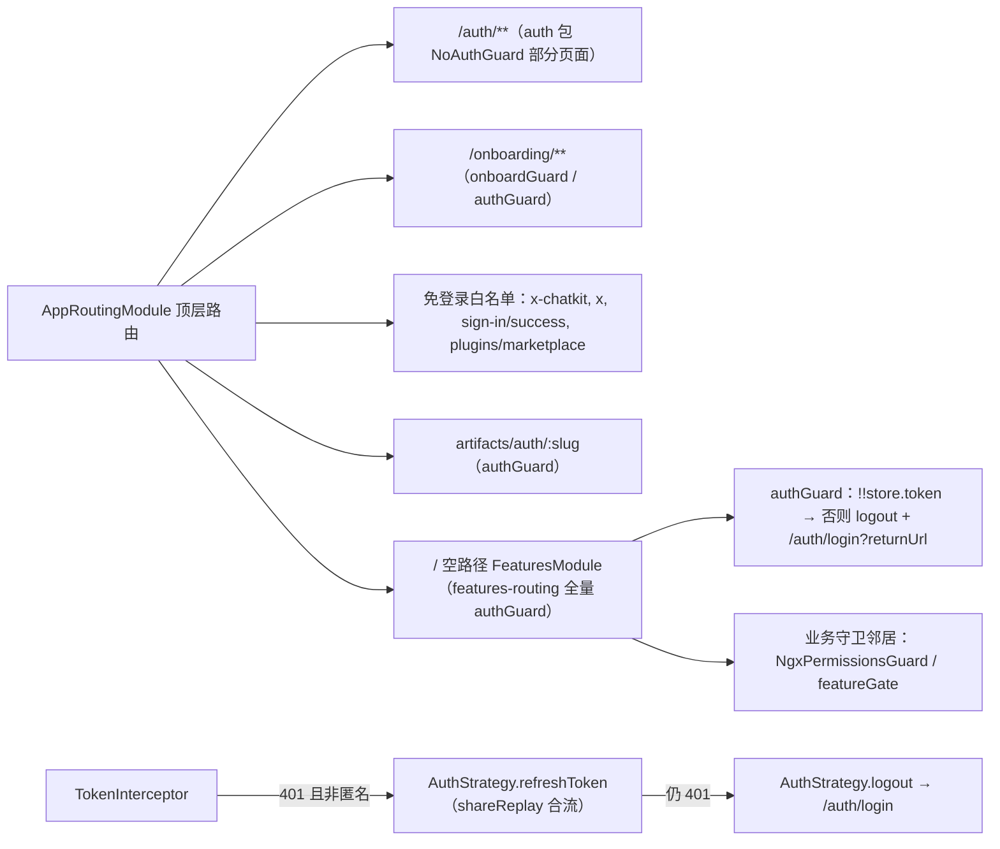
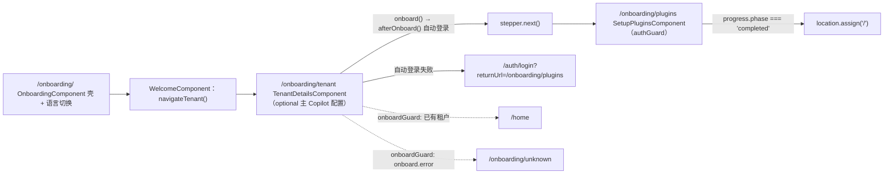

# 01 架构：认证与引导专家（Xpert 前端 · 全站准入边界）

> 模块根：`apps/cloud/src/app/auth`（实测 **52 个 `.ts` = 43 非 spec / 9 spec**；ki 归档「51 非 spec / 11 spec」与实际不符，差额为改造期文件合并/删除，下文一律用实测值）＋ `apps/cloud/src/app/onboarding`（7 非 spec `.ts` / 2 spec）
> 入口路由：`/auth/**`（1 个根壳 + **11 个子路由**，合计 12 个页面节点，与 ki「12 页」口径一致）｜`/onboarding/**`（welcome → tenant → plugins 三步向导）
> 技术底座：Angular 17 模块化路由（`@cloud/app/auth` 为 NgModule，部分页面 standalone）＋ Nebular/Akveo auth 改造遗产（`Xp*` / `Nb*` 双前缀并存）＋ `@cloud/app/@core/state`（akita 持久化 `Store`）
> 覆盖范围：`auth/**`、`onboarding/**`，以及 `@core/auth`、`@core/guards`、`@core/interceptors/token.interceptor.ts` 构成的准入面；后端 `/api/auth*` 实现归「身份与权限专家 / 认证与凭据子专家」

**本文引用的文件**

- [auth.module.ts](file://apps/cloud/src/app/auth/auth.module.ts)
- [auth.options.ts](file://apps/cloud/src/app/auth/auth.options.ts)
- [auth-routing.module.ts](file://apps/cloud/src/app/auth/auth-routing.module.ts)
- [auth.component.ts](file://apps/cloud/src/app/auth/auth.component.ts)
- [auth.service.ts](file://apps/cloud/src/app/auth/services/auth.service.ts)
- [auth-result.ts](file://apps/cloud/src/app/auth/services/auth-result.ts)
- [auth-strategy.ts](file://apps/cloud/src/app/auth/strategies/auth-strategy.ts)
- [auth-strategy-options.ts](file://apps/cloud/src/app/auth/strategies/auth-strategy-options.ts)
- [token.ts](file://apps/cloud/src/app/auth/services/token/token.ts)
- [token.service.ts](file://apps/cloud/src/app/auth/services/token/token.service.ts)
- [token-storage.ts](file://apps/cloud/src/app/auth/services/token/token-storage.ts)
- [token-parceler.ts](file://apps/cloud/src/app/auth/services/token/token-parceler.ts)
- [helpers.ts](file://apps/cloud/src/app/auth/helpers.ts)
- [password-strategy.ts](file://apps/cloud/src/app/auth/strategies/password/password-strategy.ts)
- [dummy-strategy.ts](file://apps/cloud/src/app/auth/strategies/dummy/dummy-strategy.ts)
- [no-auth.guard.ts（auth 包）](file://apps/cloud/src/app/auth/guards/no-auth.guard.ts)
- [login.component.ts](file://apps/cloud/src/app/auth/login/login.component.ts)
- [register.component.ts](file://apps/cloud/src/app/auth/register/register.component.ts)
- [forgot-password.component.ts](file://apps/cloud/src/app/auth/forgot-password/forgot-password.component.ts)
- [reset-password.component.ts](file://apps/cloud/src/app/auth/reset-password/reset-password.component.ts)
- [accept-invite.component.ts](file://apps/cloud/src/app/auth/accept-invite/accept-invite.component.ts)
- [accept-invite-form.component.ts](file://apps/cloud/src/app/auth/accept-invite/accept-invite-form/accept-invite-form.component.ts)
- [verify-email.component.ts](file://apps/cloud/src/app/auth/verify-email/verify-email.component.ts)
- [logout.component.ts](file://apps/cloud/src/app/auth/logout/logout.component.ts)
- [sso-bind.component.ts](file://apps/cloud/src/app/auth/sso-bind/sso-bind.component.ts)
- [current-user-sso-confirm.component.ts](file://apps/cloud/src/app/auth/current-user-sso-confirm/current-user-sso-confirm.component.ts)
- [consent.component.ts](file://apps/cloud/src/app/auth/consent/consent.component.ts)
- [referral-registration-session.ts](file://apps/cloud/src/app/auth/referral-registration-session.ts)
- [auth-strategy.service.ts](file://apps/cloud/src/app/@core/auth/auth-strategy.service.ts)
- [auth.guard.ts](file://apps/cloud/src/app/@core/auth/auth.guard.ts)
- [no-auth.guard.ts（@core）](file://apps/cloud/src/app/@core/auth/no-auth.guard.ts)
- [auth.module.ts（@core）](file://apps/cloud/src/app/@core/auth/auth.module.ts)
- [token.interceptor.ts](file://apps/cloud/src/app/@core/interceptors/token.interceptor.ts)
- [invite.guard.ts](file://apps/cloud/src/app/@core/guards/invite.guard.ts)
- [onboard.guard.ts](file://apps/cloud/src/app/@core/guards/onboard.guard.ts)
- [dirty-check.guard.ts](file://apps/cloud/src/app/@core/guards/dirty-check.guard.ts)
- [store.service.ts](file://apps/cloud/src/app/@core/services/store.service.ts)
- [auth.service.ts（@core/state）](file://apps/cloud/src/app/@core/state/auth.service.ts)
- [app.constants.ts](file://apps/cloud/src/app/@core/state/constants/app.constants.ts)
- [onboarding-routing.module.ts](file://apps/cloud/src/app/onboarding/onboarding-routing.module.ts)
- [tenant-details.component.ts](file://apps/cloud/src/app/onboarding/tenant-details/tenant-details.component.ts)
- [tenant-details.component.html](file://apps/cloud/src/app/onboarding/tenant-details/tenant-details.component.html)
- [setup-plugins.component.ts](file://apps/cloud/src/app/onboarding/plugins/setup-plugins.component.ts)
- [setup-plugins.service.ts](file://apps/cloud/src/app/@core/services/setup-plugins.service.ts)
- [app-routing.module.ts](file://apps/cloud/src/app/app-routing.module.ts)
- [features-routing.module.ts](file://apps/cloud/src/app/features/features-routing.module.ts)
- [app.module.ts](file://apps/cloud/src/app/app.module.ts)

## 目录

- [职责与边界](#职责与边界)
- [目录结构与分层](#目录结构与分层)
- [依赖关系](#依赖关系)
- [关键不变量](#关键不变量)
- [架构总览图](#架构总览图)
- [组件详细分析](#组件详细分析)
- [结论](#结论)

## 职责与边界

**做什么（四块职责）**

1. **认证动作入口**：`/auth/**` 12 个页面节点（login、consent、register、register-result、request-password、reset-password、accept-invite、verify、logout、sso-bind、sso-confirm + 根壳 `XpAuthComponent`）全部经 `XpAuthService` 的 11 个方法表达意图，页面不直接发认证 HTTP。
2. **策略内核**：`XpAuthStrategy` 抽象基类 + `XpAuthOptions.strategies` 策略表（`nbStrategiesFactory` 实例化）；当前生产表**仅一项** `AuthStrategy.setup({ name: 'email' })`。
3. **令牌落地与广播**：auth 包的 token 层（`XpAuthToken` / `XpAuthTokenService` / `XpTokenLocalStorage` / `XpAuthTokenParcel`）提供标准容量，现场实际台账落在 `Store.token` / `Store.refreshToken`，由 `TokenInterceptor` 注入全站请求。
4. **全站准入边界**：`authGuard` / `NoAuthGuard` / `onboardGuard` / `inviteGuard` / `dirtyCheckGuard` 与本域页面构成「谁能进哪个页面」的权威声明处之一，另有 `/onboarding/**` 三步向导。

**不做什么（逐条给出「谁家」）**

| 不在范围内 | 谁家（交叉引用） |
| --- | --- |
| `/api/auth*` 服务端实现、JWT 策略、SSO 绑定票据校验 | 身份与权限专家 · 认证与凭据子专家：[auth.controller.ts](file://packages/server/src/auth/auth.controller.ts) |
| 用户/组织/角色/权限数据模型与 CRUD | 租户与平台设置专家、组织与成员子专家（`@core/services/tenant.service.ts`、`Store.hasPermission`） |
| 业务页权限与特性开关（`NgxPermissionsGuard`、`featureGate`） | 各业务域与 `features/features-routing.module.ts`（本域只提供 `authGuard` 这一层的"已登录"判据） |
| 登录后的用户上下文联调（bootstrap、组织状态） | `@core/services/app-init-service.ts`、`@core/state/current-user-hydration.service.ts` |
| WebSocket 鉴权与重连 | 对话域（复用 `AuthStrategy.refreshToken`）：[chat.service.socket.ts](file://apps/cloud/src/app/@core/services/chat.service.socket.ts) |
| 插件安装引擎 | 平台插件与技能专家（本域只用 `SetupPluginsService` 轮询进度）：[setup-plugins.service.ts](file://apps/cloud/src/app/@core/services/setup-plugins.service.ts) |

章节来源：[auth-routing.module.ts](file://apps/cloud/src/app/auth/auth-routing.module.ts)（关键符号：`routes`、`XpAuthRoutingModule`）、[auth.service.ts](file://apps/cloud/src/app/auth/services/auth.service.ts)（关键符号：`XpAuthService`）、[auth.module.ts（@core）](file://apps/cloud/src/app/@core/auth/auth.module.ts)（关键符号：`AuthModule`、`AuthStrategy.setup`）

## 目录结构与分层

| 目录 / 文件 | 层 | 职责 |
| --- | --- | --- |
| `auth/auth.module.ts`、`auth/auth.options.ts`、`auth/index.ts` | **装配与契约层** | `XpAuthModule.forRoot()`、`nbStrategiesFactory` / `nbOptionsFactory`、`XP_AUTH_*` 6 个 InjectionToken、`defaultAuthOptions`（表单级 strategy/redirectDelay/showMessages/enablePublicSignup） |
| `auth/auth-routing.module.ts`、`auth/auth.component.ts` | **路由壳层** | 12 个页面节点声明、`XpAuthComponent` 品牌/语言/租户设置壳；仅 `request-password` / `reset-password` / `accept-invite` / `verify` 挂 `NoAuthGuard` |
| `auth/{login,register,register-result,forgot-password,reset-password,verify-email,logout}/` | **表单页层** | 8 个 NgModule 声明式页面，注入 `XP_AUTH_OPTIONS` 取表单配置，经 `XpAuthService` 提交 |
| `auth/{accept-invite,sso-bind,current-user-sso-confirm,consent}/` | **独立流程页层** | 4 个 standalone 页面，绕过策略表直连后端（邀请校验 / SSO 绑定票据 / OIDC consent） |
| `auth/services/`（`auth.service.ts`、`auth-result.ts`、`token/`、`validators.ts`、`password-strength.ts`） | **服务与令牌层** | 认证门面、结果对象、4 个 token 实现（simple/JWT/OAuth2/OAuth2JWT）、parceler、storage、密码强度与匹配校验器 |
| `auth/strategies/`（`auth-strategy.ts`、`auth-strategy-options.ts`、`password/`、`dummy/`） | **策略层** | 抽象基类 + 选项基类；`XpPasswordAuthStrategy`（通用 HTTP 策略模板，未注册）、`NbDummyAuthStrategy`（本地假策略） |
| `auth/guards/no-auth.guard.ts` | **守卫层（auth 包）** | `NoAuthGuard.canActivate`：已登录访问认证页则踢回 `/home`，并为 `accept-invite` 开显式例外 |
| `auth/components/`、`auth/i18n/`、`auth/referral-registration-session.ts`、`auth/helpers.ts` | **遗留/公共层** | `XpMenuGroupComponent`（`@deprecated`）、三份中文 i18n、返利码 sessionStorage 三函数、`deepExtend` / `getDeepFromObject` / `urlBase64Decode` |
| `@core/auth/`（`auth-strategy.service.ts`、`auth.guard.ts`、`no-auth.guard.ts`、`auth.module.ts`、`signin-success/`、`http-context.ts`） | **宿主适配层（入向）** | 生产 email 策略 `AuthStrategy`、函数式 `authGuard`、`SKIP_AUTH_REFRESH`、第三方登录回跳落地页 |
| `@core/guards/`、`@core/interceptors/token.interceptor.ts` | **准入与令牌注入层** | `inviteGuard` / `onboardGuard` / `dirtyCheckGuard`；`TokenInterceptor` 负责 Authorization 头与 401 刷新链 |
| `onboarding/`（`onboarding-routing.module.ts`、`welcome/`、`tenant-details/`、`plugins/`、`unknown/`） | **引导向导层** | 三步向导 + 异常页 `OnboardingUnknownComponent`；`welcome` / `tenant` 挂 `onboardGuard`，`plugins` 挂 `authGuard` |

**分层与依赖方向（单向）**：页面层 → `XpAuthService`（唯一门面）→ `XpAuthStrategy` 子类（表驱动）→ `@core` 服务（`AuthService` / `Store` / `TenantService`）；守卫层只依赖 `Store` + 策略/`AuthService`，**不反向依赖页面组件**。

章节来源：[auth.module.ts](file://apps/cloud/src/app/auth/auth.module.ts)（关键符号：`XpAuthModule.forRoot`、`nbStrategiesFactory`）、[auth.options.ts](file://apps/cloud/src/app/auth/auth.options.ts)（关键符号：`defaultAuthOptions`、`XP_AUTH_OPTIONS`、`XP_AUTH_STRATEGIES`）、[auth-routing.module.ts](file://apps/cloud/src/app/auth/auth-routing.module.ts)（关键符号：`routes`、`NoAuthGuard`）

## 依赖关系

**出向依赖（本域 → 外部）**

| 依赖面 | 具体符号（file://） | 用途 |
| --- | --- | --- |
| `@core/auth` | [auth-strategy.service.ts](file://apps/cloud/src/app/@core/auth/auth-strategy.service.ts)（`AuthStrategy.login/register/logout/refreshToken/requestPassword/resetPassword`）、[auth.guard.ts](file://apps/cloud/src/app/@core/auth/auth.guard.ts)（`authGuard`）、[auth.module.ts（@core）](file://apps/cloud/src/app/@core/auth/auth.module.ts)（`AuthModule` 装配策略表） | 唯一被注册的 email 策略与全站守卫 |
| `@core/state` | [store.service.ts](file://apps/cloud/src/app/@core/services/store.service.ts)（`Store.token` / `refreshToken` / `userId` / `user` / `restoreRememberedScope` / `clear` / `hasPermission`）、[auth.service.ts（@core/state）](file://apps/cloud/src/app/@core/state/auth.service.ts)（`login` / `signup` / `refreshAccessToken` / `verifyEmail` / `requestPassword` / `resetPassword` / `isAuthenticated`） | 令牌台账与 `C_API_AUTH` HTTP 客户端 |
| 常量与拦截器 | [app.constants.ts](file://apps/cloud/src/app/@core/state/constants/app.constants.ts)（`API_PREFIX = '/api'`、`C_API_AUTH = API_PREFIX + '/auth'`）、[token.interceptor.ts](file://apps/cloud/src/app/@core/interceptors/token.interceptor.ts)（`ANONYMOUS_AUTH_PATHS`、`TokenInterceptor.addAuthenticationToken`） | 端点基址与"匿名请求"白名单 |
| `@core/services/*` | `TenantService.getOnboard/onboard`、`InviteService.validateInvite/acceptUserInvite`、`ReferralService.getAvailability/validateCode`、`SetupPluginsService.status/start/catalog`、`CopilotServerService`（向导内建主 Copilot） | 引导、邀请、返利、插件安装 |
| 第三方 | `@xpert-ai/headless-ui`（`ZardStepperComponent`、`ZardAlertDialogService`、`ZardToastService`、`ZardFormImports`）、`@xpert-ai/contracts`（`IUserLoginInput`、`IAuthResponse`、`IInvite`、`PermissionsEnum`）、`ngx-cookie-service`（rememberMe）、`ngx-permissions` | UI 与契约、记住我、权限 |

**入向依赖（谁依赖本域）**

1. **全站路由挂载（单向供给）**：[app-routing.module.ts](file://apps/cloud/src/app/app-routing.module.ts) 顶层声明 `onboarding` / `auth` 两棵懒加载子树 + `artifacts/auth/:artifactLinkSlug`（挂 `authGuard`）与免登录白名单 `sign-in/success`、`x-chatkit`、`x`、`plugins/marketplace`；[features-routing.module.ts](file://apps/cloud/src/app/features/features-routing.module.ts) 在 `chat` / `project` / `explore` / `xpert` / `agent-evolution` / `plugins` / `operations` / `copilot` / `settings` / `workspace-connection` / `xpert-access-requests` 上全量挂 `authGuard`。
2. **装配入向**：[app.module.ts](file://apps/cloud/src/app/app.module.ts) `imports: [AuthModule]`（即 `@core/auth` 的 `AuthModule`，它内部再 `XpAuthModule.forRoot({ strategies: [AuthStrategy.setup({ name: 'email' })] })`），并 `HTTP_INTERCEPTORS` 注册 `APIInterceptor / TokenInterceptor / LanguageInterceptor / TenantInterceptor`；`XP_API_BASE_URL` 由 `normalizeApiBaseUrl(environment.API_BASE_URL)` 提供（consent 页依赖）。
3. **同名不同物的第二支 `authGuard`**：`apps/cloud/src/app/xpert/routes.ts` 自带一个同名 `authGuard`（判据是 `XpertAPIService.getChatApp(name)` 是否返回），与 `@core/auth` 的 token 判据守卫互不相同，改动时需区分。
4. **未挂载的入向点（核实修正）**：`inviteGuard` 全仓库仅有定义、**无任何路由引用**；`@core/auth/no-auth.guard.ts` 的 `NoAuthGuard` 也只在 `@core/auth/auth.module.ts` providers 与 `@core/auth/index.ts` 导出中出现，路由表中实际使用的是 auth 包的同名 `NoAuthGuard`。

章节来源：[app-routing.module.ts](file://apps/cloud/src/app/app-routing.module.ts)（关键符号：`routes`、`path: 'onboarding'`、`path: 'auth'`）、[features-routing.module.ts](file://apps/cloud/src/app/features/features-routing.module.ts)（关键符号：`authGuard`、`xpertProjectRouteGate`）、[invite.guard.ts](file://apps/cloud/src/app/@core/guards/invite.guard.ts)（关键符号：`inviteGuard`）

## 关键不变量

1. **策略参数化：页面只传 strategyName，不碰 HTTP**。`XpAuthService.authenticate/register/logout/requestPassword/resetPassword/refreshToken` 全部形如 `(strategyName, data)` → `getStrategy(name)` → 子类实现 → `processResultToken` 落 token；新增登录方式 = 新增策略类 + 注册表一行，**不改页面**。
2. **`XpAuthOptions.strategies` 是唯一扩展点**：`nbStrategiesFactory` 用 `Injector.get(strategyClass)` 实例化后逐项 `strategy.setOptions(options)`（`deepExtend({}, defaultOptions, options)`）。未注册的名字在调用时**运行期**抛 `TypeError: There is no Auth Strategy registered under '...' name`（无编译期保护）。
3. **令牌强校验前置**：`XpAuthStrategy.createToken(value, failWhenInvalidToken)` 在 `requireValidToken` 为真且 token 无效时抛 `NbAuthIllegalTokenError`，由策略 `handleResponseError` 捕获转成失败 `XpAuthResult`；注释明写「坏 token 不得进入存储」（否则全站 401 循环）。
4. **令牌台账双轨（现役/存量）**：auth 包容量是 `XpAuthTokenService`（`BehaviorSubject` + `filter(!!value)` + `share()` 广播 `tokenChange()`，持久化键 `auth_app_token`）；**现场写入方只有 `AuthStrategy` 写入 `Store.token` / `Store.refreshToken`**，`processResultToken` 因 email 策略从不返回 token 对象而永不触发，故 `auth_app_token` 在生产路径上没有写入者。
5. **`Store.token` 是准入的第一判据**：`authGuard` 只用 `!!store.token`（同步、零成本）；`NoAuthGuard` 用 `store.token` + `XpAuthService.isAuthenticated()`；`@core/state` 的 `AuthService.isAuthenticated()` 才走 `GET /api/auth/authenticated`。三档判据必须同时可解释，否则出现"能进页面但接口 401"。
6. **守卫矩阵语义（判据 → 不通过时的落点）**

| 守卫 | 判据 | 不通过动作 |
| --- | --- | --- |
| `authGuard`（@core/auth，函数式） | `!!store.token` | 先 `await authStrategy.logout()`（清本地），再跳 `/auth/login?returnUrl=<原 URL>` |
| `NoAuthGuard`（auth 包，类） | 若 `routeConfig.path === 'accept-invite'` 且带 `email` + `token` 查询参数 → 直接放行；否则 `store.token` 为空放行，非空再问 `XpAuthService.isAuthenticated()` | 已登录 → `router.navigate(['/home'])`，返回 `false` |
| `NoAuthGuard`（@core/auth，**未挂载**） | `AuthService.isAuthenticated()`（HTTP） | 跳 `/pages/dashboard`（路由表中已无此路径） |
| `onboardGuard`（函数式，返回 Observable） | `TenantService.getOnboard()`：`onboard.tenant` 有值 / `onboard.error` / 都没有 | 有租户 → `/home/`；有错 → `/onboarding/unknown`；否则 `true` 放行 |
| `inviteGuard`（函数式，**未挂载**） | `route.data.expectedPermissions` 命中 `store.hasPermission` 且 `store.selectedOrganization$.invitesAllowed` | `router.navigate(['/'])` |
| `dirtyCheckGuard` / `DirtyCheckGuard`（`canDeactivate`） | 组件 `isDirty()`（signal 或 observable），脏则弹 `ZardAlertDialogService.confirm` | 用户取消 → 阻止离开 |

7. **onboarding 不可跳步**：`tenant-details` 模板用 `<z-stepper [linear]="true">`；`onboard()` 成功 → `afterOnboard()` 内 `authStrategy.login()` 自动登录 + `setOrganizationScope()` → `stepper.next()`；自动登录失败则跳 `/auth/login?returnUrl=/onboarding/plugins`。`/onboarding/plugins` 挂 `authGuard`，因此**只有 onboard 成功（拿到 token）后才可能进入插件步**。
8. **免登录面是显式白名单**：路由侧 `sign-in/success`、`x-chatkit`、`x`、`plugins/marketplace`、`/auth` 下 7 个无守卫页；请求侧 `ANONYMOUS_AUTH_PATHS`（`/api/auth/login`、`/api/auth/sso/providers`、`/api/auth/sso/bind/{challenge,complete,register}`、`/api/tenant/onboard`）。两处白名单必须同步维护。

章节来源：[auth.service.ts](file://apps/cloud/src/app/auth/services/auth.service.ts)（关键符号：`XpAuthService.getStrategy`、`processResultToken`、`onTokenChange`）、[auth-strategy.ts](file://apps/cloud/src/app/auth/strategies/auth-strategy.ts)（关键符号：`XpAuthStrategy.createToken`、`getActionEndpoint`）、[auth.guard.ts](file://apps/cloud/src/app/@core/auth/auth.guard.ts)（关键符号：`authGuard`）、[onboard.guard.ts](file://apps/cloud/src/app/@core/guards/onboard.guard.ts)（关键符号：`onboardGuard`）、[tenant-details.component.ts](file://apps/cloud/src/app/onboarding/tenant-details/tenant-details.component.ts)（关键符号：`TenantDetailsComponent.onboard`、`afterOnboard`）

## 架构总览图

### 登录链与策略族

图表来源：[login.component.ts](file://apps/cloud/src/app/auth/login/login.component.ts)（关键符号：`UserLoginComponent.submit`）、[auth-strategy.service.ts](file://apps/cloud/src/app/@core/auth/auth-strategy.service.ts)（关键符号：`AuthStrategy.authenticate`、`AuthStrategy.login`）、[auth.module.ts（@core）](file://apps/cloud/src/app/@core/auth/auth.module.ts)（关键符号：`XpAuthModule.forRoot`）

章节来源：[auth.service.ts](file://apps/cloud/src/app/auth/services/auth.service.ts)（关键符号：`XpAuthService.authenticate`、`XpAuthService.getStrategy`）、[password-strategy.ts](file://apps/cloud/src/app/auth/strategies/password/password-strategy.ts)（关键符号：`XpPasswordAuthStrategy.setup`）、[dummy-strategy.ts](file://apps/cloud/src/app/auth/strategies/dummy/dummy-strategy.ts)（关键符号：`NbDummyAuthStrategy.setup`）

### 守卫矩阵与全站准入

图表来源：[app-routing.module.ts](file://apps/cloud/src/app/app-routing.module.ts)（关键符号：`routes`）、[features-routing.module.ts](file://apps/cloud/src/app/features/features-routing.module.ts)（关键符号：`canActivate: [authGuard]`）、[token.interceptor.ts](file://apps/cloud/src/app/@core/interceptors/token.interceptor.ts)（关键符号：`TokenInterceptor.intercept`）

章节来源：[auth.guard.ts](file://apps/cloud/src/app/@core/auth/auth.guard.ts)（关键符号：`authGuard`）、[no-auth.guard.ts（auth 包）](file://apps/cloud/src/app/auth/guards/no-auth.guard.ts)（关键符号：`NoAuthGuard.canAccessInviteRoute`）、[dirty-check.guard.ts](file://apps/cloud/src/app/@core/guards/dirty-check.guard.ts)（关键符号：`dirtyCheckGuard`、`DirtyCheckGuard`）

### onboarding 向导

图表来源：[onboarding-routing.module.ts](file://apps/cloud/src/app/onboarding/onboarding-routing.module.ts)（关键符号：`routes`、`onboardGuard`、`authGuard`）、[tenant-details.component.ts](file://apps/cloud/src/app/onboarding/tenant-details/tenant-details.component.ts)（关键符号：`TenantDetailsComponent.onboard`、`navigateHome`、`onStepChange`）

章节来源：[tenant-details.component.html](file://apps/cloud/src/app/onboarding/tenant-details/tenant-details.component.html)（关键符号：`z-stepper [linear]`、`z-step [stepControl]`）、[setup-plugins.component.ts](file://apps/cloud/src/app/onboarding/plugins/setup-plugins.component.ts)（关键符号：`SetupPluginsComponent.monitor`、`enterOrganization`）

## 组件详细分析

### 认证内核：XpAuthService + XpAuthStrategy + 策略表

内核是「门面 + 抽象基类 + 注入表」三段式：`XpAuthService` 只做分发与 token 落盘（`getStrategy` / `processResultToken`），`XpAuthStrategy` 只做选项解析与 token 创建（`setOptions` / `getOption` / `createToken` / `getActionEndpoint`），策略表由 `XP_AUTH_STRATEGIES` token 承载并由 `forRoot` 的工厂装配。返回值统一为 `XpAuthResult`（`isSuccess` / `getToken` / `getRedirect` / `getErrors` / `getMessages`），页面因此只需处理"成功/失败 + 跳哪里"两件事。11 个公开方法中 5 个是查询/广播类（`getToken` / `isAuthenticated` / `isAuthenticatedOrRefresh` / `onTokenChange` / `onAuthenticationChange`），其中**广播三件套在当前 commit 无任何域外消费方**。

章节来源：[auth.service.ts](file://apps/cloud/src/app/auth/services/auth.service.ts)（关键符号：`XpAuthService`、`isAuthenticatedOrRefresh`、`onAuthenticationChange`）、[auth-result.ts](file://apps/cloud/src/app/auth/services/auth-result.ts)（关键符号：`XpAuthResult`）、[auth-strategy-options.ts](file://apps/cloud/src/app/auth/strategies/auth-strategy-options.ts)（关键符号：`XpAuthStrategyOptions`、`NbStrategyToken`）

### 页面层：12 个页面节点的分型

页面按"是否走策略表"分成三型：**策略型**（login / register / forgot-password / reset-password / logout）注入 `XP_AUTH_OPTIONS` 取 `forms.*.strategy`（当前均为 `'email'`）后调 `XpAuthService`；**直连型**（accept-invite 调 `InviteService`、verify 调 `AuthService.verifyEmail`、consent 调 `/oidc/interaction/:id/consent`）；**票据型**（sso-bind / current-user-sso-confirm 走 `/api/auth/sso/bind*` 挑战-完成两跳，register 在带 `ticket` 时改走 `/api/auth/sso/bind/register`）。根壳 `XpAuthComponent` 提供租户品牌（`tenantSettings$`）与语言切换。

章节来源：[auth-routing.module.ts](file://apps/cloud/src/app/auth/auth-routing.module.ts)（关键符号：`routes`、`OidcConsentComponent`、`AcceptInvitePageComponent`）、[consent.component.ts](file://apps/cloud/src/app/auth/consent/consent.component.ts)（关键符号：`OidcConsentComponent.ngOnInit`、`submitDecision`）、[auth.component.ts](file://apps/cloud/src/app/auth/auth.component.ts)（关键符号：`XpAuthComponent.tenantSettings`）

### 守卫族：同步快判与异步慢判

`authGuard` 是**同步快判**（`!!store.token`，失败先登出再带 `returnUrl` 跳登录），保证任何受保护路由在"本地无 token"时都不发业务请求；`NoAuthGuard` 是**两段判**（`store.token` 为空直接放行；非空再问 `XpAuthService.isAuthenticated()`），并内置 `accept-invite` 例外（必须同时带 `email` 与 `token` 查询参数）。`onboardGuard` 走 `TenantService.getOnboard()` 的 `shareReplay(1)` 缓存流，把"首次部署"与"错误状态"分流到向导与 `/onboarding/unknown`。`dirtyCheckGuard` 与 `@deprecated` 的类式 `DirtyCheckGuard` 并存，后者目前仍被 `features/setting/integration/routing.ts` 使用。

章节来源：[auth.guard.ts](file://apps/cloud/src/app/@core/auth/auth.guard.ts)（关键符号：`authGuard`）、[no-auth.guard.ts（auth 包）](file://apps/cloud/src/app/auth/guards/no-auth.guard.ts)（关键符号：`NoAuthGuard.canActivate`、`canAccessInviteRoute`）、[dirty-check.guard.ts](file://apps/cloud/src/app/@core/guards/dirty-check.guard.ts)（关键符号：`DirtyCheckGuard.canDeactivate`、`dirtyCheckGuard`）

### 令牌层与拦截器：两套容量、一处注入

auth 包提供 `XpAuthToken` 抽象（`getValue` / `isValid` / `getOwnerStrategyName` / `getCreatedAt`）与 4 个实现（simple / JWT / OAuth2 / OAuth2JWT），`XpAuthTokenParceler` 负责 `{name, ownerStrategyName, createdAt, value}` 打包，`XpTokenLocalStorage` 落 `localStorage.auth_app_token`。现场链路则是 `AuthStrategy` 写 `Store`（akita 持久化）→ `TokenInterceptor.addAuthenticationToken` 按 URL 选择 access/refresh token 拼 `Authorization: Bearer`，401 时进入"单飞 + 等待队列"刷新（`refreshTokenInProgress` + `refreshTokenSubject`），刷新自身 401 则 `auth.logout()`。

章节来源：[token.ts](file://apps/cloud/src/app/auth/services/token/token.ts)（关键符号：`XpAuthToken`、`NbAuthSimpleToken`、`xpAuthCreateToken`、`decodeJwtPayload`）、[token-parceler.ts](file://apps/cloud/src/app/auth/services/token/token-parceler.ts)（关键符号：`XpAuthTokenParceler.wrap`、`unwrap`）、[token.interceptor.ts](file://apps/cloud/src/app/@core/interceptors/token.interceptor.ts)（关键符号：`TokenInterceptor.addAuthenticationToken`、`ANONYMOUS_AUTH_PATHS`）

### 引导向导层：三步与异常分流

`OnboardingComponent` 是纯壳（`router-outlet` + 右上语言菜单），三步状态**不入全局 store**：步骤 1 是 `WelcomeComponent` 的单个按钮，步骤 2 的步进状态由 `ZardStepperComponent` 与 `tenantCompleted` / `aiModelSetupRequested` / `primaryCopilotCreatedInOnboarding` 三个 signal 共同决定，步骤 3 由 `SetupPluginsService` 的 `progress.phase` 驱动（`idle → installing → completed/attention`）并在完成后整页 `location.assign('/')` 以刷新进程级插件。异常页 `/onboarding/unknown` 无守卫，承接 `onboard.error` 与 `app-init-service` 的同样分流。

章节来源：[tenant-details.component.ts](file://apps/cloud/src/app/onboarding/tenant-details/tenant-details.component.ts)（关键符号：`TenantDetailsComponent.startAiModelSetup`、`skipAiModelSetup`、`onAiModelSaved`）、[setup-plugins.component.ts](file://apps/cloud/src/app/onboarding/plugins/setup-plugins.component.ts)（关键符号：`SetupPluginsComponent.load`、`monitor`）、[onboarding-routing.module.ts](file://apps/cloud/src/app/onboarding/onboarding-routing.module.ts)（关键符号：`path: 'unknown'`）

## 结论

本域的架构价值不在页面数量，而在于它是**全站准入边界的唯一声明处之一**：`authGuard` 用一句 `!!store.token` 把"已登录"语义供给 `features/**` 十余条路由，`NoAuthGuard` / `onboardGuard` 把"未登录"与"未初始化"两种状态分流到认证页与向导，二者与 `TokenInterceptor` 的 401 刷新链共同构成"进得来 / 出得去 / 续得上"三段式。其扩展面被刻意收窄为三点：**策略表加一行**（新增登录方式）、**`defaultAuthOptions.forms.*` 改配置**（改表单行为）、**守卫数组改挂载**（改准入）。三处之外的所有改动（尤其 token 结构与刷新语义）都属于全站级回归风险。

当前最主要的架构债是**令牌容量双轨**：auth 包的 `XpAuthTokenService` / `auth_app_token` 在 email 策略下无写入方，真实台账在 `Store.persist`，导致 `NoAuthGuard` 的第二段判据事实上恒假、`onTokenChange` 广播无消费方。收敛建议是二选一并让守卫只读一个源；在此之前，任何新增认证页都必须显式评估是否加入哪一侧的白名单。

章节来源：[auth.service.ts](file://apps/cloud/src/app/auth/services/auth.service.ts)（关键符号：`XpAuthService.isAuthenticated`、`onTokenChange`）、[store.service.ts](file://apps/cloud/src/app/@core/services/store.service.ts)（关键符号：`Store.token`、`Store.clear`）、[token-storage.ts](file://apps/cloud/src/app/auth/services/token/token-storage.ts)（关键符号：`XpTokenLocalStorage.key`）
