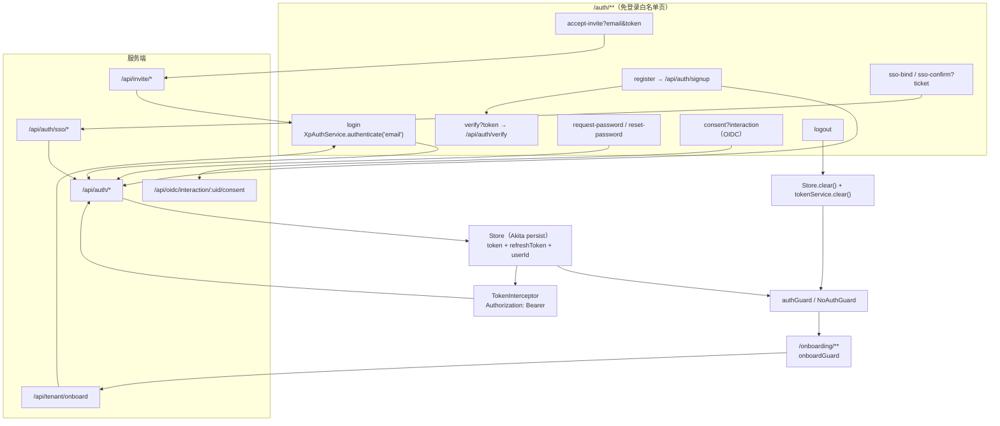
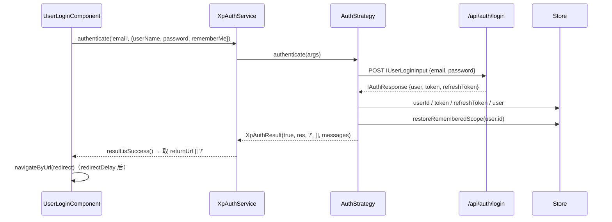
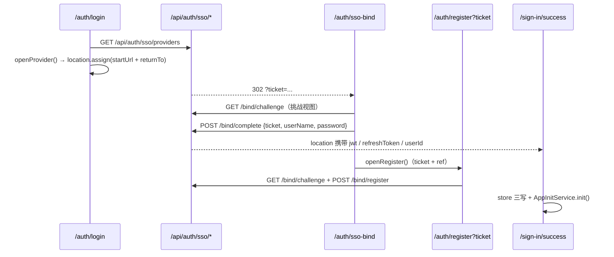
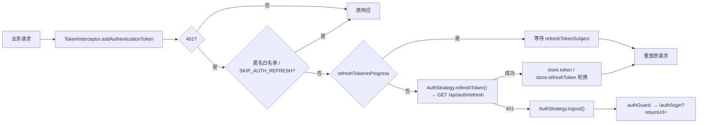

# 03 数据流转：认证与引导专家（前端）

**本文引用的文件**

- [auth.service.ts](file://apps/cloud/src/app/auth/services/auth.service.ts)
- [auth-result.ts](file://apps/cloud/src/app/auth/services/auth-result.ts)
- [auth.options.ts](file://apps/cloud/src/app/auth/auth.options.ts)
- [auth.module.ts](file://apps/cloud/src/app/auth/auth.module.ts)
- [auth-routing.module.ts](file://apps/cloud/src/app/auth/auth-routing.module.ts)
- [auth-strategy.ts](file://apps/cloud/src/app/auth/strategies/auth-strategy.ts)
- [password-strategy.ts](file://apps/cloud/src/app/auth/strategies/password/password-strategy.ts)
- [password-strategy-options.ts](file://apps/cloud/src/app/auth/strategies/password/password-strategy-options.ts)
- [token.ts](file://apps/cloud/src/app/auth/services/token/token.ts)
- [token.service.ts](file://apps/cloud/src/app/auth/services/token/token.service.ts)
- [token-storage.ts](file://apps/cloud/src/app/auth/services/token/token-storage.ts)
- [token-parceler.ts](file://apps/cloud/src/app/auth/services/token/token-parceler.ts)
- [no-auth.guard.ts（auth）](file://apps/cloud/src/app/auth/guards/no-auth.guard.ts)
- [login.component.ts](file://apps/cloud/src/app/auth/login/login.component.ts)
- [register.component.ts](file://apps/cloud/src/app/auth/register/register.component.ts)
- [forgot-password.component.ts](file://apps/cloud/src/app/auth/forgot-password/forgot-password.component.ts)
- [reset-password.component.ts](file://apps/cloud/src/app/auth/reset-password/reset-password.component.ts)
- [logout.component.ts](file://apps/cloud/src/app/auth/logout/logout.component.ts)
- [verify-email.component.ts](file://apps/cloud/src/app/auth/verify-email/verify-email.component.ts)
- [accept-invite.component.ts](file://apps/cloud/src/app/auth/accept-invite/accept-invite.component.ts)
- [consent.component.ts](file://apps/cloud/src/app/auth/consent/consent.component.ts)
- [sso-bind.component.ts](file://apps/cloud/src/app/auth/sso-bind/sso-bind.component.ts)
- [current-user-sso-confirm.component.ts](file://apps/cloud/src/app/auth/current-user-sso-confirm/current-user-sso-confirm.component.ts)
- [auth-strategy.service.ts](file://apps/cloud/src/app/@core/auth/auth-strategy.service.ts)
- [auth.guard.ts](file://apps/cloud/src/app/@core/auth/auth.guard.ts)
- [auth.module.ts（@core）](file://apps/cloud/src/app/@core/auth/auth.module.ts)
- [no-auth.guard.ts（@core）](file://apps/cloud/src/app/@core/auth/no-auth.guard.ts)
- [sign-in-success.component.ts](file://apps/cloud/src/app/@core/auth/signin-success/sign-in-success.component.ts)
- [http-context.ts](file://apps/cloud/src/app/@core/auth/http-context.ts)
- [token.interceptor.ts](file://apps/cloud/src/app/@core/interceptors/token.interceptor.ts)
- [auth.service.ts（@core/state）](file://apps/cloud/src/app/@core/state/auth.service.ts)
- [store.service.ts](file://apps/cloud/src/app/@core/state/store.service.ts)
- [tenant.service.ts](file://apps/cloud/src/app/@core/services/tenant.service.ts)
- [invite.service.ts](file://apps/cloud/src/app/@core/state/invite.service.ts)
- [referral.service.ts](file://apps/cloud/src/app/@core/state/referral.service.ts)
- [chat.service.socket.ts](file://apps/cloud/src/app/@core/services/chat.service.socket.ts)
- [referral-registration-session.ts](file://apps/cloud/src/app/auth/referral-registration-session.ts)
- [onboarding-routing.module.ts](file://apps/cloud/src/app/onboarding/onboarding-routing.module.ts)
- [welcome.component.ts](file://apps/cloud/src/app/onboarding/welcome/welcome.component.ts)
- [tenant-details.component.ts](file://apps/cloud/src/app/onboarding/tenant-details/tenant-details.component.ts)
- [setup-plugins.component.ts](file://apps/cloud/src/app/onboarding/plugins/setup-plugins.component.ts)
- [onboard.guard.ts](file://apps/cloud/src/app/@core/guards/onboard.guard.ts)
- [invite.guard.ts](file://apps/cloud/src/app/@core/guards/invite.guard.ts)
- [认证端点与特殊流.md](file://CodeWikiHub/xpert/memory/接口信息/认证与引导/认证端点与特殊流.md)
- [认证与凭据.md](file://CodeWikiHub/xpert/memory/接口信息/身份与权限/认证与凭据.md)

## 目录

1. 总览：令牌中枢与七条链
2. 链① 登录链
3. 链② 注册与邮箱确认链
4. 链③ 密码重置链
5. 链④ 邀请接受链
6. 链⑤ OIDC / SSO 链
7. 链⑥ 登出与令牌失效链
8. 链⑦ onboarding 向导链
9. 前端态 vs 服务端态对照表
10. 状态流转：会话态 / 向导步骤态 / 邀请态
11. 数据变换关键节点
12. 已知风险

## 1. 总览：令牌中枢与七条链

认证域是全站的**令牌供给方**：它只产出一件持久物 —— `Store` 的 Akita persist（`token` / `refreshToken` / `userId` / 组织作用域），auth 模块自带的 `XpTokenLocalStorage`（localStorage key `auth_app_token`）在当前 live 链路里**没有被写入**（见 §12 风险 2）。七条链共用三种通道：HTTP（`AuthService`）、整页跳转（OIDC / SSO / onboarding 后的 `window.location.assign`）、内存广播（`XpAuthTokenService.token$` → `XpAuthService.onTokenChange`）。端点真实前缀是 `/api/auth/*`（`C_API_AUTH = '/api' + '/auth'`）；`/api/auth/custom/*` 只出现在 `password-strategy.spec.ts` 的自定义 `baseEndpoint` 用例中，ki 记忆已裁决其「不存在」。

图表来源：[auth.service.ts](file://apps/cloud/src/app/auth/services/auth.service.ts)（关键符号：`XpAuthService.authenticate`、`XpAuthService.logout`）、[token.interceptor.ts](file://apps/cloud/src/app/@core/interceptors/token.interceptor.ts)（关键符号：`TokenInterceptor.addAuthenticationToken`）、[store.service.ts](file://apps/cloud/src/app/@core/state/store.service.ts)（关键符号：`Store.token`、`Store.clear`）

章节来源：[auth.options.ts](file://apps/cloud/src/app/auth/auth.options.ts)（关键符号：`XP_AUTH_OPTIONS`）、[auth.module.ts（@core）](file://apps/cloud/src/app/@core/auth/auth.module.ts)（关键符号：`AuthModule`、`AuthStrategy.setup`）、[认证与凭据.md](file://CodeWikiHub/xpert/memory/接口信息/身份与权限/认证与凭据.md)（关键符号：`/api/auth/custom/* 不存在`）

## 2. 链① 登录链

表单 → 策略 → HTTP → 令牌落地 → 上下文 → 跳转：`UserLoginComponent.submit()` 先 `markAsDirty/updateValueAndValidity`，再调 `XpAuthService.authenticate(this.strategy, {...form.value, userName: userName?.toLowerCase()})`，`strategy` 取自 `forms.login.strategy`（`'email'`）。`XpAuthService.authenticate` 经 `getStrategy(strategyName)` 在 `XP_AUTH_STRATEGIES` 表内查找（找不到抛 `TypeError`），转交 `AuthStrategy.authenticate`。

图表来源：[login.component.ts](file://apps/cloud/src/app/auth/login/login.component.ts)（关键符号：`UserLoginComponent.submit`）、[auth-strategy.service.ts](file://apps/cloud/src/app/@core/auth/auth-strategy.service.ts)（关键符号：`AuthStrategy.login`）、[auth.service.ts](file://apps/cloud/src/app/auth/services/auth.service.ts)（关键符号：`XpAuthService.authenticate`、`XpAuthService.processResultToken`）

- 令牌落地：`AuthStrategy.login` 把 `IAuthResponse` 三写进 `store.userId` / `store.token` / `store.refreshToken` 并写入 `store.user`；**它返回的 `XpAuthResult` 不带 token**，因此 `XpAuthService.processResultToken` 不会调用 `XpAuthTokenService.set`（风险 2 的根因）。
- 「记住我」是纯前端 cookie 能力：`AuthStrategy.rememberMe(data)` 写/删 `email`、`rememberMe`，`UserLoginComponent.checkRememberdMe()` 在构造时回填表单。
- 跳转解析：页面取 `route.snapshot.queryParams.returnUrl || result.getRedirect()`，`getRedirect()` 来自 `AuthStrategy.config.login.redirect.success = '/'`，`setTimeout(..., this.redirectDelay)` 后 `router.navigateByUrl`。
- 失败面：策略 `catchError` 统一返回 `new XpAuthResult(false, err, false, config.login.defaultErrors)`。

章节来源：[auth-strategy.service.ts](file://apps/cloud/src/app/@core/auth/auth-strategy.service.ts)（关键符号：`AuthStrategy.authenticate`、`AuthStrategy.login`、`AuthStrategy.rememberMe`）、[login.component.ts](file://apps/cloud/src/app/auth/login/login.component.ts)（关键符号：`UserLoginComponent.checkRememberdMe`、`UserLoginComponent.submit`）、[auth.service.ts](file://apps/cloud/src/app/auth/services/auth.service.ts)（关键符号：`XpAuthService.getStrategy`）

## 3. 链② 注册与邮箱确认链

`UserRegisterComponent.register()` → 推荐码校验（`validateReferralCode`）→ `XpAuthService.register('email', data)` → `AuthStrategy.register`：先做纯前端 `password !== confirm` 短路失败，再组装 `IUserRegistrationInput { user:{firstName,lastName,email,tenant,tags}, password, confirmPassword, referralCode }` 调 `AuthService.signup`（POST `/api/auth/signup`）。成功后**不落地令牌**、不自动登录（注释掉的 `switchMap(login)` 是历史遗留），只提示 `Auth.SignupSuccess`（"Signup success, please active the link in your email"）。

- 门控：`enablePublicSignup` 来自 `forms.register.enablePublicSignup`，在 `@core/auth/auth.module.ts` 由 `environment.deploymentTarget !== 'customer-onprem'` 计算；为假且无 `ticket` 时构造器直接 `router.navigate(['/auth/login'])`。
- 推荐码会话：`?ref=` → `saveRegistrationReferralCode`（sessionStorage key `xpert.registration.referral-code`）；可用性与校验走 `ReferralService.getAvailability` / `validateCode` → `/api/referral/availability`、`/api/referral/validate`（邀请场景带 `Tenant-Id` 头）。
- 邮箱确认：邮件链接 → `/auth/verify?token=` → `VarifyEmailComponent` 的 `queryParams` 流经 `switchMap(token => AuthService.verifyEmail(token))`（GET `/api/auth/verify`）→ 成功提示去登录；失败把 `err.error` 直接当文案。确认后再走链①完成首次登录。
- 错误映射（策略层）：`409` → `err.error?.error`；`400` → `err.error?.message`；其余 → `config.register.defaultErrors`；页面拿到的是 `result.getErrors()` 字符串数组。
- `/auth/register-result` 仍注册在路由表但组件模板为空（占位页），当前流程不跳转至此。

章节来源：[register.component.ts](file://apps/cloud/src/app/auth/register/register.component.ts)（关键符号：`UserRegisterComponent.register`、`validateReferralCode`、`loadReferralAvailability`）、[auth-strategy.service.ts](file://apps/cloud/src/app/@core/auth/auth-strategy.service.ts)（关键符号：`AuthStrategy.register`）、[verify-email.component.ts](file://apps/cloud/src/app/auth/verify-email/verify-email.component.ts)（关键符号：`VarifyEmailComponent.tokenSub`）、[auth.module.ts（@core）](file://apps/cloud/src/app/@core/auth/auth.module.ts)（关键符号：`enablePublicSignup`）

## 4. 链③ 密码重置链

申请：`/auth/request-password`（挂 `NoAuthGuard`）→ `ForgotPasswordComponent.requestPass()` → `XpAuthService.requestPassword('email', {email})` → `AuthStrategy.requestPassword` → `AuthService.requestPassword`（POST `/api/auth/request-password`）→ `XpAuthResult(true, tokens, false)`；页面据 `isFailure()` 分支弹 `Auth.RequestPasswordSuccess` / `Auth.RequestPasswordFail` 两个 toast，**不跳转**。

重置：邮件链接回 `/auth/reset-password?token=<reset token>` → `ResetPasswordComponent.resetPass()` → 表单已带 `Validators.minLength(8)` 与 `matchValidator('password','confirmPassword')` → `XpAuthService.resetPassword('email', form.value)` → `AuthStrategy.resetPassword` 从 `route.snapshot.queryParamMap.get('token')` 取令牌（**不从表单传**），组 `{token, password, confirmPassword}` → `AuthService.resetPassword`（POST `/api/auth/reset-password`）→ 成功 toast + `delay(2000)` → `router.navigate(['/auth/login'])` → 回到链①重新登录。

- 前端令牌校验：只做两次输入一致性（控制器级与策略级两道 `password !== confirmPassword`）。
- 服务端语义（对照）：重置记录过期/改密失败由后端 `400 Password Reset Failed (code: 1|2|3)` 表达，前端统一落 `config.resetPass.defaultErrors`。
- legacy 旁证：`XpPasswordAuthStrategy` 的默认 `resetPass.resetPasswordTokenKey = 'reset_password_token'` 与 `baseEndpoint = '/api/auth/'` 只在 spec 里被 `setOptions` 覆盖使用，未进策略表。
- `AuthStrategy.resetPassword` 的 `map` 内 `res.status === 400` 分支在当前调用形态下不可达（`http.post` 非 `observe:'response'`，400 走 `catchError`）—— [推测] 死分支。

章节来源：[forgot-password.component.ts](file://apps/cloud/src/app/auth/forgot-password/forgot-password.component.ts)（关键符号：`ForgotPasswordComponent.requestPass`）、[reset-password.component.ts](file://apps/cloud/src/app/auth/reset-password/reset-password.component.ts)（关键符号：`ResetPasswordComponent.resetPass`）、[auth-strategy.service.ts](file://apps/cloud/src/app/@core/auth/auth-strategy.service.ts)（关键符号：`AuthStrategy.requestPassword`、`AuthStrategy.resetPassword`）、[password-strategy-options.ts](file://apps/cloud/src/app/auth/strategies/password/password-strategy-options.ts)（关键符号：`XpPasswordAuthStrategyOptions.resetPass`）

## 5. 链④ 邀请接受链

入口是**带 `email` 与 `token` 两个查询参数的 `/auth/accept-invite`**。`NoAuthGuard.canAccessInviteRoute(route)` 判定 `routeConfig?.path === 'accept-invite' && queryParamMap.has('email') && queryParamMap.has('token')`，命中即直接放行 —— 这是本域唯一「已登录也能进免登录页」的口子；未带参则常规判定（无 token → 放行；有 token 且已认证 → 跳 `/home`）。

- 校验：`AcceptInvitePageComponent.loadInvite` → `InviteService.validateInvite(['role','organization'], {email, token})`（GET `/api/invite/validate?data=`），失败置 `inviteLoadErrorMessage = 'Invitation no longer valid'`。
- 表单：`AcceptInviteFormComponent.buildForm`（`fullName` 必填、`password` ≥4、`repeatPassword` 必填、`agreeTerms` `requiredTrue`；`referralCode` 初始 disabled，可用性由 `ReferralService.getAvailability(invitation.tenantId)` 决定）；提交时把 `invitation.email`、`invitation.role` 注入 `IUserRegistrationInput.user`。
- 接受：`submitForm` → `inviteService.acceptUserInvite({ user, password, referralCode, organization, inviteId })`（POST `/api/invite/user`）→ 成功 toast `Auth.ACCEPT_INVITE.PROFILE_UPDATED` → `router.navigate(['/auth/login'])`（**不直接登录**，回到链①）；失败 `toastrService.danger(error, null, 'Could not create your account')`。
- 邀请态在服务端：`IInvite.status` 取 `InviteStatusEnum.INVITED|ACCEPTED`，`expireDate` 过期即校验失败 —— 前端只呈现「有效/失效」两态。
- 对照：`invite.guard.ts` 的 `inviteGuard` **不挂在该路由**，它依赖 `route.data.expectedPermissions` + `store.userRolePermissions$` + `store.selectedOrganization.invitesAllowed`，不满足导航 `/`，属于组织内邀请管理页的准入。

章节来源：[no-auth.guard.ts（auth）](file://apps/cloud/src/app/auth/guards/no-auth.guard.ts)（关键符号：`NoAuthGuard.canAccessInviteRoute`）、[accept-invite.component.ts](file://apps/cloud/src/app/auth/accept-invite/accept-invite.component.ts)（关键符号：`AcceptInvitePageComponent.loadInvite`、`AcceptInvitePageComponent.submitForm`）、[invite.service.ts](file://apps/cloud/src/app/@core/state/invite.service.ts)（关键符号：`InviteService.validateInvite`、`InviteService.acceptUserInvite`）、[invite.guard.ts](file://apps/cloud/src/app/@core/guards/invite.guard.ts)（关键符号：`inviteGuard`）

## 6. 链⑤ OIDC / SSO 链

**OIDC consent（MCP 授权）**：`/auth/consent` 仅在 `environment.mcpOAuthEnabled` 为真时注册。`OidcConsentComponent.ngOnInit` 用 `XP_API_BASE_URL` 发 GET `${base}/oidc/interaction/{interaction}/consent`（`withCredentials: true`，靠后端 interaction cookie）填 `clientName/scopes/resources`；`allow()` / `deny()` 用运行时 `document.createElement('form')` 向同一 URL 整页 POST 一个 `decision` 字段，浏览器离开 SPA —— 回调与令牌完全交后端。

**SSO 双轨（不进策略表）**：

图表来源：[sso-bind.component.ts](file://apps/cloud/src/app/auth/sso-bind/sso-bind.component.ts)（关键符号：`SsoBindComponent.submit`、`SsoBindComponent.openRegister`）、[login.component.ts](file://apps/cloud/src/app/auth/login/login.component.ts)（关键符号：`UserLoginComponent.openProvider`）、[sign-in-success.component.ts](file://apps/cloud/src/app/@core/auth/signin-success/sign-in-success.component.ts)（关键符号：`SignInSuccessComponent`）

- 绑定落点：成功响应 `{ location }`，前端 `window.location.assign(result.location)` → `/sign-in/success?jwt=&refreshToken=&userId=&returnTo=` → `SignInSuccessComponent` 写 `_store.token/userId/refreshToken` + `restoreRememberedScope(userId)` → `AppInitService.init()` → `user.id !== userId` 则静默 return；`returnTo` 必须 `/` 开头且非 `//` 才 `navigateByUrl`，否则 `window.location.assign`；缺省 `navigate(['/'])`。
- 当前用户确认绑定：`/auth/sso-confirm?ticket=` → GET `/api/auth/sso/bind/current-user/challenge` → POST `/bind/current-user/complete {ticket}` → 同样 `location.assign`，**不签发新令牌**。
- 错误面：400（ticket 过期 → 置 `loadError` 清 `challenge`）、401（账密错 / 会话过期）、409（身份冲突）；登录页另解析 query `error` / `ssoMessage` / `ssoError` + `ssoProvider`（`invalid_credentials`、`invalid_tenant`、`interaction_expired` 有本地映射）。
- 注册侧分支：`/auth/register?ticket=` 时先 GET `/api/auth/sso/bind/challenge`（`verified_email_signup` 流会把邮箱锁死），提交走 POST `/api/auth/sso/bind/register` 而非链②。

章节来源：[consent.component.ts](file://apps/cloud/src/app/auth/consent/consent.component.ts)（关键符号：`OidcConsentComponent.submitDecision`）、[sso-bind.component.ts](file://apps/cloud/src/app/auth/sso-bind/sso-bind.component.ts)（关键符号：`SsoBindComponent.loadChallenge`、`SsoBindComponent.handleSubmitError`）、[current-user-sso-confirm.component.ts](file://apps/cloud/src/app/auth/current-user-sso-confirm/current-user-sso-confirm.component.ts)（关键符号：`CurrentUserSsoConfirmComponent.submit`）、[auth-routing.module.ts](file://apps/cloud/src/app/auth/auth-routing.module.ts)（关键符号：`routes`）

## 7. 链⑥ 登出与令牌失效链

显式登出：`/auth/logout`（**无守卫**）→ `XpLogoutComponent.ngOnInit` → `XpAuthService.logout('email')` → `XpAuthStrategy.logout` → `AuthStrategy.logout()` → `_logout()`：先以 `SKIP_AUTH_REFRESH` 上下文 DELETE artifact share session（`timeout(5000)`，失败仅吞），再 `authService.logout()`（空实现）、`store.clear()`、`store.serverConnection = 200`，返回 `XpAuthResult(true, null, '/')`；回到 `XpAuthService.logout` 的 `tokenService.clear()`（移除 `auth_app_token` 并 `publishStoredToken()` 广播），最后页面按 `redirectDelay` 跳 `/`。

图表来源：[token.interceptor.ts](file://apps/cloud/src/app/@core/interceptors/token.interceptor.ts)（关键符号：`TokenInterceptor.intercept`）、[auth-strategy.service.ts](file://apps/cloud/src/app/@core/auth/auth-strategy.service.ts)（关键符号：`AuthStrategy.refreshToken`）、[auth.guard.ts](file://apps/cloud/src/app/@core/auth/auth.guard.ts)（关键符号：`authGuard`）

- 被动失效（HTTP）：非匿名请求 401 → 单飞刷新窗口（`refreshTokenInProgress` + `refreshTokenSubject`）；`auth/refresh` 自身 401 → `auth.logout()`；`url.includes('login')` 的请求直接抛错不刷新（spec 断言「不向密码登录请求附加陈旧 Authorization」）。
- 被动失效（socket）：`ChatWebsocketServer` 收 `exception{status:401}` → `refreshToken()`（`refreshTokening` 防重入）→ `AuthStrategy.refreshToken()`（`refreshTokenReq` signal + `shareReplay(1)` 复用同一请求）→ 成功后 `connect()` 以 `store.token` 重连。
- 路由层兜底：`authGuard` 发现 `!store.token` 时**先 `await authStrategy.logout()` 清本地**，再 `router.navigate(['/auth/login'], { queryParams: { returnUrl: state.url } })`。
- 广播语义：`XpAuthTokenService.token$` 是 `BehaviorSubject` + `filter(!!value)` + `share()`；`publishStoredToken()` 在 `set/clear/构造` 三处触发，`XpAuthService.onTokenChange` / `onAuthenticationChange` 是其公开出口（本域内无生产级消费方）。

章节来源：[logout.component.ts](file://apps/cloud/src/app/auth/logout/logout.component.ts)（关键符号：`XpLogoutComponent.ngOnInit`）、[auth-strategy.service.ts](file://apps/cloud/src/app/@core/auth/auth-strategy.service.ts)（关键符号：`AuthStrategy._logout`、`AuthStrategy.refreshToken`）、[token.service.ts](file://apps/cloud/src/app/auth/services/token/token.service.ts)（关键符号：`XpAuthTokenService.publishStoredToken`）、[chat.service.socket.ts](file://apps/cloud/src/app/@core/services/chat.service.socket.ts)（关键符号：`ChatWebsocketServer.refreshToken`）

## 8. 链⑦ onboarding 向导链

`/onboarding` 由 `OnboardingComponent`（语言切换 shell）承载四个子路由，**步骤顺序是硬编码的路由 + 守卫矩阵**，没有独立的状态机或持久化步骤记录：

| 步骤 | 路由 | 守卫 | 通过条件 |
| --- | --- | --- | --- |
| 0 | `''`（`WelcomeComponent`） | `onboardGuard` | 租户尚未建立；已建则跳 `/home/`，出错跳 `/onboarding/unknown` |
| 1 | `tenant`（`TenantDetailsComponent`） | `onboardGuard` | 同上；页内用 stepper 再分「信息 → AI 模型」两屏 |
| 2 | `plugins`（`SetupPluginsComponent`） | `authGuard` | **必须已登录**（步骤 1 的 `afterOnboard` 才产生 token） |
| — | `unknown` | 无 | 兜底说明页（`OnboardingUnknownComponent`） |

`onboardGuard` 的判定源是 `TenantService.getOnboard()`（GET `/api/tenant/onboard`，`#isOnboarded` 带 `shareReplay(1)`）：`onboard.tenant` 为真 → `router.navigate(['/home/'])` + `false`；`onboard.error` → `/onboarding/unknown` + `false`；否则放行。

前进链：`WelcomeComponent.navigateTenant()` → `/onboarding/tenant` → `TenantDetailsComponent.onboard()`：`TenantService.onboard({ name: DEFAULT_TENANT, superAdmin:{ firstName,lastName,email,hash: password,preferredLanguage }, defaultOrganization:{ ... } })`（POST `/api/tenant/onboard`）→ `tenant.organizations[0]` → `afterOnboard(org)` 用刚建的管理员凭据 `authStrategy.login({ email, password })`（复用链①，令牌落到 `Store`）→ `store.setOrganizationScope(org)` → `copilotServer.refresh()`；这一段的失败会让页面 `navigate(['/auth/login'], { queryParams: { returnUrl: '/onboarding/plugins' } })`。

步骤态与不可跳步：`stepper.next()` 只在 `onboard()` 成功、`skipAiModelSetup()`、`onAiModelSaved()` 三处被调用；`onStepChange` 在 `selectedIndex === 2` 时改走 `navigateHome()` → `/onboarding/plugins`（步骤 2 是路由跳转而非表单屏），在 `selectedIndex === 1` 且 primary copilot 未启用时触发 `startAiModelSetup()`（`enableCopilot(AiProviderRole.Primary)`）。`tenantCompleted`、`aiModelSetupRequested`、`primaryCopilotCreatedInOnboarding` 三个 signal 只记录副作用（后者用于 `skipAiModelSetup` 时回撤刚创建的空 copilot）。plugins 页 `load()` → `SetupPluginsService.status()`，`phase === 'installing'` 时续跑 `start()`，`monitor()` 每 2s 轮询；`completed` 后 1.5s 调 `enterOrganization()` → `location.assign('/')`，异常 0/502/503/504 记 `disconnected`，超 180s 置 `waitingTooLong`。

章节来源：[onboarding-routing.module.ts](file://apps/cloud/src/app/onboarding/onboarding-routing.module.ts)（关键符号：`routes`）、[onboard.guard.ts](file://apps/cloud/src/app/@core/guards/onboard.guard.ts)（关键符号：`onboardGuard`）、[tenant-details.component.ts](file://apps/cloud/src/app/onboarding/tenant-details/tenant-details.component.ts)（关键符号：`TenantDetailsComponent.onboard`、`TenantDetailsComponent.afterOnboard`、`TenantDetailsComponent.onStepChange`）、[setup-plugins.component.ts](file://apps/cloud/src/app/onboarding/plugins/setup-plugins.component.ts)（关键符号：`SetupPluginsComponent.monitor`、`SetupPluginsComponent.enterOrganization`）

## 9. 前端态 vs 服务端态对照表

| 数据 | 前端存放位置 | 服务端对应态 | 生命周期与约束 |
| --- | --- | --- | --- |
| 访问令牌 `token` | Akita persist（`persistState({ key: '_xpertStore' })`），启动时由 `localStorage.getItem('token')` 回填 | JWT（`AuthService.createToken` 签发，含租户/角色权限快照） | 无服务端会话表；前端只在 401 时刷新 |
| 刷新令牌 `refreshToken` | 同上 persist | 落库且**刷新即轮换**（旧 refresh 失效） | `Authorization: Bearer <refreshToken>` 仅用于 `/api/auth/refresh` |
| 令牌包裹体 | `XpTokenLocalStorage`（key `auth_app_token`，JSON `{name,ownerStrategyName,createdAt,value}`） | — | 仅当 `XpAuthResult` 带 token 时写；live 链路未写 |
| 用户 / 组织上下文 | `PersistState.userId` + `AppState.user` + `selectedOrganization` | 用户、组织成员关系、角色权限实体 | `store.clear()` 一次性清空 |
| 作用域记忆 | `PersistState.organizationId / activeScopeLevel / rememberedScopes` | — | `restoreRememberedScope(userId)` 登录时回放 |
| 记住我 | cookie `email` / `rememberMe`（`ngx-cookie-service`） | — | 未勾选即删除 |
| 推荐码 | sessionStorage `xpert.registration.referral-code` | 注册/校验接口内结算 | 注册成功或校验失败即清 |
| 邀请 / 重置 / 验证令 | 仅 URL query（`token`、`email`） | 邀请记录、重置记录、邮箱验证 token（默认 2 天） | 一次性，过期即失败 |
| SSO 绑定会话 | URL query `ticket` | 服务端 ticket（`expiresAt`） | 400 即过期，需重走 SSO |
| OIDC 交互 | URL query `interaction` + `withCredentials` cookie | 后端 identity interaction | consent 提交后离开 SPA |
| 向导步骤 | 组件内 signal（无持久化） | 由 `GET /api/tenant/onboard` 是否已有租户反推 | 刷新页面即回到守护判定 |

章节来源：[token.interceptor.ts](file://apps/cloud/src/app/@core/interceptors/token.interceptor.ts)（关键符号：`TokenInterceptor.addAuthenticationToken`、`ANONYMOUS_AUTH_PATHS`）、[token-storage.ts](file://apps/cloud/src/app/auth/services/token/token-storage.ts)（关键符号：`XpTokenLocalStorage`）、[store.service.ts](file://apps/cloud/src/app/@core/state/store.service.ts)（关键符号：`PersistState`、`createInitialPersistState`）、[referral-registration-session.ts](file://apps/cloud/src/app/auth/referral-registration-session.ts)（关键符号：`saveRegistrationReferralCode`）

## 10. 状态流转：会话态 / 向导步骤态 / 邀请态

**会话态**：匿名（`store.token == null`）→ 认证中（页面 `loading` + interceptor 静默刷新）→ 已登录（`store.token` 非空）→ 刷新中（`refreshTokenInProgress` / `refreshTokenReq` 单飞窗口）→ 已登出（`store.clear()` + `tokenService.clear()`）。判定入口分裂且互不覆盖：`authGuard`、`NoAuthGuard`（auth 版）、`TokenInterceptor` 只看 `store.token`；`NoAuthGuard`（auth 版）在 `store.token` 存在时才再问 `XpAuthService.isAuthenticated()`（其数据源是另一套存储）；`NoAuthGuard`（@core 版）只问 `AuthService.isAuthenticated()`（GET `/api/auth/authenticated`）。

**向导步骤态**：`welcome → tenant(信息) → tenant(AI 模型) → plugins(安装) → '/'`；回退能力来自 stepper 组件本身，但「跳过 tenant 直接进 plugins」会被 `authGuard` 拦（无 token）或落回 `onboardGuard` 的 `/home/` 重定向（已有租户）——即步骤不可跳过，只能被重定向收敛。

**邀请态**：`INVITED → ACCEPTED` 由服务端持有；前端在 `loadInvite` 一次求值出「有效 / 失效」二态，失效后表单不再渲染，只能回登录页。

章节来源：[auth.guard.ts](file://apps/cloud/src/app/@core/auth/auth.guard.ts)（关键符号：`authGuard`）、[no-auth.guard.ts（auth）](file://apps/cloud/src/app/auth/guards/no-auth.guard.ts)（关键符号：`NoAuthGuard.canActivate`）、[no-auth.guard.ts（@core）](file://apps/cloud/src/app/@core/auth/no-auth.guard.ts)（关键符号：`NoAuthGuard.canActivate`）、[onboarding-routing.module.ts](file://apps/cloud/src/app/onboarding/onboarding-routing.module.ts)（关键符号：`routes`）

## 11. 数据变换关键节点

- **策略参数 → 请求体**：`strategyName`（`'email'`）只用于表内定址；请求体由策略手工塑形 —— 登录 `{ email: userName.toLowerCase(), password }`、注册 `{ user:{ firstName, lastName, email, tenant, tags }, password, confirmPassword, referralCode }`（`fullName.split(' ')` 切分首尾名）、邀请接受再注入 `invitation.email` / `invitation.role`。
- **响应 → 用户上下文**：`IAuthResponse { user, token, refreshToken }` → `store.userId` / `store.token` / `store.refreshToken` / `store.user` + `restoreRememberedScope(user.id)`；SSO 侧是同一套三写的 query 版本（`jwt` / `refreshToken` / `userId` + `AppInitService.init()`）。
- **重定向目标解析**（四种优先级）：登录页 `returnUrl` > `result.getRedirect()`（`'/'`）；SSO 成功页 `returnTo`（`/` 开头且非 `//` 走路由，否则整页跳）；`authGuard` 未登录用 `returnUrl = state.url` 回填；onboarding 建租户后登录失败用 `returnUrl = '/onboarding/plugins'` 回填。
- **策略错误 → 文案**：三层兜底 —— 策略 `errors.getter`（`data.errors`）、`errors` 分支（`409 → err.error.error`、`400 → err.error.message`）、`defaultErrors`；OIDC 用本地字典把 `error` 码翻译成人话。
- **密码强度**：`passwordStrength(value)` 按 `minDiversity/minLength` 归入 `PasswordStrengthEnum`，再经 `passwordProgressMap` 映射为色彩 + 进度（注册页校验器副作用写、重置页 `toSignal` 读）。

章节来源：[auth-strategy.service.ts](file://apps/cloud/src/app/@core/auth/auth-strategy.service.ts)（关键符号：`AuthStrategy.register`、`AuthStrategy.login`、`AuthStrategy.resetPassword`）、[login.component.ts](file://apps/cloud/src/app/auth/login/login.component.ts)（关键符号：`UserLoginComponent.submit`）、[password-strength.ts](file://apps/cloud/src/app/auth/services/password-strength.ts)（关键符号：`passwordStrength`、`PasswordStrengthEnum`）

## 12. 已知风险

1. **令牌过期竞态**：401 刷新窗口全局单飞（`refreshTokenInProgress` 挡并发，`refreshTokenSubject` 排队重放），socket 侧另有 `refreshTokening`；但 `AuthStrategy.refreshToken` 的共享 observable 一旦 `tap` 复位即回收，窗口外的第二条 401 会再发一次刷新。
2. **双令牌存储不一致**：`AuthStrategy.login` 不返回 token ⇒ `XpAuthService.processResultToken` 不写 `XpTokenLocalStorage`；于是 `XpAuthService.isAuthenticated()`（读 `auth_app_token`）在真实登录后仍为 `false`，只有 `store.token` 是真源。[推测] 该分支在守卫里被 `store.token` 短路掩盖，但任何新增的 `isAuthenticated()` 消费方都会踩坑。
3. **多标签页不同步**：令牌在 localStorage（Akita persist），但**未发现 `storage` 事件监听**；A 标签登出后 B 标签仍持旧 `store.token`，直到下一次 401 才被动收敛。
4. **OIDC 回调丢失**：consent 是整页 form POST，`interaction` 缺失即 `loadFailed`（无重试入口）；`/sign-in/success` 依赖 `jwt/refreshToken/userId` 齐全，且 `AppInitService.init()` 后 `user.id !== userId` 会**静默不跳转**。
5. **免登录白名单是硬编码**：`ANONYMOUS_AUTH_PATHS` 列了 6 条（含 `/api/tenant/onboard`），漏登记即被注入旧 token 并触发 401 刷新逻辑；页面级白名单（`/x-chatkit/*`、`/x/*`、`sign-in/success`、plugins/marketplace）同属显式枚举，改动需逐条核对。
6. **端点记忆污染**：`/api/auth/custom/*` 只在 `password-strategy.spec.ts` 的自定义 `baseEndpoint` 用例中存在，真实链路是 `/api/auth/{login,signup,refresh,request-password,reset-password,verify}`；沿用错误端点会造成「静默 404 → 统一兜底错误文案」的难查故障。
7. **被动清库副作用**：`authGuard` 在无 token 时会先执行一次完整 `logout()`（含对 artifact share session 的 5s 超时请求），弱网下会拖慢首次跳登录。

章节来源：[http-context.ts](file://apps/cloud/src/app/@core/auth/http-context.ts)（关键符号：`SKIP_AUTH_REFRESH`）、[token.interceptor.ts](file://apps/cloud/src/app/@core/interceptors/token.interceptor.ts)（关键符号：`TokenInterceptor.intercept`）、[auth-strategy.service.ts](file://apps/cloud/src/app/@core/auth/auth-strategy.service.ts)（关键符号：`AuthStrategy.refreshTokenReq`、`AuthStrategy._logout`）、[password-strategy.spec.ts](file://apps/cloud/src/app/auth/strategies/password/password-strategy.spec.ts)（关键符号：`custom base endpoint`）、[认证端点与特殊流.md](file://CodeWikiHub/xpert/memory/接口信息/认证与引导/认证端点与特殊流.md)（关键符号：`/api/auth/custom/*`）
