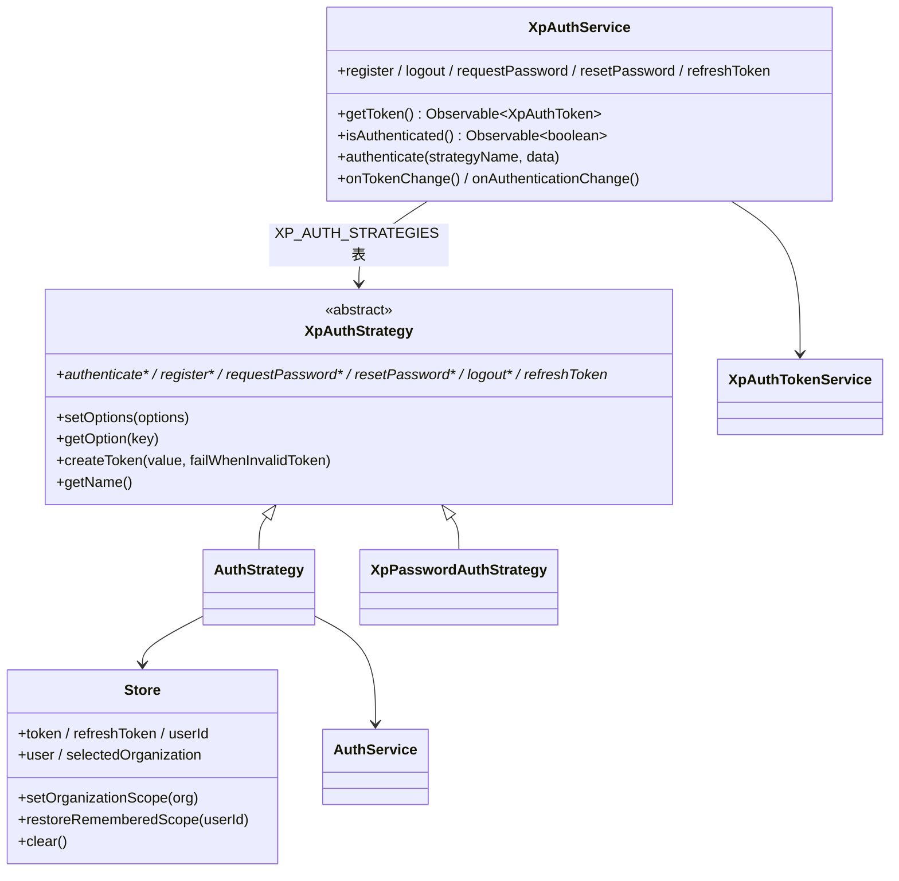

# 04 模型：认证与引导专家（前端）

**本文引用的文件**

- [auth.service.ts](file://apps/cloud/src/app/auth/services/auth.service.ts)
- [auth-result.ts](file://apps/cloud/src/app/auth/services/auth-result.ts)
- [auth.options.ts](file://apps/cloud/src/app/auth/auth.options.ts)
- [auth.module.ts](file://apps/cloud/src/app/auth/auth.module.ts)
- [auth-routing.module.ts](file://apps/cloud/src/app/auth/auth-routing.module.ts)
- [auth-strategy.ts](file://apps/cloud/src/app/auth/strategies/auth-strategy.ts)
- [auth-strategy-options.ts](file://apps/cloud/src/app/auth/strategies/auth-strategy-options.ts)
- [password-strategy.ts](file://apps/cloud/src/app/auth/strategies/password/password-strategy.ts)
- [password-strategy-options.ts](file://apps/cloud/src/app/auth/strategies/password/password-strategy-options.ts)
- [token.ts](file://apps/cloud/src/app/auth/services/token/token.ts)
- [token.service.ts](file://apps/cloud/src/app/auth/services/token/token.service.ts)
- [token-storage.ts](file://apps/cloud/src/app/auth/services/token/token-storage.ts)
- [token-parceler.ts](file://apps/cloud/src/app/auth/services/token/token-parceler.ts)
- [validators.ts](file://apps/cloud/src/app/auth/services/validators.ts)
- [password-strength.ts](file://apps/cloud/src/app/auth/services/password-strength.ts)
- [helpers.ts](file://apps/cloud/src/app/auth/helpers.ts)
- [login.component.ts](file://apps/cloud/src/app/auth/login/login.component.ts)
- [register.component.ts](file://apps/cloud/src/app/auth/register/register.component.ts)
- [reset-password.component.ts](file://apps/cloud/src/app/auth/reset-password/reset-password.component.ts)
- [accept-invite-form.component.ts](file://apps/cloud/src/app/auth/accept-invite/accept-invite-form/accept-invite-form.component.ts)
- [sso-bind.component.ts](file://apps/cloud/src/app/auth/sso-bind/sso-bind.component.ts)
- [consent.component.ts](file://apps/cloud/src/app/auth/consent/consent.component.ts)
- [referral-registration-session.ts](file://apps/cloud/src/app/auth/referral-registration-session.ts)
- [auth-strategy.service.ts](file://apps/cloud/src/app/@core/auth/auth-strategy.service.ts)
- [auth.guard.ts](file://apps/cloud/src/app/@core/auth/auth.guard.ts)
- [auth.module.ts（@core）](file://apps/cloud/src/app/@core/auth/auth.module.ts)
- [no-auth.guard.ts（@core）](file://apps/cloud/src/app/@core/auth/no-auth.guard.ts)
- [no-auth.guard.ts（auth）](file://apps/cloud/src/app/auth/guards/no-auth.guard.ts)
- [types.ts](file://apps/cloud/src/app/@core/auth/types.ts)
- [sign-in-success.component.ts](file://apps/cloud/src/app/@core/auth/signin-success/sign-in-success.component.ts)
- [http-context.ts](file://apps/cloud/src/app/@core/auth/http-context.ts)
- [invite.guard.ts](file://apps/cloud/src/app/@core/guards/invite.guard.ts)
- [onboard.guard.ts](file://apps/cloud/src/app/@core/guards/onboard.guard.ts)
- [dirty-check.guard.ts](file://apps/cloud/src/app/@core/guards/dirty-check.guard.ts)
- [store.service.ts](file://apps/cloud/src/app/@core/state/store.service.ts)
- [auth.service.ts（@core/state）](file://apps/cloud/src/app/@core/state/auth.service.ts)
- [invite.service.ts](file://apps/cloud/src/app/@core/state/invite.service.ts)
- [referral.service.ts](file://apps/cloud/src/app/@core/state/referral.service.ts)
- [tenant.service.ts](file://apps/cloud/src/app/@core/services/tenant.service.ts)
- [onboarding-routing.module.ts](file://apps/cloud/src/app/onboarding/onboarding-routing.module.ts)
- [tenant-details.component.ts](file://apps/cloud/src/app/onboarding/tenant-details/tenant-details.component.ts)
- [setup-plugins.component.ts](file://apps/cloud/src/app/onboarding/plugins/setup-plugins.component.ts)
- [user.model.ts](file://packages/contracts/src/user.model.ts)
- [invite.model.ts](file://packages/contracts/src/invite.model.ts)

## 目录

1. 前端模型层总览：无 DB / ORM
2. `XpAuthService`：状态与方法契约
3. `XpAuthStrategy` 抽象契约
4. `XpAuthOptions` 策略表与注入令牌
5. 令牌模型
6. 用户 / 租户上下文模型
7. 守卫判定输入模型
8. onboarding 向导步骤模型
9. 邀请、验证码与 SSO 会话模型
10. 建模边界：前端独有 vs 服务端投影
11. 校验规则与错误映射
12. 未确认项

## 1. 前端模型层总览：无 DB / ORM

**数据库实体 / ORM 映射 / Repository / 迁移脚本：该模块无此项。** 认证域前端全部模型分四层：`XpAuth*` 内核类型（服务/策略/令牌，本仓库内自带，命名沿用上游 Nebular 的 `Nb*` 残留）、`@core/auth` 的落地策略 `AuthStrategy`、`@core/state` 的 Akita 状态（`Store` / `PersistState` / `AppState`）、以及 `packages/contracts` 的 DTO 投影。唯一持久化手段是 Akita 的 `persistState({ key: '_xpertStore' })`（含 token）与浏览器 cookie / sessionStorage 的旁路小状态。

图表来源：[auth.service.ts](file://apps/cloud/src/app/auth/services/auth.service.ts)（关键符号：`XpAuthService`）、[auth-strategy.ts](file://apps/cloud/src/app/auth/strategies/auth-strategy.ts)（关键符号：`XpAuthStrategy`）、[auth-strategy.service.ts](file://apps/cloud/src/app/@core/auth/auth-strategy.service.ts)（关键符号：`AuthStrategy`）、[store.service.ts](file://apps/cloud/src/app/@core/state/store.service.ts)（关键符号：`Store`）

章节来源：[auth.module.ts](file://apps/cloud/src/app/auth/auth.module.ts)（关键符号：`XpAuthModule.forRoot`、`nbStrategiesFactory`）、[main.ts](file://apps/cloud/src/main.ts)（关键符号：`persistState`）、[store.service.ts](file://apps/cloud/src/app/@core/state/store.service.ts)（关键符号：`PersistState`、`AppState`）

## 2. `XpAuthService`：状态与方法契约

定义位置：[auth.service.ts](file://apps/cloud/src/app/auth/services/auth.service.ts)。它是 UI 与策略之间**唯一**的中间层，全部公开方法以 `strategyName` 参数化（无策略名的调用不存在）。

| 方法 | 签名语义 | 生产方（内部委托） | 消费方 / 约束 |
| --- | --- | --- | --- |
| `getToken()` | 读 `XpAuthTokenService.get()` → 令牌对象 | `XpTokenStorage.get()` | 当前无生产级消费方 |
| `isAuthenticated()` | `getToken().pipe(map(t => t.isValid()))` | 同上 | 只看令牌存储，不看 `Store.token` |
| `isAuthenticatedOrRefresh()` | 存储有值但失效 → `refreshToken(ownerStrategyName, token)`，成功再判 | 策略 `refreshToken` | 供守卫复用，本域未挂载 |
| `onTokenChange()` | `XpAuthTokenService.tokenChange()` 流 | `token$`（BehaviorSubject） | 登出/写入时广播 |
| `onAuthenticationChange()` | `onTokenChange()` 映射为 `isValid()` | 同上 | 注释里标注为 showcase 用法 |
| `authenticate(strategyName, data?)` | 策略 `authenticate(data)` → `processResultToken` | `XpAuthStrategy.authenticate` | 登录页：`('email', {userName,password,rememberMe})` |
| `register(strategyName, data?)` | 同上（注册） | 策略 `register` | 注册页 / 邀请页表单 |
| `logout(strategyName)` | 策略 `logout()` 成功则 `tokenService.clear()` | 策略 `logout` | 登出页、`authGuard`、拦截器、socket |
| `requestPassword(strategyName, data?)` | 直通策略，**不写令牌** | 策略 `requestPassword` | 忘记密码页 |
| `resetPassword(strategyName, data?)` | 直通策略，**不写令牌** | 策略 `resetPassword` | 重置密码页 |
| `refreshToken(strategyName, data?)` | 策略 `refreshToken` → `processResultToken` | 策略 `refreshToken` | 拦截器 401 刷新、socket 重连 |
| `getStrategy(name)`（protected） | `strategies.find(s => s.getName() === name)`，未命中抛 `TypeError` | — | 所有动作的前置定址 |
| `processResultToken(result)`（private） | `result.isSuccess() && result.getToken()` 才 `tokenService.set` | — | live 链路因 `AuthStrategy` 不产 token 而不触发 |

**状态侧可观察点**：`XpAuthService` 自身无状态，唯一 stream 来自 `XpAuthTokenService.token$`；`XpAuthResult` 是不可变结果对象（`isSuccess/getToken/getRedirect/getErrors/getMessages/getResponse`）。

章节来源：[auth.service.ts](file://apps/cloud/src/app/auth/services/auth.service.ts)（关键符号：`XpAuthService.authenticate`、`XpAuthService.processResultToken`、`XpAuthService.getStrategy`）、[auth-result.ts](file://apps/cloud/src/app/auth/services/auth-result.ts)（关键符号：`XpAuthResult.isSuccess`、`XpAuthResult.getRedirect`）

## 3. `XpAuthStrategy` 抽象契约

定义位置：[auth-strategy.ts](file://apps/cloud/src/app/auth/strategies/auth-strategy.ts)。契约只规定「六个动作 + 选项读取 + 令牌构造」，不规定传输方式。

- **必须实现（abstract）**：`authenticate(data?)`、`register(data?)`、`requestPassword(data?)`、`resetPassword(data?)`、`logout()`、`refreshToken(data?)` —— 全部返回 `Observable<XpAuthResult>`。
- **已实现（可复用）**：`setOptions(options)`（`deepExtend({}, defaultOptions, options)`）、`getOption(key)`（`getDeepFromObject`，缺失返回 `null`）、`createToken(value, failWhenInvalidToken?)`（`xpAuthCreateToken` 后按需抛 `NbAuthIllegalTokenError`）、`getName()`（取 `name` 选项）、`createFailResponse()` / `createSuccessResponse()`（401/200 的空响应）、`getActionEndpoint(action)`（`baseEndpoint + [action].endpoint`，缺一则返回 `''` ⇒ 可选端点可被停用）。
- **字段**：`protected defaultOptions`（子类声明）、`protected options`（实例选项，`setOptions` 后生效）；`AuthStrategy` 另持 `refreshTokenReq: signal<Observable<XpAuthResult>>` 做刷新单飞。
- **现实插件数**：注册进策略表的只有 `AuthStrategy`（`name: 'email'`）；`XpPasswordAuthStrategy` 存在但未注册，只被 spec 覆盖（`baseEndpoint: '/api/auth/custom/'` 用例）。

章节来源：[auth-strategy.ts](file://apps/cloud/src/app/auth/strategies/auth-strategy.ts)（关键符号：`XpAuthStrategy.createToken`、`XpAuthStrategy.getActionEndpoint`）、[auth-strategy.service.ts](file://apps/cloud/src/app/@core/auth/auth-strategy.service.ts)（关键符号：`AuthStrategy.setup`、`AuthStrategy.refreshTokenReq`）、[password-strategy.ts](file://apps/cloud/src/app/auth/strategies/password/password-strategy.ts)（关键符号：`XpPasswordAuthStrategy.handleResponseError`）

## 4. `XpAuthOptions` 策略表与注入令牌

定义位置：[auth.options.ts](file://apps/cloud/src/app/auth/auth.options.ts)。核心是把「策略类 + 选项」以二维元组表注册，再由 DI 工厂实例化：

- `XpAuthStrategies = [XpAuthStrategyClass, XpAuthStrategyOptions][]`（`XpAuthStrategyClass = new (...params) => XpAuthStrategy`）。
- `XpAuthOptions = { forms?: any; strategies?: XpAuthStrategies }`；`NbAuthSocialLink = { link?, url?, target?, title?, icon? }`（当前 `socialLinks` 为空数组）。
- `XpAuthStrategyOptions = { name: string; token?: NbStrategyToken }`（策略选项的最小公共面）。
- `defaultAuthOptions`：`strategies: []` + `forms.{login,register,requestPassword,resetPassword,logout,validation}`；关键默认值 `login.redirectDelay = 500`、`login.strategy = 'email'`、`login.rememberMe = true`、`register.enablePublicSignup = true`、`register.terms = true`、`resetPassword/... .strategy = 'email'`、`validation.password = {required, minLength: 4, maxLength: 50}`。
- 注入令牌：`XP_AUTH_OPTIONS`、`XP_AUTH_USER_OPTIONS`、`XP_AUTH_STRATEGIES`、`XP_AUTH_TOKENS`、`XP_AUTH_INTERCEPTOR_HEADER`（值 `'Authorization'`）、`XP_AUTH_TOKEN_INTERCEPTOR_FILTER`、`XP_API_BASE_URL`。
- 装配：`XpAuthModule.forRoot(options)` 提供 `XP_AUTH_OPTIONS`（`nbOptionsFactory` = `deepExtend(defaultAuthOptions, options)`）与 `XP_AUTH_STRATEGIES`（`nbStrategiesFactory` 逐条 `injector.get(strategyClass)` 后 `setOptions`）；`XpAuthModule` 自身提供 `XpAuthService`、`XpAuthTokenService`、`{provide: XpTokenStorage, useClass: XpTokenLocalStorage}`、`XpAuthTokenParceler`、`{XP_AUTH_FALLBACK_TOKEN: NbAuthSimpleToken}`、`NoAuthGuard`。
- 落地注册点：`AuthModule` 里 `XpAuthModule.forRoot({ strategies: [AuthStrategy.setup({ name: 'email' })], forms: { login: { socialLinks }, register: { socialLinks, enablePublicSignup } } })`。

章节来源：[auth.options.ts](file://apps/cloud/src/app/auth/auth.options.ts)（关键符号：`XpAuthOptions`、`defaultAuthOptions`、`XP_AUTH_STRATEGIES`）、[auth.module.ts](file://apps/cloud/src/app/auth/auth.module.ts)（关键符号：`nbStrategiesFactory`、`nbOptionsFactory`、`XpAuthModule`）、[auth.module.ts（@core）](file://apps/cloud/src/app/@core/auth/auth.module.ts)（关键符号：`AuthModule.providers`）

## 5. 令牌模型

定义位置：[token.ts](file://apps/cloud/src/app/auth/services/token/token.ts) 及同目录三件套。

| 类型 | 语义与成员 | 生产方 | 消费方 / 约束 |
| --- | --- | --- | --- |
| `XpAuthToken`（abstract） | `getValue()`、`isValid()`、`getOwnerStrategyName()`、`getCreatedAt()`、`toString()` 抽象；`getName()`、`getPayload()` 具体 | 由 `xpAuthCreateToken` 实例化 | 全站唯一令牌抽象 |
| `NbAuthSimpleToken` | `NAME='nb:auth:simple:token'`；`isValid() = !!getValue()`；`parsePayload` 置空 | 策略 `createToken` 默认类 | `XP_AUTH_FALLBACK_TOKEN` 兜底 |
| `NbAuthJWTToken` | 解 JWT payload，`iat` 推导 `createdAt`，`isValid()` 叠加 `exp` 判定 | 后端签发的 Bearer | 若启用需注册进 `XP_AUTH_TOKENS` |
| `NbAuthOAuth2Token` / `NbAuthOAuth2JWTToken` | `access_token` / `refresh_token` / `token_type` / `expires_in`；后者再解 access token payload | OAuth2 场景 | 本域未使用 |
| `NbAuthRefreshableToken`（interface） | `getRefreshToken()` / `setRefreshToken()` | — | 预留能力 |
| `XpAuthTokenNotFoundError` / `NbAuthIllegalTokenError` / `NbAuthEmptyTokenError` / `NbAuthIllegalJWTTokenError` | 令牌缺失 / 非法 / 空 / 非三段 JWT | 解析器 | 策略 `handleResponseError` 会把 message 收进 errors |
| `XpAuthTokenClass` + `xpAuthCreateToken` | `NAME` + `new (raw, strategyName, expDate?)` | 泛型工厂 | 存储还原依赖 `NAME` |
| `NbTokenPack` | `{ name, ownerStrategyName, createdAt, value }` | `XpAuthTokenParceler.wrap` | `unwrap` 按 `name` 找回令牌类（`getClassByName`） |
| `XpTokenStorage` / `XpTokenLocalStorage` | `get/set/clear`；key `auth_app_token` | 模块 provider | 换存储只需覆盖 provider |
| `XpAuthTokenService` | `token$: BehaviorSubject`；`tokenChange()`（`filter(!!value)` + `share()`）、`set`、`get`、`clear`、`publishStoredToken` | 构造时自发布一次 | `XpAuthService.onTokenChange` 的数据源 |

**过期语义**：`XpAuthToken` 自身不含过期；只有 JWT/OAuth2 子类由 `exp` / `expires_in` 计算 `getTokenExpDate()`，`isValid()` 才具时间意义 —— 这也是 `isValid()` 在本仓库实际返回值偏「非空判定」的原因。

章节来源：[token.ts](file://apps/cloud/src/app/auth/services/token/token.ts)（关键符号：`XpAuthToken`、`NbAuthSimpleToken`、`NbAuthJWTToken`、`XpAuthTokenClass`）、[token-parceler.ts](file://apps/cloud/src/app/auth/services/token/token-parceler.ts)（关键符号：`XpAuthTokenParceler.wrap`、`NbTokenPack`）、[token-storage.ts](file://apps/cloud/src/app/auth/services/token/token-storage.ts)（关键符号：`XpTokenLocalStorage`）、[token.service.ts](file://apps/cloud/src/app/auth/services/token/token.service.ts)（关键符号：`XpAuthTokenService.token$`）

## 6. 用户 / 租户上下文模型

定义位置：[store.service.ts](file://apps/cloud/src/app/@core/state/store.service.ts)。登录后建立的上下文不是单一对象，而是三块拼图：

- `PersistState`（持久，Akita `persistState` 写入 `_xpertStore`）：`token`、`refreshToken`、`userId`、`organizationId`、`activeScopeLevel`、`lastOrganizationId`、`rememberedScopes: Record<userId, RememberedUserScope>`、`lastTenantCompatibleRoute` / `lastOrganizationCompatibleRoute`、`workspaceId`、`preferredLanguage/preferredTheme`、`preferences`。
- `AppState`（内存，登出即 reset）：`user`、`userRolePermissions`（setter 触发 `loadPermissions` → `loadRoles` 写 ngx-permissions/roles）、`selectedOrganization`、`selectedEmployee`、`selectedWorkspace`、`featureToggles/featureOrganizations/featureTenant`、`tenantSettings`（登录页标题与 logo 来源）。
- 读写契约：`Store.token` / `refreshToken` / `userId` / `user` / `selectedOrganization` 全部是 getter+setter；`clear()` 一次清 token/refreshToken/userId/workspaceId/organizationId 并把 `activeScopeLevel` 降回 `TENANT`；`setOrganizationScope(organization)` 写 `activeScopeLevel=ORGANIZATION` + `rememberedScopes[userId]`；`restoreRememberedScope(userId)` 在登录时回放记忆作用域；`ActiveScope` 由 `resolveActiveScopeFromPersistState` 派生。
- 投影来源（契约层）：`IAuthResponse { user, token, refreshToken }`、`IUserLoginInput { email, password }`、`IUserRegistrationInput { user, password?, confirmPassword?, referralCode?, organizationId?, createdById? }`、`IUser`（`email?`、`firstName/lastName/fullName`、`role/roleId`、`hash`、`emailVerified?`、`emailVerification?: IEmailVerification{token,userId,validUntil}`、`tags`、`employee/employeeId`、`organizations?: IUserOrganization[]`）。
- 租户建立输入：`TenantDetailsComponent.onboard()` 组装 `{ name: DEFAULT_TENANT, superAdmin: { firstName, lastName, email, hash, preferredLanguage }, defaultOrganization: { name, preferredLanguage, invitesAllowed: true, currency, isDefault: true, defaultValueDateType, bonusType, tenant: null } }` —— 密码以 `hash` 字段名传给 `/api/tenant/onboard`。

章节来源：[store.service.ts](file://apps/cloud/src/app/@core/state/store.service.ts)（关键符号：`Store.clear`、`Store.setOrganizationScope`、`Store.restoreRememberedScope`、`RememberedUserScope`）、[user.model.ts](file://packages/contracts/src/user.model.ts)（关键符号：`IAuthResponse`、`IUser`、`IUserRegistrationInput`）、[tenant-details.component.ts](file://apps/cloud/src/app/onboarding/tenant-details/tenant-details.component.ts)（关键符号：`TenantDetailsComponent.onboard`）

## 7. 守卫判定输入模型

本域有四个判定入口，输入面互不相同（这是本域最容易误判的地方）：

| 类型名 / 符号 | 定义位置 | 判定输入 | 不通过时的后果 |
| --- | --- | --- | --- |
| `authGuard`（`CanActivateFn`） | [auth.guard.ts](file://apps/cloud/src/app/@core/auth/auth.guard.ts) | `store.token`（真值即放行）、`state.url` | `await authStrategy.logout()` 清本地 → `/auth/login?returnUrl=state.url` |
| `NoAuthGuard`（class） | [no-auth.guard.ts（auth）](file://apps/cloud/src/app/auth/guards/no-auth.guard.ts) | `route.routeConfig?.path`、`route.queryParamMap`（`email`+`token`）、`store.token`、`authService.isAuthenticated()` | 已登录 → `/home` |
| `NoAuthGuard`（class，@core 版） | [no-auth.guard.ts（@core）](file://apps/cloud/src/app/@core/auth/no-auth.guard.ts) | `AuthService.isAuthenticated()`（GET `/api/auth/authenticated`） | 已登录 → `/pages/dashboard` |
| `inviteGuard`（函数） | [invite.guard.ts](file://apps/cloud/src/app/@core/guards/invite.guard.ts) | `route.data.expectedPermissions`、`store.userRolePermissions$`、`store.hasPermission()`、`store.selectedOrganization$.invitesAllowed` | `router.navigate(['/'])` |
| `onboardGuard`（函数） | [onboard.guard.ts](file://apps/cloud/src/app/@core/guards/onboard.guard.ts) | `TenantService.getOnboard()` → `{ tenant?, error? }` | `tenant` 有值 → `/home/`；`error` → `/onboarding/unknown` |
| `dirtyCheckGuard` / `DirtyCheckGuard` | [dirty-check.guard.ts](file://apps/cloud/src/app/@core/guards/dirty-check.guard.ts) | `IsDirty.isDirty()`（可 function / Observable） | 弹确认框；`DirtyCheckGuard` 已标 `@deprecated` |
| `ANONYMOUS_AUTH_PATHS` / `SKIP_AUTH_REFRESH` | [token.interceptor.ts](file://apps/cloud/src/app/@core/interceptors/token.interceptor.ts)、[http-context.ts](file://apps/cloud/src/app/@core/auth/http-context.ts) | 请求 pathname 白名单、`HttpContext` 标记 | 不注入 `Authorization`、不触发刷新、不重试 |
| `AuthInfoType` | [types.ts](file://apps/cloud/src/app/@core/auth/types.ts) | `{ remeberMe?（原文拼写）, password, username }` | 仅类型占位，未见生产消费方 |

章节来源：[auth.guard.ts](file://apps/cloud/src/app/@core/auth/auth.guard.ts)（关键符号：`authGuard`）、[no-auth.guard.ts（auth）](file://apps/cloud/src/app/auth/guards/no-auth.guard.ts)（关键符号：`NoAuthGuard.canAccessInviteRoute`）、[invite.guard.ts](file://apps/cloud/src/app/@core/guards/invite.guard.ts)（关键符号：`inviteGuard`）、[onboard.guard.ts](file://apps/cloud/src/app/@core/guards/onboard.guard.ts)（关键符号：`onboardGuard`）

## 8. onboarding 向导步骤模型

步骤模型 = 路由表（唯一事实源）+ 组件内 stepper 状态（易失），**没有**服务端步骤字段。

| 步骤 | 路由 / 组件 | 守卫 | 步骤内状态 | 前进动作 |
| --- | --- | --- | --- | --- |
| 0 欢迎 | `''` / `WelcomeComponent` | `onboardGuard` | 无 | `navigateTenant()` → `/onboarding/tenant` |
| 1a 租户信息 | `tenant` / `TenantDetailsComponent` | `onboardGuard` | `userFormGroup`、`loading`、`tenantCompleted` | `onboard()` 成功后 `stepper.next()` |
| 1b AI 模型 | 同上（同路由第 2 屏） | 同上 | `aiModelSetupRequested`、`primaryCopilotCreatedInOnboarding`、`primaryCopilot`（computed） | `onAiModelSaved()` → `stepper.next()`；`skipAiModelSetup()` → `stepper.next()` |
| 1c 收尾 | 同上（`selectedIndex === 2`） | 同上 | `navigating` | `onStepChange` 拦截 → `navigateHome()` → `/onboarding/plugins` |
| 2 插件安装 | `plugins` / `SetupPluginsComponent` | **`authGuard`** | `response`（`SetupPluginsResponse`）、`selected: Set<string>`、`importDefaults`、`progress`/`processed`/`progressPercent`/`failed`（computed）、`disconnected`、`waitingTooLong` | `start(skip)` → `monitor()` → `completed` 后 `enterOrganization()` → `location.assign('/')` |
| 兜底 | `unknown` / `OnboardingUnknownComponent` | 无 | — | 仅静态说明 |

不可跳步的结构性依据：步骤 2 的守卫是 `authGuard`（需要 token），而 token 只能由步骤 1a 的 `afterOnboard`（用刚建管理员登录）产生；已存在租户时 `onboardGuard` 会把 0/1 步一律重定向到 `/home/`。`SetupPluginsComponent.monitor()` 的轮询协议（2s 间隔、`0/502/503/504` 视为断连、180s 判超时）是**唯一**带重试语义的向导状态。

章节来源：[onboarding-routing.module.ts](file://apps/cloud/src/app/onboarding/onboarding-routing.module.ts)（关键符号：`routes`）、[welcome.component.ts](file://apps/cloud/src/app/onboarding/welcome/welcome.component.ts)（关键符号：`WelcomeComponent.navigateTenant`）、[tenant-details.component.ts](file://apps/cloud/src/app/onboarding/tenant-details/tenant-details.component.ts)（关键符号：`TenantDetailsComponent.onStepChange`、`TenantDetailsComponent.skipAiModelSetup`）、[setup-plugins.component.ts](file://apps/cloud/src/app/onboarding/plugins/setup-plugins.component.ts)（关键符号：`SetupPluginsComponent.progressPercent`、`SetupPluginsComponent.monitor`）

## 9. 邀请、验证码与 SSO 会话模型

| 类型名 | 定义位置 | 字段与语义 | 生产方 | 消费方 / 约束 |
| --- | --- | --- | --- | --- |
| `IInvite` | [invite.model.ts](file://packages/contracts/src/invite.model.ts) | `token`、`email`、`roleId` / `role?`、`invitedById` / `invitedBy?`、`status`、`expireDate`、`actionDate?`、`organizationContacts?`、`departments?` + 租户/组织基字段 | `GET /api/invite/validate` | 接受页只读 `id/email/role/organization/tenantId` |
| `IInviteAcceptInput` | 同上 | `IUserRegistrationInput` + `inviteId`、`organization`、`originalUrl?` | 接受页 `submitForm` | POST `/api/invite/user` |
| `IPublicInviteFindInput` | 同上 | `{ email, token }` —— 与 `NoAuthGuard.canAccessInviteRoute` 的 query 契约一致 | URL query | 校验接口必填 |
| `InviteStatusEnum` | 同上 | `INVITED` / `ACCEPTED` | 服务端 | 前端不写 |
| `IEmailVerification` | [user.model.ts](file://packages/contracts/src/user.model.ts) | `token`、`userId`、`validUntil` | 服务端（默认 2 天） | `/auth/verify?token=` 消费 |
| 推荐码会话 | [referral-registration-session.ts](file://apps/cloud/src/app/auth/referral-registration-session.ts) | sessionStorage key `xpert.registration.referral-code`，读写时 `trim().toUpperCase()` | 注册页 / 邀请页 / SSO 绑定页 | 清空时机：注册成功、校验失败、绑定成功 |
| `ReferralService` | [referral.service.ts](file://apps/cloud/src/app/@core/state/referral.service.ts) | `getAvailability(tenantId?)`、`validateCode(code, tenantId?)` → `/api/referral/availability`、`/api/referral/validate` | 注册/邀请表单 | 邀请场景用 `Tenant-Id` 头传租户 |
| `SsoBindChallengeView` | [sso-bind.component.ts](file://apps/cloud/src/app/auth/sso-bind/sso-bind.component.ts) | `provider`、`displayName?`、`avatarUrl?`、`tenantScoped: true`、`expiresAt` | GET `/api/auth/sso/bind/challenge` | 过期即 400 → 页面清 challenge |
| `CompleteSsoBindingResponse` | 同上 | `{ location }`（携带 jwt/refreshToken/userId 的跳转地址） | 三个 `*/complete` 端点 | 页面只做 `window.location.assign` |
| `SsoRegistrationChallengeView` | [register.component.ts](file://apps/cloud/src/app/auth/register/register.component.ts) | 判别联合：`flow?: 'anonymous_bind'` 与 `flow: 'verified_email_signup'`（后者带 `email` 并把邮箱锁死） | GET `/api/auth/sso/bind/challenge` | `emailLocked` / `verifiedEmailSignup` getter |
| `SSOProviderDescriptor` / `SSOProviderDiscoveryResponse` | [login.component.ts](file://apps/cloud/src/app/auth/login/login.component.ts) | `provider`、`displayName`、`icon`、`order`、`startUrl`；响应含 `fallbackApplied` | GET `/api/auth/sso/providers` | `openProvider()` 前拼接 `returnTo` |
| `OidcConsentDetails` | [consent.component.ts](file://apps/cloud/src/app/auth/consent/consent.component.ts) | `clientId`、`clientName`、`scopes[]`、`resources[]` | GET `/oidc/interaction/:uid/consent`（`withCredentials`） | consent 页面仅展示，决策靠整页 POST |

章节来源：[invite.model.ts](file://packages/contracts/src/invite.model.ts)（关键符号：`IInvite`、`IInviteAcceptInput`、`IPublicInviteFindInput`）、[accept-invite-form.component.ts](file://apps/cloud/src/app/auth/accept-invite/accept-invite-form/accept-invite-form.component.ts)（关键符号：`AcceptInviteFormComponent.buildForm`）、[sso-bind.component.ts](file://apps/cloud/src/app/auth/sso-bind/sso-bind.component.ts)（关键符号：`SsoBindChallengeView`、`CompleteSsoBindingResponse`）、[register.component.ts](file://apps/cloud/src/app/auth/register/register.component.ts)（关键符号：`SsoRegistrationChallengeView`、`loadSsoRegistrationChallenge`）

## 10. 建模边界：前端独有 vs 服务端投影

| 数据 | 归属 | 说明 |
| --- | --- | --- |
| 访问 / 刷新令牌明文 | 前端持有（`_xpertStore`） | 服务端只以签名校验，无会话表 |
| 「记住我」邮箱、推荐码、`returnUrl`/`returnTo` | **仅前端** | cookie / sessionStorage / query 三元组，服务端不可见 |
| 向导步骤进度、stepper 索引、AI 模型副作用标记 | **仅前端** | 刷新即丢；服务端只有「租户是否已建」这一个可观察量 |
| 表单错误文案（`defaultErrors`、`PasswordStrengthEnum`） | **仅前端** | 服务端只回 HTTP 状态与 message |
| 角色权限快照 | 服务端投影 | 随 token 签发；前端写入 `userRolePermissions` 后转 ngx-permissions |
| 邀请状态 / 过期、邮箱验证 token、重置记录 | 服务端投影 | 前端只读「有效/失效」，不派生新字段 |
| SSO bind ticket、OIDC interaction | 服务端投影 | 前端仅透传 query 与 cookie，不解析内容 |
| 组织作用域（`activeScopeLevel` / `rememberedScopes`） | 混合 | 前端记忆，服务端按 `organizationId` 头/上下文解释 |

**未在本域建模的东西**：服务端用户/组织/角色/token 实体（属后端身份与权限域）、`XpPasswordAuthStrategy` 的 `'/api/auth/custom/*'` 端点表（spec 用例产物，非真实路由）、GraphQL/RPC 契约（本域只有 HTTP + 整页跳转）。

章节来源：[store.service.ts](file://apps/cloud/src/app/@core/state/store.service.ts)（关键符号：`Store.userRolePermissions`、`Store.activeScope`）、[token.interceptor.ts](file://apps/cloud/src/app/@core/interceptors/token.interceptor.ts)（关键符号：`TokenInterceptor.addAuthenticationToken`）、[auth.service.ts（@core/state）](file://apps/cloud/src/app/@core/state/auth.service.ts)（关键符号：`AuthService.login`、`AuthService.refreshAccessToken`）

## 11. 校验规则与错误映射

| 表单 | 规则（源码内） | 服务端错误 → 前端表现 |
| --- | --- | --- |
| 登录 | `userName` required；`password` required；`rememberMe` 默认 `true` | `catchError` → `config.login.defaultErrors`；OIDC 码映射 `invalid_credentials` / `invalid_tenant` / `interaction_expired` |
| 注册 | `email` required+email；`password` required + `minLength(6)` + 强度副作用校验；`confirm` required+`minLength(6)`；表单级 `matchValidator('password','confirm')`；`referralCode` 需通过 `validateCode` | `409 → err.error?.error`；`400 → err.error?.message`；其它 → `config.register.defaultErrors` |
| 重置密码 | `password` required + `minLength(8)` + `matchValidator('password','confirmPassword')` | 统一 `config.resetPass.defaultErrors`（`code: 1\|2\|3` 被吞） |
| 接受邀请 | `fullName` required；`password` required+`minLength(4)`；`repeatPassword` required；`agreeTerms` `requiredTrue`；`referralCode` 可选（`ReferralService` 校验） | `toastrService.danger(error, null, 'Could not create your account')` |
| SSO 绑定 | `userName` required；`password` required | `400` 过期 → 回 loadError；`401` → `INVALID_CREDENTIALS`；`409` → 冲突文案 |
| onboarding 租户 | `email` required+email、`organizationName` required、`password` required+`minLength(8)`、`confirmPassword` required+`minLength(8)`+`matchWithValidator(password)` | `TenantService.onboard` 抛错 → `toastrService.error(getErrorMessage(error))` |
| 强度分级 | `PasswordStrengthEnum.Tooweak/Weak/Medium/Strong`，阈值 `{minDiversity, minLength} = {0,0}/{2,6}/{4,8}/{4,10}`，字符类 `[a-z]/[A-Z]/[0-9]/符号` | 仅前端展示（进度条色彩 + 百分比） |

**结果对象的错误/消息语义**：`XpAuthResult` 构造时对 `errors`/`messages` 做「数组优先、否则包一层」的归一化，`getErrors()` 过滤假值 —— 因此策略既可以直接传字符串（`err.error?.error`）也可以传数组（`defaultErrors`）。`AuthStrategy` 里两处 `map` 内的 `res.status === 400` 判断因未使用 `observe: 'response'` 而不可达 —— [推测] 死分支，实际错误恒走 `catchError`。

章节来源：[validators.ts](file://apps/cloud/src/app/auth/services/validators.ts)（关键符号：`matchValidator`、`matchWithValidator`、`passwordStrengthValidator`）、[password-strength.ts](file://apps/cloud/src/app/auth/services/password-strength.ts)（关键符号：`PasswordStrengthOption`、`passwordStrength`）、[auth-result.ts](file://apps/cloud/src/app/auth/services/auth-result.ts)（关键符号：`XpAuthResult.getErrors`）、[auth-strategy.service.ts](file://apps/cloud/src/app/@core/auth/auth-strategy.service.ts)（关键符号：`AuthStrategy.resetPassword`）

## 12. 未确认项

- `[推测]` **令牌存储主路径**：`persistState({ key: '_xpertStore' })` 是 Akita 的持久化挂载点，`token` 因此落在该 localStorage 键内；同时 `createInitialPersistState()` 仍读旧键 `localStorage['token']`/`['_userId']`。二者的真实写入形态与迁移兼容性未在源码中显式说明。
- `[推测]` `XpAuthService.isAuthenticated()` 在本域恒为 `false`（`AuthStrategy` 不产 token ⇒ `XpTokenLocalStorage` 不写）；据此推断所有以它为准的新守卫都会失效，但当前路由矩阵靠 `store.token` 掩盖了该问题。
- `[推测]` 全局会话水合时机（`userRolePermissions` / `featureTenant` 写入者 `CurrentUserHydrationService`）未在本域文件中定位，`loadPermissions/loadRoles` 的触发链只核实到 `Store` 的 setter。
- **未确认**：`/api/auth/sso/providers` 在登录页（未登录态）可用的前提（后端标注为需登录，但前端在匿名页直接 GET）；是否存在部署形态开关未在源码中找到。
- **未确认**：`ChatWebsocketServer.refreshToken()` 在刷新失败（refresh 401）时的表现 —— 拦截器路径会 `logout()`，socket 路径未见等价兜底。
- **未确认**：注册链 `XpAuthResult(true, null, false, [], [])` 的 `redirect = false` 是有意还是遗留；`register-result` 空组件是否还会被启用。
- **未确认**：`auth/i18n/zh*.ts` 内认证文案与组件里硬编码 fallback（`'Auth.SignupSuccess'` 等）的覆盖关系，本次未逐键比对。
- **已裁决（非未确认）**：`/api/auth/custom/{login,register,logout,refresh-token,request-pass,reset-pass}` 不存在，仅存在于 `password-strategy.spec.ts` 的自定义 `baseEndpoint` 用例；真实端点为 `/api/auth/{login,signup,register,refresh,request-password,reset-password,verify,authenticated,sso/*}`。

章节来源：[store.service.ts](file://apps/cloud/src/app/@core/state/store.service.ts)（关键符号：`createInitialPersistState`）、[auth-strategy.ts](file://apps/cloud/src/app/auth/strategies/auth-strategy.ts)（关键符号：`XpAuthStrategy.createToken`）、[password-strategy.spec.ts](file://apps/cloud/src/app/auth/strategies/password/password-strategy.spec.ts)（关键符号：`custom base endpoint`）、[auth.service.ts（@core/state）](file://apps/cloud/src/app/@core/state/auth.service.ts)（关键符号：`AuthService.signup`）
