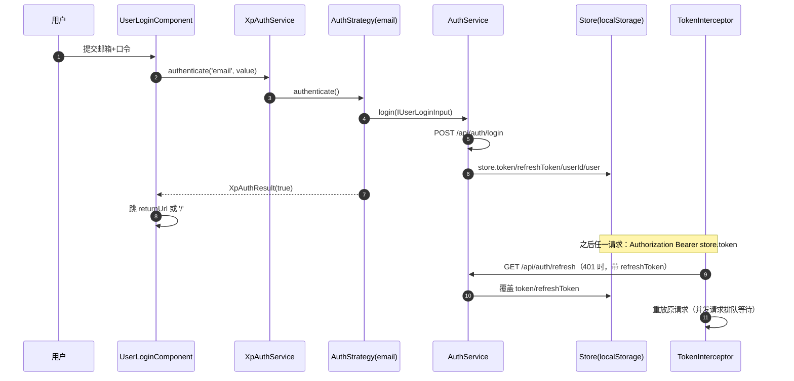

# 05 接口

> 模块：Xpert 前端 · 全站准入边界（`apps/cloud/src/app/auth/**` + `apps/cloud/src/app/onboarding/**`，引用面 `@core/auth`、`@core/guards`）
> 入口：`/auth/**`（login · consent · register · register-result · request-password · reset-password · accept-invite · verify · logout · sso-bind · sso-confirm）· `/onboarding/**`（welcome → tenant-details → plugins）
> 口径：`API_PREFIX = '/api'`；`C_API_AUTH = '/api/auth'`；表单型组件另接 `/api/auth/sso/*`、`/api/tenant/*`、`/api/system/setup/plugins`、`/api/invite/*`、`/api/referral/*`。**服务端契约归属「后端专题/身份与权限专家」**，本文只描述前端实际发出的请求与前端契约。

**本文引用的文件**
- [auth.options.ts](file://apps/cloud/src/app/auth/auth.options.ts)
- [auth.module.ts](file://apps/cloud/src/app/auth/auth.module.ts)
- [auth-routing.module.ts](file://apps/cloud/src/app/auth/auth-routing.module.ts)
- [helpers.ts](file://apps/cloud/src/app/auth/helpers.ts)
- [services/auth.service.ts](file://apps/cloud/src/app/auth/services/auth.service.ts)
- [services/auth-result.ts](file://apps/cloud/src/app/auth/services/auth-result.ts)
- [services/token/token.ts](file://apps/cloud/src/app/auth/services/token/token.ts)
- [services/token/token.service.ts](file://apps/cloud/src/app/auth/services/token/token.service.ts)
- [services/token/token-storage.ts](file://apps/cloud/src/app/auth/services/token/token-storage.ts)
- [services/token/token-parceler.ts](file://apps/cloud/src/app/auth/services/token/token-parceler.ts)
- [strategies/auth-strategy.ts](file://apps/cloud/src/app/auth/strategies/auth-strategy.ts)
- [strategies/auth-strategy-options.ts](file://apps/cloud/src/app/auth/strategies/auth-strategy-options.ts)
- [strategies/password/password-strategy.ts](file://apps/cloud/src/app/auth/strategies/password/password-strategy.ts)
- [strategies/password/password-strategy-options.ts](file://apps/cloud/src/app/auth/strategies/password/password-strategy-options.ts)
- [guards/no-auth.guard.ts](file://apps/cloud/src/app/auth/guards/no-auth.guard.ts)
- [login.component.ts](file://apps/cloud/src/app/auth/login/login.component.ts)
- [register.component.ts](file://apps/cloud/src/app/auth/register/register.component.ts)
- [consent/consent.component.ts](file://apps/cloud/src/app/auth/consent/consent.component.ts)
- [sso-bind/sso-bind.component.ts](file://apps/cloud/src/app/auth/sso-bind/sso-bind.component.ts)
- [current-user-sso-confirm/current-user-sso-confirm.component.ts](file://apps/cloud/src/app/auth/current-user-sso-confirm/current-user-sso-confirm.component.ts)
- [accept-invite/accept-invite.component.ts](file://apps/cloud/src/app/auth/accept-invite/accept-invite.component.ts)
- [verify-email/verify-email.component.ts](file://apps/cloud/src/app/auth/verify-email/verify-email.component.ts)
- [referral-registration-session.ts](file://apps/cloud/src/app/auth/referral-registration-session.ts)
- [@core/auth/auth-strategy.service.ts](file://apps/cloud/src/app/@core/auth/auth-strategy.service.ts)
- [@core/auth/auth.guard.ts](file://apps/cloud/src/app/@core/auth/auth.guard.ts)
- [@core/auth/no-auth.guard.ts](file://apps/cloud/src/app/@core/auth/no-auth.guard.ts)
- [@core/auth/signin-success/sign-in-success.component.ts](file://apps/cloud/src/app/@core/auth/signin-success/sign-in-success.component.ts)
- [@core/guards/invite.guard.ts](file://apps/cloud/src/app/@core/guards/invite.guard.ts)
- [@core/guards/onboard.guard.ts](file://apps/cloud/src/app/@core/guards/onboard.guard.ts)
- [@core/guards/dirty-check.guard.ts](file://apps/cloud/src/app/@core/guards/dirty-check.guard.ts)
- [@core/interceptors/token.interceptor.ts](file://apps/cloud/src/app/@core/interceptors/token.interceptor.ts)
- [@core/state/auth.service.ts](file://apps/cloud/src/app/@core/state/auth.service.ts)
- [@core/state/invite.service.ts](file://apps/cloud/src/app/@core/state/invite.service.ts)
- [@core/state/constants/app.constants.ts](file://apps/cloud/src/app/@core/state/constants/app.constants.ts)
- [@core/state/store.service.ts](file://apps/cloud/src/app/@core/state/store.service.ts)
- [onboarding-routing.module.ts](file://apps/cloud/src/app/onboarding/onboarding-routing.module.ts)
- [onboarding/tenant-details/tenant-details.component.ts](file://apps/cloud/src/app/onboarding/tenant-details/tenant-details.component.ts)
- [onboarding/plugins/setup-plugins.component.ts](file://apps/cloud/src/app/onboarding/plugins/setup-plugins.component.ts)
- [main.ts](file://apps/cloud/src/main.ts)
- [认证与凭据子专家 05-接口](file://.module-experts/后端专题/身份与权限专家/sub-experts/认证与凭据子专家/implementation/05-接口.md)

## 目录

1. 接口口径与归属
2. 认证端点（策略面 6 条 + 实际生效面）
3. OIDC / SSO 端点
4. 前端服务契约：XpAuthService
5. 策略契约：XpAuthStrategy 与 XpAuthOptions
6. 守卫契约（准入矩阵）
7. token 契约
8. 错误语义
9. 调用时序图
10. 未能确认

---

## 1. 接口口径与归属

本域同时存在**两套认证调用面**，改接口前必须先判断改的是哪一套：

| 面 | 载体 | 现状 |
|---|---|---|
| 策略面（Nebular 改造遗留） | `XpPasswordAuthStrategy` ← `baseEndpoint` 拼 `endpoint` | **代码在、已不被注册**：`@core/auth/auth.module.ts` 只注册 `AuthStrategy.setup({ name: 'email' })` |
| 生效面 | `AuthStrategy`（name=`email`）→ `AuthService`（`@cloud/app/@core/state`）→ `/api/auth/*` | **活跃**：登录/注册/刷新/找回/验证全走这里 |

- `/api/auth/custom/*` 在本仓库**只出现在测试与 ki 记忆**（`password-strategy.spec.ts` 用 `baseEndpoint` 覆盖出的断言路径），生产源码零引用；服务端亦无该路由（后端专家已源码核实）。
- 服务端端点明细（方法、DTO、守卫、状态码归属）**指向后端资产**：`.module-experts/后端专题/身份与权限专家/{C1-能力契约.md,implementation/05-接口.md,implementation/07-运维.md}` 与 `sub-experts/认证与凭据子专家/implementation/05-接口.md`；冲突时以服务端为准。

章节来源：[auth.module.ts](file://apps/cloud/src/app/@core/auth/auth.module.ts)（关键符号：`AuthModule`、`AuthStrategy.setup`）、[认证与凭据子专家 05-接口](file://.module-experts/后端专题/身份与权限专家/sub-experts/认证与凭据子专家/implementation/05-接口.md)（关键符号：`AuthController`）

## 2. 认证端点（策略面 6 条 + 实际生效面）

### 2.1 策略面默认表（`XpPasswordAuthStrategyOptions`，`baseEndpoint = '/api/auth/'`）

| 方法 | 路径 | 用途 | 关键参数与行为 | 主要错误 | 消费方 |
|---|---|---|---|---|---|
| POST | `/api/auth/login` | 登录 | body=`data`（`requireValidToken: true`）；token 取 `data.token`，消息取 `data.messages` | 非 2xx → `login.defaultErrors` | `XpPasswordAuthStrategy.authenticate` |
| POST | `/api/auth/register` | 注册 | 同上；token 用 `register` 响应体 | 非 2xx → `register.defaultErrors` | `XpPasswordAuthStrategy.register` |
| POST | `/api/auth/request-pass` | 申请重置邮件 | body=`{email}`，无 token 提取 | 非 2xx | `requestPassword` |
| PUT | `/api/auth/reset-pass` | 用 token 改密 | body=`data` + `reset_password_token`（**从当前路由 query 取**） | 非 2xx | `resetPassword` |
| DELETE | `/api/auth/logout` | 登出 | 无 body；url 为空时**跳过请求**直接成功 | 非 2xx | `logout` |
| POST | `/api/auth/refresh-token` | 刷新令牌 | body=`data`，`requireValidToken: true` | 非 2xx | `refreshToken` |

- 字段映射固定：`token.key = 'data.token'`、`errors.key = 'data.errors'`、`messages.key = 'data.messages'`；`resetPass.resetPasswordTokenKey = 'reset_password_token'`。
- **`/api/auth/custom/*` 是测试注入的变体**（spec 断言 `/api/auth/custom/request-pass` 等），非默认值。

章节来源：[password-strategy-options.ts](file://apps/cloud/src/app/auth/strategies/password/password-strategy-options.ts)（关键符号：`XpPasswordAuthStrategyOptions`）、[password-strategy.ts](file://apps/cloud/src/app/auth/strategies/password/password-strategy.ts)（关键符号：`XpPasswordAuthStrategy.resetPassword`、`XpPasswordAuthStrategy.handleResponseError`）

### 2.2 实际生效面（`AuthStrategy` → `AuthService`，`/api/auth/*`）

| 方法 | 路径 | 用途 | 关键参数与行为 | 主要错误 | 消费方 |
|---|---|---|---|---|---|
| POST | `/api/auth/login` | 登录 | body=`IUserLoginInput{email,password}`；成功写 `store.userId/token/refreshToken/user` | 无 `user` 字段即判失败 | `AuthStrategy.login` ← `XpAuthService.authenticate` |
| POST | `/api/auth/signup` | 自助注册 | body=`{user{firstName,lastName,email,tenant,tags}, password, confirmPassword, referralCode?}` | 409 / 400 / 其它 | `AuthStrategy.register` |
| POST | `/api/auth/register` | 代客/受邀注册 | `IUserRegistrationInput` | 同签 | `AuthService.register`（邀请接受路径复用） |
| POST | `/api/auth/request-password` | 找回密码 | body=`{email}` | 非 2xx → toast 失败 | `AuthStrategy.requestPassword` |
| POST | `/api/auth/reset-password` | 改密 | body=`{token(来自 ?token=), password, confirmPassword}` | 400 → 抛出 | `AuthStrategy.resetPassword` |
| GET | `/api/auth/refresh` | 刷新令牌 | **用 `Authorization: Bearer <refreshToken>`**；返回 `{token, refreshToken}` | 401 → 登出 | `AuthStrategy.refreshToken` ← 拦截器 |
| GET | `/api/auth/verify?token=` | 邮箱验证 | query `token` | 失败取 `err.error` | `VarifyEmailComponent.getTranslation` |
| GET | `/api/auth/authenticated` | 登录态断言 | 返回 boolean | — | `AuthService.isAuthenticated`（遗留守卫） |
| POST | `/api/auth/sso/bind/register` | SSO 注册并绑定 | body=`{ticket,email,password,confirmPassword,referralCode?}` → `{location}` | 409 冲突保留表单 | `UserRegisterComponent.register` |

- 注册成功后**不自动登录**（`signup → switchMap(login)` 段已被注释），只回 `XpAuthResult(true, null, false, [], [])`。

章节来源：[auth-strategy.service.ts](file://apps/cloud/src/app/@core/auth/auth-strategy.service.ts)（关键符号：`AuthStrategy.login`、`AuthStrategy.register`、`AuthStrategy._logout`）、[auth.service.ts](file://apps/cloud/src/app/@core/state/auth.service.ts)（关键符号：`AuthService.refreshAccessToken`、`AuthService.verifyEmail`）

### 2.3 非认证前缀但属本域的端点

| 方法 | 路径 | 用途 | 关键参数 | 消费方 |
|---|---|---|---|---|
| GET | `/api/invite/validate` | 邀请校验 | `data=JSON({relations,findInput:{email,token}})` | `AcceptInvitePageComponent.loadInvite` |
| POST | `/api/invite/user` | 接受用户邀请 | `{user,password,referralCode,organization,inviteId}` | `AcceptInvitePageComponent.submitForm` |
| GET | `/api/referral/availability`、`/api/referral/validate` | 返利开关与校验 | 可带 `Tenant-Id` 头 | `UserRegisterComponent`（`ReferralService`） |
| GET | `/api/tenant/onboard` | 是否已 onboard | 无参，`shareReplay(1)` | `onboardGuard`、`AppInitService.init` |
| POST | `/api/tenant/onboard` | 创建租户+组织+超管 | `{name,superAdmin{...},defaultOrganization{...}}` | `TenantDetailsComponent.onboard` |
| GET/POST | `/api/system/setup/plugins`、`/api/system/setup/plugins/catalog` | onboarding 末步插件安装 | `{plugins[],importDefaultAgentPlugins}` / 分页查询 | `SetupPluginsComponent` |

章节来源：[invite.service.ts](file://apps/cloud/src/app/@core/state/invite.service.ts)（关键符号：`InviteService.validateInvite`、`InviteService.acceptUserInvite`）、[tenant-details.component.ts](file://apps/cloud/src/app/onboarding/tenant-details/tenant-details.component.ts)（关键符号：`TenantDetailsComponent.afterOnboard`）

## 3. OIDC / SSO 端点

### 3.1 OIDC consent（`/auth/consent`，`mcpOAuthEnabled` 门控）

| 方法 | 路径 | 用途 | 关键参数与行为 | 主要错误 |
|---|---|---|---|---|
| GET | `{XP_API_BASE_URL}/oidc/interaction/{interaction}/consent` | 拉取授权请求详情 | `withCredentials: true`；`interaction` 取自 `?interaction=`；返回 `{clientId,clientName,scopes,resources}` | 任意异常 → `loadFailed = true` |
| POST（原生表单） | `{XP_API_BASE_URL}/oidc/interaction/{interaction}/consent` | 提交同意/拒绝 | 动态 `form` + hidden `decision=allow\|deny`，整页提交（非 XHR）；`interaction` 做 `encodeURIComponent` | 提交前若 `loading/loadFailed/submitting` 则忽略 |

- **`state`/`nonce` 语义**：前端**不生成也不校验**，仅透传 `interaction`；state/nonce 由服务端授权码流持有（**不确定处，见 §10**）。
- 路由**默认不存在**：`environment.mcpOAuthEnabled` 在本仓库 dev/jest/prod 三份环境文件里均为 `false`，故 `/auth/consent` 不注册。

章节来源：[consent.component.ts](file://apps/cloud/src/app/auth/consent/consent.component.ts)（关键符号：`OidcConsentComponent.submitDecision`、`OidcConsentComponent.interaction`）、[auth-routing.module.ts](file://apps/cloud/src/app/auth/auth-routing.module.ts)（关键符号：`routes`）

### 3.2 SSO 发现与绑定

| 方法 | 路径 | 用途 | 关键参数 | 主要错误 |
|---|---|---|---|---|
| GET | `/api/auth/sso/providers` | provider 发现 | 无参；返回 `{fallbackApplied, providers[]}`，`startUrl` 为整页跳转地址 | 失败静默降级为 `[]` |
| GET | `/api/auth/sso/bind/challenge?ticket=` | 绑定挑战（匿名） | `ticket` 来自 `?ticket=`；返回 `{provider,displayName?,avatarUrl?,tenantScoped,expiresAt}` | 400/ticket 过期 |
| POST | `/api/auth/sso/bind/complete` | 匿名绑定既有账号 | `{ticket,userName,password}` → `{location}` | 400 过期、401 凭据错、409 冲突 |
| POST | `/api/auth/sso/bind/register` | 注册并绑定 | `{ticket,email,password,confirmPassword,referralCode?}` → `{location}` | 409 冲突（保留表单与 ticket） |
| GET | `/api/auth/sso/bind/current-user/challenge?ticket=` | 已登录用户确认绑定 | 同 challenge 结构 | 401 需重新登录 |
| POST | `/api/auth/sso/bind/current-user/complete` | 已登录用户完成绑定 | `{ticket}` → `{location}` | 400/401/409 |

- 成功后一律 `window.location.assign(result.location)`（服务端给 `/sign-in/success?jwt=&refreshToken=&userId=`）；`referralCode` 经 `sessionStorage`（键 `xpert.registration.referral-code`）跨页保持。
- 登录页对回调失败做 query 解析：`?error=invalid_credentials|invalid_tenant|interaction_expired`、`?ssoError=&ssoProvider=&ssoMessage=`。

章节来源：[sso-bind.component.ts](file://apps/cloud/src/app/auth/sso-bind/sso-bind.component.ts)（关键符号：`SsoBindComponent.loadChallenge`、`SsoBindComponent.handleSubmitError`）、[login.component.ts](file://apps/cloud/src/app/auth/login/login.component.ts)（关键符号：`UserLoginComponent.resolveSsoErrors`、`UserLoginComponent.openProvider`）

## 4. 前端服务契约：XpAuthService

`XpAuthService` 是「UI ⇄ 策略」的唯一中介，**全部动作按 `strategyName` 参数化**；未注册的名字直接抛错。

| # | 方法 | 用途 | 参数与策略语义 | 返回 / 异常 |
|---|---|---|---|---|
| 1 | `getToken()` | 读当前令牌 | 无 | `Observable<XpAuthToken>`（来自 `XpAuthTokenService`） |
| 2 | `isAuthenticated()` | 令牌有效 | 无 | `Observable<boolean>` = `token.isValid()` |
| 3 | `isAuthenticatedOrRefresh()` | 有值但过期则先刷新 | 无 | 刷新成功→再判有效；失败→`false` |
| 4 | `onTokenChange()` | 令牌变更广播 | 无 | `Observable<XpAuthToken>`（`tokenChange()`，过滤空值） |
| 5 | `onAuthenticationChange()` | 登录态广播 | 无 | `Observable<boolean>` |
| 6 | `authenticate(name, data?)` | 登录 | `data` 透传策略 | `Observable<XpAuthResult>`；成功后写 token |
| 7 | `register(name, data?)` | 注册 | 同上 | 同上 |
| 8 | `logout(name)` | 登出 | 无参 | 成功时 `tokenService.clear()` |
| 9 | `requestPassword(name, data?)` | 申请重置 | 同上 | 不写 token |
| 10 | `resetPassword(name, data?)` | 执行重置 | 同上 | 不写 token |
| 11 | `refreshToken(name, data?)` | 刷新 | 同上 | 成功后写 token |

- 约束 1：`getStrategy()` 找不到名字时 `throw new TypeError("There is no Auth Strategy registered under '<name>' name")`——**只写策略类不注册策略表 = 运行期崩溃**。
- 约束 2：`processResultToken()` 仅在 `result.isSuccess() && result.getToken()` 时落盘。

章节来源：[auth.service.ts](file://apps/cloud/src/app/auth/services/auth.service.ts)（关键符号：`XpAuthService.getStrategy`、`XpAuthService.processResultToken`）

## 5. 策略契约：XpAuthStrategy 与 XpAuthOptions

**实现新策略必须提供的成员**（抽象基类 `XpAuthStrategy`）：
`authenticate / register / requestPassword / resetPassword / logout / refreshToken`（6 个抽象方法，均可选 `data`，返回 `Observable<XpAuthResult>`）；继承到的非抽象能力：`setOptions`（与 `defaultOptions` 深合并）、`getOption(key)`（点号路径取值）、`createToken(value, failWhenInvalidToken?)`、`getName()`、`createFailResponse`/`createSuccessResponse`、`getActionEndpoint(action)`（= `baseEndpoint + <action>.endpoint`）。**策略必须自己声明 `defaultOptions` 与 `getName` 依据的 `name` 选项**。

**`XpAuthOptions` 策略表结构**：`{ forms?: any; strategies?: XpAuthStrategies }`，其中 `XpAuthStrategies = [XpAuthStrategyClass, XpAuthStrategyOptions][]`（类 + 选项二元组数组）；`auth.module.ts` 的 `nbStrategiesFactory` 用 `injector.get(strategyClass)` 实例化并 `setOptions(strategyOptions)`；`nbOptionsFactory` 把用户选项与 `defaultAuthOptions` 做 `deepExtend`。

| 注入令牌 | 语义 |
|---|---|
| `XP_AUTH_OPTIONS` / `XP_AUTH_USER_OPTIONS` | 合并后选项 / 调用方原始选项 |
| `XP_AUTH_STRATEGIES` | 实例化后的策略数组（`XpAuthService` 依赖它） |
| `XP_AUTH_TOKENS` / `XP_AUTH_FALLBACK_TOKEN` | 令牌类注册表 / 反序列化兜底类（默认 `NbAuthSimpleToken`） |
| `XP_AUTH_INTERCEPTOR_HEADER` | 默认 `'Authorization'` |
| `XP_API_BASE_URL` | consent 组件用的 API 根（**提供方未在本模块内，见 §10**） |

`defaultAuthOptions.forms` 规定各页行为：`redirectDelay: 500`、`strategy: 'email'`、`showMessages.{success,error}`、`register.{terms:true, enablePublicSignup:true}`、`validation.password.{required,minLength:4,maxLength:50}`。

章节来源：[auth-strategy.ts](file://apps/cloud/src/app/auth/strategies/auth-strategy.ts)（关键符号：`XpAuthStrategy.createToken`、`XpAuthStrategy.getActionEndpoint`）、[auth.options.ts](file://apps/cloud/src/app/auth/auth.options.ts)（关键符号：`XpAuthOptions`、`defaultAuthOptions`）

## 6. 守卫契约（准入矩阵）

**本节是本域最核心的对外契约**——全站访问边界由这 5 个守卫 + NoAuthGuard 的例外规则决定。

| 守卫 | 类型 / 位置 | 判定条件 | 拒绝时跳转目标 | 例外 |
|---|---|---|---|---|
| `authGuard` | `CanActivateFn` · `@core/auth/auth.guard.ts` | `!!store.token`（只读本地 store，**不发请求**） | 先 `await authStrategy.logout()`，再 `router.navigate(['/auth/login'], {queryParams:{returnUrl: state.url}})` | 无 |
| `NoAuthGuard` | 类 · `auth/guards/no-auth.guard.ts`（auth 路由用） | ①`!store.token`→放行；②否则 `await authService.isAuthenticated()`，未认证放行 | 已登录 → `['/home']` | `accept-invite` 且 query 同时含 `email` 与 `token` → **无条件放行** |
| `NoAuthGuard` | 类 · `@core/auth/no-auth.guard.ts`（@core 版，另一实现） | `await authService.isAuthenticated()` | 已登录 → `['/pages/dashboard']`（**遗留目标**） | 无 |
| `inviteGuard` | 函数 · `@core/guards/invite.guard.ts` | `route.data.expectedPermissions.some(store.hasPermission)` **且** `selectedOrganization?.invitesAllowed` | 不满足 → `['/']` | 无 |
| `onboardGuard` | 函数 · `@core/guards/onboard.guard.ts` | `TenantService.getOnboard()`：有 `tenant`→已开通；有 `error`→探测失败；否则可引导 | `tenant` → `['/home/']`；`error` → `['/onboarding/unknown']` | 两者皆无 → 放行（进入 welcome/tenant 步） |
| `dirtyCheckGuard` / `DirtyCheckGuard`（`@deprecated` 类） | `CanDeactivateFn<IsDirty>` · `@core/guards/dirty-check.guard.ts` | `component.isDirty()`（signal/函数/布尔均可） | 不 dirty → `true`；dirty → 弹 `ZardAlertDialogService.confirm`（`XP.KEY_WORDS.Confirm` / `XP.MESSAGE.ConfirmExitDirtyData`） | 取消即留在原页（返回 `false`） |

**挂载实况**：

| 路由 | 守卫 | 说明 |
|---|---|---|
| `/onboarding`（根） | 无（壳组件 `OnboardingComponent`） | 子路由各自守卫 |
| `/onboarding`（welcome） | `onboardGuard` | 已开通用户被送回 `/home` |
| `/onboarding/tenant` | `onboardGuard` | 已开通即不可重入 |
| `/onboarding/plugins` | `authGuard` | **必须已登录**（tenant-details 成功后 `authStrategy.login` 才跳这里） |
| `/onboarding/unknown` | 无 | `onboardGuard` 的兜底落点 |
| `/auth/request-password`、`/auth/reset-password`、`/auth/accept-invite`、`/auth/verify` | `NoAuthGuard` | 未登录可用，已登录跳 `/home` |
| `/auth/{login,register,register-result,logout,sso-bind,sso-confirm,consent}` | 无 | 靠页面自身逻辑 |
| 全站 features（`/chat`、`/explore`、`/xpert`、`/settings` 等） | `authGuard`（+`NgxPermissionsGuard`、`featureGate`） | 见 07-运维 §4 |

章节来源：[auth.guard.ts](file://apps/cloud/src/app/@core/auth/auth.guard.ts)（关键符号：`authGuard`）、[no-auth.guard.ts](file://apps/cloud/src/app/auth/guards/no-auth.guard.ts)（关键符号：`NoAuthGuard.canAccessInviteRoute`、`NoAuthGuard.canActivate`）、[onboard.guard.ts](file://apps/cloud/src/app/@core/guards/onboard.guard.ts)（关键符号：`onboardGuard`）、[invite.guard.ts](file://apps/cloud/src/app/@core/guards/invite.guard.ts)（关键符号：`inviteGuard`）、[dirty-check.guard.ts](file://apps/cloud/src/app/@core/guards/dirty-check.guard.ts)（关键符号：`dirtyCheckGuard`、`DirtyCheckGuard.canDeactivate`）

## 7. token 契约

- **存取位置**：生效面令牌存于 `Store`（`@core/state`）的 akita `PersistStore`，由 `main.ts` 的 `persistState({ key: '_xpertStore' })` 落 localStorage；初始态从 localStorage 的 `token`、`_userId`、`_organizationId`、`_activeScopeLevel`、`_lastOrganizationId`、`serverConnection` 等键回填。遗留面另有 `XpTokenLocalStorage`（键 `auth_app_token`，经 `XpAuthTokenParceler` 序列化为 `{name,ownerStrategyName,createdAt,value}`）与 `XpAuthTokenService`（`BehaviorSubject` + `tokenChange()`）。
- **写入点**：`AuthStrategy.login`（`userId/token/refreshToken/user` + `restoreRememberedScope`）、`AuthStrategy.refreshToken`（`token/refreshToken`）、`SignInSuccessComponent`（`?jwt=&refreshToken=&userId=&returnTo=` → 写 store 后 `AppInitService.init()`，`returnTo` 仅接受同源相对路径）、`AuthStrategy._logout`（`store.clear()` + `serverConnection = 200`）。
- **读取点**：`TokenInterceptor.addAuthenticationToken`（普通请求放 `store.token`，`auth/refresh` 请求放 `store.refreshToken`，均为 `Authorization: Bearer …`）、`authGuard`（`!!store.token`）、`NoAuthGuard`（`store.token` 短路）。
- **刷新时机**：仅当响应 `401`、请求不在**匿名白名单**（`/api/auth/login`、`/api/auth/sso/providers`、`/api/auth/sso/bind/{challenge,complete,register}`、`/api/tenant/onboard`）、URL 不含 `auth/refresh|login`、且未设 `SKIP_AUTH_REFRESH` 上下文时触发；refresh 请求自身 401 → `auth.logout()`。并发去重两层：拦截器 `refreshTokenInProgress` + `refreshTokenSubject`；策略侧 `AuthStrategy.refreshTokenReq` signal + `shareReplay(1)`。
- **`onTokenChange` 广播语义**：来自 `XpAuthTokenService.tokenChange()`（空值被 `filter` 掉，`share()` 复用），`onAuthenticationChange()` 是它的 `isValid()` 映射。**注意**：`AuthStrategy` 不写入 `XpAuthTokenService`（只写 `Store`），因此该广播在生效面上不反映登录态变化——全站登录态请以 `Store` 为准。
- **合法性**：`XpAuthToken.isValid()` 抽象；`NbAuthSimpleToken`=非空、`NbAuthJWTToken`=非空且未过 `exp`、`NbAuthOAuth2*Token` 另看 `expires_in`。`createToken(failWhenInvalidToken=true)` 时非法直接抛 `NbAuthIllegalTokenError`（含 `NbAuthEmptyTokenError`/`NbAuthIllegalJWTTokenError`）。

章节来源：[store.service.ts](file://apps/cloud/src/app/@core/state/store.service.ts)（关键符号：`createInitialPersistState`、`Store.clear`）、[main.ts](file://apps/cloud/src/main.ts)（关键符号：`persistState`）、[token.interceptor.ts](file://apps/cloud/src/app/@core/interceptors/token.interceptor.ts)（关键符号：`TokenInterceptor.intercept`、`isAnonymousAuthRequest`）、[token.ts](file://apps/cloud/src/app/auth/services/token/token.ts)（关键符号：`NbAuthJWTToken.isValid`、`decodeJwtPayload`）

## 8. 错误语义

| 场景 | 触发条件 | 前端表现 |
|---|---|---|
| 凭据错误 | 服务端登录失败（后端为 `200 + null`）或 4xx | `XpAuthResult(false, err, false, ['Login/Email combination is not correct, please try again.'])`；`AuthStrategy.login` 另打 `console.error(err)` |
| 账号未验证 | 注册后未点邮件链接 | 注册页展示 `Auth.SignupSuccess`（提示查收邮件）；`/auth/verify?token=` 成功→`Auth.VarifyEmailSuccess`，失败→`err.error` |
| 邀请失效 | `GET /api/invite/validate` 抛错或返回空 | `AcceptInvitePageComponent.inviteLoadErrorMessage = 'Invitation no longer valid'` |
| OIDC 回调失败 | `/auth/login?error=…` | `invalid_credentials`→凭据文案、`invalid_tenant`→`The requested tenant is not available.`、`interaction_expired`→`Session expired, please try again.` |
| SSO 回调失败 | `/auth/login?ssoProvider=&ssoError=` / `?ssoMessage=` | `ssoMessage` 优先原样显示；否则 `<Provider> sign-in failed. Please try again.` |
| SSO 绑定失败 | 400/401/409 | 400 且含 `expired` → 会话失效并清 challenge；401 → 账号或口令错误；409 → 冲突提示（保留 ticket） |
| token 过期 | 任意受保护请求 401 | 拦截器静默刷新并**重放原请求**；刷新失败 → `logout()` → 下次导航被 `authGuard` 送到 `/auth/login?returnUrl=` |
| 密码不一致 | 注册/重置本地校验 | 注册：`"The passwords don't match."`；重置：`'The password and confirmation password do not match.'` |
| 策略未注册 | 传入未知 `strategyName` | `TypeError: There is no Auth Strategy registered under '<name>' name`（同步抛出，非 Observable 错误） |
| 登出接口异常 | 清理接口 4xx/5xx/超时 | **仍判成功**：5s `timeout` + `SKIP_AUTH_REFRESH`，本地身份一定清空 |

章节来源：[auth-strategy.service.ts](file://apps/cloud/src/app/@core/auth/auth-strategy.service.ts)（关键符号：`AuthStrategy.logout`、`AuthStrategy.resetPassword`）、[login.component.ts](file://apps/cloud/src/app/auth/login/login.component.ts)（关键符号：`UserLoginComponent.oidcErrorMap`）、[accept-invite.component.ts](file://apps/cloud/src/app/auth/accept-invite/accept-invite.component.ts)（关键符号：`AcceptInvitePageComponent.loadInvite`）

## 9. 调用时序图

图表来源：[auth-strategy.service.ts](file://apps/cloud/src/app/@core/auth/auth-strategy.service.ts)（关键符号：`AuthStrategy.authenticate`、`AuthStrategy.refreshToken`）、[token.interceptor.ts](file://apps/cloud/src/app/@core/interceptors/token.interceptor.ts)（关键符号：`TokenInterceptor.addAuthenticationToken`）

## 10. 未能确认

- `XP_API_BASE_URL` 的实际提供方未在本域模块内出现（`XpAuthModule` 只提供 header/token/strategy 相关令牌），OIDC 端点的宿主基址需由应用层注入——**待确认**。
- OIDC 授权码流的 `state`/`nonce` 由服务端持有：前端只透传 `interaction` 与 `ticket`，**未经源码核实服务端如何校验**。
- `/api/auth/custom/*` 仅在 `password-strategy.spec.ts` 出现；若线上真实存在该前缀，需以服务端路由表复核（后端专家结论为不存在）。
- `/auth/consent` 线上是否可达取决于部署环境是否开启 `mcpOAuthEnabled`（本仓库三份环境文件均为 `false`）。
- `sso-confirm` 页面在什么条件下被服务端作为回调落点，未在本域代码中体现。

章节来源：[auth.options.ts](file://apps/cloud/src/app/auth/auth.options.ts)（关键符号：`XP_API_BASE_URL`）、[consent.component.ts](file://apps/cloud/src/app/auth/consent/consent.component.ts)（关键符号：`OidcConsentComponent.ngOnInit`）
