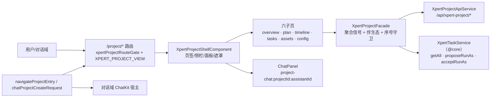

# C0 使用总览：项目协作专家

> 一句话定位：Xpert 前端的**项目协作域**——平台内 `/project` 的项目列表与 `/project/:id` 工作区（概览 / 计划 / 任务时间线 / 会话 / 资源 / 配置六页签），以及 `type-entry` 入口解析与「对话内建项目」桥。
> 范围：`apps/cloud/src/app/features/project`（**25 非 spec `.ts` / 13 spec**）；不含对话工作台与 ChatKit 宿主状态机（对话前端专家）、不含后端 `xpert-project` 域（后端批次 5 未建）。

**本文引用的文件**

- [features-routing.module.ts](file://apps/cloud/src/app/features/features-routing.module.ts)
- [routes.ts](file://apps/cloud/src/app/features/project/routes.ts)
- [project.facade.ts](file://apps/cloud/src/app/features/project/project.facade.ts)
- [project-api.service.ts](file://apps/cloud/src/app/features/project/project-api.service.ts)
- [project-entry.ts](file://apps/cloud/src/app/features/project/project-entry.ts)
- [project-chat-create.ts](file://apps/cloud/src/app/features/project/project-chat-create.ts)
- [project-shell.component.ts](file://apps/cloud/src/app/features/project/project-shell.component.ts)
- [project-list.component.ts](file://apps/cloud/src/app/features/project/project-list.component.ts)
- [project-plan.component.ts](file://apps/cloud/src/app/features/project/project-plan.component.ts)
- [project-task-management.component.ts](file://apps/cloud/src/app/features/project/project-task-management.component.ts)
- [project-config.component.ts](file://apps/cloud/src/app/features/project/project-config.component.ts)
- [project-chat-panel.component.ts](file://apps/cloud/src/app/features/project/project-chat-panel.component.ts)
- [project-invitation-accept.component.ts](file://apps/cloud/src/app/features/project/project-invitation-accept.component.ts)
- [project-assets.component.ts](file://apps/cloud/src/app/features/project/project-assets.component.ts)
- [xpert-task.service.ts](file://apps/cloud/src/app/@core/services/xpert-task.service.ts)
- [xpert-project.service.ts](file://apps/cloud/src/app/@core/services/xpert-project.service.ts)
- [xpert-project-type.model.ts](file://packages/contracts/src/ai/xpert-project-type.model.ts)
- [project-selection.model.ts](file://packages/contracts/src/ai/project-selection.model.ts)
- [workbench-chat.facade.ts](file://apps/cloud/src/app/features/chat/workbench-chat/workbench-chat.facade.ts)
- file://.module-experts/前端专题/项目协作专家/implementation/01-架构.md
- file://.module-experts/前端专题/项目协作专家/C1-能力契约.md

## 目录

1. [定位与何时找](#1-定位与何时找)
2. [契约自足声明与资产基线](#2-契约自足声明与资产基线)
3. [能力清单](#3-能力清单)
4. [边界](#4-边界)
5. [已知问题与常见坑](#5-已知问题与常见坑)

## 1. 定位与何时找

**定位**：本域是「**页面族 + 信号门面 + 端点面 + 入口解析**」四层结构。`/project/:id` 的 `XpertProjectShellComponent` 是唯一壳（页签、治理侧栏、遮罩、会话面板全部状态镜像到 URL query），六个子页与对话框族只读写 `XpertProjectFacade` 或 `XpertProjectApiService`；入口解析 `navigateProjectEntry` 与对话建项目桥 `chatProjectCreateRequest`/`executeChatProjectCreate` 是无状态纯函数，被列表页与对话域 ChatKit 宿主共同消费。

图表来源：[project-shell.component.ts](file://apps/cloud/src/app/features/project/project-shell.component.ts)（关键符号：`tabs`、`chatPanelOpen`、`id`）、[project.facade.ts](file://apps/cloud/src/app/features/project/project.facade.ts)（关键符号：`XpertProjectFacade`、`loadProject`）、[project-api.service.ts](file://apps/cloud/src/app/features/project/project-api.service.ts)（关键符号：`XpertProjectApiService`）、[project-entry.ts](file://apps/cloud/src/app/features/project/project-entry.ts)（关键符号：`navigateProjectEntry`）

**何时找（10 条）**

1. **改项目列表或路由结构**（类型菜单、筛选、分页、DSL 导入、新增子页）→ [routes.ts](file://apps/cloud/src/app/features/project/routes.ts)、[project-list.component.ts](file://apps/cloud/src/app/features/project/project-list.component.ts)。
2. **改项目数据加载与合并语义**（并发、序号守卫、伴生态、局部回填）→ [project.facade.ts](file://apps/cloud/src/app/features/project/project.facade.ts)。
3. **新增/调整项目端点调用**（成员、邀请、指令、技能、资产、计划、任务、自动化、工作区文件）→ [project-api.service.ts](file://apps/cloud/src/app/features/project/project-api.service.ts)（逐端点清单见 [C1-能力契约.md](file://.module-experts/前端专题/项目协作专家/C1-能力契约.md) §2）。
4. **项目入口跳转**（平台项目 vs 宿主应用视图、默认类型）→ [project-entry.ts](file://apps/cloud/src/app/features/project/project-entry.ts)。
5. **对话内建项目 / 选项目**（ChatKit `project.create`、`project.create-entry` 事件）→ [project-chat-create.ts](file://apps/cloud/src/app/features/project/project-chat-create.ts)（消费方在对话域 `clawxpert-conversation-detail.component.ts`）。
6. **计划 / 任务联动**（看板拖拽、冲刺、里程碑、任务抽屉与执行上下文）→ [project-plan.component.ts](file://apps/cloud/src/app/features/project/project-plan.component.ts)、[project-task-management.component.ts](file://apps/cloud/src/app/features/project/project-task-management.component.ts)。
7. **项目内专家会话**（面板挂载、锁定项目、既有会话对话框、client-command 发消息）→ [project-chat-panel.component.ts](file://apps/cloud/src/app/features/project/project-chat-panel.component.ts)、[project-shell.component.ts](file://apps/cloud/src/app/features/project/project-shell.component.ts)。
8. **成员与邀请**（列表/角色/所有权转移/邀请与撤销/接受流程与组织切换）→ [project-config.component.ts](file://apps/cloud/src/app/features/project/project-config.component.ts)、[project-invitation-accept.component.ts](file://apps/cloud/src/app/features/project/project-invitation-accept.component.ts)。
9. **run-as 运行身份**（提案、接受、可见性）→ [project-config.component.ts](file://apps/cloud/src/app/features/project/project-config.component.ts) + [xpert-task.service.ts](file://apps/cloud/src/app/@core/services/xpert-task.service.ts)。
10. **项目资源与治理对话框**（文件工作台、连接器、技能、专家）→ [project-assets.component.ts](file://apps/cloud/src/app/features/project/project-assets.component.ts)。

章节来源：[routes.ts](file://apps/cloud/src/app/features/project/routes.ts)（关键符号：`routes`）、[project-list.component.ts](file://apps/cloud/src/app/features/project/project-list.component.ts)（关键符号：`openCreate`、`openApplication`、`openImport`）、[project-config.component.ts](file://apps/cloud/src/app/features/project/project-config.component.ts)（关键符号：`openMembers`、`openConnectors`、`proposeTaskRunAs`、`acceptTaskRunAs`）

## 2. 契约自足声明与资产基线

`C0-使用总览.md` 与 [C1-能力契约.md](file://.module-experts/前端专题/项目协作专家/C1-能力契约.md) 两篇**自足可用**：读完即可完成「找到入口、判断边界、按契约调用门面/端点、识别已知坑」。口径与同目录 `implementation/01-架构.md` 对齐；文中每个符号均已在源码核实存在；后端只作跨端引用（`xpert-project` 域尚未建专家）。

| 项 | 值 |
|---|---|
| 资产版本 | **2026-10-16 重建**（原基线 commit `c07bb83d` / 2026-10-15） |
| 源码核对 | 仓库 `/root/xpert`；`apps/cloud/src/app/features/project`（25 非 spec / 13 spec） |
| 入口路由 | `/project`（列表）· `/project/invitations/accept`（邀请接受）· `/project/:id`（`''`/`plan`/`timeline`/`tasks`/`assets`/`config`）＋ `type-entry` 入口解析 |
| 技术底座 | Angular standalone + signal + `@angular/cdk`（Dialog / DragDrop / BreakpointObserver）+ `@xpert-ai/headless-ui` + `@xpert-ai/chatkit-angular` |
| 核心契约 | `XpertProjectFacade`（注入 `XpertProjectApiService` + `XpertTaskService`）· `XpertProjectApiService`（`API_XPERT_PROJECT`）· `navigateProjectEntry` / `chatProjectCreateRequest` |
| 准入 | `authGuard` + `NgxPermissionsGuard`（`XPERT_PROJECT_VIEW`）+ `xpertProjectRouteGate`（`FEATURE_XPERT` + `FEATURE_XPERT_PROJECT`，缺失回落 `/chat`） |
| 测试状态 | 13 spec；2026-10-15 基线 **4 PASS / 9 FAIL**，全为环境级 `@xpert-ai/store` 缺依赖，无真实断言失败 |
| 后端引用面 | `API_XPERT_PROJECT = /api/xpert-project`；后端 `xpert-project` 为批次 5 候选、未建专家 |

章节来源：[features-routing.module.ts](file://apps/cloud/src/app/features/features-routing.module.ts)（关键符号：`xpertProjectRouteGate`、`path: 'project'`）、[project-api.service.ts](file://apps/cloud/src/app/features/project/project-api.service.ts)（关键符号：`API_XPERT_PROJECT`）、[project.facade.ts](file://apps/cloud/src/app/features/project/project.facade.ts)（关键符号：`XpertProjectFacade`）、file://.module-experts/前端专题/项目协作专家/implementation/01-架构.md（关键符号：测试状态章节）

## 3. 能力清单

| 能力 | 入口（组件 / 服务 / 函数 / 路由） | 一句话 |
|---|---|---|
| 项目列表 | `XpertProjectListComponent` / `/project` | 类型菜单（`types`）＋应用/类型/状态筛选＋搜索＋50/页分页＋DSL 导入 |
| 项目工作区壳 | `XpertProjectShellComponent` / `/project/:id` | 六页签、治理侧栏、加载/错误遮罩，面板与线程状态镜像到 URL query |
| 概览 | `XpertProjectOverviewComponent` / `:id`（默认页） | 四项指标（任务/计划/资产/自动化）＋最近活动＋活跃计划＋进行中任务 |
| 计划与里程碑 | `XpertProjectPlanComponent` / `:id/plan` | 计划/冲刺/里程碑/泳道看板（拖拽重排）＋`project-plan-dialog` |
| 任务时间线 | `XpertProjectTaskManagementComponent` / `:id/timeline` | 经扩展宿主挂载 `platform.project-tasks__timeline`，注册 `openAssistantConversation` 命令 |
| 任务详情 | `project-task-drawer` / `project-task-dialog` | 表单＋执行步骤＋执行上下文＋关联会话/执行（`loadTaskRelations`） |
| 项目内会话 | `XpertProjectChatPanelComponent`、`project-conversation-dialog` / `?chat=open` | 面板锁定项目挂 ChatKit；既有会话按 `threadId/xpert` query 打开 |
| 会话列表 | `XpertProjectTasksComponent` / `:id/tasks` | 状态过滤（all/busy/idle/interrupted/error）＋打开会话对话框 |
| 项目资源 | `XpertProjectAssetsComponent` / `:id/assets` | `FileWorkbenchComponent` 工作区文件工作台（读放开、写按 `canEdit`） |
| 成员与邀请 | `project-members-dialog`、`XpertProjectInvitationAcceptComponent` / `/project/invitations/accept` | 成员角色、所有权转移、邀请/撤销；`?token=` 接受或拒绝＋组织切换 |
| 配置与治理 | `XpertProjectConfigComponent` / `:id/config` | 指令、专家、连接器、技能、自动化、run-as 提案/接受 |
| run-as 运行身份 | `proposeTaskRunAs` / `acceptTaskRunAs` + `XpertTaskService` | 任务级代跑：可提案者（manager 或当前 runner）、只有 pending 目标可接受 |
| 入口解析 | `navigateProjectEntry` / `chatProjectCreateRequest` | `XpertProjectEntry` 二分支：平台项目 `/project/:id` 或宿主视图 `/chat/x/...` |
| 门面 API | `XpertProjectFacade` / `XpertProjectApiService` | 聚合信号＋伴生态；端点面见 [C1-能力契约.md](file://.module-experts/前端专题/项目协作专家/C1-能力契约.md) §2 |

章节来源：[project-list.component.ts](file://apps/cloud/src/app/features/project/project-list.component.ts)（关键符号：`types`、`query`、`page`）、[project-shell.component.ts](file://apps/cloud/src/app/features/project/project-shell.component.ts)（关键符号：`tabs`、`toggleChatPanel`）、[project-plan.component.ts](file://apps/cloud/src/app/features/project/project-plan.component.ts)（关键符号：`dropTask`、`activeSprint`）、[project-assets.component.ts](file://apps/cloud/src/app/features/project/project-assets.component.ts)（关键符号：`loadFiles`、`canEdit`）

## 4. 边界

1. **不含对话工作台与 ChatKit 宿主实现**：`injectHostedAssistantChatkitControl` / `sanitizeAssistantFrameUrl` / client-command 裁决归 **对话前端专家**；本域只是宿主之一。
2. **不含项目作用域的跨会话时序**：`chatkitMountProjectId`（仅初始挂载）、`chatkitProjectSelection`（草稿意图）、`syncConversationProject(threadId)`（运行开始/结束后刷新持久项目，不新开会话）由对话域门面持有；本域只负责 projectId 绑定与入口解析。
3. **不含对话内项目壳**：`features/chat/project/*`（VCS / GitHub 安装等）与 `@core` 旧服务 `XpertProjectService`（`/vcs`、`/toolsets`、`/knowledges`、`/files` 等老口径）归对话域与 `@core`，与本域 `XpertProjectApiService` 是**两套并存口径**。
4. **不含后端项目域**：端点语义、36 表模型与权限实现属后端（未建专家，批次 5 候选）；本域只记录自身调用面，端点语义变更以服务端源码为准。
5. **不含任务调度内核**：定时/暂停/执行记录投影归后端 `xpert-task` 与对话域任务页；本域只调用动作端点（`getAll`/`schedule`/`pause`/`proposeRunAs`/`acceptRunAs`）。
6. **不含文件工作台组件本体**：`xp-file-workbench` 归共享层 `@cloud/app/@shared/files`，本域只注入 loader/saver。

章节来源：[workbench-chat.facade.ts](file://apps/cloud/src/app/features/chat/workbench-chat/workbench-chat.facade.ts)（关键符号：`chatkitMountProjectId`、`chatkitProjectSelection`、`syncConversationProject`）、[xpert-project.service.ts](file://apps/cloud/src/app/@core/services/xpert-project.service.ts)（关键符号：`getVCS`、`getToolsets`、`getKnowledgebases`）、[project-selection.model.ts](file://packages/contracts/src/ai/project-selection.model.ts)（关键符号：`ProjectSelection`）

## 5. 已知问题与常见坑

1. **`type-entry` 解析与默认入口**：`kind: 'project'` 且缺 `projectId` 时 `navigateProjectEntry` **静默返回 `false` 不导航**（调用方需自行兜底）；默认类型是 `GENERAL_PROJECT_TYPE = { applicationKey: 'platform', projectTypeKey: 'general' }`；`kind: 'assistant'` 的查询参数恒为 `{ view: viewKey, viewSelection: selectionId }`，`viewKey` 必填。新增类型不得引入任意 URL（契约注释：never an arbitrary URL）。（来源：[project-entry.ts](file://apps/cloud/src/app/features/project/project-entry.ts)（关键符号：`navigateProjectEntry`）· [xpert-project-type.model.ts](file://packages/contracts/src/ai/xpert-project-type.model.ts)（关键符号：`XpertProjectEntry`、`GENERAL_PROJECT_TYPE`））
2. **`openCreate` 的两段式**：先 `typeEntry(type)`，仅当 `kind === 'assistant'` 才直接跳转宿主视图；否则才弹创建对话框并以 `projectType` 建项目（`kind === 'project'` 不跳转）。跳过 `typeEntry` 直接建项目会绕过受管入口。（来源：[project-list.component.ts](file://apps/cloud/src/app/features/project/project-list.component.ts)（关键符号：`openCreate`、`openApplication`））
3. **run-as 是任务级、前端闸门是 advisory**：run-as 挂在 `IXpertTask`（`runAsUserId`/`pendingRunAsUserId`），不是项目字段；`canProposeTaskRunAs = canManage() || taskRunAsUserId(task) === 当前用户`、`canAcceptTaskRunAs = pendingRunAsUserId === 当前用户`；真正的裁决在服务端 `/run-as/proposal`、`/run-as/accept`；成功后只 `reloadScheduledTasks` 重取，不本地改对象。（来源：[project-config.component.ts](file://apps/cloud/src/app/features/project/project-config.component.ts)（关键符号：`canProposeTaskRunAs`、`canAcceptTaskRunAs`、`taskRunAsUserId`））
4. **成员邀请的接受流程有两步**：接受页从 `?token=` 取令牌，**无 token 时按钮禁用且只显示无效提示**；接受成功后必须重新水合当前用户、按 `membership.organizationId` 定位组织并 `ScopeService.switchToOrganization`，再导航 `/project/:id`——跳过组织切换会出现「组织不可用」错误；`acceptInvitation` 会触发 `projectsChanged$`。（来源：[project-invitation-accept.component.ts](file://apps/cloud/src/app/features/project/project-invitation-accept.component.ts)（关键符号：`accept`、`openProject`）· [project-api.service.ts](file://apps/cloud/src/app/features/project/project-api.service.ts)（关键符号：`acceptInvitation`、`projectsChanged$`））
5. **任务与计划的联动是「嵌套回填」**：`createMilestone`/`createSprint` 只更新 `plans` 里对应计划的嵌套数组，`reorderTasks` 只按返回结果回填 `tasks` 数组；任务抽屉切换计划会清空已选里程碑；旧状态经 `normalizeStatus` 归一（`pending→todo`、`completed→done`、`failed→blocked`）。（来源：[project-plan.component.ts](file://apps/cloud/src/app/features/project/project-plan.component.ts)（关键符号：`dropTask`、`createSprint`、`createMilestone`）· [project-task-drawer.component.ts](file://apps/cloud/src/app/features/project/project-task-drawer.component.ts)（关键符号：`changePlan`、`normalizeStatus`））
6. **会话绑定时的项目上下文**：面板 identity 是 `project-chat:${projectId}:${assistantId}` 且 composer 项目槽位 `locked: true`（面板内不可改项目）；会话对话框必须存在 `conversation.xpertId` 才渲染 ChatKit，否则显示「专家不可用」；`identity`/`initialThread` 变化会改变 ChatKit `runtimeKey` → 会话重建，切勿在渲染过程中抖动这些值。（来源：[project-chat-panel.component.ts](file://apps/cloud/src/app/features/project/project-chat-panel.component.ts)（关键符号：`identity`、`composer`、`eligibleAssistants`））
7. **门面伴生态易被忽略**：共有四对（`loading/error`、`projectLoading/projectError`、`conversationsLoading/conversationsError`、`assetsLoading/assetsError`）＋三个计数（`projectsTotal`、`assetsTotal`、`assetCount`——`assetCount` 只在根查询更新）＋`projectContentError`（合并指令与技能两路 `allSettled` 的失败）；overview 失败**静默**，壳层仍可用。只读 `loading` 会漏掉详情态。（来源：[project.facade.ts](file://apps/cloud/src/app/features/project/project.facade.ts)（关键符号：`assetCount`、`projectContentError`、`loadProjectOverview`））
8. **`@xpert-ai/store` 缺依赖使整域测试不可跑**：`apps/cloud/package.json` 声明 `3.9.1`，工作区 `node_modules/@xpert-ai/store` 不存在，`jest.config.ts` 无该包 `moduleNameMapper`；spec 经 `../../@core` 间接加载该包 → 文件级加载失败（基线 4 PASS / 9 FAIL，**无真实断言失败**）。复跑前先 `corepack pnpm install`。（来源：[jest.config.ts](file://apps/cloud/jest.config.ts)（关键符号：`moduleNameMapper`）· file://.module-experts/前端专题/项目协作专家/implementation/01-架构.md（关键符号：测试状态））
9. **两套项目服务并存 + 未接线 API**：本域用 `XpertProjectApiService`（新，`/api/xpert-project`），`@core` 的 `XpertProjectService` 是旧口径（`/my`、`/vcs`、`/toolsets`、`/knowledges` 等）；`bindWorkspace`、`setAssistant` 在新服务中只有定义、仓库内无消费方——按需接面，别误以为已接线。（来源：[xpert-project.service.ts](file://apps/cloud/src/app/@core/services/xpert-project.service.ts)（关键符号：`XpertProjectService`、`getVCS`）· [project-api.service.ts](file://apps/cloud/src/app/features/project/project-api.service.ts)（关键符号：`bindWorkspace`、`setAssistant`））
10. **死组件与扩展宿主依赖**：`XpertProjectConversationsComponent` 未挂任何路由（`tasks` 路由实际渲染 `XpertProjectTasksComponent`）；`timeline` 页依赖扩展宿主 `viewKey = platform.project-tasks__timeline` 与 `hostType = 'project'` 的载体清单，导航命令还会做 `projectId` 一致性校验（`PROJECT_TASK_CONTEXT_REQUIRED` / `PROJECT_TASK_CONTEXT_CHANGED`），缺载体时该页为空。（来源：[project-conversations.component.ts](file://apps/cloud/src/app/features/project/project-conversations.component.ts)（关键符号：`XpertProjectConversationsComponent`）· [project-task-management.component.ts](file://apps/cloud/src/app/features/project/project-task-management.component.ts)（关键符号：`registerWorkbenchNavigationOpenCommand`、`PROJECT_TASK_CONTEXT_REQUIRED`））

章节来源：[project-entry.ts](file://apps/cloud/src/app/features/project/project-entry.ts)（关键符号：`navigateProjectEntry`）、[project-chat-create.ts](file://apps/cloud/src/app/features/project/project-chat-create.ts)（关键符号：`chatProjectCreateRequest`、`executeChatProjectCreate`）、[project.facade.ts](file://apps/cloud/src/app/features/project/project.facade.ts)（关键符号：`XpertProjectFacade`）、[project-config.component.ts](file://apps/cloud/src/app/features/project/project-config.component.ts)（关键符号：`proposeTaskRunAs`、`acceptTaskRunAs`）
