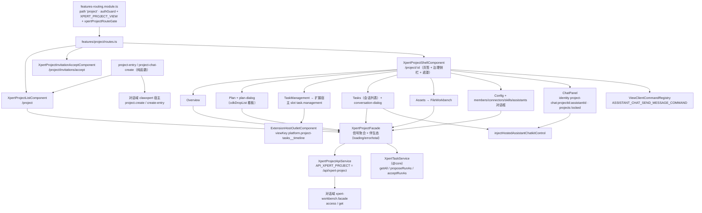

# 01 架构：项目协作专家（Xpert 前端 · 项目协作域）

> 模块根：`apps/cloud/src/app/features/project`（**25 非 spec `.ts` / 13 spec**，合计 38）
> 入口路由：`/project`（列表）· `/project/invitations/accept`（邀请接受）· `/project/:id` 工作区壳（`''` 概览 / `plan` / `timeline` / `tasks` / `assets` / `config`）＋ `type-entry` 入口解析
> 技术底座：Angular standalone + signal + `@angular/cdk`（Dialog / DragDrop / BreakpointObserver）+ `@xpert-ai/headless-ui`（Zard）+ `@xpert-ai/chatkit-angular`（iframe 宿主）
> 覆盖范围：仅前端项目协作域。后端 `xpert-project` 域（36 表）属「**批次 5 候选、尚未建专家**」，本域只记录自身实际调用的端点，不展开服务端实现。

**本文引用的文件**

- [features-routing.module.ts](file://apps/cloud/src/app/features/features-routing.module.ts)
- [routes.ts](file://apps/cloud/src/app/features/project/routes.ts)
- [project.facade.ts](file://apps/cloud/src/app/features/project/project.facade.ts)
- [project-api.service.ts](file://apps/cloud/src/app/features/project/project-api.service.ts)
- [project-entry.ts](file://apps/cloud/src/app/features/project/project-entry.ts)
- [project-chat-create.ts](file://apps/cloud/src/app/features/project/project-chat-create.ts)
- [project-shell.component.ts](file://apps/cloud/src/app/features/project/project-shell.component.ts)
- [project-list.component.ts](file://apps/cloud/src/app/features/project/project-list.component.ts)
- [project-overview.component.ts](file://apps/cloud/src/app/features/project/project-overview.component.ts)
- [project-plan.component.ts](file://apps/cloud/src/app/features/project/project-plan.component.ts)
- [project-plan-dialog.component.ts](file://apps/cloud/src/app/features/project/project-plan-dialog.component.ts)
- [project-tasks.component.ts](file://apps/cloud/src/app/features/project/project-tasks.component.ts)
- [project-task-management.component.ts](file://apps/cloud/src/app/features/project/project-task-management.component.ts)
- [project-task-drawer.component.ts](file://apps/cloud/src/app/features/project/project-task-drawer.component.ts)
- [project-task-dialog.component.ts](file://apps/cloud/src/app/features/project/project-task-dialog.component.ts)
- [project-assets.component.ts](file://apps/cloud/src/app/features/project/project-assets.component.ts)
- [project-config.component.ts](file://apps/cloud/src/app/features/project/project-config.component.ts)
- [project-chat-panel.component.ts](file://apps/cloud/src/app/features/project/project-chat-panel.component.ts)
- [project-conversation-dialog.component.ts](file://apps/cloud/src/app/features/project/project-conversation-dialog.component.ts)
- [project-conversations.component.ts](file://apps/cloud/src/app/features/project/project-conversations.component.ts)
- [project-members-dialog.component.ts](file://apps/cloud/src/app/features/project/project-members-dialog.component.ts)
- [project-invitation-accept.component.ts](file://apps/cloud/src/app/features/project/project-invitation-accept.component.ts)
- [project-connectors-dialog.component.ts](file://apps/cloud/src/app/features/project/project-connectors-dialog.component.ts)
- [project-skills-dialog.component.ts](file://apps/cloud/src/app/features/project/project-skills-dialog.component.ts)
- [project-assistants-dialog.component.ts](file://apps/cloud/src/app/features/project/project-assistants-dialog.component.ts)
- [project-create-dialog.component.ts](file://apps/cloud/src/app/features/project/project-create-dialog.component.ts)
- [project.facade.spec.ts](file://apps/cloud/src/app/features/project/project.facade.spec.ts)
- [project-config.run-as.spec.ts](file://apps/cloud/src/app/features/project/project-config.run-as.spec.ts)
- [project-entry.spec.ts](file://apps/cloud/src/app/features/project/project-entry.spec.ts)
- [jest.config.ts](file://apps/cloud/jest.config.ts)
- [app.constants.ts](file://apps/cloud/src/app/@core/constants/app.constants.ts)
- [xpert-task.service.ts](file://apps/cloud/src/app/@core/services/xpert-task.service.ts)
- [xpert-project.service.ts](file://apps/cloud/src/app/@core/services/xpert-project.service.ts)
- [assistant-chatkit.runtime.ts](file://apps/cloud/src/app/features/assistant/assistant-chatkit.runtime.ts)
- [workbench-chat.facade.ts](file://apps/cloud/src/app/features/chat/workbench-chat/workbench-chat.facade.ts)
- [xpert-workbench.facade.ts](file://apps/cloud/src/app/features/chat/xpert-workbench/xpert-workbench.facade.ts)
- [clawxpert-conversation-detail.component.ts](file://apps/cloud/src/app/features/chat/clawxpert/clawxpert-conversation-detail.component.ts)
- [xpert-project-type.model.ts](file://packages/contracts/src/ai/xpert-project-type.model.ts)
- [project-selection.model.ts](file://packages/contracts/src/ai/project-selection.model.ts)
- [extension-host-outlet.component.ts](file://apps/cloud/src/app/@shared/view-extension/extension-host-outlet.component.ts)
- file://.module-experts/前端专题/项目协作专家/C0-使用总览.md
- file://.module-experts/前端专题/项目协作专家/C1-能力契约.md

## 目录

- [职责与边界](#职责与边界)
- [目录结构与分层](#目录结构与分层)
- [依赖关系](#依赖关系)
- [关键不变量](#关键不变量)
- [架构总览图](#架构总览图)
- [组件详细分析](#组件详细分析)
- [测试状态](#测试状态)
- [结论](#结论)

## 职责与边界

**做什么（四类职责）**

1. **项目工作区页面族**：列表页（类型菜单 / 应用与类型筛选 / 搜索 / 分页 / DSL 导入）、工作区壳（页签导航、治理侧栏、专家会话面板、加载与错误遮罩）、六个子页（概览、计划、任务时间线、会话、资源、配置）。
2. **门面与 API 层**：`XpertProjectFacade` 信号聚合（`project`/`projects`/`plans`/`tasks`/`conversations`/`assets`/`activities`/`automations`/`scheduledTasks`/`projectInstruction`/`projectSkills`/`projectAccess`＋伴生态）与 `XpertProjectApiService`（基址常量 `API_XPERT_PROJECT`）；任务面经 `@core` 的 `XpertTaskService`。
3. **协作能力**：成员与邀请（members-dialog / invitation-accept）、任务与计划（task-management / tasks / drawer / dialog、plan / plan-dialog）、会话绑定（chat-panel / conversation-dialog / tasks 列表）、项目资源（assets 文件工作台＋connectors/skills/assistants 对话框）、run-as 运行身份（配置页提案/接受）。
4. **与对话域的接缝**：`type-entry` 入口解析（`navigateProjectEntry`）与「对话内建项目」桥（`chatProjectCreateRequest` / `executeChatProjectCreate`），二者是纯函数，被对话域 ChatKit 宿主直接 import。

**不做什么（逐条给出「谁家」）**

| 不在范围内 | 谁家（交叉引用） |
| --- | --- |
| 对话工作台与 ChatKit 宿主状态机 | 对话前端专家：[workbench-chat.facade.ts](file://apps/cloud/src/app/features/chat/workbench-chat/workbench-chat.facade.ts)、[assistant-chatkit.runtime.ts](file://apps/cloud/src/app/features/assistant/assistant-chatkit.runtime.ts) |
| `/chat/x/:slug` 形态工作台与项目作用域持久化 | 对话前端专家：[xpert-workbench.facade.ts](file://apps/cloud/src/app/features/chat/xpert-workbench/xpert-workbench.facade.ts) |
| 对话内项目壳（VCS / GitHub 安装等子页）与旧 `XpertProjectService` 口径 | 对话前端专家 `features/chat/project/*` 与 `@core`：[xpert-project.service.ts](file://apps/cloud/src/app/@core/services/xpert-project.service.ts) |
| 后端项目域与端点实现（36 表） | 后端批次 5 候选、**未建**：`file://.module-experts/后端专题/T0-专题总览.md` |
| 任务调度内核（定时 / 暂停 / 执行记录投影） | 对话前端专家任务页 + 后端 `xpert-task`；本域只调 `XpertTaskService` 动作端点 |
| 文件工作台组件本体（`xp-file-workbench`） | 共享层 `@cloud/app/@shared/files`（本域按 loader/saver 注入接面） |

章节来源：[routes.ts](file://apps/cloud/src/app/features/project/routes.ts)（关键符号：`routes`、`XpertProjectShellComponent`）、[project.facade.ts](file://apps/cloud/src/app/features/project/project.facade.ts)（关键符号：`XpertProjectFacade`、`loadProject`）、[clawxpert-conversation-detail.component.ts](file://apps/cloud/src/app/features/chat/clawxpert/clawxpert-conversation-detail.component.ts)（关键符号：`createChatProject`、`chatProjectCreateRequest`、`executeChatProjectCreate`）

## 目录结构与分层

| 目录 / 文件 | 层 | 职责 |
| --- | --- | --- |
| `routes.ts`、`project.facade.ts`、`project-api.service.ts`、`project-entry.ts`、`project-chat-create.ts` | **路由 / 门面 / API / 入口解析（模块根）** | 路由表（含 `invitations/accept` 与 `:id` 子路由）、信号门面、HTTP 端点面、入口解析与对话建项目桥 |
| `project-list.component.ts`、`project-overview.component.ts` | **页面层（列表与概览）** | 类型菜单（`types()`/`typeLabel()`）、筛选与分页、概览指标（任务/计划/资产/自动化） |
| `project-plan.component.ts`、`project-plan-dialog.component.ts` | **页面层（计划）** | 计划/里程碑/冲刺/泳道看板（`cdkDropListGroup`、`dropTask`）、计划对话框 |
| `project-task-management.component.ts`、`project-tasks.component.ts`、`project-task-drawer.component.ts`、`project-task-dialog.component.ts` | **页面层（任务与会话）** | 时间线经扩展宿主槽位挂载；会话列表（状态过滤）；任务抽屉与任务对话框（执行步骤/执行上下文） |
| `project-shell.component.ts`、`project-chat-panel.component.ts`、`project-conversation-dialog.component.ts`、`project-conversations.component.ts` | **工作区壳与项目内会话** | 页签与治理侧栏、专家会话面板、既有会话对话框；`project-conversations.component.ts` 为未挂路由的死组件 |
| `project-config.component.ts`＋`project-{members,connectors,skills,assistants}-dialog.component.ts`、`project-create-dialog.component.ts` | **配置层与对话框族** | 成员与邀请、连接器、技能、专家、指令、自动化与 run-as；项目创建 |
| `project-assets.component.ts`、`project-invitation-accept.component.ts` | **资源层与入口页** | `FileWorkbenchComponent` 文件工作台；邀请接受/拒绝＋组织切换 |

**分层与依赖方向（单向）**：页面/对话框（视图层）→ `XpertProjectFacade`（门面层）→ `XpertProjectApiService` / `@core XpertTaskService`（API 层）→ HTTP（`/api/xpert-project/*`、`/api/xpert-task/*`）。有两条例外且是刻意设计：① 入口解析 `project-entry.ts` / `project-chat-create.ts` 是**无状态纯函数**，被列表页与对话域共同消费，不依赖门面；② 对话框族经 `DIALOG_DATA`/`input()` 接收 DTO，直接注入 `XpertProjectApiService`（不做门面中转），因此门面聚合集不含「对话框内部的临时状态」。

章节来源：[project-api.service.ts](file://apps/cloud/src/app/features/project/project-api.service.ts)（关键符号：`XpertProjectApiService`、`API_XPERT_PROJECT`、`XpertProjectOverview`）、[project-chat-panel.component.ts](file://apps/cloud/src/app/features/project/project-chat-panel.component.ts)（关键符号：`XpertProjectChatPanelComponent`、`resolveProjectChatAssistantId`）、[project-invitation-accept.component.ts](file://apps/cloud/src/app/features/project/project-invitation-accept.component.ts)（关键符号：`XpertProjectInvitationAcceptComponent.accept`、`openProject`）、[project-assets.component.ts](file://apps/cloud/src/app/features/project/project-assets.component.ts)（关键符号：`loadFiles`、`saveFile`、`canEdit`）

## 依赖关系

**出向依赖（项目域 → 外部）**

| 依赖面 | 具体符号 | 用途 |
| --- | --- | --- |
| `@core` 服务 | [xpert-task.service.ts](file://apps/cloud/src/app/@core/services/xpert-task.service.ts)（`XpertTaskService.getAll` / `schedule` / `pause` / `proposeRunAs` / `acceptRunAs`）、[app.constants.ts](file://apps/cloud/src/app/@core/constants/app.constants.ts)（`API_XPERT_PROJECT = API_PREFIX + '/xpert-project'`）、`getErrorMessage`、`Store`、`ToastrService`、`ScheduleTaskStatus`、`CurrentUserHydrationService`、`ScopeService` | 任务动作、端点基址、错误与用户上下文、接受邀请后的组织切换 |
| `@shared` 复用件 | `@shared/files`（`FileWorkbenchComponent` 与 `FileWorkbenchFilesLoader` 等 loader/saver 类型）、`@shared/chat/task-dialog`（`XpertTaskDialogService`）、`@shared/skills`（`XpertSkillInstallDialogComponent`）、`@shared/view-extension`（`ExtensionHostOutletComponent`、`ViewClientCommandRegistry`）、`@shared/avatar` | 文件工作台、任务对话框、技能安装、扩展宿主与命令注册 |
| `features/assistant`（对话侧运行时） | [assistant-chatkit.runtime.ts](file://apps/cloud/src/app/features/assistant/assistant-chatkit.runtime.ts)（`injectHostedAssistantChatkitControl`、`sanitizeAssistantFrameUrl`）、`toSendUserMessageParams`、`registerWorkbenchNavigationOpenCommand` | 项目内会话面板与会话对话框的 ChatKit 宿主、client-command 受理 |
| 契约与 UI 库 | `@xpert-ai/contracts`（`IXpertProject`、`XpertProjectEntry`、`XpertProjectTypeRef`、`GENERAL_PROJECT_TYPE`、`ASSISTANT_CHAT_SEND_MESSAGE_COMMAND`、`PermissionsEnum`）、`@xpert-ai/headless-ui`、`@xpert-ai/chatkit-angular`、`@angular/cdk` | 类型、组件库与 iframe 宿主 |

**入向依赖（谁消费项目域）**

1. **对话域 ChatKit 宿主**：[clawxpert-conversation-detail.component.ts](file://apps/cloud/src/app/features/chat/clawxpert/clawxpert-conversation-detail.component.ts) 直接 import 项目域的 `chatProjectCreateRequest` / `executeChatProjectCreate`，并注入 `XpertProjectApiService` 承接 `project.create` / `project.create-entry` 事件。
2. **对话域工作台门面**：[xpert-workbench.facade.ts](file://apps/cloud/src/app/features/chat/xpert-workbench/xpert-workbench.facade.ts) 注入 `XpertProjectApiService`，用 `access(projectId)` 取项目访问摘要（403 时置 `projectAccess` 为 `null`，fail-closed）、用 `get(projectId)` 取项目名。
3. **路由挂载与准入**：[features-routing.module.ts](file://apps/cloud/src/app/features/features-routing.module.ts) 的 `path: 'project'` 懒加载本域 `routes`，`canActivate` 为 `authGuard` + `NgxPermissionsGuard`（`AIPermissionsEnum.XPERT_PROJECT_VIEW`）+ `xpertProjectRouteGate`（特性位 `FEATURE_XPERT` 与 `FEATURE_XPERT_PROJECT`，缺失回落 `/chat`），`scopeContext: 'dual-scope'`。
4. **项目选择语义的消费方在对话域**：`ProjectSelection`（`{mode:'auto-new'|'none'|'existing'}`）与「初始挂载 / 草稿意图 / 运行期持久项目」三段语义由对话域门面持有；项目域只负责 projectId 绑定与入口解析。

章节来源：[xpert-task.service.ts](file://apps/cloud/src/app/@core/services/xpert-task.service.ts)（关键符号：`XpertTaskService.proposeRunAs`、`acceptRunAs`、`schedule`、`pause`）、[xpert-workbench.facade.ts](file://apps/cloud/src/app/features/chat/xpert-workbench/xpert-workbench.facade.ts)（关键符号：`loadProjectAccess`、`loadProjectName`、`ProjectSelection`）、[features-routing.module.ts](file://apps/cloud/src/app/features/features-routing.module.ts)（关键符号：`xpertProjectRouteGate`、`path: 'project'`）、[extension-host-outlet.component.ts](file://apps/cloud/src/app/@shared/view-extension/extension-host-outlet.component.ts)（关键符号：`ExtensionHostOutletComponent`）

## 关键不变量

1. **门面信号聚合与伴生态一致性**：`loadProject` 先清空全部聚合子集（conversations/plans/tasks/assets/activities/automations/projectInstruction/projectSkills/projectAccess/scheduledTasks）再拉主记录；主记录到手即以 `#projectLoadSequence` 序号守卫并发派生 overview/content/access/scheduledTasks，过期响应一律丢弃。overview 失败被静默吞掉（源码注释：The project shell remains usable when optional overview data is unavailable），`loadProject` 在项目记录返回时即解除 `projectLoading`/`loading`（`project.facade.spec.ts` 用例「stops blocking the project shell as soon as the project record loads」）；`loadProjects` 用 `#projectsLoadSequence`，`createProject` 主动自增序号，使旧列表响应不能覆盖新建项。`assetsTotal` 与 `assetCount` 语义不同：后者只在无 `parentId` 的根查询时更新。
2. **`type-entry` 解析规则**：`XpertProjectEntry` 是闭合二分支——`kind: 'project'` 导航 `/project/:id`（`projectId` 缺失直接 `Promise.resolve(false)` 不导航）；`kind: 'assistant'` 导航 `/chat/x/:slug[/p/:projectId]/c` 并携带 `queryParams { view: viewKey, viewSelection: selectionId }`。`XpertProjectTypeRef` 只认 `applicationKey` + `projectTypeKey` 两个非空字符串（契约注释：Resolved by the host and a trusted provider, never an arbitrary URL），默认入口 `GENERAL_PROJECT_TYPE = { applicationKey: 'platform', projectTypeKey: 'general' }`。
3. **run-as 身份的生效边界**：run-as 是**任务级**（`IXpertTask.runAsUserId` / `pendingRunAsUserId`）而非项目级。提案资格 = `canManage() || taskRunAsUserId(task) === 当前用户`；接受资格 = `pendingRunAsUserId === 当前用户`；`taskRunAsUserId` 缺省回落 `createdById`。前端闸门只做可见性与本地短路，真正裁决在服务端（`/xpert-task/:id/run-as/proposal`、`/run-as/accept`）；提案/接受成功后只 `reloadScheduledTasks(projectId)` 重取，不就地改对象。
4. **会话绑定与项目选择的时序**：项目内会话面板**只用 projectId 挂载**——`identity = project-chat:${projectId}:${assistantId}`、`requestContext.env.projectId`、composer 的 `projects` 槽位 `{enabled:true, locked:true}`（不允许在面板内改项目）；既有会话用 `project-conversation:${projectId}:${conversationId}:${assistantId}` + `initialThread` 打开，且必须存在 `conversation.xpertId` 才渲染 ChatKit（否则显示「专家不可用」）。跨域时序由对话域负责：`chatkitMountProjectId` 是**仅初始**挂载绑定、`chatkitProjectSelection` 是初始草稿意图、`syncConversationProject(threadId)` 在运行开始/结束后刷新持久项目且不新开会话——改项目侧 identity 或挂载参数会改变 ChatKit `runtimeKey`，直接导致会话重建。
5. **权限闸门一律取 `projectAccess().capabilities`**：`canEdit` 管资源写、指令保存与技能安装；`canManage` 管成员、专家、连接器与自动化；`role === 'owner'` 才可转移所有权；邀请组织成员额外要求 `ORG_INVITE_EDIT` 权限；`projectAccess` 为 `null` 表示 pending / 不可用 / 被拒（fail-closed，消费方不得自造默认值）。

章节来源：[project.facade.ts](file://apps/cloud/src/app/features/project/project.facade.ts)（关键符号：`#projectsLoadSequence`、`#projectLoadSequence`、`loadProjectOverview`、`loadProjectContent`、`loadAssets`）、[project-entry.ts](file://apps/cloud/src/app/features/project/project-entry.ts)（关键符号：`navigateProjectEntry`）、[project-config.component.ts](file://apps/cloud/src/app/features/project/project-config.component.ts)（关键符号：`canProposeTaskRunAs`、`canAcceptTaskRunAs`、`taskRunAsUserId`）、[project-chat-panel.component.ts](file://apps/cloud/src/app/features/project/project-chat-panel.component.ts)（关键符号：`identity`、`requestContext`、`control`）、[xpert-project-type.model.ts](file://packages/contracts/src/ai/xpert-project-type.model.ts)（关键符号：`XpertProjectEntry`、`XpertProjectTypeRef`、`GENERAL_PROJECT_TYPE`）

## 架构总览图

图表来源：[routes.ts](file://apps/cloud/src/app/features/project/routes.ts)（关键符号：`routes`）、[project-shell.component.ts](file://apps/cloud/src/app/features/project/project-shell.component.ts)（关键符号：`tabs`、`chatPanelOpen`、`chatThreadId`）、[project.facade.ts](file://apps/cloud/src/app/features/project/project.facade.ts)（关键符号：`XpertProjectFacade.loadProjects`、`loadProject`、`loadScheduledTasks`）、[project-api.service.ts](file://apps/cloud/src/app/features/project/project-api.service.ts)（关键符号：`list`、`typeEntry`、`overview`、`conversations`）、[project-entry.ts](file://apps/cloud/src/app/features/project/project-entry.ts)（关键符号：`navigateProjectEntry`）· [project-task-management.component.ts](file://apps/cloud/src/app/features/project/project-task-management.component.ts)（关键符号：`registerWorkbenchNavigationOpenCommand`、`platform.project-tasks__timeline`）

章节来源：[project-shell.component.ts](file://apps/cloud/src/app/features/project/project-shell.component.ts)（关键符号：`XpertProjectShellComponent`、`canEditProjectContent`、`selectProjectExpert`、`waitForChatControl`）、[project-chat-panel.component.ts](file://apps/cloud/src/app/features/project/project-chat-panel.component.ts)（关键符号：`XpertProjectChatPanelComponent.control`、`composer`）

## 组件详细分析

### 路由、工作区壳与准入

`routes.ts` 只声明四类路由：列表 `''`、`invitations/accept`、`':id'` 壳（含 `''`/`plan`/`timeline`/`tasks`/`assets`/`config` 六个子路由）。壳组件用 `paramMap`→`loadProject(id)`、`queryParamMap`→`chat`/`threadId`/`xpert` 三条 `distinctUntilChanged` 订阅驱动 URL 状态；顶部页签与治理侧栏（指令 / 连接器 / 专家 / 技能 / 自动化五张卡片＋任务·资产·成员三格计数）都直接读门面信号；打开/关闭会话面板、切换专家、切换线程**全部经 URL query 参数**（`chat=open`、`xpert`、`threadId`，`replaceUrl: true`），因此面板状态可刷新恢复。壳还持有 `ViewClientCommandRegistry` 上 `ASSISTANT_CHAT_SEND_MESSAGE_COMMAND` 的注册：先校验 `context.hostType === 'project'` 且 `hostId === 当前项目 id`，再从 `context.manifest.runtime.featureProviders` 取候选专家（单个直选、多个弹出选择器，`waitForChatPanel`/`waitForChatControl` 以 rAF 轮询等待面板与 ChatKit 就绪），最后 `control.sendUserMessage(toSendUserMessageParams(payload))`。

章节来源：[routes.ts](file://apps/cloud/src/app/features/project/routes.ts)（关键符号：`routes`、`XpertProjectShellComponent`）、[project-shell.component.ts](file://apps/cloud/src/app/features/project/project-shell.component.ts)（关键符号：`ngOnInit`、`toggleChatPanel`、`onChatThreadChanged`、`onChatExpertChanged`、`#unregisterAssistantCommand`）、[view-client-command-registry.service.ts](file://apps/cloud/src/app/@shared/view-extension/view-client-command-registry.service.ts)（关键符号：`ViewClientCommandRegistry.register`）

### 门面与 API 层

门面是「**聚合信号 + 伴生态 + 序号守卫**」的三件套：主聚合信号按页面分区（列表 `projects`/`projectsTotal`、详情 `project`、计划 `plans`、任务 `tasks`、会话 `conversations`、资产 `assets`/`assetsTotal`/`assetCount`、活动 `activities`、自动化 `automations`/`scheduledTasks`、内容 `projectInstruction`/`projectSkills`/`projectContentError`、权限 `projectAccess`），伴生态严格成对（`loading`/`error`、`projectLoading`/`projectError`、`conversationsLoading`/`conversationsError`、`assetsLoading`/`assetsError`），派生 `hasProject`。写路径全部「先打服务端、成功后局部回填」（`createProject`/`updateProject`/`addXpert`/`removeXpert`/`createPlan`/`createMilestone`/`createTask`/`reorderTasks`/`createSprint`/`createAsset`/`updateAutomation`/`createAutomation`），不乐观写。API 层 `XpertProjectApiService` 覆盖资源全 CRUD，并以 `projectsChanged$`（`Subject`）在 `create`/`importDsl`/`update`/`archive`/`acceptInvitation` 后广播变更。

章节来源：[project.facade.ts](file://apps/cloud/src/app/features/project/project.facade.ts)（关键符号：`XpertProjectFacade.projectsTotal`、`assetCount`、`projectContentError`、`hasProject`、`setOverview`）、[project-api.service.ts](file://apps/cloud/src/app/features/project/project-api.service.ts)（关键符号：`projectsChanged$`、`create`、`acceptInvitation`、`reorderTasks`）

### 计划与任务（看板与时间线）

`project-plan.component.ts` 是复杂度最高的一页：`activePlan`/`activeSprint`/`activeMilestone` 三个 computed 决定视图，高级模式显示泳道（按 `sortOrder` 排序、显示 `wipLimit`/`concurrencyLimit` 与 `agentRole`/`environmentType`），拖拽经 `cdkDropListGroup` 的 `dropTask` 落到 `facade.reorderTasks`；冲刺与里程碑创建走 `facade.createSprint`/`createMilestone`，任务详情经 `facade.loadTaskRelations(task.id)` 拉取「会话 + 执行」两类关联。`timeline` 路由不是自绘组件，而是把整页交给扩展宿主：`ExtensionHostOutletComponent` 以 `hostType="project"`、`hostId=projectId`、`slot="task.management"`、`viewKey="platform.project-tasks__timeline"` 挂载外部视图，并注册 `registerWorkbenchNavigationOpenCommand`（`openAssistantConversation` 前校验 `target.projectId === 当前 projectId`，不一致抛 `PROJECT_TASK_CONTEXT_REQUIRED`，切换中抛 `PROJECT_TASK_CONTEXT_CHANGED`）。任务抽屉/对话框负责表单与执行上下文展示，`normalizeStatus` 把旧状态映射为 `pending→todo`、`completed→done`、`failed→blocked`。

章节来源：[project-plan.component.ts](file://apps/cloud/src/app/features/project/project-plan.component.ts)（关键符号：`activeSprint`、`activeMilestone`、`laneTasks`、`dropTask`、`reorderTasks`、`loadTaskRelations`）、[project-task-management.component.ts](file://apps/cloud/src/app/features/project/project-task-management.component.ts)（关键符号：`registerWorkbenchNavigationOpenCommand`、`PROJECT_TASK_CONTEXT_REQUIRED`）、[project-task-drawer.component.ts](file://apps/cloud/src/app/features/project/project-task-drawer.component.ts)（关键符号：`XpertProjectTaskDrawerComponent.save`、`normalizeStatus`、`openConversation`）

### 会话绑定（面板与既有会话）

两条会话入口，身份前缀不同、均绑定项目：会话面板 `project-chat:${projectId}:${assistantId}`（项目锁定，候选专家取 `project.xperts` 与 `eligibleAssistantIds` 交集，`resolveProjectChatAssistantId` 支持 id/slug 兜底到线程携带的 key），会话对话框 `project-conversation:${projectId}:${conversationId}:${assistantId}`（`requestContext.env` 带 `projectId/conversationId/threadId/executionId`，供服务端定位执行）。二者都复用 `injectHostedAssistantChatkitControl` + `sanitizeAssistantFrameUrl`，且会话对话框对 `conversation.xpertId` 缺失做了显式降级。会话列表页（`tasks` 路由）按 `all/busy/idle/interrupted/error` 过滤并打开会话对话框。

章节来源：[project-chat-panel.component.ts](file://apps/cloud/src/app/features/project/project-chat-panel.component.ts)（关键符号：`eligibleAssistants`、`assistantId`、`identity`、`requestContext`、`resolveProjectChatAssistantId`）、[project-conversation-dialog.component.ts](file://apps/cloud/src/app/features/project/project-conversation-dialog.component.ts)（关键符号：`XpertProjectConversationDialogData`、`identity`、`initialThread`）、[project-tasks.component.ts](file://apps/cloud/src/app/features/project/project-tasks.component.ts)（关键符号：`visibleConversations`、`openConversation`）

### 成员、邀请与 run-as 配置

`project-config.component.ts` 是配置中枢：进入时并发拉 `availableXperts` 与 `members`（`Promise.allSettled`，任一失败降级为空集），打开四个对话框（专家 / 成员 / 连接器 / 技能）并复用 `XpertTaskDialogService` 打开任务对话框；可见性完全由 `canManage`/`canEdit`/`canInviteOrganizationMembers`（`ORG_INVITE_EDIT`）与 `projectAccess.role === 'owner'` 决定。run-as 区块按 `pendingRunAsUserId` 展示待接受提示（仅 `pendingRunAsUserId === 当前用户` 可点接受），提案下拉排除当前 runner 本人，成功后 `reloadScheduledTasks` 重取。邀请接受页从 `?token=` 取值，接受成功后必须先用 `CurrentUserHydrationService.getFeatureHydration({force:true, skipSessionCache:true})` 重新水合、按 `membership.organizationId` 找到组织并 `ScopeService.switchToOrganization`，再导航 `/project/:id`（组织未就绪时显式报错而不是静默跳转）。

章节来源：[project-config.component.ts](file://apps/cloud/src/app/features/project/project-config.component.ts)（关键符号：`loadConfiguration`、`openMembers`、`taskRunAsUserId`、`runAsTargetMembers`、`proposeTaskRunAs`、`acceptTaskRunAs`）、[project-members-dialog.component.ts](file://apps/cloud/src/app/features/project/project-members-dialog.component.ts)（关键符号：`pendingInvitations`、`addMember`、`invite`、`transferOwnership`）、[project-invitation-accept.component.ts](file://apps/cloud/src/app/features/project/project-invitation-accept.component.ts)（关键符号：`accept`、`decline`、`openProject`）

### 资源、连接器与扩展宿主

资源页把项目工作区文件能力整体委托给共享 `FileWorkbenchComponent`（`rootId = projectId`，五个 loader/saver 直连 API 的 `workspaceFiles`/`workspaceFile`/`saveWorkspaceFile`/`uploadWorkspaceFile`/`deleteWorkspaceFile`），写操作按 `canEdit` 逐个置空。连接器对话框维护 `definitions`/`bindings`/`selectedMode`/`pendingAuthorizationUrls`，并按 `selectedDefinitionModes` 决定授权模式可选性；助手对话框以 `project.xperts` 为初始集合并提供 `availableCandidates`（过滤已加入者），增删走 `addXpert`/`removeXpert`；技能对话框与技能安装对话框（`@shared/skills`）协同完成「仓库安装 / 上传 / 启停 / 卸载」。

章节来源：[project-assets.component.ts](file://apps/cloud/src/app/features/project/project-assets.component.ts)（关键符号：`loadFiles`、`saveFile`、`canEdit`）、[project-connectors-dialog.component.ts](file://apps/cloud/src/app/features/project/project-connectors-dialog.component.ts)（关键符号：`availableDefinitions`、`selectedDefinitionModes`、`canSelectAuthorizationMode`）、[project-assistants-dialog.component.ts](file://apps/cloud/src/app/features/project/project-assistants-dialog.component.ts)（关键符号：`availableCandidates`、`addXpert`、`removeXpert`）

## 测试状态

**口径**：13 spec / 25 非 spec `.ts`。**2026-10-15 基线实测：4 PASS / 9 FAIL，全部为环境级 `@xpert-ai/store` 缺依赖导致的「整文件加载失败」，无真实断言失败**；2026-10-16 重建未复跑，沿用该基线并标注。

**环境级归因（已核实）**：`apps/cloud/package.json` 声明依赖 `"@xpert-ai/store": "3.9.1"`，但工作区 `node_modules/@xpert-ai/store` **不存在**；[jest.config.ts](file://apps/cloud/jest.config.ts) 的 `moduleNameMapper` 只映射 `@xpert-ai/contracts` 与 environment，没有该包的兜底映射。`@core` 多处（`auth.service.ts`、`organization-status.service.ts`、`app.service.ts`、`@shared/language-base/translation-base.component.ts`）真实 import 该包，而本域 spec 普遍经 `../../@core` 取 `XpertTaskService`/`Store`/`ToastrService`，因此整文件在 import 阶段失败，与被测代码的断言逻辑无关。**复跑前先 `corepack pnpm install`。**

**spec 覆盖点（按文件）**：`project.facade.spec.ts`（错误消息透传 403；旧列表响应不得覆盖新建项目；项目记录到手即解除壳层阻塞）；`project-entry.spec.ts`（`kind:'assistant'` 双形态命令拼装 + `project.create`/`project.create-entry` 事件解析与畸形类型拒绝）；`project-config.run-as.spec.ts`（当前 runner 可提案、manager 可越权提案、只有 pending 目标可接受）；其余 10 个为 `project-api.service.spec.ts`、`project-config.component.spec.ts`、`project-create-dialog.component.spec.ts`、`project-members-dialog.component.spec.ts`、`project-invitation-accept.component.spec.ts`、`project-connectors-dialog.component.spec.ts`、`project-skills-dialog.component.spec.ts`、`project-task-dialog.component.spec.ts`、`project-task-drawer.component.spec.ts`、`project-chat-panel.component.spec.ts`。

章节来源：[project.facade.spec.ts](file://apps/cloud/src/app/features/project/project.facade.spec.ts)（关键符号：`loadProjects`、`createProject`、`loadProject` 断言）、[project-config.run-as.spec.ts](file://apps/cloud/src/app/features/project/project-config.run-as.spec.ts)（关键符号：`proposeTaskRunAs`、`acceptTaskRunAs`）、[project-entry.spec.ts](file://apps/cloud/src/app/features/project/project-entry.spec.ts)（关键符号：`navigateProjectEntry`、`chatProjectCreateRequest`）、[jest.config.ts](file://apps/cloud/jest.config.ts)（关键符号：`moduleNameMapper`、`transformIgnorePatterns`）

## 结论

- **职责单一且接缝清楚**：项目域 = 项目工作区页面族 + 门面/API + 协作能力 + 两枚入口解析纯函数；对话域负责 ChatKit 挂载、会话与项目作用域持久化，二者通过 `project-chat-create`、`XpertProjectApiService.access/get`、`ViewClientCommandRegistry` 三处显式接触，无反向依赖。
- **门面的真正契约是「聚合 + 伴生态 + 序号守卫」**：所有加载态成对出现，过期响应按序号丢弃，可选数据（overview）失败不阻塞壳层——消费方应按这一语义取用，而不要自造 loading 或直接读 API 结果。
- **`type-entry` 是本域最具跨域价值的契约**：`XpertProjectEntry` 的二分支把「平台项目」与「宿主应用视图」统一为一次解析，列表页与对话域共用同一函数，新增项目类型不应改动路由分支。
- **run-as 与权限是「前端闸门 + 服务端裁决」**：前端只做资格判定与可见性，项目角色能力位（`canRead/canEdit/canManage/canUse`）是唯一入口；任何绕过 `projectAccess` 的直连写操作都应视为缺陷。
- **风险与遗留**：① 测试处于环境级不可跑状态（`@xpert-ai/store` 缺依赖），改动后必须 `corepack pnpm install` 复跑重新标定；② `bindWorkspace`/`setAssistant` 在仓库内只有定义、无消费方（API 面先行）；③ `XpertProjectConversationsComponent` 未挂任何路由，属死组件；④ 后端 `xpert-project` 域未建专家（批次 5 候选），端点语义改动需以服务端源码为准。
- 门面逐成员语义、API 方法清单与真实调用示例见同目录 [C1-能力契约.md](file://.module-experts/前端专题/项目协作专家/C1-能力契约.md)；按场景索引与已知坑见 [C0-使用总览.md](file://.module-experts/前端专题/项目协作专家/C0-使用总览.md)。

章节来源：[project.facade.ts](file://apps/cloud/src/app/features/project/project.facade.ts)（关键符号：`XpertProjectFacade.loadProject`、`loadProjects`、`projectAccess`）、[project-entry.ts](file://apps/cloud/src/app/features/project/project-entry.ts)（关键符号：`navigateProjectEntry`）、[project-config.component.ts](file://apps/cloud/src/app/features/project/project-config.component.ts)（关键符号：`canManage`、`canEdit`、`canInviteOrganizationMembers`）、[project-api.service.ts](file://apps/cloud/src/app/features/project/project-api.service.ts)（关键符号：`bindWorkspace`、`setAssistant`）
