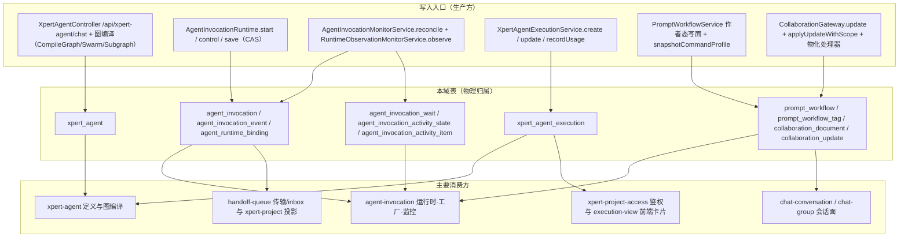

# C4 · 数据流向与消费（Agent 执行链专家）

> 口径：表结构与索引来自 `file://.module-experts/后端专题/Agent 执行链专家/implementation/04-模型.md`；消费方为表反查（`file://.fe-index/xpert-server/tables.md`）的模块级概括，**列出 >3 个模块时做归纳**，并标 `[基于引用扫描，未深入验证]`。本文件不重复逐列 DDL。

## 总览：写入入口 → 表 → 主要消费方

图表来源：[xpert-agent.controller.ts](file://packages/server-ai/src/xpert-agent/xpert-agent.controller.ts)、[invocation-runtime.ts](file://packages/server-ai/src/agent-invocation/invocation-runtime.ts)、[invocation-monitor.service.ts](file://packages/server-ai/src/agent-invocation/invocation-monitor.service.ts)、[agent-execution.service.ts](file://packages/server-ai/src/xpert-agent-execution/agent-execution.service.ts)、[prompt-workflow.service.ts](file://packages/server-ai/src/prompt-workflow/prompt-workflow.service.ts)、[collaboration.gateway.ts](file://packages/server-ai/src/collaboration/collaboration.gateway.ts)、[tables.md](file://.fe-index/xpert-server/tables.md)

---

## 1. 图与定义

**`xpert_agent`**
- 实体类型：定义面（`XpertAgent` extends `TenantOrganizationBaseEntity`）
- 结构：表 `xpert_agent`；关键列 `key`、`name`、`leaderKey`、`collaboratorNames`(json)、`knowledgebaseIds`(json)、`toolsetIds`(json)；无自定义索引，仅靠关系生成 FK/唯一约束（json 列**不是真外键**）
- 生产方：`xpert-agent` 域 CRUD（`XpertAgentController extends CrudController`）
- 主要消费方：`xpert-agent`、`chat-conversation`、`graphrag`（3 个，不归纳）`[基于引用扫描，未深入验证]`
- 业务用途：承载 Agent 定义与多智能体成员声明，是图编译的唯一输入。
- 详细流向：见本域《03 数据流转》「图编译链」。

## 2. Invocation 与账本

**`agent_invocation`**
- 实体类型：运行时账本（`AgentInvocationEntity` extends `TenantOrganizationBaseEntity`）
- 结构：表 `agent_invocation`；关键列 `ownerId`、`revision`（**CAS 版本**，int default 0）、`invocation`(jsonb)、`providerSource`(jsonb)、`nextObservationAt`、`observationLeaseToken/observationLeaseUntil`；索引 `(tenantId, organizationId, ownerId)` + `IDX_invocation_observation_due (nextObservationAt)`
- 生产方：`AgentInvocationRuntime.start/save`（唯一状态写入面）与 `TypeOrmAgentInvocationStore.insert/replace`
- 主要消费方：`agent-invocation`、`xpert-project`、`xpert-project-access`、`handoff-queue`、`chat-group`、`model-execution`（6 个，归纳为「本域运行时 + 项目投影/鉴权 + 传输与执行面」）`[基于引用扫描，未深入验证]`
- 业务用途：一次逻辑调用操作的授权、幂等键、pin 快照与状态机载体。
- 详细流向：见本域《03 数据流转》「Invocation 生命周期链」。

**`agent_invocation_event`**
- 实体类型：append-only 观察历史
- 结构：表 `agent_invocation_event`；**唯一索引 `(invocationId, revision)`**；列 `invocationId`(uuid, FK→`agent_invocation(id)` CASCADE)、`ownerId`、`revision`、`observation`(jsonb，仅存 `status/handle/interaction/progress/result/error`)
- 生产方：`TypeOrmAgentInvocationStore.replace` 同事务 `appendEvent`
- 主要消费方：`agent-invocation`（唯一注册方）`[基于引用扫描，未深入验证]`
- 业务用途：事件级幂等兜底与审计；重复 revision 直接约束报错并回滚整个 `replace` 事务。
- 详细流向：见本域《03 数据流转》「Invocation 生命周期链」。

**`agent_runtime_binding`**
- 实体类型：provider 绑定与授权（`AgentRuntimeBindingEntity`）
- 结构：表 `agent_runtime_binding`；关键列 `title`、`workspaceIds`(jsonb，无 FK)、`target`(jsonb = `{bindingId, provider, reference, revision(config 固定), configuration}`)、`enabled`(default true)；无自定义索引
- 生产方：`AgentRuntimeBindingsController`（admin-only，`requireResourceAdmin()`）
- 主要消费方：`agent-invocation`、`xpert-project`、`xpert-project-access`、`handoff-queue`、`model-execution`（5 个，归纳为「调用/授权/传输/模型出口」）`[基于引用扫描，未深入验证]`
- 业务用途：把插件 runtime provider 授权给本组织 workspace，并为每次调用提供不可变 `target.revision`。
- 详细流向：见本域《03 数据流转》「数据变换关键节点」（provider pin 快照）。

## 3. 等待与活动

**`agent_invocation_wait`**
- 实体类型：有界等待/依赖组状态机
- 结构：表 `agent_invocation_wait`；索引 `(state, nextCheckAt)` 与 gin `(request->'taskIds')`；列 `state`(`waiting|ready|delivered|stale|blocked`，唯一 CHECK 约束所在)、`request`(jsonb)、`deadlineAt`、`nextCheckAt`(NOT NULL)、`leaseToken/leaseUntil`、`lastError`
- 生产方：`AgentInvocationWaitStore.register/registerTasks`；`replace` 同事务推进 `nextCheckAt`
- 主要消费方：`agent-invocation`（唯一注册方）`[基于引用扫描，未深入验证]`
- 业务用途：让 Agent 有界观察依赖任务，超窗返回 `pending` 而不挂父级。
- 详细流向：见本域《03 数据流转》「状态流转」表。

**`agent_invocation_activity_state`**
- 实体类型：活动流游标/容量账本（一个 Invocation 一行）
- 结构：表 `agent_invocation_activity_state`；`id`(uuid PK，FK→`agent_invocation(id)` CASCADE)、`seq`、`bytes`（容量语义）、`sourceCursor`、`closed`、`expiresAt`、`expired`、`gaps`(jsonb，缺口显式记录)
- 生产方：`InvocationActivityService`（写入时累积 `bytes`/`gaps`）
- 主要消费方：`agent-invocation`（唯一注册方）`[基于引用扫描，未深入验证]`
- 业务用途：为长任务输出提供有界、可声明缺口的观察游标。
- 详细流向：见本域《03 数据流转》「数据变换关键节点」。

**`agent_invocation_activity_item`**
- 实体类型：活动条目（不可变切片）
- 结构：表 `agent_invocation_activity_item`；**唯一索引 `(invocationId, seq)`**、普通索引 `(invocationId, itemId, seq)`；列 `invocationId`(FK CASCADE)、`seq`、`firstSeq`、`itemId`、`hash`、`item`(jsonb)
- 生产方：`InvocationActivityService`（随写入累积）
- 主要消费方：`agent-invocation`（唯一注册方）`[基于引用扫描，未深入验证]`
- 业务用途：事件的不可变可校验切片，支撑增量读取与去重。
- 详细流向：见本域《03 数据流转》「数据变换关键节点」。

## 4. 执行账本

**`xpert_agent_execution`**
- 实体类型：执行与用量账本（`XpertAgentExecution`）
- 结构：表 `xpert_agent_execution`；索引 `(parentId, tenantId, organizationId)`；关键列 `status`(`running/success/error/pending/timeout/interrupted`)、`completedAt`(timestamptz)、`elapsedTime`(numeric)、`tokens/inputTokens/outputTokens`(bigint)、`threadId`、`checkpointNs/checkpointId`、`parentId`(自关联 CASCADE)
- 生产方：`XpertAgentExecutionService.create/update/recordUsage`（CQRS `XpertAgentExecutionUpsertCommand` / `RecordUsageCommand`，`update` 走事务 + `pessimistic_write`）
- 主要消费方：`handoff-queue`、`chat-group`、`agent-invocation`、`server-ai`、`ai`、`model-execution`、`xpert-agent-execution`、`chat-conversation`、`xpert-project`、`xpert-project-access`、`assistant-binding`（11 个，归纳为「本域写入方 + 会话/队列消费面 + 项目与计费面」）`[基于引用扫描，未深入验证]`
- 业务用途：一次执行的状态、时间与用量/定价的权威账本。
- 详细流向：见本域《03 数据流转》「一次执行链」。

## 5. Prompt 与协作

**`prompt_workflow`**
- 实体类型：作者态命令模板（`PromptWorkflow` extends `WorkspaceBaseEntity`，带软删除）
- 结构：表 `prompt_workflow`；**唯一索引 `(workspaceId, name)`**（不含 `deletedAt`）；关键列 `name`(`/^[a-z0-9][a-z0-9_-]{0,63}$/`)、`template`(text NOT NULL)、`sourceTemplateId`（server-owned provenance）、`visibility`(`private|team|tenant`)、`associatedXpertIds`(json)、`archivedAt`
- 生产方：`PromptWorkflowService` 作者态写面（`createInWorkspace/updateInWorkspace/upsertInWorkspaceByKey/archive*/duplicate*/initializeDefaultsInWorkspace`）
- 主要消费方：`prompt-workflow`（唯一注册方）；命令档案下游为 `xpert` 的 `commandProfile` `[基于引用扫描，未深入验证]`
- 业务用途：工作空间内可辨识的 slash 命令模板，发布时固化为命令档案快照。
- 详细流向：见本域《03 数据流转》「Prompt 工作流链」。

**`prompt_workflow_tag`**
- 实体类型：M2M 连接表（`PromptWorkflow.organizationTags` ↔ `Tag`）
- 结构：表 `prompt_workflow_tag`；由 TypeORM `@JoinTable` 生成，无自定义列（连接关系本身即唯一性来源）
- 生产方：`PromptWorkflowService` 关联收口（`prompt-workflow-associations.ts`）
- 主要消费方：`prompt-workflow`；**未出现在 `tables.md` 反查索引中**（连接表未被模块级扫描收录）`[基于引用扫描，未深入验证]`
- 业务用途：组织标签维度检索；与实体上的 `tags`(json) 是两套数据，只写一套会导致使用面/检索面不一致。
- 详细流向：见本域《03 数据流转》「Prompt 工作流链」。

**`collaboration_document`**
- 实体类型：CRDT 权威快照 + 物化检查点
- 结构：表 `collaboration_document`；**唯一索引 `(scopeKey, providerKey, resourceId)`**、普通索引 `(tenantId, organizationId, providerKey, status)`；关键列 `stateBase64`、`stateVectorBase64`、`sequenceNumber`、`updateCount`、`materializedSequence`、`materializationStatus`
- 生产方：`CollaborationService.applyUpdateWithScope`（事务内 `pessimistic_write` 后重编码）与物化处理器
- 主要消费方：`collaboration`（唯一注册方）`[基于引用扫描，未深入验证]`
- 业务用途：协作文档的权威状态与跨节点广播后的落点。
- 详细流向：见本域《03 数据流转》「协作链」。

**`collaboration_update`**
- 实体类型：有界不可变更新日志
- 结构：表 `collaboration_update`；**唯一 `(documentId, sequenceNumber)`**、**唯一 `(documentId, updateHash)`**、普通索引 `(tenantId, organizationId, documentId)`；列 `documentId`(FK→`collaboration_document` CASCADE)、`sequenceNumber`、`updateBase64`、`updateHash`、`origin/actorType/presenceId/userId`
- 生产方：`CollaborationService.applyUpdateWithScope`
- 主要消费方：`collaboration`（唯一注册方）`[基于引用扫描，未深入验证]`
- 业务用途：更新幂等去重与运维诊断；保留量由 `UPDATE_RETENTION_COUNT = 200` / `24h` 控制。
- 详细流向：见本域《03 数据流转》「协作链」。

---

## 6. 跨域注册的 8 张表（实体物理在别处、由本模块注册/直读）

| 表 | 本模块的关系 | 物理归属 | 对「归属判断」的影响 |
|---|---|---|---|
| `agent_runtime_delivery` | **`forFeature` 注册** + 由本模块暴露 `RuntimeDeliveryController` | `handoff/runtime-messaging` | 仅凭「谁 forFeature」会误判它属 handoff 域；但其投递/消费收据语义确属「对话与会话专家」，本域只保证相邻 CAS 与账本不变量 |
| `agent_runtime_inbox` | **`forFeature` 注册** | `handoff/runtime-messaging` | 同上；inbox 认领与 `consumer_outcome_unknown` 处置不归本域 |
| `user` | **`forFeature` 注册**（用于交付/收据 owner 解析） | `user` 域 | 25 个模块共同引用，**不能**作为归属依据 |
| `user_organization` | **`forFeature` 注册** | `user-organization` 域 | 13 个模块共同注册，同上 |
| `chat_conversation_thread` | 未注册，经 `Repository.manager.getRepository(...)` **直读**（判定阻塞/回写线程） | `chat-conversation` 域 | 会误判「本域拥有会话线程」；线程准入与 pause/resume 不归本域 |
| `chat_conversation` | 未注册，**直读** | `chat-conversation` 域 | 同上；15 个模块引用 |
| `xpert_workspace` | 未注册，**直读**（校验 workspace 归属） | `xpert-workspace` 域 | 会误判本域拥有 workspace 定义 |
| `xpert_project` | 未注册，**直读**（校验 `project_agent` 作用域） | `xpert-project` 域 | 同上；项目投影写入仍由项目域主导 |

**判断影响小结**：① 「注册方」≠「物理归属」——`agent_runtime_delivery` / `agent_runtime_inbox` 的 DDL 与领域语义在 handoff；② 「直读方」≠「拥有方」——`xpert_workspace` / `xpert_project` / `chat_conversation*` 仅作授权与状态判定；③ 公共表（`user` / `user_organization`）被多模块共同注册，任何按注册方推断归属的结论都不可靠。这 8 张表的逐列 DDL 归属仍在其物理定义模块，本文件不重复。
