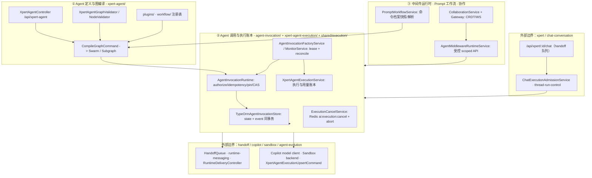

**本文引用的文件**

- [xpert-agent.module.ts](file://packages/server-ai/src/xpert-agent/xpert-agent.module.ts)
- [xpert-agent.controller.ts](file://packages/server-ai/src/xpert-agent/xpert-agent.controller.ts)
- [xpert-agent.service.ts](file://packages/server-ai/src/xpert-agent/xpert-agent.service.ts)
- [xpert-agent.entity.ts](file://packages/server-ai/src/xpert-agent/xpert-agent.entity.ts)
- [compile-graph.command.ts](file://packages/server-ai/src/xpert-agent/commands/compile-graph.command.ts)
- [compile-graph.handler.ts](file://packages/server-ai/src/xpert-agent/commands/handlers/compile-graph.handler.ts)
- [create-swarm.handler.ts](file://packages/server-ai/src/xpert-agent/commands/handlers/create-swarm.handler.ts)
- [chat.handler.ts](file://packages/server-ai/src/xpert-agent/commands/handlers/chat.handler.ts)
- [graph-validator.ts](file://packages/server-ai/src/xpert-agent/graph-validator.ts)
- [agent-validator.ts](file://packages/server-ai/src/xpert-agent/agent-validator.ts)
- [agent.ts](file://packages/server-ai/src/xpert-agent/agent.ts)
- [plugins/index.ts](file://packages/server-ai/src/xpert-agent/plugins/index.ts)
- [workflow/index.ts](file://packages/server-ai/src/xpert-agent/workflow/index.ts)
- [collaborators.middleware.ts](file://packages/server-ai/src/xpert-agent/collaborators/collaborators.middleware.ts)
- [agent-execution.module.ts](file://packages/server-ai/src/xpert-agent-execution/agent-execution.module.ts)
- [agent-execution.service.ts](file://packages/server-ai/src/xpert-agent-execution/agent-execution.service.ts)
- [agent-execution.entity.ts](file://packages/server-ai/src/xpert-agent-execution/agent-execution.entity.ts)
- [xpert-agent-execution/README.md](file://packages/server-ai/src/xpert-agent-execution/README.md)
- [agent-invocation.module.ts](file://packages/server-ai/src/agent-invocation/agent-invocation.module.ts)
- [invocation-runtime.ts](file://packages/server-ai/src/agent-invocation/invocation-runtime.ts)
- [typeorm-invocation.store.ts](file://packages/server-ai/src/agent-invocation/typeorm-invocation.store.ts)
- [invocation-factory.service.ts](file://packages/server-ai/src/agent-invocation/invocation-factory.service.ts)
- [invocation-monitor.service.ts](file://packages/server-ai/src/agent-invocation/invocation-monitor.service.ts)
- [invocation.entity.ts](file://packages/server-ai/src/agent-invocation/invocation.entity.ts)
- [invocations.controller.ts](file://packages/server-ai/src/agent-invocation/invocations.controller.ts)
- [runtime-bindings.controller.ts](file://packages/server-ai/src/agent-invocation/runtime-bindings.controller.ts)
- [agent-invocation/README.md](file://packages/server-ai/src/agent-invocation/README.md)
- [prompt-workflow.controller.ts](file://packages/server-ai/src/prompt-workflow/prompt-workflow.controller.ts)
- [prompt-workflow.entity.ts](file://packages/server-ai/src/prompt-workflow/prompt-workflow.entity.ts)
- [collaboration.module.ts](file://packages/server-ai/src/collaboration/collaboration.module.ts)
- [collaboration.service.ts](file://packages/server-ai/src/collaboration/collaboration.service.ts)
- [collaboration.gateway.ts](file://packages/server-ai/src/collaboration/collaboration.gateway.ts)
- [middleware-runtime.module.ts](file://packages/server-ai/src/shared/agent/middleware-runtime/middleware-runtime.module.ts)
- [middleware-runtime.service.ts](file://packages/server-ai/src/shared/agent/middleware-runtime/middleware-runtime.service.ts)
- [execution-cancel.module.ts](file://packages/server-ai/src/shared/execution/execution-cancel.module.ts)
- [execution-cancel.service.ts](file://packages/server-ai/src/shared/execution/execution-cancel.service.ts)
- [runtime-delivery.controller.ts](file://packages/server-ai/src/handoff/runtime-messaging/runtime-delivery.controller.ts)
- [runtime-messaging/README.md](file://packages/server-ai/src/handoff/runtime-messaging/README.md)
- [handoff/README.md](file://packages/server-ai/src/handoff/README.md)
- [thread-run-control.md](file://packages/server-ai/src/chat-conversation/thread-run-control.md)
- [2026-09-22-unified-agent-invocation.md](file://docs/plans/2026-09-22-unified-agent-invocation.md)

## 目录

- [1. 专家域职责与边界](#1-专家域职责与边界)
- [2. 子专家划分说明](#2-子专家划分说明)
- [3. 子模块清单](#3-子模块清单)
- [4. 分层结构](#4-分层结构)
- [5. 依赖关系](#5-依赖关系)
- [6. 关键设计约束与不变量](#6-关键设计约束与不变量)
- [7. 架构总览](#7-架构总览)
- [8. 组件详细分析](#8-组件详细分析)
- [9. 结论](#9-结论)

章节来源：[xpert-agent.module.ts](file://packages/server-ai/src/xpert-agent/xpert-agent.module.ts)（关键符号：XpertAgentModule）、[agent-invocation.module.ts](file://packages/server-ai/src/agent-invocation/agent-invocation.module.ts)（关键符号：AgentInvocationModule）

## 1. 专家域职责与边界

**做什么**：① Agent 定义面与图编译——`xpert_agent`（`leaderKey`/`collaboratorNames`/`knowledgebaseIds`/`toolsetIds`）经 `XpertAgentController extends CrudController` 暴露 CRUD，`POST /api/xpert-agent/chat` 提供草稿态 SSE 直连调试入口（不是 `/api/xpert/chat`，该路径不存在；`/api/xpert/:id/chat` 在 xpert 域，走 handoff 队列），`POST /api/xpert-agent/xpert/:id/test/:key` 做单节点调试，`GET middlewares` / `POST middlewares/:provider/tools` / `POST middlewares/:provider/tools/:toolName/test` 暴露中间件策略与工具面；图编译由 `CompileGraphCommand` → `XpertAgentSwarmCommand` / `XpertAgentSubgraphCommand` 完成，校验由 `XpertAgentGraphValidator` / `XpertAgentNodeValidator`（`XpertDraftValidateEvent`）承担。② 调用与执行账本——`agent_invocation*` 运行时账本（授权、幂等键、pin、CAS 状态转移、wait/activity/delivery）、`xpert_agent_execution` 执行与用量账本、`/api/xpert-agent-execution` 只读日志/状态/检查点、以及协作式取消。③ 中间件运行时（`AgentMiddlewareRuntimeModule`，`@Global`）以受控 capability API 供插件使用；prompt-workflow 作者态模板与运行时命令档案；collaboration 的 CRDT 文档面与 WS 在线状态。

**不做什么**：不实现队列物理与 outbox 写入器（`handoff` 的 `HandoffQueueService`、`HandoffCancelService`、`AgentChatRealtimeService`；本域只注册 `agent_runtime_delivery`/`agent_runtime_inbox` 实体并消费）；不做会话准入与线程暂停/恢复（`chat-conversation` 的 `ChatExecutionAdmissionService`、`thread-run-control.md`）；不实现模型客户端（`copilot` 的 `CopilotModule`/`CopilotUsageModule`，本域只经 `AgentMiddlewareModelRuntimeService` 与 `GetCopilotProviderModelQuery`/`CopilotGetOneQuery`/`CopilotTokenRecordCommand` 装配）；不实现执行后端（`sandbox`，经 CQRS `SandboxAcquireBackendCommand`/`SandboxVMCommand`）；不做 Agent 能力演进治理（`agent-evolution`，仅经 `XpertAgentExecutionUpsertCommand` 单向耦合）；不拥有 `xpert` 团队定义本体（`xpert` 域，经 `forwardRef` + `FindXpertQuery`/`GetXpertWorkflowQuery`）。

**四个归属判定（逐条）**：
1. `shared/agent/middleware-runtime`（索引 slug `agent-middleware-runtime`）**属本域**：它是独立 Nest 模块 `AgentMiddlewareRuntimeModule`，以 `XPERT_AGENT_MIDDLEWARE_RUNTIME_TOKEN` 暴露 `AgentMiddlewareRuntimeService`，被 `XpertAgentModule`、`XpertAgentExecutionModule` 及 `Chat`/`Xpert` 依赖。
2. `execution-cancel` **不是顶层目录**：真实位置为 `shared/execution/`，模块名 `ExecutionCancelModule`（含 `ExecutionCancelService`、`ExecutionCancelledError`、`executionAbortScope`），使用者为 `XpertAgentModule` 与 `ChatConversationModule`，**归本域**（执行链取消）。
3. `agent-evolution/`（约 45 非 spec、19 表、`/baselines` `/changes` 前缀）**不属本域**：独立顶层模块（提案—评估—发布治理、release gate/canary），仅通过 CQRS `XpertAgentExecutionUpsertCommand` 与本域耦合，本批不纳入，只记录耦合点。
4. `RuntimeDeliveryController` 文件物理在 `handoff/runtime-messaging/`，但**注册在 `agent-invocation.module.ts` 的 controllers**，对外为 `GET /api/agent-invocations/:id/delivery`、`POST /api/agent-invocations/:id/delivery/redrive`；其投递/消费收据语义与对账属**「对话与会话专家」**，本域仅保证相邻的 CAS 与账本不变量，改动需两侧确认（交叉引用）。

章节来源：[xpert-agent.controller.ts](file://packages/server-ai/src/xpert-agent/xpert-agent.controller.ts)（关键符号：XpertAgentController.chatAgent/getMiddlewareStrategies/getMiddlewareTools/testMiddlewareTool）、[agent-invocation.module.ts](file://packages/server-ai/src/agent-invocation/agent-invocation.module.ts)（关键符号：AgentInvocationModule.controllers：RuntimeDeliveryController）、[runtime-delivery.controller.ts](file://packages/server-ai/src/handoff/runtime-messaging/runtime-delivery.controller.ts)（关键符号：RuntimeDeliveryController.inspect/redrive）、[2026-09-22-unified-agent-invocation.md](file://docs/plans/2026-09-22-unified-agent-invocation.md)（关键符号：unified agent invocation plan）

## 2. 子专家划分说明

本域约 230 非 spec 源文件按「定义/编译 → 调用/账本 → 运行时与作者态外围」切为 3 个子专家，边界与目录一一对应：

| 子专家 | 目录与规模 | 职责内核 |
|---|---|---|
| ① Agent 定义与图编译 | `xpert-agent/`（159 .ts / ≈127 非 spec，含本地 barrel `workflow/`、`plugins/`） | `xpert_agent` 定义面、`CompileGraphCommand` 图编译、`XpertAgentGraphValidator`/`XpertAgentNodeValidator` 校验、`XpertAgentSwarmHandler`（leader·followers，`createSwarm`/`createHandoffTool`）、`plugins/`+`workflow/` 策略与校验注册表、`FakeStreamingChatModel` 与 `messageEvent` 流式事件投影 |
| ② Agent 调用与执行账本 | `agent-invocation/`（61/44）＋`xpert-agent-execution/`（54/39）＋`shared/execution/`（6/5） | 15 表账本口径、`AgentInvocationRuntime`（授权·幂等哈希·pin·CAS）、`TypeOrmAgentInvocationStore.replace`、`AgentInvocationFactoryService`、`AgentInvocationMonitorService`（租约+对账）、wait/activity/delivery、执行与用量账本（`completedAt` 规则、`recordUsage`）、`ExecutionCancelService` 协作式取消 |
| ③ 中间件运行时·Prompt 工作流·协作 | `shared/agent/middleware-runtime/`（10/5）＋`prompt-workflow/`（12/9）＋`collaboration/`（11/9） | 受控 capability API（actor token/artifacts/collaboration/connector/workspace files/model client）与 provider 边界、草稿态 vs 发布态上下文、命令档案快照/解析、CRDT 文档与 WS 广播 |

移交与依赖方向：① 通过 `AgentInvocationFactoryService`/`NativeAgentCompiler` 与 ② 衔接（图内调用即一次 Invocation）；② 消费 ③ 提供的 scoped API（`AgentMiddlewareRuntimeService.createScopedApi` 注册 `AgentInvocationRuntimeCapability`）；③ 不反向依赖 ① 的具体图实现。

章节来源：[plugins/index.ts](file://packages/server-ai/src/xpert-agent/plugins/index.ts)（关键符号：Strategies、Validators）、[workflow/index.ts](file://packages/server-ai/src/xpert-agent/workflow/index.ts)（关键符号：WorkflowCodeValidator、WorkflowTriggerValidator）、[create-swarm.handler.ts](file://packages/server-ai/src/xpert-agent/commands/handlers/create-swarm.handler.ts)（关键符号：XpertAgentSwarmHandler.execute）、[middleware-runtime.service.ts](file://packages/server-ai/src/shared/agent/middleware-runtime/middleware-runtime.service.ts)（关键符号：AgentMiddlewareRuntimeService.createScopedApi）

## 3. 子模块清单

| 子模块 | 非 spec | 入口 | 控制器/网关与前缀 | 主要表 | 子专家 |
|---|---|---|---|---|---|
| `xpert-agent/` | ≈127 | [xpert-agent.module.ts](file://packages/server-ai/src/xpert-agent/xpert-agent.module.ts) | `XpertAgentController` → `/api/xpert-agent` | `xpert_agent` | ① |
| `agent-invocation/` | 44 | [agent-invocation.module.ts](file://packages/server-ai/src/agent-invocation/agent-invocation.module.ts) | `AgentInvocationsController` → `/api/agent-invocations`；`AgentRuntimeBindingsController` → `/api/agent-runtime-bindings`；`RuntimeDeliveryController`（同前缀，物理属 handoff） | `agent_invocation`、`agent_runtime_binding`、`agent_invocation_event`、`agent_invocation_wait`、`agent_invocation_activity_state`/`_item`、`agent_runtime_delivery`/`agent_runtime_inbox`、`xpert_agent_execution`、`user`、`user_organization`（11 实体 `forFeature`）＋ `xpert_workspace`/`xpert_project`/`chat_conversation*` 跨域只读（合计 15 表口径） | ② |
| `xpert-agent-execution/` | 39 | [agent-execution.module.ts](file://packages/server-ai/src/xpert-agent-execution/agent-execution.module.ts) | `XpertAgentExecutionController` → `/api/xpert-agent-execution`（`GET :id/log`、`GET :id/state`、`GET :id/checkpoints`、`GET xpert/:id/agent/:key`） | `xpert_agent_execution` | ② |
| `shared/execution/` | 5 | [execution-cancel.module.ts](file://packages/server-ai/src/shared/execution/execution-cancel.module.ts) | 无 HTTP 面 | 该模块无此项（仅进程内 `AbortController` 注册表 + Redis 频道 `ai:execution:cancel`） | ② |
| `shared/agent/middleware-runtime/` | 5 | [middleware-runtime.module.ts](file://packages/server-ai/src/shared/agent/middleware-runtime/middleware-runtime.module.ts) | 无 HTTP 面（`@Global`，token `XPERT_AGENT_MIDDLEWARE_RUNTIME_TOKEN`） | 该模块无此项 | ③ |
| `prompt-workflow/` | 9 | `PromptWorkflowModule` | `PromptWorkflowController` → `/api/prompt-workflow`（全部 `WorkspaceAuthoringGuard`） | `prompt_workflow`（唯一 `(workspaceId,name)`）、`prompt_workflow_tag` | ③ |
| `collaboration/` | 9 | [collaboration.module.ts](file://packages/server-ai/src/collaboration/collaboration.module.ts)（`@Global`） | `CollaborationGateway` → WS namespace `/api/collaboration`（无 HTTP controller） | `collaboration_document`、`collaboration_update` | ③ |

章节来源：[agent-invocation.module.ts](file://packages/server-ai/src/agent-invocation/agent-invocation.module.ts)（关键符号：TypeOrmModule.forFeature：agent_invocation、agent_runtime_binding、agent_invocation_event、agent_invocation_wait、agent_invocation_activity_state、agent_invocation_activity_item、agent_runtime_delivery、agent_runtime_inbox、xpert_agent_execution、user、user_organization）、[prompt-workflow.controller.ts](file://packages/server-ai/src/prompt-workflow/prompt-workflow.controller.ts)（关键符号：PromptWorkflowController.getAllByWorkspace/createInWorkspace/updateInWorkspace/archiveInWorkspace/duplicateInWorkspace/getUsage/validateCommandProfile）、[collaboration.module.ts](file://packages/server-ai/src/collaboration/collaboration.module.ts)（关键符号：CollaborationModule.providers）

## 4. 分层结构

- **controller / gateway**：`XpertAgentController`、`XpertAgentExecutionController`、`AgentInvocationsController`、`AgentRuntimeBindingsController`、`PromptWorkflowController`、`RuntimeDeliveryController`（跨域）、`CollaborationGateway`（WS）。
- **service（领域服务）**：`XpertAgentService`、`XpertAgentExecutionService`、`PromptWorkflowService`、`CollaborationService`、`InvocationActivityService`、`ExecutionReaderService`、`AssistantTaskRuntimeService`。
- **runtime（不变量承载）**：`AgentInvocationRuntime`（`scoped`/`start`/`control`/`pinned`/`assertScope`/`updateLatest`/`save`）、`AgentMiddlewareRuntimeService` + `AgentMiddlewareModelRuntimeService`（capability 组合与模型出口）。
- **store**：`TypeOrmAgentInvocationStore`（`insert`/`read`/`replace`/`appendEvent`）、`AgentInvocationWaitStore`、`AgentInvocationStore` 抽象。
- **monitor / 驱动**：`AgentInvocationMonitorService`（`handle`/`reconcile`/`process`/`deliver`/`claim`/`withAccess`）、`RuntimeObservationMonitorService`、`InvocationContinuationDispatcher`、`CollaborationMaterializationProcessor`。
- **factory / provider**：`AgentInvocationFactoryService`（`createCapturedApi`/`createScopedApi`/`existingApi`/`awaitResult`/`waitForTasks`/`getResourceCard`/`resolve`）、`NativeAgentInvocationReader`、`InvocationResultsProvider`、`InvocationCardProvider`、`CodingExecutionProvider`。
- **CQRS handler**：`CompileGraphHandler`、`XpertAgentSwarmHandler`、`XpertAgentChatHandler`、`XpertAgentExecutionUpsertHandler`、`ClaimAgentRuntimeResultsHandler`、`CancelTaskWaitsHandler`/`CheckTaskWaitClaimHandler`、`ResolvePromptWorkflowInvocationHandler`、`RequestRuntimeResultCheckHandler`。
- **strategy registry**：`AgentRuntimeRegistry`（runtime provider 与 pin 源）、`AgentMiddlewareRegistry`、`WorkflowNodeRegistry`/`WorkflowTriggerRegistry`、`CollaborationDocumentProviderRegistry`。
- **entity**：`XpertAgent`、`XpertAgentExecution`、`AgentInvocationEntity`、`AgentRuntimeBindingEntity`、`AgentInvocationEventEntity`、`AgentInvocationWaitEntity`、`InvocationActivityState`/`InvocationActivityItem`、`PromptWorkflow`、`CollaborationDocument`/`CollaborationUpdate`。

章节来源：[invocation-runtime.ts](file://packages/server-ai/src/agent-invocation/invocation-runtime.ts)（关键符号：AgentInvocationRuntime.scoped/start/control/pinned/updateLatest/save）、[typeorm-invocation.store.ts](file://packages/server-ai/src/agent-invocation/typeorm-invocation.store.ts)（关键符号：TypeOrmAgentInvocationStore.insert/read/replace/appendEvent）、[invocation-monitor.service.ts](file://packages/server-ai/src/agent-invocation/invocation-monitor.service.ts)（关键符号：AgentInvocationMonitorService.handle/reconcile/process/withAccess）

## 5. 依赖关系

**出向（本域依赖）**：`XpertModule`（`FindXpertQuery`、`GetXpertWorkflowQuery`、runtime capabilities，`forwardRef`）、`ChatConversationModule`（`forwardRef`，线程准入/取消/消息）、`handoff`（`HandoffQueueService`/`HandoffCancelService`/`AgentChatRealtimeService` + runtime-messaging 全套 provider 与 `agent_runtime_*` 表）、`Copilot*`（`CopilotCheckpointModule`、`CopilotGetOneQuery`、`GetCopilotProviderModelQuery`、`CopilotTokenRecordCommand`、`CopilotUsageModule`）、`ArtifactsModule`、`SandboxModule`（CQRS `SandboxAcquireBackendCommand`/`SandboxVMCommand`）、`SkillPackageModule`、`XpertToolsetModule`/`xpert-middleware`（`ConnectorMiddleware`）、`EnvironmentModule`（`forwardRef`）、`RedisModule`、`ActorTokenModule`/`ActorTokenRuntimeModule`、`TenantModule`、`WorkspaceFilesRuntimeModule`/`FileRuntimeModule`、`RuntimeCapabilityModule`、`ConnectorModule`、`SuperAdminOrganizationScopeModule`、`PromptWorkflowModule`（`forwardRef`）。

**入向（被依赖）**：`AIModule`、`ChatModule`、`XpertModule`、`XpertProjectModule`（`AgentInvocationFactoryService` 项目绑定/分组目标）、`XpertTaskModule`、`XpertToolsetModule`、`EnterpriseChatkitModule`、`KnowledgebaseModule`（`ConnectAgentKnowledgebasesCommand`）、`FileMemoryModule`（`XpertAgentChatCommand`）、`AgentEvolutionModule`（仅 CQRS `XpertAgentExecutionUpsertCommand`）、`ServerAIModule`、`SuperAdminOrganizationScopeModule`。

**同域内关键连线**：`XpertAgentModule` → `AgentInvocationModule` + `AgentMiddlewareRuntimeModule` + `ExecutionCancelModule` + `XpertAgentExecutionModule`；`XpertAgentExecutionModule` → `AgentMiddlewareRuntimeModule` + `CopilotUsageModule`；`AgentMiddlewareRuntimeModule` → `CollaborationModule`（`@Global`，隐式面广，误用即跨模块隐式耦合）。

章节来源：[xpert-agent.module.ts](file://packages/server-ai/src/xpert-agent/xpert-agent.module.ts)（关键符号：XpertAgentModule.imports：AgentInvocationModule、AgentMiddlewareRuntimeModule、ExecutionCancelModule、forwardRef(ChatConversationModule)、forwardRef(XpertModule)）、[agent-execution.module.ts](file://packages/server-ai/src/xpert-agent-execution/agent-execution.module.ts)（关键符号：XpertAgentExecutionModule.imports/exports）、[middleware-runtime.module.ts](file://packages/server-ai/src/shared/agent/middleware-runtime/middleware-runtime.module.ts)（关键符号：AgentMiddlewareRuntimeModule.imports/exports）

## 6. 关键设计约束与不变量

1. **Invocation 是运行时账本**：中间件工具、工作流 Agent 节点、后台任务是同一 runtime 的 caller，不得各自拥有另一 Agent 的图/进程/会话/协议；Project Task 保留业务决策，不从传输成功推断完成。
2. **CAS 状态转移**：`agent_invocation.revision` 单调；`TypeOrmAgentInvocationStore.replace(record, expectedRevision)` 返回 boolean，失败即由 `updateLatest` 重读重试（8 次后 `ConcurrentUpdate`）；只有 CAS 赢家可启动。
3. **pin 后不得静默回退**：`providerSource` 与 `target.revision` 在解析时固定，恢复一律走 `pinned()`（`registry.getPinned`），失效即 `ProviderChanged`；binding 创建拒绝 `provider ∈ {xpert, xpert-task}` 并随机固定 `target.revision`。
4. **先持久化再派发**：`start` 先 `insert` 保留 `queued`，CAS `begin` 成功后才调 `strategy.start`；含糊启动记 `unknown`/`DispatchUnknown`，**不得自动重放**。
5. **store 与 append-only 观察历史同事务**：`replace` 在单事务内写 `agent_invocation` 与 `agent_invocation_event`（唯一 `(invocationId, revision)`），并 `appendRuntimeDelivery`、把相关 `agent_invocation_wait.nextCheckAt` 置为 `now()`。
6. **`waitForTasks` 有界**：观测窗口耗尽正常返回 `pending`，不挂起父级、不意味着任务完成；只有人工交互才挂起（`invocation-wait`/`invocation-task-wait`）。
7. **停请求不是终止证明**：「A stop request is not proof of termination: only `exited` confirms the process stopped, and `unknown` must remain visible.」
8. **终局化不得重放初始行**：`create`/`update` 忽略调用方 `createdAt`/`updatedAt`；`completedAt` 仅表成功/失败/超时/中断，恢复 running 时清空，`updatedAt` 不能替代结束时间；`recordUsage` 必须在事务内。
9. **中间件只暴露受控 API**：`createScopedApi` 组合 actor token/artifacts/collaboration/connector/workspace files/model client 与 `AgentExecutionRunnerCapability`，不得把全局 capability registry 传给插件；草稿态上下文（`getDraftXpertMiddlewareContext`/`createDraftXpertMiddlewareRuntime`）与发布态分离。
10. **协作式取消**：`ExecutionCancelService.cancelExecutions` 先 `publish('ai:execution:cancel')` 再本地 `applyCancel`（`AbortController.abort(new ExecutionCancelledError(...))`）；不能强杀 CPU-bound；跨副本订阅失败仅告警（静默丢取消风险）；`redrive` 与对账不得越过用户 stop 屏障。

章节来源：[agent-invocation/README.md](file://packages/server-ai/src/agent-invocation/README.md)（关键符号：compare-and-swap、append-only observation history、A stop request is not proof of termination）、[xpert-agent-execution/README.md](file://packages/server-ai/src/xpert-agent-execution/README.md)（关键符号：completedAt、Finalization must not replay the initial database row）、[runtime-messaging/README.md](file://packages/server-ai/src/handoff/runtime-messaging/README.md)（关键符号：Invocation remains the runtime ledger、revision CAS、Polling is the durable recovery mechanism）

## 7. 架构总览

图表来源：[xpert-agent.controller.ts](file://packages/server-ai/src/xpert-agent/xpert-agent.controller.ts)、[invocation-runtime.ts](file://packages/server-ai/src/agent-invocation/invocation-runtime.ts)、[middleware-runtime.service.ts](file://packages/server-ai/src/shared/agent/middleware-runtime/middleware-runtime.service.ts)、[runtime-messaging/README.md](file://packages/server-ai/src/handoff/runtime-messaging/README.md)

## 8. 组件详细分析

### 8.1 图编译与多智能体
`CompileGraphHandler` 取 `GetXpertWorkflowQuery` 得 agent+图，用 `getSwarmPartners` 判定：partners>1 走 `XpertAgentSwarmCommand`，否则走 `XpertAgentSubgraphCommand`；swarm 内为每个 partner 生成 `createHandoffTool` 并把各前驱包装为 `RunnableLambda`，每次调用以 `XpertAgentExecutionUpsertCommand` 写父执行下的子执行（`parentId`/`checkpointNs`/`predecessor`），并以 `ON_AGENT_START`/`ON_AGENT_END` 投影流式事件；`installThreadPauseGuards` 注入暂停门闩。单 Agent 协作走 `collaborators.middleware.ts`（`createCollaboratorsMiddleware`/`resolveCollaborators`/`collaboratorToolDeclaration`，中间件名 `__collaborators_middleware__`）。

章节来源：[compile-graph.handler.ts](file://packages/server-ai/src/xpert-agent/commands/handlers/compile-graph.handler.ts)（关键符号：CompileGraphHandler.execute）、[create-swarm.handler.ts](file://packages/server-ai/src/xpert-agent/commands/handlers/create-swarm.handler.ts)（关键符号：XpertAgentSwarmHandler.execute、createSwarm、createHandoffTool）、[collaborators.middleware.ts](file://packages/server-ai/src/xpert-agent/collaborators/collaborators.middleware.ts)（关键符号：COLLABORATORS_MIDDLEWARE_NAME）

### 8.2 Invocation 运行时与账本
`AgentInvocationRuntime` 是唯一状态转移入口：`scoped(scope)` 校验五元身份（tenant/organization/user/parentExecutionId/callerAgentKey）后给出 `{start, inspect, cancel, respond}`；`start` 以 `agentInvocationId(scope, callId)`（sha256 规范化哈希）幂等，`authorizeAgentInvocation` 复检绑定四元组（revision/provider/reference/configuration 全等，否则 `CallConflict`），`save(..., 'begin')` 置 `startPendingUntil`（120s 启动 fence）；`control` 在交互前先 `save(record, {status:'running', interaction: undefined})` 抢占，避免副作用重放。`AgentInvocationFactoryService` 负责捕获不可变身份 scope、只向策略暴露 `AgentExecutionRunnerCapability`、`existingApi` 复用（Project attempt 跨 turn 但不跨 actor/会话/工作区/Assistant scope）。`AgentInvocationMonitorService` 每 5s `reconcile`（`(state,nextCheckAt)` 索引 + `busy` 门闩），`claim` 用 `leaseToken/leaseUntil` + 心跳续租，`withAccess` 恢复原始 actor/tenant/org 并复检 membership。

章节来源：[invocation-runtime.ts](file://packages/server-ai/src/agent-invocation/invocation-runtime.ts)（关键符号：AgentInvocationRuntime.start/control/pinned/agentInvocationId）、[invocation-factory.service.ts](file://packages/server-ai/src/agent-invocation/invocation-factory.service.ts)（关键符号：AgentInvocationFactoryService.createCapturedApi/existingApi/createApi）、[invocation-monitor.service.ts](file://packages/server-ai/src/agent-invocation/invocation-monitor.service.ts)（关键符号：AgentInvocationMonitorService.reconcile/process/withAccess）

### 8.3 中间件运行时
`AgentMiddlewareRuntimeService` 是「能力组合门面」而非领域实现：`createScopedApi(scope)` 组装 `actorTokenApi/artifactsApi/collaborationApi/connectorApi/fileRuntimeApi`，并在有绑定工作区作用域（`hasBoundRuntimeWorkspaceScope`）时再注册 workspace files、tool images 与知识文档视觉资产；`AgentInvocationRuntimeCapability` 由 `AgentRuntimeFactoryCapability` 派生注册，插件因此看不到 runner factory。模型出口与事件出口集中在 `AgentMiddlewareModelRuntimeService`，`provider-boundary.spec.ts` 固化该边界；`wrapWorkflowNodeExecution` 让工作流节点执行包上执行账本写入。

章节来源：[middleware-runtime.service.ts](file://packages/server-ai/src/shared/agent/middleware-runtime/middleware-runtime.service.ts)（关键符号：AgentMiddlewareRuntimeService.createScopedApi/createModelClient/emitMiddlewareEvent/wrapWorkflowNodeExecution/hasBoundRuntimeWorkspaceScope）、[middleware-runtime.module.ts](file://packages/server-ai/src/shared/agent/middleware-runtime/middleware-runtime.module.ts)（关键符号：XPERT_AGENT_MIDDLEWARE_RUNTIME_TOKEN）

### 8.4 Prompt 工作流
`PromptWorkflow` 以唯一 `(workspaceId, name)` 界定工作空间内可辨识命令，`sourceTemplateId` 为服务端 provenance（明写「never inferred from a matching name」）；服务侧区分作者态（`createInWorkspace`/`updateInWorkspace`/`upsertInWorkspaceByKey`/`archiveInWorkspace(ByKey)`/`duplicateInWorkspace`/`initializeDefaultsInWorkspace`/`getUsage`）与运行时（`validateCommandProfile`/`snapshotCommandProfile`/`resolveRuntimeCommandProfile`/`resolveCapabilityScopes`/`findActiveWorkflowMap`/`findWorkspaceWorkflowByKey`），运行时解析经 CQRS `ResolvePromptWorkflowInvocationQuery`。

章节来源：[prompt-workflow.service.ts](file://packages/server-ai/src/prompt-workflow/prompt-workflow.service.ts)（关键符号：PromptWorkflowService.resolveRuntimeCommandProfile/snapshotCommandProfile/findActiveWorkflowMap）、[prompt-workflow.entity.ts](file://packages/server-ai/src/prompt-workflow/prompt-workflow.entity.ts)（关键符号：PromptWorkflow.sourceTemplateId、表 prompt_workflow、表 prompt_workflow_tag）

### 8.5 协作
`CollaborationService` 只提供共享文档/更新的 CRDT 面与在线状态：`createScopedApi(defaults)` 绑定运行身份，会话面 `resolveSession(sessionId, clientKey, documentId)` 用 timing-safe 哈希校验 opaque 凭据并从 Redis 恢复会话；`CollaborationGateway` 只在 `handleConnection` 成功后加入 `collaboration:<documentId>` 房间，`update` 先落库再 `update-ack`，`sync-request` 用 state vector 增量修复，`presence` 独立于文档更新。边界：协作文档 ≠ Agent 执行；Redis 只做跨节点广播，持久化为 `collaboration_document`/`collaboration_update`。

章节来源：[collaboration.service.ts](file://packages/server-ai/src/collaboration/collaboration.service.ts)（关键符号：CollaborationService.createScopedApi/resolveSession/getStateForSession/applyUpdateForSession/onBroadcast）、[collaboration.gateway.ts](file://packages/server-ai/src/collaboration/collaboration.gateway.ts)（关键符号：CollaborationGateway.handleConnection/update/sync/presence）

## 9. 结论

本域以「一个运行时账本 + 三个子专家」收敛 Agent 执行链：定义与图编译（①）产出可执行图，调用与执行账本（②）用幂等哈希、pin、CAS 与租约保证「先持久化再派发、观察即审计」，中间件/Prompt/协作（③）只以受控 capability 与作者态档案接入。四个归属判定（middleware-runtime 归本域、execution-cancel 即 `shared/execution/`、agent-evolution 不纳入、RuntimeDeliveryController 跨域注册）与 `agent-invocation` / `xpert-agent-execution` / `runtime-messaging` 三份明写文档共同构成本域的可审计边界；最脆弱的三处是跨副本取消的静默失败、显式调用型鉴权缺装饰器、以及绕过 service 直写执行账本的风险。

章节来源：[agent-invocation/README.md](file://packages/server-ai/src/agent-invocation/README.md)、[xpert-agent-execution/README.md](file://packages/server-ai/src/xpert-agent-execution/README.md)、[runtime-messaging/README.md](file://packages/server-ai/src/handoff/runtime-messaging/README.md)、[execution-cancel.service.ts](file://packages/server-ai/src/shared/execution/execution-cancel.service.ts)（关键符号：ExecutionCancelService.cancelExecutions）
