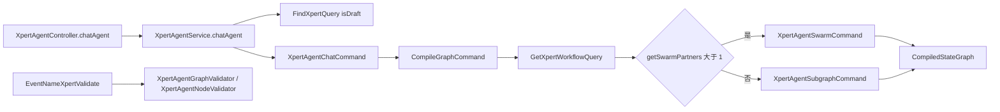
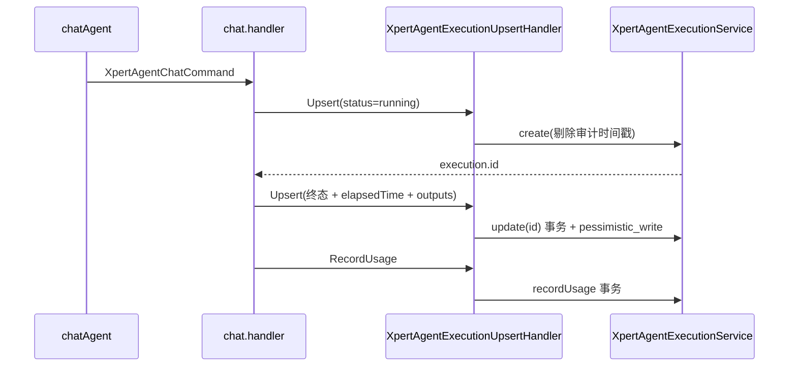
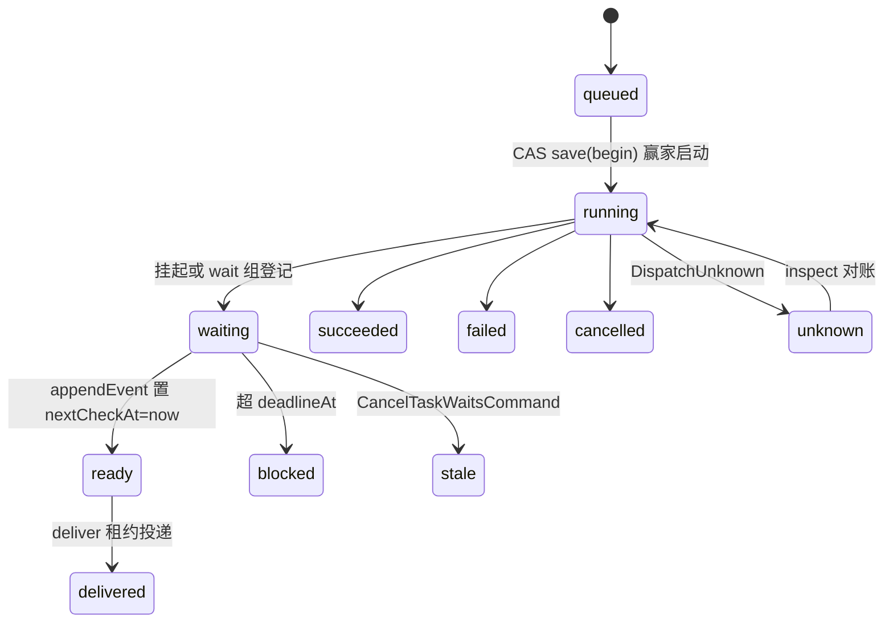
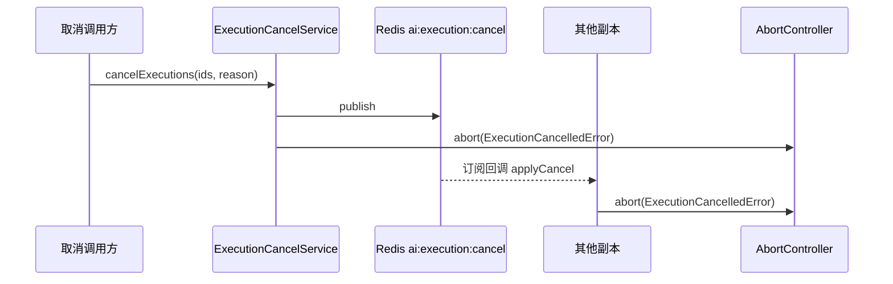
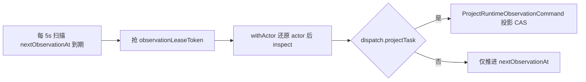
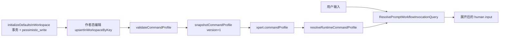
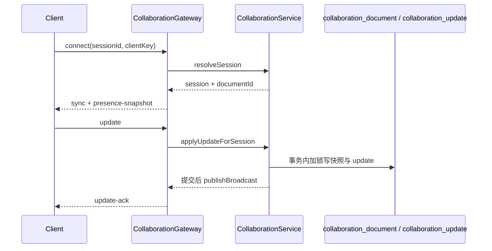

# 03 数据流转（Agent 执行链域）

**本文引用的文件**

- [packages/server-ai/src/xpert-agent/xpert-agent.service.ts](file://packages/server-ai/src/xpert-agent/xpert-agent.service.ts)
- [packages/server-ai/src/xpert-agent/xpert-agent.controller.ts](file://packages/server-ai/src/xpert-agent/xpert-agent.controller.ts)
- [packages/server-ai/src/xpert-agent/commands/compile-graph.command.ts](file://packages/server-ai/src/xpert-agent/commands/compile-graph.command.ts)
- [packages/server-ai/src/xpert-agent/commands/handlers/compile-graph.handler.ts](file://packages/server-ai/src/xpert-agent/commands/handlers/compile-graph.handler.ts)
- [packages/server-ai/src/xpert-agent/graph-validator.ts](file://packages/server-ai/src/xpert-agent/graph-validator.ts)
- [packages/server-ai/src/xpert-agent/agent-validator.ts](file://packages/server-ai/src/xpert-agent/agent-validator.ts)
- [packages/server-ai/src/xpert-agent/commands/handlers/chat.handler.ts](file://packages/server-ai/src/xpert-agent/commands/handlers/chat.handler.ts)
- [packages/server-ai/src/shared/agent/execution.ts](file://packages/server-ai/src/shared/agent/execution.ts)
- [packages/server-ai/src/xpert-agent-execution/agent-execution.service.ts](file://packages/server-ai/src/xpert-agent-execution/agent-execution.service.ts)
- [packages/server-ai/src/xpert-agent-execution/execution-timing.ts](file://packages/server-ai/src/xpert-agent-execution/execution-timing.ts)
- [packages/server-ai/src/xpert-agent-execution/commands/handlers/upsert.handler.ts](file://packages/server-ai/src/xpert-agent-execution/commands/handlers/upsert.handler.ts)
- [packages/server-ai/src/xpert-agent-execution/commands/handlers/record-usage.handler.ts](file://packages/server-ai/src/xpert-agent-execution/commands/handlers/record-usage.handler.ts)
- [packages/server-ai/src/agent-invocation/invocation-runtime.ts](file://packages/server-ai/src/agent-invocation/invocation-runtime.ts)
- [packages/server-ai/src/agent-invocation/typeorm-invocation.store.ts](file://packages/server-ai/src/agent-invocation/typeorm-invocation.store.ts)
- [packages/server-ai/src/agent-invocation/invocation-monitor.service.ts](file://packages/server-ai/src/agent-invocation/invocation-monitor.service.ts)
- [packages/server-ai/src/agent-invocation/invocation-wait.store.ts](file://packages/server-ai/src/agent-invocation/invocation-wait.store.ts)
- [packages/server-ai/src/agent-invocation/task-wait-control.ts](file://packages/server-ai/src/agent-invocation/task-wait-control.ts)
- [packages/server-ai/src/agent-invocation/invocation.entity.ts](file://packages/server-ai/src/agent-invocation/invocation.entity.ts)
- [packages/server-ai/src/handoff/runtime-messaging/runtime-observation-monitor.service.ts](file://packages/server-ai/src/handoff/runtime-messaging/runtime-observation-monitor.service.ts)
- [packages/server-ai/src/handoff/runtime-messaging/README.md](file://packages/server-ai/src/handoff/runtime-messaging/README.md)
- [packages/server-ai/src/shared/execution/execution-cancel.service.ts](file://packages/server-ai/src/shared/execution/execution-cancel.service.ts)
- [packages/server-ai/src/handoff/handoff-cancel.service.ts](file://packages/server-ai/src/handoff/handoff-cancel.service.ts)
- [packages/server-ai/src/prompt-workflow/prompt-workflow.service.ts](file://packages/server-ai/src/prompt-workflow/prompt-workflow.service.ts)
- [packages/server-ai/src/prompt-workflow/queries/handlers/resolve-prompt-workflow-invocation.handler.ts](file://packages/server-ai/src/prompt-workflow/queries/handlers/resolve-prompt-workflow-invocation.handler.ts)
- [packages/server-ai/src/collaboration/collaboration.service.ts](file://packages/server-ai/src/collaboration/collaboration.service.ts)
- [packages/server-ai/src/collaboration/collaboration.gateway.ts](file://packages/server-ai/src/collaboration/collaboration.gateway.ts)

## 目录

1. [图编译链](#图编译链)
2. [一次执行链](#一次执行链)
3. [Invocation 生命周期链](#invocation-生命周期链)
4. [取消链](#取消链)
5. [观察与投影链](#观察与投影链)
6. [Prompt 工作流链](#prompt-工作流链)
7. [协作链](#协作链)
8. [状态流转](#状态流转)
9. [异步流与外部依赖](#异步流与外部依赖)
10. [数据变换关键节点](#数据变换关键节点)
11. [已知风险](#已知风险)

## 图编译链

`XpertAgentController.chatAgent`（`POST /api/xpert-agent/chat`，SSE + `keepAlive(30000)` + `takeUntilClose`）调用 `XpertAgentService.chatAgent`：先 `FindXpertQuery({ isDraft: true })` 取 xpert，再派发 `XpertAgentChatCommand`（handler `chat.handler.ts`）。图编译由 `CompileGraphCommand`（`type = '[Xpert Agent] Compile graph'`）承担，`CompileGraphHandler` 通过 `GetXpertWorkflowQuery(xpert.id, agentKeyOrName, options.isDraft)` 取回 `{ agent, graph }`；`getSwarmPartners` 判定伙伴数 > 1 时走 `XpertAgentSwarmCommand`，否则走 `XpertAgentSubgraphCommand`，最终返回 `CompiledStateGraph`。

校验不与编译同步串联，而是 `EventNameXpertValidate` 事件的订阅者：`XpertAgentGraphValidator`（`validateAgentSubgraphBuildCycles`，错误码 `AGENT_SUBGRAPH_BUILD_CYCLE`）、`XpertAgentNodeValidator`，以及 plugins/workflow 下各节点 validator（middleware、skill、iterator、agent-tool 等）。

图表来源：[compile-graph.handler.ts](file://packages/server-ai/src/xpert-agent/commands/handlers/compile-graph.handler.ts)、[graph-validator.ts](file://packages/server-ai/src/xpert-agent/graph-validator.ts)、[xpert-agent.controller.ts](file://packages/server-ai/src/xpert-agent/xpert-agent.controller.ts)

草稿态/发布态隔离在中间件运行时侧落实：`getDraftXpertMiddlewareContext` 先 `assertCanAuthorById(xpertId)`，再以 `isDraft: true` 读 xpert 特征；`createDraftXpertMiddlewareRuntime` 用 `resolveXpertDataVolumeScope` + `agentMiddlewareRuntimeService.createScopedApi({...})` 构造只面向作者草稿的运行时，`getMiddlewareStrategies` / `getMiddlewareTools` / `testMiddlewareTool` 共用该路径，不与发布态运行链共享全局 registry。

章节来源：[xpert-agent.service.ts](file://packages/server-ai/src/xpert-agent/xpert-agent.service.ts)（关键符号：`XpertAgentService.chatAgent` / `createDraftXpertMiddlewareRuntime` / `getDraftXpertMiddlewareContext`）

## 一次执行链

执行账本的唯一写入面是 `XpertAgentExecutionService`，调用方一律经 CQRS 命令：`XpertAgentExecutionUpsertCommand` → `XpertAgentExecutionUpsertHandler`（首次 `create`，重试 `update`；已有 `threadId` 的执行禁止改挂到另一线程，抛 `ForbiddenException`），以及 `XpertAgentExecutionRecordUsageCommand` → `XpertAgentExecutionRecordUsageHandler`。

`wrapAgentExecution` 是标准范式：把 `execution.status = running` 后首次 upsert（返回 id 并发出 `ON_AGENT_START`）；`finally` 中用**运行时变更**再次 upsert（注释明写“Persist runtime changes, not the initial row's timestamps or usage counters.”），随后 `XpertAgentExecutionOneQuery` 重读并发出 `ON_AGENT_END`。`chat.handler.ts` 亦按同一约束写入 `status / error / outputs / checkpointNs / checkpointId` 并按 `timeEnd - timeStart` 累加 `elapsedTime`；捕获 `ExecutionCancelledError` 与 graph interrupt 时落 `interrupted`。

终局化语义由 `executionCompletedAt` 保证：`running` / `pending` 清空 `completedAt`，仅在“本次为停止态且上次非停止态”时写 `new Date()`，其余情况保留原值；`update(id, entity)` 在事务内 `pessimistic_write` 加锁后重算，`create` 则剔除调用方传入的 `createdAt` / `updatedAt`。`recordUsage(id, usage)` 亦走事务：`increment(tokens)`，并在 `usage.type !== 'estimated' && usage.details` 时写 `responseLatency / currency / totalPrice / input* / output*` 定价列。

图表来源：[shared/agent/execution.ts](file://packages/server-ai/src/shared/agent/execution.ts)、[agent-execution.service.ts](file://packages/server-ai/src/xpert-agent-execution/agent-execution.service.ts)

章节来源：[agent-execution.service.ts](file://packages/server-ai/src/xpert-agent-execution/agent-execution.service.ts)（关键符号：`XpertAgentExecutionService.create` / `update` / `recordUsage` / `interruptRunning`、表 `xpert_agent_execution`）

## Invocation 生命周期链

`start` 先 `structuredClone` + `validateRequest`（校验 `callId` 非空且 ≤1024、`target.bindingId/provider/reference/revision`、`input.prompt` 类型），再 `authorizeAgentInvocation(() => access.authorize(target))`，并用 `agentInvocationId(scope, callId)`（`sha256(canonical({scope, callId}))` 切成 UUID 形）作幂等键读 store：命中则 `assertScope` + `canonical(record.request)` 全等校验，不等抛 `CallConflict`，终态直接返回，非终态只在 `queued`（或 `waiting` 且策略 `recovery === 'checkpoint'`）时续跑。

未命中则 `registry.get(provider, organizationId)` 取策略并落 `providerSource`（`registry.getSource(strategy)`）作**策略固定快照**，`store.insert` 用 `orIgnore().returning('id')` 判定是否抢占成功，失败则递归重入。随后 `save(..., 'begin')` 以 revision CAS 把状态推到 `running`：只有 CAS 赢家才能启动策略；策略异常时按 `isSuspension` 落 `waiting`，否则落 `unknown`（错误码 `DispatchUnknown`）并抛出。

状态转移统一经 store 的 `replace(record, expectedRevision)`：`where {id, tenantId, organizationId, ownerId, revision: expectedRevision}`，`affected !== 1` 即返回 false 交由调用方重读；同一事务内 `appendEvent` 写 `agent_invocation_event`（唯一 `(invocationId, revision)`，append-only），并 `appendRuntimeDelivery`；若新状态属于 `succeeded|failed|cancelled|waiting`，还会把匹配的 `agent_invocation_wait` 行 `nextCheckAt` 置 `now()`，并在提交后发 `TaskObservationCommittedEvent`（仅通知，失败降级到轮询）。

监控侧：`AgentInvocationMonitorService` 每 5s `reconcile()`（`take: 10`，`state='waiting' AND nextCheckAt <= now()`），`process()` 处理 waiting 组、`deliver()` 处理 ready 组，二者共用 `claim(state, handler)`：CAS 抢 `leaseToken` + `leaseUntil = now + 120s`、`nextCheckAt = now + 15s`，心跳 30s 续租，异常落 `lastError='continuation_pending'` 且在超 `deadlineAt` 时改写 `blocked`；`withAccess()` 恢复原 actor/tenant/org 并复核 membership 后才执行。wait 组自身由 `AgentInvocationWaitStore.register / registerTasks` 以 `id()` 哈希（tenant/org/user/parentExecutionId/callerAgentKey/callId 的 sha256）幂等落库，`state='waiting'`、`deadlineAt = now + HOST_TASK_WAIT_POLICY.maxWaitMs`。

图表来源：[invocation-runtime.ts](file://packages/server-ai/src/agent-invocation/invocation-runtime.ts)、[typeorm-invocation.store.ts](file://packages/server-ai/src/agent-invocation/typeorm-invocation.store.ts)、[invocation-monitor.service.ts](file://packages/server-ai/src/agent-invocation/invocation-monitor.service.ts)

章节来源：[invocation-runtime.ts](file://packages/server-ai/src/agent-invocation/invocation-runtime.ts)（关键符号：`AgentInvocationRuntime.start` / `control` / `pinned` / `save`、表 `agent_invocation` / `agent_invocation_event` / `agent_invocation_wait`）

## 取消链

`ExecutionCancelService.cancelExecutions(executionIds, reason?)` 先去重并 `redis.publish('ai:execution:cancel', {executionIds, reason})`（**失败只 warn，不抛出**），再本地 `applyCancel`：对本地 `#controllers` 中登记的 `AbortController` 调 `controller.abort(new ExecutionCancelledError(executionId, reason))`，并删除登记（`register/unregister` 支持“旧实例不覆盖新登记”的对比删除）。`execution-abort-scope.ts` 把父信号级联到子执行作用域，父已中止时新作用域立即处于中止态。

调用方实测：`chat-conversation/commands/handlers/cancel-conversation.handler.ts` 先 `cancelRuns(executionIds)`（desktop-shell）+ `cancelExecutions(..., 'Canceled by user')`，再 best-effort `StopHandoffMessageCommand`；`cancel-external-assistant.handler.ts` 在取消后调 `interruptRunning(ids, threadId, reason)`（仅把仍为 `running` 的行改为 `interrupted` 并写 `completedAt`）；`thread-run-control.service.ts` 在 run owner 失租时取消该执行。与 handoff 侧分工：`HandoffCancelService` 管队列态（删除 Bull job）与 `active` 态 abort，走独立频道 `ai:handoff:cancel`；两者互不替代。

终止证明：取消只是请求。`agent-invocation/README.md` 明写“A stop request is not proof of termination: only `exited` confirms the process stopped, and `unknown` must remain visible.”；投影/对账必须保留 `unknown` 可见性，不得据取消信号推断终态。

图表来源：[execution-cancel.service.ts](file://packages/server-ai/src/shared/execution/execution-cancel.service.ts)、[cancel-conversation.handler.ts](file://packages/server-ai/src/chat-conversation/commands/handlers/cancel-conversation.handler.ts)

章节来源：[execution-cancel.service.ts](file://packages/server-ai/src/shared/execution/execution-cancel.service.ts)（关键符号：`ExecutionCancelService.cancelExecutions` / `applyCancel`、`ExecutionCancelledError`）

## 观察与投影链

`RuntimeObservationMonitorService` 用 `@Interval(5000)` 扫描 `nextObservationAt <= now()` 且带 `request.dispatch` 或 `activity` 的 `agent_invocation`（`take: 20`），`observe()` 以 `observationLeaseToken/observationLeaseUntil`（60s，20s 续租）抢占，经 `access.withActor(scope, ...)` 还原 actor 后 `factory.createCapturedApi(scope).inspect(id)`——**只观察已存在句柄，绝不启动**；成功后按状态回写 `nextObservationAt`（终态置 `null`，`unknown` 60s，其余 5s）并清 `observationError`；失败置 60s 与 `observationError='observation_unavailable'`。该租约与父 turn 无关，也不与 `agent_invocation_wait` 的 `leaseToken/leaseUntil` 共用。

投影：观察到 `request.dispatch.projectTask` 时发 `ProjectRuntimeObservationCommand`；`runtime-messaging/README.md` 明写自动投影需要“最新实现尝试 + 规格未变 + 调度时或上一次投影捕获的 task revision”，最终写入同样用 revision CAS（因为遗留写者不取 Project 锁），运行时启动映射 `in_progress`、成功 `review`、失败 `blocked`，取消 Invocation 不等于取消 Task。

图表来源：[runtime-observation-monitor.service.ts](file://packages/server-ai/src/handoff/runtime-messaging/runtime-observation-monitor.service.ts)

章节来源：[runtime-observation-monitor.service.ts](file://packages/server-ai/src/handoff/runtime-messaging/runtime-observation-monitor.service.ts)（关键符号：`RuntimeObservationMonitorService.reconcile` / `observe`）、[README.md](file://packages/server-ai/src/handoff/runtime-messaging/README.md)（表 `agent_invocation`、`agent_runtime_delivery`）

## Prompt 工作流链

作者态：`initializeDefaultsInWorkspace` 在事务内以 `pessimistic_write` 锁读同名工作流后只补插缺失项（返回 `created/skipped`）；`createInWorkspace` / `updateInWorkspace` / `upsertInWorkspaceByKey` / `archiveInWorkspace(ByKey)` / `duplicateInWorkspace` 承载编辑，`getUsage` 汇总被 xpert 命令档案引用情况；`validateCommandProfile` 校验 `workspace_prompt_workflow` 条目必须带 `workspaceId` 且工作流存在（`findActiveWorkflowMap`），`skill` 条目必须有 `skillCommandName|name`。

运行时时序：`snapshotCommandProfile` = `validateCommandProfile` + `findActiveWorkflowMap`，对未禁用的 `workspace_prompt_workflow` 条目用 `mergeWorkflowWithEntry` 生成 `snapshot` 并落 `version: 1`（发布时固定）；`resolveRuntimeCommandProfile(xpert)` 读 `xpert.commandProfile`（`normalizeCommandProfile`），去掉已禁用/已归档工作流后返回 `{hasProfile, xpertCommands, workspaceCommands, preferredSkillEntries, skillEntries}`。用户输入侧由 `ResolvePromptWorkflowInvocationQuery(xpert, human)` 解析（handler 在 prompt-workflow/queries/handlers），命中 `insert_text` 且 `commandSource.kind === 'prompt_workflow'` 时返回 `null`（不覆盖用户已编辑内容），否则渲染模板并回填 `commandSource`。

图表来源：[prompt-workflow.service.ts](file://packages/server-ai/src/prompt-workflow/prompt-workflow.service.ts)、[resolve-prompt-workflow-invocation.handler.ts](file://packages/server-ai/src/prompt-workflow/queries/handlers/resolve-prompt-workflow-invocation.handler.ts)

章节来源：[prompt-workflow.service.ts](file://packages/server-ai/src/prompt-workflow/prompt-workflow.service.ts)（关键符号：`initializeDefaultsInWorkspace` / `snapshotCommandProfile` / `resolveRuntimeCommandProfile`、表 `prompt_workflow`）

## 协作链

`createSessionWithScope` 生成 `sessionId`，只保留 `clientKey` 哈希（`hashSecret`）并写 Redis（`SESSION_TTL_SECONDS = 600`）；`collaboration.gateway.ts` 在 `handleConnection` 用 `resolveSession(sessionId, clientKey, documentId)` 校验后 `join(room(documentId))`，并下发 `sync`（`getStateForSession`）与 `presence-snapshot`。`update` 消息先 `applyUpdateForSession`，**落库成功后才 `emit('update-ack')`**（注释：Persist a client update before acknowledging it）。

`applyUpdateWithScope` 在事务内 `pessimistic_write` 锁文档、按 `(documentId, updateHash)` 去重、`sequenceNumber + 1`、编码文档快照（`stateBase64` / `stateVectorBase64`）并累加 `updateCount`；服务在提交后 `publishBroadcast`（Redis `xpert:collaboration:broadcast`）做跨节点扇出。`getStateForSession(session, stateVectorBase64)` 返回 state-vector 增量用于重连修复；presence 走 Redis（TTL 30s、15s 判定 stale），`retryMaterialization(documentId)` / `enqueueMaterialization`（Bull 队列任务）驱动 `materialize` 与 `materializationStatus` / `lastMaterializationError` 回写。

图表来源：[collaboration.gateway.ts](file://packages/server-ai/src/collaboration/collaboration.gateway.ts)、[collaboration.service.ts](file://packages/server-ai/src/collaboration/collaboration.service.ts)

章节来源：[collaboration.service.ts](file://packages/server-ai/src/collaboration/collaboration.service.ts)（关键符号：`CollaborationService.createSessionWithScope` / `applyUpdateWithScope` / `getStateForSession` / `retryMaterialization`、表 `collaboration_document` / `collaboration_update`）

## 状态流转

| 载体 | 状态/版本 | 触发与约束 |
|---|---|---|
| `agent_invocation.revision` | 单调递增 int | 每次 `replace(record, expectedRevision)` 成功即 +1；冲突返回 false 由调用方重读；`agent_invocation_event` 唯一 `(invocationId, revision)` 兜底事件级幂等 |
| `agent_invocation_wait.state` | `waiting → ready → delivered`，旁路 `stale` / `blocked` | `waiting` 由登记写入；`ready` 由 `appendEvent` 置 `nextCheckAt=now` 唤醒；`delivered` 由 `deliver()` 租约投递；`stale` 由 `CancelTaskWaitsCommand`（`lastError='parent_cancelled'`）；`blocked` 由超 `deadlineAt`；DB 侧 `CHECK` 由迁移补齐 |
| `xpert_agent_execution.status` | `running / success / error / pending / timeout / interrupted` | `wrapAgentExecution` 首写 `running`，`finally` 写终态；graph interrupt 与 `ExecutionCancelledError` 归 `interrupted` |
| `xpert_agent_execution.completedAt` | 时间戳 | 仅表“成功/失败/超时/中断”；回到 `running/pending` 清空；元数据写入不得改动既有结束时间 |
| `agent_runtime_binding.enabled` | boolean（建时 true） | `PUT /api/agent-runtime-bindings/:id` 置位；被禁即视为显式撤权（读侧按“禁用/删除即撤销”处理） |
| `agent_runtime_delivery` / `agent_runtime_inbox` | `state` + `attempts` + `leaseToken/leaseUntil` | 投递失败重试，`redrive` 只重排被阻塞/失败的传输并保留 claim/phase/user-stop 屏障 |

章节来源：[invocation.entity.ts](file://packages/server-ai/src/agent-invocation/invocation.entity.ts)、[invocation-wait.store.ts](file://packages/server-ai/src/agent-invocation/invocation-wait.store.ts)、[execution-timing.ts](file://packages/server-ai/src/xpert-agent-execution/execution-timing.ts)（表 `agent_invocation` / `agent_invocation_wait` / `xpert_agent_execution` / `agent_runtime_delivery`）

## 异步流与外部依赖

- Redis pub/sub：`ai:execution:cancel`（执行取消，发布失败仅 warn → 退化为本地取消）、`ai:handoff:cancel`（handoff 队列/进程取消，另见 handoff README）、`xpert:collaboration:broadcast`（协作文档跨节点扇出）；Redis 亦承载 collaboration 会话与 presence（`SESSION_TTL_SECONDS = 600`、`PRESENCE_TTL_SECONDS = 30`）。
- 进程内轮询：`AgentInvocationMonitorService` 与 `RuntimeObservationMonitorService` 均为 `@Interval(5000)`，且各自有 `busy/scanning` 门闩与本地事件加速；`runtime-messaging/README.md` 明写“Polling is the durable recovery mechanism; local events and queue delivery are acceleration only.”。
- 租约：观察租约 60s/续租 20s；wait 组租约 120s/续租 30s/`nextCheckAt` 15s；启动 fence 最长 120s 内不判定中间态失效（`unknown` 必须可见）。文档同时声明“Leases permit independent host processes to scan safely… not exactly-once network or model execution.”。
- 队列：handoff 队列（Bull + 持久化 outbox/inbox，`agent_runtime_delivery` / `agent_runtime_inbox`）；协作物化另有 Bull 队列任务（`enqueueMaterialization`）。
- 失败语义：传输成功不推断任务完成；`consumer_outcome_unknown` 不得自动重放或重分配消费者；断开观察者不取消运行；含糊启动必须对账且不得自动重放；本地事件发布失败降级为轮询。

章节来源：[execution-cancel.service.ts](file://packages/server-ai/src/shared/execution/execution-cancel.service.ts)、[invocation-monitor.service.ts](file://packages/server-ai/src/agent-invocation/invocation-monitor.service.ts)、[README.md](file://packages/server-ai/src/handoff/runtime-messaging/README.md)（关键符号：`HandoffCancelService`、`AgentInvocationMonitorService.claim`）

## 数据变换关键节点

- 幂等键哈希：`agentInvocationId(scope, callId)` = `sha256(canonical({scope, callId}))`，取 32 位十六进制并整形为 UUID（第 13 位写 `5`、第 17 位写 `a`）；`canonical` 对对象按键排序、丢弃 `undefined`，保证 JSONB 键序无关；请求一致性强等校验也走 `sameInvocationData`。
- wait 组标识：`AgentInvocationWaitStore.id(request, scope)` 对 `[tenantId, organizationId, userId, parentExecutionId, callerAgentKey, callId]` 做 `sha256` 后按同一 UUID 整形规则生成，登记用 `orIgnore()`，随后重读做 `threadId` 与 `mode/taskIds` 全等校验，不符抛 `CallConflict`。
- provider pin 快照：`providerSource = registry.getSource(strategy)` 与 `invocation` 同事务落库；恢复时 `pinned(record)` 取回原策略，不静默回退；`agent_runtime_binding.target.revision` 建时 `randomUUID()` 固定（`AgentTarget` 含 provider/reference/revision/configuration）。
- activity 游标与缺口：`agent_invocation_activity_state`（`seq/bytes/sourceCursor/closed/expiresAt/expired/gaps`）+ `agent_invocation_activity_item`（唯一 `(invocationId, seq)`；`firstSeq/itemId/hash/item`），游标推进与缺口记入 `gaps`，容量语义见 04。
- CRDT 物化：更新以 base64 存储（`updateBase64`），文档快照同样 base64（`stateBase64` / `stateVectorBase64`），`stateVectorBase64` 既用于增量同步也用于物化比对（`materializedSequence`）。
- 命令档案快照：发布时把工作流实体内容 `mergeWorkflowWithEntry` 内联到 `snapshot` 并固定 `version: 1`，运行时不依赖后续工作流改名/归档。

章节来源：[invocation-runtime.ts](file://packages/server-ai/src/agent-invocation/invocation-runtime.ts)、[invocation-wait.store.ts](file://packages/server-ai/src/agent-invocation/invocation-wait.store.ts)、[collaboration.service.ts](file://packages/server-ai/src/collaboration/collaboration.service.ts)（关键符号：`agentInvocationId` / `canonical`、表 `agent_invocation_activity_state` / `agent_invocation_activity_item`）

## 已知风险

1. **跨副本取消是尽力而为**：`cancelExecutions` 的 publish 失败只 `warn`，Redis 订阅缺失/失败即静默丢取消；`ExecutionCancelService` 只能中止本进程登记的 `AbortController`，无法终止 CPU-bound 代码，也无法证明进程已停止（只有 `exited` 确认，`unknown` 必须保持可见）。
2. **CAS 冲突是常态而非异常**：`replace` 返回 `false` 时调用方必须重读并重算，任何“失败即当作终态”的写法都会丢事件；`agent_invocation_event` 唯一索引会在乱序 revision 上直接报约束错误。
3. **终局化重放会污染账本**：整行重放初次 `create` 的快照会覆盖 `updatedAt` 与 usage 计数（执行域 README 明写禁止）；`completedAt` 只能由生命周期写入，元数据更新不得改动它。
4. **两套租约不可混用**：观察租约（`observationLeaseToken/observationLeaseUntil`）只保护对已存在句柄的观察；wait 组租约（`leaseToken/leaseUntil`）保护 continuation 投递与 claim 复核（`CheckTaskWaitClaimQuery` 要求 `state='ready'` 且 `leaseUntil` 未过期）。
5. **`recordUsage` 的入口守卫存在待核实点**：`XpertAgentExecutionRecordUsageHandler` 仅在 `tokens` 为正整数且 `type` 为 `undefined` 或 `'estimated'` 时调用服务，而服务只在 `type !== 'estimated'` 且带 `details` 时写定价列——两侧条件交叉，需按调用方实际 `type` 取值回归确认定价是否落库。
6. **投影与 Task 决策解耦**：取消 Invocation 不取消 Task；`consumer_outcome_unknown` 不得自动重放、redrive 不得重分配 consumer；历史终态调用不会被自动唤醒（只由新的已提交观察产生新的投递意图）。
7. **`xpert_agent.knowledgebaseIds/toolsetIds` 是 json 数组而非外键**：删除知识库/工具集不会级联清理，引用悬空只能由业务侧消化（详见 04）。
8. **协作面鉴权靠不透明会话**：namespace `/api/collaboration` 且 `cors.origin='*'`，鉴权依赖 `sessionId/clientKey`（只存哈希、TTL 600s）而非 Nest Guard；`update` 采用“先落库后 ack”，客户端必须按 ack 语义重试。

章节来源：[runtime-messaging/README.md](file://packages/server-ai/src/handoff/runtime-messaging/README.md)、[agent-invocation/README.md](file://packages/server-ai/src/agent-invocation/README.md)、[xpert-agent-execution/README.md](file://packages/server-ai/src/xpert-agent-execution/README.md)（关键符号：`ExecutionCancelService`、`TypeOrmAgentInvocationStore.replace`、`XpertAgentExecutionService.recordUsage`）
