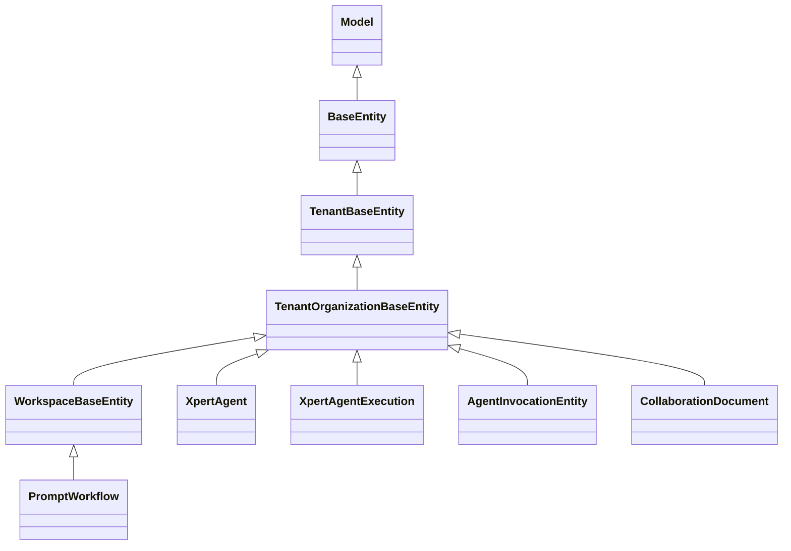

# 04 模型（Agent 执行链域数据模型）

**本文引用的文件**

- [packages/server-ai/src/xpert-agent/xpert-agent.entity.ts](file://packages/server-ai/src/xpert-agent/xpert-agent.entity.ts)
- [packages/server-ai/src/xpert-agent-execution/agent-execution.entity.ts](file://packages/server-ai/src/xpert-agent-execution/agent-execution.entity.ts)
- [packages/server-ai/src/xpert-agent-execution/agent-execution.service.ts](file://packages/server-ai/src/xpert-agent-execution/agent-execution.service.ts)
- [packages/server-ai/src/xpert-agent-execution/execution-timing.ts](file://packages/server-ai/src/xpert-agent-execution/execution-timing.ts)
- [packages/server-ai/src/xpert-agent-execution/migrations/20261008-execution-completed-at.sql](file://packages/server-ai/src/xpert-agent-execution/migrations/20261008-execution-completed-at.sql)
- [packages/server-ai/src/agent-invocation/invocation.entity.ts](file://packages/server-ai/src/agent-invocation/invocation.entity.ts)
- [packages/server-ai/src/agent-invocation/activity/activity.entity.ts](file://packages/server-ai/src/agent-invocation/activity/activity.entity.ts)
- [packages/server-ai/src/agent-invocation/agent-invocation.module.ts](file://packages/server-ai/src/agent-invocation/agent-invocation.module.ts)
- [packages/server-ai/src/agent-invocation/runtime-bindings.controller.ts](file://packages/server-ai/src/agent-invocation/runtime-bindings.controller.ts)
- [packages/server-ai/src/agent-invocation/migrations/20260922-agent-invocation.sql](file://packages/server-ai/src/agent-invocation/migrations/20260922-agent-invocation.sql)
- [packages/server-ai/src/agent-invocation/migrations/20261001-invocation-wait.sql](file://packages/server-ai/src/agent-invocation/migrations/20261001-invocation-wait.sql)
- [packages/server-ai/src/agent-invocation/migrations/20261002-task-wait-groups.sql](file://packages/server-ai/src/agent-invocation/migrations/20261002-task-wait-groups.sql)
- [packages/server-ai/src/agent-invocation/migrations/20261007-execution-activity.sql](file://packages/server-ai/src/agent-invocation/migrations/20261007-execution-activity.sql)
- [packages/server-ai/src/handoff/runtime-messaging/runtime-message.entity.ts](file://packages/server-ai/src/handoff/runtime-messaging/runtime-message.entity.ts)
- [packages/server-ai/src/handoff/runtime-messaging/migrations/20261006-runtime-reliable-replies.sql](file://packages/server-ai/src/handoff/runtime-messaging/migrations/20261006-runtime-reliable-replies.sql)
- [packages/server-ai/src/prompt-workflow/prompt-workflow.entity.ts](file://packages/server-ai/src/prompt-workflow/prompt-workflow.entity.ts)
- [packages/server-ai/src/prompt-workflow/prompt-workflow.service.ts](file://packages/server-ai/src/prompt-workflow/prompt-workflow.service.ts)
- [packages/server-ai/src/collaboration/entities/collaboration-document.entity.ts](file://packages/server-ai/src/collaboration/entities/collaboration-document.entity.ts)
- [packages/server-ai/src/collaboration/entities/collaboration-update.entity.ts](file://packages/server-ai/src/collaboration/entities/collaboration-update.entity.ts)
- [packages/server/src/core/entities/base.entity.ts](file://packages/server/src/core/entities/base.entity.ts)
- [packages/server/src/core/entities/tenant-base.entity.ts](file://packages/server/src/core/entities/tenant-base.entity.ts)
- [packages/server/src/core/entities/tenant-organization-base.entity.ts](file://packages/server/src/core/entities/tenant-organization-base.entity.ts)
- [packages/server-ai/src/core/entities/base.entity.ts](file://packages/server-ai/src/core/entities/base.entity.ts)
- [.fe-index/xpert-server/tables.md](file://.fe-index/xpert-server/tables.md)

## 目录

1. [实体基类分层](#实体基类分层)
2. [xpert_agent](#xpert_agent)
3. [xpert_agent_execution](#xpert_agent_execution)
4. [agent_invocation 与 agent_invocation_event](#agent_invocation-与-agent_invocation_event)
5. [agent_runtime_binding](#agent_runtime_binding)
6. [agent_invocation_wait](#agent_invocation_wait)
7. [agent_invocation_activity_state 与 activity_item](#agent_invocation_activity_state-与-activity_item)
8. [prompt_workflow 与 prompt_workflow_tag](#prompt_workflow-与-prompt_workflow_tag)
9. [collaboration_document 与 collaboration_update](#collaboration_document-与-collaboration_update)
10. [跨域注册的表](#跨域注册的表)
11. [迁移与 seed 惯例](#迁移与-seed-惯例)
12. [校验规则](#校验规则)
13. [已知风险与坑](#已知风险与坑)

## 实体基类分层

基类链：`Model`（构造函数批量赋值）→ `BaseEntity`（`id` uuid 主键、`createdById/updatedById`、`createdBy/updatedBy` 关系 `onDelete: RESTRICT`、`createdAt/updatedAt` timestamptz）→ `TenantBaseEntity`（`tenantId` 加 `@Index`、`tenant` CASCADE）→ `TenantOrganizationBaseEntity`（`organizationId` 加 `@Index`、`organization` CASCADE）。另有 `packages/server-ai/src/core/entities/base.entity.ts` 的 `WorkspaceBaseEntity extends TenantOrganizationBaseEntity`，补 `workspace`（`as IXpertWorkspace`，CASCADE）+ `workspaceId`（`@Index`）+ `publishAt` + `deletedAt`（`@DeleteDateColumn` 软删除）。

本域适用面（实体实测）：`XpertAgent`、`XpertAgentExecution`、`AgentInvocationEntity`、`AgentRuntimeBindingEntity`、`AgentInvocationEventEntity`、`AgentInvocationWaitEntity`、`InvocationActivityState`、`InvocationActivityItem`、`CollaborationDocument`、`CollaborationUpdate` 均 extends `TenantOrganizationBaseEntity`；`PromptWorkflow` extends `WorkspaceBaseEntity`（因此带 workspace 维度与软删除，**不**带 `publishAt` 之外的组织级语义差异）。本域无直接 extends `BaseEntity`/`TenantBaseEntity` 的实体。

图表来源：[base.entity.ts](file://packages/server/src/core/entities/base.entity.ts)、[tenant-organization-base.entity.ts](file://packages/server/src/core/entities/tenant-organization-base.entity.ts)、[base.entity.ts](file://packages/server-ai/src/core/entities/base.entity.ts)

章节来源：[base.entity.ts](file://packages/server/src/core/entities/base.entity.ts)、[tenant-base.entity.ts](file://packages/server/src/core/entities/tenant-base.entity.ts)（关键符号：`Model` / `BaseEntity` / `TenantBaseEntity` / `TenantOrganizationBaseEntity` / `WorkspaceBaseEntity`）

## xpert_agent

表 `xpert_agent`（无自定义索引，靠关系生成的 FK/唯一约束）。列：`key` varchar NOT NULL；`name` varchar(100) 可空；`title` varchar(100) 可空；`description` text 可空；`avatar` json 可空（`TAvatar`）；`prompt` text 可空；`promptTemplates` json 可空（`TAgentPromptTemplate[]`）；`parameters` json 可空（`TXpertParameter[]`）；`outputVariables` json 可空（`TAgentOutputVariable[]`）；`options` json 可空（`TXpertAgentOptions`）；`leaderKey` varchar 可空；`knowledgebaseIds` / `toolsetIds` / `collaboratorNames` 均为 json 可空数组。

关系与级联：`xpert` OneToOne `Xpert`，`@JoinColumn()`，`nullable: true`，`onDelete: 'CASCADE'` + `onUpdate: 'CASCADE'`（`xpertId` 为 `@RelationId` 列，可空）；`copilotModel` OneToOne `CopilotModel`，`@JoinColumn()`，`cascade: ['insert','update','remove','soft-remove','recover']`（模型随 Agent 全量级联写/删）；`team` ManyToOne `Xpert`，可空，`onDelete: 'CASCADE'`（`teamId` 列）。

业务约束：`knowledgebaseIds` / `toolsetIds` 是 **json 列而非真外键**，源码注释虽在 `@ManyToMany` 段落下，但实体没有 `@ManyToMany`/`@JoinTable`，只有 `knowledgebases?` / `toolsets?` / `collaborators?` 内存属性；`followers?` 亦非关系列（`leaderKey` + `collaboratorNames` 才是落库面）。删除知识库/工具集不触发级联清理。

章节来源：[xpert-agent.entity.ts](file://packages/server-ai/src/xpert-agent/xpert-agent.entity.ts)（关键符号：`XpertAgent`、表 `xpert_agent`）

## xpert_agent_execution

表 `xpert_agent_execution`，索引 `@Index(['parentId', 'tenantId', 'organizationId'])`。列（关键）：`category` varchar 默认 `'agent'`（`TXpertTeamNodeType`）；`type` varchar 可空（`WorkflowNodeTypeEnum | string`）；`title` text 可空；`agentKey` varchar(100) 可空；`predecessor` text 可空；`inputs` / `outputs` / `messages`（`StoredMessage[]`）/ `metadata`（`TAgentExecutionMetadata`）/ `operation`（`TSensitiveOperation`）为 json 可空；`status` varchar 可空（`XpertAgentExecutionStatusEnum`：`running/success/error/pending/timeout/interrupted`）；`error` text 可空；`elapsedTime` numeric 可空（`numericNumberTransformer` 转 number）；`completedAt` `timestamp with time zone` 可空。

用量与定价：`tokens` / `embedTokens` / `inputTokens` / `outputTokens` 为 `bigint` 默认 `0`（`bigintNumberTransformer`）；`responseLatency` `double precision` 可空；`totalPrice` numeric(20,7) 可空；`inputUnitPrice` / `inputPriceUnit` / `outputUnitPrice` / `outputPriceUnit` numeric(20,10) 可空；`currency` varchar(20) 可空。追踪列：`threadId` varchar(100) 可空且 DB 默认 `gen_random_uuid()`；`checkpointNs` / `checkpointId` / `channelName` 可空；`parent_thread_id` varchar(100) 可空；其余列见实体。

关系与级联：`parent` ManyToOne 自关联，可空，**`onDelete: 'CASCADE'`**（删父执行级联删子执行）；`subExecutions` 为 OneToMany 反向；`xpert` ManyToOne `Xpert`，可空，**`onDelete: 'SET NULL'`**（删 xpert 保留执行历史并解引用）；`xpertId` 为只读 `@RelationId` 列。非持久化成员：`get totalTokens()` 递归累加自身与 `subExecutions` 的 tokens；`summary?`。

写入约束（服务层）：`create` 剔除调用方 `createdAt/updatedAt` 并计算 `completedAt`；`update(id, entity)` 在事务内 `pessimistic_write` 重载后按 `executionCompletedAt(current, nextStatus)` 决定时间戳；`interruptRunning(ids, threadId, error)` 只更新仍为 `running` 的行（注释声明调用方已完成租户范围鉴权）。

章节来源：[agent-execution.entity.ts](file://packages/server-ai/src/xpert-agent-execution/agent-execution.entity.ts)、[agent-execution.service.ts](file://packages/server-ai/src/xpert-agent-execution/agent-execution.service.ts)（关键符号：`XpertAgentExecution`、`executionCompletedAt`、表 `xpert_agent_execution`）

## agent_invocation 与 agent_invocation_event

`agent_invocation`：索引 `@Index(['tenantId', 'organizationId', 'ownerId'])`。列：`ownerId` varchar NOT NULL；`revision` int 默认 `0`（**CAS 版本**）；`invocation` jsonb NOT NULL（SDK `AgentInvocation`）；`providerSource` jsonb NOT NULL（`StrategySource`，策略固定快照）；`nextObservationAt` timestamptz 默认 `now()` 可空；`observationLeaseToken` uuid 可空；`observationLeaseUntil` timestamptz 可空；`observationError` varchar 可空。迁移侧 `id` 为 `uuid PRIMARY KEY`（无默认值，由 `agentInvocationId` 生成），`tenantId/organizationId` 外键 CASCADE；观察列由 `20261006-runtime-reliable-replies.sql` 追加以 `IDX_invocation_observation_due (nextObservationAt)`。

`agent_invocation_event`：唯一 `@Index(['invocationId', 'revision'])`，append-only 观察历史。列：`invocationId` uuid NOT NULL（迁移中 REFERENCES `agent_invocation(id)` ON DELETE CASCADE）；`ownerId` varchar；`revision` int；`observation` jsonb（写入时只取 `status/handle/interaction/progress/result/error` 六个字段）。事件幂等即由该唯一索引保证：重复 revision 插入会直接触发约束错误并回滚整个 `replace` 事务。

章节来源：[invocation.entity.ts](file://packages/server-ai/src/agent-invocation/invocation.entity.ts)、[20260922-agent-invocation.sql](file://packages/server-ai/src/agent-invocation/migrations/20260922-agent-invocation.sql)（关键符号：`AgentInvocationEntity` / `AgentInvocationEventEntity`、表 `agent_invocation` / `agent_invocation_event`）

## agent_runtime_binding

表 `agent_runtime_binding`（无自定义索引）。列：`title` varchar NOT NULL（zod 限 1–200）；`workspaceIds` jsonb NOT NULL（zod `z.array(z.string().uuid()).min(1).max(100)`，服务侧 `[...new Set(...)]` 去重并核对 workspace 归属，`countBy` 不符抛 `InvalidScope`）；`target` jsonb NOT NULL（`AgentTarget`：`bindingId` / `provider` / `reference` / `revision` / `configuration`，其中 `revision` 建时 `randomUUID()` **固定**）；`enabled` boolean 默认 `true`。无 FK 关系列：`workspaceIds` 为 json，仅做应用层归属校验。创建时拒绝 `provider ∈ {xpert, xpert-task}`（内置运行时不经绑定暴露）。

章节来源：[invocation.entity.ts](file://packages/server-ai/src/agent-invocation/invocation.entity.ts)、[runtime-bindings.controller.ts](file://packages/server-ai/src/agent-invocation/runtime-bindings.controller.ts)（关键符号：`AgentRuntimeBindingEntity`、表 `agent_runtime_binding`）

## agent_invocation_wait

表名保留历史单任务 checkpoint 语义（源码注释：“Durable dependency groups; table name preserves existing single-task checkpoints.”）。列：`ownerId` / `threadId` / `checkpointNamespace` varchar NOT NULL；`state` varchar 默认 `'waiting'`，取值 `'waiting' | 'ready' | 'delivered' | 'stale' | 'blocked'`；`request` jsonb 可空（`TaskWaitRequest & { scope: AgentInvocationScope }`）；`outcome` varchar 可空（`TaskWaitReason`）；`deadlineAt` / `unknownSince` / `nextCheckAt`（**NOT NULL**，登记时写 `now()`）；`leaseToken` uuid 可空；`leaseUntil` timestamptz 可空；`lastError` varchar 可空。索引：`@Index(['state', 'nextCheckAt'])`。

迁移演进：`20261001-invocation-wait.sql` 建表（`id uuid PRIMARY KEY REFERENCES agent_invocation(id) ON DELETE CASCADE`，`state` CHECK 仅 `waiting|delivered|stale`，`IDX_agent_invocation_wait_due`）；`20261002-task-wait-groups.sql` **DROP** `agent_invocation_wait_id_fkey` 以允许组身份复用，重建 CHECK 为五态，补 `request/outcome/deadlineAt/unknownSince`，回填 `deadlineAt = now() + 24 hours`，并建 gin 索引 `IDX_agent_invocation_wait_tasks ON ... ((request->'taskIds'))`。

章节来源：[invocation.entity.ts](file://packages/server-ai/src/agent-invocation/invocation.entity.ts)、[20261002-task-wait-groups.sql](file://packages/server-ai/src/agent-invocation/migrations/20261002-task-wait-groups.sql)（关键符号：`AgentInvocationWaitEntity`、表 `agent_invocation_wait`）

## agent_invocation_activity_state 与 activity_item

`agent_invocation_activity_state`：`id uuid PRIMARY KEY REFERENCES agent_invocation(id) ON DELETE CASCADE`（一个 Invocation 一行）；`seq` int 默认 0；`bytes` int 默认 0（**容量语义**）；`sourceCursor` varchar 可空（外部源游标）；`closed` boolean 默认 false；`expiresAt` timestamptz 可空；`expired` boolean 默认 false；`gaps` jsonb 默认 `[]`（`ExecutionActivityGap[]`，缺口显式记录而非静默跳过）。`agent_invocation_activity_item`：`id uuid DEFAULT gen_random_uuid()`；`invocationId` uuid NOT NULL REFERENCES `agent_invocation(id)` CASCADE；`seq` int NOT NULL；`firstSeq` int NOT NULL；`itemId` varchar NOT NULL；`hash` varchar NOT NULL；`item` jsonb NOT NULL。索引：唯一 `@Index(['invocationId', 'seq'])` 与 `@Index(['invocationId', 'itemId', 'seq'])`（迁移实体化为 `seq DESC` 的 `IDX_invocation_activity_item`）。

容量语义：`20261007-execution-activity.sql` 是幂等脚本，仅对“已 closed 且无 `expiresAt`”的行回填 `updatedAt + interval '30 days'`，并声明“Existing execution is replayed”不成立——**不重放历史执行**；`gaps` 与 `bytes` 由服务侧随写入累积（判定阈值见 `InvocationActivityService`）。

章节来源：[activity.entity.ts](file://packages/server-ai/src/agent-invocation/activity/activity.entity.ts)、[20261007-execution-activity.sql](file://packages/server-ai/src/agent-invocation/migrations/20261007-execution-activity.sql)（关键符号：`InvocationActivityState` / `InvocationActivityItem`、表 `agent_invocation_activity_state` / `agent_invocation_activity_item`）

## prompt_workflow 与 prompt_workflow_tag

表 `prompt_workflow`，唯一 `@Index(['workspaceId', 'name'])`（同名并发创建/重命名会直接撞唯一约束）。列：`name` varchar(64) NOT NULL（服务侧模式 `/^[a-z0-9][a-z0-9_-]{0,63}$/`）；`label` varchar(120) 可空；`description` text 可空；`icon` json 可空（字符串或 `IconDefinition`）；`category` varchar(80) 可空；`aliases` json 可空（string[]）；`argsHint` varchar(120) 可空；`template` **text NOT NULL**；`scenarios` json 可空；`tags` json 可空（string[]，与 `organizationTags` 是两套）；`sourceTemplateId` varchar 可空（源码注释：**Server-owned provenance; never inferred from a matching name.**）；`associatedXpertIds` json 可空；`visibility` varchar(20) 默认 `'private'`（`private|team|tenant`，服务侧 `PROMPT_WORKFLOW_VISIBILITIES` 收口）；`runtimeCapabilities` json 可空；`archivedAt` timestamptz 可空。继承列：`workspaceId` / `workspace`（CASCADE）、`publishAt`、`deletedAt`（软删除）。

`prompt_workflow_tag`：`organizationTags?: ITag[]` ManyToMany `Tag`（`@JoinTable({ name: 'prompt_workflow_tag' })`，`eager: true`），无自定义列声明（连接表由 TypeORM 生成）；删除工作流需同步该表与 `associatedXpertIds` 引用（`prompt-workflow-associations.ts` 收口）。

章节来源：[prompt-workflow.entity.ts](file://packages/server-ai/src/prompt-workflow/prompt-workflow.entity.ts)、[prompt-workflow.service.ts](file://packages/server-ai/src/prompt-workflow/prompt-workflow.service.ts)（关键符号：`PromptWorkflow`、`PROMPT_WORKFLOW_NAME_PATTERN`、表 `prompt_workflow` / `prompt_workflow_tag`）

## collaboration_document 与 collaboration_update

`collaboration_document`：唯一 `@Index(['scopeKey', 'providerKey', 'resourceId'])` + `@Index(['tenantId', 'organizationId', 'providerKey', 'status'])`。列：`scopeKey` / `providerKey` / `resourceId` varchar NOT NULL；`engine` varchar 默认 `'yjs'`；`schemaVersion` int 默认 1；`status` varchar 默认 `'active'`；`stateBase64` text NOT NULL；`stateVectorBase64` text NOT NULL；`sequenceNumber` int 默认 0；`updateCount` int 默认 0；`materializedSequence` int 默认 0；`materializationStatus` varchar 默认 `'ready'`；`lastMaterializationError` text 可空；`workspaceId` / `projectId` / `xpertId` / `userId` varchar 可空（作用域冗余列，便于按维度检索）；`metadata` json 可空。注释定位：“Persistent authoritative CRDT snapshot and its plugin materialization checkpoint.”。

`collaboration_update`：唯一 `@Index(['documentId', 'sequenceNumber'])` + 唯一 `@Index(['documentId', 'updateHash'])` + `@Index(['tenantId', 'organizationId', 'documentId'])`；`document` ManyToOne `CollaborationDocument`，`nullable: false`，**`onDelete: 'CASCADE'`**；`documentId` uuid NOT NULL；`sequenceNumber` int；`updateBase64` text；`updateHash` varchar；`origin` / `actorType` / `presenceId` / `userId` 可空。注释定位：“Bounded immutable journal used for update idempotency and operational diagnostics.”，保留量由服务常量 `UPDATE_RETENTION_COUNT = 200` / `UPDATE_RETENTION_MS = 24h` 控制（`pruneUpdates`）。

章节来源：[collaboration-document.entity.ts](file://packages/server-ai/src/collaboration/entities/collaboration-document.entity.ts)、[collaboration-update.entity.ts](file://packages/server-ai/src/collaboration/entities/collaboration-update.entity.ts)（关键符号：`CollaborationDocument` / `CollaborationUpdate`、表 `collaboration_document` / `collaboration_update`）

## 跨域注册的表

`AgentInvocationModule` 的 `TypeOrmModule.forFeature([...])` 实测为 **11 个实体**：`InvocationActivityItem`、`InvocationActivityState`、`AgentRuntimeDelivery`、`AgentRuntimeInbox`、`AgentInvocationEntity`、`AgentRuntimeBindingEntity`、`AgentInvocationEventEntity`、`AgentInvocationWaitEntity`、`User`、`UserOrganization`、`XpertAgentExecution`。其中 `AgentRuntimeDelivery` / `AgentRuntimeInbox` 的**实体物理在 handoff**（`handoff/runtime-messaging/runtime-message.entity.ts`），却由本模块注册并暴露 `RuntimeDeliveryController`（`GET /api/agent-invocations/:id/delivery`、`POST .../delivery/redrive`）。

另有 4 张跨域表**不在** forFeature 中，而是通过 `DataSource/Repository.manager.getRepository(...)` 直读：`XpertWorkspace`（`runtime-bindings.controller.ts` 校验 workspace 归属）、`XpertProject`（`invocation-factory.service.ts` 校验 `project_agent` 作用域）、`ChatConversationThread` 与 `ChatConversation`（`runtime-message-continuation.service.ts` 判定阻塞与回写线程）。

归属判断影响：仅凭“谁 forFeature 注册”会误判 `agent_runtime_delivery` / `agent_runtime_inbox` 属 handoff 域、或误判 `xpert_workspace` 属本域；反之 `user` / `user_organization` 被多个模块共同注册（tables 索引中 `user_organization` 有 13 个注册方），不能作为归属依据。上述 8 张表的 DDL 归属仍在其物理定义模块。以下 8 张表的逐列定义见各自模块文档，本文不重复：`agent_runtime_delivery`、`agent_runtime_inbox`、`user`、`user_organization`、`chat_conversation_thread`、`chat_conversation`、`xpert_workspace`、`xpert_project`。

章节来源：[agent-invocation.module.ts](file://packages/server-ai/src/agent-invocation/agent-invocation.module.ts)、[runtime-message.entity.ts](file://packages/server-ai/src/handoff/runtime-messaging/runtime-message.entity.ts)（关键符号：`AgentInvocationModule`、`AgentRuntimeDelivery` / `AgentRuntimeInbox`）

## 迁移与 seed 惯例

本域真实迁移（`*.sql`，实测 5 个文件）：`agent-invocation/migrations/20260922-agent-invocation.sql`（建 `agent_invocation` / `agent_runtime_binding` / `agent_invocation_event`）、`20261001-invocation-wait.sql`（建 wait 表）、`20261002-task-wait-groups.sql`（改 wait 表为组语义）、`20261007-execution-activity.sql`（建 activity 两表）、`xpert-agent-execution/migrations/20261008-execution-completed-at.sql`（**仅** `ADD COLUMN IF NOT EXISTS "completedAt"`）。handoff 侧同属本域链的 `handoff/runtime-messaging/migrations/20261006-runtime-reliable-replies.sql` 追 `agent_invocation` 观察列与 `agent_runtime_delivery` / `agent_runtime_inbox` 两表。

执行方式：全部是手写纯 SQL，脚本自身 `BEGIN/COMMIT` 并大量使用 `IF NOT EXISTS`（可重复执行），由 README 指示“Apply … before deploying/starting the updated host”，**没有** TypeORM migration 类或 CLI 集成；其余表结构依赖 `synchronize` 自动对齐（本域实体无 migration 文件即属此类，例如 `xpert_agent`、`prompt_workflow`、`collaboration_*`）。

「不 backfill」语义（实测两处明写）：`20261008-execution-completed-at.sql` 注释“Existing rows remain unknown: neither elapsedTime nor updatedAt proves their end time.”——历史行的 `completedAt` 保持 NULL，时间线显式留空，不得用 `updatedAt`/`elapsedTime` 反推；`20261007-execution-activity.sql` 注释“No existing execution is replayed.”，只对已 closed 行补 `expiresAt`。seed 应用：本域无 ORM seeder；默认命令档案数据由运行时 `PromptWorkflowService.initializeDefaultsInWorkspace` 以事务 + `pessimistic_write` 幂等补插（已存在同名则 `skipped`）。

章节来源：[20261008-execution-completed-at.sql](file://packages/server-ai/src/xpert-agent-execution/migrations/20261008-execution-completed-at.sql)、[README.md](file://packages/server-ai/src/xpert-agent-execution/README.md)（关键符号：`completedAt` 迁移、`initializeDefaultsInWorkspace`）

## 校验规则

- **DTO 层（class-validator）**：`XpertAgent` 用 `@IsString/@IsJSON/@IsOptional`（`key` 无 `@IsOptional`，即必填）；`XpertAgentExecution` 用 `@IsEnum(XpertAgentExecutionStatusEnum)`、`@IsNumber()`、`@IsJSON()`、`@IsObject()`，且 `elapsedTime/tokens/...` 均 `@IsOptional`（可空列）。
- **HTTP 边界（zod strict）**：`AgentRuntimeBindingsController` 的 `bindingSchema` 为 `.strict()`（未知字段即 400）：`title` trim 后 1–200、`workspaceIds` uuid 数组 1–100、`provider` 1–100、`reference` 1–200、`configuration` `z.record(json).default({})`；`PUT :id` 用 `z.object({ enabled: z.boolean() }).strict()`。`json` 为 `z.lazy` 递归联合（null/boolean/有限 number/string/array/record）。
- **CQRS/服务层**：`validateRequest` 校验 `callId`（非空、≤1024）、`target.bindingId/provider/reference/revision`、`input.prompt` 类型，并用 SDK schema 校验 `dispatch` 与 `input.delivery`；`AgentInvocationWaitStore.registerTasks` 用 `parseInvocationTaskWait` / `parseInvocationWaitScope` 并在读回时做全等比对；`PromptWorkflowService` 用 `PROMPT_WORKFLOW_NAME_PATTERN`、`PROMPT_WORKFLOW_VISIBILITIES`、`COMMAND_PROFILE_SOURCES` 三个白名单收口，`validateCommandProfile` 额外要求 `workspace_prompt_workflow` 条目具备存在的 workspace 工作流。
- **DB 层**：唯一索引兜底——`prompt_workflow(workspaceId,name)`、`agent_invocation_event(invocationId,revision)`、`agent_invocation_activity_item(invocationId,seq)`、`agent_runtime_inbox(tenantId,organizationId,ownerId,consumptionKey)`、`collaboration_update(documentId,sequenceNumber)` 与 `(documentId,updateHash)`、`collaboration_document(scopeKey,providerKey,resourceId)`；CHECK 约束仅 `agent_invocation_wait.state`。
- Guard 面：`PromptWorkflowController` 每个路由都挂 `WorkspaceAuthoringGuard`（`assertCanAuthor`）；`AgentRuntimeBindingsController` / `AgentInvocationsController` **无** `@UseGuards`，鉴权靠方法体内 `requireResourceAdmin()` / `findOwned()` 显式调用。

章节来源：[runtime-bindings.controller.ts](file://packages/server-ai/src/agent-invocation/runtime-bindings.controller.ts)、[invocation-runtime.ts](file://packages/server-ai/src/agent-invocation/invocation-runtime.ts)（关键符号：`bindingSchema`、`validateRequest`、`PROMPT_WORKFLOW_NAME_PATTERN`）

## 已知风险与坑

1. **revision CAS 的乐观锁语义**：`revision` 是应用层 CAS 版本（`int default 0`），不是 DB 自增/`@VersionColumn`；`replace` 的 `where` 含 `revision: expectedRevision`，`affected !== 1` 即失败，调用方必须重读重试。任何绕过 store 直写 `invocation` 列的代码都会静默破坏事件与状态的一致性（`agent_invocation_event` 唯一约束只保护事件表）。
2. **两套租约**：`observationLeaseToken/observationLeaseUntil`（观察已存在句柄，60s）与 `agent_invocation_wait.leaseToken/leaseUntil`（continuation 投递 claim，120s）语义完全不同、互不校验；`agent_runtime_delivery` / `agent_runtime_inbox` 又各有一套 `leaseToken/leaseUntil`。混用会导致重复投递或提前接管。
3. **`agent_invocation_wait` 表名与语义历史错位**：表名保留“单任务 checkpoint”语义，实际已是“有依赖组”的等待记录；`20261002` 还 DROP 了指向 `agent_invocation(id)` 的外键，因此 wait 行不再天然绑定某个 invocation 身份，只能靠 `request.scope.parentExecutionId` / `request.taskIds` 关联，误用 FK 假设会得到错误结论。
4. **`xpert_agent.knowledgebaseIds` / `toolsetIds` 是非 FK 的 json**：删除知识库或工具集不会有级联，也不会报错；`collaboratorNames` 同理（`leaderKey` 只是字符串）。`XpertAgentExecution.xpertId` 反而是真 FK 且 `SET NULL`，历史行会在 xpert 删除后留下 `xpertId = NULL`。
5. **`prompt_workflow.sourceTemplateId` 是 server-owned provenance**：源码注释明确“never inferred from a matching name”，任何按名字回填该字段的迁移/脚本都是错的；`tags`（json 字符串数组）与 `organizationTags`（M2M `prompt_workflow_tag`）是两套数据，只写一套会导致使用面/检索面不一致。
6. **activity 表的容量语义**：`bytes` / `seq` / `gaps` / `closed` / `expiresAt` / `expired` 共同决定可见性；`gaps` 表示“已知缺失区间”，不是错误日志，投影时丢弃它会伪造连续流。`expiresAt` 仅对 closed 行在迁移时回填 30 天，未 closed 行永不自设过期。
7. **级联边界不对称**：`XpertAgentExecution.parent` 是 CASCADE（删父即删子执行），`XpertAgentExecution.xpert` 是 SET NULL，`XpertAgent.xpert` 与 `XpertAgent.team` 都是 CASCADE，`CollaborationUpdate.document` 是 CASCADE，而 `agent_invocation_wait` 已无 FK——跨表清理顺序不同，批量删除必须按此顺序推演。
8. **软删除与唯一索引的相互作用**：`PromptWorkflow` 继承 `WorkspaceBaseEntity` 的 `deletedAt`，但唯一索引 `(workspaceId, name)` 不含 `deletedAt`，因此“删除后重建同名”需要走 `upsertInWorkspaceByKey` / `duplicateInWorkspace` 的改名逻辑，不能假设软删后唯一约束会放松。
9. **注册地 ≠ 物理位置**：`agent_runtime_delivery` / `agent_runtime_inbox` 由 `AgentInvocationModule` 注册但实体在 handoff；`xpert_workspace` / `xpert_project` / `chat_conversation*` 被本域直读但不由本域注册——按“注册方”判断表归属会出错。
10. **待核实项**：`prompt_workflow` / `collaboration_*` 无 SQL 迁移文件、依赖 `synchronize`，生产环境若关闭 `synchronize` 需自行补 DDL；`recordUsage` 的调用入口守卫（`type` 为 `undefined|estimated`）与定价写入条件（`type !== 'estimated'`）交叉，需按真实用量类型回归。

章节来源：[invocation.entity.ts](file://packages/server-ai/src/agent-invocation/invocation.entity.ts)、[invocation-wait.store.ts](file://packages/server-ai/src/agent-invocation/invocation-wait.store.ts)、[prompt-workflow.entity.ts](file://packages/server-ai/src/prompt-workflow/prompt-workflow.entity.ts)、[tables.md](file://.fe-index/xpert-server/tables.md)（关键符号：`AgentInvocationEntity.revision`、`AgentInvocationWaitEntity.leaseToken`、`PromptWorkflow.sourceTemplateId`）
