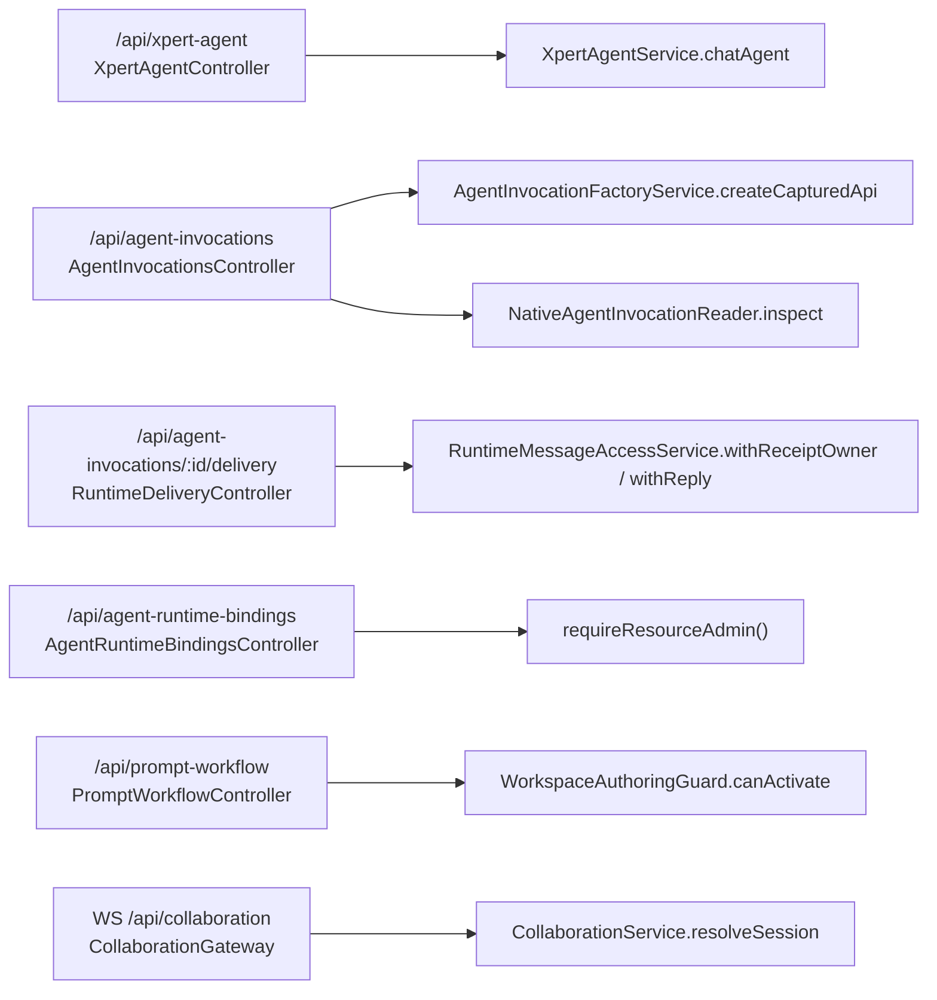

**本文引用的文件**

- [AGENTS.md](file://AGENTS.md)
- [apps/api/src/bootstrap/index.ts](file://apps/api/src/bootstrap/index.ts)
- [packages/server/src/core/crud/crud.controller.ts](file://packages/server/src/core/crud/crud.controller.ts)
- [packages/server-ai/src/agent-invocation/agent-invocation.module.ts](file://packages/server-ai/src/agent-invocation/agent-invocation.module.ts)
- [packages/server-ai/src/agent-invocation/invocation-errors.ts](file://packages/server-ai/src/agent-invocation/invocation-errors.ts)
- [packages/server-ai/src/agent-invocation/invocation-factory.service.ts](file://packages/server-ai/src/agent-invocation/invocation-factory.service.ts)
- [packages/server-ai/src/agent-invocation/invocation-runtime.ts](file://packages/server-ai/src/agent-invocation/invocation-runtime.ts)
- [packages/server-ai/src/agent-invocation/invocations.controller.ts](file://packages/server-ai/src/agent-invocation/invocations.controller.ts)
- [packages/server-ai/src/agent-invocation/native-invocation-reader.ts](file://packages/server-ai/src/agent-invocation/native-invocation-reader.ts)
- [packages/server-ai/src/agent-invocation/runtime-bindings.controller.ts](file://packages/server-ai/src/agent-invocation/runtime-bindings.controller.ts)
- [packages/server-ai/src/agent-plugin/agent-plugin.service.ts](file://packages/server-ai/src/agent-plugin/agent-plugin.service.ts)
- [packages/server-ai/src/collaboration/collaboration.gateway.ts](file://packages/server-ai/src/collaboration/collaboration.gateway.ts)
- [packages/server-ai/src/collaboration/collaboration.module.ts](file://packages/server-ai/src/collaboration/collaboration.module.ts)
- [packages/server-ai/src/collaboration/collaboration.service.ts](file://packages/server-ai/src/collaboration/collaboration.service.ts)
- [packages/server-ai/src/handoff/runtime-messaging/README.md](file://packages/server-ai/src/handoff/runtime-messaging/README.md)
- [packages/server-ai/src/handoff/runtime-messaging/runtime-delivery.controller.ts](file://packages/server-ai/src/handoff/runtime-messaging/runtime-delivery.controller.ts)
- [packages/server-ai/src/handoff/runtime-messaging/runtime-message-access.service.ts](file://packages/server-ai/src/handoff/runtime-messaging/runtime-message-access.service.ts)
- [packages/server-ai/src/handoff/runtime-messaging/runtime-message.errors.ts](file://packages/server-ai/src/handoff/runtime-messaging/runtime-message.errors.ts)
- [packages/server-ai/src/prompt-workflow/prompt-workflow.controller.ts](file://packages/server-ai/src/prompt-workflow/prompt-workflow.controller.ts)
- [packages/server-ai/src/prompt-workflow/prompt-workflow.module.ts](file://packages/server-ai/src/prompt-workflow/prompt-workflow.module.ts)
- [packages/server-ai/src/xpert-agent-execution/agent-execution.controller.ts](file://packages/server-ai/src/xpert-agent-execution/agent-execution.controller.ts)
- [packages/server-ai/src/xpert-agent/xpert-agent.controller.ts](file://packages/server-ai/src/xpert-agent/xpert-agent.controller.ts)
- [packages/server-ai/src/xpert-agent/xpert-agent.module.ts](file://packages/server-ai/src/xpert-agent/xpert-agent.module.ts)
- [packages/server-ai/src/xpert-workspace/guards/workspace-authoring.guard.ts](file://packages/server-ai/src/xpert-workspace/guards/workspace-authoring.guard.ts)
- [packages/server-ai/src/xpert/xpert.controller.ts](file://packages/server-ai/src/xpert/xpert.controller.ts)
- [packages/server-ai/src/xpert/xpert.module.ts](file://packages/server-ai/src/xpert/xpert.module.ts)

## 目录

1. [接口面总览](#接口面总览)
2. [/api/xpert-agent（XpertAgentController）](#apixpert-agentxpertagentcontroller)
3. [/api/agent-invocations（AgentInvocationsController）](#apiagent-invocationsagentinvocationscontroller)
4. [/api/agent-runtime-bindings（AgentRuntimeBindingsController）](#apiagent-runtime-bindingsagentruntimebindingscontroller)
5. [/api/prompt-workflow（PromptWorkflowController）](#apiprompt-workflowpromptworkflowcontroller)
6. [跨域注册：delivery 与 redrive](#跨域注册delivery-与-redrive)
7. [WebSocket 面：/api/collaboration](#websocket-面apicollaboration)
8. [非 HTTP 调用面：AgentInvocationFactoryService](#非-http-调用面agentinvocationfactoryservice)
9. [鉴权约定](#鉴权约定)
10. [状态与语义校正](#状态与语义校正)
11. [错误码](#错误码)

## 接口面总览

全局前缀 `api` 由引导层设置：`app.setGlobalPrefix('api', { exclude: [...] })`（排除 `artifacts/share` 与 OAuth 元数据路径，不含本域）。本域四个 HTTP controller 中，`XpertAgentController` 用 `RouterModule.register` 挂到 `/xpert-agent`；`AgentInvocationsController` / `AgentRuntimeBindingsController` / `RuntimeDeliveryController` / `PromptWorkflowController` 直接在 `@Controller('...')` 上写前缀。

图表来源：[agent-invocation.module.ts](file://packages/server-ai/src/agent-invocation/agent-invocation.module.ts)、[xpert-agent.module.ts](file://packages/server-ai/src/xpert-agent/xpert-agent.module.ts)、[apps/api/src/bootstrap/index.ts](file://apps/api/src/bootstrap/index.ts)

章节来源：[apps/api/src/bootstrap/index.ts](file://apps/api/src/bootstrap/index.ts)（关键符号：bootstrap 的 `setGlobalPrefix`）

## /api/xpert-agent（XpertAgentController）

真实前缀由 `RouterModule.register([{ path: '/xpert-agent', module: XpertAgentModule }])` 提供，controller 本身是空 `@Controller()`，因此**没有** `/api/xpert/agent` 之类的拼法。类继承 `CrudController<XpertAgent>`，故显式端点之外还带一套继承来的 `xpert_agent` 定义面 REST。

| 方法 | 路径 | 鉴权 | 用途 | 关键参数与行为 | 主要错误 |
|---|---|---|---|---|---|
| POST | `/api/xpert-agent/chat` | 全局 `AuthGuard`（controller 无 `@UseGuards`） | Agent 直连对话入口，SSE | body `TXpertAgentChatRequest`（可选 `environmentId`，命中则先 `EnvironmentService.findOne`）；`@Post('chat')` + `@Sse()` + `@Header('content-type','text/event-stream')` + `@Header('Connection','keep-alive')`；返回 `service.chatAgent(body, {language, timeZone, environment})` 再 `keepAlive(30000)`、`takeUntilClose(res)` | `EnvironmentService.findOne` 抛出的异常原样上抛 |
| POST | `/api/xpert-agent/xpert/:id/test/:key` | 同上 | 工作流单节点调试 | body `{ state: any }` → `WorkflowTestNodeCommand(id, key, body.state)` | 任意错误包成 `HttpException(getErrorMessage(err), 500)` |
| GET | `/api/xpert-agent/middlewares` | 同上 | 中间件策略清单 | 直接返回 `XpertAgentService.getMiddlewareStrategies()` | 无显式包装 |
| POST | `/api/xpert-agent/middlewares/:provider/tools` | 同上 | 取某 provider 的工具清单 | body `{ xpertId?, options? }` → `getMiddlewareTools(provider, body)` | 失败 → `BadRequestException(getErrorMessage(err))` |
| POST | `/api/xpert-agent/middlewares/:provider/tools/:toolName/test` | 同上 | 单工具试跑（草稿态） | body `{ xpertId?, options?, parameters? }` → `testMiddlewareTool(provider, toolName, body)` | 失败 → `BadRequestException(getErrorMessage(err))` |
| GET | `/api/xpert-agent/count`、`/pagination`、`/my`、`/:id` | 同上 | 继承 CRUD 读 | `/:id` 经 `UUIDValidationPipe`；支持 `$where`/`$relations`/`$order`/`$take`/`$skip`/`$select` | 404（记录不存在）、400（id 非 UUID） |
| POST / PUT / DELETE | `/api/xpert-agent/`、`/:id`、`/:id/soft`、`/:id/recover` | 同上 | 继承 CRUD 写 | `create` 201、`update` 202、`delete` 202、`softRemove` 202、`softRecover` 202 | 404、400 |

### SSE 契约

`chatAgent` 用 `@Sse()` 声明事件流，但注入的是 Express `Response`（`@Res() res`），由 `takeUntilClose(res)` 在浏览器断开时终止上游订阅；`keepAlive(30000)` 每 30s 发一条注释心跳，防止中间代理掐断长连接。注意 Swagger 侧的 `@ApiBearerAuth()` 只是 OpenAPI 注解，不是运行时守卫。

章节来源：[xpert-agent.controller.ts](file://packages/server-ai/src/xpert-agent/xpert-agent.controller.ts)（关键符号：`XpertAgentController.chatAgent`、`XpertAgentController.testMiddlewareTool`）、[xpert-agent.module.ts](file://packages/server-ai/src/xpert-agent/xpert-agent.module.ts)（关键符号：`XpertAgentModule` 的 `RouterModule.register`）、[crud.controller.ts](file://packages/server/src/core/crud/crud.controller.ts)（关键符号：`CrudController`）

## /api/agent-invocations（AgentInvocationsController）

| 方法 | 路径 | 鉴权 | 用途 | 关键参数与行为 | 主要错误 |
|---|---|---|---|---|---|
| GET | `/api/agent-invocations/:id` | 全局 `AuthGuard` + 私有 `findOwned()` 显式四元组校验 | owner-scoped 观察读取 | 先 `findOwned(id)`；`isNativeInvocation(entity.invocation)` 为真走 `NativeAgentInvocationReader.inspect`，否则走 `factory.createCapturedApi(scope).inspect(id)` | `NotFound`(404)、`InvalidScope`(403)、`InvalidRequest`(400) |
| POST | `/api/agent-invocations/:id/cancel` | 同上 | 取消一次调用 | native（`provider ∈ {xpert, xpert-task}` 且非 assistant task group 上下文）**一律** `invocationError('Unsupported')`；否则 `api.cancel(id)` | `Unsupported`(422)、`NotFound`(404) |
| POST | `/api/agent-invocations/:id/respond` | 同上 | 回填人工交互 | body 经 `reply = z.object({ interactionId: z.string().min(1), response: json }).strict()`；解析失败即 `InvalidRequest`；native **一律** `Unsupported`；否则 `api.respond(id, interactionId, response)` | `InvalidRequest`(400)、`Unsupported`(422)、`InteractionConflict`(409) |

### `findOwned()` 四元组校验

私有 `findOwned(id)` 是这三个端点的唯一入口闸门，顺序如下：① 取 `RequestContext.currentUserId()` / `currentTenantId()` / `getOrganizationId()`，任一为空、或 `z.string().uuid().safeParse(id)` 失败 → `NotFound`；② `records.findOneBy({ id, ownerId, tenantId, organizationId })`，四列全等才拿得到行；③ 拒绝既无 `invocation.scope.callerXpertId` 又不是 `callerType === 'project_agent'` 的行；④ 复核存储 JSON 里的 `scope`：`invocation.id`、`scope.userId`、`scope.tenantId`、`scope.organizationId` 必须与列值逐项相等，任一不符 → `NotFound`。第 ④ 步专门防「列被改过但 JSON 没跟着改」的错位记录。

native 分支在 `NativeAgentInvocationReader.inspect` 内还有一层独立校验：`scope.callerXpertId` 与 `target.reference` 必须是 UUID；有 `scope.projectId` 时先 `ProjectAccessRuntimeCapability.assertEdit({actor, projectId})`；`GetXpertWorkflowQuery` 取回的 team 必须同租户/同组织；`workspace` 必须等于 `scope.workspaceId`（`xpert-task` 用目标 team 的 workspace，`xpert` 用调用方 team 的 workspace）；`provider === 'xpert'` 时还要求 `scope.parentExecutionId` 是 UUID 且父执行的 `xpertId === scope.callerXpertId`（`xpert-task` 跳过这步）。读取成功返回 `structuredClone(invocation)`，不落库、不改 revision，也不触发 provider 派发。

章节来源：[invocations.controller.ts](file://packages/server-ai/src/agent-invocation/invocations.controller.ts)（关键符号：`AgentInvocationsController.findOwned`、`AgentInvocationsController.respond`）、[native-invocation-reader.ts](file://packages/server-ai/src/agent-invocation/native-invocation-reader.ts)（关键符号：`NativeAgentInvocationReader.inspect`、`isNativeInvocation`）、[invocation-runtime.ts](file://packages/server-ai/src/agent-invocation/invocation-runtime.ts)（关键符号：`AgentInvocationRuntime.control`）

## /api/agent-runtime-bindings（AgentRuntimeBindingsController）

| 方法 | 路径 | 鉴权 | 用途 | 关键参数与行为 | 主要错误 |
|---|---|---|---|---|---|
| GET | `/api/agent-runtime-bindings` | `requireResourceAdmin()` | 列绑定 | 用 `requireResourceAdmin()` 的返回值直接当 `where`，`order: { createdAt: 'DESC' }` | `ForbiddenException`（非 SUPER_ADMIN/ADMIN） |
| POST | `/api/agent-runtime-bindings` | `requireResourceAdmin()` | 建绑定 | body 经 `bindingSchema`（`.strict()`）：`title` 1–200、`workspaceIds` uuid 数组 1–100、`provider` 1–100、`reference` 1–200、`configuration` record 默认 `{}`；**显式拒绝 `provider === 'xpert' \|\| provider === 'xpert-task'`**；随后 `this.registry.get(input.provider, scope.organizationId)`（返回值被丢弃）；`workspaceIds` 去重后按 `{...scope, id: In(workspaces)}` 数 `XpertWorkspace`，数量不等即拒；`id` 与 `target.revision` 都用 `randomUUID()` 建时随机固定；插入走 `insert().values({... :workspaces::jsonb, :target::jsonb})` | `BadRequestException`(400，zod flatten)、`InvalidRequest`(400)、`InvalidScope`(403) |
| PUT | `/api/agent-runtime-bindings/:id` | `requireResourceAdmin()` | 启停绑定 | body 经 `z.object({ enabled: z.boolean() }).strict()`；`update().where({ id, ...scope })`；`affected === 0` 即 `NotFound`；成功返回 `{ id, enabled }` | `BadRequestException`(400)、`NotFound`(404) |

三个端点的 scope 都来自 `requireResourceAdmin()` → `agentPluginScope()`，即 `{tenantId, organizationId}`，因此跨租户/跨组织天然不可见。注意 `create` 那行 `registry.get` 只做「按 org 解析」的副作用调用，源码未检查其返回值，未注册 provider 不会在该行失败——这是审计时需要留意的行为。

章节来源：[runtime-bindings.controller.ts](file://packages/server-ai/src/agent-invocation/runtime-bindings.controller.ts)（关键符号：`AgentRuntimeBindingsController.create`、`AgentRuntimeBindingsController.setEnabled`）、[agent-plugin.service.ts](file://packages/server-ai/src/agent-plugin/agent-plugin.service.ts)（关键符号：`requireResourceAdmin`、`agentPluginScope`）

## /api/prompt-workflow（PromptWorkflowController）

7 个端点，**全部**挂 `@UseGuards(WorkspaceAuthoringGuard)`。守卫读 `request.params.workspaceId`，先要求 `isUUID`（不合法 → `BadRequestException`，i18n `server-ai:Error.WorkspaceIdInvalid`），再交给 `XpertWorkspaceAccessService.assertCanAuthor(workspaceId)`。

| 方法 | 路径 | 用途 | 关键参数 |
|---|---|---|---|
| GET | `/api/prompt-workflow/by-workspace/:workspaceId` | 列工作流 | `data` 走 `ParseJsonPipe` 的 `PaginationParams<PromptWorkflow>`，`published?`；末尾传入 `RequestContext.currentUser()` |
| POST | `/api/prompt-workflow/workspace/:workspaceId` | 新建 | body `PromptWorkflowInput` → `createInWorkspace` |
| PUT | `/api/prompt-workflow/workspace/:workspaceId/:id` | 更新 | body `PromptWorkflowInput` → `updateInWorkspace` |
| POST | `/api/prompt-workflow/workspace/:workspaceId/:id/archive` | 归档 | 无 body → `archiveInWorkspace` |
| POST | `/api/prompt-workflow/workspace/:workspaceId/:id/duplicate` | 复制 | 无 body → `duplicateInWorkspace` |
| GET | `/api/prompt-workflow/workspace/:workspaceId/:id/usage` | 使用方口径 | → `getUsage` |
| POST | `/api/prompt-workflow/workspace/:workspaceId/validate-profile` | 校验命令档案 | body `TXpertCommandProfile` → `validateCommandProfile` |

章节来源：[prompt-workflow.controller.ts](file://packages/server-ai/src/prompt-workflow/prompt-workflow.controller.ts)（关键符号：`PromptWorkflowController.validateCommandProfile`、`PromptWorkflowController.getAllByWorkspace`）、[workspace-authoring.guard.ts](file://packages/server-ai/src/xpert-workspace/guards/workspace-authoring.guard.ts)（关键符号：`WorkspaceAuthoringGuard.canActivate`）、[prompt-workflow.module.ts](file://packages/server-ai/src/prompt-workflow/prompt-workflow.module.ts)（关键符号：`PromptWorkflowModule`）

## 跨域注册：delivery 与 redrive

`RuntimeDeliveryController` 的**文件物理位置在 handoff 域**（`handoff/runtime-messaging/`），但 `@Controller('agent-invocations')` 是注册在 `AgentInvocationModule` 的 `controllers` 数组里的，所以两个端点对外表现为 `/api/agent-invocations/*` 的同一前缀。**逻辑归属「对话与会话专家」**，本域只记录交叉引用与可观测契约。

| 方法 | 路径 | 鉴权 | 用途 | 关键参数与行为 | 主要错误 |
|---|---|---|---|---|---|
| GET | `/api/agent-invocations/:id/delivery` | 全局 `AuthGuard` + `RuntimeMessageAccessService.withReceiptOwner` | 读传输与消费收据 | `:id` 经 `ZodValidationPipe(runtimeDeliveryIdSchema = z.string().uuid(), () => runtimeMessageError('Invalid'))`；`owner()` 取 tenant/organization/owner 三元组，缺即 `Access`；返回 `{ delivery, consumption }`，两侧都用显式 `select` 只投影诊断字段（`messageId/event/state/attempts/lastError/nextAttemptAt`，收据侧另有 `phase/claim`）——**不含结果体、不授予运行权限** | `Invalid`(400)、`Access`(403) |
| POST | `/api/agent-invocations/:id/delivery/redrive` | 同上 + `RuntimeMessageAccessService.withReply` | 重授权原回复目标并重排阻塞/失败的传输 | body 经 `runtimeRedriveSchema = z.object({}).strict()`（传任何身份或路由字段 → 400）；事务内 `resetRuntimeDelivery(manager, id, owner)` 后再次调用 `inspect` 返回同一投影 | `Invalid`(400)、`Access`(403)、`Consumed`/`Busy`/`Blocked`/`Unknown`(409) |

章节来源：[runtime-delivery.controller.ts](file://packages/server-ai/src/handoff/runtime-messaging/runtime-delivery.controller.ts)（关键符号：`RuntimeDeliveryController.redrive`、`runtimeRedriveSchema`）、[agent-invocation.module.ts](file://packages/server-ai/src/agent-invocation/agent-invocation.module.ts)（关键符号：`AgentInvocationModule` 的 `controllers`）、[runtime-message-access.service.ts](file://packages/server-ai/src/handoff/runtime-messaging/runtime-message-access.service.ts)（关键符号：`RuntimeMessageAccessService.withReceiptOwner`、`RuntimeMessageAccessService.withReply`）、[runtime-message.errors.ts](file://packages/server-ai/src/handoff/runtime-messaging/runtime-message.errors.ts)（关键符号：`runtimeMessageError`）

## WebSocket 面：/api/collaboration

`@WebSocketGateway({ namespace: '/api/collaboration', cors: { origin: '*' }, transports: ['websocket'] })`——本域**没有**对应的 HTTP controller，全部交互走 socket.io 消息。

| 事件 | 方向 | 用途 | 关键行为 |
|---|---|---|---|
| （连接） | 入 | 握手 | 从 `handshake.auth`（回退 `handshake.query`）取 `sessionId` / `clientKey` / `documentId` → `CollaborationService.resolveSession(...)`；返回 null 时 emit `error`（`'Invalid or expired collaboration session.'`）并 `disconnect(true)` |
| （连接成功） | 出 | 初始快照 | `join('collaboration:' + documentId)` 后 emit `sync`（`getStateForSession(session)`）与 `presence-snapshot`（含 `selfClientId` 与 `listPresenceForSession`） |
| `update` | 入 | 提交 CRDT 更新 | `applyUpdateForSession(session, { documentId, updateBase64, origin, expectedSequence })`，**先落库再** emit `update-ack`；异常路径 emit `error` |
| `sync-request` | 入 | 断线/丢包修复 | 携带 `stateVectorBase64` 走 `getStateForSession(session, base)` 拿增量，结果 emit `sync` |
| `presence` | 入 | 刷新在线状态 | `sanitizePatch(data)` 白名单投影（`pointer/focus/selection/viewport/mode/status/toolName/operationLabel` 等）后 `upsertPresenceForSession(session, client.id, patch)`；异常 emit `error` |
| （断开） | — | 清理在线状态 | `removePresenceForSession(state.session, client.id)` |
| `update` / `presence-remove` / 其他 | 出 | 广播 | `broadcast(event)` 只 fan-out 到 `collaboration:<documentId>` 单房间；上游 `publishBroadcast` **先本地** `events.emit('broadcast')`，再 `redis.publish('xpert:collaboration:broadcast', ...)` |

鉴权是 opaque 的 `sessionId` + 客户端计算结果 `clientKey`（以及 `documentId` 三元齐备），**不是 Nest Guard**——`CollaborationGateway` 上没有任何 `@UseGuards`。`CollaborationModule` 标了 `@Global()`。

章节来源：[collaboration.gateway.ts](file://packages/server-ai/src/collaboration/collaboration.gateway.ts)（关键符号：`CollaborationGateway.handleConnection`、`CollaborationGateway.sync`、`CollaborationGateway.broadcast`）、[collaboration.service.ts](file://packages/server-ai/src/collaboration/collaboration.service.ts)（关键符号：`CollaborationService.resolveSession`、`CollaborationService.publishBroadcast`）、[collaboration.module.ts](file://packages/server-ai/src/collaboration/collaboration.module.ts)（关键符号：`CollaborationModule`）

## 非 HTTP 调用面：AgentInvocationFactoryService

以下能力**不经 HTTP**，只供进程内 caller（中间件工具、工作流 Agent 节点、后台任务、host 重放）使用。它们共享 `runtime` 的授权/幂等/CAS 语义，但没有 controller 层的 `findOwned` 闸门，鉴权责任在调用方。

| 方法 | 用途 | 关键约束 |
|---|---|---|
| `createCapturedApi(scope)` | host-only 重放 | 用持久化的 identity（`{ xpertId: scope.callerXpertId }` + `structuredClone(scope)`），**不采信下一个图 turn 的环境 scope** |
| `createScopedApi(identity)` / `api()` | 运行时 scope 化 API | 暴露 `start` / `inspect` / `cancel` / `respond` + `capabilities` |
| `existingApi(id)` | 幂等复用 | project scope 且非 captured 时按 `{ id, tenantId, organizationId }` 读回原记录并重建其**原始** scope 的 API；否则退化为普通 `api()` |
| `claimResults(callId, tasks)` | 认领结果 | 只对 `task.request.dispatch` 存在且 `status ∈ {succeeded, failed, cancelled}` 的任务执行 `ClaimAgentRuntimeResultsCommand`；无 `commands`（`@Optional()` 未注入）→ `Unsupported` |
| `awaitResult(id, options)` | 单任务有界等待 | `awaitInvocationTasks(controls, { callId: id, taskIds: [id], mode: 'all' }, ...)` 后接 `claimResults`，返回 `tasks[0]` |
| `waitForTasks(request, options)` | 多任务有界等待 | `awaitInvocationTasks(...)` 后接 `claimResults(request.callId, result.tasks)`；支撑 `task_status` 工具 |
| `getResourceCard(id)` | 资源卡投影 | 无 `records` 或 `cards` → 返回 `null` |
| `resolveBackgroundTarget(scope, bindingId)` | 背景任务目标 | 追加 `runtime.assertBackgroundTarget(target, organizationId)`；`callerType === 'project_agent'` + computer 环境 + 缺 `modelSource` → `ModelSourceRequired` |
| `resolveGroupTarget(scope, participantId)` | 群组任务目标 | 无 `commands` → `Unsupported`；随后同样过 `assertBackgroundTarget` |
| `listProjectBindings(scope)` | 列可选目标 | 只取同租户/同组织且 `enabled` 的绑定，再按 `workspaceIds.includes(scope.workspaceId)` 过滤，逐个 `resolve(binding.id)` 复检 |

章节来源：[invocation-factory.service.ts](file://packages/server-ai/src/agent-invocation/invocation-factory.service.ts)（关键符号：`AgentInvocationFactoryService.createCapturedApi`、`AgentInvocationFactoryService.waitForTasks`、`AgentInvocationFactoryService.existingApi`）

## 鉴权约定

本域 HTTP 面的鉴权分三层，职责边界必须分清：

1. **全局认证层**。引导层执行 `app.useGlobalGuards(new AuthGuard(reflector), new PluginScopeGuard(reflector))`，注释明写「This will lockdown all routes and make them accessible by authenticated users only.」。本域**没有任何 controller 声明 `@UseGuards`**（`XpertAgentController`、`AgentInvocationsController`、`AgentRuntimeBindingsController`、`RuntimeDeliveryController`、`XpertAgentExecutionController` 全无），所以「能过 AuthGuard」只等于「已认证」，不等于「已授权」。结合 AGENTS.md 记录的「判权走 Guard 链 CASL 占位未接线」「Guard 无元数据即放行」，新增端点若只依赖全局 Guard，默认是放行的——必须在 handler 内显式补授权。
2. **显式调用型鉴权**（本域主要形态）。`AgentInvocationsController` 靠私有 `findOwned()` 的 `{id, ownerId, tenantId, organizationId}` 四元组 + scope 全等复核；`AgentRuntimeBindingsController` 三个端点都调 `requireResourceAdmin()`（`RolesEnum.SUPER_ADMIN` / `RolesEnum.ADMIN` 之外抛 `ForbiddenException`，i18n `server-ai:Error.AgentResourceAdminRequired`），并把返回的 org scope 直接拼进 `where`；`RuntimeDeliveryController` 用 `owner()` 三元组 + `withReceiptOwner` / `withReply`。`XpertAgentExecutionController` 亦同属此形态：先 `AssertXpertAgentExecutionAccessQuery`，再 `SuperAdminOrganizationScopeService.run(organizationId, ...)`。
3. **Nest Guard 形态**。只有 `PromptWorkflowController` 使用 `@UseGuards(WorkspaceAuthoringGuard)`，守卫内 `assertCanAuthor(workspaceId)`。**WebSocket 面**两者都不用：`CollaborationGateway` 靠 opaque `sessionId`/`clientKey` 的 `resolveSession`。

章节来源：[apps/api/src/bootstrap/index.ts](file://apps/api/src/bootstrap/index.ts)（关键符号：`useGlobalGuards`）、[AGENTS.md](file://AGENTS.md)（关键符号：身份与权限决策记录）、[agent-execution.controller.ts](file://packages/server-ai/src/xpert-agent-execution/agent-execution.controller.ts)（关键符号：`XpertAgentExecutionController.getOne`）

## 状态与语义校正

- **`/api/xpert/chat` 不存在。** 真实路径是 `/api/xpert-agent/chat`（无 id，纯 Agent 直连）与 `/api/xpert/:id/chat`（带 id，`@Post(':id/chat')` + `@Sse()` 在 `XpertController` 上，经 `RouterModule.register([{ path: '/xpert', module: XpertModule }])` 落地）。两者是不同入口、不同域：前者属本域 Agent 直连，后者属 `/api/xpert` 定义面的调试入口。
- **`respond` 对 native 一律 `Unsupported`（422）。** native 图的人工交互不走这个 HTTP 面，而是经 `XpertAgentService.chatAgent` 内部的 `resume({ decision })` 续跑；`cancel` 同理，native 图/任务保留各自既有路由。
- **`inspect` 是只读观察，不是探活。** `AgentInvocationRuntime.control` 在 `handle` 缺失且 `startPendingUntil` 尚未过期时直接返回原记录；只有过期后才把状态推进为 `unknown` 并写入 `DispatchUnknown` 文案——因此 HTTP 读取本身可能触达一次状态转移，读操作不是绝对无副作用。
- **`redrive` 的边界。** 它只暴露 owner-scoped 收据、**不改 Invocation、不清 user stop**；对 `consumer_outcome_unknown` 只复核同一条已记录的 execution identity，既不重发 CLI 也不重新分配 consumer。已提交的交付失败可在绑定被撤销后仍被 owner 读取（收据面），但这不构成结果体访问权。
- **`/api/xpert-agent/middlewares/:provider/tools` 是「取清单」不是「建节点」。** 建节点的路径在 service 层（`createMiddlewareNode`），HTTP 面不暴露。

章节来源：[xpert.controller.ts](file://packages/server-ai/src/xpert/xpert.controller.ts)（关键符号：`XpertController` 的 `@Post(':id/chat')`）、[xpert.module.ts](file://packages/server-ai/src/xpert/xpert.module.ts)（关键符号：`XpertModule` 的 `RouterModule.register`）、[handoff/runtime-messaging/README.md](file://packages/server-ai/src/handoff/runtime-messaging/README.md)（关键符号：Operations 节的 delivery / redrive 语义）

## 错误码

`invocationError(code)` 产出的 `AgentInvocationError extends HttpException`，响应体文案走 i18n key ``server-ai:Error.AgentInvocation${code}``，HTTP 状态由模块内 `status` 表固定：

| code | HTTP | i18n key | 主要触发点 |
|---|---|---|---|
| `ModelSourceRequired` | 400 | `server-ai:Error.AgentInvocationModelSourceRequired` | `resolveBackgroundTarget`（project_agent + computer 环境缺 `modelSource`） |
| `InvalidRequest` | 400 | `server-ai:Error.AgentInvocationInvalidRequest` | `respond` 的 zod 解析失败；建绑定时 `provider ∈ {xpert, xpert-task}`；native 读取时 `callerXpertId` / `target.reference` 非 UUID |
| `InvalidScope` | 403 | `server-ai:Error.AgentInvocationInvalidScope` | 绑定的 workspace 归属数不符；native 读取的租户/组织/workspace/父执行归属不符；`scoped()` 缺 `tenantId/organizationId/userId/parentExecutionId/callerAgentKey`；`registerTasks` 缺 `thread_id` |
| `NotFound` | 404 | `server-ai:Error.AgentInvocationNotFound` | `findOwned` 全部分支；`control()` 读不到记录；`assertScope` 不等；`setEnabled` 的 `affected === 0`；activity 过期后读输出 |
| `CallConflict` | 409 | `server-ai:Error.AgentInvocationCallConflict` | 同一 `callId` 的 `canonical(request)` 不一致；wait 行的 `mode`/`taskIds` 与既有行不一致 |
| `ProviderChanged` | 409 | `server-ai:Error.AgentInvocationProviderChanged` | `pinned()` 找不到与 `providerSource` 快照匹配的策略（禁止静默回退） |
| `DispatchUnknown` | 409 | `server-ai:Error.AgentInvocationDispatchUnknown` | 派发异常路径与「handle 缺失且 `startPendingUntil` 已过期」的 inspect |
| `Unsupported` | 422 | `server-ai:Error.AgentInvocationUnsupported` | native 的 `cancel` / `respond`；缺 `capabilities.cancellation` / `interactions`；无 `commands` 的 `claimResults` |
| `InteractionConflict` | 409 | `server-ai:Error.AgentInvocationInteractionConflict` | `respond` 时状态非 `waiting` 或 `interaction.id` 不匹配 |
| `ProviderUnavailable` | 503 | `server-ai:Error.AgentInvocationProviderUnavailable` | `registry.get(provider, organizationId)` 返回空（`start` 与 `assertBackgroundTarget`） |
| `MissingResult` | 502 | `server-ai:Error.AgentInvocationMissingResult` | 结果读取路径（`invocation-results.provider`） |
| `ConcurrentUpdate` | 409 | `server-ai:Error.AgentInvocationConcurrentUpdate` | CAS 提交冲突路径 |

另有两套独立错误面：`runtimeMessageError(code)` 映射 `Access→403` / `Invalid→400` / 其余（`Consumed`、`Busy`、`Blocked`、`Unknown`）`→409`，i18n key ``server-ai:Error.RuntimeMessage${code}``，用于 delivery / redrive 与 inbox 认领；controller 内联的 `BadRequestException` / `ForbiddenException` / `HttpException` 分别带 `server-ai:Error.WorkspaceIdInvalid`、`server-ai:Error.AgentResourceAdminRequired`、`server-ai:Error.ExecutionAccessDenied`，而 `XpertAgentController.testNode` 与 `getMiddlewareTools` 走 `getErrorMessage(err)` 的字符串直出（**无 i18n key**）。

章节来源：[invocation-errors.ts](file://packages/server-ai/src/agent-invocation/invocation-errors.ts)（关键符号：`AgentInvocationError`、`AgentInvocationErrorCode`、`authorizeAgentInvocation`）、[runtime-message.errors.ts](file://packages/server-ai/src/handoff/runtime-messaging/runtime-message.errors.ts)（关键符号：`runtimeMessageError`、`isRuntimeMessageBlocked`）
