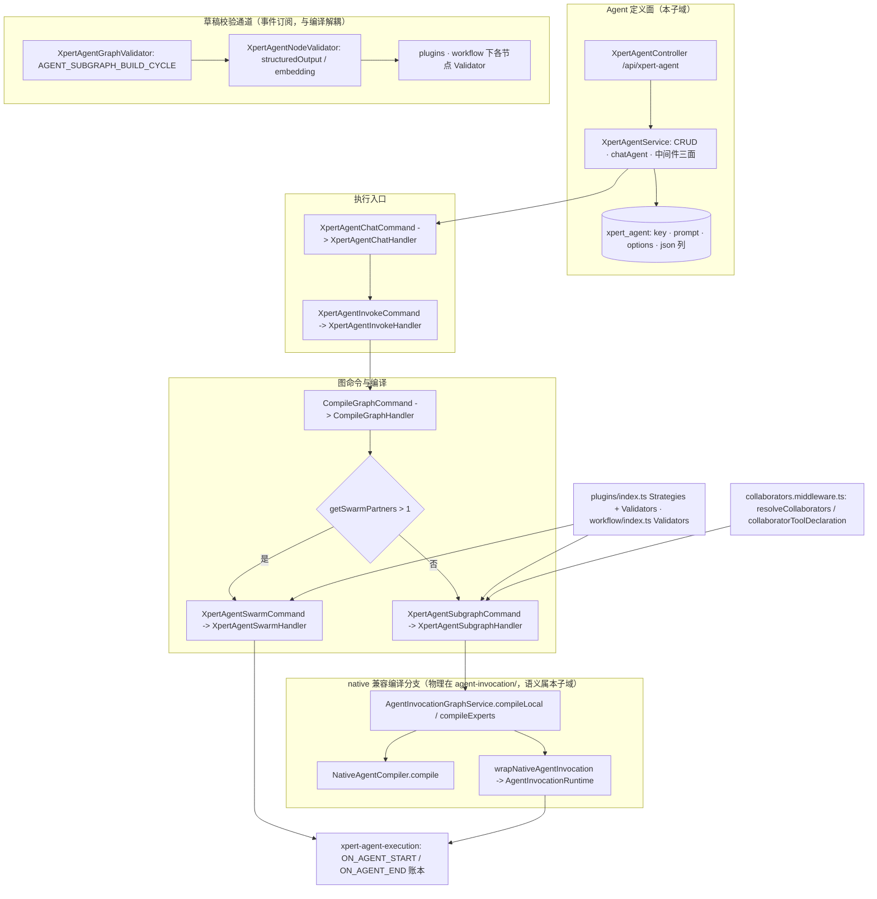

**本文引用的文件**

- [xpert-agent.module.ts](file://packages/server-ai/src/xpert-agent/xpert-agent.module.ts)
- [xpert-agent.controller.ts](file://packages/server-ai/src/xpert-agent/xpert-agent.controller.ts)
- [xpert-agent.service.ts](file://packages/server-ai/src/xpert-agent/xpert-agent.service.ts)
- [xpert-agent.entity.ts](file://packages/server-ai/src/xpert-agent/xpert-agent.entity.ts)
- [index.ts](file://packages/server-ai/src/xpert-agent/index.ts)
- [agent.ts](file://packages/server-ai/src/xpert-agent/agent.ts)
- [graph-validator.ts](file://packages/server-ai/src/xpert-agent/graph-validator.ts)
- [agent-validator.ts](file://packages/server-ai/src/xpert-agent/agent-validator.ts)
- [compile-graph.command.ts](file://packages/server-ai/src/xpert-agent/commands/compile-graph.command.ts)
- [compile-graph.handler.ts](file://packages/server-ai/src/xpert-agent/commands/handlers/compile-graph.handler.ts)
- [create-swarm.handler.ts](file://packages/server-ai/src/xpert-agent/commands/handlers/create-swarm.handler.ts)
- [subgraph.command.ts](file://packages/server-ai/src/xpert-agent/commands/subgraph.command.ts)
- [commands/index.ts](file://packages/server-ai/src/xpert-agent/commands/index.ts)
- [plugins/index.ts](file://packages/server-ai/src/xpert-agent/plugins/index.ts)
- [workflow/index.ts](file://packages/server-ai/src/xpert-agent/workflow/index.ts)
- [collaborators.middleware.ts](file://packages/server-ai/src/xpert-agent/collaborators/collaborators.middleware.ts)
- [native-agent.compiler.ts](file://packages/server-ai/src/agent-invocation/native-agent.compiler.ts)
- [native-graph-adapter.ts](file://packages/server-ai/src/agent-invocation/native-graph-adapter.ts)
- [agent-invocation-graph.service.ts](file://packages/server-ai/src/agent-invocation/agent-invocation-graph.service.ts)
- [native-invocation-reader.ts](file://packages/server-ai/src/agent-invocation/native-invocation-reader.ts)

## 目录

- [1. 子域职责边界](#1-子域职责边界)
- [2. 内部分层](#2-内部分层)
- [3. 依赖关系](#3-依赖关系)
- [4. 关键不变量](#4-关键不变量)
- [5. 架构总览](#5-架构总览)
- [6. 结论](#6-结论)

## 1. 子域职责边界

**做什么**（子专家①「Agent 定义与图编译」）：

| 能力 | 落点 | 说明 |
|---|---|---|
| 定义面 CRUD | `XpertAgentController extends CrudController<XpertAgent>`、`XpertAgentService extends TenantOrganizationAwareCrudService<XpertAgent>` | 前缀 `/xpert-agent` 由 `RouterModule.register` 提供（controller 本身是空 `@Controller()`）；`update` 被覆写为 `assign + repository.save` |
| 草稿态直连入口 | `XpertAgentService.chatAgent` → `XpertAgentChatCommand` | 固定 `isDraft: true`、`store: null`、`from: 'debugger'`；`action === 'resume'` 时携 `execution.id` 与 `resume: { decision, patch }` |
| 中间件策略与工具面 | `getMiddlewareStrategies` / `getMiddlewareTools` / `testMiddlewareTool` | 三者共用 `getDraftXpertMiddlewareContext` + `createDraftXpertMiddlewareRuntime`；`createMiddlewareNode` 产出 `WorkflowNodeTypeEnum.MIDDLEWARE` 节点；`normalizeSchema` 做 zod→JSON Schema 归一化；`resolveMiddlewareSource` 还原 plugin 展示元数据 |
| 图命令与草稿校验 | `CompileGraphCommand` / `XpertAgentSwarmCommand` / `XpertAgentSubgraphCommand`；`XpertAgentGraphValidator` / `XpertAgentNodeValidator` | 校验以 `@OnEvent(EventNameXpertValidate)` 订阅草稿校验事件 |
| 图构建与流式投影 | `agent.ts`（`createMapStreamEvents`/`messageEvent`/`getChannelState`/`TAgentSubgraphResult`）、`subgraph.handler.ts`、`create-swarm.handler.ts` | `agent.ts` 再导出 `FakeStreamingChatModel` |
| 多智能体 | `XpertAgentSwarmHandler`、`collaborators.middleware.ts` | `getSwarmPartners` 判定 partners>1 走 swarm；静态协作者走中间件 |
| 两个本地 barrel | `plugins/index.ts`（`Strategies`/`Validators`）、`workflow/index.ts`（`Validators` + workflow 子图/分类/迭代命令与 handler） | 均由 `XpertAgentModule.providers` 统一注册 |
| native 兼容编译 | `NativeAgentCompiler`、`AgentInvocationGraphService`、`wrapNativeAgentInvocation` | 三个文件物理在 `agent-invocation/`，语义属图编译 |

**不做什么**：不拥有 Invocation 运行时与账本（`AgentInvocationRuntime`/`TypeOrmAgentInvocationStore`/`AgentInvocationMonitorService`，子专家②）；不实现中间件运行时、Prompt 工作流与协作（`AgentMiddlewareRuntimeService`/`PromptWorkflowService`/`CollaborationService`，子专家③）；不拥有 `xpert` 团队定义本体（`xpert` 域，经 `forwardRef(XpertModule)` + `FindXpertQuery`/`GetXpertWorkflowQuery` 只读）；不实现执行与用量账本服务（`XpertAgentExecutionService` 属②，本域只发 `XpertAgentExecutionUpsertCommand`/`XpertAgentExecutionOneQuery`）。

**文件物理位置 vs 语义归属（三条交叉引用）**：

1. `agent-invocation/native-agent.compiler.ts`、`agent-invocation/native-graph-adapter.ts`、`agent-invocation/agent-invocation-graph.service.ts` **物理属 `agent-invocation/`，语义属本子域「图编译」**：三者被 `XpertAgentModule.providers` 注册；`NativeAgentCompiler.compile` 派发 `XpertAgentSubgraphCommand` 并复用本域 `agent.ts` 的 `messageEvent` 与 `TAgentSubgraphParams`；`AgentInvocationGraphService.compileExperts/compileLocal` 复用本域 `collaborators.middleware.ts` 的 `collaboratorToolDeclaration`。按目录归属会把它们误划给子专家②。
2. 反向依赖同样成立：`native-graph-adapter.ts` 调 `AgentInvocationRuntime.scoped` 与 `invocationError`，`AgentInvocationGraphService.remove` 之外的 `wrap` 依赖 `ExecutionCancelService`，故改动这三者必须①+②双侧确认。
3. 对照组：`RuntimeDeliveryController` 与上述相反——物理在 `handoff/runtime-messaging/`、注册在 `AgentInvocationModule.controllers`，属②的对外面；`native-invocation-reader.ts` 亦物理在 `agent-invocation/` 但语义属②的只读观察面。`xpert_agent` 表还被 `chat-conversation` 与 `graphrag` 跨域注册/直读（详 04）。

章节来源：[xpert-agent.module.ts](file://packages/server-ai/src/xpert-agent/xpert-agent.module.ts)（关键符号：`XpertAgentModule.providers`）、[xpert-agent.service.ts](file://packages/server-ai/src/xpert-agent/xpert-agent.service.ts)（关键符号：`XpertAgentService.chatAgent`/`getDraftXpertMiddlewareContext`/`createDraftXpertMiddlewareRuntime`/`createMiddlewareNode`/`normalizeSchema`/`resolveMiddlewareSource`）、[agent-invocation-graph.service.ts](file://packages/server-ai/src/agent-invocation/agent-invocation-graph.service.ts)（关键符号：`AgentInvocationGraphService.compileExperts`/`compileLocal`）、[native-agent.compiler.ts](file://packages/server-ai/src/agent-invocation/native-agent.compiler.ts)（关键符号：`NativeAgentCompiler.compile`）

## 2. 内部分层

- **controller**：`XpertAgentController`（`@Post('chat')` + `@Sse()`、`@Post('xpert/:id/test/:key')`、`@Get('middlewares')`、`@Post('middlewares/:provider/tools')`、`@Post('middlewares/:provider/tools/:toolName/test')`，其余继承 `CrudController`）。本层无 `@UseGuards`。
- **service**：`XpertAgentService`（CRUD 基类 + `chatAgent` + 中间件三面 + `update` 覆写）；`effective-copilot-model.ts` 的 `resolveEffectiveCopilotModel` 是纯函数式模型选择策略。
- **command handler**：`CommandHandlers` 10 个（`CompileGraphHandler`、`XpertAgentSwarmHandler`、`XpertAgentSubgraphHandler`、`XpertAgentChatHandler`、`XpertAgentInvokeHandler`、`XpertWorkflowSubgraphHandler`、`ConnectAgentKnowledgebasesHandler`、`CreateSummarizeTitleAgentHandler`、`CreateNodeStagePendingSteerFollowUpsHandler`、`CreateNodeConsumePendingSteerFollowUpsHandler`）+ `WorkflowCommandHandlers` 6 个（test/create-workflow/create-wn-iterating/knowledge-retrieval/subflow/classifier）。
- **query handler**：`QueryHandlers` 4 个（`CompleteToolCallsHandler`、`XpertAgentVariablesHandler`、`XpertAgentVariableSchemaHandler`、`ListWorkspaceSkillsHandler`）。
- **validator**：`XpertAgentGraphValidator.handle`（错误码 `AGENT_SUBGRAPH_BUILD_CYCLE`）、`XpertAgentNodeValidator.handle`/`check`（`AGENT_STRUCTURED_OUTPUT_FILE_UNDERSTANDING_CONFLICT`、`AGENT_FILE_UNDERSTANDING_EMBEDDING_UNAVAILABLE`，`level: 'warning'`），以及 `plugins/`、`workflow/` 下各节点 validator（如 `WorkflowMiddlewareNodeValidator` 的 `MIDDLEWARE_PROVIDER_NOT_FOUND`、`MIDDLEWARE_REQUIRED_FEATURE_DISABLED`、`MULTIPLE_SKILLS_MIDDLEWARE_CONNECTED`）。
- **graph builder**：`agent.ts`（`createMapStreamEvents`/`messageEvent`/`getChannelState`）、`subgraph.handler.ts`（legacy 单 agent 图）、`create-swarm.handler.ts`（swarm 图）、`native-agent.compiler.ts` + `agent-invocation-graph.service.ts` + `native-graph-adapter.ts`（native 兼容图）。
- **strategy registry**：`WorkflowNodeRegistry`/`WorkflowTriggerRegistry`/`AgentMiddlewareRegistry`（由 `@xpert-ai/plugin-sdk` 提供，在 `XpertAgentModule.providers` 实例化）+ 本地注册表常量。
- **barrel**：`xpert-agent/index.ts`（module/service/queries/commands/handlers-types/agent/effective-copilot-model）、`commands/index.ts`、`commands/handlers/index.ts`、`queries/index.ts`、`workflow/index.ts`、`plugins/index.ts`。

章节来源：[xpert-agent.controller.ts](file://packages/server-ai/src/xpert-agent/xpert-agent.controller.ts)（关键符号：`XpertAgentController.chatAgent`/`testNode`/`getMiddlewareStrategies`）、[commands/handlers/index.ts](file://packages/server-ai/src/xpert-agent/commands/handlers/index.ts)（关键符号：`CommandHandlers`）、[agent.ts](file://packages/server-ai/src/xpert-agent/agent.ts)（关键符号：`createMapStreamEvents`/`messageEvent`/`TAgentSubgraphResult`）、[agent-validator.ts](file://packages/server-ai/src/xpert-agent/agent-validator.ts)（关键符号：`XpertAgentNodeValidator.check`）

## 3. 依赖关系

**出向（`XpertAgentModule.imports`，实测顺序）**：`RouterModule.register`、`TypeOrmModule.forFeature([XpertAgent, ChatMessage])`、`TenantModule`、`RedisModule`、`ActorTokenModule`、`CqrsModule`、`DiscoveryModule`、`AgentInvocationModule`、`CopilotCheckpointModule`、`forwardRef(ChatConversationModule)`、`XpertAgentExecutionModule`、`AgentMiddlewareRuntimeModule`、`forwardRef(XpertModule)`、`forwardRef(EnvironmentModule)`、`ExecutionCancelModule`、`SkillPackageModule`、`forwardRef(PromptWorkflowModule)`。

**出向（providers 层引入的外部实现）**：`NativeAgentCompiler` 与 `AgentInvocationGraphService`（`agent-invocation/`）、`ConnectorMiddleware`（`xpert-middleware/`）、`MiddlewareMcpAppsService`（`mcp-app-runtime/`）、`McpAppBundleService`（`mcp-publication/`）、`ConversationTitleService`（`shared/agent/`）、三个 registry（`plugin-sdk`）。

**出向（CQRS 面）**：`FindXpertQuery`/`GetXpertWorkflowQuery`（`xpert`）、`CopilotOneByRoleQuery`（`copilot`，`agent-validator` 内判嵌入模型可用性）、`XpertAgentExecutionUpsertCommand`/`XpertAgentExecutionOneQuery`（`xpert-agent-execution`）、`ToolsetGetToolsCommand`（`xpert-toolset`）、`SandboxAcquireBackendCommand`（`sandbox`，`invoke.handler`）、知识库侧服务（`invoke.handler`）。

**入向（import `XpertAgentModule`，实测 8 处，多为 `forwardRef`）**：`AppModule`、`AIModule`、`ChatModule`、`XpertModule`、`XpertProjectModule`、`XpertTaskModule`、`XpertToolsetModule`、`PromptWorkflowModule`。**导出面仅 3 个**：`XpertAgentService`、`AgentMiddlewareRegistry`、`MiddlewareMcpAppsService`。

**入向（CQRS 单向消费，不经模块 import）**：`xpert/commands/handlers/chat.handler.ts` 与 `file-memory/adapters/xpert-dreamer-invoker.ts` 发 `XpertAgentChatCommand`；`shared/agent/xpert.ts`、`chat/commands/handlers/chat-common-agent-builder.ts`、`xpert/commands/handlers/export-diagram.handler.ts` 用 `CompileGraphCommand`；`AgentMiddlewareRuntimeService` 侧发 `ConnectAgentKnowledgebasesCommand`。**入向（表级共享）**：`chat-conversation` 在 `TypeOrmModule.forFeature` 注册 `XpertAgent` 并由 `TaskSummaryService` 注入 `Repository<XpertAgent>`；`graphrag/bounded-graph-reader.ts` 经 `DataSource.getRepository(XpertAgent)` 直读 `knowledgebaseIds`。

**同域内关键连线**：本模块 → `AgentInvocationModule` + `AgentMiddlewareRuntimeModule` + `ExecutionCancelModule` + `XpertAgentExecutionModule`；本模块 → `XpertModule`（`forwardRef`，团队定义与图取回）。

章节来源：[xpert-agent.module.ts](file://packages/server-ai/src/xpert-agent/xpert-agent.module.ts)（关键符号：`XpertAgentModule.imports`/`providers`/`exports`）、[graph-validator.ts](file://packages/server-ai/src/xpert-agent/graph-validator.ts)（关键符号：`XpertAgentGraphValidator.handle`）、[bounded-graph-reader.ts](file://packages/server-ai/src/graphrag/bounded-graph-reader.ts)（关键符号：`getRepository(XpertAgent)`）、[task-summary.service.ts](file://packages/server-ai/src/chat-conversation/task-summary.service.ts)（关键符号：`XpertAgent` 仓储注入）

## 4. 关键不变量

1. **草稿态与发布态上下文分离**：`getDraftXpertMiddlewareContext` 先 `xpertService.assertCanAuthorById(xpertId)` 再 `FindXpertQuery({ id }, { isDraft: true })`；`chatAgent` 固定 `isDraft: true` 与 `store: null`；`createDraftXpertMiddlewareRuntime` 以 `resolveXpertDataVolumeScope` 构造仅面向作者的 scoped API，不经发布态全局 registry。native 侧同源约束：`AgentInvocationGraphService.wrap` 的 `revision` 仅在 `isDraft` 时把 `target.draft` 纳入哈希（注释：编辑未发布的草稿不得使已暂停的已发布运行失效）。
2. **多智能体 leader/follower 图契约**：`CompileGraphHandler` 用 `getSwarmPartners(xpertGraph, agent.key, partners)` 判定，`partners.length > 1` 才走 `XpertAgentSwarmCommand`，否则走 `XpertAgentSubgraphCommand`（`isStart: true`、`channel: channelName(agent.key)`、`partners: []`）。swarm 内 handoff 工具**只对 `conn.type === 'agent' && conn.from === member && conn.to === partner`** 的连边生成；状态 schema 为 `AgentStateAnnotation` + `activeAgent`；`XpertAgentSubgraphCommand` 的 `leaderKey` 承担三态语义（`isStart && !leaderKey` = 主 agent；`isStart && leaderKey` = 子 agent；`!isStart && leaderKey` = 工作流中的普通 agent）。
3. **图编译前必须过 validator —— 实测未强制**：`CompileGraphHandler.execute` 只调 `GetXpertWorkflowQuery` 与两条子命令，**不读取** `ChecklistItem`；校验由 `@OnEvent(EventNameXpertValidate)` 的订阅者独立产出（`XpertAgentGraphValidator`、`XpertAgentNodeValidator`、`plugins`/`workflow` 下各 validator）。因此「校验闸门」实际落在草稿保存侧而非编译侧，本子域不存在编译期强制校验。
4. **`knowledgebaseIds`/`toolsetIds` 是非 FK 的 json 列（不保证引用完整性）**：两列与 `collaboratorNames` 均为 `@Column({ type: 'json', nullable: true })`，实体**没有** `@ManyToMany`/`@JoinTable`，`knowledgebases?`/`toolsets?`/`collaborators?`/`followers?` 只是内存属性。删除知识库/工具集/协作者团队不会级联清理，也不会报错。
5. **图内调用即一次 Invocation**：`AgentInvocationGraphService.wrap` 为每个 agent 生成 `bindingId = xpert:${target.id}:${entry}`、`provider = 'xpert'`、`revision = sha256({publishAt, graph, (draft), entry})`；`wrapNativeAgentInvocation` 以 `${bindingId}:${callId}` 作幂等 `callId`，并把 `nativeInputDigest`（sha256）写进 `parameters` 以保证「同一 callId 不可复用于不同输入」。
6. **定义面不写执行账本**：`XpertAgentModule` 只 `forFeature([XpertAgent, ChatMessage])`；所有 `xpert_agent_execution` 写入经 `XpertAgentExecutionUpsertCommand`（swarm 的子执行、native 子图执行、chat 根执行三条路径均如此），本域不直接注入执行实体仓储。

章节来源：[xpert-agent.service.ts](file://packages/server-ai/src/xpert-agent/xpert-agent.service.ts)（关键符号：`XpertAgentService.getDraftXpertMiddlewareContext`/`createDraftXpertMiddlewareRuntime`）、[compile-graph.handler.ts](file://packages/server-ai/src/xpert-agent/commands/handlers/compile-graph.handler.ts)（关键符号：`CompileGraphHandler.execute`/`getSwarmPartners`）、[create-swarm.handler.ts](file://packages/server-ai/src/xpert-agent/commands/handlers/create-swarm.handler.ts)（关键符号：`XpertAgentSwarmHandler.execute`/`createHandoffTool`/`createSwarm`）、[agent-invocation-graph.service.ts](file://packages/server-ai/src/agent-invocation/agent-invocation-graph.service.ts)（关键符号：`AgentInvocationGraphService.wrap`）、[xpert-agent.entity.ts](file://packages/server-ai/src/xpert-agent/xpert-agent.entity.ts)（关键符号：`XpertAgent.knowledgebaseIds`/`toolsetIds`/`collaboratorNames`、表 `xpert_agent`）

## 5. 架构总览

图表来源：[xpert-agent.controller.ts](file://packages/server-ai/src/xpert-agent/xpert-agent.controller.ts)、[xpert-agent.service.ts](file://packages/server-ai/src/xpert-agent/xpert-agent.service.ts)、[compile-graph.handler.ts](file://packages/server-ai/src/xpert-agent/commands/handlers/compile-graph.handler.ts)、[plugins/index.ts](file://packages/server-ai/src/xpert-agent/plugins/index.ts)、[agent-invocation-graph.service.ts](file://packages/server-ai/src/agent-invocation/agent-invocation-graph.service.ts)

## 6. 结论

本子域以「定义面 + 一条 CQRS 图命令链 + 两张注册表」收敛 Agent 定义与图编译：定义写入只碰 `xpert_agent`（含 3 个非 FK 的 json 列），校验是事件订阅者而非编译闸门，编译在 `CompileGraphHandler` 分叉为 swarm 与 subgraph 两条 legacy 分支，native 分支则由物理位于 `agent-invocation/` 的三文件以「兼容旧图路径」的姿态接入同一执行账本。最脆弱的三处是：① 三文件跨目录归属导致改动面被低估；② 校验与编译解耦使「编译前必须过 validator」在源码中不成立；③ `knowledgebaseIds`/`toolsetIds`/`collaboratorNames` 与 `leaderKey` 都无引用完整性保护，悬空引用只能在业务侧消化。

章节来源：[xpert-agent.module.ts](file://packages/server-ai/src/xpert-agent/xpert-agent.module.ts)、[compile-graph.handler.ts](file://packages/server-ai/src/xpert-agent/commands/handlers/compile-graph.handler.ts)、[native-graph-adapter.ts](file://packages/server-ai/src/agent-invocation/native-graph-adapter.ts)（关键符号：`wrapNativeAgentInvocation`）、[xpert-agent.entity.ts](file://packages/server-ai/src/xpert-agent/xpert-agent.entity.ts)（表 `xpert_agent`）
