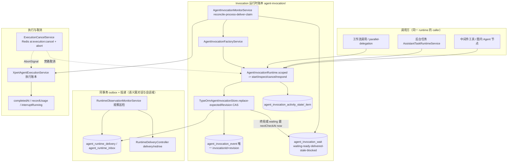

**本文引用的文件**

- [agent-invocation/README.md](file://packages/server-ai/src/agent-invocation/README.md)
- [2026-09-22-unified-agent-invocation.md](file://docs/plans/2026-09-22-unified-agent-invocation.md)
- [agent-invocation.module.ts](file://packages/server-ai/src/agent-invocation/agent-invocation.module.ts)
- [invocation-runtime.ts](file://packages/server-ai/src/agent-invocation/invocation-runtime.ts)
- [invocation-store.ts](file://packages/server-ai/src/agent-invocation/invocation-store.ts)
- [typeorm-invocation.store.ts](file://packages/server-ai/src/agent-invocation/typeorm-invocation.store.ts)
- [invocation-errors.ts](file://packages/server-ai/src/agent-invocation/invocation-errors.ts)
- [invocation-factory.service.ts](file://packages/server-ai/src/agent-invocation/invocation-factory.service.ts)
- [invocation-monitor.service.ts](file://packages/server-ai/src/agent-invocation/invocation-monitor.service.ts)
- [invocation-continuation-dispatcher.service.ts](file://packages/server-ai/src/agent-invocation/invocation-continuation-dispatcher.service.ts)
- [invocation-continuation.ts](file://packages/server-ai/src/agent-invocation/invocation-continuation.ts)
- [invocation-resume.ts](file://packages/server-ai/src/agent-invocation/invocation-resume.ts)
- [invocation-wait.store.ts](file://packages/server-ai/src/agent-invocation/invocation-wait.store.ts)
- [invocation-task-wait.ts](file://packages/server-ai/src/agent-invocation/invocation-task-wait.ts)
- [task-wait-control.ts](file://packages/server-ai/src/agent-invocation/task-wait-control.ts)
- [parallel-delegation.ts](file://packages/server-ai/src/agent-invocation/parallel-delegation.ts)
- [invocation-results.provider.ts](file://packages/server-ai/src/agent-invocation/invocation-results.provider.ts)
- [activity/activity.entity.ts](file://packages/server-ai/src/agent-invocation/activity/activity.entity.ts)
- [activity/activity.service.ts](file://packages/server-ai/src/agent-invocation/activity/activity.service.ts)
- [assistant-task-adapter.ts](file://packages/server-ai/src/agent-invocation/assistant-task-adapter.ts)
- [runtime-delivery.controller.ts](file://packages/server-ai/src/handoff/runtime-messaging/runtime-delivery.controller.ts)
- [runtime-observation-monitor.service.ts](file://packages/server-ai/src/handoff/runtime-messaging/runtime-observation-monitor.service.ts)
- [runtime-messaging/README.md](file://packages/server-ai/src/handoff/runtime-messaging/README.md)
- [xpert-agent-execution/README.md](file://packages/server-ai/src/xpert-agent-execution/README.md)
- [agent-execution.service.ts](file://packages/server-ai/src/xpert-agent-execution/agent-execution.service.ts)
- [execution-timing.ts](file://packages/server-ai/src/xpert-agent-execution/execution-timing.ts)
- [assistant-task-runtime.service.ts](file://packages/server-ai/src/xpert-agent-execution/runtime/assistant-task-runtime.service.ts)
- [execution-cancel.service.ts](file://packages/server-ai/src/shared/execution/execution-cancel.service.ts)
- [execution-abort-scope.ts](file://packages/server-ai/src/shared/execution/execution-abort-scope.ts)

## 目录

- [1. 子域职责边界](#1-子域职责边界)
- [2. 内部分层](#2-内部分层)
- [3. 依赖关系](#3-依赖关系)
- [4. 关键不变量](#4-关键不变量)
- [5. 架构总览](#5-架构总览)
- [6. 结论](#6-结论)

章节来源：[agent-invocation/README.md](file://packages/server-ai/src/agent-invocation/README.md)（关键符号：AgentInvocationRuntime / TypeOrmAgentInvocationStore）、[2026-09-22-unified-agent-invocation.md](file://docs/plans/2026-09-22-unified-agent-invocation.md)（关键符号：unified agent invocation plan）

## 1. 子域职责边界

**做什么**：本子域是「Agent 调用与执行账本」——① Invocation 运行时账本：授权、幂等键、目标快照 pin、CAS 状态转移、观察历史、等待与续跑、activity 采集、协作式取消；② 执行与用量账本：`xpert_agent_execution` 的 `create/update/recordUsage/interruptRunning`；③ 任务入口：`AssistantTaskRuntimeService` 与 `assistant-task-adapter` 把后台任务接到同一 runtime；④ 资源卡与结果视图：`InvocationResultsProvider`、`InvocationCardProvider`。

**核心定位（明写）**：「Invocation remains the runtime ledger. Project Tasks retain business decisions.」调用方（中间件工具、工作流 Agent 节点、后台任务）都是同一 runtime 的 caller，不各自拥有另一 Agent 的图、进程、会话或协议。

**不做什么**：不拥有 Project Task 的业务决策与最终验收（stage 4 / `xpert-project`）；不实现队列物理与 outbox 写入器（`handoff` 的 `HandoffQueueService`/`HandoffCancelService`）；不实现具体 provider（`xpert-plugins/xpertai/integrations/agent-runtimes`：Codex/Pi/Claude Code/OpenCode）。

**交叉引用一：`handoff`（投递）**。`TypeOrmAgentInvocationStore.replace` 在同事务内调用 `appendRuntimeDelivery` 写 `agent_runtime_delivery`；传输 worker、`RuntimeMessageProcessor`、`RuntimeMessageInboxService`、`RuntimeObservationMonitorService` 物理在 `handoff/runtime-messaging/`，但由 `AgentInvocationModule` 注册与依赖。归属判定按「语义」而非「谁注册」：投递、消费收据与对账属「对话与会话专家」，本域只保证相邻的 CAS 与账本不变量。

**交叉引用二：「对话与会话专家」**。`RuntimeDeliveryController`（`GET /api/agent-invocations/:id/delivery`、`POST /api/agent-invocations/:id/delivery/redrive`）文件物理在 handoff，**注册在 `agent-invocation.module.ts` 的 `controllers`**，接口前缀属本域但 `delivery/redrive` 的收据与对账语义属「对话与会话专家」；跨侧改动需两侧确认。

章节来源：[agent-invocation.module.ts](file://packages/server-ai/src/agent-invocation/agent-invocation.module.ts)（关键符号：AgentInvocationModule.controllers/providers/exports）、[runtime-messaging/README.md](file://packages/server-ai/src/handoff/runtime-messaging/README.md)（关键符号：Invocation remains the runtime ledger、Commit and recovery boundaries）、[runtime-delivery.controller.ts](file://packages/server-ai/src/handoff/runtime-messaging/runtime-delivery.controller.ts)（关键符号：RuntimeDeliveryController.inspect/redrive、表 agent_runtime_delivery）

## 2. 内部分层

| 层 | 承载者 | 职责 |
|---|---|---|
| runtime（不变量承载） | `AgentInvocationRuntime` | `scoped` 五元身份校验、`start`/`control`、`pinned`、`assertScope`、`updateLatest`、私有 `save`（CAS + `startPendingUntil` fence） |
| store | `AgentInvocationStore`（抽象）、`TypeOrmAgentInvocationStore` | `insert`（`orIgnore().returning('id')`）、`read`（owner 四元组）、`replace(record, expectedRevision)` 同事务写事件与投递、`appendEvent` |
| factory | `AgentInvocationFactoryService` | `createCapturedApi`/`createScopedApi`/`api()`、`existingApi` 复用、`resolve`/`resolveBackgroundTarget`/`resolveGroupTarget`/`listProjectBindings`、`awaitResult`/`waitForTasks`/`getResourceCard`/`claimResults` |
| monitor | `AgentInvocationMonitorService` | `reconcile(5s, take 10)`/`process`/`deliver`/`claim(state, handler)`/`withAccess`/`busy`/`onModuleDestroy` |
| wait & continuation | `AgentInvocationWaitStore`、`InvocationContinuationDispatcher`、`InvocationContinuationResolver`、`invocation-continuation.ts`、`invocation-resume.ts`、`invocation-task-wait.ts`、`task-wait-control.ts`、`parallel-delegation.ts` | 有界观察、wait 组登记、ready 组派发、checkpoint 围栏、stale/blocked 归一 |
| activity | `InvocationActivityService`、`InvocationActivityState`/`InvocationActivityItem` | 游标推进、item 落库、gaps 语义、容量与保留、`output` 分段读 |
| cancel | `ExecutionCancelService`、`executionAbortScope`、`ExecutionCancelledError` | Redis `ai:execution:cancel` + 本地 `AbortController.abort`；父→子级联 |
| execution ledger | `XpertAgentExecutionService`、`executionCompletedAt`、`XpertAgentExecution` | `xpert_agent_execution` 写入面、`completedAt` 规则、`interruptRunning` |
| task runtime | `AssistantTaskRuntimeService`、`AssistantTaskRuntimeStrategy`、`invokeAssistantTask` | `xpert-task` provider 策略、任务 facade 与私有传输、receipt 归一 |

章节来源：[invocation-runtime.ts](file://packages/server-ai/src/agent-invocation/invocation-runtime.ts)（关键符号：AgentInvocationRuntime.scoped/start/control/pinned/updateLatest/save）、[typeorm-invocation.store.ts](file://packages/server-ai/src/agent-invocation/typeorm-invocation.store.ts)（关键符号：TypeOrmAgentInvocationStore.insert/read/replace/appendEvent）、[invocation-monitor.service.ts](file://packages/server-ai/src/agent-invocation/invocation-monitor.service.ts)（关键符号：AgentInvocationMonitorService.reconcile/process/deliver/claim/withAccess）、[activity.service.ts](file://packages/server-ai/src/agent-invocation/activity/activity.service.ts)（关键符号：InvocationActivityService.recorder/page/output/purgeExpired、表 agent_invocation_activity_state/agent_invocation_activity_item）

## 3. 依赖关系

**出向**：`AgentRuntimeRegistry`（`get`/`getSource`/`getPinned`，来自 `@xpert-ai/plugin-sdk`）、`XPERT_RUNTIME_CAPABILITIES_TOKEN`（`ProjectAccessRuntimeCapability`、`AgentExecutionRunnerFactoryCapability`）、`handoff/runtime-messaging`（outbox/inbox/processor/观察巡检）、`CqrsModule`（`ClaimAgentRuntimeResultsCommand`、`ResolveGroupTaskTargetCommand`、`ExecuteGroupTaskCommand`、`RunCreateStreamCommand`、`CopilotCheckpointGetTupleQuery`）、`ArtifactsModule`（结果视图下载解析）、`RedisModule`（取消频道）、`User`/`UserOrganization`（`withAccess` 复检）、`XpertAgentExecution`（父执行上溯与可读面）。

**入向**：`XpertAgentModule`（图内调用经 `AgentInvocationFactoryService`）、`AgentMiddlewareRuntimeService.createScopedApi`（注册 `AgentInvocationRuntimeCapability` 为 `AgentInvocationApi`）、`xpert-project` 任务投影、`xpert-task` 任务 facade、`chat-conversation`（取消链）。

**同域内连线**：`AgentInvocationModule` 一个模块内同时装配 runtime + store + factory + monitor + dispatcher + activity + 两个 CQRS handler + 跨域 message provider，并以 `exports: [RuntimeMessageAccessService, AgentInvocationRuntime, AgentRuntimeRegistry, AgentInvocationFactoryService]` 对外；`shared/execution`（`ExecutionCancelModule`，`@Global`）独立，只被调用不反向依赖。

章节来源：[agent-invocation.module.ts](file://packages/server-ai/src/agent-invocation/agent-invocation.module.ts)（关键符号：AgentInvocationModule.imports/exports、表 agent_invocation/agent_invocation_event/agent_invocation_wait/agent_runtime_binding/agent_runtime_delivery/agent_runtime_inbox）、[execution-cancel.service.ts](file://packages/server-ai/src/shared/execution/execution-cancel.service.ts)（关键符号：ExecutionCancelService.cancelExecutions、EXECUTION_CANCEL_CHANNEL）

## 4. 关键不变量

### 4.1 CAS 状态转移与 append-only 观察历史同事务
`agent_invocation.revision` 单调递增；`replace(record, expectedRevision)` 以 `where {id, tenantId, organizationId, ownerId, revision: expectedRevision}` 提交，`affected !== 1` 即返回 `false`，调用方必须重读重试（`updateLatest` 上限 8 次，超限 `ConcurrentUpdate`）。同一事务内写 `agent_invocation_event`（唯一 `(invocationId, revision)`）、`appendRuntimeDelivery`，并把相关 `agent_invocation_wait.nextCheckAt` 置为 `now()`。明写原文：「`TypeOrmAgentInvocationStore`: state and append-only observation history in one transaction.」

章节来源：[agent-invocation/README.md](file://packages/server-ai/src/agent-invocation/README.md)（关键符号：compare-and-swap state transitions）、[typeorm-invocation.store.ts](file://packages/server-ai/src/agent-invocation/typeorm-invocation.store.ts)（关键符号：TypeOrmAgentInvocationStore.replace/appendEvent、表 agent_invocation_event）

### 4.2 解析一次即 pin，恢复不得静默回退
`providerSource = registry.getSource(strategy)` 在首次解析时落库；此后 `pinned(record)` 一律走 `registry.getPinned(provider, providerSource)`，找不到即 `ProviderChanged`（409）而非降级到别的实现。明写原文：「Resolve a provider once and pin its source. Removal or upgrade must never silently fall back to a different implementation during recovery.」

章节来源：[2026-09-22-unified-agent-invocation.md](file://docs/plans/2026-09-22-unified-agent-invocation.md)（关键符号：ResolvedAgentTarget、pin 不变量）、[invocation-runtime.ts](file://packages/server-ai/src/agent-invocation/invocation-runtime.ts)（关键符号：AgentInvocationRuntime.pinned）

### 4.3 先持久化再派发（幂等键含父执行与 toolCallId）
`start` 先 `insert` 保留 `queued`，CAS `begin` 赢家才调 `strategy.start`；幂等键 `agentInvocationId(scope, callId)` 对 `{scope, callId}` 做规范化 JSON 的 sha256 并整形为 UUID，`scope.parentExecutionId` + callId（即调用点/toolCallId）共同构成身份。明写原文：「Persist an invocation and immutable target snapshot before dispatch. The idempotency key includes the parent execution and call site/toolCallId.」

章节来源：[2026-09-22-unified-agent-invocation.md](file://docs/plans/2026-09-22-unified-agent-invocation.md)（关键符号：Lifecycle and reliability 第 2 条）、[invocation-runtime.ts](file://packages/server-ai/src/agent-invocation/invocation-runtime.ts)（关键符号：agentInvocationId、AgentInvocationRuntime.start）

### 4.4 `waitForTasks` 有界观察（超时不挂父级）
明写原文：「An elapsed observation window returns `pending` normally; it does not suspend the parent or imply task completion.」`observeTasks` 到点即返回 `reason: 'pending'`；`awaitInvocationTasks` 仅在 `attention`（子任务 `waiting` 且带 interaction）时才 `interrupt(...)` 挂起父级，只有人工交互会挂起。

章节来源：[agent-invocation/README.md](file://packages/server-ai/src/agent-invocation/README.md)（关键符号：Generic long-task waiting、AgentInvocationApi.waitForTasks）、[invocation-task-wait.ts](file://packages/server-ai/src/agent-invocation/invocation-task-wait.ts)（关键符号：awaitInvocationTasks/invocationDependencyState）

### 4.5 停请求不是终止证明
明写原文：「A stop request is not proof of termination: only `exited` confirms the process stopped, and `unknown` must remain visible.」取消只是请求；`unknown` 必须保持可见，投影与对账不得据取消信号推断终态。

章节来源：[agent-invocation/README.md](file://packages/server-ai/src/agent-invocation/README.md)（关键符号：Host execution runner 终止判定）、[execution-cancel.service.ts](file://packages/server-ai/src/shared/execution/execution-cancel.service.ts)（关键符号：ExecutionCancelService.applyCancel）

### 4.6 含糊启动不得自动重放；断开的观察者不取消运行
明写原文：「An ambiguous launch must be reconciled rather than automatically retried.」「A disconnected observer does not cancel the run; cancellation requires provider confirmation.」「Unknown launch outcome does not trigger blind retries.」`start` 异常落 `unknown`（`DispatchUnknown`）并向上抛；启动围栏（`startPendingUntil`，最长 120 s）内 `inspect` 不判定中间态失效，围栏到期后无 handle 才收敛为 `unknown`。

章节来源：[2026-09-22-unified-agent-invocation.md](file://docs/plans/2026-09-22-unified-agent-invocation.md)（关键符号：Lifecycle and reliability、Acceptance）、[invocation-runtime.ts](file://packages/server-ai/src/agent-invocation/invocation-runtime.ts)（关键符号：AgentInvocationRuntime.start/control、startPendingUntil）

### 4.7 终局化不得重放初始行；`completedAt` 仅表真终态
明写原文：「Finalization must not replay the initial database row, which can overwrite newer timestamps and usage counters.」「`completedAt` records the wall-clock time when an execution succeeds, fails, times out or is interrupted. Resuming to running/pending clears it」，且「`updatedAt` … cannot substitute for the execution's end time」。实现上 `create`/`update` 用 `omit(entity, ['createdAt','updatedAt'])`，`update` 在事务内 `pessimistic_write` 重读后由 `executionCompletedAt` 决定时间戳。

章节来源：[xpert-agent-execution/README.md](file://packages/server-ai/src/xpert-agent-execution/README.md)（关键符号：Audit timestamps、Completion timestamps）、[execution-timing.ts](file://packages/server-ai/src/xpert-agent-execution/execution-timing.ts)（关键符号：executionCompletedAt/isExecutionStopped）、[agent-execution.service.ts](file://packages/server-ai/src/xpert-agent-execution/agent-execution.service.ts)（关键符号：XpertAgentExecutionService.create/update、表 xpert_agent_execution）

## 5. 架构总览

图表来源：[invocation-runtime.ts](file://packages/server-ai/src/agent-invocation/invocation-runtime.ts)、[typeorm-invocation.store.ts](file://packages/server-ai/src/agent-invocation/typeorm-invocation.store.ts)、[invocation-monitor.service.ts](file://packages/server-ai/src/agent-invocation/invocation-monitor.service.ts)、[runtime-observation-monitor.service.ts](file://packages/server-ai/src/handoff/runtime-messaging/runtime-observation-monitor.service.ts)、[execution-cancel.service.ts](file://packages/server-ai/src/shared/execution/execution-cancel.service.ts)

章节来源：[invocation-factory.service.ts](file://packages/server-ai/src/agent-invocation/invocation-factory.service.ts)（关键符号：AgentInvocationFactoryService.createCapturedApi/createScopedApi/api）、[agent-execution.service.ts](file://packages/server-ai/src/xpert-agent-execution/agent-execution.service.ts)（关键符号：XpertAgentExecutionService.recordUsage/interruptRunning）

## 6. 结论

本子域用「一个运行时账本 + 一个执行账本」收敛 Agent 调用：`AgentInvocationRuntime` 是唯一状态转移入口（幂等哈希 + pin + CAS + 启动围栏），`TypeOrmAgentInvocationStore` 把状态与 append-only 观察历史锁进同一事务，`AgentInvocationMonitorService` 与 `InvocationContinuationDispatcher` 以租约 + 轮询把「等待/续跑」变成可恢复的持久状态，`ExecutionCancelService` 以 Redis 广播 + 本地 abort 做协作式取消，`XpertAgentExecutionService` 承担审计时间戳与 `completedAt` 的唯一写入面。边界上必须守住三件事：Task 决策不在本域、投递/收据语义在「对话与会话专家」、Invocation 账本不得被旁路直写。

章节来源：[agent-invocation/README.md](file://packages/server-ai/src/agent-invocation/README.md)、[xpert-agent-execution/README.md](file://packages/server-ai/src/xpert-agent-execution/README.md)、[runtime-messaging/README.md](file://packages/server-ai/src/handoff/runtime-messaging/README.md)、[2026-09-22-unified-agent-invocation.md](file://docs/plans/2026-09-22-unified-agent-invocation.md)（关键符号：Only the runtime writes invocation status）
