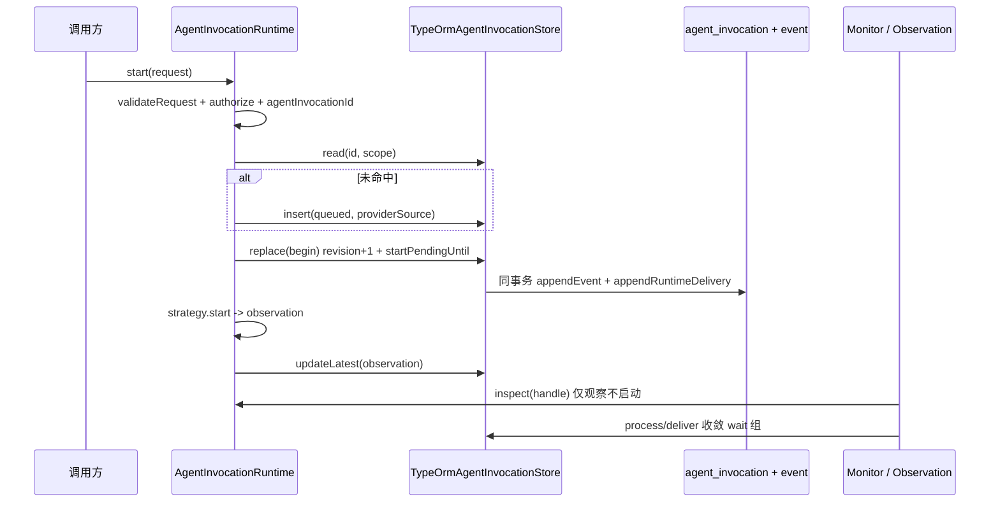
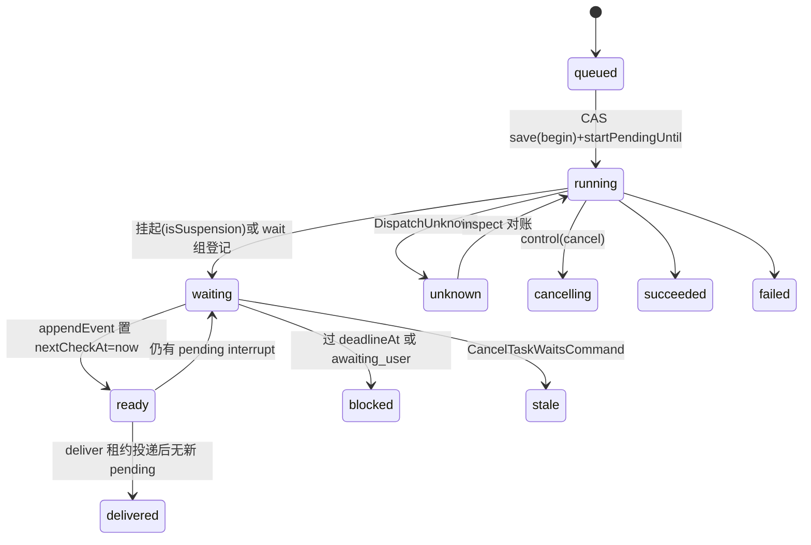
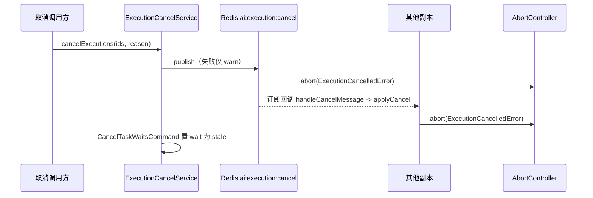

**本文引用的文件**

- [invocation-runtime.ts](file://packages/server-ai/src/agent-invocation/invocation-runtime.ts)
- [typeorm-invocation.store.ts](file://packages/server-ai/src/agent-invocation/typeorm-invocation.store.ts)
- [invocation.entity.ts](file://packages/server-ai/src/agent-invocation/invocation.entity.ts)
- [invocation-errors.ts](file://packages/server-ai/src/agent-invocation/invocation-errors.ts)
- [invocation-factory.service.ts](file://packages/server-ai/src/agent-invocation/invocation-factory.service.ts)
- [invocation-monitor.service.ts](file://packages/server-ai/src/agent-invocation/invocation-monitor.service.ts)
- [invocation-continuation-dispatcher.service.ts](file://packages/server-ai/src/agent-invocation/invocation-continuation-dispatcher.service.ts)
- [invocation-continuation.ts](file://packages/server-ai/src/agent-invocation/invocation-continuation.ts)
- [invocation-resume.ts](file://packages/server-ai/src/agent-invocation/invocation-resume.ts)
- [invocation-wait.store.ts](file://packages/server-ai/src/agent-invocation/invocation-wait.store.ts)
- [invocation-task-wait.ts](file://packages/server-ai/src/agent-invocation/invocation-task-wait.ts)
- [invocation-task-wait.schema.ts](file://packages/server-ai/src/agent-invocation/invocation-task-wait.schema.ts)
- [task-wait-control.ts](file://packages/server-ai/src/agent-invocation/task-wait-control.ts)
- [invocation-results.provider.ts](file://packages/server-ai/src/agent-invocation/invocation-results.provider.ts)
- [activity/activity.entity.ts](file://packages/server-ai/src/agent-invocation/activity/activity.entity.ts)
- [activity/activity.service.ts](file://packages/server-ai/src/agent-invocation/activity/activity.service.ts)
- [assistant-task-adapter.ts](file://packages/server-ai/src/agent-invocation/assistant-task-adapter.ts)
- [runtime-observation-monitor.service.ts](file://packages/server-ai/src/handoff/runtime-messaging/runtime-observation-monitor.service.ts)
- [runtime-messaging/README.md](file://packages/server-ai/src/handoff/runtime-messaging/README.md)
- [20261006-runtime-reliable-replies.sql](file://packages/server-ai/src/handoff/runtime-messaging/migrations/20261006-runtime-reliable-replies.sql)
- [agent-execution.service.ts](file://packages/server-ai/src/xpert-agent-execution/agent-execution.service.ts)
- [execution-timing.ts](file://packages/server-ai/src/xpert-agent-execution/execution-timing.ts)
- [xpert-agent-execution/README.md](file://packages/server-ai/src/xpert-agent-execution/README.md)
- [20261008-execution-completed-at.sql](file://packages/server-ai/src/xpert-agent-execution/migrations/20261008-execution-completed-at.sql)
- [execution-cancel.service.ts](file://packages/server-ai/src/shared/execution/execution-cancel.service.ts)
- [execution-abort-scope.ts](file://packages/server-ai/src/shared/execution/execution-abort-scope.ts)
- [task-wait.ts](file://packages/server-ai/src/runtime-task/task-wait.ts)
- [task-wait-policy.ts](file://packages/server-ai/src/runtime-task/task-wait-policy.ts)

## 目录

- [1. 链一：一次 Invocation](#1-链一一次-invocation)
- [2. 链二：等待与恢复](#2-链二等待与恢复)
- [3. 链三：取消](#3-链三取消)
- [4. 链四：activity 采集](#4-链四activity-采集)
- [5. 链五：执行账本](#5-链五执行账本)
- [6. 状态流转](#6-状态流转)
- [7. 异步流与依赖](#7-异步流与依赖)
- [8. 数据变换关键节点](#8-数据变换关键节点)
- [9. 已知风险](#9-已知风险)

章节来源：[invocation-runtime.ts](file://packages/server-ai/src/agent-invocation/invocation-runtime.ts)（关键符号：AgentInvocationRuntime.start）、[invocation-monitor.service.ts](file://packages/server-ai/src/agent-invocation/invocation-monitor.service.ts)（关键符号：AgentInvocationMonitorService.process/deliver）

## 1. 链一：一次 Invocation

**start → CAS → 观察 → 投递 → 认领 → 续跑 → 终态**：调用方（中间件工具 / 图内 Agent 节点 / 任务 facade）拿到 `AgentInvocationApi` 后调 `start(request)`：`validateRequest` 校验 `callId`（非空、≤1024）、`target` 四字段与 `input.prompt`；`authorizeAgentInvocation` 包装的 `authorize` 会重新解析 binding 并比对 `revision/provider/reference/configuration`；`agentInvocationId(scope, callId)` 得到幂等主键；`store.read` 命中则校验 scope 与 request 全等后复用，未命中则 `registry.get` + `registry.getSource` 建 `queued` 记录并 `insert`（`orIgnore().returning('id')`）。

CAS 之后，赢家把状态推到 `running` 并写 `startPendingUntil = now + 120 s`，随后 `strategy.start` 返回 observation（句柄 + 状态），由 `updateLatest` 以 CAS 落库；落库路径 `save` 会先校验 `progress` schema 与「`succeeded` 必须带 result」，再 `replace`。观察侧由 `RuntimeObservationMonitorService`（`nextObservationAt <= now()` 且请求含 `dispatch` 或 `activity`，take 20）租约 `inspect`，`AgentInvocationMonitorService` 负责 wait 组的 `process/deliver`；投递由同事务 `appendRuntimeDelivery` 写入 `agent_runtime_delivery`，队列 worker 认领后写 `agent_runtime_inbox` 并把结果送回原会话；父级恢复则回到 Invocation 自身记录（不重放启动）。



图表来源：[invocation-runtime.ts](file://packages/server-ai/src/agent-invocation/invocation-runtime.ts)、[typeorm-invocation.store.ts](file://packages/server-ai/src/agent-invocation/typeorm-invocation.store.ts)、[runtime-observation-monitor.service.ts](file://packages/server-ai/src/handoff/runtime-messaging/runtime-observation-monitor.service.ts)

章节来源：[invocation-runtime.ts](file://packages/server-ai/src/agent-invocation/invocation-runtime.ts)（关键符号：AgentInvocationRuntime.start/save/updateLatest、表 agent_invocation/agent_invocation_event）、[typeorm-invocation.store.ts](file://packages/server-ai/src/agent-invocation/typeorm-invocation.store.ts)（关键符号：TypeOrmAgentInvocationStore.insert/replace、表 agent_runtime_delivery）

## 2. 链二：等待与恢复

登记：`AgentInvocationWaitStore.register/registerTasks`（`id` = `[tenantId, organizationId, userId, parentExecutionId, callerAgentKey, callId]` 的 sha256 UUID 形态）以 `orIgnore()` 写 `state='waiting'`、`nextCheckAt=now()`、`deadlineAt = now + HOST_TASK_WAIT_POLICY.maxWaitMs`，随后重读校验 `threadId/mode/taskIds`。观察：`reconcile`（5 s，take 10）用 `claim` 抢租约后 `withAccess` → `api.inspect`，产出 `outcome` 或把 `nextCheckAt` 推后 15 s。恢复：`replace` 落到 `succeeded|failed|cancelled|waiting` 时同事务把相关 wait 行 `nextCheckAt` 置 `now()`，把 `ready` 行交给 `InvocationContinuationDispatcher`（1 s，take 10，并发 ≤4）→ `deliver` 重新授权依赖、上溯父执行、核 checkpoint 与 interrupt，满足条件才发 `RunCreateStreamCommand(action: 'resume')`。

围栏与启动 fence：`deliver` 传出的上下文带 `invocationId/waitLeaseToken/checkpointNamespace/checkpointId/interruptId`；落到图的恢复入口时 `assertInvocationResume` 会再读 checkpoint 并 `CheckTaskWaitClaimQuery` 复核（`state='ready'` 且 `leaseUntil > now`），否则 `BadRequestException`。与此并行的是**启动 fence ≤120 s**：持久化的 `startPendingUntil` 期间 `inspect` 直接返回当前记录、不判定中间态失效；围栏到期且仍无 handle 才由 `updateLatest` 收敛为 `unknown` + `DispatchUnknown`。



图表来源：[invocation-runtime.ts](file://packages/server-ai/src/agent-invocation/invocation-runtime.ts)、[invocation-monitor.service.ts](file://packages/server-ai/src/agent-invocation/invocation-monitor.service.ts)、[task-wait-control.ts](file://packages/server-ai/src/agent-invocation/task-wait-control.ts)

章节来源：[invocation-wait.store.ts](file://packages/server-ai/src/agent-invocation/invocation-wait.store.ts)（关键符号：AgentInvocationWaitStore.registerTasks/id、表 agent_invocation_wait）、[invocation-resume.ts](file://packages/server-ai/src/agent-invocation/invocation-resume.ts)（关键符号：assertInvocationResume）、[runtime-messaging/README.md](file://packages/server-ai/src/handoff/runtime-messaging/README.md)（关键符号：A persisted startup fence lasts at most 120 seconds）

## 3. 链三：取消

`ExecutionCancelService.cancelExecutions(executionIds, reason?)` → 去重 → `redis.publish('ai:execution:cancel', {executionIds, reason})`（失败只 `warn`）→ 本地 `applyCancel` 对登记的 `AbortController` 调 `abort(new ExecutionCancelledError(id, reason))` 并删除条目；跨副本由 `onModuleInit` 的 `redis.duplicate()` 订阅回调走同一 `applyCancel`。`executionAbortScope` 让父信号向子作用域级联（父已中止则子立即中止），`dispose()` 时对比删除登记。

Invocation 侧的取消入口：`control(id, access, 'cancel')` 校验策略 `capabilities.cancellation` 后先 `save(record, {status:'cancelling'})`（防止迟到的 `running` observation 覆盖），再 `strategy.cancel(handle, context)`，返回的 observation 经 `updateLatest` 归一。父级取消还会 `CancelTaskWaitsCommand` 把 wait 行置 `stale` + `lastError='parent_cancelled'`，切断待续跑的 checkpoint 链路；取消 Invocation 不等于取消 Project Task。



图表来源：[execution-cancel.service.ts](file://packages/server-ai/src/shared/execution/execution-cancel.service.ts)、[execution-abort-scope.ts](file://packages/server-ai/src/shared/execution/execution-abort-scope.ts)、[task-wait-control.ts](file://packages/server-ai/src/agent-invocation/task-wait-control.ts)

章节来源：[execution-cancel.service.ts](file://packages/server-ai/src/shared/execution/execution-cancel.service.ts)（关键符号：ExecutionCancelService.cancelExecutions/applyCancel/handleCancelMessage、EXECUTION_CANCEL_CHANNEL）、[invocation-runtime.ts](file://packages/server-ai/src/agent-invocation/invocation-runtime.ts)（关键符号：AgentInvocationRuntime.control）

## 4. 链四：activity 采集

`InvocationActivityService.recorder(invocation)` 的 `append(batch)` 是唯一写入口：`executionActivityBatchSchema` 解析 → 事务内 `insert().orIgnore()` 建 state + `pessimistic_write` 取回 → 若 `closed` 或 `expectedSourceCursor` 不匹配则原样返回旧游标（不写入）→ 逐 item `redactCredentials`、合并且按 `(itemId, hash)` 去重 → 超 `EXECUTION_ACTIVITY_MAX_BYTES` 或 `seq >= 20000` 记 `gaps: ['capture_limit']` 并跳过 → 工具输出 >65536 字符截断并把完整体写入 volume（`outputRef.key = sha256`）→ `state.seq++`、`state.bytes += bytes`、插入 `agent_invocation_activity_item`（`firstSeq` 取首见 seq）→ 更新 `sourceCursor`、`expiresAt`，`batch.complete` 时置 `closed`。

读取面：`page` 以 `state.seq` 为 waterline，按 `itemId` 取 `MAX(seq)` 后回捞并给出 `nextCursor/hasMore/state/gaps`；`output(invocation, key, offset)` 从 volume 分段读取（段长 65536），state 缺失/`expired`/过期/无 volume 都是 `NotFound`。`purgeExpired`（每小时，取 100）删除 item、删 volume 文件并置 `expired = true`。

章节来源：[activity.service.ts](file://packages/server-ai/src/agent-invocation/activity/activity.service.ts)（关键符号：InvocationActivityService.recorder/page/output/purgeExpired、表 agent_invocation_activity_state/agent_invocation_activity_item）、[activity.entity.ts](file://packages/server-ai/src/agent-invocation/activity/activity.entity.ts)（关键符号：InvocationActivityState.seq/bytes/sourceCursor/closed/expiresAt/gaps、InvocationActivityItem 唯一 (invocationId, seq)）

## 5. 链五：执行账本

`create` → `update` → `recordUsage`：`create` 忽略调用方 `createdAt/updatedAt` 并用 `executionCompletedAt(undefined, status)` 初始化 `completedAt`；`update` 事务内 `pessimistic_write` 重读后 `assign(current, changes, {completedAt})` 保存；`recordUsage` 独立事务 `increment` tokens，并在 `type !== 'estimated'` 且带 `details` 时写定价列。`interruptRunning(ids, threadId, error)` 只把仍为 `RUNNING` 且线程匹配的行改成 `INTERRUPTED` 并写 `completedAt`——它是取消链回路中「把账本收口到终态」的那一步，前提是调用方已完成租户范围鉴权。`xpert_agent_execution` 的 `parentId` 自关联与 `agent_invocation` 的 `request.dispatch` 是两侧关联点：Invocation 记「调用」，Execution 记「执行与用量」。

```mermaid
flowchart LR
  A[create 忽略调用方审计时间戳] --> B[update 事务 + pessimistic_write]
  B --> C[executionCompletedAt(current, nextStatus)]
  C --> D[completedAt 写入或保留或清空]
  B --> E[recordUsage 事务 increment tokens]
  E --> F[type 非 estimated 且有 details 时写定价列]
  G[interruptRunning] --> H[仅 RUNNING 且 threadId 匹配 -> INTERRUPTED + completedAt]
```

图表来源：[agent-execution.service.ts](file://packages/server-ai/src/xpert-agent-execution/agent-execution.service.ts)、[execution-timing.ts](file://packages/server-ai/src/xpert-agent-execution/execution-timing.ts)

章节来源：[agent-execution.service.ts](file://packages/server-ai/src/xpert-agent-execution/agent-execution.service.ts)（关键符号：XpertAgentExecutionService.create/update/recordUsage/interruptRunning、表 xpert_agent_execution）、[xpert-agent-execution/README.md](file://packages/server-ai/src/xpert-agent-execution/README.md)（关键符号：Completion timestamps）

## 6. 状态流转

| 载体 | 状态/版本 | 触发与约束 |
|---|---|---|
| `agent_invocation.revision` | 单调递增 int | 每次 `replace(record, expectedRevision)` 成功 +1；失败返回 false 由调用方重读（`updateLatest` ≤8 次）；事件表唯一 `(invocationId, revision)` 兜底 |
| `invocation.status` | `queued → running → waiting/cancelling → succeeded/failed/cancelled/unknown` | `unknown` 仅由含糊启动或围栏到期无 handle 产生，必须保持可见 |
| `agent_invocation_wait.state` | `waiting → ready → delivered`，旁路 `stale`/`blocked` | `ready` 由同事务置 `nextCheckAt=now` 唤醒；`delivered` 由 `deliver` 落地；`stale` 由 `CancelTaskWaitsCommand`（`parent_cancelled`）或 checkpoint 不符；`blocked` 由 `deadlineAt` 超期或 `awaiting_user` |
| `lastError` | `outcome_unknown`/`awaiting_user`/`continuation_pending` | 三种故障指向不同处置，不可混看 |
| `xpert_agent_execution.status` + `completedAt` | `running/pending/success/error/timeout/interrupted` + timestamptz | 仅停止态写 `completedAt`；回 `running/pending` 清空；重复终局化保留 |
| activity `closed`/`expiresAt`/`expired`/`gaps` | boolean/timestamptz/数组 | `closed` 由 `batch.complete` 置；`expiresAt` 按保留天数续算；`expired` 由 `purgeExpired` 置；`gaps` 显式记录缺口 |

章节来源：[invocation.entity.ts](file://packages/server-ai/src/agent-invocation/invocation.entity.ts)、[invocation-monitor.service.ts](file://packages/server-ai/src/agent-invocation/invocation-monitor.service.ts)（关键符号：process/deliver 的状态回写）、[activity.entity.ts](file://packages/server-ai/src/agent-invocation/activity/activity.entity.ts)、[execution-timing.ts](file://packages/server-ai/src/xpert-agent-execution/execution-timing.ts)

## 7. 异步流与依赖

- **Redis pub/sub**：`ai:execution:cancel`（执行取消，发布/订阅失败只 `warn`）；`ai:handoff:cancel`（队列取消，属 handoff 侧，独立频道）。
- **进程内轮询**：`AgentInvocationMonitorService.reconcile`（5 s，take 10）、`InvocationContinuationDispatcher.dispatch`（1 s，take 10，active ≤4）、`RuntimeObservationMonitorService.reconcile`（5 s，take 20）、`InvocationActivityService.purgeExpired`（1 h，take 100）——全部是「持久恢复」而非加速器；明写「Polling is the durable recovery mechanism; local events and queue delivery are acceleration only.」
- **观察轮询语义**：`observe` 只 `inspect` 已存在句柄，成功后 `nextObservationAt` = 终态 `null` / `unknown` 60 s / 其余 5 s，失败写 `observationError='observation_unavailable'` 并推后 60 s；标题注释明写「Missing receipts are never launch instructions.」
- **handoff 队列**：`agent_runtime_delivery`（`state`/`attempts`/`nextAttemptAt`/`leaseToken`/`leaseUntil`，索引 `(state, nextAttemptAt)`）与 `agent_runtime_inbox`（唯一 `(tenantId, organizationId, ownerId, consumptionKey)`）承载有界投递与幂等消费。
- **启动 fence**：`startPendingUntil` 最长 120 s；围栏内不做中间态失效判定，围栏到期后 `inspect` 才可收敛 `unknown`。
- **失败语义**：传输成功不推断任务完成；含糊启动不得自动重放；断开的观察者不取消运行；本地事件失败降级为轮询。

章节来源：[runtime-messaging/README.md](file://packages/server-ai/src/handoff/runtime-messaging/README.md)（关键符号：Leases / polling、Commit and recovery boundaries）、[runtime-observation-monitor.service.ts](file://packages/server-ai/src/handoff/runtime-messaging/runtime-observation-monitor.service.ts)（关键符号：RuntimeObservationMonitorService.reconcile/observe）、[20261006-runtime-reliable-replies.sql](file://packages/server-ai/src/handoff/runtime-messaging/migrations/20261006-runtime-reliable-replies.sql)（关键符号：IDX_runtime_delivery_due/IDX_runtime_inbox_due）

## 8. 数据变换关键节点

- **幂等键哈希**：`agentInvocationId(scope, callId)` = `sha256(canonical({scope, callId}))` 取 32 位十六进制并整形为 UUID；`canonical` 对对象按键排序、丢弃 `undefined`，因此 JSONB 键序与驱动原型差异不影响比对；请求一致性强等校验走 `sameInvocationData`。
- **wait 组标识**：`AgentInvocationWaitStore.id(request, scope)` 对六元组做 sha256 后按同一 UUID 整形；`parseInvocationWaitScope` 会剔除 `undefined` 的可选键，避免「空字段」与「缺字段」被判为不同 scope。
- **provider 快照**：`providerSource = registry.getSource(strategy)` 与 invocation 同事务落库；恢复一律 `registry.getPinned(provider, providerSource)`，失效即 `ProviderChanged`（409）而不静默回退；绑定侧 `target.revision` 建时 `randomUUID()` 固定。
- **task 投影的 revision CAS**：`agent_runtime_delivery`/`agent_runtime_inbox` 与 Invocation 的 `revision` 是同一份乐观版本；投影侧另持有 `projectedInvocationRevision`（迁移新增，默认 -1）与 `projectedTaskRevision`，最终写入同样用 revision CAS。
- **activity 归一**：`redactCredentials` 对字符串统一脱敏；工具项按 `previous.item.content` 合并、`outputRef` 只在需要归档时生成；`hash` 与 `firstSeq` 是「同一逻辑项多版本」的压缩依据。
- **结果卡与下载**：`InvocationResultsProvider.resolveViewFile` 要求 `reference.versionId` 存在（明写「Historical unpinned references remain readable, but must never select a later version silently.」），再经 `artifacts.resolveForManagementAccess` 取 pinned 版本。

章节来源：[invocation-runtime.ts](file://packages/server-ai/src/agent-invocation/invocation-runtime.ts)（关键符号：agentInvocationId/sameInvocationData/canonical）、[invocation-task-wait.schema.ts](file://packages/server-ai/src/agent-invocation/invocation-task-wait.schema.ts)（关键符号：parseInvocationWaitScope/parsePersistedInvocationWait）、[invocation-results.provider.ts](file://packages/server-ai/src/agent-invocation/invocation-results.provider.ts)（关键符号：InvocationResultsProvider.resolveViewFile）

## 9. 已知风险

1. **CAS 冲突是常态**：`replace` 返回 `false` 时任何「当作失败/终态」的写法都会丢事件；`agent_invocation_event` 的唯一约束会在乱序 revision 上直接报错并回滚整个事务。
2. **三套租约不可混用**：观察租约（60 s）只保护「观察已存在句柄」；wait 租约（120 s）保护 continuation 投递与 claim 复核；投递/消费租约属传输层。语义混淆会造成重复投递或提前接管。
3. **跨副本取消是尽力而为**：publish 失败只 `warn`，订阅缺失即静默丢取消；且取消只能中止本进程登记的 `AbortController`，无法终止 CPU-bound 代码，也不能证明进程已停止（只有 `exited` 确认，`unknown` 必须可见）。
4. **终局化重放会污染账本**：重放初次 `create` 快照会覆盖 `updatedAt` 与 usage 计数；`completedAt` 只能由生命周期写入，元数据更新不得改动它。
5. **启动围栏与 unknown 的判读**：围栏内不会把中间态判成失效，因此「启动后短时间内没有任何状态推进」不等于失败；反之围栏到期后的 `unknown` 是设计行为，不是 bug。
6. **activity 的缺口会被下游误读**：`gaps`（如 `capture_limit`）表示已知缺失区间而非错误日志；投影时丢弃它会伪造连续流；`expiresAt` 到期后 `page` 返回空 items 但状态为 `expired`。
7. **历史数据不 backfill**：`completedAt` 迁移明写「Existing rows remain unknown: neither elapsedTime nor updatedAt proves their end time.」，历史行时间轴留空；不 backfill 是设计，不是遗漏。
8. **结果消费与 Task 决策解耦**：`claimResults` 只消费结果，不推进 Task 决策；取消 Invocation 不取消 Task，「消费成功」也不能推断任务完成。

章节来源：[typeorm-invocation.store.ts](file://packages/server-ai/src/agent-invocation/typeorm-invocation.store.ts)、[execution-cancel.service.ts](file://packages/server-ai/src/shared/execution/execution-cancel.service.ts)、[20261008-execution-completed-at.sql](file://packages/server-ai/src/xpert-agent-execution/migrations/20261008-execution-completed-at.sql)、[runtime-messaging/README.md](file://packages/server-ai/src/handoff/runtime-messaging/README.md)（关键符号：Cancelling an Invocation does not cancel the Task）
