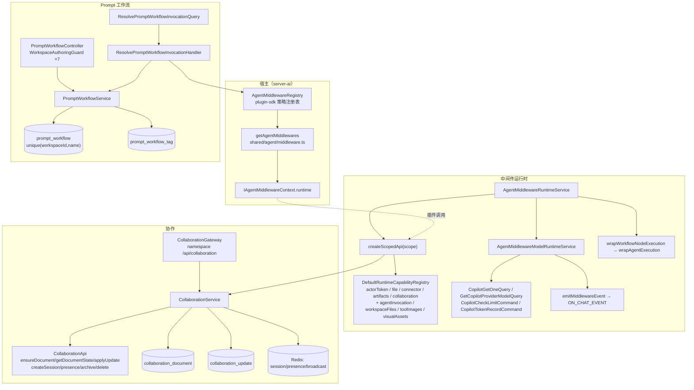

# 中间件运行时 · Prompt 工作流 · 协作 —— 架构

**本文引用的文件**
- `file://packages/server-ai/src/shared/agent/middleware-runtime/middleware-runtime.service.ts`
- `file://packages/server-ai/src/shared/agent/middleware-runtime/model-runtime.service.ts`
- `file://packages/server-ai/src/shared/agent/middleware-runtime/execution-scope.ts`
- `file://packages/server-ai/src/shared/agent/middleware-runtime/middleware-runtime.module.ts`
- `file://packages/server-ai/src/shared/agent/middleware-runtime/middleware-runtime.provider-boundary.spec.ts`
- `file://packages/server-ai/src/shared/agent/middleware.ts`
- `file://packages/server-ai/src/shared/agent/execution.ts`
- `file://packages/plugin-sdk/src/lib/agent/middleware/runtime.ts`
- `file://packages/plugin-sdk/src/lib/agent/middleware/strategy.registry.ts`
- `file://packages/plugin-sdk/src/lib/agent/middleware/strategy.interface.ts`
- `file://packages/plugin-sdk/src/lib/collaboration/types.ts`
- `file://packages/server-ai/src/prompt-workflow/prompt-workflow.service.ts`
- `file://packages/server-ai/src/prompt-workflow/prompt-workflow.entity.ts`
- `file://packages/server-ai/src/prompt-workflow/prompt-workflow.controller.ts`
- `file://packages/server-ai/src/prompt-workflow/prompt-workflow-associations.ts`
- `file://packages/server-ai/src/prompt-workflow/queries/handlers/resolve-prompt-workflow-invocation.handler.ts`
- `file://packages/server-ai/src/shared/agent/message.ts`
- `file://packages/server-ai/src/collaboration/collaboration.service.ts`
- `file://packages/server-ai/src/collaboration/collaboration.gateway.ts`
- `file://packages/server-ai/src/collaboration/collaboration.module.ts`
- `file://packages/server-ai/src/collaboration/entities/collaboration-document.entity.ts`
- `file://packages/server-ai/src/collaboration/entities/collaboration-update.entity.ts`
- `file://packages/server-ai/src/xpert-agent/plugins/index.ts`
- `file://packages/server-ai/src/xpert-workspace/guards/workspace-authoring.guard.ts`

## 目录

- [子域职责边界](#子域职责边界)
- [内部分层](#内部分层)
- [依赖关系](#依赖关系)
- [关键不变量](#关键不变量)
- [架构总览](#架构总览)
- [结论](#结论)

## 子域职责边界

三块代码共享同一个定位：**给 Agent 提供受控能力面，而不是承载业务逻辑**。

- **中间件运行时**：`AgentMiddlewareRuntimeService` 自身不含领域行为，注释明确「domain behavior lives in focused runtime services so this class only owns capability composition」；它把一次调用（invocation）内的能力装配为 `AgentMiddlewareRuntimeApi`，并注入到 `IAgentMiddlewareContext.runtime`，供中间件策略按需取用。
- **Prompt 工作流**：是「斜杠命令 → 提示词模板」的作者态存储与运行时解析面。作者态由 `PromptWorkflowService` 的 workspace CRUD 承担；运行时只输出扁平化的 `RuntimePromptWorkflowCommandSource[]`，真正的展开发生在 `ResolvePromptWorkflowInvocationHandler`，且仅当输入形如 `/name args` 时才介入。
- **协作**：**不是 Agent 执行链的一部分**，它只提供共享文档的 CRDT 能力面（`CollaborationApi`）与在线状态（presence）。服务注释写明「Plugin providers own resource authorization and projection into business entities」——平台持有权威 Yjs 状态，业务实体投影由插件 provider 负责。

章节来源：[middleware-runtime.service.ts](file://packages/server-ai/src/shared/agent/middleware-runtime/middleware-runtime.service.ts)（关键符号：AgentMiddlewareRuntimeService.createScopedApi / AgentMiddlewareRuntimeApi）· [collaboration.service.ts](file://packages/server-ai/src/collaboration/collaboration.service.ts)（关键符号：CollaborationService.api）

## 内部分层

| 层 | 组成 | 职责 |
| --- | --- | --- |
| 门面层 | `AgentMiddlewareRuntimeService` | 按 scope 组装 `createScopedApi`，暴露 `api` getter、`createModelClient`、`getModelProvider`、`wrapWorkflowNodeExecution`、`emitMiddlewareEvent`、`resolveSelectedConnectorRuntimeBindings` |
| 模型运行时 | `AgentMiddlewareModelRuntimeService` | 模型 client 构造、provider 连接解析（含计价/限额）、执行包裹、事件出口 |
| scope 解析 | `resolveAgentExecutionScope`（`execution-scope.ts`） | 从 LangChain `AsyncLocalStorageProviderSingleton` 的 runnable config 补齐 tenant/org/user/xpert/conversation/execution 身份 |
| 作者态服务 | `PromptWorkflowService` + `prompt-workflow-associations.ts` | 工作流 CRUD、默认初始化、命令档案校验/快照/运行时解析、标签与专家关联 |
| CQRS | `ResolvePromptWorkflowInvocationQuery` + handler | 把 `/name args` 解析为模板 + `commandSource` + `runtimeCapabilities` |
| HTTP 控制器 | `PromptWorkflowController` | 7 个端点，全部 `WorkspaceAuthoringGuard` |
| WS 网关 | `CollaborationGateway` | `/api/collaboration` 单文档会话、update/sync/presence 消息 |
| Entities | `PromptWorkflow`、`CollaborationDocument`、`CollaborationUpdate` | 三张持久化表 |

章节来源：[middleware-runtime.module.ts](file://packages/server-ai/src/shared/agent/middleware-runtime/middleware-runtime.module.ts)（关键符号：AgentMiddlewareRuntimeModule）· [prompt-workflow.controller.ts](file://packages/server-ai/src/prompt-workflow/prompt-workflow.controller.ts)（关键符号：PromptWorkflowController）· [collaboration.gateway.ts](file://packages/server-ai/src/collaboration/collaboration.gateway.ts)（关键符号：CollaborationGateway.handleConnection）

## 依赖关系

**出向（本子域依赖别的模块）**

- `copilot*`：`CopilotGetOneQuery`、`GetCopilotProviderModelQuery`、`CopilotCheckLimitCommand`、`CopilotTokenRecordCommand`、`CopilotService`、`CopilotUsageService.recordModelUsage`、`ensureCopilotModelContextSize`。
- `ai-model`：`AIModelGetProviderQuery` → `IAIModelProviderStrategy`（`getModelInstance` / `getBaseUrl` / `getAuthorization` / `getModelManager`）。
- `actor-token`、`artifacts`、`connector`、`workspace-files`/`file-runtime`：分别以 `ActorTokenRuntimeFactoryCapability`、`ArtifactsRuntimeCapability`、`ConnectorRuntimeFactoryCapability`、`WorkspaceFilesRuntimeCapability`/`FileRuntimeCapability` 形态注册进能力表。
- `redis`（`REDIS_CLIENT`、`closeRedisSubscriber`）、`tenant`（TenantModule）、`xpert-workspace`（`XpertWorkspaceAccessService`、`XpertWorkspaceBaseService`）、`xpert`（`Xpert` 仓库校验关联）、`server-config`（`environment.baseUrl`）、`plugin-sdk`（能力令牌、队列令牌）。

**入向（谁依赖本子域）**

- `xpert-agent`：`xpert-agent.module.ts` 导入 `AgentMiddlewareRuntimeModule`，`XpertAgentService` 注入 `AgentMiddlewareRuntimeService` 以构造草稿态 scoped runtime（`createDraftXpertMiddlewareRuntime`）。
- `chat`：`chat-common-agent-builder` 同时注入 `AgentMiddlewareRegistry` 与 `AgentMiddlewareRuntimeService`。
- `shared/agent/message.ts`：派发 `ResolvePromptWorkflowInvocationQuery`，把人类输入的斜杠命令展开为最终提示词。
- `copilot-model`、`xpert-agent-execution`：由 `middleware-runtime.provider-boundary.spec.ts` 断言为 runtime 消费方（必须 import runtime module、不得自行 provide runtime service）。

章节来源：[model-runtime.service.ts](file://packages/server-ai/src/shared/agent/middleware-runtime/model-runtime.service.ts)（关键符号：AgentMiddlewareModelRuntimeService.createModelClient）· [resolve-prompt-workflow-invocation.handler.ts](file://packages/server-ai/src/prompt-workflow/queries/handlers/resolve-prompt-workflow-invocation.handler.ts)（关键符号：ResolvePromptWorkflowInvocationHandler.execute）

## 关键不变量

1. **只暴露 `createScopedApi` 的受控 API，不把全局 registry 交给插件**。`AgentMiddlewareRuntimeApi` 只含 `createModelClient`/`getModelProvider`/`wrapWorkflowNodeExecution`/`emitMiddlewareEvent`/`capabilities`；平台能力通过 `platformCapabilities.require(...)` 在服务内部取用并转发为 scoped API。
2. **能力装配的单点所有权**。`provider-boundary.spec.ts` 断言：`WorkspaceFilesRuntimeCapabilityService` 只由 `WorkspaceFilesRuntimeModule` 提供、`FileRuntimeService` 只由 `FileRuntimeModule` 提供、`ActorTokenRuntimeService`/`ConnectorService`/`KnowledgeDocumentVisualAssetsRuntimeService` 由各自 domain module 提供，且 `SandboxModule` 不得导入 `AgentMiddlewareRuntimeModule`。
3. **Workspace 能力需要绑定数据所有者**。只有 `projectId` / `xpertId` 存在，或 `catalog === 'users' && scopeId === userId` 时才注册 workspace-files、tool-images、知识库视觉资产能力（`hasBoundRuntimeWorkspaceScope`）。
4. **草稿态与发布态上下文分离**。草稿 runtime 由 `XpertAgentService.createDraftXpertMiddlewareRuntime` 单独构造；运行时 scope 由 `resolveAgentExecutionScope` 从 runnable config 补齐，而非复用请求上下文。
5. **`prompt_workflow` 唯一 `(workspaceId, name)`**，且 `sourceTemplateId` 是 **server-owned provenance**（实体 JSDoc：never inferred from a matching name），初始化的关联补写必须同时匹配 `sourceTemplateId`。
6. **协作鉴权是 opaque `sessionId`/`clientKey`，不是 Nest Guard**。`resolveSession` 校验 documentId 匹配、TTL，并用 `timingSafeEqual` 比对 `clientKeyHash`；会话只访问单个文档房间。文档访问再由插件 provider 的 `authorize` 二次裁决。
7. **`update` 先落库后 ack**。网关注释：persist before acknowledging；广播与物化都发生在事务提交之后。

章节来源：[middleware-runtime.provider-boundary.spec.ts](file://packages/server-ai/src/shared/agent/middleware-runtime/middleware-runtime.provider-boundary.spec.ts)（关键符号：AgentMiddlewareRuntimeService）· [collaboration.gateway.ts](file://packages/server-ai/src/collaboration/collaboration.gateway.ts)（关键符号：CollaborationGateway.update）

## 架构总览

图表来源：[middleware-runtime.service.ts](file://packages/server-ai/src/shared/agent/middleware-runtime/middleware-runtime.service.ts)（关键符号：AgentMiddlewareRuntimeService.createScopedApi）· [prompt-workflow.service.ts](file://packages/server-ai/src/prompt-workflow/prompt-workflow.service.ts)（关键符号：PromptWorkflowService.resolveRuntimeCommandProfile）· [collaboration.module.ts](file://packages/server-ai/src/collaboration/collaboration.module.ts)（关键符号：CollaborationModule）

## 结论

本子域是 Agent 执行链的「能力面」而非「业务面」：中间件运行时负责按 invocation 装配受控 API 与模型出口，Prompt 工作流负责「斜杠命令 → 模板」的作者态与运行时两套一致性语义，协作则以平台权威 Yjs 状态 + 插件 provider 投影的方式提供共享文档面。三者的共同约束是**身份与 scope 只能由宿主绑定**：插件拿到的是 scoped 快照，而非全局 registry、全局仓储或平台认证态。

章节来源：[middleware-runtime.service.ts](file://packages/server-ai/src/shared/agent/middleware-runtime/middleware-runtime.service.ts)（关键符号：AgentMiddlewareRuntimeService.api）· [collaboration.service.ts](file://packages/server-ai/src/collaboration/collaboration.service.ts)（关键符号：CollaborationService.createScopedApi）
