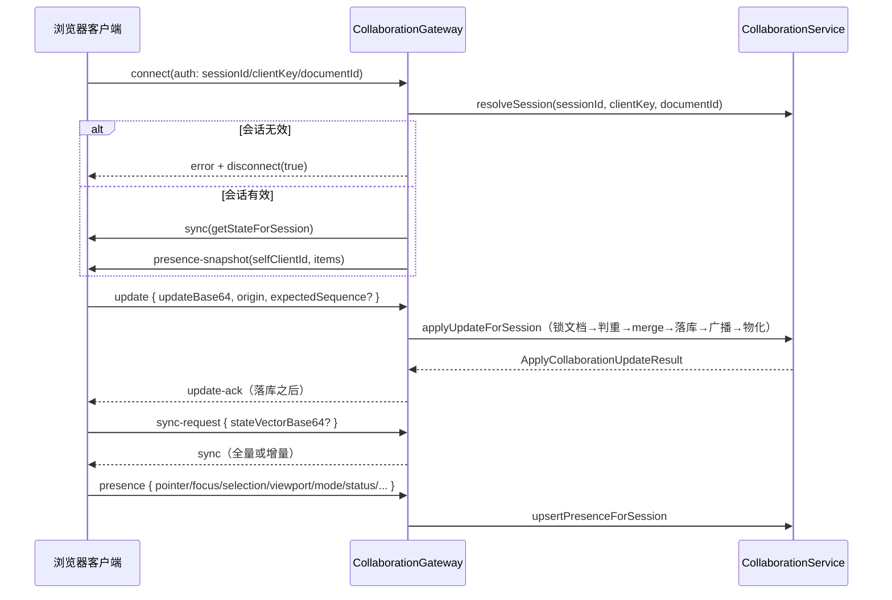

# 中间件运行时 · Prompt 工作流 · 协作 —— 接口

**本文引用的文件**
- `file://packages/server-ai/src/prompt-workflow/prompt-workflow.controller.ts`
- `file://packages/server-ai/src/prompt-workflow/prompt-workflow.service.ts`
- `file://packages/server-ai/src/xpert-workspace/guards/workspace-authoring.guard.ts`
- `file://packages/server-ai/src/xpert-workspace/workspace-base.service.ts`
- `file://packages/server-ai/src/collaboration/collaboration.gateway.ts`
- `file://packages/server-ai/src/collaboration/collaboration.service.ts`
- `file://packages/plugin-sdk/src/lib/collaboration/types.ts`
- `file://packages/plugin-sdk/src/lib/agent/middleware/runtime.ts`
- `file://packages/server-ai/src/shared/agent/middleware-runtime/middleware-runtime.service.ts`
- `file://packages/server-ai/src/shared/agent/queries/resolve-prompt-workflow-invocation.query.ts`
- `file://packages/server-ai/src/prompt-workflow/queries/handlers/resolve-prompt-workflow-invocation.handler.ts`
- `file://packages/server-ai/src/shared/agent/message.ts`

## 目录

- [HTTP 端点一览](#http-端点一览)
- [端点关键参数与行为](#端点关键参数与行为)
- [WS 协议：/api/collaboration](#ws-协议apicollaboration)
- [非 HTTP 调用面](#非-http-调用面)
- [错误码](#错误码)
- [结论](#结论)

## HTTP 端点一览

控制器：`@Controller('prompt-workflow')`，类级 `@ApiTags('Prompt Workflow')`、`@ApiBearerAuth()`、`@UseInterceptors(TransformInterceptor)`。**全部 7 个端点均标注 `@UseGuards(WorkspaceAuthoringGuard)`**：守卫从 `request.params.workspaceId` 取 id，非 UUID 抛 400 `Error.WorkspaceIdInvalid`，随后 `XpertWorkspaceAccessService.assertCanAuthor(workspaceId)` 裁决创作权限。

| # | 方法 | 路径 | 鉴权 | 用途 |
| --- | --- | --- | --- | --- |
| 1 | GET | `/api/prompt-workflow/by-workspace/:workspaceId` | WorkspaceAuthoringGuard | 分页列出工作流（可带 `published`） |
| 2 | POST | `/api/prompt-workflow/workspace/:workspaceId` | WorkspaceAuthoringGuard | 在 workspace 内创建 |
| 3 | PUT | `/api/prompt-workflow/workspace/:workspaceId/:id` | WorkspaceAuthoringGuard | 更新指定工作流 |
| 4 | POST | `/api/prompt-workflow/workspace/:workspaceId/:id/archive` | WorkspaceAuthoringGuard | 归档（写 `archivedAt`） |
| 5 | POST | `/api/prompt-workflow/workspace/:workspaceId/:id/duplicate` | WorkspaceAuthoringGuard | 复制副本（自动派生名字） |
| 6 | GET | `/api/prompt-workflow/workspace/:workspaceId/:id/usage` | WorkspaceAuthoringGuard | 列出引用/适用该工作流的专家 |
| 7 | POST | `/api/prompt-workflow/workspace/:workspaceId/validate-profile` | WorkspaceAuthoringGuard | 校验命令档案中的工作流引用 |

章节来源：[prompt-workflow.controller.ts](file://packages/server-ai/src/prompt-workflow/prompt-workflow.controller.ts)（关键符号：PromptWorkflowController）· [workspace-authoring.guard.ts](file://packages/server-ai/src/xpert-workspace/guards/workspace-authoring.guard.ts)（关键符号：WorkspaceAuthoringGuard.canActivate）

## 端点关键参数与行为

- **① `GET by-workspace/:workspaceId`**：`data` 查询参数经 `ParseJsonPipe` 解析为 `PaginationParams<PromptWorkflow>`；可选 `published` 布尔；调用 `service.getAllByWorkspace(workspaceId, data, published, RequestContext.currentUser())`（基类按 `authoring` 访问码过滤）。
- **② `POST workspace/:workspaceId`**：body 为 `PromptWorkflowInput = Partial<TPromptWorkflow> & { organizationTagIds?, associatedXpertIds? }`；服务做归一化 + 关联校验后落库，返回实体；名字非法/模板缺失为 400，标签或专家不可用为 `Error.PromptWorkflowAssociationsUnavailable`。
- **③ `PUT workspace/:workspaceId/:id`**：**id 与 workspaceId 必须一致**，否则 404「The requested prompt workflow was not found」；对 `label/description/category/argsHint/icon/runtimeCapabilities` 支持「显式置空」（传空值写 NULL，传 `undefined` 保留旧值）。
- **④ `POST .../:id/archive`**：把 `archivedAt` 置为当前时间并保存；不删除行，归档项在运行时解析中被排除。
- **⑤ `POST .../:id/duplicate`**：按 `createCopyName` 生成 `name-copy` / `name-copy-2`…（最多 100 次、总长截断 64），复制快照、组织标签与 `associatedXpertIds`，`label` 追加 `" Copy"`，`archivedAt` 置空；名字耗尽时 400「Unable to create a unique prompt workflow copy name」。
- **⑥ `GET .../:id/usage`**：先 `assertWorkspaceReadAccess`，再在 workspace 内（`deletedAt IsNull`）计算引用集——命中 `latest && isPromptWorkflowApplicable`，或 `commandProfile`/`draft.team.commandProfile` 中存在 `source === 'workspace_prompt_workflow' && workflowId === id` 的条目；返回 `{ id, name, title, version, latest, publishAt }[]`。工作流不存在时 404。
- **⑦ `POST workspace/:workspaceId/validate-profile`**：body 为 `TXpertCommandProfile`，返回归一化后的档案；workspace 引用不存在时 400「Prompt workflow commands are not available: <ids>」，缺 workspaceId 时 400「workspaceId is required for workspace prompt workflow commands」。

章节来源：[prompt-workflow.service.ts](file://packages/server-ai/src/prompt-workflow/prompt-workflow.service.ts)（关键符号：PromptWorkflowService.getUsage / duplicateInWorkspace / validateCommandProfile）· [workspace-base.service.ts](file://packages/server-ai/src/xpert-workspace/workspace-base.service.ts)（关键符号：XpertWorkspaceBaseService.getAllByWorkspace）

## WS 协议：/api/collaboration

网关声明：`@WebSocketGateway({ namespace: '/api/collaboration', cors: { origin: '*' }, transports: ['websocket'] })`。客户端连接地址由 `createSession` 返回的 `connectionUrl`（基于 `environment.baseUrl` + namespace）与 `sessionId`/`clientKey` 组成。

**握手**：从 `handshake.auth` 读取 `sessionId`/`clientKey`/`documentId`（`documentId` 亦兼容 `handshake.query`）。`resolveSession` 校验：三者齐备、会话未过期（TTL 600s）、`session.documentId === documentId`、`timingSafeEqual(clientKeyHash, sha256(clientKey))`。失败即 `emit('error', { message: 'Invalid or expired collaboration session.' })` + `disconnect(true)`；成功则 `join('collaboration:<documentId>')`，随后服务端主动下发 `sync` 与 `presence-snapshot`（`{ selfClientId, items }`）。

图表来源：[prompt-workflow.service.ts](file://packages/server-ai/src/prompt-workflow/prompt-workflow.service.ts)

**消息与事件**

| 方向 | 名称 | 载荷要点 |
| --- | --- | --- |
| C→S | `update` | `updateBase64`、`origin?`、`expectedSequence?` |
| S→C | `update-ack` | `documentId`、`duplicate`、`updateId`、`sequenceNumber`、`stateVectorBase64`、`materializationStatus` |
| C→S | `sync-request` | `stateVectorBase64?` |
| S→C | `sync` | `document`、`updateBase64`、`stateVectorBase64`、`sequenceNumber` |
| C→S | `presence` | 经 `sanitizePatch` 白名单：`pageId`、`pointer`、`focus`、`selection`、`viewport`、`mode`、`status`、`toolName`、`operationLabel` |
| S→C | `presence-snapshot` / `presence` / `presence-remove` | 广播事件名由 `CollaborationBroadcast.type` 决定 |
| S→C | `error` | `{ message }`（会话无效或 update/presence 处理异常） |

**顺序与广播语义**：`update` 在服务端事务提交（包含幂等判重与序列号推进）之后才回 `update-ack`；广播与物化同样在提交之后进行，本地先 emit、再经 Redis 频道 `xpert:collaboration:broadcast` 跨节点扇出，且仅发给 `collaboration:<documentId>` 房间。

**`cors.origin = '*'` 的风险提示**：WS 命名空间接受任意来源的浏览器连接，没有 Origin 白名单与 Nest Guard 兜底；安全性完全依赖 opaque 凭据（`sessionId` + `clientKey`）与「单文档房间」约束。一旦凭据经前端日志、URL 或第三方页面泄漏，攻击者可直接对该文档发起 `update`/`presence`。此外 `stateBase64` 全量状态与 presence 详情都会推送给同一文档房间内的所有连接。

章节来源：[collaboration.gateway.ts](file://packages/server-ai/src/collaboration/collaboration.gateway.ts)（关键符号：CollaborationGateway.update / sync / presence）· [collaboration.service.ts](file://packages/server-ai/src/collaboration/collaboration.service.ts)（关键符号：CollaborationService.createSessionWithScope / resolveSession / publishBroadcast）

## 非 HTTP 调用面

**1. `CollaborationService.createScopedApi(defaults)` → `CollaborationApi`（10 个方法）**：`ensureDocument`、`getDocument`、`getDocumentState`、`applyUpdate`、`createSession`、`listPresence`、`upsertVirtualPresence`、`removeVirtualPresence`、`archiveDocument`、`deleteDocument`。每次调用都重新 `resolveScope(defaults)`（defaults 优先，`RequestContext` 兜底 tenant/org/user）；`CollaborationRuntimeDefaults` 额外携带 `conversationId`/`agentKey`/`xpertName`/`executionId` 以生成稳定的虚拟协作者身份。服务实例本身也实现 `CollaborationApi`（`readonly api = this.createScopedApi()`），并提供会话面 `resolveSession`/`getStateForSession`/`applyUpdateForSession`/`listPresenceForSession`/`upsertPresenceForSession`/`removePresenceForSession`、广播订阅 `onBroadcast(listener) → unsubscribe`，以及 `retryMaterialization(documentId)`。

**2. `AgentMiddlewareRuntimeService` 的 scoped API（`AgentMiddlewareRuntimeApi`）**

| 成员 | 签名要点 |
| --- | --- |
| `createModelClient` | `(copilotModel: ICopilotModel, options: AgentMiddlewareCreateModelClientOptions) => Promise<T>`；scoped 版本固定 `recordApplicationMetrics = true` |
| `getModelProvider?` | `(provider: string) => Promise<AgentMiddlewareModelProviderConnection>` |
| `wrapWorkflowNodeExecution` | `(run, params: AgentMiddlewareWrapWorkflowNodeExecutionParams) => Promise<T>` |
| `emitMiddlewareEvent?` | `(event: AgentMiddlewareEvent) => Promise<void> \| void` |
| `capabilities?` | `RuntimeCapabilityRegistry`（含 actorToken/file/connector/artifacts/collaboration 等） |

服务级（非 scoped）另暴露 `api` getter、`resolveSelectedConnectorRuntimeBindings(scope)`、`createModelClient`、`getModelProvider`、`wrapWorkflowNodeExecution`、`emitMiddlewareEvent`。插件通过 Nest 注入令牌 `XPERT_AGENT_MIDDLEWARE_RUNTIME_TOKEN = 'XPERT_AGENT_MIDDLEWARE_RUNTIME'` 获取该门面。

**3. CQRS：`ResolvePromptWorkflowInvocationQuery`**

- 类型：`class ResolvePromptWorkflowInvocationQuery extends Query<PromptWorkflowInvocationResolution | null>`，`static readonly type = '[Prompt Workflow] Resolve invocation'`。
- 入参：`xpert: Pick<IXpert, 'id' | 'workspaceId' | 'commandProfile' | 'graph' | 'agent'>`、`input: TChatRequestHuman`；返回 `{ input: TChatRequestHuman } | null`。
- 派发点：`shared/agent/message.ts` 中人类消息预处理（仅当 `isPromptWorkflowInvocationCandidate(human.input)` 为真才发起查询，无解析结果时原样返回输入）。
- Handler 顺序：已展开的 `insert_text` prompt_workflow 直接返回 null → 中间件斜杠命令（`getAgentMiddlewareNodes` + registry `meta.slashCommands`，`/goal` 非必需时需 `runtimeCapabilities.plugins.nodeKeys` 命中）→ `resolveRuntimeCommandProfile` 的专家命令与 workspace 命令。

章节来源：[types.ts](file://packages/plugin-sdk/src/lib/collaboration/types.ts)（关键符号：CollaborationApi）· [runtime.ts](file://packages/plugin-sdk/src/lib/agent/middleware/runtime.ts)（关键符号：AgentMiddlewareRuntimeApi / XPERT_AGENT_MIDDLEWARE_RUNTIME_TOKEN）· [resolve-prompt-workflow-invocation.query.ts](file://packages/server-ai/src/shared/agent/queries/resolve-prompt-workflow-invocation.query.ts)（关键符号：ResolvePromptWorkflowInvocationQuery）

## 错误码

**Nest 标准异常（含契约 i18n key）**

| 状态 | 触发 | 关键信息 |
| --- | --- | --- |
| 400 | `WorkspaceAuthoringGuard` 校验 workspaceId 非 UUID | `server-ai:Error.WorkspaceIdInvalid` |
| 400 | 工作流 name 非法 / template 缺失 | `Prompt workflow command name is invalid` / `Prompt workflow template is required` |
| 400 | 标签或专家关联不可用 | `server-ai:Error.PromptWorkflowAssociationsUnavailable`；标签侧为 `server-ai:Error.TagAssociationUnavailable` |
| 400 | scenarios 非法 | `server-ai:Error.InvalidPromptScenarios` |
| 400 | 命令档案引用失效 / 缺 workspaceId / 复制名耗尽 | `Prompt workflow commands are not available: …` 等字面消息 |
| 400 | 模板默认工作流同名 | `Template prompt workflow names must be unique` |
| 404 | 工作流 id 与 workspaceId 不匹配或不存在 | `The requested prompt workflow was not found` |
| 400 / 500 | 模型 provider 上下文缺失、provider 未配置、模型不存在、超额 | `server-ai:Error.ToolModelProviderContextRequired`、`server-ai:Error.ToolModelProviderNotConfigured`、`server-ai:Error.AIModelProviderNotFound`、`server-ai:Error.ModelExecutionDenied`、`CopilotModelNotFoundException`、`ExceedingLimitException` |
| 403 | 协作 provider 授权拒绝 | `Collaboration document access was denied.` |
| 403 | 只读会话提交 update | `Collaboration session is read-only.` |
| 404 | 协作文档不存在或已删除 | `Collaboration document was not found.` |
| 400 | 协作输入非法（base64 非法/超限、序列冲突、状态非 active、presence 超限） | `Collaboration sequence conflict. Current sequence is N.`、`Collaboration document exceeds the platform size limit.` |

**WS 侧**：错误不映射为 HTTP 状态，统一通过 `emit('error', { message })` 下发（会话无效时为固定文案 `Invalid or expired collaboration session.`），不会触发 `update-ack`。

章节来源：[prompt-workflow.service.ts](file://packages/server-ai/src/prompt-workflow/prompt-workflow.service.ts)（关键符号：PromptWorkflowService）· [collaboration.service.ts](file://packages/server-ai/src/collaboration/collaboration.service.ts)（关键符号：CollaborationService.applyUpdateWithScope）· [collaboration.gateway.ts](file://packages/server-ai/src/collaboration/collaboration.gateway.ts)（关键符号：CollaborationGateway.errorMessage）

## 结论

对外可见的接口面分三层：HTTP 只有 `prompt-workflow` 的 7 个全守卫端点；实时面只有 `/api/collaboration` 命名空间下的 5 类消息与 4 类服务端事件，其安全边界是 opaque 会话凭据而非 Guard；其余能力（`CollaborationApi`、中间件 scoped API、`ResolvePromptWorkflowInvocationQuery`）都是进程内调用面，由宿主注入 scope，插件无法绕过。

章节来源：[prompt-workflow.controller.ts](file://packages/server-ai/src/prompt-workflow/prompt-workflow.controller.ts)（关键符号：PromptWorkflowController）· [middleware-runtime.service.ts](file://packages/server-ai/src/shared/agent/middleware-runtime/middleware-runtime.service.ts)（关键符号：AgentMiddlewareRuntimeService.createScopedApi）
