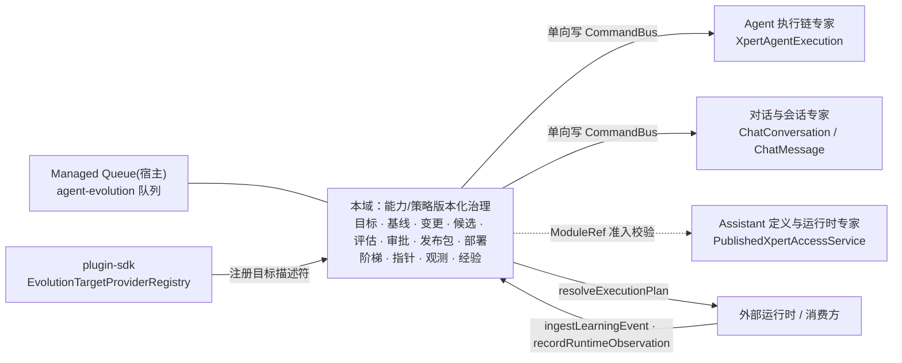

# Agent 演进专家 —— C0 使用总览

> **资产基线**：`2026-10-16 · commit 80f5676fd`（批次 5 第 11 专家）。实测范围：`packages/server-ai/src/agent-evolution`（**44 非 spec / 19 spec / 19 张表 / 48 个 HTTP 端点**，目录内 `.ts` 共 63 个），HTTP 前缀 `/api/agent-evolution`（`RouterModule.register` 给 `/agent-evolution` ＋ 全局前缀 `api`）；3 个控制器 ＝ `EvolutionBaselineController`（`baselines`，1）· `EvolutionLifecycleController`（`changes`，8）· `AgentEvolutionController`（空前缀，**39**）。子域：① 变更与生命周期 ② 评估与发布。

**本文引用的文件**（相对仓库根，链接均为 `file://`）

- [agent-evolution.module.ts](file://packages/server-ai/src/agent-evolution/agent-evolution.module.ts)
- [controllers/agent-evolution.controller.ts](file://packages/server-ai/src/agent-evolution/controllers/agent-evolution.controller.ts)
- [controllers/evolution-baseline.controller.ts](file://packages/server-ai/src/agent-evolution/controllers/evolution-baseline.controller.ts)
- [changes/lifecycle.controller.ts](file://packages/server-ai/src/agent-evolution/changes/lifecycle.controller.ts)
- [changes/lifecycle.service.ts](file://packages/server-ai/src/agent-evolution/changes/lifecycle.service.ts)
- [changes/lifecycle.projection.ts](file://packages/server-ai/src/agent-evolution/changes/lifecycle.projection.ts)
- [changes/change.service.ts](file://packages/server-ai/src/agent-evolution/changes/change.service.ts)
- [changes/change.store.ts](file://packages/server-ai/src/agent-evolution/changes/change.store.ts)
- [changes/change.errors.ts](file://packages/server-ai/src/agent-evolution/changes/change.errors.ts)
- [changes/evaluation-executor.service.ts](file://packages/server-ai/src/agent-evolution/changes/evaluation-executor.service.ts)
- [changes/publication-executor.service.ts](file://packages/server-ai/src/agent-evolution/changes/publication-executor.service.ts)
- [application/agent-evolution.service.ts](file://packages/server-ai/src/agent-evolution/application/agent-evolution.service.ts)
- [application/agent-evolution-governance.service.ts](file://packages/server-ai/src/agent-evolution/application/agent-evolution-governance.service.ts)
- [application/agent-evolution-runtime.service.ts](file://packages/server-ai/src/agent-evolution/application/agent-evolution-runtime.service.ts)
- [application/agent-evolution-analyst.service.ts](file://packages/server-ai/src/agent-evolution/application/agent-evolution-analyst.service.ts)
- [application/agent-evolution-queue.service.ts](file://packages/server-ai/src/agent-evolution/application/agent-evolution-queue.service.ts)
- [application/agent-evolution-release-gate-policy.service.ts](file://packages/server-ai/src/agent-evolution/application/agent-evolution-release-gate-policy.service.ts)
- [application/evolution-baseline.service.ts](file://packages/server-ai/src/agent-evolution/application/evolution-baseline.service.ts)
- [application/evolution-runtime.store.ts](file://packages/server-ai/src/agent-evolution/application/evolution-runtime.store.ts)
- [entities/evolution.entities.ts](file://packages/server-ai/src/agent-evolution/entities/evolution.entities.ts)
- [domain/evolution-state.ts](file://packages/server-ai/src/agent-evolution/domain/evolution-state.ts)
- [providers/conformance-template.provider.ts](file://packages/server-ai/src/agent-evolution/providers/conformance-template.provider.ts)
- [packages/contracts/src/ai/evolution/governance.ts](file://packages/contracts/src/ai/evolution/governance.ts)
- [packages/contracts/src/ai/role-permissions.ts](file://packages/contracts/src/ai/role-permissions.ts)
- [前端 Agent 演进专家 · C1-能力契约.md](file://.module-experts/前端专题/Agent 演进专家/C1-能力契约.md)

## 目录

1. [专家定位](#专家定位)
2. [何时找这个专家](#何时找这个专家)
3. [契约自足声明](#契约自足声明)
4. [能力清单表](#能力清单表)
5. [边界](#边界)
6. [已知问题与常见坑](#已知问题与常见坑)
7. [延伸阅读](#延伸阅读)

## 专家定位

本专家负责 **「Agent 能力/策略的版本化治理」**——把一条改进从「学习信号」推进到「生产指针」的受治理闭环：**学习事件 → 诊断 → 提案 → 候选 → 评估 → 审批 → 发布 → 金丝雀/回滚 → 观测 → 经验**。四块职责：① 目标与基线（`EvolutionTargetEntity` 注册 provider 描述符；`EvolutionBaselineService.inspect/publish` 把「已发布源规则」铺成初版能力版本与生产指针）；② 变更全生命周期（`EvolutionChangeService.prepare/build/evaluate/process/decide/publish` ＋ `EvolutionLifecycleService` 投影成 HTTP 可读的 `EvolutionLifecycleRecord`）；③ 评估与发布（`EvolutionEvaluationExecutor` 逐步评估与 golden replay；`EvolutionPublicationExecutor` 在调用方事务内分配版本与 `PUB-<changeId>`；`AgentEvolutionGovernanceService` 的 install→shadow→canary→activate→rollback 阶梯）；④ 运行时解析与回流（`AgentEvolutionRuntimeService.resolveExecutionPlan` 出能力束，`recordRuntimeObservation` 把观测回流成部署样本并可在严重错误时自动暂停）。

**一句话口径**：本域**改的是「能力版本与指针」，不是 Agent 定义本体**——定义域持有 `Xpert`，本域持有与之**平行**的能力版本线，两者只靠 `EvolutionTargetProvider` 描述符（`providerKey`/`providerVersion`/`artifactSchemaVersion`）与哈希对齐，实体层无外键；所有「生效」都收敛成 `ActiveCapabilityPointer` 的一次 CAS。

章节来源：[change.service.ts](file://packages/server-ai/src/agent-evolution/changes/change.service.ts)（关键符号：EvolutionChangeService.prepare / build / evaluate / process / decide / publish）、[agent-evolution-governance.service.ts](file://packages/server-ai/src/agent-evolution/application/agent-evolution-governance.service.ts)（关键符号：installRelease / startCanary / activateProduction / rollbackProduction）、[evolution-baseline.service.ts](file://packages/server-ai/src/agent-evolution/application/evolution-baseline.service.ts)（关键符号：EvolutionBaselineService.inspect / publish）

## 何时找这个专家

- 要**查仪表盘与目标**：`GET /dashboard`（store 直通聚合快照）、`GET /targets`（描述符分页）、`POST /targets/synchronize`（注册 provider 描述符并给无指针目标自动铺初版版本）。
- 要**看变更与生命周期**：`GET /changes`（`lifecycleRecord()` 投影分页）、`GET /changes/records`（富变更记录，可带 `targetId`）、`GET /changes/:id`。
- 要**提一个变更**：`POST /changes`（Zod `evolutionSubmissionSchema` 全对象 `.strict()`，多余字段直接 400）或夹具入口 `POST /changes/conformance-template`。
- 要**跑/看评估与闸门**：`POST /changes/:id/evaluations`、`GET /evaluations`；阈值判据在 `AgentEvolutionQualityGovernanceService.reviewGoldenReplay`（50/20/10 样本 ＋ 零严重错误 ＋ 正收益）。
- 要**做审批**：`POST /changes/:id/decisions`（候选哈希 ＋ `evaluationRunId` ＋ `strategyHash` 三绑定）与 `POST /candidates/:candidateId/approvals`（单条人工审批）；quorum 由 `reviewHumanApprovals` 决定。
- 要**发布与部署**：`POST /changes/:id/publication`、`POST /release-packages`（冻结 `gatePolicy`）、`POST /releases/:id/{install,shadow,canary,pause,activate,rollback}`。
- 要**用一次性金丝雀覆盖**：`GET|POST /releases/:id/canary-test-overrides`（管理员 ＋ `manual_test` 档 ＋ canary 阶段，同一主体**只生效一次**）。
- 要**回滚**：`POST /releases/:id/rollback`（拒绝 agent 主体；`rolled_back` 是终态，回不到原 canary 档，只能重走 install）。
- 要**读观测/审计/经验**：`GET /runtime-observations`、`GET /audit-events`、`GET /experiences`；经验留档走 `POST /experiences`（需 active 发布 ＋ 生产门槛）。
- 要**排查 job 卡住**：`GET /jobs/:jobId`（`EVOJOB-<uuid>` 账本，**未命中返回 `null` 而非 404**）；判据是 `queueJobId` 是否为 `null`、`errorCode` 是 `queue_enqueue_failed` 还是 `evolution_job_failed`。
- 要**对接运行时消费方**：`POST /capability-executions/resolve`（版本裁决：production 指针 / shadow / canary / 一次性覆盖 → 能力束）；学习事件与观测的**写**入只有运行时能力 token，没有 HTTP 写端点。
- 要**做一致性演练**：`POST /simulations/conformance` 与 `POST /examples/conformance-field-mapping/run`（**同一实现**，生产默认 404 门禁）。

章节来源：[agent-evolution.controller.ts](file://packages/server-ai/src/agent-evolution/controllers/agent-evolution.controller.ts)（关键符号：requestScope / commandContext / normalizeQuery / assertConformanceEnabled）、[lifecycle.controller.ts](file://packages/server-ai/src/agent-evolution/changes/lifecycle.controller.ts)（关键符号：submit / conformance / list / records / evaluate / decide / publish）、[agent-evolution-analyst.service.ts](file://packages/server-ai/src/agent-evolution/application/agent-evolution-analyst.service.ts)（关键符号：diagnose / correctionSignature）

## 契约自足声明

本专家的 `C0` ＋ `C1` 构成该子域**完整契约面**：HTTP 入口索引、服务方法签名与参数行为语义、返回与异常、准入门槛、代码示例均在本层可查，无需阅读实现层即可完成集成与排障；实现细节（算法、私有方法、表结构逐列）只在需要定位时按 `file://` 链接回源码。**逐端点明细**（完整字段、错误码全集、控制器逐条清单、与前端调用面的逐条对照）见 [implementation/05-接口.md](file://.module-experts/后端专题/Agent 演进专家/implementation/05-接口.md)，本文不复制。凡未标 `[推测]` 的结论均取自源码或本域实现层文档。

| 项 | 值 |
|---|---|
| 基线时点 / commit | `2026-10-16` · `80f5676fd`（批次 5 第 11 专家） |
| 规模实测 | 44 非 spec（63 − 19 spec）、19 张表、**48 条真实路由**（39 ＋ 8 ＋ 1） |
| 子域 | ① 变更与生命周期 ② 评估与发布 |
| 契约入口 | 本文件 ＋ [C1-能力契约.md](file://.module-experts/后端专题/Agent 演进专家/C1-能力契约.md) |
| 实现层 | [01-架构](file://.module-experts/后端专题/Agent 演进专家/implementation/01-架构.md) · [02-实现](file://.module-experts/后端专题/Agent 演进专家/implementation/02-实现.md) · [03-数据流转](file://.module-experts/后端专题/Agent 演进专家/implementation/03-数据流转.md) · [04-模型](file://.module-experts/后端专题/Agent 演进专家/implementation/04-模型.md) · [05-接口](file://.module-experts/后端专题/Agent 演进专家/implementation/05-接口.md) · [06-测试](file://.module-experts/后端专题/Agent 演进专家/implementation/06-测试.md) · [07-运维](file://.module-experts/后端专题/Agent 演进专家/implementation/07-运维.md) |
| 跨端对照 | [前端 Agent 演进专家 · C1-能力契约.md](file://.module-experts/前端专题/Agent 演进专家/C1-能力契约.md) · [implementation/01-架构.md](file://.module-experts/前端专题/Agent 演进专家/implementation/01-架构.md) |

章节来源：[agent-evolution.module.ts](file://packages/server-ai/src/agent-evolution/agent-evolution.module.ts)（关键符号：RouterModule.register / TypeOrmModule.forFeature(AGENT_EVOLUTION_ENTITIES) / controllers / EVOLUTION_RUNTIME_SERVICE_TOKEN）、[entities/evolution.entities.ts](file://packages/server-ai/src/agent-evolution/entities/evolution.entities.ts)（关键符号：AGENT_EVOLUTION_ENTITIES）、[前端 implementation/01-架构.md](file://.module-experts/前端专题/Agent 演进专家/implementation/01-架构.md)（关键符号：覆盖范围 / 后端引用面）

## 能力清单表

| 能力 | 入口 | 一句话 |
|---|---|---|
| 仪表盘与目标同步 | `GET /dashboard`、`GET /targets`、`POST /targets/synchronize` | dashboard 由 store 直通不裁剪；同步会给「有 baselineExporter 且无指针」的目标自动铺初版版本 |
| 能力版本 / 版本束 / 生产指针（只读） | `GET /capability-versions`、`/capability-bundles`、`/active-pointers` | 版本不可变；`channel='production'` 的指针行才是生效事实 |
| 上线规则基线检视 | `GET /baselines/:targetId` | **唯一**同时接受 `EVOLUTION_VIEW｜XPERT_EDIT｜EVOLUTION_MANAGE` 的端点；不写库，返回值带 `canManage` |
| 变更提交与生命周期投影 | `POST /changes`、`GET /changes`、`/changes/records`、`/changes/:id` | 变更「assembled, never persisted whole」；读侧只见 `lifecycleRecord()` |
| 变更评估 / 审批 / 发布包 | `POST /changes/:id/evaluations`、`/decisions`、`/publication` | 三条写路径都由 `EvolutionLifecycleService` 代理到 `EvolutionChangeService` 后回读投影 |
| 学习事件与复核 | `GET /learning-events`、`PATCH /learning-events/:eventId/review` | 入账只有运行时能力 token（无 HTTP 写）；`reviewStatus ∈ pending｜ignored｜golden` |
| 诊断与聚类 | `GET /diagnoses`、`GET /clusters`、`POST /diagnoses` | 按 `correctionSignature` 分组；`POST /diagnoses` 只诊断不写提案 |
| 改进提案 | `GET /proposals`、`POST /proposals` | 提案即变更的持久化根（`requestId` 幂等，`UQ(tenant,org,targetId,requestId)`） |
| 候选构建与单条审批 | `GET|POST /candidates`、`POST /candidates/:candidateId/approvals` | 候选 artifact 与 definition 双不可变；跨版本重放命中 `candidate_snapshot_mismatch` |
| golden 数据集快照 | `GET|POST /datasets` | 用例 `(caseId, revision)` 唯一；`snapshotHash` 只哈希三字段 |
| 评估运行与入队 | `GET|POST /evaluations` | `POST` 返回 `EvolutionJob`（**不是评估结果**）；记录含布尔判据列 `gatePassed` |
| 发布包冻结 | `POST /release-packages`、`GET /releases` | 一次性冻结 `gatePolicy`，命名固定 `PUB-<changeId>`（幂等：已存在直接返回旧值） |
| 部署阶梯 | `POST /releases/:id/{install,shadow,canary}` | 全部入队返回 `EvolutionJob`；金丝雀只接受 5/25/50 且首轮必须 5% |
| 暂停与生产激活 | `POST /releases/:id/pause`、`/activate` | **同步**动作（返回发布包 / 新指针）；激活要求 `canaryPercent === 50` 且指针未被他人前推 |
| 回滚 | `POST /releases/:id/rollback` | 入队；拒绝 agent 主体；`rolled_back` 为终态 |
| 一次性金丝雀覆盖 | `GET|POST /releases/:id/canary-test-overrides` | `activeKey` 唯一索引物理保证「同主体同部署至多一条 pending」 |
| 作业账本 | `GET /jobs/:jobId` | 只回 `value` 投影；未命中返回 `null`（HTTP 200） |
| 观测 / 审计 / 经验 | `GET /runtime-observations`、`/audit-events`、`/experiences`、`POST /experiences` | 观测与学习事件**只有读端点**；经验只能人工留档 |
| 能力执行解析与一致性夹具 | `POST /capability-executions/resolve`、`/simulations/conformance`、`/examples/conformance-field-mapping/run` | 前一条是消费方的版本裁决；后两条同实现、生产默认 404 |

章节来源：[agent-evolution.controller.ts](file://packages/server-ai/src/agent-evolution/controllers/agent-evolution.controller.ts)（关键符号：getDashboard / synchronizeTargets / listCapabilityVersions / resolveExecutionPlan / simulate）、[agent-evolution-governance.service.ts](file://packages/server-ai/src/agent-evolution/application/agent-evolution-governance.service.ts)（关键符号：createReleasePackage / startCanary / activateProduction / createExperience）

## 边界

**做什么**：演进目标与上线基线、变更全生命周期（提交→候选→评估→审批→发布包）、部署阶梯与生产指针、一次性金丝雀覆盖、运行时解析与观测回流、经验留档与审计台账。

**不做什么（与相邻专家分工，5 条）**

- **不含 Agent 定义与发布版本**：本域不拥有 `Xpert` 实体、不改助手定义；对 `xpert` 只做**准入校验**（经 `ModuleRef` 取 `PublishedXpertAccessService.getAccessiblePublishedXpert` 与 `XpertProjectAccessService.assertCanUseXpert`）→ **Assistant 定义与运行时专家**。
- **不含 Agent 调用账本与执行账本**：评估/候选阶段写 `XpertAgentExecutionUpsertCommand` 是**单向写、不读**，`agent_evolution_*` 与执行记录之间**无关联列、无校验** → **Agent 执行链专家**。
- **不含模型执行与计费**：模块内 `billing|credit|quota|membership` 零命中，成本只作为观测指标参与平均 → **模型访问与计费专家**。
- **不含会话与消息表**：ChatKit 转录经 `ChatConversationUpsertCommand` / `ChatMessageUpsertCommand` 跨域写，SSE 失败静默降级 → **对话与会话专家**。
- **不含队列运行时本体**：逻辑队列 `agent-evolution` 承载在宿主 `ManagedQueueModule`（BullMQ `plugin-jobs`）上，本域只落 job 账本并发投递意图 → **宿主 platform 队列**。
- **本域只写**：能力版本（`capability_version`）、版本束（`capability_bundle`）、生产指针（`active_pointer`）、发布包/部署/覆盖、以及治理台账（提案/候选/评估/审批/经验/审计/观测/job）。

图表来源：[agent-evolution.module.ts](file://packages/server-ai/src/agent-evolution/agent-evolution.module.ts)（关键符号：AgentEvolutionModule imports/exports）、[execution-conversation.service.ts](file://packages/server-ai/src/agent-evolution/changes/execution-conversation.service.ts)（关键符号：EvolutionExecutionConversationService.start）、[agent-evolution-runtime.service.ts](file://packages/server-ai/src/agent-evolution/application/agent-evolution-runtime.service.ts)（关键符号：resolveExecutionPlan / ingestLearningEvent / recordRuntimeObservation）

章节来源：[evolution-runtime.store.ts](file://packages/server-ai/src/agent-evolution/application/evolution-runtime.store.ts)（关键符号：activatePointerCas / rollbackPointerCas / saveRuntimeObservation）、[agent-evolution-queue.service.ts](file://packages/server-ai/src/agent-evolution/application/agent-evolution-queue.service.ts)（关键符号：AGENT_EVOLUTION_QUEUE / enqueue）、[entities/evolution.entities.ts](file://packages/server-ai/src/agent-evolution/entities/evolution.entities.ts)（关键符号：EvolutionScopedEntity / AGENT_EVOLUTION_ENTITIES）

## 已知问题与常见坑

1. **权限位三分不可混用**：读＝`EVOLUTION_VIEW｜XPERT_EDIT`（或语义），写＝`EVOLUTION_MANAGE`；基线读是**三位任一**（含 `EVOLUTION_MANAGE`），是「管理员只做读巡检」的唯一通道。
   - 契约来源：[role-permissions.ts](file://packages/contracts/src/ai/role-permissions.ts)（关键符号：AIPermissionsEnum.EVOLUTION_VIEW / EVOLUTION_MANAGE / XPERT_EDIT）、[evolution-baseline.controller.ts](file://packages/server-ai/src/agent-evolution/controllers/evolution-baseline.controller.ts)（关键符号：inspect / Permissions）。
2. **夹具端点的生产 404 是预期行为**：`environment.production && AGENT_EVOLUTION_ENABLE_CONFORMANCE !== 'true'` → `NotFoundException`（空体 404，与「路由不存在」不可区分）；门禁**只读 `environment.production`、不叠加 `NODE_ENV`**，且 provider 侧另有同款 `assertTemplateConformanceEnabled()` ＋ `authorizeScope` 二次校验。
   - 契约来源：[agent-evolution.controller.ts](file://packages/server-ai/src/agent-evolution/controllers/agent-evolution.controller.ts)（关键符号：assertConformanceEnabled）、[conformance-template.provider.ts](file://packages/server-ai/src/agent-evolution/providers/conformance-template.provider.ts)（关键符号：assertTemplateConformanceEnabled）。
3. **能力版本不可变**：`CapabilityVersionEntity` 以 `UQ(tenant,organization,targetId,sequence)` ＋ `artifactHash` 固化「第 N 版」，`versionId = targetId:changeId`、`sequence = max+1`；hash 变即抛 `Immutable capability version`，重试只返回旧行。
   - 契约来源：[entities/evolution.entities.ts](file://packages/server-ai/src/agent-evolution/entities/evolution.entities.ts)（关键符号：CapabilityVersionEntity 的唯一索引）、[publication-executor.service.ts](file://packages/server-ai/src/agent-evolution/changes/publication-executor.service.ts)（关键符号：EvolutionPublicationExecutor.package）。
4. **发布包一次性冻结 `gatePolicy`**：`package()` 在调用方事务内写入，命名固定 `PUB-<changeId>`；此后 `forRelease()` 只读冻结值，缺失即 `Release gate policy was not frozen`——**发布中途改 env 不影响已建包**。
   - 契约来源：[agent-evolution-release-gate-policy.service.ts](file://packages/server-ai/src/agent-evolution/application/agent-evolution-release-gate-policy.service.ts)（关键符号：snapshot / forRelease / STANDARD_GATE_POLICY）。
5. **金丝雀覆盖只生效一次**：`activeKey = sha256(tenant:org:deploymentId:subjectKey)` 唯一索引保证同主体同部署至多一条 pending；消费后立即回落 `deterministicPercent = sha256(deploymentId:subjectKey)` 的确定性路由。
   - 契约来源：[evolution-runtime.store.ts](file://packages/server-ai/src/agent-evolution/application/evolution-runtime.store.ts)（关键符号：createCanaryTestOverride / consumeCanaryTestOverride）、[agent-evolution-runtime.service.ts](file://packages/server-ai/src/agent-evolution/application/agent-evolution-runtime.service.ts)（关键符号：deterministicPercent）。
6. **回滚与 `active_pointer` 切换有硬前置**：激活要求「指针 `activeVersionId` 仍等于 `release.rollbackVersionId`」，回滚要求「指针仍等于 `release.targetVersionId`」；并发由 `revision + activeVersionId` 条件更新兜底，`affected !== 1` 抛 `Active Pointer CAS conflict`（属异常/5xx，不是 409）。
   - 契约来源：[agent-evolution-governance.service.ts](file://packages/server-ai/src/agent-evolution/application/agent-evolution-governance.service.ts)（关键符号：activateProduction / rollbackProduction）、[evolution-runtime.store.ts](file://packages/server-ai/src/agent-evolution/application/evolution-runtime.store.ts)（关键符号：activatePointerCas / rollbackPointerCas）。
7. **`job` 状态枚举契约无 `pending`**：契约 `EvolutionJobStatus = 'queued' | 'running' | 'completed' | 'failed' | 'cancelled'`，而 `EvolutionChangeService.process` 的补偿分支仍判断 `['pending','queued','running']`——**死分支/跨实现漂移**；另本域无任何「取消 job」HTTP 入口，`cancelled` 只能直接改账本。前端 `C1-能力契约.md` 把 `pending` 写进清单属口径冲突，**以契约为准**。
   - 契约来源：[packages/contracts/src/ai/evolution/governance.ts](file://packages/contracts/src/ai/evolution/governance.ts)（关键符号：EvolutionJobStatus）、[change.service.ts](file://packages/server-ai/src/agent-evolution/changes/change.service.ts)（关键符号：EvolutionChangeService.process）。
8. **与前端清单的端点差额已定案**：前端 `C1-能力契约.md` §2 端点表实测 **23 行**（跨端曾记 24，计入 `/changes/conformance-template` 时成立），其中**未列本域的 5 条**：`/runtime-observations`、`/audit-events`、`/experiences`、`/capability-executions/resolve`、`/simulations/conformance`；`/experiences` 在前端 §1.3 `AgentEvolutionApiService` 方法表中**已存在**，属表格漏列而非能力缺口。
   - 契约来源：[前端 C1-能力契约.md](file://.module-experts/前端专题/Agent 演进专家/C1-能力契约.md)（关键符号：后端接口调用面 / 端点表）、[implementation/05-接口.md](file://.module-experts/后端专题/Agent 演进专家/implementation/05-接口.md)（关键符号：与前端资产的差异清单）。
9. **dashboard 字段数：前端称 17 不符合 store 实测**：`getDashboard` 直接透传 store、不做字段裁剪，实测返回 **14 个键**（targets/versions/bundles/events/proposals/candidates/datasets/evaluations/approvals/releases/deployments/pointers/audits/canaryTestOverrides），每键还被 `take` 截断；前端 17 的口径**未在本仓核实**，不得据此做类型断言。
   - 契约来源：[agent-evolution.service.ts](file://packages/server-ai/src/agent-evolution/application/agent-evolution.service.ts)（关键符号：getDashboard）、[implementation/04-模型.md](file://.module-experts/后端专题/Agent 演进专家/implementation/04-模型.md)（关键符号：未确认项 / dashboard 字段数）。
10. **观测 / 审计 / 经验 / job 无清理策略**：模块内 `@Cron`/`@Interval`/`DELETE FROM`/`.delete(`/`retention`/`cleanup`/`purge` **全部 0 命中**；宿主 BullMQ 的 `removeOnComplete/removeOnFail` **只清队列 job，不清 `agent_evolution_job` 账本**。长跑须运维自建按 `createdAt` 分片清理。
   - 契约来源：[implementation/07-运维.md](file://.module-experts/后端专题/Agent 演进专家/implementation/07-运维.md)（关键符号：观测与审计数据运维 / 无 TTL 无清理任务）。
11. **`experience` 的写入触发点只有一个**：全模块仅 `POST /experiences` → `AgentEvolutionGovernanceService.createExperience` → `store.saveExperience`（人工、`requireHuman` ＋ 生产门槛）；**没有**「观测达标自动沉淀经验」的代码，也没有「经验 → 下一轮 learning_event」的连线，闭环只在数据形状上成立。
   - 契约来源：[agent-evolution-governance.service.ts](file://packages/server-ai/src/agent-evolution/application/agent-evolution-governance.service.ts)（关键符号：createExperience / saveExperience 调用点）。
12. **44 / 45 的规模差额已澄清**：前端资产曾记「后端 45 非 spec，差额 1 待复核」；本域实测目录内 `.ts` 共 **63** 个、其中 `*.spec.ts` **19** 个 ⇒ **63 − 19 = 44**。
   - 契约来源：[前端 implementation/01-架构.md](file://.module-experts/前端专题/Agent 演进专家/implementation/01-架构.md)（关键符号：覆盖范围 / ki 口径 45 非 spec）、[implementation/01-架构.md](file://.module-experts/后端专题/Agent 演进专家/implementation/01-架构.md)（关键符号：44 非 spec / 19 spec / 19 表 / 48 端点）。
13. **19 张表没有任何 SQL 迁移**：`packages/server-ai/src/agent-evolution/**/*.sql` 不存在，全仓 `*.sql` 检索 `agent_evolution` **0 命中**；DDL 唯一事实来源是实体注解，建表依赖 TypeORM 实体同步 / 插件 schema 预检——回滚应用版本**表结构不会自动回退**。
   - 契约来源：[entities/evolution.entities.ts](file://packages/server-ai/src/agent-evolution/entities/evolution.entities.ts)（关键符号：19 个 @Entity 与唯一索引注解）、[implementation/07-运维.md](file://.module-experts/后端专题/Agent 演进专家/implementation/07-运维.md)（关键符号：迁移现状 / DB_SCHEMA_SYNC_MODE）。
14. **两条无界增长路径**：① `resolveExecutionPlan` 每次解析都 `createBundle` **新增一行** `capability_bundle`（该表只有 `bundleHash` 非唯一索引，无 TTL/清理）；② 观测按条 append 进 `release_deployment.value.observations[]`，`p95LatencyMs` 用 `max` 合并**只增不减**。
   - 契约来源：[agent-evolution-runtime.service.ts](file://packages/server-ai/src/agent-evolution/application/agent-evolution-runtime.service.ts)（关键符号：resolveExecutionPlan / createBundle）、[evolution-runtime.store.ts](file://packages/server-ai/src/agent-evolution/application/evolution-runtime.store.ts)（关键符号：saveRuntimeObservation 统计累加）。
15. **两个「只读」端点会写库**：`GET /dashboard` 与 `GET /releases/:id/canary-test-overrides` 会把「pending 且已过期」的覆盖行就地翻 `expired`（**翻转不写审计**）——高并发下会产生写竞争与审计缺口。
   - 契约来源：[agent-evolution.store.ts](file://packages/server-ai/src/agent-evolution/application/agent-evolution.store.ts)（关键符号：getDashboard / listCanaryTestOverrides 惰性过期）、[implementation/03-数据流转.md](file://.module-experts/后端专题/Agent 演进专家/implementation/03-数据流转.md)（关键符号：读路径写库）。

章节来源：[implementation/02-实现.md](file://.module-experts/后端专题/Agent 演进专家/implementation/02-实现.md)（关键符号：技术债与 hack / job.status 口径漂移 / createBundle 写入放大）、[implementation/04-模型.md](file://.module-experts/后端专题/Agent 演进专家/implementation/04-模型.md)（关键符号：未确认项 / 校验规则）、[domain/evolution-state.ts](file://packages/server-ai/src/agent-evolution/domain/evolution-state.ts)（关键符号：assertCandidateTransition / assertReleaseTransition）

## 延伸阅读

- 域内 48 端点全集、权限矩阵、错误语义与「与前端资产的差异清单与回写建议」：[implementation/05-接口.md](file://.module-experts/后端专题/Agent 演进专家/implementation/05-接口.md)
- 九条端到端数据流（学习事件、提案候选、评估、审批、发布包、部署阶梯、一次性覆盖、观测回流、job）：[implementation/03-数据流转.md](file://.module-experts/后端专题/Agent 演进专家/implementation/03-数据流转.md)
- 装配与跨子域共享文件清单（8 项双边复核点）、关键不变量：[implementation/01-架构.md](file://.module-experts/后端专题/Agent 演进专家/implementation/01-架构.md)
- 19 张表逐列事实来源、唯一索引与冲突键、三套哈希口径：[implementation/04-模型.md](file://.module-experts/后端专题/Agent 演进专家/implementation/04-模型.md)
- 闸门阈值、队列运维、发布/回滚运维与故障处置表：[implementation/07-运维.md](file://.module-experts/后端专题/Agent 演进专家/implementation/07-运维.md)
- 19 个 spec 分布、运行命令与缺口（控制器 0 spec；真库用例需 `AGENT_EVOLUTION_PERSISTENCE_E2E=1`）：[implementation/06-测试.md](file://.module-experts/后端专题/Agent 演进专家/implementation/06-测试.md)
- 前端调用面与门面口径（差异回写的另一端）：[前端 C1-能力契约.md](file://.module-experts/前端专题/Agent 演进专家/C1-能力契约.md)

章节来源：[implementation/06-测试.md](file://.module-experts/后端专题/Agent 演进专家/implementation/06-测试.md)（关键符号：spec 分布 / 缺口 / 可执行性结论）、[implementation/07-运维.md](file://.module-experts/后端专题/Agent 演进专家/implementation/07-运维.md)（关键符号：环境变量与门禁 / 常见故障与处置）
