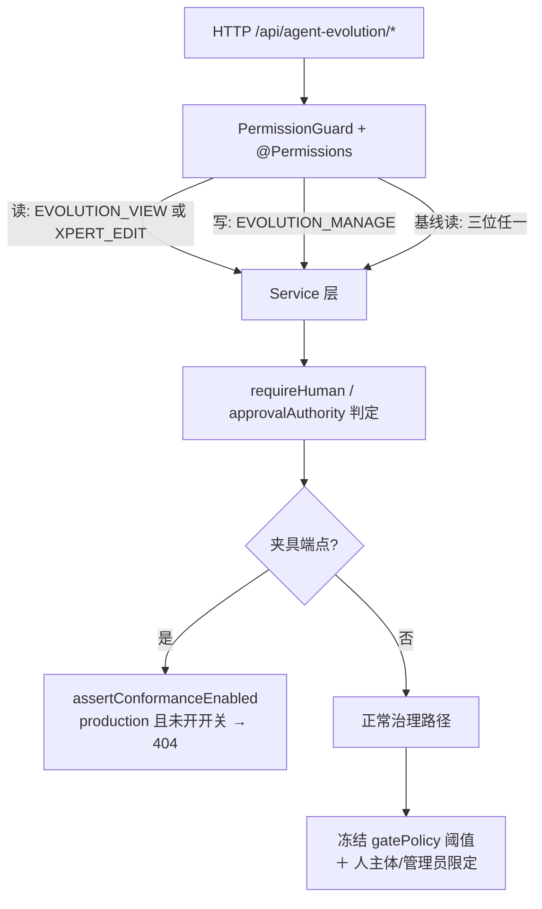

# Agent 演进专家 —— C1 能力契约

> **契约面口径**：本文件是 `agent-evolution` 模块（路由前缀 `/api/agent-evolution`）的**服务端契约层**：48 个 HTTP 端点、19 张表、3 个控制器、16 组服务方法、权限与门禁、可执行示例一次收敛在此；实现细节回源码按 `file://` 链接定位。
> **与前端资产的关系**：前端 [C1-能力契约.md](file://.module-experts/前端专题/Agent 演进专家/C1-能力契约.md) 只做**调用面**索引（`AgentEvolutionApiService` / `API_AGENT_EVOLUTION`），其端点表声明已过期，差异见 [§1.2](#12-与前端清单的差异)。凡未标 `[推测]` 的结论均取自源码或本域实现层文档。

**本文引用的文件**（相对仓库根，链接均为 `file://`）

- [agent-evolution.module.ts](file://packages/server-ai/src/agent-evolution/agent-evolution.module.ts)
- [controllers/agent-evolution.controller.ts](file://packages/server-ai/src/agent-evolution/controllers/agent-evolution.controller.ts)
- [controllers/evolution-baseline.controller.ts](file://packages/server-ai/src/agent-evolution/controllers/evolution-baseline.controller.ts)
- [changes/lifecycle.controller.ts](file://packages/server-ai/src/agent-evolution/changes/lifecycle.controller.ts)
- [changes/lifecycle.service.ts](file://packages/server-ai/src/agent-evolution/changes/lifecycle.service.ts)
- [changes/lifecycle.projection.ts](file://packages/server-ai/src/agent-evolution/changes/lifecycle.projection.ts)
- [changes/change.service.ts](file://packages/server-ai/src/agent-evolution/changes/change.service.ts)
- [changes/change.store.ts](file://packages/server-ai/src/agent-evolution/changes/change.store.ts)
- [changes/change.errors.ts](file://packages/server-ai/src/agent-evolution/changes/change.errors.ts)
- [changes/submission.schema.ts](file://packages/server-ai/src/agent-evolution/changes/submission.schema.ts)
- [changes/strategy.service.ts](file://packages/server-ai/src/agent-evolution/changes/strategy.service.ts)
- [changes/evaluation-executor.service.ts](file://packages/server-ai/src/agent-evolution/changes/evaluation-executor.service.ts)
- [changes/publication-executor.service.ts](file://packages/server-ai/src/agent-evolution/changes/publication-executor.service.ts)
- [application/agent-evolution.service.ts](file://packages/server-ai/src/agent-evolution/application/agent-evolution.service.ts)
- [application/agent-evolution-governance.service.ts](file://packages/server-ai/src/agent-evolution/application/agent-evolution-governance.service.ts)
- [application/agent-evolution-runtime.service.ts](file://packages/server-ai/src/agent-evolution/application/agent-evolution-runtime.service.ts)
- [application/agent-evolution-analyst.service.ts](file://packages/server-ai/src/agent-evolution/application/agent-evolution-analyst.service.ts)
- [application/agent-evolution-queue.service.ts](file://packages/server-ai/src/agent-evolution/application/agent-evolution-queue.service.ts)
- [application/agent-evolution-queue.processor.ts](file://packages/server-ai/src/agent-evolution/application/agent-evolution-queue.processor.ts)
- [application/agent-evolution-quality-governance.service.ts](file://packages/server-ai/src/agent-evolution/application/agent-evolution-quality-governance.service.ts)
- [application/agent-evolution-release-gate-policy.service.ts](file://packages/server-ai/src/agent-evolution/application/agent-evolution-release-gate-policy.service.ts)
- [application/evolution-baseline.service.ts](file://packages/server-ai/src/agent-evolution/application/evolution-baseline.service.ts)
- [application/evolution-governance.helpers.ts](file://packages/server-ai/src/agent-evolution/application/evolution-governance.helpers.ts)
- [entities/evolution.entities.ts](file://packages/server-ai/src/agent-evolution/entities/evolution.entities.ts)
- [domain/evolution-state.ts](file://packages/server-ai/src/agent-evolution/domain/evolution-state.ts)
- [packages/contracts/src/ai/evolution/governance.ts](file://packages/contracts/src/ai/evolution/governance.ts)
- [packages/contracts/src/ai/role-permissions.ts](file://packages/contracts/src/ai/role-permissions.ts)

## 目录

1. [HTTP 入口索引](#1-http-入口索引)
2. [服务能力契约](#2-服务能力契约)
3. [权限与门禁契约](#3-权限与门禁契约)
4. [代码示例](#4-代码示例)
5. [契约来源索引](#5-契约来源索引)

## 1. HTTP 入口索引

路径前缀 `/api/agent-evolution`；分页口径由控制器 `normalizeQuery` 统一归一（`page` 默认 1、`pageSize` 默认 20、`search` 截断 200、`sort ∈ createdAt|updatedAt|status`、`order` 仅 `ASC` 否则 `DESC`）；上下文由 `requestScope()`（租户＋组织）与 `commandContext()`（追加 `actorId/actorRole/actorRoleName/approvalAuthority/actorType:'human'`）注入。

### 1.1 端点表（按控制器 × 主题分组，26 行）

| 方法 | 路径 | 权限位 | 用途 |
|---|---|---|---|
| GET | `/dashboard` | `EVOLUTION_VIEW｜XPERT_EDIT` | 聚合快照（store 直通，无分页入参，实测 14 键） |
| GET | `/targets` | `EVOLUTION_VIEW｜XPERT_EDIT` | 目标描述符分页 |
| POST | `/targets/synchronize` | `EVOLUTION_MANAGE` | 注册 provider 描述符并同步基线能力版本（无指针目标自动铺初版） |
| GET | `/capability-versions` · `/capability-bundles` · `/active-pointers` | `EVOLUTION_VIEW｜XPERT_EDIT` | 不可变版本 / 版本束（四执行模式）/ 生产指针分页 |
| GET | `/baselines/:targetId` | 三位任一（含 `EVOLUTION_MANAGE`） | 上线规则基线只读检视，**不写库**，返回体带 `canManage` |
| POST | `/changes` | `EVOLUTION_MANAGE` | 提交变更：Zod 校验 → 写 Proposal 行 → 投递 `change_preparation` |
| POST | `/changes/conformance-template` | `EVOLUTION_MANAGE` ＋ 夹具门禁 | 夹具提交（`fixtureInput` 生成输入后复用 `prepare`） |
| GET | `/changes` · `/changes/records` · `/changes/:id` | `EVOLUTION_VIEW｜XPERT_EDIT` | 生命周期记录投影 / 富变更记录 / 单条记录 |
| POST | `/changes/:id/evaluations` | `EVOLUTION_MANAGE` | 触发评估（可传 `datasetSnapshotIds`）→ 返回生命周期记录 |
| POST | `/changes/:id/decisions` | `EVOLUTION_MANAGE` | 人工审批（候选哈希 ＋ runId ＋ 策略哈希三绑定） |
| POST | `/changes/:id/publication` | `EVOLUTION_MANAGE` | 产出发布包 `PUB-<changeId>` |
| GET | `/learning-events` · `/diagnoses` · `/clusters` | `EVOLUTION_VIEW｜XPERT_EDIT` | 学习信号 / 诊断结论 / 事件簇分页 |
| PATCH | `/learning-events/:eventId/review` | `EVOLUTION_MANAGE` | 事件复核（`pending｜ignored｜golden`，唯一人工分类入口） |
| POST | `/diagnoses` | `EVOLUTION_MANAGE` | 诊断 ＋ 聚类（**不写提案**） |
| GET · POST | `/proposals` | 读 / `EVOLUTION_MANAGE` | 改进提案列表（只认 `sourceKind='learning_events'`）/ 创建（`requestId` 幂等） |
| GET · POST | `/candidates` | 读 / `EVOLUTION_MANAGE` | 候选分页 / 构建隔离候选（依赖 `proposalRevision`） |
| POST | `/candidates/:candidateId/approvals` | `EVOLUTION_MANAGE` | 单条人工审批（agent 主体被拒） |
| GET · POST | `/datasets` | 读 / `EVOLUTION_MANAGE` | golden 数据集快照分页 / 创建（用例 `(caseId,revision)` 唯一） |
| GET · POST | `/evaluations` | 读 / `EVOLUTION_MANAGE` | 评估记录（含 `gatePassed`）/ 入队评估（返回 `EvolutionJob`） |
| GET | `/releases` · `/deployments` | `EVOLUTION_VIEW｜XPERT_EDIT` | 发布包（含冻结 `gatePolicy`、`canaryPercent`）/ 部署观测分页 |
| GET · POST | `/releases/:releasePackageId/canary-test-overrides` | 读 / `EVOLUTION_MANAGE` | 一次性覆盖清单（读路径惰性翻 `expired`）/ 创建 |
| POST | `/release-packages` | `EVOLUTION_MANAGE` | 冻结 `gatePolicy` 并产出发布包 |
| POST | `/releases/:id/install` · `/shadow` · `/canary` · `/rollback` | `EVOLUTION_MANAGE` | **入队**部署动作 → 返回 `EvolutionJob`（HTTP 200 ≠ 动作成功） |
| POST | `/releases/:id/pause` · `/activate` | `EVOLUTION_MANAGE` | **同步**动作 → 返回发布包 / 新指针 |
| GET | `/jobs/:jobId` | `EVOLUTION_VIEW｜XPERT_EDIT` | 作业账本查询；**未命中返回 `null`（200）而非 404** |
| GET | `/runtime-observations` · `/audit-events` · `/experiences` | `EVOLUTION_VIEW｜XPERT_EDIT` | 观测回流 / 审计留痕 / 经验留档分页 |
| POST | `/experiences` · `/capability-executions/resolve` · `/simulations/conformance` · `/examples/conformance-field-mapping/run` | `EVOLUTION_MANAGE`（后两条另加夹具门禁） | 经验留档 / 执行计划解析（运行时消费）/ 一致性模拟（两条路径**同一实现**） |

**逐端点明细**（完整字段、错误码全集、控制器逐条装饰器清单）见 [implementation/05-接口.md](file://.module-experts/后端专题/Agent 演进专家/implementation/05-接口.md)，本文不复制。

### 1.2 与前端清单的差异

- **端点口径**：后端 **48**（`39 + 8 + 1`）；前端端点表实测 **23 行**，其中**未列 5 条**：`GET /runtime-observations`、`GET /audit-events`、`GET|POST /experiences`、`POST /capability-executions/resolve`、`POST /simulations/conformance`；`/experiences` 在前端 §1.3 API 方法表已存在，属**表格漏列而非能力缺口**。
- **前端另有/后端也有的路径**：前端 27 条路径与本域逐条一致，且**无「前端调用了后端不存在的路径」**；本域另多 `POST /changes/conformance-template` 夹具入口（前端未接）。
- **job 状态口径冲突**：前端把 `/jobs/:jobId` 状态写作 `pending|running|queued|completed|failed|cancelled`，契约 `EvolutionJobStatus` **不含 `pending`**，回写建议为删除。
- **dashboard 字段数**：前端声明 17 个数组字段，后端 `getDashboard` 实测透传 **14 键**，差异未核实（以 store 返回为准）。

章节来源：[agent-evolution.controller.ts](file://packages/server-ai/src/agent-evolution/controllers/agent-evolution.controller.ts)（关键符号：AgentEvolutionController 的 @Get/@Post/@Patch ＋ @Permissions 组合、requestScope / commandContext / normalizeQuery / assertConformanceEnabled）、[lifecycle.controller.ts](file://packages/server-ai/src/agent-evolution/changes/lifecycle.controller.ts)（关键符号：submit / conformance / list / records / get / evaluate / decide / publish）、[evolution-baseline.controller.ts](file://packages/server-ai/src/agent-evolution/controllers/evolution-baseline.controller.ts)（关键符号：inspect / Permissions 三位并列）、[implementation/05-接口.md](file://.module-experts/后端专题/Agent 演进专家/implementation/05-接口.md)（关键符号：与前端资产的差异清单与回写建议）

## 2. 服务能力契约

| 类.方法（签名） | 用途 | 参数行为语义 | 返回 | 异常 |
|---|---|---|---|---|
| `EvolutionChangeService.prepare(input: SubmitEvolutionChange, options?: { defer?: boolean })` | 变更提交（唯一入口） | `checkIdentity` → `strategies.freeze()` 冻结策略快照；feedback 模式对学习事件做「数量/主体/新鲜度/脱敏」四重门并重算 evidence 逐条对账；写 `Proposal`（`proposalId=PROP-<changeId>`，`revision:1`）＋ `change_preparation` job | `EvolutionChange` | 400 `invalid_strategy_submission` / `strategy_not_allowed` / `learning_evidence_gate_failed` / `learning_evidence_snapshot_mismatch` |
| `EvolutionChangeService.build(input)` · `evaluate(input)` · `process(input)` | 候选构建 / 评估 / 幂等推进 | `build` 已存在候选即做 digest 比对；`evaluate` 已审批或已有回执即拒；`process` 非可推进状态时把残留活跃 job 收尾为 `completed`，推进时**先提交 running 再调外部 provider** | `EvolutionChange` | `immutable_candidate_changed` / `evaluation_snapshot_mismatch` / `approved_candidate_immutable` |
| `EvolutionChangeService.decide(input)` | 人工审批 | 必须人主体 ＋ `reason` 非空；候选哈希/`evaluationRunId`/`strategyHash` 三绑定；同 actor 改判即拒（同判天然幂等）；配额由 `reviewHumanApprovals` 判定 | `EvolutionChange` | 400 `review_snapshot_mismatch` / `immutable_approval_changed` / `review_reason_required` / `tests_must_pass` / `not_reviewable` |
| `EvolutionChangeService.publish(input)` | 发布 | 先推 `publishing` 再第二事务发货：`staged_rollout` → 执行器；`version_write` → `versionPublisher` 并校验回执三元组 | `EvolutionChange` | 400 `publication_not_in_strategy` / `publication_snapshot_mismatch` / `write_receipt_mismatch` / `identity_mismatch` |
| `EvolutionLifecycleService.list(identity, query)` · `get(identity, id)` · `evaluate/decide/publish(context, id, …)` | HTTP 投影层 | 读一律经 `lifecycleRecord()`，写代理 `EvolutionChangeService` 后**回读投影**；`pageSize` 上限 200 | `{ items, total, page, pageSize }` / `EvolutionLifecycleRecord` | `change_not_found` → 400 |
| `lifecycleRecord(change: EvolutionChange, release?: ReleasePackage)` | 纯函数投影（不落库） | `release.status` **优先**于 `change.status`；派生 `phase` / `publicationStatus` / `effectStatus` 与 `capabilities.{stagedRollout,evaluate,decide,publish}`；`publication` 阶段在 published 时被改写为 `passed` | `EvolutionLifecycleRecord` | — |
| `AgentEvolutionService.getDashboard(context)` · `synchronizeTargets(context)` | 仪表盘 / 目标同步 | dashboard 直通 store 不裁剪；同步 upsert 全部描述符，并对「有 `baselineExporter` 且无指针」的目标导出初版版本 ＋ `revision:1` 生产指针 | 14 键聚合快照 / `EvolutionTargetDescriptor[]` | 400 `Conformance provider does not implement the complete evolution contract` |
| `AgentEvolutionService.runConformanceSimulation(input)` | 端到端一致性夹具 | 串起同步→学习事件→提案→候选→评估→审批→发布→shadow/canary→指针 CAS→`verifyPersistence`；`gate.passed` 为假时抛错 | `EvolutionSimulationResult`（含 `gatePassed`、`rowCount`、pointer 终态） | 400 `Conformance evaluation failed: …` |
| `AgentEvolutionGovernanceService.createProposal(context, request)` · `buildCandidate(context, command)` · `decideApproval(context, candidateId, request)` · `createDatasetSnapshot(context, request)` · `evaluateCandidate(context, command)` · `createReleasePackage(context, request)` | 治理写入口（变更侧） | 一律 `requireHuman`；`agent` 主体 ＋ `R4` 提案拒绝；提案需生产指针（否则 `production_baseline_required`）；候选依赖提案 `revision`；发布包要求 `publication.mode === 'staged_rollout'` | 契约对象（`ImprovementProposal` / `EvolutionCandidate` / `ApprovalDecision` / `DatasetSnapshot` / `ReleasePackage`） | `change_not_found` / `agent_proposal_risk_forbidden` / `candidate_baseline_mismatch` / `candidate_snapshot_mismatch` / `evaluation_not_in_strategy` / `identity_mismatch` |
| `AgentEvolutionGovernanceService.installRelease(context, releasePackageId)` · `startShadow(ctx,id)` · `startCanary(ctx,id,request: StartDeploymentRequest)` · `pauseRelease(ctx,id)` · `activateProduction(ctx,id)` · `rollbackProduction(ctx,id)` | 部署阶梯 | 全部 `requireHuman`；`install` 要求 `approved`；`shadow` 只允许 `installed｜paused`；`canary` 只接受 `5｜25｜50`、首轮必须 5%、跳档 400；`activate` 要求 50% ＋ 生产阈值 ＋ 指针仍等于 `rollbackVersionId`；`rollback` 拒绝 agent 主体且指针须等于 `targetVersionId` | `ReleasePackage` / `ActiveCapabilityPointer` | 命名闸门文案 `AgentEvolution{Shadow,Canary,Production}GateNotSatisfied`、`Only Shadow or Canary can be paused`、`Production activation requires Canary`、`Agents cannot initiate Production rollback`、`Release is not the active Production version` |
| `AgentEvolutionGovernanceService.createCanaryTestOverride(context, releasePackageId, request)` · `createExperience(context, request)` · `list*`（`listTargets`/`listLearningEvents`/`listCapabilityVersions`/`listCapabilityBundles`/`listActivePointers`/`listProposals`/`listCandidates`/`listDatasets`/`listEvaluations`/`listReleases`/`listDeployments`/`listCanaryTestOverrides`/`listRuntimeObservations`/`listAuditEvents`/`listExperiences`） | 一次性覆盖 · 经验 · 读面 | 覆盖四条件：人 ＋ `administrator` ＋ `gatePolicy.profile==='manual_test'` ＋ release 处于 canary 且存在未完成 canary 部署；`subjectKey ≤ 200`、`reason ≤ 500`、`expiresInMinutes ∈ [1,120]`（缺省 30）。经验要求 release `active` ＋ 生产部署达样本/时长 ＋ `severeErrors===0` ＋ 评估 runId 一致 | `EvolutionCanaryTestOverride` / `EvolutionExperience` / `EvolutionPage<T>` | `…RequiresAdministrator` / `…RequiresManualTestProfile` / `…RequiresCanary` / `…InvalidSubject|Reason|Expiry` / `…AlreadyPending` / `Release strategy assessment does not match` |
| `AgentEvolutionReleaseGatePolicyService.snapshot()` · `forRelease(release)` · `manualTestProfileEnabled()` | 阈值解析与冻结读取 | `STANDARD_GATE_POLICY`＝shadow 100/72h、canary 30/24h、productionCanary 30/24h、experience 100/168h；`manual_test` 仅**非生产**且 `AGENT_EVOLUTION_GATE_PROFILE=manual_test`；`requestedShadowMinimumSamples` 只能抬高不能降低 | `EvolutionReleaseGatePolicy` / `boolean` | 400 `Release gate policy was not frozen` |
| `AgentEvolutionQualityGovernanceService.reviewGoldenReplay(cases, metrics)` · `reviewHumanApprovals(riskLevel, approvals)` · `requiredHumanApprovals(riskLevel)` | 闸门判据（纯函数） | replay：`totalCases ≥ 50`、affected 切片 ≥ 20、high 风险切片 ≥ 10、`severeErrors === 0`、`accuracyDelta > 0`；审批：R3/R4 需 3 人、其余 2 人，**有管理员审批即单票放行**，且 `distinct actorId` 与 `distinct actorRole` 双达标 | `{ decision, blockingReasons }` / `{ passed, … }` / `number` | — |
| `AgentEvolutionRuntimeService.ingestLearningEvent(input)` · `resolveExecutionPlan(request)` · `recordRuntimeObservation(input)` · `getCapabilityBundle(input)` · `getCapabilityVersion(input)` | 运行时 API（`EvolutionRuntimeApi` 实现） | 事件入账要求 target `active`、confidential 必须已 `redacted`、`eventId` 缺省 `EVT-<uuid>`；解析要求 `targetIds`/`subjectKey` 非空并**先取 production 指针**，按 canary > shadow > production 选路并消费一次性覆盖；观测按 `observationId` 幂等、锁部署行累加，`severeError` 且 release 处于 shadow/canary 时自动暂停并写审计 | `LearningEvent` / `CapabilityExecutionPlan` / `ReleaseRuntimeObservation` / 版本与束 | 400 scope/脱敏/`subjectKey is required`；404 `Production pointer for '<targetId>' was not found` |
| `AgentEvolutionAnalystService.diagnose(context, request)` · `listDiagnoses` · `listClusters` | 诊断与聚类 | 事件 id 去重后取行，**数量不等即 400**；confidential 未脱敏拒绝；按 `correctionSignature = hashEvolutionValue({…, reasonCodes(sorted)})` 分组；簇状态由 `qualifiesLearning` 决定 | `EvolutionAnalysisResult` | 400 三条文案 ＋ `strategy_not_allowed` |
| `AgentEvolutionQueueService.enqueueEvaluation(context, command)` · `enqueueReleaseOperation(context, operation, releasePackageId, request?)` · `getJob(context, jobId)` · `AgentEvolutionQueueProcessor.handle(job)` | 作业入队与消费 | **先落 `job` 账本再投递**（`attempts:3`、`backoffMs:1000`），成功回写 `queueJobId`；投递失败置 `failed` ＋ `queue_enqueue_failed` 并抛出；worker 置 `running` → `completed` / `failed`（`evolution_job_failed` 后**重抛**交队列重试）；未注入队列时 `@Optional()` 走 503 | `EvolutionJob` / `null`（未命中） | 503 `Managed Queue is unavailable` |
| `EvolutionBaselineService.inspect(input: EvolutionBaselineIdentity)` · `publish(input: EvolutionBaselinePublishRequest)` | 上线规则基线 | `inspect` 真调 `previewBaseline` 并把状态收敛成 `managed_release > blocked > missing > current > update_available`；`publish` 要求 `mode ∈ {initialize, update}` ＋ `expectedRevision` 安全整数 ＋ `expectedHash` 匹配 `/^[a-f0-9]{64}$/` ＋ `reason` 长度 3~1000，事务内 `pg_advisory_xact_lock` ＋ `pessimistic_write` 锁指针 | `EvolutionBaselineInspection` / `ActiveCapabilityPointer` | 400 `source_changed` / `revision_changed`；`managed_release` → 409 |
| `EvolutionEvaluationExecutor.run(operation, target, manager)` · `EvolutionPublicationExecutor.package(manager, operation)` | 事务内执行器 | 评估：逐步按 `kind` 分派，golden replay 建基线与候选双 bundle、`randomSeed:42`、`repeatIndex:0`，无步骤时 `assessment='not_applicable'`（**不是通过**）；发布：在**调用方事务**内分配 `CapabilityVersion` 与 `PUB-<changeId>`（已存在原样返回） | `EvolutionChangeEvaluation` / `ReleasePackage` | `evaluation_dataset_required` / `inconsistent_evaluation_gate` / `immutable_evaluation_changed` / `Release gate policy was not frozen` |
| `changeError(code: string)` | 变更域统一错误信道 | 恒抛 `BadRequestException`，文案为 i18n 键 `server-ai:Error.EvolutionChange`，`defaultValue = 'Evolution cannot proceed: {{code}}'`；**调用方应按 code 解析而非匹配整句** | `never` | 400 |

章节来源：[change.service.ts](file://packages/server-ai/src/agent-evolution/changes/change.service.ts)（关键符号：prepare / build / evaluate / process / decide / publish / enqueue）、[lifecycle.service.ts](file://packages/server-ai/src/agent-evolution/changes/lifecycle.service.ts)（关键符号：list / get / evaluate / decide / publish）、[lifecycle.projection.ts](file://packages/server-ai/src/agent-evolution/changes/lifecycle.projection.ts)（关键符号：lifecycleRecord）、[agent-evolution-governance.service.ts](file://packages/server-ai/src/agent-evolution/application/agent-evolution-governance.service.ts)（关键符号：createProposal / startCanary / activateProduction / rollbackProduction / createExperience）、[agent-evolution-queue.service.ts](file://packages/server-ai/src/agent-evolution/application/agent-evolution-queue.service.ts)（关键符号：enqueueEvaluation / enqueueReleaseOperation / getJob）

## 3. 权限与门禁契约

### 3.1 权限位矩阵

| 控制器（端点数） | 读（`EVOLUTION_VIEW` **或** `XPERT_EDIT`） | 写（`EVOLUTION_MANAGE`） | 额外门禁 |
|---|---|---|---|
| `AgentEvolutionController`（39） | 21 条（全部 `@Get`） | 18 条（全部 `@Post`/`@Patch`） | `POST /simulations/conformance`、`POST /examples/conformance-field-mapping/run` 夹具 404 门禁 |
| `EvolutionLifecycleController`（8） | 4 条（`GET /changes`、`/records`、`/:id`，类级 `@UseGuards(PermissionGuard)`） | 4 条（`POST /changes`、`/:id/{evaluations,decisions,publication}`） | `POST /changes/conformance-template` 夹具 404 门禁 |
| `EvolutionBaselineController`（1） | 1 条（`EVOLUTION_VIEW｜XPERT_EDIT｜EVOLUTION_MANAGE` 三位任一） | — | — |

### 3.2 门禁叠加顺序

1. **HTTP 层**：`PermissionGuard` ＋ `@Permissions`（读两位或语义 / 写一位）。
2. **服务层人主体门**：`requireHuman`（`actorType === 'agent'` 直接 400），`approvalAuthority` 由角色名派生（`SUPER_ADMIN`/`ADMIN` → `administrator`，否则 `standard`）。
3. **闸门数值判定**：读**冻结在发布包里的** `gatePolicy`，改 env 只影响新建包；`manual_test` 档仅在非生产生效。
4. **管理员与 `manual_test` 限定**：仅一次性金丝雀覆盖；`rollback` 拒绝 agent 主体，`R4` 提案拒绝 agent 主体。
5. **夹具门禁（两条独立声明，均需满足）**：控制器级 `assertConformanceEnabled()` 与 provider 级 `assertTemplateConformanceEnabled()` 同款条件（`environment.production && AGENT_EVOLUTION_ENABLE_CONFORMANCE !== 'true'` → **空体 404**）；后者另经 `authorizeScope` 复核 target/scope。**夹具端点在生产的正确表现就是 404**，不属路由缺失。
6. **scope 校验**：`validateScope` 在 `scope.type === 'organization'` 时要求 `scope.key === organizationId`；`resolveExecutionPlan` 另拒绝「演进 scope 与请求组织不一致」。



图表来源：[agent-evolution.controller.ts](file://packages/server-ai/src/agent-evolution/controllers/agent-evolution.controller.ts)（关键符号：Permissions / UseGuards / assertConformanceEnabled / commandContext）、[evolution-governance.helpers.ts](file://packages/server-ai/src/agent-evolution/application/evolution-governance.helpers.ts)（关键符号：requireHuman）、[conformance-template.provider.ts](file://packages/server-ai/src/agent-evolution/providers/conformance-template.provider.ts)（关键符号：assertTemplateConformanceEnabled / CONFORMANCE_TEMPLATE_TARGET）

章节来源：[role-permissions.ts](file://packages/contracts/src/ai/role-permissions.ts)（关键符号：AIPermissionsEnum.EVOLUTION_VIEW / EVOLUTION_MANAGE / XPERT_EDIT）、[agent-evolution-release-gate-policy.service.ts](file://packages/server-ai/src/agent-evolution/application/agent-evolution-release-gate-policy.service.ts)（关键符号：forRelease / manualTestProfileEnabled）、[implementation/05-接口.md](file://.module-experts/后端专题/Agent 演进专家/implementation/05-接口.md)（关键符号：权限矩阵与守卫链 / 夹具门禁与 404 语义）

## 4. 代码示例

① **提一个变更并读生命周期**（`EvolutionLifecycleController` 是 `prepare` 的真实调用方；投影由 `list` 产出）：

```ts
// 注：示例中 `identity()` / `scope` 为占位，接入时替换为你的调用身份与作用域
// lifecycle.controller.ts（剪裁）：POST /changes → prepare，GET /changes → lifecycle.list
submit(@Body() body: unknown) {
    const parsed = evolutionSubmissionSchema.safeParse(body)
    if (!parsed.success) changeError('invalid_strategy_submission')
    return this.changes.prepare({ ...(parsed.data as Omit<SubmitEvolutionChange, 'tenantId' | 'organizationId'>), ...identity() })
}
list(@Query() query: EvolutionPageQuery) {
    return this.lifecycle.list(identity(), query)   // → { items, total, page, pageSize }
}

// lifecycle.service.ts（剪裁）：投影而非实体，release.status 优先于 change.status
const records = changes.map((change) =>
    lifecycleRecord(change, releases.map((row) => row.value).filter(isStagedRelease)
        .find((release) => release.candidateId === change.changeId)))
```

② **跑一次评估并判读 `gatePassed`**（`EvolutionChangeService.process` → `EvolutionEvaluationExecutor.run`，布尔判据列由 `gate.passed` 直接映射）：

```ts
// agent-evolution.service.ts（剪裁）：评估结论 → 夹具结果
const evaluation: EvaluationRun = { /* … */
    status: blockingReasons.length ? 'failed' : 'passed',
    gate: { passed: blockingReasons.length === 0, decision: blockingReasons.length ? 'reject' : 'promote', blockingReasons }
}
return { /* … */ gatePassed: evaluation.gate.passed }

// agent-evolution.service.spec.ts（剪裁）：真实断言
const result = await service.runConformanceSimulation({ tenantId: 'tenant-1', organizationId: 'org-1',
    actorId: 'reviewer-1', actorRole: 'governance_reviewer' })
expect(result.gatePassed).toBe(true)
expect(state.deployments.map((item) => item.channel)).toEqual(['shadow', 'canary'])
```

③ **发布到金丝雀 → 观测 → 回滚**（入队动作返回 `EvolutionJob`，观测经运行时能力回流，回滚拒绝 agent 主体）：

```ts
// agent-evolution.controller.ts（剪裁）：阶梯与回滚全是入队
startCanary(@Param('releasePackageId') id: string, @Body() body: StartDeploymentRequest) {
    return this.queue.enqueueReleaseOperation(commandContext(), 'canary', id, body)   // → EvolutionJob
}
rollbackRelease(@Param('releasePackageId') id: string) {
    return this.queue.enqueueReleaseOperation(commandContext(), 'rollback', id)       // → EvolutionJob
}

// agent-evolution-runtime.service.spec.ts（剪裁）：覆盖只生效一次，之后回落确定性路由
const forcedPlan = await service.resolveExecutionPlan({ tenantId: 'tenant-1', organizationId: 'org-1',
    scope, targetIds: [release.targetId], subjectKey, executionId: 'EXEC-1' })
expect(forcedPlan.assignments[0]).toMatchObject({ versionId: release.targetVersionId,
    selectionReason: 'manual_test_override' })
const followingPlan = await service.resolveExecutionPlan({ /* … executionId: 'EXEC-2' */ })
expect(followingPlan).toMatchObject({ executionMode: 'production' })   // 回落生产指针
expect(followingPlan.manualTestOverrides).toBeUndefined()
```

④ **读解析后的能力执行**（`/capability-executions/resolve` 是唯一出「能力束 ＋ 版本裁决」的入口，消费方按 `executionMode` / `assignments` 执行）：

```ts
// agent-evolution.controller.ts（剪裁）：POST /capability-executions/resolve
@Post('capability-executions/resolve')
@UseGuards(PermissionGuard)
@Permissions(AIPermissionsEnum.EVOLUTION_MANAGE)
resolveExecutionPlan(@Body() body: Omit<ResolveCapabilityExecutionPlanRequest, 'tenantId' | 'organizationId'>) {
    const scope = requestScope()
    return this.runtime.resolveExecutionPlan({ ...body, ...scope })
}

// agent-evolution-runtime.service.ts（剪裁）：无生产指针直接 404；命中覆盖才有 manualTestOverrides
// executionMode 依次取 canary > shadow > production；影子另出 shadowBundle + shadowAssignments
const pointer = await this.store.findPointer(tenant, targetId, scope)   // channel: 'production'
if (!pointer) throw new NotFoundException(`Production pointer for '${targetId}' was not found`)
```

章节来源：[lifecycle.controller.ts](file://packages/server-ai/src/agent-evolution/changes/lifecycle.controller.ts)（关键符号：submit / list）、[lifecycle.service.ts](file://packages/server-ai/src/agent-evolution/changes/lifecycle.service.ts)（关键符号：EvolutionLifecycleService.list / lifecycleRecord 调用点）、[agent-evolution.service.ts](file://packages/server-ai/src/agent-evolution/application/agent-evolution.service.ts)（关键符号：runConformanceSimulation / gatePassed）、[agent-evolution.service.spec.ts](file://packages/server-ai/src/agent-evolution/application/agent-evolution.service.spec.ts)（关键符号：runConformanceSimulation / gatePassed 断言）、[agent-evolution.controller.ts](file://packages/server-ai/src/agent-evolution/controllers/agent-evolution.controller.ts)（关键符号：startCanary / rollbackRelease / resolveExecutionPlan）、[agent-evolution-runtime.service.spec.ts](file://packages/server-ai/src/agent-evolution/application/agent-evolution-runtime.service.spec.ts)（关键符号：resolveExecutionPlan / manual_test_override / manualTestOverrides）

## 5. 契约来源索引

| 契约点 | 证据文件 | 关键符号 |
|---|---|---|
| 路由前缀与装配（19 表 forFeature、3 控制器、4 exports） | [agent-evolution.module.ts](file://packages/server-ai/src/agent-evolution/agent-evolution.module.ts) | `RouterModule.register`、`AGENT_EVOLUTION_ENTITIES`、`EVOLUTION_RUNTIME_SERVICE_TOKEN` |
| 39 端点与权限装饰器 | [agent-evolution.controller.ts](file://packages/server-ai/src/agent-evolution/controllers/agent-evolution.controller.ts) | `AgentEvolutionController`、`Permissions`、`assertConformanceEnabled`、`commandContext` |
| 变更 8 端点与 Zod 准入 | [lifecycle.controller.ts](file://packages/server-ai/src/agent-evolution/changes/lifecycle.controller.ts)、[submission.schema.ts](file://packages/server-ai/src/agent-evolution/changes/submission.schema.ts) | `submit`、`conformance`、`evolutionSubmissionSchema` |
| 基线 1 端点（三位读） | [evolution-baseline.controller.ts](file://packages/server-ai/src/agent-evolution/controllers/evolution-baseline.controller.ts) | `inspect`、`Permissions` |
| 变更协调器与阶段入口 | [change.service.ts](file://packages/server-ai/src/agent-evolution/changes/change.service.ts) | `prepare` / `build` / `evaluate` / `process` / `decide` / `publish` / `enqueue` |
| 变更分表映射与不可变校验 | [change.store.ts](file://packages/server-ai/src/agent-evolution/changes/change.store.ts) | `assemble`、`save`、`saveEvaluation`、`fromCandidateStatus` |
| 统一错误信道 | [change.errors.ts](file://packages/server-ai/src/agent-evolution/changes/change.errors.ts) | `changeError` |
| 生命周期投影 | [lifecycle.projection.ts](file://packages/server-ai/src/agent-evolution/changes/lifecycle.projection.ts) | `lifecycleRecord`、`phase` / `publicationStatus` / `effectStatus` / `capabilities` |
| 评估与发布执行器 | [evaluation-executor.service.ts](file://packages/server-ai/src/agent-evolution/changes/evaluation-executor.service.ts)、[publication-executor.service.ts](file://packages/server-ai/src/agent-evolution/changes/publication-executor.service.ts) | `run`、`package`、`not_applicable` |
| 治理写入口与阶梯 | [agent-evolution-governance.service.ts](file://packages/server-ai/src/agent-evolution/application/agent-evolution-governance.service.ts) | `createProposal`、`startCanary`、`activateProduction`、`rollbackProduction`、`createExperience` |
| 运行时解析与观测回流 | [agent-evolution-runtime.service.ts](file://packages/server-ai/src/agent-evolution/application/agent-evolution-runtime.service.ts) | `ingestLearningEvent`、`resolveExecutionPlan`、`recordRuntimeObservation`、`deterministicPercent` |
| 阈值与环境开关 | [agent-evolution-release-gate-policy.service.ts](file://packages/server-ai/src/agent-evolution/application/agent-evolution-release-gate-policy.service.ts) | `STANDARD_GATE_POLICY`、`snapshot`、`forRelease`、`manualTestProfileEnabled` |
| 作业状态机与状态枚举 | [evolution-state.ts](file://packages/server-ai/src/agent-evolution/domain/evolution-state.ts)、[packages/contracts/src/ai/evolution/governance.ts](file://packages/contracts/src/ai/evolution/governance.ts) | `assertReleaseTransition`、`EvolutionJobStatus`（**无 `pending`**） |
| 唯一索引与冲突键（19 表） | [entities/evolution.entities.ts](file://packages/server-ai/src/agent-evolution/entities/evolution.entities.ts) | `CapabilityVersionEntity` 的 `(tenant,org,targetId,sequence)`、`canary_test_override.activeKey` |

章节来源：[implementation/01-架构.md](file://.module-experts/后端专题/Agent 演进专家/implementation/01-架构.md)（关键符号：关键不变量 / 组件详细分析）、[implementation/03-数据流转.md](file://.module-experts/后端专题/Agent 演进专家/implementation/03-数据流转.md)（关键符号：状态机汇总 / 本域写 vs 跨域写对照）、[implementation/04-模型.md](file://.module-experts/后端专题/Agent 演进专家/implementation/04-模型.md)（关键符号：唯一索引与冲突键）
