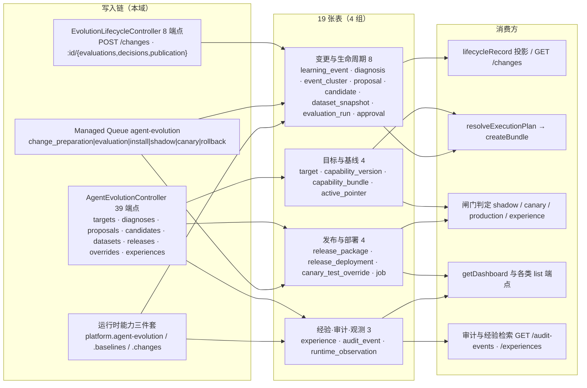

# C4 数据流向与消费（Agent 演进专家）

> 口径：表结构与索引以实现层 [04-模型.md](file://.module-experts/后端专题/Agent 演进专家/implementation/04-模型.md) 与源码实体 `entities/evolution.entities.ts` 为准。**19 张表**（`AGENT_EVOLUTION_ENTITIES`）按 4 组组织：目标与基线 4 · 变更与生命周期 8 · 发布与部署 4 · 经验·审计·观测 3（`experience` 只计入第三组，避免与实现层交叉引用重复计数）。
> **一处必须先说清的结构事实**：任务书要的「jsonb 快照列」在本域**实际是 `@Column({ type: 'json' })`**——模块内 `jsonb` 零命中，但查询仍用 PG 的 `value ->> 'field'` 运算符；下文一律写作「`json` 快照列」。全部 19 表**无外键、无 `@VersionColumn`、无软删、无 SQL 迁移**，业务关联全靠「逻辑外键 = varchar 列」。消费方为模块级概括，跨 3 个以上消费者时归纳为模块族。

**本文引用的文件**
- [agent-evolution/entities/evolution.entities.ts](file://packages/server-ai/src/agent-evolution/entities/evolution.entities.ts) · [entities/evolution-row-guards.ts](file://packages/server-ai/src/agent-evolution/entities/evolution-row-guards.ts)
- [application/agent-evolution.store.ts](file://packages/server-ai/src/agent-evolution/application/agent-evolution.store.ts) · [application/evolution-runtime.store.ts](file://packages/server-ai/src/agent-evolution/application/evolution-runtime.store.ts) · [application/evolution-store.helpers.ts](file://packages/server-ai/src/agent-evolution/application/evolution-store.helpers.ts)
- [application/evolution-persistence-proof.ts](file://packages/server-ai/src/agent-evolution/application/evolution-persistence-proof.ts) · [application/agent-evolution-runtime.service.ts](file://packages/server-ai/src/agent-evolution/application/agent-evolution-runtime.service.ts)
- [changes/change.store.ts](file://packages/server-ai/src/agent-evolution/changes/change.store.ts) · [changes/change.service.ts](file://packages/server-ai/src/agent-evolution/changes/change.service.ts) · [changes/publication-executor.service.ts](file://packages/server-ai/src/agent-evolution/changes/publication-executor.service.ts)
- [changes/execution-conversation.service.ts](file://packages/server-ai/src/agent-evolution/changes/execution-conversation.service.ts) · [controllers/agent-evolution.controller.ts](file://packages/server-ai/src/agent-evolution/controllers/agent-evolution.controller.ts)
- [domain/evolution-hash.ts](file://packages/server-ai/src/agent-evolution/domain/evolution-hash.ts) · [domain/evolution-state.ts](file://packages/server-ai/src/agent-evolution/domain/evolution-state.ts)

## 目录
1. [总览：写入链 → 表 → 消费方](#总览写入链--表--消费方)
2. [目标与基线（4 张表）](#目标与基线4-张表)
3. [变更与生命周期（8 张表）](#变更与生命周期8-张表)
4. [发布与部署（4 张表）](#发布与部署4-张表)
5. [经验、审计与观测（3 张表）](#经验审计与观测3-张表)
6. [本域写 vs 跨域投影写](#本域写-vs-跨域投影写)
7. [口径核对与未确认项](#口径核对与未确认项)

## 总览：写入链 → 表 → 消费方

图表来源：[evolution.entities.ts](file://packages/server-ai/src/agent-evolution/entities/evolution.entities.ts)（关键符号：AGENT_EVOLUTION_ENTITIES / 19 个 @Entity）· [agent-evolution.module.ts](file://packages/server-ai/src/agent-evolution/agent-evolution.module.ts)（关键符号：TypeOrmModule.forFeature / RouterModule.register）· [agent-evolution-queue.processor.ts](file://packages/server-ai/src/agent-evolution/application/agent-evolution-queue.processor.ts)（关键符号：@PluginJobProcessor / concurrency）· [agent-evolution-runtime.service.ts](file://packages/server-ai/src/agent-evolution/application/agent-evolution-runtime.service.ts)（关键符号：resolveExecutionPlan / ingestLearningEvent / recordRuntimeObservation）

三条读法：① 三条写入面并存——HTTP、Managed Queue 处理器、运行时能力 token，全部落到同一批 store 方法；② `EvolutionChange` **不落库**（`// EvolutionChange is assembled, never persisted whole.`），由 `change.store.assemble` 从 proposal/candidate/evaluation_run/approval/release_package 五表拼装；③ 完全无 HTTP 写端点的表是 `runtime_observation` 与 `learning_event` 的**入账**（HTTP 只有 `PATCH /learning-events/:eventId/review` 改 `reviewStatus`）。

章节来源：[evolution.entities.ts](file://packages/server-ai/src/agent-evolution/entities/evolution.entities.ts)（关键符号：AGENT_EVOLUTION_ENTITIES）、[agent-evolution.store.ts](file://packages/server-ai/src/agent-evolution/application/agent-evolution.store.ts)（关键符号：AgentEvolutionStore 读写门面 / getDashboard）、[change.store.ts](file://packages/server-ai/src/agent-evolution/changes/change.store.ts)（关键符号：assemble）

## 目标与基线（4 张表）

| 实体 / 表名 | 结构（关键列 · 唯一索引 · 快照列） | 生产方 | 主要消费方 | 用途 |
|---|---|---|---|---|
| `EvolutionTargetEntity` / `agent_evolution_target` | `targetId`、`providerKey`、`status`、`providerVersion`、`artifactSchemaVersion`、`descriptor`（`json` 快照）；UQ `(tenantId, organizationId, targetId)` | `AgentEvolutionStore.upsertTarget`（← `POST /targets/synchronize`）、`EvolutionBaselineService.publish` 的 upsert | `listTargets`、`getDashboard`、baseline `inspect`、`ingestLearningEvent` 的 active 校验、所有策略冻结前的描述符解析 | 演进目标注册 + provider 描述符快照（与 `xpert` 定义域对齐的唯一接口） |
| `CapabilityVersionEntity` / `agent_evolution_capability_version` | `versionId`（`${targetId}:${changeId}`）、`targetId`、`sequence`(int)、`artifactHash`、`sourceCandidateId`(nullable)、`value`（`json` 快照）；UQ `(…, versionId)` **与** UQ `(…, targetId, sequence)` | `saveVersion`（← `EvolutionPublicationExecutor.package`、baseline `publish`、`synchronizeTargets`、一致性夹具） | `resolveExecutionPlan → createBundle`、`findLatestVersionForTarget`、`GET /capability-versions`、baseline `inspect` | **不可变**能力版本（基线初版 / 发布产物）；同名不同 hash 直接抛错 |
| `CapabilityVersionBundleEntity` / `agent_evolution_capability_bundle` | `bundleId`、`bundleHash`、`value`（`json` 快照）；UQ `(…, bundleId)`；非唯一 idx `(…, bundleHash)` | `saveBundle`（← runtime `createBundle`、governance `createBundle/createCandidateBundle`、evaluation-executor 的 baseline/candidate bundle） | `GET /capability-bundles`、`getCapabilityBundle`、`learning_event.bundleHash` 的语义关联（无外键） | 一次执行模式快照（production / shadow / canary / replay） |
| `ActiveCapabilityPointerEntity` / `agent_evolution_active_pointer` | `pointerId`、`targetId`、`scopeType`、`scopeKey`、`channel`、`activeVersionId`、`revision`(int)、`value`（`json` 快照）；UQ `(…, targetId, scopeType, scopeKey, channel)` | `savePointer`（baseline publish / Bootstrap）、`activatePointerCas` / `rollbackPointerCas` 条件 UPDATE | `resolveExecutionPlan`（生产版本入口）、`createProposal` 的 `production_baseline_required`、activate/rollback 的期望值比对、`GET /active-pointers` | **全模块唯一被 CAS 保护的行**：`channel='production'` 即生效版本 |

- 该组是「不可变仓库 + 一行可变指针」：版本与束只写不改（hash 变即抛错），指针是唯一生效点。
- `revision` 是**应用层版本列**（由服务端 `expectedRevision + 1` 计算），**不是** TypeORM `@VersionColumn`；并发分配序号的真正硬约束是 `capability_version` 上的 UQ `(…, targetId, sequence)`。
- 列与 JSON 的重复字段（`status`/`targetId`/`artifactHash`/`sequence`）是**查询与索引副本**，写时由服务端同时赋值，**数据库层无一致性约束**。

章节来源：[evolution.entities.ts](file://packages/server-ai/src/agent-evolution/entities/evolution.entities.ts)（关键符号：CapabilityVersionEntity / ActiveCapabilityPointerEntity / @Index 唯一索引）、[evolution-runtime.store.ts](file://packages/server-ai/src/agent-evolution/application/evolution-runtime.store.ts)（关键符号：activatePointerCas / rollbackPointerCas / Active Pointer CAS conflict）

## 变更与生命周期（8 张表）

| 实体 / 表名 | 结构（关键列 · 唯一索引 · 快照列） | 生产方 | 主要消费方 | 用途 |
|---|---|---|---|---|
| `LearningEventEntity` / `agent_evolution_learning_event` | `eventId`、`idempotencyKey`、`targetId`、`bundleHash`、`scopeType`/`scopeKey`、`value`（`json` 快照）；UQ `(…, idempotencyKey)`；idx `(…, targetId, scopeType, scopeKey)` | `saveLearningEvent`（← 运行时能力 `ingestLearningEvent`、夹具 `createLearningEvents`） | analyst `diagnose`、`EvolutionChangeService.prepare` 的学习证据闸门、`GET /learning-events` | 学习信号入账（执行/反馈），幂等键去重、`reviewStatus` 人工分类 |
| `EvolutionDiagnosisEntity` / `agent_evolution_diagnosis` | `diagnosisId`、`targetId`、`correctionSignature`、`scopeType`/`scopeKey`、`value`（`json` 快照）；UQ `(…, diagnosisId)`；idx `(…, targetId, scopeKey)` | `saveDiagnosis`（← analyst `diagnose`，`DIA-<uuid>`） | `GET /diagnoses`、`listDiagnoses` | 一次诊断结论（按签名归并的事件集 + 根因 + 置信度） |
| `EvolutionEventClusterEntity` / `agent_evolution_event_cluster` | `clusterId`、`targetId`、`correctionSignature`、`status`、`scopeType`/`scopeKey`、`value`（`json` 快照）；UQ `(…, clusterId)`；idx `(…, targetId, scopeKey, correctionSignature)` | `saveEventCluster`（同签名命中即**复用 `clusterId`**，并集 `eventIds`、`caseCount` 取 max） | `GET /clusters`、`listEventClusters` | 按修正签名聚合的簇（`collecting` / `proposal_ready`） |
| `ImprovementProposalEntity` / `agent_evolution_proposal` | `requestId`(nullable)、`proposalId`（`PROP-<changeId>`）、`revision`(int，**恒 1**)、`targetId`、`status`、`scopeType`/`scopeKey`、`value`（`json` 快照）；UQ `UX_evolution_proposal_request(tenant, org, targetId, requestId)` **与** UQ `(…, proposalId, revision)` | `EvolutionChangeStore.create`（`.orIgnore()` + 复读 digest 比对）、`.save`、`saveProposal` / `updateProposalStatus` | `change.store.read/assemble`（变更的持久化根）、`GET /proposals` | 改进提案 = 变更的身份与幂等载体 |
| `EvolutionCandidateEntity` / `agent_evolution_candidate` | `candidateId`、`targetId`、`artifactHash`、`status`、`scopeType`/`scopeKey`、`value`（`json` 快照）；UQ `(…, candidateId)`；非唯一 idx `(…, artifactHash)` | `saveCandidate`（hash 不可变）、`change.store.save`（definition 不可变）、`transitionCandidate` | `assemble`、`GET /candidates`、evaluation/approval 的 `candidateId` 关联 | 隔离产物候选（artifact + definition 双固定） |
| `DatasetSnapshotEntity` / `agent_evolution_dataset_snapshot` | `snapshotId`、`datasetId`、`snapshotHash`、`value`（`json` 快照）；UQ `(…, snapshotId)`；**无 scope 列** | `saveDataset`（← `POST /datasets`、一致性夹具） | `evaluation-executor.replay`（`snapshotHash` 参与 `evaluation.datasetHash`） | golden 用例集快照（`snapshotHash` 只哈希 `caseId/revision/evidenceRef` 三字段） |
| `EvaluationRunEntity` / `agent_evolution_evaluation_run` | `runId`、`candidateId`、`status`、**`gatePassed`(boolean)**、`value`（`json` 快照）；UQ `(…, runId)`；非唯一 idx `(…, candidateId)` | `saveEvaluation`（← replay 路径）、`change.store.saveEvaluation`（strategy_checks，写后不可变） | `findEvaluation`、`GET /evaluations`、审批与发布的 `evaluationRunId` 绑定 | 评估运行 + 闸门结论（`passed`/`failed` 写一次；`gatePassed` 为冗余判据列） |
| `ApprovalDecisionEntity` / `agent_evolution_approval` | `approvalId`、`candidateId`、`candidateHash`、`decision`、`scopeType`/`scopeKey`、`value`（`json` 快照）；UQ `(…, approvalId)`；**无 `(candidateId, actorId)` 唯一索引** | `saveApproval` / `change.store.save`（← `decide`，`APR-<uuid>`） | `assemble`、`EvolutionPublicationExecutor` 的三绑定过滤、`reviewHumanApprovals` quorum 计算 | 单条人工审批；哈希三绑定不可变，同 actor 改判靠**应用层**拦截 |

- `learning_event.bundleHash` 是写入时随事件带来的字符串，仓库内**没有把它 join 回 `capability_bundle` 的查询**（关联在语义层）。
- `proposal.revision` 恒为 1 → 该表**不会出现 revision 2**；`revision` 主要作为 UQ 的组成部分存在。
- `dataset_snapshot` 与 `evaluation_run` **没有 scope 列**，跨组织隔离只靠 `tenantId/organizationId`；scope 一致性由 `value.scope` + `sameScope` 在应用层校验。

章节来源：[evolution.entities.ts](file://packages/server-ai/src/agent-evolution/entities/evolution.entities.ts)（关键符号：ImprovementProposalEntity / UX_evolution_proposal_request / EvaluationRunEntity.gatePassed / ApprovalDecisionEntity）、[change.store.ts](file://packages/server-ai/src/agent-evolution/changes/change.store.ts)（关键符号：create / save / saveEvaluation）、[evaluation-executor.service.ts](file://packages/server-ai/src/agent-evolution/changes/evaluation-executor.service.ts)（关键符号：replay / aggregateMetrics）

## 发布与部署（4 张表）

| 实体 / 表名 | 结构（关键列 · 唯一索引 · 快照列） | 生产方 | 主要消费方 | 用途 |
|---|---|---|---|---|
| `ReleasePackageEntity` / `agent_evolution_release_package` | `releasePackageId`（staged 路径 `PUB-<changeId>`、夹具 `RP-<simulationId>`）、`candidateId`、`targetId`、`status`、`scopeType`/`scopeKey`、`value`（`json` 快照，**内含冻结的 `gatePolicy` 与 `canaryPercent`**）；UQ `(…, releasePackageId)` | `EvolutionPublicationExecutor.package`（同事务分配版本 + 包）、`change.store.save`（`version_write` 路径）、`transitionRelease` / `saveRelease` | 部署阶梯全部动作、baseline `managed_release` 判定、`assemble` 的状态映射、`resolveExecutionPlan` 的 paused/rolled_back 跳过 | **唯一承载策略冻结的表**：`forRelease` 只读其 `value.gatePolicy` |
| `ReleaseDeploymentEntity` / `agent_evolution_release_deployment` | `deploymentId`、`releasePackageId`、`channel`、`status`、`scopeType`/`scopeKey`、`value`（`json` 快照，含 `sampleCount`/`candidateAccuracy`/`severeErrors`/`p95LatencyMs`/`averageCost`/`observations[]`/`completedAt`）；UQ `(…, deploymentId)` | `saveDeployment`（← governance `createDeployment`）、`completeDeployment`（写 `value.completedAt`）、`saveRuntimeObservation`（锁内累加统计 + 追加 `observations[]`） | 四道闸门（`sampleCount`/`severeErrors`/`startedAt`）、`resolveExecutionPlan`、`createExperience`、`GET /deployments` | 一次部署（shadow/canary/production）与它的样本统计账 |
| `EvolutionCanaryTestOverrideEntity` / `agent_evolution_canary_test_override` | `overrideId`、`releasePackageId`、`candidateId`、`deploymentId`、`targetId`、`subjectKey`、**`activeKey`(nullable)**、`status`、**`expiresAt`(timestamptz)**、`value`（`json` 快照）；UQ `(…, overrideId)` **与 UQ `(activeKey)` 单列、不带租户维度**；idx `(…, releasePackageId, status)` | `createCanaryTestOverride`（写 `activeKey`）、`consumeCanaryTestOverride`（清 `activeKey` + 翻状态 + 审计）、`listCanaryTestOverrides` / `getDashboard` **惰性翻 `expired`** | `resolveExecutionPlan`（唯一消费点）、`GET /releases/:id/canary-test-overrides` | 管理员一次性试放行；「一次性」由 `activeKey` 唯一索引物理保证 |
| `EvolutionJobEntity` / `agent_evolution_job` | `jobId`（`EVOJOB-<uuid>`）、`jobType`、`resourceId`、`status`、`value`（`json` 快照，含 `queueJobId`/`errorCode`/`errorMessage`/`startedAt`/`completedAt`——**这些不是列**）；UQ `(…, jobId)`；非唯一 idx `(…, resourceId, jobType)` | `AgentEvolutionQueueService.enqueue`、`EvolutionChangeService.prepare/enqueue`（`change_preparation`）、`updateJobStatus`（processor 与 `change.process`） | `GET /jobs/:jobId`（只回 `value`）、`change.process` 的补偿分支 | evolution 队列作业账本；状态与错误码的唯一查询入口 |

- `release_package` 的 `canaryPercent`（发布包与部署行各存一份）是「阶梯位置」的事实来源；`startCanary` 的 `expectedNext` 由它推导。
- `canary_test_override` 的「一次性」三层叠加：`activeKey` 唯一索引（同 subject 同部署仅一条 pending）→ 消费/过期即 `activeKey = null` 让位 → `expiresAt` 惰性翻转补救。
- `job` 的 `status` 列与 `value.status` **双写**；无按 `resourceId` 反查 job 的端点（尽管 `(resourceId, jobType)` 索引存在）。

章节来源：[evolution.entities.ts](file://packages/server-ai/src/agent-evolution/entities/evolution.entities.ts)（关键符号：ReleasePackageEntity / EvolutionCanaryTestOverrideEntity.activeKey / EvolutionJobEntity）、[evolution-runtime.store.ts](file://packages/server-ai/src/agent-evolution/application/evolution-runtime.store.ts)（关键符号：saveRuntimeObservation / createCanaryTestOverride / consumeCanaryTestOverride）、[publication-executor.service.ts](file://packages/server-ai/src/agent-evolution/changes/publication-executor.service.ts)（关键符号：package / gatePolicy）

## 经验、审计与观测（3 张表）

| 实体 / 表名 | 结构（关键列 · 唯一索引 · 快照列） | 生产方 | 主要消费方 | 用途 |
|---|---|---|---|---|
| `EvolutionExperienceEntity` / `agent_evolution_experience` | `experienceId`（`EXP-<uuid>`）、`targetId`、`sourceReleasePackageId`、`status`、`scopeType`/`scopeKey`、`value`（`json` 快照，`evidence` 内含生产观测数与稳定天数）；UQ `(…, experienceId)`；idx `(…, targetId, scopeKey, status)` | `saveExperience`（← **仅** `createExperience`，`POST /experiences`；按 `sourceReleasePackageId` 去重复用 id 与 `createdAt`） | `GET /experiences`、`listExperiences`、`getDashboard` | 稳定生产后的经验**留档**（不改任何指针） |
| `EvolutionAuditEventEntity` / `agent_evolution_audit_event` | `auditId`、`releasePackageId`(nullable)、`candidateId`(nullable)、`action`、`value`（`json` 快照，含 `actorId`/`actorRole`/`summary`/`occurredAt`）；UQ `(…, auditId)`；非唯一 idx `(…, releasePackageId)` | `saveAudit`（governance 审计助手、`change.service.audit`、baseline publish、runtime store 的自动暂停/CAS/覆盖创建与消费、夹具） | `GET /audit-events`、`getDashboard` 的 `audits` | 治理动作**留痕**；baseline 类审计两者皆空 |
| `EvolutionRuntimeObservationEntity` / `agent_evolution_runtime_observation` | `observationId`（`OBS-<uuid>`）、`targetId`、`deploymentId`(nullable)、`executionId`、`severeError`(boolean)、`scopeType`/`scopeKey`、`value`（`json` 快照）；UQ `(…, observationId)`；idx `(…, targetId, deploymentId)` | `saveRuntimeObservation`（← 运行时能力 `recordRuntimeObservation`；按 `observationId` 幂等） | `GET /runtime-observations`、**同事务内**对 deployment 统计的累加 | 运行时观测**回流**（成功/严重错误/延迟/成本） |

- 三表分职很干净：**留痕**（audit，只追加）· **沉淀**（experience，需生产闸门）· **观测**（runtime_observation，驱动统计与自动暂停）。
- `auditId` 常为**确定性字符串**（`AUD-<releasePackageId>-activate`、`AUD-<observationId>-auto-pause`、`AUD-<overrideId>-consumed`），与随机 `AUD-<uuid>` 混用；同一次动作重放是否会命中 UQ，实现层未核实 `[推测]`。
- `runtime_observation` 与部署统计是**单事务内两处写**：先观测表查重、再锁 deployment 行累加；`deploymentId` 为空时**只入观测表、不累加统计**（静默跳过）。

章节来源：[evolution-runtime.store.ts](file://packages/server-ai/src/agent-evolution/application/evolution-runtime.store.ts)（关键符号：saveRuntimeObservation / 审计构造 / 自动暂停）、[agent-evolution.store.ts](file://packages/server-ai/src/agent-evolution/application/agent-evolution.store.ts)（关键符号：saveAudit / listAuditEvents / saveExperience）、[agent-evolution-governance.service.ts](file://packages/server-ai/src/agent-evolution/application/agent-evolution-governance.service.ts)（关键符号：createExperience / listExperiences）

## 本域写 vs 跨域投影写

| 列 / 事实 | 写入方 | 说明（含证据） |
|---|---|---|
| `agent_evolution_*` 19 表**全部业务列** | **本域**（`AgentEvolutionStore` / `EvolutionRuntimeStore`） | 本模块是唯一写入方；`select: false` 全模块 0 命中，无隐藏列 |
| `learning_event.*` | **跨域输入 → 本域落库** | 外部运行时经运行时能力 `ingestLearningEvent` 发起，本域校验（active target / confidential 已脱敏）后入库；**无 HTTP 写端点** |
| `runtime_observation.*` | **跨域输入 → 本域落库** | 同上，经 `recordRuntimeObservation`；`GET /runtime-observations` 只读 |
| `release_deployment.sampleCount / candidateAccuracy / severeErrors / p95LatencyMs / averageCost / observations[]` | **跨域观测输入 → 本域计算并落库** | `saveRuntimeObservation` 在 `pessimistic_write` 锁内增量累加；**与执行账本无关联校验** |
| `canary_test_override.consumedByExecutionId` | **跨域执行 id → 本域落库** | 由消费方在 `resolve` 时传入 `executionId`，本域据此实现「同一次执行重试命中同一覆盖」 |
| `ChatConversation`（threadId/xpertId/projectId/title/status/`from='job'`） | 跨域表，**本域经 `ChatConversationUpsertCommand` 写** | `execution-conversation.service.ts`；失败静默降级（`logger.warn`），不影响评估/审批/发布结论 |
| `ChatMessage`（input/ai 两阶段消息、`parent` 树、`createdInThreadId`） | 跨域表，**本域经 `ChatMessageUpsertCommand` 写** + SSE 推送 | 注释逐字：`A real, persisted ChatKit transcript of provider execution. No extra agent or model invocation.` |
| `XpertAgentExecution`（status RUNNING/SUCCESS/ERROR、`metadata.evolutionChangeId`） | 跨域表，**本域经 `XpertAgentExecutionUpsertCommand` 单向写** | **只写不读**；账本与部署统计是两套独立数据（`change.service.ts` 逐字：`Transcript availability must never change evaluation, approval or publication outcomes.`） |
| 读取 `xpert-agent-execution` / `agent-invocation` | **无** | 模块内两域引用 0 命中；无订阅、无 join |
| `lifecycleRecord` 的 `phase / publicationStatus / effectStatus` | **读时投影，不落库** | 由 change 状态与 release 状态派生，`release.status` 优先于 `change.status` |
| 计费与配额 | **无** | 模块内 `billing|credit|quota|membership` 0 命中；成本只作为观测指标参与平均 |

口径提醒：跨域**写**（会话 / 消息 / 执行账本）一律走 `CommandBus.execute`，跨域**读**仅用于准入校验（`ModuleRef` 取 `PublishedXpertAccessService.getAccessiblePublishedXpert`、`XpertProjectAccessService.assertCanUseXpert`）。

章节来源：[execution-conversation.service.ts](file://packages/server-ai/src/agent-evolution/changes/execution-conversation.service.ts)（关键符号：start / finish / event / publish）、[change.service.ts](file://packages/server-ai/src/agent-evolution/changes/change.service.ts)（关键符号：转录失败不得改变结论）、[lifecycle.projection.ts](file://packages/server-ai/src/agent-evolution/changes/lifecycle.projection.ts)（关键符号：lifecycleRecord）

## 口径核对与未确认项

1. **表数与分组**：`AGENT_EVOLUTION_ENTITIES` 实测 **19**；实现层 [04-模型.md](file://.module-experts/后端专题/Agent 演进专家/implementation/04-模型.md) 把 `experience` 同时列在「变更与生命周期」与「经验·审计与观测」两组（交叉引用同一张表），因此按 4 + 8 + 4 + 3 = 19 的分组**只把 `experience` 计入第三组**。
2. **快照列类型**：任务书表述的「jsonb 快照列」在本域**不存在**——19 表所有快照列均为 `@Column({ type: 'json' })`，模块内 `jsonb` 零命中；但查询用 `value ->> 'field'`（PG 运算符）。
3. **两套哈希口径并存**：`hashEvolutionValue`（`sha256:` + 键排序规范 JSON）用于 `bundleHash`/`correctionSignature`/`datasetHash`/`snapshotHash`/`activeKey`；`digest`（`sha256:` + `JSON.stringify`，**不排序**）用于 evidence/approval/definition 比对；`strategyService.freeze` 用裸 `sha256(JSON.stringify(...))`（**无前缀**）。跨表比 hash 前必须确认口径。
4. **无 DDL 事实来源**：19 表无 `migrations/`、全仓 `*.sql` 内 `agent_evolution` 0 命中；分区/索引只在实体注解里。
5. **`verifyEvolutionPersistence` 只核对 13 张表**（target / capability_version / capability_bundle / active_pointer / learning_event / proposal / candidate / dataset_snapshot / evaluation_run / approval / release_package / release_deployment / audit_event），**未覆盖** diagnosis / event_cluster / experience / canary_test_override / runtime_observation / job 六张——是「约定式探针」而非表级完备校验。
6. **`scope` 与 `organizationId` 不是同一件事**：`scopeType/scopeKey` 是业务 scope，`organizationId` 是隔离列；`validateScope` 只在 `scope.type === 'organization'` 时要求 `scope.key === organizationId`。scoped / 非 scoped 的计数在实现层存在 11/12 的表述摇摆（`EvolutionScopedEntity` 实际子类为 12），以实体文件为准。
7. **无软删、无版本列**：19 表均无 `@DeleteDateColumn`，历史行只靠状态语义（`expired` / `rolled_back` / `superseded` / `cancelled`）表达终态，**行永不删除**；唯一乐观锁是 `active_pointer.revision`（手写 CAS）。
8. **`job.status` 口径漂移**：`change.service.process` 判断 `['pending','queued','running']`，而契约 `EvolutionJobStatus` 无 `pending`——属跨实现漂移/死分支，合法状态以契约为准。

章节来源：[evolution.entities.ts](file://packages/server-ai/src/agent-evolution/entities/evolution.entities.ts)（关键符号：EvolutionScopedEntity / 19 表）、[evolution-persistence-proof.ts](file://packages/server-ai/src/agent-evolution/application/evolution-persistence-proof.ts)（关键符号：verifyEvolutionPersistence / 13 张表清单）、[evolution-hash.ts](file://packages/server-ai/src/agent-evolution/domain/evolution-hash.ts)（关键符号：hashEvolutionValue / canonicalEvolutionJson）
