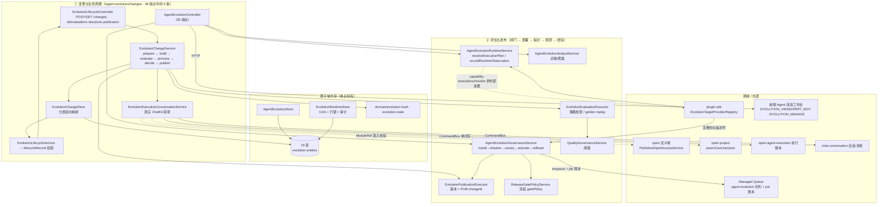

# Agent 演进域 · 架构（01-架构）

> 模块根：`packages/server-ai/src/agent-evolution`（**44 非 spec `.ts` / 19 spec / 19 表 / 48 HTTP 端点**，实测 63 个 `.ts`，基线 commit `80f5676fd`）
> 路由前缀：`/api/agent-evolution`（`RouterModule.register([{ path: '/agent-evolution', module: AgentEvolutionModule }])`）
> 三个控制器：`EvolutionBaselineController`（`baselines`，1 端点）· `EvolutionLifecycleController`（`changes`，8 端点）· `AgentEvolutionController`（空前缀，**39** 端点）
> 准入：`PermissionGuard` + `@Permissions`（读 `EVOLUTION_VIEW | XPERT_EDIT`，写 `EVOLUTION_MANAGE`）；夹具端点在 production 下另有 env 门禁
> 跨端校对：前端 `Agent 演进专家` 的 `01-架构.md` 曾记「45 非 spec，差额 1 待复核」——本域实测 **63 − 19 = 44**，差额已澄清

**本文引用的文件**
- [agent-evolution.module.ts](file://packages/server-ai/src/agent-evolution/agent-evolution.module.ts)
- [controllers/agent-evolution.controller.ts](file://packages/server-ai/src/agent-evolution/controllers/agent-evolution.controller.ts)
- [controllers/evolution-baseline.controller.ts](file://packages/server-ai/src/agent-evolution/controllers/evolution-baseline.controller.ts)
- [changes/lifecycle.controller.ts](file://packages/server-ai/src/agent-evolution/changes/lifecycle.controller.ts)
- [changes/lifecycle.service.ts](file://packages/server-ai/src/agent-evolution/changes/lifecycle.service.ts)
- [changes/lifecycle.projection.ts](file://packages/server-ai/src/agent-evolution/changes/lifecycle.projection.ts)
- [changes/change.service.ts](file://packages/server-ai/src/agent-evolution/changes/change.service.ts)
- [changes/change.store.ts](file://packages/server-ai/src/agent-evolution/changes/change.store.ts)
- [changes/change.processor.ts](file://packages/server-ai/src/agent-evolution/changes/change.processor.ts)
- [changes/change.validation.ts](file://packages/server-ai/src/agent-evolution/changes/change.validation.ts)
- [changes/change.errors.ts](file://packages/server-ai/src/agent-evolution/changes/change.errors.ts)
- [changes/submission.schema.ts](file://packages/server-ai/src/agent-evolution/changes/submission.schema.ts)
- [changes/strategy.service.ts](file://packages/server-ai/src/agent-evolution/changes/strategy.service.ts)
- [changes/evaluation-executor.service.ts](file://packages/server-ai/src/agent-evolution/changes/evaluation-executor.service.ts)
- [changes/publication-executor.service.ts](file://packages/server-ai/src/agent-evolution/changes/publication-executor.service.ts)
- [changes/execution-conversation.service.ts](file://packages/server-ai/src/agent-evolution/changes/execution-conversation.service.ts)
- [application/agent-evolution.service.ts](file://packages/server-ai/src/agent-evolution/application/agent-evolution.service.ts)
- [application/agent-evolution.store.ts](file://packages/server-ai/src/agent-evolution/application/agent-evolution.store.ts)
- [application/evolution-runtime.store.ts](file://packages/server-ai/src/agent-evolution/application/evolution-runtime.store.ts)
- [application/evolution-store.helpers.ts](file://packages/server-ai/src/agent-evolution/application/evolution-store.helpers.ts)
- [application/evolution-persistence-proof.ts](file://packages/server-ai/src/agent-evolution/application/evolution-persistence-proof.ts)
- [application/agent-evolution-governance.service.ts](file://packages/server-ai/src/agent-evolution/application/agent-evolution-governance.service.ts)
- [application/agent-evolution-runtime.service.ts](file://packages/server-ai/src/agent-evolution/application/agent-evolution-runtime.service.ts)
- [application/agent-evolution-analyst.service.ts](file://packages/server-ai/src/agent-evolution/application/agent-evolution-analyst.service.ts)
- [application/agent-evolution-quality-governance.service.ts](file://packages/server-ai/src/agent-evolution/application/agent-evolution-quality-governance.service.ts)
- [application/agent-evolution-release-gate-policy.service.ts](file://packages/server-ai/src/agent-evolution/application/agent-evolution-release-gate-policy.service.ts)
- [application/agent-evolution-queue.service.ts](file://packages/server-ai/src/agent-evolution/application/agent-evolution-queue.service.ts)
- [application/agent-evolution-queue.processor.ts](file://packages/server-ai/src/agent-evolution/application/agent-evolution-queue.processor.ts)
- [application/evolution-baseline.service.ts](file://packages/server-ai/src/agent-evolution/application/evolution-baseline.service.ts)
- [domain/evolution-hash.ts](file://packages/server-ai/src/agent-evolution/domain/evolution-hash.ts)
- [domain/evolution-state.ts](file://packages/server-ai/src/agent-evolution/domain/evolution-state.ts)
- [entities/evolution.entities.ts](file://packages/server-ai/src/agent-evolution/entities/evolution.entities.ts)
- [entities/evolution-row-guards.ts](file://packages/server-ai/src/agent-evolution/entities/evolution-row-guards.ts)
- [providers/conformance-template.provider.ts](file://packages/server-ai/src/agent-evolution/providers/conformance-template.provider.ts)
- [providers/conformance-field-mapping.provider.ts](file://packages/server-ai/src/agent-evolution/providers/conformance-field-mapping.provider.ts)
- [providers/conformance-intent-routing.provider.ts](file://packages/server-ai/src/agent-evolution/providers/conformance-intent-routing.provider.ts)
- [contracts/src/ai/evolution/change.ts](file://packages/contracts/src/ai/evolution/change.ts)
- [contracts/src/ai/evolution/release.ts](file://packages/contracts/src/ai/evolution/release.ts)
- [contracts/src/ai/evolution/runtime.ts](file://packages/contracts/src/ai/evolution/runtime.ts)
- [contracts/src/ai/evolution/governance.ts](file://packages/contracts/src/ai/evolution/governance.ts)
- [plugin-sdk/src/lib/evolution/runtime-capability.ts](file://packages/plugin-sdk/src/lib/evolution/runtime-capability.ts)
- [前端 Agent 演进专家 · 01-架构.md](file://.module-experts/前端专题/Agent 演进专家/implementation/01-架构.md)
- [前端 Agent 演进专家 · C1-能力契约.md](file://.module-experts/前端专题/Agent 演进专家/C1-能力契约.md)

## 目录
1. [专家域职责边界](#专家域职责边界)
2. [子专家划分说明](#子专家划分说明)
3. [跨子域共享文件清单](#跨子域共享文件清单)
4. [子模块清单](#子模块清单)
5. [分层结构](#分层结构)
6. [依赖关系](#依赖关系)
7. [关键不变量](#关键不变量)
8. [架构总览](#架构总览)
9. [组件详细分析](#组件详细分析)
10. [结论](#结论)

## 专家域职责边界
**做什么**：把 Agent 的**能力/策略版本**从「学习信号」推进到「生产指针」的受治理闭环。四块职责：① 目标与基线（`EvolutionTargetEntity` 注册 provider 描述符；`EvolutionBaselineService.inspect`/`publish` 把「已发布源规则」铺成初版能力版本 + 生产指针）；② 变更全生命周期（`EvolutionChangeService.prepare/build/evaluate/process/decide/publish`，`EvolutionLifecycleService` 把它投影成 HTTP 可读的 `EvolutionLifecycleRecord`）；③ 评估与发布（`EvolutionEvaluationExecutor` 逐步评估与 golden replay；`EvolutionPublicationExecutor` 在调用方事务内分配版本与发布包；`AgentEvolutionGovernanceService` 的 install→shadow→canary→activate→rollback 阶梯）；④ 运行时解析与回流（`AgentEvolutionRuntimeService.resolveExecutionPlan` 出能力束，`recordRuntimeObservation` 把观测回流成部署样本）。
**不做什么**：**改的是「能力/策略版本」，不是 Agent 定义本体。** 本域不拥有 `Xpert` 实体、不改助手定义、不写 `shared/agent` 或 middleware-runtime（`packages/server-ai/src/shared` 内 `evolution` 零命中）；对 `xpert` 只做**准入校验**——经 `ModuleRef` 取 `PublishedXpertAccessService.getAccessiblePublishedXpert` 与 `XpertProjectAccessService.assertCanUseXpert`。不拥有会话与消息表（写路径全部走命令）；**不读执行账本**，对 `xpert-agent-execution` 是单向写；不做模型推理；**不计费**（模块内 `billing|credit|quota|membership` 零命中，成本只作为观测指标参与平均）。
**与 `xpert`（定义域）的分工**：定义域持有 `Xpert` 与发布版本；本域只持有「目标 → 能力版本 → 生产指针」这条与定义域**平行**的版本线，两者靠 `EvolutionTargetProvider` 描述符（`providerKey`/`providerVersion`/`artifactSchemaVersion`）对齐，实体层无外键。
**与 `agent-invocation` / `xpert-agent-execution`（执行账本与观测）的分工**：评估与候选阶段通过 `CommandBus` 写**真实 ChatKit 会话与执行账本**（`EvolutionExecutionConversationService`，类注释逐字：`A real, persisted ChatKit transcript of provider execution. No extra agent or model invocation.`），写的是 `ChatConversationUpsertCommand`/`ChatMessageUpsertCommand`/`XpertAgentExecutionUpsertCommand`（RUNNING → SUCCESS/ERROR）；观测则从**外部运行时**经 `recordRuntimeObservation` 回流并只用于累加部署统计。`agent-invocation` 目录内 `evolution` 零命中——**两套数据独立，无关联校验**。
**与前端的关系**：前端 `Agent 演进专家` 是**叶子域**，与本域的唯一接触面是 HTTP（`API_AGENT_EVOLUTION = '/api/agent-evolution'`），其 17 路 `load()` 与 4s `refreshChanges()` 直接消费本域端点，完全不感知 19 张表。**端点级比对结论**：前端 `C1-能力契约.md` 列出的 27 条路径与本域实现**逐条一致**；本域另有 5 条前端清单未列（`GET /runtime-observations`、`GET /audit-events`、`GET|POST /experiences`、`POST /capability-executions/resolve`、`POST /simulations/conformance`），外加 `POST /changes/conformance-template` 夹具入口。

章节来源：[change.service.ts](file://packages/server-ai/src/agent-evolution/changes/change.service.ts)（关键符号：EvolutionChangeService.prepare）、[execution-conversation.service.ts](file://packages/server-ai/src/agent-evolution/changes/execution-conversation.service.ts)（关键符号：EvolutionExecutionConversationService.start）、[agent-evolution-runtime.service.ts](file://packages/server-ai/src/agent-evolution/application/agent-evolution-runtime.service.ts)（关键符号：AgentEvolutionRuntimeService.recordRuntimeObservation）、[前端 C1-能力契约.md](file://.module-experts/前端专题/Agent 演进专家/C1-能力契约.md)（关键符号：API_AGENT_EVOLUTION）

## 子专家划分说明
① **变更与生命周期**：`changes/{change.service,change.store,change.processor,change.validation,change.errors}.ts` · `changes/submission.schema.ts` · `changes/strategy.service.ts` · `changes/{lifecycle.service,lifecycle.controller,lifecycle.projection}.ts` · `changes/execution-conversation.service.ts` · `controllers/agent-evolution.controller.ts` · `providers/conformance-template.provider.ts`。核心类：`EvolutionChangeService`、`EvolutionChangeStore`、`EvolutionStrategyService`、`EvolutionLifecycleService`、`EvolutionExecutionConversationService`。
② **评估与发布**：`application/agent-evolution-{governance,release-gate-policy,quality-governance,runtime,service,analyst,queue,queue.processor}.service.ts` · `application/evolution-baseline.service.ts` · `changes/{evaluation-executor,publication-executor}.service.ts` · `controllers/evolution-baseline.controller.ts` · `providers/{conformance-field-mapping,conformance-intent-routing}.provider.ts`。核心类：`AgentEvolutionGovernanceService`、`EvolutionEvaluationExecutor`、`EvolutionPublicationExecutor`、`AgentEvolutionRuntimeService`、`EvolutionBaselineService`。
**划分依据**：① 是「记录与投影」侧（提交→候选→评估记录→审批→发布的**意图与事实**），② 是「闸门与生效」侧（阈值判定→部署阶梯→指针切换→观测回流→经验沉淀）。两侧通过 `EvolutionChange` 契约对象与跨子域共享 store 交换数据，**不共享可变状态**。

章节来源：[change.service.ts](file://packages/server-ai/src/agent-evolution/changes/change.service.ts)（关键符号：EvolutionChangeService.decide、EvolutionChangeService.publish）、[agent-evolution-governance.service.ts](file://packages/server-ai/src/agent-evolution/application/agent-evolution-governance.service.ts)（关键符号：AgentEvolutionGovernanceService.activateProduction）、[evolution-baseline.service.ts](file://packages/server-ai/src/agent-evolution/application/evolution-baseline.service.ts)（关键符号：EvolutionBaselineService.publish）

## 跨子域共享文件清单
以下 8 项被两个子域同时读写，任何一侧改动都必须双边复核：
1. `entities/evolution.entities.ts`：**19 表全集**（`AGENT_EVOLUTION_ENTITIES` 导出的 19 个 `@Entity`），实体层无显式 `@ManyToOne`，FK 只来自基类 `organization/tenant/createdBy`；全部列 `type: 'json'`（无 jsonb），无 `@VersionColumn`、无软删。
2. `application/agent-evolution.store.ts`：目标/基线/事件/提案/候选/数据集/评估/发布/部署/经验/作业的统一读写门面，`getDashboard` 亦由此透传。
3. `application/evolution-runtime.store.ts`：运行时侧独占写入者——发布状态迁移、指针 CAS、金丝雀覆盖、观测累加与自动暂停、审计落地（文件头注释逐字：`// Invariants: runtime rollout mutations keep their original CAS, locks and safety gates.`）。
4. `application/evolution-store.helpers.ts`：租户/组织 where 归一（`tenantWhere` 用 `IsNull()` 表达「组织为空」）、分页归一（`pageSize` 上限 100）、`canaryTestOverrideActiveKey` 的组合哈希。
5. `application/evolution-persistence-proof.ts`：持久化自证（配合 `evolution-persistence.integration.spec.ts`，需 `AGENT_EVOLUTION_PERSISTENCE_E2E=1` 才跑）。
6. `domain/evolution-hash.ts` + `domain/evolution-state.ts`：前者是全域唯一哈希口径（`sha256:` 前缀 + 键排序的规范 JSON），后者是候选/发布两张迁移表 + `assertCandidateTransition`/`assertReleaseTransition`。
7. `agent-evolution.module.ts`：唯一装配点（`imports` 含 `RouterModule`/`TypeOrmModule.forFeature(AGENT_EVOLUTION_ENTITIES)`/`CqrsModule`/`DiscoveryModule`），控制器 3 个、provider 21 项、`exports` 4 项。
8. 三个 barrel：`application/index.ts`、`entities/index.ts`、`providers/index.ts`（后者聚合三个夹具 provider 为 `AGENT_EVOLUTION_CONFORMANCE_PROVIDERS`）。

章节来源：[evolution.entities.ts](file://packages/server-ai/src/agent-evolution/entities/evolution.entities.ts)（关键符号：AGENT_EVOLUTION_ENTITIES）、[evolution-runtime.store.ts](file://packages/server-ai/src/agent-evolution/application/evolution-runtime.store.ts)（关键符号：EvolutionRuntimeStore.consumeCanaryTestOverride）、[evolution-store.helpers.ts](file://packages/server-ai/src/agent-evolution/application/evolution-store.helpers.ts)（关键符号：canaryTestOverrideActiveKey）、[agent-evolution.module.ts](file://packages/server-ai/src/agent-evolution/agent-evolution.module.ts)（关键符号：AgentEvolutionModule 的 imports/controllers/providers/exports）

## 子模块清单
| 目录 / 文件 | 层 | 对外接口 |
|---|---|---|
| `agent-evolution.module.ts` | 装配 | 路由前缀 `/api/agent-evolution`；`exports`：`AgentEvolutionService`、`AgentEvolutionRuntimeService`、`EVOLUTION_RUNTIME_SERVICE_TOKEN`、`EvolutionTargetProviderRegistry` |
| `controllers/agent-evolution.controller.ts` | 入口（39 端点） | `/dashboard`、`/targets`、`/targets/synchronize`、`/capability-versions`、`/capability-bundles`、`/active-pointers`、`/learning-events(+/:id/review)`、`/diagnoses`、`/clusters`、`/proposals`、`/candidates(+/:id/approvals)`、`/datasets`、`/evaluations`、`/releases(+/:id/{install,shadow,canary,pause,activate,rollback})`、`/release-packages`、`/releases/:id/canary-test-overrides`、`/deployments`、`/runtime-observations`、`/audit-events`、`/experiences`、`/jobs/:jobId`、`/capability-executions/resolve`、`/simulations/conformance`、`/examples/conformance-field-mapping/run` |
| `changes/lifecycle.controller.ts` | 入口（8 端点） | `POST /changes`、`POST /changes/conformance-template`、`GET /changes`、`GET /changes/records`、`GET /changes/:id`、`POST /changes/:id/{evaluations,decisions,publication}` |
| `controllers/evolution-baseline.controller.ts` | 入口（1 端点） | `GET /baselines/:targetId`（只读；`canManage` 由返回值内的权限位表达） |
| `application/*.service.ts` | 服务 | 治理、运行时、分析、质量治理、闸门策略、队列、基线、dashboard/目标同步、conformance 模拟 |
| `application/*.store.ts` + `evolution-store.helpers.ts` | 持久化 | 19 表的 TypeORM 读写与事务；`EvolutionRuntimeStore` 独占运行时写入 |
| `changes/*` | 生命周期 | 变更协调器、记录拼装、队列处理器、校验/错误码、提交 schema、策略冻结、评估/发布执行器、会话转录、HTTP 投影 |
| `domain/{evolution-hash,evolution-state}.ts` | 领域 | 规范哈希与两张状态迁移表 |
| `entities/evolution.entities.ts` + `entities/evolution-row-guards.ts` | 实体 | 19 表定义 + 行守卫（`stagedReleaseRow` 等收窄） |
| `providers/conformance-*.provider.ts` | 夹具 | 三个 `@EvolutionTargetProviderStrategy`：`conformance.template_version`（`test_fixture`/R1/capabilities 近乎全 false）、字段映射、意图路由 |
| `examples/` | 夹具数据 | `CONFORMANCE_FIELD_MAPPING_EXAMPLE` 等，被 `/examples/...` 端点消费 |

章节来源：[agent-evolution.controller.ts](file://packages/server-ai/src/agent-evolution/controllers/agent-evolution.controller.ts)（关键符号：AgentEvolutionController 的 @Controller/@Permissions 组合）、[lifecycle.controller.ts](file://packages/server-ai/src/agent-evolution/changes/lifecycle.controller.ts)（关键符号：EvolutionLifecycleController.submit、conformance）、[providers/index.ts](file://packages/server-ai/src/agent-evolution/providers/index.ts)（关键符号：AGENT_EVOLUTION_CONFORMANCE_PROVIDERS）

## 分层结构
- **控制器层**：三个控制器均为「薄转发 + 装饰器鉴权」。`AgentEvolutionController` 注入 5 个服务（`AgentEvolutionService`/`AgentEvolutionGovernanceService`/`AgentEvolutionAnalystService`/`AgentEvolutionQueueService`/`AgentEvolutionRuntimeService`），把 `RequestContext` 归一成 `requestScope()`（tenant/org）与 `commandContext()`（再加 `actorId`/`actorRole`/`actorRoleName`/`approvalAuthority`/`actorType:'human'`）后下传；`normalizeQuery()` 把 `pageSize`/`sort`/`order` 收窄成白名单。
- **服务层（`application/`）**：`AgentEvolutionGovernanceService` 是 HTTP 治理总入口（发布阶梯 + 审批 + 经验 + 覆盖 + 各类 list），`AgentEvolutionService` 只做 dashboard 与目标同步/conformance 模拟，`AgentEvolutionAnalystService` 做诊断与聚类，`AgentEvolutionQualityGovernanceService` 与 `AgentEvolutionReleaseGatePolicyService` 是**纯函数式判据**（阈值表），`AgentEvolutionQueueService` 负责作业账本 + 投递，`AgentEvolutionRuntimeService` 实现 `EvolutionRuntimeApi`。
- **生命周期层（`changes/`）**：`EvolutionChangeService` 是唯一协调器，`EvolutionChangeStore` 把 `EvolutionChange` 契约对象与 `Proposal/Candidate/Evaluation/Approval/Release` 分表**双向映射**，`EvolutionChangeProcessor` 消费 `change_preparation` 队列，`EvolutionLifecycleService` 产出 `EvolutionLifecycleRecord` 投影（`lifecycleRecord()` 计算 `phase`/`publicationStatus`/`effectStatus` 与 `capabilities.{stagedRollout,evaluate,decide,publish}`）。
- **领域层（`domain/`）**：`hashEvolutionValue`/`canonicalEvolutionJson` 是全域哈希唯一实现；`evolution-state.ts` 是唯一迁移白名单。
- **持久化层**：`AgentEvolutionStore`（业务读 + 大量写）+ `EvolutionRuntimeStore`（运行时写，全事务 + 行锁 + CAS），两者都在 `application/`。
- **实体层（`entities/`）**：19 表 + 行守卫；`providers/` 是**开发/测试专用的夹具 provider**，不参与生产业务。

章节来源：[agent-evolution.controller.ts](file://packages/server-ai/src/agent-evolution/controllers/agent-evolution.controller.ts)（关键符号：requestScope、commandContext、normalizeQuery）、[lifecycle.projection.ts](file://packages/server-ai/src/agent-evolution/changes/lifecycle.projection.ts)（关键符号：lifecycleRecord）、[agent-evolution.store.ts](file://packages/server-ai/src/agent-evolution/application/agent-evolution.store.ts)（关键符号：AgentEvolutionStore.getDashboard）

## 依赖关系
**出向（本域依赖）**
| 依赖面 | 具体符号 | 用途 |
|---|---|---|
| 契约包 | `packages/contracts/src/ai/evolution/*`（16 个文件：`baseline`/`candidate`/`capability-version`/`change`/`evaluation`/`example`/`experience`/`governance`/`learning-event`/`persistence`/`provider`/`release`/`runtime`/`strategy`/`target`/`index`） | 全部数据形状、`EvolutionJobStatus`、`isStagedRelease`、`FEEDBACK_LEARNING_STRATEGY`/`HUMAN_PROPOSAL_STRATEGY`/`evidenceDrivenStrategy` |
| `@xpert-ai/plugin-sdk` | `EvolutionTargetProviderRegistry`、`EvolutionTargetProviderStrategy`、`EvolutionRuntimeCapability`、`EvolutionBaselineRuntimeCapability`、`EvolutionChangeRuntimeCapability`、`MANAGED_QUEUE_SERVICE_TOKEN`、`PluginJobProcessor` | provider 注册表、运行时能力三件套、队列 |
| `@xpert-ai/server-core` / `@xpert-ai/server-config` | `PermissionGuard`、`Permissions`、`RequestContext`、`environment` | 鉴权、上下文、env |
| **执行账本**（`xpert-agent-execution`） | `XpertAgentExecutionUpsertCommand`（RUNNING + `metadata: { from:'job', evolutionChangeId }`；终态 SUCCESS/ERROR + error 文本） | 评估/候选阶段的执行留痕，**单向写、不读** |
| **会话域**（`chat-conversation`） | `ChatConversationUpsertCommand`、`ChatMessageUpsertCommand`、`ChatConversationThreadService.ensurePrimary/updateRuntimeState` | 变更的 ChatKit 转录 |
| **`xpert`（定义域）** | `PublishedXpertAccessService.getAccessiblePublishedXpert`（经 `ModuleRef`，`strict:false`） | 执行上下文可用性校验 |
| **`xpert-project`** | `XpertProjectAccessService.assertCanUseXpert(projectId, xpertId)` | 项目内可用性校验 |
| **SSE** | `RedisSseStreamService` | 变更转录的实时片段（失败被 `logger.warn` 吞掉，注释：`Persisted messages and runtime state remain authoritative when live delivery fails.`） |

**入向（依赖本域）**：前端 **Agent 演进工作台**（`/agent-evolution/*`，权限位 `EVOLUTION_VIEW | XPERT_EDIT` + `EVOLUTION_MANAGE`，`dual-scope`）；插件侧经 `EVOLUTION_RUNTIME_SERVICE_TOKEN` 与三个 `@RuntimeCapabilityProvider` 消费运行时 API；`EvolutionTargetProviderRegistry` 由外部插件注册目标。**未找到**：`resolveExecutionPlan` 的仓内调用方（除自身 HTTP 端点与 spec）——「发布是否真影响到 Agent 运行时」取决于外部域，本仓无证据。

章节来源：[agent-evolution.module.ts](file://packages/server-ai/src/agent-evolution/agent-evolution.module.ts)（关键符号：EVOLUTION_RUNTIME_SERVICE_TOKEN 的 useExisting）、[execution-conversation.service.ts](file://packages/server-ai/src/agent-evolution/changes/execution-conversation.service.ts)（关键符号：EvolutionExecutionConversationService.validate）、[contracts/src/ai/evolution/index.ts](file://packages/contracts/src/ai/evolution/index.ts)、[前端 01-架构.md](file://.module-experts/前端专题/Agent 演进专家/implementation/01-架构.md)（关键符号：API_AGENT_EVOLUTION）

## 关键不变量
1. **权限位三分**：一切读端点用 `@Permissions(AIPermissionsEnum.EVOLUTION_VIEW, AIPermissionsEnum.XPERT_EDIT)`（**或**语义，与前端路由 `permissions.only: [EVOLUTION_VIEW, XPERT_EDIT]` 同口径），一切写端点（含 `/targets/synchronize`、`/capability-executions/resolve`、`/simulations/conformance`、`/examples/...`）用 `EVOLUTION_MANAGE`；`EvolutionLifecycleController` 用**类级** `@UseGuards(PermissionGuard)` + 方法级 `@Permissions`；基线只读端点返回体内以 `canManage = RequestContext.hasPermission(EVOLUTION_MANAGE)` 让前端区分可写性。控制器把 `SUPER_ADMIN|ADMIN` 映射为 `approvalAuthority: 'administrator'`，其余为 `'standard'`。
2. **夹具生产门禁 + scope 二次校验**：两个夹具端点调用 `assertConformanceEnabled()`——`environment.production && AGENT_EVOLUTION_ENABLE_CONFORMANCE !== 'true'` 即抛 `NotFoundException`（**与「不存在」不可区分**）；`ConformanceTemplateProvider` 侧另有 `assertTemplateConformanceEnabled()` 同款门禁，并对 target/scope 做 `authorizeScope` 二次校验。夹具描述符自标 `targetType: 'test_fixture'`、`riskLevel: 'R1'`、`capabilities` 除 `candidateBuild` 外全 false，`validateCurrent` 还要求 evidence 恰为 1 条 feedback——**夹具口径不是通用规则**。
3. **能力版本不可变**：`CapabilityVersionEntity` 以 `UQ(tenant,organization,targetId,sequence)` + `artifactHash` 列固化「第 N 版」，`versionId = \`${targetId}:${changeId}\``、`sequence = max(sequence)+1`、`semanticVersion = \`1.${sequence-1}.0\``，`sourceCandidateId` 指向候选；版本一旦落库只被指针引用，不被改写（基线的「精确重放」也是**只返回旧行**，注释逐字：`// An exact replay after success is harmless; never overwrite a different version on retry.`）。
4. **发布包冻结 `gatePolicy`**：`EvolutionPublicationExecutor.package()` 在调用方事务内一次性冻结 `gatePolicy`（`profile`/六个样本与时长阈值写入 `ReleasePackage`），命名固定 `PUB-<changeId>`（幂等：已存在直接返回旧值）；此后 `forRelease()` 只读冻结值，缺失即抛 `Release gate policy was not frozen`——**发布中途改 env 不影响已建包**。
5. **金丝雀覆盖只生效一次**：`EvolutionCanaryTestOverrideEntity` 以 `UQ(activeKey)`（`sha256(tenant:org:deploymentId:subjectKey)`）保证「同主体同部署至多一条活跃覆盖」；`consumeCanaryTestOverride` 用 `pessimistic_write` 取 pending 行、过期则翻 `expired`、否则翻 `consumed` 并记 `consumedByExecutionId`。同一 `executionId` 重试**返回已消费结果**；`resolveExecutionPlan` 的判定是 `!consumedOverride && !deterministicSelection → continue`，即覆盖消费后**同一主体回落**到 `deterministicPercent = sha256(deploymentId:subjectKey)` 的确定性路由。
6. **回滚与指针的切换语义**：`activatePointerCas`/`rollbackPointerCas` 均以 `revision + activeVersionId` 为条件更新，`affected !== 1` 即抛 `Active Pointer CAS conflict`；激活前必须校验指针仍等于 `release.rollbackVersionId`（注释语义：指针已被别人前推就拒绝）；回滚成功后 release 状态与指针 revision **同时前推**，而 `rolled_back` 在迁移表中是**终态**——不可回到原 canary 档，只能重新走 install。
7. **审计留痕**：每次发布动作（installed/shadow_started/canary_started/paused/activated/auto_paused/rolled_back）、覆盖创建与消费、指针 CAS、版本发布都写 `agent_evolution_audit_event`（含 `releasePackageId`/`candidateId`/`action`/`actorId`/`actorRole`/`summary`/`occurredAt`）；严重错误的自动暂停是**系统主体**动作（`actorId: 'agent-evolution-runtime'`、`actorRole: 'system_safety_guard'`），且 `rollbackProduction` 显式拒绝 agent 主体：`Agents cannot initiate Production rollback`。

章节来源：[agent-evolution.controller.ts](file://packages/server-ai/src/agent-evolution/controllers/agent-evolution.controller.ts)（关键符号：assertConformanceEnabled、commandContext）、[conformance-template.provider.ts](file://packages/server-ai/src/agent-evolution/providers/conformance-template.provider.ts)（关键符号：assertTemplateConformanceEnabled、ConformanceTemplateProvider.descriptor）、[publication-executor.service.ts](file://packages/server-ai/src/agent-evolution/changes/publication-executor.service.ts)（关键符号：EvolutionPublicationExecutor.package）、[release-gate-policy.service.ts](file://packages/server-ai/src/agent-evolution/application/agent-evolution-release-gate-policy.service.ts)（关键符号：AgentEvolutionReleaseGatePolicyService.forRelease）、[evolution-runtime.store.ts](file://packages/server-ai/src/agent-evolution/application/evolution-runtime.store.ts)（关键符号：EvolutionRuntimeStore.consumeCanaryTestOverride、saveRuntimeObservation）、[agent-evolution-runtime.service.ts](file://packages/server-ai/src/agent-evolution/application/agent-evolution-runtime.service.ts)（关键符号：deterministicPercent）、[governance.service.ts](file://packages/server-ai/src/agent-evolution/application/agent-evolution-governance.service.ts)（关键符号：rollbackProduction、activateProduction）、[evolution-state.ts](file://packages/server-ai/src/agent-evolution/domain/evolution-state.ts)（关键符号：assertReleaseTransition）

## 架构总览

图表来源：[agent-evolution.controller.ts](file://packages/server-ai/src/agent-evolution/controllers/agent-evolution.controller.ts)

**闭环读法**：学习信号（`ingestLearningEvent`，要求 target 处于 `active`、confidential 必须已脱敏）→ 诊断/聚类（`AnalystService` 按 `correctionSignature` 分组，`qualifiesLearning` 决定 `proposal_ready|collecting`）→ 提案与候选（`EvolutionChangeService` 的 `prepare/build`）→ 评估（`EvaluationExecutor`：target 检查或 golden replay，落 `EvaluationRun` + `gatePassed`）→ 闸门（`QualityGovernanceService` 四项阈值 + 人工审批 quorum）→ 发布（`PUB-<changeId>` + 冻结 `gatePolicy`）→ 部署阶梯（5/25/50 不可跳档）→ 指针（`ActiveCapabilityPointer.channel='production'`）→ 观测回流（`saveRuntimeObservation` 累加样本，严重错误自动 pause）→ 经验（`createExperience` 需 active release + 生产闸门）。**跨域两条边**：转录/执行账本是单向写；运行时观测是外部推入，本域只做统计。

图表来源：[agent-evolution.module.ts](file://packages/server-ai/src/agent-evolution/agent-evolution.module.ts)（关键符号：AgentEvolutionModule）· [change.service.ts](file://packages/server-ai/src/agent-evolution/changes/change.service.ts)（关键符号：EvolutionChangeService.prepare/build/evaluate/decide/publish）· [agent-evolution-governance.service.ts](file://packages/server-ai/src/agent-evolution/application/agent-evolution-governance.service.ts)（关键符号：startCanary、activateProduction、rollbackProduction、createExperience）· [agent-evolution-runtime.service.ts](file://packages/server-ai/src/agent-evolution/application/agent-evolution-runtime.service.ts)（关键符号：resolveExecutionPlan）· [evolution-runtime.store.ts](file://packages/server-ai/src/agent-evolution/application/evolution-runtime.store.ts)（关键符号：saveRuntimeObservation）

## 组件详细分析
### 变更协调器与记录拼装（①）
`EvolutionChangeService` 持有全部阶段入口，且**不整表落库**——文件注释逐字：`// Invariants: one Proposal owns request identity; Candidate, Evaluation, Approval and Release` / `// are authorized for their own stage. EvolutionChange is assembled, never persisted whole.`。`prepare()` 先 `strategies.freeze()` 冻结策略快照（含 `hash`），校验 scope 白名单与 `validateChangeInput`，feedback 模式下对学习事件做「数量/主体/新鲜度/脱敏」四重门（失败即 `learning_evidence_gate_failed`）并把事件重算成 evidence 与输入**逐条对账**（`learning_evidence_snapshot_mismatch`）；随后写 `Proposal` 行 + `job change_preparation`，非 defer 时入队。`build/evaluate` 只允许「候选/评估尚未存在」时改输入，已存在即 `immutable_candidate_changed` / `evaluation_snapshot_mismatch`。`process()` 是幂等 worker：非可推进状态时把残留的 `pending|queued|running` job 收尾成 `completed`；推进时**先提交 running 阶段再调外部 provider**，让读侧能看到进度。
### 评估与发布执行器（②）
`EvolutionEvaluationExecutor` 注释逐字：`// Each evaluator runs against the same frozen candidate; an omitted assessment is never a passing test.`——无评估步骤时 `assessment='not_applicable'`（前端不得当通过）；多步骤时逐条落 `EvaluationRun`（`strategyHash` 绑定，`checkId` 加 `step.key:` 前缀），并强制 `candidateHash/baselineHash/evidenceHash/dataset*` 全一致。`EvolutionPublicationExecutor` 注释逐字：`// Staged publication allocates its version and package in the caller's transaction.`——`staged_rollout` 走它、`version_write` 走 provider 的 `versionPublisher`，两条路都要 `human_approval_required` 前置。
### 治理阶梯与基线（②）
`AgentEvolutionGovernanceService` 把阶梯压成**一组显式前置条件**：`startCanary` 只接受 `5|25|50`，从 shadow/paused-shadow 起必须 `5%` 且 shadow 阈值全达标，扩档由 `latest.canaryPercent` 推导 `expectedNext`（5→25→50，**跳档即 400**）；`activateProduction` 要求 `canaryPercent === 50` + 生产阈值 + 指针仍等于 `rollbackVersionId`；`createExperience` 要求 release 为 `active` + 生产部署达 `experienceMinimumSamples`/时长 + `severeErrors === 0` + 评估记录 `runId` 一致。`EvolutionBaselineService` 与之**互斥**：`inspect` 状态机含 `managed_release`/`blocked`/`missing`/`current`/`update_available`，`publish` 用 `pg_advisory_xact_lock(hashtextextended(...))` 覆盖「首次初始化无行可锁」，并要求 `expectedRevision` + `expectedHash` 双预期。
章节来源：[change.service.ts](file://packages/server-ai/src/agent-evolution/changes/change.service.ts)（关键符号：EvolutionChangeService.process、checkIdentity）、[evaluation-executor.service.ts](file://packages/server-ai/src/agent-evolution/changes/evaluation-executor.service.ts)（关键符号：EvolutionEvaluationExecutor.run）、[publication-executor.service.ts](file://packages/server-ai/src/agent-evolution/changes/publication-executor.service.ts)（关键符号：EvolutionPublicationExecutor.package）、[governance.service.ts](file://packages/server-ai/src/agent-evolution/application/agent-evolution-governance.service.ts)（关键符号：startShadow、startCanary、activateProduction、createExperience）、[evolution-baseline.service.ts](file://packages/server-ai/src/agent-evolution/application/evolution-baseline.service.ts)（关键符号：EvolutionBaselineService.inspect、publish）

## 结论
本域的架构重心是「**两条版本线的对齐 + 一道只前推的指针**」：定义域持有 `Xpert` 本体，本域持有平行能力版本线，二者只靠 provider 描述符与哈希对齐；所有「生效」都收敛成 `ActiveCapabilityPointer` 的一次 CAS，而所有「能不能生效」都收敛成两组纯函数阈值（质量治理 + 发布闸门）与一张冻结在发布包里的 `gatePolicy`。三条需要长期防守的边界：① **哈希口径唯一**（`domain/evolution-hash.ts` 是唯一实现，任何绕过它自算摘要的代码都会与 `strategyHash`/`evidenceHash`/`candidateHash` 的绑定校验冲突）；② **运行时写入唯一**（`EvolutionRuntimeStore` 独占状态迁移、指针 CAS 与审计，控制器与治理服务不得直写实体）；③ **夹具与生产同构但不同权**（夹具 provider 走 `test_fixture` + env 门禁，生产路径的 `capabilities` 由目标描述符声明，两者不可互换）。已知的结构性弱点见 `02-实现.md`：变更无整表导致跨表拼装视图、`job.status` 口径含契约不存在的 `pending`、以及 19 张表**没有任何 SQL 迁移文件**（唯一 DDL 事实来源是实体注记）。
章节来源：[evolution-hash.ts](file://packages/server-ai/src/agent-evolution/domain/evolution-hash.ts)（关键符号：hashEvolutionValue、canonicalEvolutionJson）、[evolution-runtime.store.ts](file://packages/server-ai/src/agent-evolution/application/evolution-runtime.store.ts)（关键符号：EvolutionRuntimeStore.activatePointerCas）、[change.store.ts](file://packages/server-ai/src/agent-evolution/changes/change.store.ts)（关键符号：EvolutionChangeStore 的 Proposal/Candidate 映射）
