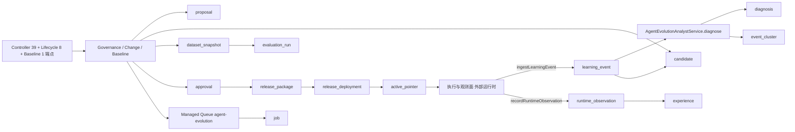
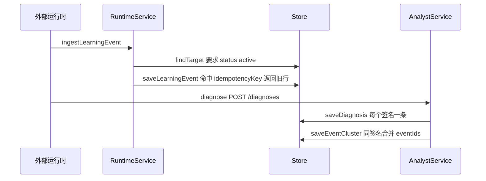
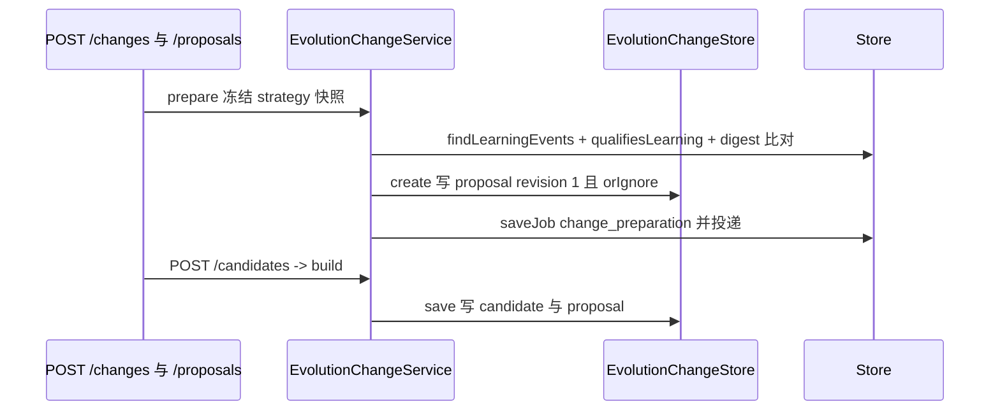
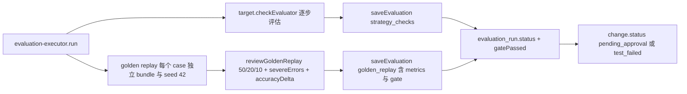
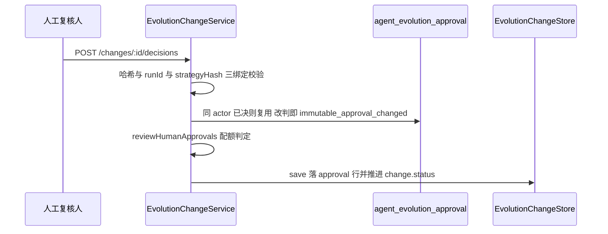
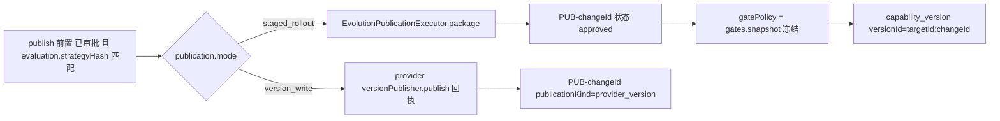
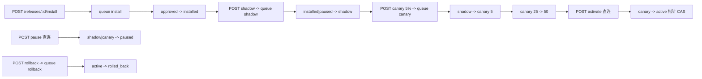
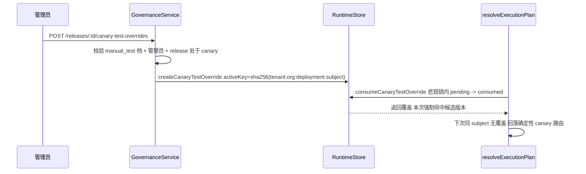
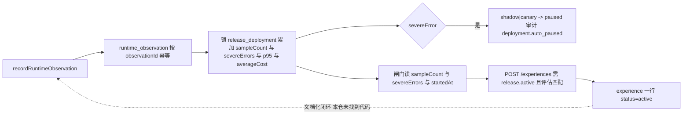
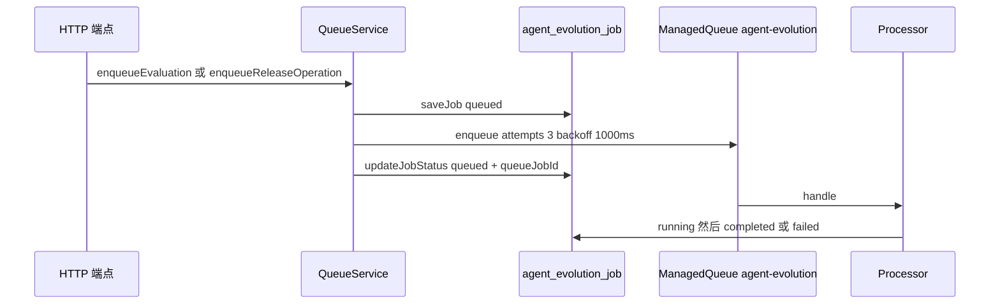

# Agent 演进域 · 数据流转

> 只读梳理（commit `80f5676fd`）。范围：`packages/server-ai/src/agent-evolution/**`（44 非 spec / 19 spec / **19 张表** / **48 个端点**，HTTP 前缀 `/api/agent-evolution`）。子域：① 变更与生命周期 ② 评估与发布。引用为仓库根相对路径；未能证实处标 `[推测]`。

**本文引用的文件**

- [agent-evolution/agent-evolution.module.ts](file://packages/server-ai/src/agent-evolution/agent-evolution.module.ts)
- [agent-evolution/controllers/agent-evolution.controller.ts](file://packages/server-ai/src/agent-evolution/controllers/agent-evolution.controller.ts)
- [agent-evolution/changes/lifecycle.controller.ts](file://packages/server-ai/src/agent-evolution/changes/lifecycle.controller.ts)
- [agent-evolution/application/agent-evolution-runtime.service.ts](file://packages/server-ai/src/agent-evolution/application/agent-evolution-runtime.service.ts)
- [agent-evolution/application/agent-evolution-governance.service.ts](file://packages/server-ai/src/agent-evolution/application/agent-evolution-governance.service.ts)
- [agent-evolution/application/agent-evolution-analyst.service.ts](file://packages/server-ai/src/agent-evolution/application/agent-evolution-analyst.service.ts)
- [agent-evolution/application/agent-evolution-queue.service.ts](file://packages/server-ai/src/agent-evolution/application/agent-evolution-queue.service.ts)
- [agent-evolution/application/agent-evolution-queue.processor.ts](file://packages/server-ai/src/agent-evolution/application/agent-evolution-queue.processor.ts)
- [agent-evolution/application/agent-evolution.store.ts](file://packages/server-ai/src/agent-evolution/application/agent-evolution.store.ts)
- [agent-evolution/application/evolution-runtime.store.ts](file://packages/server-ai/src/agent-evolution/application/evolution-runtime.store.ts)
- [agent-evolution/application/evolution-store.helpers.ts](file://packages/server-ai/src/agent-evolution/application/evolution-store.helpers.ts)
- [agent-evolution/application/agent-evolution.service.ts](file://packages/server-ai/src/agent-evolution/application/agent-evolution.service.ts)
- [agent-evolution/application/evolution-baseline.service.ts](file://packages/server-ai/src/agent-evolution/application/evolution-baseline.service.ts)
- [agent-evolution/application/agent-evolution-release-gate-policy.service.ts](file://packages/server-ai/src/agent-evolution/application/agent-evolution-release-gate-policy.service.ts)
- [agent-evolution/application/agent-evolution-quality-governance.service.ts](file://packages/server-ai/src/agent-evolution/application/agent-evolution-quality-governance.service.ts)
- [agent-evolution/application/evolution-governance.helpers.ts](file://packages/server-ai/src/agent-evolution/application/evolution-governance.helpers.ts)
- [agent-evolution/changes/change.service.ts](file://packages/server-ai/src/agent-evolution/changes/change.service.ts)
- [agent-evolution/changes/change.store.ts](file://packages/server-ai/src/agent-evolution/changes/change.store.ts)
- [agent-evolution/changes/change.processor.ts](file://packages/server-ai/src/agent-evolution/changes/change.processor.ts)
- [agent-evolution/changes/evaluation-executor.service.ts](file://packages/server-ai/src/agent-evolution/changes/evaluation-executor.service.ts)
- [agent-evolution/changes/publication-executor.service.ts](file://packages/server-ai/src/agent-evolution/changes/publication-executor.service.ts)
- [agent-evolution/changes/execution-conversation.service.ts](file://packages/server-ai/src/agent-evolution/changes/execution-conversation.service.ts)
- [agent-evolution/changes/lifecycle.projection.ts](file://packages/server-ai/src/agent-evolution/changes/lifecycle.projection.ts)
- [agent-evolution/domain/evolution-state.ts](file://packages/server-ai/src/agent-evolution/domain/evolution-state.ts)
- [agent-evolution/domain/evolution-hash.ts](file://packages/server-ai/src/agent-evolution/domain/evolution-hash.ts)
- [agent-evolution/entities/evolution.entities.ts](file://packages/server-ai/src/agent-evolution/entities/evolution.entities.ts)
- [plugin-sdk/src/lib/evolution/runtime-capability.ts](file://packages/plugin-sdk/src/lib/evolution/runtime-capability.ts)

## 目录

- [总览与读写面](#总览与读写面)
- [链路一 学习事件入账与诊断链](#链路一-学习事件入账与诊断链)
- [链路二 提案与候选链](#链路二-提案与候选链)
- [链路三 评估链](#链路三-评估链)
- [链路四 审批链](#链路四-审批链)
- [链路五 发布包链](#链路五-发布包链)
- [链路六 部署阶梯与指针链](#链路六-部署阶梯与指针链)
- [链路七 金丝雀一次性覆盖链](#链路七-金丝雀一次性覆盖链)
- [链路八 运行时观测回流与经验链](#链路八-运行时观测回流与经验链)
- [链路九 job 链](#链路九-job-链)
- [状态机汇总](#状态机汇总)
- [本域写 vs 跨域写对照](#本域写-vs-跨域写对照)
- [已知风险](#已知风险)

## 总览与读写面

三条写入面并存：HTTP（三个控制器）→ store；Managed Queue `agent-evolution` → 处理器 → 同一批 store 方法；运行时能力三件套（`platform.agent-evolution` / `.baselines` / `.changes`）由外部域直接调用。**本模块不订阅任何跨域事件**（`@OnEvent` 0 命中）、**无调度器**（`@Cron`/`@Interval` 0 命中）、**无 CQRS handler**（`@CommandHandler`/`@QueryHandler` 0 命中，`CqrsModule` 只用于 `PermissionGuard` 解析 `CommandBus`）。

图表来源：[agent-evolution.controller.ts](file://packages/server-ai/src/agent-evolution/controllers/agent-evolution.controller.ts)、[agent-evolution-queue.processor.ts](file://packages/server-ai/src/agent-evolution/application/agent-evolution-queue.processor.ts)、[agent-evolution-runtime.service.ts](file://packages/server-ai/src/agent-evolution/application/agent-evolution-runtime.service.ts)

- `AgentEvolutionStore` 覆盖 19 表的读/写；指针 CAS、覆盖创建与消费、观测累加这 4 类**必须事务 + 锁**的写被抽到 `EvolutionRuntimeStore`，由 store 内的包装方法惰性 `new EvolutionRuntimeStore(dataSource)` 转发。
- 完全无 HTTP 写端点的表：`runtime_observation`（仅 `recordRuntimeObservation`）、`learning_event` 的**入账**（仅 `ingestLearningEvent`；HTTP 只有 `PATCH /learning-events/:eventId/review` 改 `reviewStatus`）。
- 唯一读投影不落库：变更（`EvolutionChange`）由 `EvolutionChangeStore.assemble` 从 proposal/candidate/evaluation_run/approval/release_package 五表拼装，见 `// EvolutionChange is assembled, never persisted whole.`。

章节来源：[agent-evolution.module.ts](file://packages/server-ai/src/agent-evolution/agent-evolution.module.ts)（关键符号：AgentEvolutionModule / TypeOrmModule.forFeature(AGENT_EVOLUTION_ENTITIES) / EVOLUTION_RUNTIME_SERVICE_TOKEN）、[agent-evolution.store.ts](file://packages/server-ai/src/agent-evolution/application/agent-evolution.store.ts)（关键符号：AgentEvolutionStore / activatePointerCas 转发）

## 链路一 学习事件入账与诊断链

图表来源：[agent-evolution-runtime.service.ts](file://packages/server-ai/src/agent-evolution/application/agent-evolution-runtime.service.ts)、[agent-evolution-analyst.service.ts](file://packages/server-ai/src/agent-evolution/application/agent-evolution-analyst.service.ts)、[agent-evolution.store.ts](file://packages/server-ai/src/agent-evolution/application/agent-evolution.store.ts)

- 写入门槛：`classification === 'confidential'` 必须 `redactionStatus === 'redacted'`，否则 400；目标必须存在且 `status === 'active'`，否则 404；`eventId` 缺省补 `EVT-<uuid>`，`reviewStatus` 强制 `pending`。
- 幂等键是 `idempotencyKey`（UQ `(tenantId, organizationId, idempotencyKey)`），命中即返回**已存行**（丢弃新 payload），因此改内容重放不会报错也不会更新。
- 诊断签名 `correctionSignature = hashEvolutionValue({scope.dimensions, decisionPoint, 排序后 reasonCodes})`，是「同一根因」的唯一聚合键；聚类按 `(targetId, scope, correctionSignature)` 命中即复用 `clusterId`、并集 `eventIds`、`caseCount` 取 `max`。
- 簇状态由策略闸门 `qualifiesLearning` 决定：满足 → `proposal_ready`，否则 `collecting`。

章节来源：[agent-evolution-runtime.service.ts](file://packages/server-ai/src/agent-evolution/application/agent-evolution-runtime.service.ts)（关键符号：AgentEvolutionRuntimeService.ingestLearningEvent / validateScope）、[agent-evolution.store.ts](file://packages/server-ai/src/agent-evolution/application/agent-evolution.store.ts)（关键符号：saveLearningEvent / saveEventCluster / reviewLearningEvent）

## 链路二 提案与候选链

图表来源：[change.service.ts](file://packages/server-ai/src/agent-evolution/changes/change.service.ts)、[change.store.ts](file://packages/server-ai/src/agent-evolution/changes/change.store.ts)、[publication-executor.service.ts](file://packages/server-ai/src/agent-evolution/changes/publication-executor.service.ts)

- 一是提案载体：`agent_evolution_proposal` 一行承载变更（`proposalId = PROP-<changeId>`、`revision` 恒为 1），UQ `UX_evolution_proposal_request(tenant, organizationId, targetId, requestId)` + UQ `(…, proposalId, revision)`；`.orIgnore()` 后 `findOneByOrFail` 复读，逐字段 digest 比对，任一不符 → `immutable_request_changed`。
- 二是候选产物：`agent_evolution_candidate`（`artifactHash` + 不可变 `definition`）；`save` 在 Proposal 行锁内做 `immutable_candidate_changed` 校验，`transitionCandidate` 用 `assertCandidateTransition` 兜底状态迁移。
- 三是数据集快照：`agent_evolution_dataset_snapshot` 由 `createDatasetSnapshot`（`POST /datasets`）单独生产，要求 provider 具备 `replayEvaluator` + `capabilities.replay`、scope 受支持、用例 `(caseId, revision)` 唯一；`snapshotHash` 只哈希 3 个字段（caseId/revision/evidenceRef），与 `value.cases` 全量内容无关。
- 三者解耦：`prepare` 只写提案 + 入队；`build`/`evaluate` 各自触发 `process`，候选与评估由队列内的系统主体（`actorType: 'system'`）落库。

章节来源：[change.store.ts](file://packages/server-ai/src/agent-evolution/changes/change.store.ts)（关键符号：EvolutionChangeStore.create / save / assemble）、[change.service.ts](file://packages/server-ai/src/agent-evolution/changes/change.service.ts)（关键符号：EvolutionChangeService.prepare / build / process）

## 链路三 评估链

图表来源：[evaluation-executor.service.ts](file://packages/server-ai/src/agent-evolution/changes/evaluation-executor.service.ts)、[agent-evolution-quality-governance.service.ts](file://packages/server-ai/src/agent-evolution/application/agent-evolution-quality-governance.service.ts)、[change.store.ts](file://packages/server-ai/src/agent-evolution/changes/change.store.ts)

- 阈值全在 `AgentEvolutionQualityGovernanceService.reviewGoldenReplay`：`totalCases ≥ 50`、affected slice `≥ 20`、high 风险 `≥ 10`、`severeErrors === 0`、`accuracyDelta > 0`；不满足即 `decision='reject'` + 逐条 `blockingReasons`。
- `evaluation_run.status` 只有 `passed | failed` 两值（由 `gate.passed` / `result.passed` 直接映射），**写后不可改**：`saveEvaluation` 命中同一 `runId` 且 digest 不同 → `immutable_evaluation_changed`；`gatePassed` 是冗余布尔列，永远等于 `value.gate.passed`（staged 路径）或 `value.result.passed`（version_write 路径）。
- 指标来源分两类：replay 的 `metrics` 由 `aggregateMetrics` 从 `caseResults` 现算（含 p95 用 `ceil(n*0.95)-1` 索引）；checks 类评估的指标由 provider 返回。
- 两条硬约束：`validateChangeEvaluation` 强制 `passed === every(!blocking || passed)`，否则 `inconsistent_evaluation_gate`；无评估步骤时 `assessment='not_applicable'`（不能被当作通过），多步时 `datasetHash` 变成各步 runId 的合成哈希。

章节来源：[evaluation-executor.service.ts](file://packages/server-ai/src/agent-evolution/changes/evaluation-executor.service.ts)（关键符号：EvolutionEvaluationExecutor.run / replay）、[change.store.ts](file://packages/server-ai/src/agent-evolution/changes/change.store.ts)（关键符号：saveEvaluation）

## 链路四 审批链

图表来源：[change.service.ts](file://packages/server-ai/src/agent-evolution/changes/change.service.ts)、[agent-evolution-quality-governance.service.ts](file://packages/server-ai/src/agent-evolution/application/agent-evolution-quality-governance.service.ts)

- 三绑定：`candidateHash` + `evaluationRunId` + `strategyHash` 任一不符 → `review_snapshot_mismatch`；只有 `pending_approval | test_failed` 可决，`approved` 必须 `evaluation.passed`。
- 配额：`requiredHumanApprovals` = R3/R4 → 3，否则 2；**只要有 1 名 SUPER_ADMIN/ADMIN 审批，配额降为 1**；通过还要求「不重复的 actorId 数与 actorRole 数都达标」。
- 留痕：一条 `agent_evolution_approval` 一行 JSON，`approvalAuthority` 由 `role.name ∈ {SUPER_ADMIN, ADMIN}` 判定；`resource` 直接落库，但**实体无 `(candidateId, actorId)` 唯一索引**，同 actor 改判靠应用层比对拦截。
- 审批后不可再评估：`evaluate` 前置 `if (change.approval || change.receipt) changeError('approved_candidate_immutable')`。

章节来源：[change.service.ts](file://packages/server-ai/src/agent-evolution/changes/change.service.ts)（关键符号：EvolutionChangeService.decide / human）、[agent-evolution-quality-governance.service.ts](file://packages/server-ai/src/agent-evolution/application/agent-evolution-quality-governance.service.ts)（关键符号：reviewHumanApprovals / requiredHumanApprovals）

## 链路五 发布包链

图表来源：[publication-executor.service.ts](file://packages/server-ai/src/agent-evolution/changes/publication-executor.service.ts)、[change.service.ts](file://packages/server-ai/src/agent-evolution/changes/change.service.ts)、[agent-evolution-release-gate-policy.service.ts](file://packages/server-ai/src/agent-evolution/application/agent-evolution-release-gate-policy.service.ts)

- 命名与幂等：`releasePackageId = PUB-${change.changeId}`（`version_write` 路径同命名）；`package()` 首行按该 id 查重，命中即原样返回（发布幂等）。
- `gatePolicy` 冻结：调用 `AgentEvolutionReleaseGatePolicyService.snapshot()` 取当时策略（标准档 100/72h、30/24h、30/24h、100/168h；`AGENT_EVOLUTION_GATE_PROFILE=manual_test` 且非生产时可切测试档）；`profile === 'manual_test'` 且审批人非 administrator → `manual_test_administrator_required`。
- 同事务分配版本：`capability_version` 的 `sequence = max(sequence)+1`（UQ `(tenant, organizationId, targetId, sequence)`），`versionId = ${targetId}:${changeId}`，`rollbackVersionId = change.baseline.resourceId`。
- 写入点分布：`package()` 写 capability_version + release_package；`saveRuntimeObservation` 之后的部署动作全部由 `AgentEvolutionStore.transitionRelease/saveRelease` 推进；一致性夹具另有 `POST /simulations/conformance` 走 `AgentEvolutionService.createRelease`，包名为 `RP-<simulationId>`（**与 PUB- 命名不同，口径需区分**）。

章节来源：[publication-executor.service.ts](file://packages/server-ai/src/agent-evolution/changes/publication-executor.service.ts)（关键符号：EvolutionPublicationExecutor.package / gatePolicy 冻结 / approvalIds 过滤）、[change.service.ts](file://packages/server-ai/src/agent-evolution/changes/change.service.ts)（关键符号：publish / assertCurrent）

## 链路六 部署阶梯与指针链

图表来源：[agent-evolution.controller.ts](file://packages/server-ai/src/agent-evolution/controllers/agent-evolution.controller.ts)、[agent-evolution-governance.service.ts](file://packages/server-ai/src/agent-evolution/application/agent-evolution-governance.service.ts)、[evolution-runtime.store.ts](file://packages/server-ai/src/agent-evolution/application/evolution-runtime.store.ts)

- **install**（入队）：`requireHuman` → 必须 `status === 'approved'` → `releaseProvider.install(idempotencyKey = <pkg>:install)` → `installed` → 审计 `release.installed`。前置：release 存在 + provider 有 `releaseProvider`。
- **shadow**（入队）：`capabilities.shadow` 必须为真；只允许 `installed | paused` 进入；先 `freezeReleaseGatePolicy`（manual_test 需管理员）；建 `channel='shadow'`、`canaryPercent=0` 的部署行，再迁移 `shadow`。
- **canary**（入队）：百分比只能是 5/25/50；从 `shadow` 或 `paused(最新渠道=shadow)` 首轮必须 5%，且最新 shadow 行需满足 `shadowMinimumSamples`、`severeErrors === 0`、最短时长；从 `canary` 或 `paused(最新渠道=canary)` 严格 5→25→50，且满足 canary 门槛；先 `completeDeployment(latest)` 再建新部署行。
- **pause**（HTTP 直连，不入队）：只允许 `shadow | canary` → `paused`；另有**系统主体**自动迁移 `shadow|canary → paused`（观测 `severeError` 触发，`actorRole: 'system_safety_guard'`）。
- **activate**（HTTP 直连）：必须 `canary`；最新 canary 行必须 `canaryPercent === 50` + 样本/时长达标 + `severeErrors === 0`；**指针前置校验** `pointer.activeVersionId === release.rollbackVersionId`；`releaseProvider.activate` 后 `activatePointerCas`（`revision` + `activeVersionId` 双条件 UPDATE，`affected !== 1` → `Active Pointer CAS conflict`），并建 `channel='production'` 部署行。
- **rollback**（入队）：`actorType === 'agent'` 直接 400；`capabilities.rollback` 必须为真；指针必须仍等于 `release.targetVersionId`；`rollbackPointerCas` 把指针翻回 `rollbackVersionId` 并把 release 置 `rolled_back`。

章节来源：[agent-evolution-governance.service.ts](file://packages/server-ai/src/agent-evolution/application/agent-evolution-governance.service.ts)（关键符号：installRelease / startShadow / startCanary / pauseRelease / activateProduction / rollbackProduction / requireGatePolicyAuthority）、[evolution-runtime.store.ts](file://packages/server-ai/src/agent-evolution/application/evolution-runtime.store.ts)（关键符号：activatePointerCas / rollbackPointerCas）

## 链路七 金丝雀一次性覆盖链

图表来源：[agent-evolution-governance.service.ts](file://packages/server-ai/src/agent-evolution/application/agent-evolution-governance.service.ts)、[evolution-runtime.store.ts](file://packages/server-ai/src/agent-evolution/application/evolution-runtime.store.ts)、[agent-evolution-runtime.service.ts](file://packages/server-ai/src/agent-evolution/application/agent-evolution-runtime.service.ts)

- 创建门槛四连：`requireHuman` + `approvalAuthority === 'administrator'`；release 的 `gatePolicy.profile === 'manual_test'` 且 `manualTestProfileEnabled()`；`release.status === 'canary'`；存在 `channel='canary' && status='canary' && !completedAt` 的部署行。另有 `subjectKey ≤ 200`、`reason ≤ 500`、`expiresInMinutes ∈ [1,120]`（默认 30）。
- `activeKey` 语义：`sha256(tenantId:organizationId:deploymentId:subjectKey)`，**仅在 pending 期间非空**；创建时若同 key 未过期 → 幂等返回旧值，已过期 → 就地翻 `expired` 并清空 `activeKey` 后再插新行。
- 消费语义：`consumeCanaryTestOverride` 先按 `(releasePackageId, deploymentId, targetId, subjectKey, status='consumed')` 找最近一行，若 `consumedByExecutionId === 本次 executionId` 则直接返回（**同一次执行重试命中同一覆盖**）；否则在 `pessimistic_write` 锁内取 `pending` 行，过期翻 `expired` 返回 null，否则翻 `consumed` + 清空 `activeKey` + 审计 `canary.manual_test_override_consumed`。
- 回落：`resolveExecutionPlan` 中 `consumedOverride || deterministicPercent(deploymentId, subjectKey) < canaryPercent` 二者取或；覆盖被消费后同 subject 只能靠 `sha256(deploymentId:subjectKey)` 的确定性百分比再命中，且响应里会带 `selectionReason: 'manual_test_override'` 与 `manualTestOverrideId`。
- 惰性过期：`listCanaryTestOverrides` 与 `getDashboard` 都会把「pending 且已过 expiresAt」的行就地翻 `expired`——**读路径写库**。

章节来源：[agent-evolution-governance.service.ts](file://packages/server-ai/src/agent-evolution/application/agent-evolution-governance.service.ts)（关键符号：createCanaryTestOverride）、[evolution-store.helpers.ts](file://packages/server-ai/src/agent-evolution/application/evolution-store.helpers.ts)（关键符号：canaryTestOverrideActiveKey）

## 链路八 运行时观测回流与经验链

图表来源：[agent-evolution-runtime.service.ts](file://packages/server-ai/src/agent-evolution/application/agent-evolution-runtime.service.ts)、[evolution-runtime.store.ts](file://packages/server-ai/src/agent-evolution/application/evolution-runtime.store.ts)、[agent-evolution-governance.service.ts](file://packages/server-ai/src/agent-evolution/application/agent-evolution-governance.service.ts)

- 累加在**同一事务**内完成：先按 `observationId` 查重（命中直接返回旧值，不重复累加），再 `pessimistic_write` 锁 deployment 行，用上一观测值做增量平均：`candidateAccuracy = (旧值*旧样本 + success)/新样本`、`p95LatencyMs = max(上一观测 p95, 本次 latency)`、`averageCost` 用上一观测的 cost 均值续算（**不是**用 `ReleaseDeployment` 上的平均字段续算，存在口径漂移风险）。
- 自动暂停：仅当 `isStagedRelease(release)` 且 `status ∈ {shadow, canary}` 时允许迁移到 `paused`（经 `assertReleaseTransition`）；写审计 `deployment.auto_paused`，`actorId: 'agent-evolution-runtime'`。
- 经验生成：只由 `POST /experiences` 触发，前置 = release `active` + 生产部署行满足 `experienceMinimumSamples` / `experienceMinimumDurationHours` / `severeErrors === 0` + `change.evaluation.passed && evaluation.runId === release.evaluationRunId`；`saveExperience` 按 `sourceReleasePackageId` 去重并复用 `experienceId` 与 `createdAt`。
- **闭环断点**：`experience` 与 `learning_event` 之间**没有任何代码连线**（无「经验 → 下一轮学习事件」的写入点），`runtime_observation` 也没有 HTTP 写端点（只有运行时能力 token），故该闭环在本仓只有数据形状，缺实现。

章节来源：[evolution-runtime.store.ts](file://packages/server-ai/src/agent-evolution/application/evolution-runtime.store.ts)（关键符号：saveRuntimeObservation / isStagedRelease 分支 / 审计 ID `AUD-<observationId>-auto-pause`）、[agent-evolution-governance.service.ts](file://packages/server-ai/src/agent-evolution/application/agent-evolution-governance.service.ts)（关键符号：createExperience）

## 链路九 job 链

图表来源：[agent-evolution-queue.service.ts](file://packages/server-ai/src/agent-evolution/application/agent-evolution-queue.service.ts)、[agent-evolution-queue.processor.ts](file://packages/server-ai/src/agent-evolution/application/agent-evolution-queue.processor.ts)、[change.service.ts](file://packages/server-ai/src/agent-evolution/changes/change.service.ts)

- 两条入队源：①`AgentEvolutionQueueService.enqueue`（evaluation/install/shadow/canary/rollback，`jobId = EVOJOB-<uuid>`）；②`EvolutionChangeService.prepare/enqueue`（`change_preparation`，`jobId = EVOJOB-<changeId>` 且 `jobType='change_preparation'`），两条都写 `agent_evolution_job`。
- 查询：`GET /jobs/:jobId` → `store.findJob` 只回 `value`（JSON 全量，含 status/queueJobId/errorCode/startedAt/completedAt）；**无按 resourceId 反查 job 的端点**（虽然索引 `(tenantId, organizationId, resourceId, jobType)` 存在）。
- 入队失败即终态：`queue.enqueue` 抛错时把 job 直接写 `failed` + `errorCode='queue_enqueue_failed'` 并**继续向上抛**（HTTP 500），此时任务未进队列。
- 处理器语义：`handle` 先 `running` 再按 operation 分发到 governance；成功 `completed`，异常写 `failed` + `errorCode='evolution_job_failed'` 后重抛（交给队列 attempts/backoff 重试）。`change.service.process` 里另有一条补偿：状态已不在 `preparing|testing|failed` 时，若 job 仍活跃（含契约中不存在的 `'pending'`）就补写 `completed`。

章节来源：[agent-evolution-queue.service.ts](file://packages/server-ai/src/agent-evolution/application/agent-evolution-queue.service.ts)（关键符号：enqueueEvaluation / enqueueReleaseOperation / getJob / enqueue）、[change.service.ts](file://packages/server-ai/src/agent-evolution/changes/change.service.ts)（关键符号：process / updateJobStatus 补偿分支）

## 状态机汇总

- **candidate**：`building → ready → evaluating → {evaluation_failed, pending_approval}`；`evaluation_failed → expired`；`pending_approval → {approved, rejected}`；`approved → packaged`；`rejected → expired`；`packaged` / `expired` 终态。唯一校验点 `assertCandidateTransition`（非法即 400 `Illegal candidate transition`）。请注意 change.store 的双向映射会把 `published → packaged`、`publishing → approved`、`failed → evaluation_failed`、`stale → expired` 直接写成目标态。
- **release_package**：`draft → pending_approval → approved → installed → shadow → {canary, paused, rolled_back}`；`canary → {active, paused, rolled_back}`；`active → {superseded, rolled_back}`；`paused → {shadow, canary, rolled_back}`；`rolled_back` / `superseded` 终态。`assertReleaseTransition` 只在 store 的 `transitionRelease` 与运行时自动暂停/CAS 里调用；`saveRelease` **绕过**校验直接覆盖 status（`startCanary` 里 `{...release, status:'canary'}` 走的是这条）。
- **target**：`active | disabled | provider_unavailable`，值来自 provider 描述符快照（`upsertTarget` / baseline publish 的 upsert），**无迁移函数**，无代码内自动流转；`ingestLearningEvent` 只读不写。
- **event_cluster**：`collecting | proposal_ready`，由 `qualifiesLearning` 一次决定，无迁移校验；同签名重入会复用行并更新 status。
- **proposal**：写入点实测出现 `draft` / `candidate_built` / `rejected` 三档（`change.store.proposal()`），`updateProposalStatus` 直接赋值不做校验；契约完整取值集合本文件未逐值核读 `[推测]`。
- **evaluation_run**：`passed | failed` 两值，写后不可变；`gatePassed` 为冗余布尔列。
- **approval**：`decision ∈ {approved, rejected}`（服务层前置校验，非枚举列约束）；不可变，同 actor 改判 → `immutable_approval_changed`。
- **release_deployment**：实测写 `shadow` / `canary` / `active`（`createDeployment` 由 channel 直接推导），另有 `completeDeployment` 追加 `value.completedAt` 作为终态标记——**状态列与 completedAt 双轨表达**，`resolveExecutionPlan` 判 canary 时会读 `!completedAt`。
- **canary_test_override**：`pending → consumed`（消费）或 `pending → expired`（到期，三处惰性翻转）；`activeKey` 随之置空，是「一次性」的唯一物理保证。
- **experience**：实测只写 `active`；无迁移校验，`saveExperience` 只做 `sourceReleasePackageId` 去重。
- **job**：契约 `queued | running | completed | failed | cancelled`；实写 `queued → running → completed | failed`；`cancelled` **未找到写入点**；`change.service.ts` 仍判断 `'pending'`（契约无此值）。

章节来源：[evolution-state.ts](file://packages/server-ai/src/agent-evolution/domain/evolution-state.ts)（关键符号：CANDIDATE_TRANSITIONS / RELEASE_TRANSITIONS / assertCandidateTransition / assertReleaseTransition）、[change.store.ts](file://packages/server-ai/src/agent-evolution/changes/change.store.ts)（关键符号：fromCandidateStatus / toCandidateStatus / proposal().status）

## 本域写 vs 跨域写对照

| 事实 / 列 | 写入方 | 说明 |
|---|---|---|
| `agent_evolution_*` 全部 19 表的所有列 | **本域**（store / runtime store） | 本模块是唯一写入方；`select:false` 列全模块 0 命中，无隐藏列 |
| `learning_event.*`、`runtime_observation.*` | **跨域输入 → 本域落库** | 由外部运行时经 `EvolutionRuntimeApi` 能力发起，本域校验（active target / 脱敏）后入库；两者都无 HTTP 写端点 |
| `release_deployment.sampleCount / candidateAccuracy / severeErrors / observations[]` | **跨域观测输入 → 本域计算并落库** | `saveRuntimeObservation` 在锁内增量累加，无与 `xpert-agent-execution` 的关联校验 |
| `ChatConversation`（id/threadId/xpertId/projectId/title/status/from='job'） | 跨域表，**本域经 `ChatConversationUpsertCommand` 写** | `execution-conversation.service.ts`；失败经 `recordConversation` 静默降级，不影响评估/审批/发布结论 |
| `ChatMessage`（input/ai 两阶段消息、`parent` 树、`createdInThreadId`） | 跨域表，**本域经 `ChatMessageUpsertCommand` 写** + SSE 推送 | 注释逐字：`A real, persisted ChatKit transcript of provider execution. No extra agent or model invocation.` |
| `XpertAgentExecution`（status RUNNING/SUCCESS/ERROR、metadata.evolutionChangeId） | 跨域表，**本域经 `XpertAgentExecutionUpsertCommand` 单向写** | 只写不读；账本与部署统计是两套独立数据 |
| `xpert-agent-execution` 读取 | **无** | 模块内该域引用 0 命中；`agent-invocation` 与 evolution 也无关系（0 命中） |
| `lifecycleRecord` 的 `phase / publicationStatus / effectStatus` | **读时投影，不落库** | 由 change 状态与 release 状态派生，`release.status` 优先于 `change.status` |
| 计费与配额 | **无** | 模块内 `billing|credit|quota|membership` 0 命中，评估与发布不计费 |

章节来源：[execution-conversation.service.ts](file://packages/server-ai/src/agent-evolution/changes/execution-conversation.service.ts)（关键符号：start / finish / event / publish）、[lifecycle.projection.ts](file://packages/server-ai/src/agent-evolution/changes/lifecycle.projection.ts)（关键符号：lifecycleRecord）

## 已知风险

1. **最终一致窗口无补偿**：影子/金丝雀/生产/经验四道闸门只读 `ReleaseDeployment` 的累计样本与 `startedAt`；观测未回流时闸门**永远无法满足**，且没有任何超时或补齐机制（无 `@Cron`）。观测重复只能靠 `observationId` 幂等，无法与执行账本交叉核对。
2. **回滚是单向前推**：`rollbackPointerCas` 成功后 release 落 `rolled_back`（终态）且指针 `revision` 已 +1，**不能回到原 canary 档位**，只能重新 `install`；`activatePointerCas` / `rollbackPointerCas` 冲突时抛普通 `Error`（HTTP 500），非 409，前端无法据此做重试语义。
3. **覆盖残留与全局唯一键**：`agent_evolution_canary_test_override` 的 `activeKey` 唯一索引是**单列、不带租户维度**（值本身含 tenant/org 哈希）；已消费行的 `consumedByExecutionId` 只记一次执行，`consumeCanaryTestOverride` 的「已消费重试」分支按四元组取 `createdAt DESC` 的最新 consumed 行，多轮部署后可能匹配到旧行 `[推测]`。
4. **跨表拼装视图**：变更不是一张表，`assemble` 依赖 `PROP-<id>` / `PUB-<id>` 命名约定 join 五张表；台账侧还有 candidate 与 change 两套状态口径（双向映射函数），叠加 `lifecycleRecord` 的第二层派生，「写一半」的中间态会被投影成看似终态的值。
5. **口径漂移已实体化**：`job.status` 判断含契约不存在的 `'pending'`；`saveRelease` 绕过 `assertReleaseTransition`；观测的 `averageCost/p95` 基于 `value.observations` 末项而非部署行上的均值字段。
6. **读路径写库**：`GET /dashboard` 与 `GET /releases/:id/canary-test-overrides` 会把过期覆盖就地翻 `expired`，只读端点在高并发下会产生写竞争与审计缺口（翻转不写审计）。

章节来源：[evolution-runtime.store.ts](file://packages/server-ai/src/agent-evolution/application/evolution-runtime.store.ts)（关键符号：consumeCanaryTestOverride / activatePointerCas / rollbackPointerCas）、[agent-evolution.store.ts](file://packages/server-ai/src/agent-evolution/application/agent-evolution.store.ts)（关键符号：getDashboard / listCanaryTestOverrides / saveRelease）
