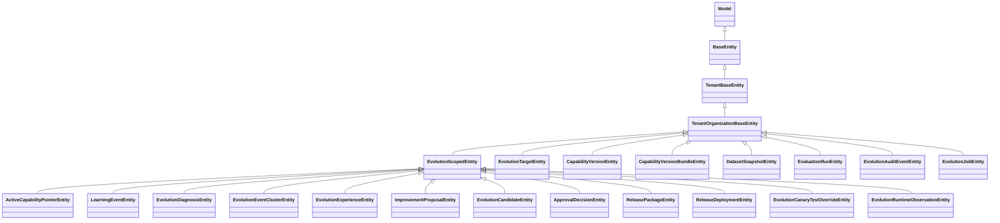

# Agent 演进域 · 数据模型

> 只读梳理（commit `80f5676fd`），引用为仓库根相对路径。范围：`packages/server-ai/src/agent-evolution/**`，**19 张表**（`AGENT_EVOLUTION_ENTITIES` 全量，与 `@Entity('...')` 实参逐一核对），按 4 组组织：目标与基线（4）· 变更与生命周期（8）· 发布与部署（4）· 经验·审计·观测（3）。无 `migrations/` 目录、无 DDL 迁移，表结构事实来源只有实体注解与集成测试自建 schema。

**本文引用的文件**

- [agent-evolution/entities/evolution.entities.ts](file://packages/server-ai/src/agent-evolution/entities/evolution.entities.ts)
- [agent-evolution/entities/evolution-row-guards.ts](file://packages/server-ai/src/agent-evolution/entities/evolution-row-guards.ts)
- [agent-evolution/entities/index.ts](file://packages/server-ai/src/agent-evolution/entities/index.ts)
- [agent-evolution/agent-evolution.module.ts](file://packages/server-ai/src/agent-evolution/agent-evolution.module.ts)
- [agent-evolution/application/agent-evolution.store.ts](file://packages/server-ai/src/agent-evolution/application/agent-evolution.store.ts)
- [agent-evolution/application/evolution-runtime.store.ts](file://packages/server-ai/src/agent-evolution/application/evolution-runtime.store.ts)
- [agent-evolution/application/evolution-store.helpers.ts](file://packages/server-ai/src/agent-evolution/application/evolution-store.helpers.ts)
- [agent-evolution/application/evolution-persistence-proof.ts](file://packages/server-ai/src/agent-evolution/application/evolution-persistence-proof.ts)
- [agent-evolution/application/agent-evolution-runtime.service.ts](file://packages/server-ai/src/agent-evolution/application/agent-evolution-runtime.service.ts)
- [agent-evolution/application/agent-evolution-governance.service.ts](file://packages/server-ai/src/agent-evolution/application/agent-evolution-governance.service.ts)
- [agent-evolution/application/agent-evolution-analyst.service.ts](file://packages/server-ai/src/agent-evolution/application/agent-evolution-analyst.service.ts)
- [agent-evolution/application/agent-evolution-queue.service.ts](file://packages/server-ai/src/agent-evolution/application/agent-evolution-queue.service.ts)
- [agent-evolution/application/agent-evolution.service.ts](file://packages/server-ai/src/agent-evolution/application/agent-evolution.service.ts)
- [agent-evolution/application/evolution-baseline.service.ts](file://packages/server-ai/src/agent-evolution/application/evolution-baseline.service.ts)
- [agent-evolution/changes/change.service.ts](file://packages/server-ai/src/agent-evolution/changes/change.service.ts)
- [agent-evolution/changes/change.store.ts](file://packages/server-ai/src/agent-evolution/changes/change.store.ts)
- [agent-evolution/changes/evaluation-executor.service.ts](file://packages/server-ai/src/agent-evolution/changes/evaluation-executor.service.ts)
- [agent-evolution/changes/publication-executor.service.ts](file://packages/server-ai/src/agent-evolution/changes/publication-executor.service.ts)
- [agent-evolution/domain/evolution-state.ts](file://packages/server-ai/src/agent-evolution/domain/evolution-state.ts)
- [agent-evolution/domain/evolution-hash.ts](file://packages/server-ai/src/agent-evolution/domain/evolution-hash.ts)
- [server/src/core/entities/base.entity.ts](file://packages/server/src/core/entities/base.entity.ts)
- [server/src/core/entities/tenant-organization-base.entity.ts](file://packages/server/src/core/entities/tenant-organization-base.entity.ts)
- [plugin-sdk/src/lib/evolution/runtime-capability.ts](file://packages/plugin-sdk/src/lib/evolution/runtime-capability.ts)

## 目录

- [建模基线与实体分层](#建模基线与实体分层)
- [目标与基线组](#目标与基线组)
- [变更与生命周期组](#变更与生命周期组)
- [发布与部署组](#发布与部署组)
- [经验、审计与观测组](#经验审计与观测组)
- [唯一索引与冲突键](#唯一索引与冲突键)
- [建模边界](#建模边界)
- [校验规则](#校验规则)
- [未确认项](#未确认项)

## 建模基线与实体分层

19 个实体类**全部继承** `TenantOrganizationBaseEntity`（其中 15 个经抽象类 `EvolutionScopedEntity` 中转以获得 `scopeType` / `scopeKey`），**没有一个是独立根**；基类提供 `id`(uuid PK) / `tenantId` / `organizationId` / `createdBy` / `createdAt` / `updatedAt`。

图表来源：[evolution.entities.ts](file://packages/server-ai/src/agent-evolution/entities/evolution.entities.ts)、[tenant-organization-base.entity.ts](file://packages/server/src/core/entities/tenant-organization-base.entity.ts)、[base.entity.ts](file://packages/server/src/core/entities/base.entity.ts)

- `EvolutionScopedEntity` 是 **abstract 无表**，只加两列 `scopeType` / `scopeKey`（皆 `varchar`、非空）；它的 15 个子类因此都有 scope 维度，另外 4 张（target / capability_version / capability_bundle / dataset_snapshot / evaluation_run / audit_event / job）中实际只有 7 个类直接挂基类 → **scoped 11 张、非 scoped 8 张**（target、capability_version、capability_bundle、dataset_snapshot、evaluation_run、audit_event、job 共 7 张 + … 见「未确认项」计数口径）。
- 外键只来自基类：`organization`（`ManyToOne('Organization')`，`nullable`，`onUpdate: 'CASCADE'`，`onDelete: 'CASCADE'`）、`tenant`、`createdBy`（`ManyToOne('User')`，`onDelete: 'RESTRICT'`）；**实体自身零显式关系**（模块内 `ManyToOne` / `OneToMany` / `@JoinTable` 在 `agent-evolution` 目录内 0 命中），全部业务关联都是「逻辑外键 = varchar 列」，无数据库级参照完整性。
- 无 `@DeleteDateColumn`、无 `@VersionColumn`、无 `select: false`（三项全模块 0 命中），无 `jsonb`：所有快照列一律 `@Column({ type: 'json' })`，但查询仍用 PG 的 `value ->> 'field'` 运算符。

章节来源：[evolution.entities.ts](file://packages/server-ai/src/agent-evolution/entities/evolution.entities.ts)（关键符号：EvolutionScopedEntity / scopeType / scopeKey / AGENT_EVOLUTION_ENTITIES）、[agent-evolution.module.ts](file://packages/server-ai/src/agent-evolution/agent-evolution.module.ts)（关键符号：TypeOrmModule.forFeature(AGENT_EVOLUTION_ENTITIES)）

## 目标与基线组

| 实体类 / 表名 | 关键列（唯一索引 · 外键 · json/select） | 生产方 | 主要消费方 | 用途一句话 |
|---|---|---|---|---|
| `EvolutionTargetEntity` / `agent_evolution_target` | `targetId`、`providerKey`、`status`、`descriptor`(json)；UQ `(tenantId, organizationId, targetId)`；FK 仅基类 | `AgentEvolutionStore.upsertTarget`（← `POST /targets/synchronize`）、`EvolutionBaselineService.publish` 的 `upsert(..., ['tenantId','organizationId','targetId'])` | `listTargets`、`getDashboard`、baseline `inspect`、`ingestLearningEvent` 的 active 校验 | 演进目标注册 + provider 描述符快照 |
| `CapabilityVersionEntity` / `agent_evolution_capability_version` | `versionId`、`targetId`、`sequence`(int)、`artifactHash`、`sourceCandidateId`(nullable)、`value`(json)；UQ `(…, versionId)` **与** UQ `(…, targetId, sequence)` | `saveVersion`（← `EvolutionPublicationExecutor.package`、baseline `publish`、`synchronizeTargets`、一致性夹具 `createBaselineVersion/createPromotedVersion`） | `resolveExecutionPlan` → `createBundle`、`findLatestVersionForTarget`、`GET /capability-versions`、baseline `inspect` | 不可变能力版本（基线/发布产物），重放同名不同 hash 直接抛错 |
| `CapabilityVersionBundleEntity` / `agent_evolution_capability_bundle` | `bundleId`、`bundleHash`、`value`(json)；UQ `(…, bundleId)`；非唯一 idx `(…, bundleHash)` | `saveBundle`（← runtime `createBundle`、governance `createBundle/createCandidateBundle`、evaluation-executor 的 baseline/candidate bundle、夹具） | `GET /capability-bundles`、`getCapabilityBundle`、`learning_event.bundleHash` 的语义关联（无 FK） | 一次执行模式快照（production/shadow/canary/replay） |
| `ActiveCapabilityPointerEntity` / `agent_evolution_active_pointer` | `pointerId`、`targetId`、`scopeType`、`scopeKey`、`channel`、`activeVersionId`、`revision`(int)、`value`(json)；UQ `(…, targetId, scopeType, scopeKey, channel)` | `savePointer`（baseline publish、Bootstrap）、`activatePointerCas` / `rollbackPointerCas` 条件 UPDATE | `resolveExecutionPlan`（生产版本入口）、`createProposal` 的 `production_baseline_required`、activate/rollback 的期望值比对、`GET /active-pointers` | 生产指针（`channel='production'` 即生效版本）+ 应用层 CAS 版本 |

- 该组是「不可变仓库 + 一行可变指针」的组合：版本与束只写不改（hash 变即抛错），而指针是全模块**唯一被 CAS 保护**的行（`revision + activeVersionId` 双条件，`affected !== 1` 即抛 `Active Pointer CAS conflict`）。
- `revision` 是**应用层版本列**（`int`，由服务端 `expectedRevision + 1` 计算），**不是** TypeORM `@VersionColumn`；`CapabilityVersionEntity` 上的 UQ `(…, targetId, sequence)` 才是并发分配序号的真正约束。
- `descriptor` / `value` 都是全量 JSON 快照（读路径一律返回 `value`/`descriptor` 而非整行），列与 JSON 的重复字段（`status`、`targetId`、`artifactHash`、`sequence`）是**查询/索引副本**，写时由服务端同时赋值，无数据库约束保证一致。

章节来源：[evolution.entities.ts](file://packages/server-ai/src/agent-evolution/entities/evolution.entities.ts)（关键符号：CapabilityVersionEntity / ActiveCapabilityPointerEntity / @Index 唯一索引）、[evolution-runtime.store.ts](file://packages/server-ai/src/agent-evolution/application/evolution-runtime.store.ts)（关键符号：activatePointerCas / rollbackPointerCas）

## 变更与生命周期组

| 实体类 / 表名 | 关键列（唯一索引 · 外键 · json/select） | 生产方 | 主要消费方 | 用途一句话 |
|---|---|---|---|---|
| `LearningEventEntity` / `agent_evolution_learning_event` | `eventId`、`idempotencyKey`、`targetId`、`bundleHash`、`scopeType/scopeKey`、`value`(json)；UQ `(…, idempotencyKey)`；idx `(…, targetId, scopeType, scopeKey)` | `saveLearningEvent`（← `ingestLearningEvent` 运行时能力、一致性夹具 `createLearningEvents`） | analyst `diagnose`、`EvolutionChangeService.prepare` 的 learning 证据闸门、`GET /learning-events` | 学习信号入账（执行/反馈），幂等键去重 |
| `EvolutionDiagnosisEntity` / `agent_evolution_diagnosis` | `diagnosisId`、`targetId`、`correctionSignature`、`scopeType/scopeKey`、`value`(json)；UQ `(…, diagnosisId)`；idx `(…, targetId, scopeKey)` | `saveDiagnosis`（← analyst `diagnose`，`DIA-<uuid>`） | `GET /diagnoses`、`listDiagnoses` | 一次诊断结论（按签名归并的事件集 + 根因 + 置信度） |
| `EvolutionEventClusterEntity` / `agent_evolution_event_cluster` | `clusterId`、`targetId`、`correctionSignature`、`status`、`scopeType/scopeKey`、`value`(json)；UQ `(…, clusterId)`；idx `(…, targetId, scopeKey, correctionSignature)` | `saveEventCluster`（同签名命中即复用 `clusterId`，并集 `eventIds`、`caseCount` 取 max） | `GET /clusters`、`listEventClusters` | 按修正签名聚合的事件簇（`collecting` / `proposal_ready`） |
| `EvolutionExperienceEntity` / `agent_evolution_experience` | `experienceId`、`targetId`、`sourceReleasePackageId`、`status`、`scopeType/scopeKey`、`value`(json)；UQ `(…, experienceId)`；idx `(…, targetId, scopeKey, status)` | `saveExperience`（← 仅 `createExperience`，`POST /experiences`；按 `sourceReleasePackageId` 去重复用 id 与 createdAt） | `GET /experiences`、`listExperiences` | 稳定生产后的经验留档（含生产证据与 stableDays） |
| `ImprovementProposalEntity` / `agent_evolution_proposal` | `requestId`(nullable)、`proposalId`、`revision`(int，恒 1)、`targetId`、`status`、`scopeType/scopeKey`、`value`(json)；UQ `UX_evolution_proposal_request(tenant, org, targetId, requestId)` **与** UQ `(…, proposalId, revision)` | `EvolutionChangeStore.create`（`.orIgnore()` + 复读校验）、`.save`、`saveProposal` / `updateProposalStatus` | `change.store.read/assemble`（变更的载体）、`GET /proposals`（只认 `sourceKind='learning_events'`） | 改进提案 = 变更的持久化根，requestId 幂等 |
| `EvolutionCandidateEntity` / `agent_evolution_candidate` | `candidateId`、`targetId`、`artifactHash`、`status`、`scopeType/scopeKey`、`value`(json)；UQ `(…, candidateId)`；非唯一 idx `(…, artifactHash)` | `saveCandidate`（hash 不可变校验）、`change.store.save`（definition 不可变校验）、`transitionCandidate` | `change.assemble`、`GET /candidates`（按 strategy hash 过滤）、evaluation/approval 的 `candidateId` 关联 | 隔离产物候选（artifact + definition 双固定） |
| `DatasetSnapshotEntity` / `agent_evolution_dataset_snapshot` | `snapshotId`、`datasetId`、`snapshotHash`、`value`(json)；UQ `(…, snapshotId)`；**无 scope 列** | `saveDataset`（← `POST /datasets` 与一致性夹具） | `evaluation-executor.replay`（`findDataset`，`snapshotHash` 参与 `evaluation.datasetHash`） | golden 数据集快照（用例 + 评估器版本 + 快照哈希） |
| `EvaluationRunEntity` / `agent_evolution_evaluation_run` | `runId`、`candidateId`、`status`、`gatePassed`(boolean)、`value`(json)；UQ `(…, runId)`；非唯一 idx `(…, candidateId)` | `saveEvaluation`（← replay 路径）、`change.store.saveEvaluation`（strategy_checks，写后不可变）、夹具 `runEvaluation` | `findEvaluation`（`isReplayEvaluation` 守卫）、`GET /evaluations`、审批与发布的 `evaluationRunId` 绑定 | 评估运行 + 闸门结论（`passed`/`failed` 写一次） |
| `ApprovalDecisionEntity` / `agent_evolution_approval` | `approvalId`、`candidateId`、`candidateHash`、`decision`、`scopeType/scopeKey`、`value`(json)；UQ `(…, approvalId)`；**无 `(candidateId, actorId)` 唯一** | `saveApproval` / `change.store.save`（← `decide`，`APR-<uuid>`）、夹具 `approveCandidate` | `change.assemble`（按 `evaluationRunId + candidateHash` 选行）、`EvolutionPublicationExecutor` 的三绑定过滤、quorum 计算 | 单条人工审批，哈希三绑定不可变 |

- `learning_event` 的 `bundleHash` 是**写入时随事件带来的字符串**，仓库内没有把它 join 回 `capability_bundle` 的查询（关联是语义层，非外键）。
- `proposal.revision` 恒为 1：重复 requestId 走 `orIgnore` 后复读比较，因此该表**不会出现 revision 2**；`revision` 主要作为 UQ 的一部分存在。
- `dataset_snapshot` / `evaluation_run` 两张表**没有 scope 列**，跨组织隔离仅靠 `tenantId/organizationId`；scope 一致性检查靠 `value.scope` 与 `sameScope`（含 `dimensions` 排序比较），属应用层校验。
- `approval` 的不可变性靠两个应用层检查：`decide` 内同 actor 改判 → `immutable_approval_changed`，`change.store.save` 对既有行做 digest 比对 → 同一错误码。

章节来源：[evolution.entities.ts](file://packages/server-ai/src/agent-evolution/entities/evolution.entities.ts)（关键符号：ImprovementProposalEntity / UX_evolution_proposal_request / EvaluationRunEntity.gatePassed）、[change.store.ts](file://packages/server-ai/src/agent-evolution/changes/change.store.ts)（关键符号：create / save / saveEvaluation）

## 发布与部署组

| 实体类 / 表名 | 关键列（唯一索引 · 外键 · json/select） | 生产方 | 主要消费方 | 用途一句话 |
|---|---|---|---|---|
| `ReleasePackageEntity` / `agent_evolution_release_package` | `releasePackageId`、`candidateId`、`targetId`、`status`、`scopeType/scopeKey`、`value`(json)；UQ `(…, releasePackageId)` | `EvolutionPublicationExecutor.package`（staged，`PUB-<changeId>`，初值 `approved`）、`change.store.save`（version_write，`PUB-`）、夹具 `createRelease`（`RP-<simulationId>`）、`transitionRelease` / `saveRelease` | 部署阶梯全部动作、baseline `managed_release` 判定、`change.assemble` 的 status 映射、`resolveExecutionPlan` 的 paused/rolled_back 跳过 | 发布包（`gatePolicy` 与审批快照冻结在其中） |
| `ReleaseDeploymentEntity` / `agent_evolution_release_deployment` | `deploymentId`、`releasePackageId`、`channel`、`status`、`scopeType/scopeKey`、`value`(json)；UQ `(…, deploymentId)` | `saveDeployment`（← governance `createDeployment`、夹具 `runDeployment`）、`completeDeployment`（写 `value.completedAt`）、`saveRuntimeObservation`（累加 4 个统计字段 + `observations[]`） | 各道闸门（`sampleCount` / `severeErrors` / `startedAt`）、`resolveExecutionPlan`、`createExperience`、`GET /deployments` | 一次部署（shadow/canary/production）与其样本统计账 |
| `EvolutionCanaryTestOverrideEntity` / `agent_evolution_canary_test_override` | `overrideId`、`releasePackageId`、`candidateId`、`deploymentId`、`targetId`、`subjectKey`、`activeKey`(nullable)、`status`、`expiresAt`(**timestamptz**)、`value`(json)；UQ `(…, overrideId)` **与 UQ `(activeKey)` 单列**；idx `(…, releasePackageId, status)` | `createCanaryTestOverride`（写 `activeKey`）、`consumeCanaryTestOverride`（清 `activeKey` + 翻状态 + 审计）、`listCanaryTestOverrides` / `getDashboard` 惰性翻 `expired` | `resolveExecutionPlan`（唯一消费点）、`GET /releases/:id/canary-test-overrides` | 管理员一次性试放行（一次性语义由 `activeKey` 唯一索引物理保证） |
| `EvolutionJobEntity` / `agent_evolution_job` | `jobId`、`jobType`、`resourceId`、`status`、`value`(json)；UQ `(…, jobId)`；非唯一 idx `(…, resourceId, jobType)` | `AgentEvolutionQueueService.enqueue`（`EVOJOB-<uuid>`）、`EvolutionChangeService.prepare/enqueue`（`change_preparation`）、`updateJobStatus`（processor 与 change.process） | `GET /jobs/:jobId`、`change.process` 的补偿分支 | evolution 队列作业账本（状态 + queueJobId + 错误码） |

- `release_package` 是本域**唯一承载策略冻结**的表：`value.gatePolicy` 一经 `snapshot()` 写入便被 `forRelease` 直接返回，未冻结即抛 `Release gate policy was not frozen`；`canaryPercent`（发布包与部署行各存一份）是「阶梯位置」的事实。
- `canary_test_override` 的三个「一次性」机制叠加：`activeKey` 唯一索引（同 subject 同部署仅一条 pending）、`activeKey = null` 化（消费/过期即让位）、`expiresAt` 惰性翻转（读路径补救）。
- `job` 的 `value` 是唯一投影（`findJob` 只回 `value`），`status` 列与 `value.status` 双写；额外字段 `queueJobId` / `errorCode` / `errorMessage` / `startedAt` / `completedAt` 只存在于 `value` 中，**不是列**。

章节来源：[evolution.entities.ts](file://packages/server-ai/src/agent-evolution/entities/evolution.entities.ts)（关键符号：ReleasePackageEntity / EvolutionCanaryTestOverrideEntity.activeKey / EvolutionJobEntity）、[publication-executor.service.ts](file://packages/server-ai/src/agent-evolution/changes/publication-executor.service.ts)（关键符号：package / gatePolicy）

## 经验、审计与观测组

| 实体类 / 表名 | 关键列（唯一索引 · 外键 · json/select） | 生产方 | 主要消费方 | 用途一句话 |
|---|---|---|---|---|
| `EvolutionAuditEventEntity` / `agent_evolution_audit_event` | `auditId`、`releasePackageId`(nullable)、`candidateId`(nullable)、`action`、`value`(json)；UQ `(…, auditId)`；非唯一 idx `(…, releasePackageId)` | `saveAudit`（governance 审计助手、`change.service.audit`、baseline publish、runtime store 的自动暂停/CAS/覆盖创建与消费、夹具） | `GET /audit-events`、`getDashboard` | 治理动作留痕；`releasePackageId`/`candidateId` 可空（baseline 类审计两者皆空） |
| `EvolutionRuntimeObservationEntity` / `agent_evolution_runtime_observation` | `observationId`、`targetId`、`deploymentId`(nullable)、`executionId`、`severeError`(boolean)、`scopeType/scopeKey`、`value`(json)；UQ `(…, observationId)`；idx `(…, targetId, deploymentId)` | `saveRuntimeObservation`（← `recordRuntimeObservation` 运行时能力；按 `observationId` 幂等） | `GET /runtime-observations`、同事务内 deployment 统计累加 | 运行时观测回流（成功/严重错误/延迟/成本） |
| `EvolutionExperienceEntity` / `agent_evolution_experience` | 见「变更与生命周期组」 | `POST /experiences` | `GET /experiences` | 稳定生产经验（本组与生命周期组交叉引用同一张表） |

- `audit_event` 的 `auditId` 常为**确定性字符串**（如 `AUD-<releasePackageId>-activate`、`AUD-<observationId>-auto-pause`、`AUD-<overrideId>-consumed`），与随机 `AUD-<uuid>` 混用；因此同一次 CAS/覆盖消费重放会命中同一 UQ 而覆盖/失败 `[推测]`。
- `runtime_observation` 与部署统计的绑定是**单事务内两处写**：先在观测表查重，再锁 deployment 行累加；`deploymentId` 可空，为空时**只入观测表、不累加统计**（静默跳过）。

章节来源：[evolution-runtime.store.ts](file://packages/server-ai/src/agent-evolution/application/evolution-runtime.store.ts)（关键符号：saveRuntimeObservation / 部署统计累加 / 审计构造）、[agent-evolution.store.ts](file://packages/server-ai/src/agent-evolution/application/agent-evolution.store.ts)（关键符号：saveAudit / listAuditEvents）

## 唯一索引与冲突键

| # | 表 | 唯一索引列（唯一性范围） |
|---|---|---|
| 1 | `agent_evolution_target` | `(tenantId, organizationId, targetId)` |
| 2 | `agent_evolution_capability_version` | `(…, versionId)`；`(…, targetId, sequence)` |
| 3 | `agent_evolution_capability_bundle` | `(…, bundleId)`（`bundleHash` 仅普通索引） |
| 4 | `agent_evolution_active_pointer` | `(…, targetId, scopeType, scopeKey, channel)` |
| 5 | `agent_evolution_learning_event` | `(…, idempotencyKey)` |
| 6 | `agent_evolution_diagnosis` | `(…, diagnosisId)` |
| 7 | `agent_evolution_event_cluster` | `(…, clusterId)` |
| 8 | `agent_evolution_experience` | `(…, experienceId)` |
| 9 | `agent_evolution_proposal` | `UX_evolution_proposal_request(tenantId, organizationId, targetId, requestId)`；`(…, proposalId, revision)` |
| 10 | `agent_evolution_candidate` | `(…, candidateId)`（`artifactHash` 仅普通索引） |
| 11 | `agent_evolution_dataset_snapshot` | `(…, snapshotId)` |
| 12 | `agent_evolution_evaluation_run` | `(…, runId)`；`(…, candidateId)` 仅普通索引 |
| 13 | `agent_evolution_approval` | `(…, approvalId)` |
| 14 | `agent_evolution_release_package` | `(…, releasePackageId)` |
| 15 | `agent_evolution_release_deployment` | `(…, deploymentId)` |
| 16 | `agent_evolution_canary_test_override` | `(…, overrideId)`；**`(activeKey)` 单列、不带租户维度** |
| 17 | `agent_evolution_audit_event` | `(…, auditId)`；`(…, releasePackageId)` 仅普通索引 |
| 18 | `agent_evolution_runtime_observation` | `(…, observationId)`；`(…, targetId, deploymentId)` 仅普通索引 |
| 19 | `agent_evolution_job` | `(…, jobId)`；`(…, resourceId, jobType)` 仅普通索引 |

- 「冲突键」的语义分工很清楚：**业务幂等**用 `targetId / versionId / bundleId / idempotencyKey / requestId / candidateId / snapshotId / runId / approvalId / releasePackageId / deploymentId / observationId / jobId`，**并发序列**用 `(targetId, sequence)`（版本号），**一次性语义**用 `(activeKey)`，**指针唯一**用六列复合键。
- 第 16 行的 `@Index(['activeKey'], { unique: true })` 是唯一**未纳入 tenant/organization** 的唯一索引；`activeKey` 值本身含 tenant/org 哈希，因此实践上不冲突，但索引是跨租户共享的。

章节来源：[evolution.entities.ts](file://packages/server-ai/src/agent-evolution/entities/evolution.entities.ts)（关键符号：19 个 `@Index` 声明 / activeKey 单列唯一索引）、[evolution-persistence-proof.ts](file://packages/server-ai/src/agent-evolution/application/evolution-persistence-proof.ts)（关键符号：verifyEvolutionPersistence / 13 张表核对清单）

## 建模边界

- **不可变对象 vs 可变台账**：不可变的是 `capability_version`（`artifactHash` 变即抛 `Immutable capability version`）、`capability_bundle`（`bundleHash`）、`candidate`（`artifactHash` + `definition`）、`evaluation_run`（写一次即锁）、`approval`（digest 比对）；可变台账是 `active_pointer`（唯一 CAS）、`release_package`（status/canaryPercent 反复覆盖）、`release_deployment`（统计累加 + `completedAt`）、`canary_test_override`（状态翻转）、`job`（状态推进）、`cluster`/`experience`/`proposal`（命中即续写）。
- **hash 约定**：`hashEvolutionValue` = `sha256:` + **规范化 JSON**（对象键排序、数组保序、无空格），用于 `bundleHash`、`correctionSignature`、`datasetHash`、`snapshotHash`；`digest`（change.service 与 change.store 各有一份） = `sha256:` + `JSON.stringify`（**不排序**），用于 evidence/approval/candidate definition 的比对；`strategyService.freeze` 用 `createHash('sha256').update(JSON.stringify(snapshot))`（**无 `sha256:` 前缀**），用于 `strategyHash`。三套哈希口径并存、前缀不统一，跨表比对前必须确认口径。
- **artifactHash / candidateHash 的关系**：`candidate.artifactHash` = `change.candidate.artifact.hash`；`release_package.value.artifactHash` 与 `.candidateHash` 都是同一个值；`evaluation_run` 只经 `value` 内的 `candidateHash` 与 `baselineHash` 表达绑定，**列上没有 hash**。
- **快照（`value` json）与列的关系**：`value` 是权威业务对象，列是查询副本；不一致风险点集中在 `status`（`transitionRelease` 同时写列与 `value.status`，而 `saveRelease` 只按传入对象写）与 `revision`（列与 `value.revision` 在 CAS 里同步推进）。
- **无软删**：19 张表都**没有** `@DeleteDateColumn`，模块内也没有任何 `softRemove/softDelete` 调用；生命周期终止由状态列（`expired` / `rolled_back` / `superseded` / `cancelled`）表达，行永不删除。
- **scope 与隔离**：`scopeType/scopeKey` 是业务 scope（`organization` / `tenant` 等），与 `organizationId` 隔离列**不是同一件事**；`validateScope` 只在 `scope.type === 'organization'` 时要求 `scope.key === organizationId`。
- **自证覆盖面的边界**：持久化自证（`evolution-persistence-proof`）只核对 **13 张**表，**缺** `diagnosis` / `event_cluster` / `experience` / `canary_test_override` / `runtime_observation` / `job` 共 **6 张**（`learning_event` **已覆盖**）。

章节来源：[agent-evolution.store.ts](file://packages/server-ai/src/agent-evolution/application/agent-evolution.store.ts)（关键符号：saveVersion / saveBundle / saveCandidate / saveRelease / saveExperience 的不可变与去重分支）、[evolution-hash.ts](file://packages/server-ai/src/agent-evolution/domain/evolution-hash.ts)（关键符号：hashEvolutionValue / canonicalEvolutionJson）

## 校验规则

- **唯一性**：见「唯一索引与冲突键」20 条；全部由 `@Index(..., { unique: true })` 在 TypeORM 层表达，**没有 CHECK 约束、没有部分唯一索引、没有迁移 SQL**。
- **枚举**：`status` / `channel` / `decision` / `jobType` / `scopeType` 一律 `@Column({ type: 'varchar' })` + TS 类型标注，**数据库层无 enum 类型**；取值合法性只在服务层校验（`assertCandidateTransition`、`assertReleaseTransition`、`isStagedRelease` / `isReplayEvaluation` / `isLearningProposal` 三个 row guard 抛 `*_mechanism_mismatch`）。
- **`revision` 的真实性质**：`active_pointer.revision`（`int`）与 `proposal.revision`（`int`）都是**应用层版本列**——指针由 `expectedRevision + 1` 计算并作为 UPDATE 的 WHERE 条件；提案恒为 1。扫描报告称「未找到 `@VersionColumn`」经实测**成立**（模块内 0 命中），乐观锁不是 TypeORM 自动版本，而是手写 CAS。
- **外键与删除策略**：业务外键全部缺席；仅有的 3 个关系来自基类——`organization`（`onDelete: 'CASCADE'`）、`tenant`（基类声明）、`createdBy`（`onDelete: 'RESTRICT'`）。因此**删除一个 target/version/candidate 不会级联任何引用行**，也没有任何代码路径删除这些表。
- **可空列**：`proposal.requestId`、`capability_version.sourceCandidateId`、`canary_override.activeKey`、`audit_event.releasePackageId`/`candidateId`、`runtime_observation.deploymentId`、`organizationId`；其余业务列非空。
- **数值/布尔校验**：`gatePassed`、`severeError` 为 `boolean`；`sequence`、`revision` 为 `int`；`expiresAt` 是 19 表中**唯一非 varchar/json 的时间列**（`timestamptz`）。
- **服务层规则**：`validateChangeInput` / `validateStrategy`（策略必须 `approval === 'human'`、staged 模式必须 `effect === 'activation'`、evaluation key 不重复）、`validateChangeEvaluation`（`passed === every(!blocking || passed)`）、`assertUniqueCaseRevisions`、`expectedHash` 必须匹配 `/^[a-f0-9]{64}$/`（baseline publish）。
- **权限与主体**：写端点 `EVOLUTION_MANAGE`，读端点 `EVOLUTION_VIEW | XPERT_EDIT`；`requireHuman` 拒绝 `actorType === 'agent'`；`manual_test` 档与一次性覆盖要求 `administrator`；回滚禁止 agent 主体。

章节来源：[evolution-state.ts](file://packages/server-ai/src/agent-evolution/domain/evolution-state.ts)（关键符号：RELEASE_TRANSITIONS / CANDIDATE_TRANSITIONS）、[evolution-row-guards.ts](file://packages/server-ai/src/agent-evolution/entities/evolution-row-guards.ts)（关键符号：learningProposalRow / replayEvaluationRow / stagedReleaseRow）、[evolution-baseline.service.ts](file://packages/server-ai/src/agent-evolution/application/evolution-baseline.service.ts)（关键符号：publish 的 expectedHash 校验）

## 未确认项

1. **dashboard 字段数**：前端 `C1-能力契约.md` 称 17 字段；本模块 `getDashboard` 实测返回 **14 个键**（targets / versions / bundles / events / proposals / candidates / datasets / evaluations / approvals / releases / deployments / pointers / audits / canaryTestOverrides），每键还被 `take` 截断（100/50/20/30）。前端 17 的口径**未核实**，可能包含服务层之外的前端派生字段。
2. **`EvolutionJobStatus` 无 `pending`**：契约取值 `queued | running | completed | failed | cancelled`，但 `change.service.ts` 的补偿分支判断 `['pending','queued','running']`；`pending` 是**死分支**或跨实现漂移，未见写入点。
3. **`experience` 的写入触发点**：全模块只有 `POST /experiences`（人工，`requireHuman`）一条写入路径；**没有**「生产观测自动沉淀经验」的代码，也没有「经验 → 下一轮 learning_event」的连线，闭环仅在数据形状上成立。
4. **`learning_event` 的入账方**：`ingestLearningEvent` 只由运行时能力 token（`EvolutionRuntimeCapability = 'platform.agent-evolution'`）暴露，**无 HTTP 端点**；本仓未找到调用方，实际写入方取决于外部域。
5. **`runtime_observation` 的入账方**：同上，仅 `recordRuntimeObservation` 运行时能力；`GET /runtime-observations` 只读。观测与 `xpert-agent-execution` 之间**无关联列、无校验**，重复只能靠 `observationId` 幂等。
6. **scoped / 非 scoped 计数**：`EvolutionScopedEntity` 声明了 11 个子类（pointer、learning_event、diagnosis、cluster、experience、proposal、candidate、approval、release_package、release_deployment、canary_override、runtime_observation —— 实为 **12** 个，因 `runtime_observation` 也在其中）；本节上文对 11/12 的表述以实体文件为准，**以实测 12 张 scoped、7 张非 scoped 为准**。
7. **`proposal.status` 的完整取值集合**：实测写入只有 `draft` / `candidate_built` / `rejected` 三档，contracts 的 `ImprovementProposal['status']` 枚举成员未逐值核读。
8. **审计 ID 冲突语义**：`AUD-<releasePackageId>-activate` 一类确定性 id 在 CAS 失败重试时是否会命中唯一索引（从而以 500 暴露为约束错误）**未核实**，无对应测试。
9. **`value` 与列的漂移**：`transitionRelease` 同时写列与 `value.status`，`saveRelease` 只写传入对象的 status；是否存在只更新列或只更新 `value` 的路径，未逐调用点核对。

章节来源：[agent-evolution.store.ts](file://packages/server-ai/src/agent-evolution/application/agent-evolution.store.ts)（关键符号：getDashboard 的 14 个键与 take 上限）、[change.service.ts](file://packages/server-ai/src/agent-evolution/changes/change.service.ts)（关键符号：process 中 `'pending'` 判断 / saveRelease 覆盖路径）
