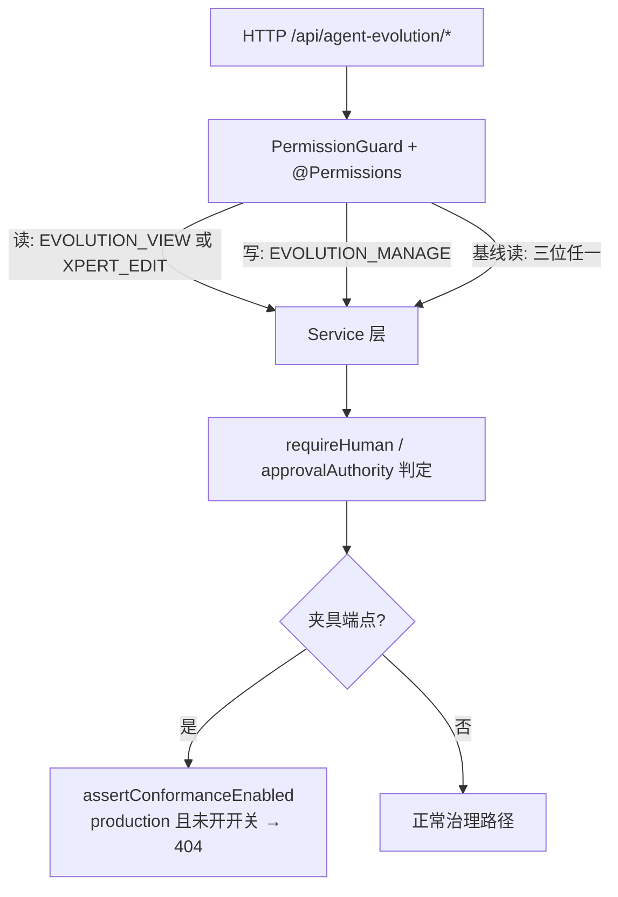

# Agent 演进专家 · 接口说明（05）

**本文引用的文件**（路径均相对仓库根 `/root/xpert`）

- [packages/server-ai/src/agent-evolution/agent-evolution.module.ts](file://packages/server-ai/src/agent-evolution/agent-evolution.module.ts)
- [packages/server-ai/src/agent-evolution/controllers/agent-evolution.controller.ts](file://packages/server-ai/src/agent-evolution/controllers/agent-evolution.controller.ts)
- [packages/server-ai/src/agent-evolution/changes/lifecycle.controller.ts](file://packages/server-ai/src/agent-evolution/changes/lifecycle.controller.ts)
- [packages/server-ai/src/agent-evolution/controllers/evolution-baseline.controller.ts](file://packages/server-ai/src/agent-evolution/controllers/evolution-baseline.controller.ts)
- [packages/server-ai/src/agent-evolution/controllers/index.ts](file://packages/server-ai/src/agent-evolution/controllers/index.ts)
- [packages/server-ai/src/agent-evolution/application/agent-evolution-governance.service.ts](file://packages/server-ai/src/agent-evolution/application/agent-evolution-governance.service.ts)
- [packages/server-ai/src/agent-evolution/application/agent-evolution.service.ts](file://packages/server-ai/src/agent-evolution/application/agent-evolution.service.ts)
- [packages/server-ai/src/agent-evolution/application/agent-evolution-runtime.service.ts](file://packages/server-ai/src/agent-evolution/application/agent-evolution-runtime.service.ts)
- [packages/server-ai/src/agent-evolution/application/agent-evolution-analyst.service.ts](file://packages/server-ai/src/agent-evolution/application/agent-evolution-analyst.service.ts)
- [packages/server-ai/src/agent-evolution/application/agent-evolution-queue.service.ts](file://packages/server-ai/src/agent-evolution/application/agent-evolution-queue.service.ts)
- [packages/server-ai/src/agent-evolution/application/agent-evolution-release-gate-policy.service.ts](file://packages/server-ai/src/agent-evolution/application/agent-evolution-release-gate-policy.service.ts)
- [packages/server-ai/src/agent-evolution/application/evolution-baseline.service.ts](file://packages/server-ai/src/agent-evolution/application/evolution-baseline.service.ts)
- [packages/server-ai/src/agent-evolution/changes/change.service.ts](file://packages/server-ai/src/agent-evolution/changes/change.service.ts)
- [packages/server-ai/src/agent-evolution/changes/lifecycle.service.ts](file://packages/server-ai/src/agent-evolution/changes/lifecycle.service.ts)
- [packages/server-ai/src/agent-evolution/changes/change.errors.ts](file://packages/server-ai/src/agent-evolution/changes/change.errors.ts)
- [packages/server-ai/src/agent-evolution/providers/conformance-template.provider.ts](file://packages/server-ai/src/agent-evolution/providers/conformance-template.provider.ts)
- [packages/contracts/src/ai/evolution/governance.ts](file://packages/contracts/src/ai/evolution/governance.ts)
- [packages/contracts/src/ai/role-permissions.ts](file://packages/contracts/src/ai/role-permissions.ts)
- [apps/cloud/src/app/features/agent-evolution/agent-evolution-api.service.ts](file://apps/cloud/src/app/features/agent-evolution/agent-evolution-api.service.ts)
- [.module-experts/前端专题/Agent 演进专家/C1-能力契约.md](file://.module-experts/前端专题/Agent 演进专家/C1-能力契约.md)

## 目录

1. [一、口径总览：48 端点与前端对照](#一口径总览48-端点与前端对照)
2. [二、EvolutionLifecycleController（`changes`，8 条）](#二evolutionlifecyclecontrollerchanges8-条)
3. [三、EvolutionBaselineController（`baselines`，1 条）](#三evolutionbaselinecontrollerbaselines1-条)
4. [四、AgentEvolutionController：仪表盘、目标与能力版本（6 条）](#四agentevolutioncontroller仪表盘目标与能力版本6-条)
5. [五、AgentEvolutionController：学习、诊断、提案与候选（10 条）](#五agentevolutioncontroller学习诊断提案与候选10-条)
6. [六、AgentEvolutionController：数据集、评估、发布与部署（16 条）](#六agentevolutioncontroller数据集评估发布与部署16-条)
7. [七、AgentEvolutionController：观测、审计、经验与夹具（7 条）](#七agentevolutioncontroller观测审计经验与夹具7-条)
8. [八、权限矩阵与守卫链](#八权限矩阵与守卫链)
9. [九、错误语义](#九错误语义)
10. [十、与前端资产的差异清单与回写建议](#十与前端资产的差异清单与回写建议)

## 一、口径总览：48 端点与前端对照

路由前缀由 `RouterModule.register([{ path: '/agent-evolution', module: AgentEvolutionModule }])` 给定；前端基址为 `API_PREFIX + '/agent-evolution'`（`API_PREFIX = '/api'`），故**真实路径均为 `/api/agent-evolution/*`**。

| 控制器 | 控制器前缀 | 端点数 | 类级/方法级守卫 |
|---|---|---|---|
| `AgentEvolutionController` | `@Controller()`（空前缀） | **39** | 每个方法 `@UseGuards(PermissionGuard)` ＋ `@Permissions(...)`；类级 `@ApiTags('Agent Evolution')`、`@ApiBearerAuth()` |
| `EvolutionLifecycleController` | `@Controller('changes')` | **8** | **类级** `@UseGuards(PermissionGuard)`，方法级 `@Permissions(...)` |
| `EvolutionBaselineController` | `@Controller('baselines')` | **1** | 方法级 `@UseGuards(PermissionGuard)` ＋ 三个权限位并列 |
| 合计 | — | **48** | — |

**与前端对照的口径说明（三条并存，请按口径引用）**：

1. **端点口径（本文件）**：后端 **48**；前端 `AgentEvolutionApiService` 共 **41 个调用**（逐方法核对到路径），故后端比前端调用面多 **7 条**（见第十节）。
2. **文档表口径**：前端 `C1-能力契约.md` §2 端点表只列 **43 条**，其中未列后端 5 条（`/runtime-observations`、`/audit-events`、`/experiences`、`/capability-executions/resolve`、`/simulations/conformance`）——这是**表格漏列**，其中 `/experiences` 在该文件 §1 门面方法表与前端 API service 中**已存在**。
3. **计数一致性**：`39 + 8 + 1 = 48`；前端 API service 的 41 条全部能在后端找到对应实现，**无「前端调用了后端不存在的路径」**。

分页口径统一由控制器的 `normalizeQuery` 归一：`page` 默认 1、`pageSize` 默认 20、`search` 截断 200 字符、`sort` 仅接受 `createdAt|updatedAt|status`（其余回落 `createdAt`）、`order` 仅接受 `ASC`，否则 `DESC`。上下文由 `requestScope()`（租户＋组织）与 `commandContext()`（追加 `actorId/actorRole/actorRoleName/approvalAuthority/actorType:'human'`）统一注入，`approvalAuthority` 仅在角色名为 `SUPER_ADMIN`/`ADMIN` 时为 `administrator`。

章节来源：[agent-evolution.module.ts](file://packages/server-ai/src/agent-evolution/agent-evolution.module.ts)（关键符号：RouterModule.register / AgentEvolutionModule / controllers），[agent-evolution.controller.ts](file://packages/server-ai/src/agent-evolution/controllers/agent-evolution.controller.ts)（关键符号：AgentEvolutionController / requestScope / commandContext / normalizeQuery），[agent-evolution-api.service.ts](file://apps/cloud/src/app/features/agent-evolution/agent-evolution-api.service.ts)（关键符号：API_AGENT_EVOLUTION / AgentEvolutionApiService）

## 二、EvolutionLifecycleController（`changes`，8 条）

写路径全部返回**生命周期记录或变更对象**（`EvolutionLifecycleRecord` / `EvolutionChange`），是前端 `/changes` 面板的唯一写入口。

| 方法 | 路径 | 用途（服务方法） | 权限位 | 主要错误 | 消费方 |
|---|---|---|---|---|---|
| POST | `/changes` | `changeService.prepare`：提交变更（Zod `evolutionSubmissionSchema` 校验后落库并投递 `change_preparation`） | `EVOLUTION_MANAGE` | 400 `invalid_strategy_submission`（`changeError` 文案：`Evolution cannot proceed: invalid_strategy_submission`） | 无前端调用（外部/脚本提交） |
| POST | `/changes/conformance-template` | 夹具提交：`assertTemplateConformanceEnabled()` 后由 `ConformanceTemplateProvider.fixtureInput` 生成输入再 `prepare` | `EVOLUTION_MANAGE` | 生产环境 404（未开夹具）；`invalid_strategy_submission` | 无前端调用 |
| GET | `/changes` | `lifecycle.list`：生命周期记录投影 `{items,total}` | `EVOLUTION_VIEW \| XPERT_EDIT` | — | `listLifecycleRecords` |
| GET | `/changes/records` | `changeService.list`：富变更记录（可带 `targetId`） | 同上 | — | `listChanges` |
| GET | `/changes/:id` | `lifecycle.get`：单条生命周期记录 | 同上 | 未命中即 `changeError('change_not_found')` → 400 | 无前端调用 |
| POST | `/changes/:id/evaluations` | `lifecycle.evaluate`（可传 `datasetSnapshotIds`） | `EVOLUTION_MANAGE` | `evaluation_snapshot_mismatch`、`evaluation_not_in_strategy` | `evaluateChange` |
| POST | `/changes/:id/decisions` | `lifecycle.decide`：人工审批（哈希/runId/策略哈希绑定） | `EVOLUTION_MANAGE` | `review_snapshot_mismatch`、`immutable_approval_changed` | `decideChange` |
| POST | `/changes/:id/publication` | `lifecycle.publish`：产出发布包（`PUB-<changeId>`） | `EVOLUTION_MANAGE` | `publication_not_in_strategy`、`publication_snapshot_mismatch`、`identity_mismatch` | `publishChange` |

口径提醒：**:id 路径参数是「变更 ID」，`/changes/records` 与 `/changes/:id` 的路由顺序由装饰器声明序决定**（`records` 先声明），新增子路径必须放在 `/:id` 之前。

章节来源：[lifecycle.controller.ts](file://packages/server-ai/src/agent-evolution/changes/lifecycle.controller.ts)（关键符号：EvolutionLifecycleController / submit / conformance / list / records / get / evaluate / decide / publish），[lifecycle.service.ts](file://packages/server-ai/src/agent-evolution/changes/lifecycle.service.ts)（关键符号：list / get / evaluate / decide / publish），[change.service.ts](file://packages/server-ai/src/agent-evolution/changes/change.service.ts)（关键符号：prepare / process / decide / publish / CHANGE_QUEUE），[change.errors.ts](file://packages/server-ai/src/agent-evolution/changes/change.errors.ts)（关键符号：changeError）

## 三、EvolutionBaselineController（`baselines`，1 条）

| 方法 | 路径 | 用途 | 权限位 | 主要错误 | 消费方 |
|---|---|---|---|---|---|
| GET | `/baselines/:targetId` | `EvolutionBaselineService.inspect`：上线规则基线只读检视（当前版本 / 生产指针 / 预览），**不写库** | `EVOLUTION_VIEW \| XPERT_EDIT \| EVOLUTION_MANAGE`（**读权限三位任一即可**） | 目标无基线时按 service 语义返回空检视（未见异常抛出） | `getRuleBaseline` |

口径提醒：这是**唯一**同时接受三个权限位的端点，是「管理员只做读巡检」的通道；同域的 `inspect` 无分页参数，`targetId` 由路径直接透传，不做长度归一。

章节来源：[evolution-baseline.controller.ts](file://packages/server-ai/src/agent-evolution/controllers/evolution-baseline.controller.ts)（关键符号：EvolutionBaselineController / inspect / Permissions），[evolution-baseline.service.ts](file://packages/server-ai/src/agent-evolution/application/evolution-baseline.service.ts)（关键符号：inspect / publish）

## 四、AgentEvolutionController：仪表盘、目标与能力版本（6 条）

| 方法 | 路径 | 用途 | 权限位 | 主要错误 | 消费方 |
|---|---|---|---|---|---|
| GET | `/dashboard` | `AgentEvolutionService.getDashboard`：直接透传 store 的聚合快照（**无分页入参**） | `EVOLUTION_VIEW \| XPERT_EDIT` | — | `getDashboard`（前端门面一次 load 的主数据） |
| GET | `/targets` | `governance.listTargets`：目标描述符分页 | 同上 | — | `listTargets` |
| POST | `/targets/synchronize` | `AgentEvolutionService.synchronizeTargets`：注册 provider 描述符并同步基线能力版本 | `EVOLUTION_MANAGE` | 400 `Conformance provider does not implement the complete evolution contract` | `synchronizeTargets` |
| GET | `/capability-versions` | `governance.listCapabilityVersions`：不可变能力版本分页 | 同上读权限 | — | `listCapabilityVersions` |
| GET | `/capability-bundles` | `governance.listCapabilityBundles`：版本束分页（执行模式 `production/shadow/canary/replay`） | 同上读权限 | — | `listCapabilityBundles` |
| GET | `/active-pointers` | `governance.listActivePointers`：生产指针分页（`channel='production'` 即生效版本） | 同上读权限 | — | `listActivePointers` |

口径提醒：`/dashboard` 的字段数是**store 决定**的（`AgentEvolutionService` 不做裁剪），前端声明的「17 字段」是否与 store 返回一致**未在本仓核实**，不得据此做前端类型断言。

章节来源：[agent-evolution.controller.ts](file://packages/server-ai/src/agent-evolution/controllers/agent-evolution.controller.ts)（关键符号：getDashboard / listTargets / synchronizeTargets / listCapabilityVersions / listCapabilityBundles / listActivePointers），[agent-evolution.service.ts](file://packages/server-ai/src/agent-evolution/application/agent-evolution.service.ts)（关键符号：getDashboard / synchronizeTargets），[agent-evolution-governance.service.ts](file://packages/server-ai/src/agent-evolution/application/agent-evolution-governance.service.ts)（关键符号：listTargets / listCapabilityVersions / listCapabilityBundles / listActivePointers）

## 五、AgentEvolutionController：学习、诊断、提案与候选（10 条）

| 方法 | 路径 | 用途 | 权限位 | 主要错误 | 消费方 |
|---|---|---|---|---|---|
| GET | `/learning-events` | `governance.listLearningEvents` | `EVOLUTION_VIEW \| XPERT_EDIT` | — | `listLearningEvents` |
| PATCH | `/learning-events/:eventId/review` | `governance.reviewLearningEvent`（`reviewStatus ∈ pending\|ignored\|golden`） | `EVOLUTION_MANAGE` | 事件不在租户域内 | `reviewLearningEvent` |
| GET | `/diagnoses` | `analyst.listDiagnoses` | 同上读权限 | — | `listDiagnoses` |
| GET | `/clusters` | `analyst.listClusters`（按 `correctionSignature` 聚合） | 同上读权限 | — | `listClusters` |
| POST | `/diagnoses` | `analyst.diagnose`：诊断 + 聚类（不写提案） | `EVOLUTION_MANAGE` | 400 `At least one Learning Event is required for diagnosis`、`One or more Learning Events were not found in the current tenant scope`、`Confidential Learning Events must be redacted before analysis`；`changeError('strategy_not_allowed')` | `diagnose` |
| POST | `/proposals` | `governance.createProposal`：改进提案（`requestId` 幂等） | `EVOLUTION_MANAGE` | `changeError('agent_proposal_risk_forbidden')`（agent 主体 + R4）、`production_baseline_required`、`candidate_baseline_mismatch` | `createProposal` |
| GET | `/proposals` | `governance.listProposals` | 同上读权限 | — | `listProposals` |
| GET | `/candidates` | `governance.listCandidates` | 同上读权限 | — | `listCandidates` |
| POST | `/candidates` | `governance.buildCandidate`：构建隔离候选 | `EVOLUTION_MANAGE` | `change_not_found`、`candidate_snapshot_mismatch`、`immutable_candidate_changed` | `buildCandidate` |
| POST | `/candidates/:candidateId/approvals` | `governance.decideApproval`：单条人工审批（哈希绑定） | `EVOLUTION_MANAGE` | 400 `Agent identity cannot satisfy a human approval decision`、`immutable_approval_changed`、`review_snapshot_mismatch` | `decideApproval` |

口径提醒：`POST /diagnoses` 与 `POST /proposals` **不是幂等写入的替代品**——前者只做诊断/聚类，提案必须显式调用 `POST /proposals`；而 `POST /candidates` 依赖提案的 `proposalRevision`，跨版本重放会命中 `candidate_snapshot_mismatch`。

章节来源：[agent-evolution.controller.ts](file://packages/server-ai/src/agent-evolution/controllers/agent-evolution.controller.ts)（关键符号：listLearningEvents / reviewLearningEvent / listDiagnoses / listClusters / diagnoseLearningEvents / createProposal / listProposals / listCandidates / buildCandidate / decideApproval），[agent-evolution-analyst.service.ts](file://packages/server-ai/src/agent-evolution/application/agent-evolution-analyst.service.ts)（关键符号：diagnose / listDiagnoses / listClusters），[agent-evolution-governance.service.ts](file://packages/server-ai/src/agent-evolution/application/agent-evolution-governance.service.ts)（关键符号：createProposal / buildCandidate / decideApproval / reviewLearningEvent）

## 六、AgentEvolutionController：数据集、评估、发布与部署（16 条）

| 方法 | 路径 | 用途 | 权限位 | 主要错误 | 消费方 |
|---|---|---|---|---|---|
| GET | `/datasets` | `governance.listDatasets` | `EVOLUTION_VIEW \| XPERT_EDIT` | — | `listDatasets` |
| POST | `/datasets` | `governance.createDatasetSnapshot`（golden 快照） | `EVOLUTION_MANAGE` | 400 `Golden Dataset must contain at least one case`、`Golden Dataset contains duplicate cases`、`Target '<id>' does not support Golden Replay`、scope 不支持 | `createDataset` |
| GET | `/evaluations` | `governance.listEvaluations`（含 `gatePassed`） | 同上读权限 | — | `listEvaluations` |
| POST | `/evaluations` | `queue.enqueueEvaluation` → 返回 `EvolutionJob` | `EVOLUTION_MANAGE` | 503 `Managed Queue is unavailable` | `evaluateCandidate` |
| GET | `/releases` | `governance.listReleases`（含冻结 `gatePolicy`、`canaryPercent`） | 同上读权限 | — | `listReleases` |
| GET | `/deployments` | `governance.listDeployments`（`channel/sampleCount/severeErrors/observations`） | 同上读权限 | — | `listDeployments` |
| GET | `/releases/:releasePackageId/canary-test-overrides` | `governance.listCanaryTestOverrides` | 同上读权限 | — | `listCanaryTestOverrides` |
| POST | `/releases/:releasePackageId/canary-test-overrides` | `governance.createCanaryTestOverride`：一次性金丝雀试放行 | `EVOLUTION_MANAGE` | 404 `Release Package was not found`；400 `…RequiresAdministrator` / `…RequiresManualTestProfile` / `…RequiresCanary` / `…InvalidSubject` / `…InvalidReason` / `…InvalidExpiry` / `…AlreadyPending` | `createCanaryTestOverride` |
| POST | `/release-packages` | `governance.createReleasePackage`：冻结 gatePolicy 并产出发布包 | `EVOLUTION_MANAGE` | `publication_not_in_strategy`、`evaluation_snapshot_mismatch`、`publication_snapshot_mismatch`、`identity_mismatch` | `createReleasePackage` |
| POST | `/releases/:id/install` | `queue.enqueueReleaseOperation(…,'install')` → `EvolutionJob` | `EVOLUTION_MANAGE` | 作业内 400 `Only an approved Release Package can be installed` | `installRelease` |
| POST | `/releases/:id/shadow` | `…'shadow'` → `EvolutionJob` | `EVOLUTION_MANAGE` | 作业内 400 `Target does not support Shadow`、`Shadow can start only from installed or paused` | `startShadow` |
| POST | `/releases/:id/canary` | `…'canary'`（body `StartDeploymentRequest`）→ `EvolutionJob` | `EVOLUTION_MANAGE` | 作业内 400 `Canary percent must be 5, 25 or 50`、`The first Canary stage must be 5%`、`AgentEvolutionShadowGateNotSatisfied`、`AgentEvolutionCanaryGateNotSatisfied`、`Canary can start only after Shadow or resume from paused` | `startCanary` |
| POST | `/releases/:id/pause` | `governance.pauseRelease`（**同步返回发布包**，不入队） | `EVOLUTION_MANAGE` | 400 `Only Shadow or Canary can be paused` | `pauseRelease` |
| POST | `/releases/:id/activate` | `governance.activateProduction`（**同步返回新指针**） | `EVOLUTION_MANAGE` | 400 `Production activation requires Canary`、`AgentEvolutionProductionGateNotSatisfied`、`Production pointer no longer matches the approved rollback version` | `activateRelease` |
| POST | `/releases/:id/rollback` | `…'rollback'` → `EvolutionJob` | `EVOLUTION_MANAGE` | 作业内 400 `Agents cannot initiate Production rollback`、`Target does not support rollback`、`Release is not the active Production version` | `rollbackRelease` |
| GET | `/jobs/:jobId` | `queue.getJob`：`EVOJOB-<uuid>` 账本查询 | 同上读权限 | **未找到返回 `null`（不是 404）** | `getJob` |

口径提醒：**入队型端点返回的是 job，不是结果**；`install/shadow/canary/rollback` 四条的失败要先发生在队列侧（`errorCode='queue_enqueue_failed'`），后发生在 worker 侧（`errorCode='evolution_job_failed'`），因此 HTTP 200 不代表动作成功。

章节来源：[agent-evolution.controller.ts](file://packages/server-ai/src/agent-evolution/controllers/agent-evolution.controller.ts)（关键符号：listDatasets / createDataset / listEvaluations / enqueueEvaluation / listReleases / listDeployments / listCanaryTestOverrides / createCanaryTestOverride / createReleasePackage / installRelease / startShadow / startCanary / pauseRelease / activateRelease / rollbackRelease / getJob），[agent-evolution-queue.service.ts](file://packages/server-ai/src/agent-evolution/application/agent-evolution-queue.service.ts)（关键符号：enqueueEvaluation / enqueueReleaseOperation / getJob / AGENT_EVOLUTION_QUEUE），[agent-evolution-governance.service.ts](file://packages/server-ai/src/agent-evolution/application/agent-evolution-governance.service.ts)（关键符号：createReleasePackage / installRelease / startShadow / startCanary / pauseRelease / activateProduction / rollbackProduction / createCanaryTestOverride），[agent-evolution-release-gate-policy.service.ts](file://packages/server-ai/src/agent-evolution/application/agent-evolution-release-gate-policy.service.ts)（关键符号：snapshot / forRelease / manualTestProfileEnabled）

## 七、AgentEvolutionController：观测、审计、经验与夹具（7 条）

| 方法 | 路径 | 用途 | 权限位 | 主要错误 | 消费方 |
|---|---|---|---|---|---|
| GET | `/runtime-observations` | `governance.listRuntimeObservations`：运行时观测（样本 / 严重错误 / 延迟 / 成本） | `EVOLUTION_VIEW \| XPERT_EDIT` | — | **前端未调用** |
| GET | `/audit-events` | `governance.listAuditEvents`：审计留痕 | 同上读权限 | — | **前端未调用** |
| GET | `/experiences` | `governance.listExperiences`：稳定生产后的经验留档 | 同上读权限 | — | `listExperiences` |
| POST | `/experiences` | `governance.createExperience`：需 active 发布 + 生产闸门 | `EVOLUTION_MANAGE` | 400（生产闸门不足，见 `EvolutionExperienceGate*` 语义） | `createExperience` |
| POST | `/capability-executions/resolve` | `runtime.resolveExecutionPlan`：解析执行计划（shadow / canary / 一次性覆盖 → 版本裁决） | `EVOLUTION_MANAGE` | 400 `At least one targetId is required`、`subjectKey is required`、`Evolution scope key is required`、`Evolution organization scope does not match the request organization`；404 `Production pointer for '<targetId>' was not found` | **前端未调用** |
| POST | `/simulations/conformance` | `service.runConformanceSimulation`：端到端一致性模拟 | `EVOLUTION_MANAGE` ＋ **夹具门禁** | **生产环境且未开夹具 → 404**（`assertConformanceEnabled`） | **前端未调用** |
| POST | `/examples/conformance-field-mapping/run` | 夹具：字段映射一致性演示（与上一条**同实现**，仅路径不同） | `EVOLUTION_MANAGE` ＋ **夹具门禁** | **生产环境且未开夹具 → 404** | `simulateConformance` |

**夹具门禁与 404 语义（两条独立声明，均需满足）**：

1. 控制器级 `assertConformanceEnabled()`：`environment.production && process.env.AGENT_EVOLUTION_ENABLE_CONFORMANCE !== 'true'` → 抛 `NotFoundException`（**空体 404**，不是 403/400）；注意它只读 `environment.production`，**未叠加 `NODE_ENV`**。
2. provider 级 `assertTemplateConformanceEnabled()`（同样条件、同样 404），由 `POST /changes/conformance-template` 与 `ConformanceTemplateProvider.authorizeScope` 复核 target/scope 时调用。

因此**夹具端点在生产的正确表现就是 404**，不能当作路由缺失排障；反过来，`AGENT_EVOLUTION_ENABLE_CONFORMANCE=true` 会让夹具在生产可写，属高风险开关（见 07-运维）。

章节来源：[agent-evolution.controller.ts](file://packages/server-ai/src/agent-evolution/controllers/agent-evolution.controller.ts)（关键符号：listRuntimeObservations / listAuditEvents / listExperiences / createExperience / resolveExecutionPlan / simulate / runConformanceFieldMappingExample / assertConformanceEnabled），[agent-evolution-runtime.service.ts](file://packages/server-ai/src/agent-evolution/application/agent-evolution-runtime.service.ts)（关键符号：resolveExecutionPlan / getCapabilityBundle / getCapabilityVersion / recordRuntimeObservation），[conformance-template.provider.ts](file://packages/server-ai/src/agent-evolution/providers/conformance-template.provider.ts)（关键符号：assertTemplateConformanceEnabled / ConformanceTemplateProvider / CONFORMANCE_TEMPLATE_TARGET），[agent-evolution.service.ts](file://packages/server-ai/src/agent-evolution/application/agent-evolution.service.ts)（关键符号：runConformanceSimulation）

## 八、权限矩阵与守卫链

三类权限位（`packages/contracts/src/ai/role-permissions.ts` 定义且出现在默认角色权限集中：`EVOLUTION_VIEW`、`EVOLUTION_MANAGE`，读侧另接受 `XPERT_EDIT`）：

| 控制器 | 读（`EVOLUTION_VIEW` 或 `XPERT_EDIT`） | 写（`EVOLUTION_MANAGE`） | 夹具门禁（额外） |
|---|---|---|---|
| `AgentEvolutionController`（39） | 21 条（所有 `@Get`：dashboard/targets/capability-*/active-pointers/learning-events/diagnoses/clusters/proposals/candidates/datasets/evaluations/releases/deployments/…overrides/runtime-observations/audit-events/experiences/jobs） | 18 条（所有 `@Post`/`@Patch`） | `POST /simulations/conformance`、`POST /examples/conformance-field-mapping/run` 额外 404 门禁 |
| `EvolutionLifecycleController`（8） | 4 条（`GET /changes`、`/changes/records`、`/changes/:id`）（读 3 + 写 5 = 8） | 5 条（`POST /changes`、`/changes/conformance-template`、`/:id/evaluations`、`/:id/decisions`、`/:id/publication`） | `POST /changes/conformance-template` 额外 404 门禁 |
| `EvolutionBaselineController`（1） | 1 条（三位任一：`EVOLUTION_VIEW｜XPERT_EDIT｜EVOLUTION_MANAGE`） | — | — |

**角色叠加语义（服务层，不体现在 `@Permissions`）**：`approvalAuthority` 由角色名派生（`SUPER_ADMIN`/`ADMIN` → `administrator`）；`manual_test` 闸门 profile 与一次性金丝雀覆盖要求管理员；回滚入口拒绝 agent 主体；`R4` 风险的提案拒绝 agent 主体；所有「治理动作」入口先过 `requireHuman`（`actorType==='agent'` 直接 400）。

图表来源：[agent-evolution.controller.ts](file://packages/server-ai/src/agent-evolution/controllers/agent-evolution.controller.ts)（关键符号：Permissions / UseGuards / assertConformanceEnabled / commandContext），[evolution-baseline.controller.ts](file://packages/server-ai/src/agent-evolution/controllers/evolution-baseline.controller.ts)（关键符号：inspect / Permissions），[evolution-governance.helpers.ts](file://packages/server-ai/src/agent-evolution/application/evolution-governance.helpers.ts)（关键符号：requireHuman）

章节来源：[role-permissions.ts](file://packages/contracts/src/ai/role-permissions.ts)（关键符号：AIPermissionsEnum.EVOLUTION_VIEW / EVOLUTION_MANAGE），[lifecycle.controller.ts](file://packages/server-ai/src/agent-evolution/changes/lifecycle.controller.ts)（关键符号：UseGuards / Permissions / identity / context），[agent-evolution.module.ts](file://packages/server-ai/src/agent-evolution/agent-evolution.module.ts)（关键符号：controllers）

## 九、错误语义

- **变更域统一错误信道**：`changeError(code)` 恒抛 `BadRequestException`，文案为 i18n 键 `server-ai:Error.EvolutionChange`，`defaultValue = 'Evolution cannot proceed: {{code}}'`。前端应**按 code 解析**而非匹配整句。
- **闸门未过（4 个已命名文案）**：`Error.AgentEvolutionShadowGateNotSatisfied`、`Error.AgentEvolutionCanaryGateNotSatisfied`、`Error.AgentEvolutionProductionGateNotSatisfied`（均带 `hours`/`samples` 插值）、`Error.AgentEvolutionExperienceGate*`（经验创建路径）。判据来自**冻结在发布包里的** `gatePolicy`，改 env 不影响既有发布包。
- **候选/评估/发布快照不一致**：`evaluation_snapshot_mismatch`、`review_snapshot_mismatch`、`candidate_snapshot_mismatch`、`publication_snapshot_mismatch`、`candidate_baseline_mismatch`、`immutable_candidate_changed`、`immutable_request_changed`、`immutable_approval_changed` —— 均为 400，语义是「读到的快照与你手上的不一致，请重载」。
- **发布包不存在 / 闸门未冻结**：`NotFoundException('Release Package was not found')`（仅金丝雀覆盖族）；`BadRequestException('Release gate policy was not frozen')` 出现在 `forRelease` 与 canary/activate 内联校验两处 —— 后者说明**发布包不是「已有闸门快照」的合法产物**，需重新走 `POST /release-packages`。
- **回滚前置不满足**：① agent 主体 → `Agents cannot initiate Production rollback`；② provider 描述符 `capabilities.rollback=false` → `Target does not support rollback`；③ 生产指针的 `activeVersionId !== release.targetVersionId` → `Release is not the active Production version`；④ 激活侧另有一条「指针不再等于 `rollbackVersionId`」→ `Production pointer no longer matches the approved rollback version`；⑤ 指针并发由 CAS 兜底（`affected !== 1` 即 `Active Pointer CAS conflict`，属 5xx/异常而非 4xx 语义）。
- **状态机非法迁移**：`Illegal candidate transition: <from> -> <to>`、`Illegal release transition: <from> -> <to>`（400）。
- **job 取消**：契约有 `cancelled` 状态，**但本模块 48 个端点中没有任何「取消 job」的 HTTP 入口**；`EvolutionJobStatus` 的 `cancelled` 只能由服务端/运维直接改 `agent_evolution_job` 账本状态产生。前端不得把「调不到取消接口」当成待修 bug。
- **契约枚举不含 `pending` 的口径提醒（重要）**：`EvolutionJobStatus = 'queued' | 'running' | 'completed' | 'failed' | 'cancelled'`（**无 `pending`**），而 `change.service.process` 在回收 job 时仍用 `['pending','queued','running'].includes(job.status)` 判断 —— 属**跨实现漂移/死分支**，不应被前端当作合法状态。合法 job 状态以契约枚举为准。
- **队列不可用的表现**：`ServiceUnavailableException('Managed Queue is unavailable')`（未注入 `MANAGED_QUEUE_SERVICE_TOKEN` 时）；入队失败会把账本置 `failed` 并写 `errorCode='queue_enqueue_failed'`；worker 内失败写 `errorCode='evolution_job_failed'` 并重抛（触发队列重试）。
- **桩口径提醒（易误判为通过）**：评估的「未执行步骤」会用 `assessment='not_applicable'` 表达（`// an omitted assessment is never a passing test`）；单步评估的 `datasetHash` 是合成值。前端把 `not_applicable` 渲染为「通过」会导致假绿。

章节来源：[change.errors.ts](file://packages/server-ai/src/agent-evolution/changes/change.errors.ts)（关键符号：changeError），[change.service.ts](file://packages/server-ai/src/agent-evolution/changes/change.service.ts)（关键符号：process / decide / publish / job.status 判断），[agent-evolution-governance.service.ts](file://packages/server-ai/src/agent-evolution/application/agent-evolution-governance.service.ts)（关键符号：createCanaryTestOverride / startCanary / activateProduction / rollbackProduction / forRelease），[agent-evolution-queue.service.ts](file://packages/server-ai/src/agent-evolution/application/agent-evolution-queue.service.ts)（关键符号：enqueue / queue_enqueue_failed / Managed Queue is unavailable），[governance.ts](file://packages/contracts/src/ai/evolution/governance.ts)（关键符号：EvolutionJobStatus / EvolutionJobType / EvolutionJob），[evaluation-executor.service.ts](file://packages/server-ai/src/agent-evolution/changes/evaluation-executor.service.ts)（关键符号：not_applicable / datasetHash）

## 十、与前端资产的差异清单与回写建议

**A. 后端存在、前端资产未覆盖（按 `AgentEvolutionApiService` 调用面逐条核对，共 7 条）**：

| # | 端点 | 归属 | 影响 | 回写建议 |
|---|---|---|---|---|
| 1 | `POST /changes` | lifecycle | 变更提交入口，前端只能看不能建 | C1 §2 端点表补一行（标注「外部/脚本入口，UI 未接」） |
| 2 | `POST /changes/conformance-template` | lifecycle | 夹具提交，前端无 | C1 §2 表补一行并标注夹具门禁 |
| 3 | `GET /changes/:id` | lifecycle | 前端只拉列表（`pageSize=200`），**无单条详情调用** | 若需「深链刷新单条」建议接入；否则标注为未使用 |
| 4 | `GET /runtime-observations` | agent-evolution | 前端只有 `/deployments` 的聚合观测 | C1 §2 表补一行 |
| 5 | `GET /audit-events` | agent-evolution | 审计只来自 dashboard 的 `audits` 数组 | 同上 |
| 6 | `POST /capability-executions/resolve` | agent-evolution | **运行时消费的关键写端点**（版本裁决），前端不调用属正常（由消费方系统调用） | C1 §2 表补一行并注明「非 UI」 |
| 7 | `POST /simulations/conformance` | agent-evolution | 与前端已在用的夹具路径**同实现** | C1 §2 表补一行，注明与 `/examples/...` 等价 |

**B. 前端 C1 §2 端点表漏列 5 条**（`/runtime-observations`、`/audit-events`、`/experiences`、`/capability-executions/resolve`、`/simulations/conformance`）：其中 **`/experiences` 已被前端调用**（`listExperiences` / `createExperience`，C1 §1 门面方法表亦有），故属**表格漏列而非能力缺口**；`/changes/:id` 与 `POST /changes` 同样未出现在该表。**回写建议**：C1 §2 改用「后端 48 端点全表 ＋ 一列『前端是否调用』」，避免再出现「表口径 ≠ 调用面口径」。

**C. job 状态口径冲突（需回写）**：C1 §2 把 `/jobs/:jobId` 的状态写作 `pending | running | queued | completed | failed | cancelled`；后端契约 `EvolutionJobStatus` **不含 `pending`**。**回写建议**：C1 删除 `pending`，只保留 `queued|running|completed|failed|cancelled`；如确有前端在用 `pending` 分支，需同时清理前端判断（后端代码侧的同名死分支已记录在 06/07 中）。

**D. dashboard 字段数**：C1 声明 17 个数组字段，后端 `getDashboard` 直接透传 store（无字段裁剪），**字段数未在本仓核实**；建议回写时标注「以 store 返回为准」，或将 17 改为「实测字段清单」。

章节来源：[agent-evolution-api.service.ts](file://apps/cloud/src/app/features/agent-evolution/agent-evolution-api.service.ts)（关键符号：AgentEvolutionApiService / listExperiences / createExperience / simulateConformance / getJob），[C1-能力契约.md](file://.module-experts/前端专题/Agent 演进专家/C1-能力契约.md)（关键符号：后端接口调用面 / 端点表 / 作业状态），[agent-evolution.controller.ts](file://packages/server-ai/src/agent-evolution/controllers/agent-evolution.controller.ts)（关键符号：runtime-observations / audit-events / capability-executions/resolve / simulations/conformance），[governance.ts](file://packages/contracts/src/ai/evolution/governance.ts)（关键符号：EvolutionJobStatus），[agent-evolution.service.ts](file://packages/server-ai/src/agent-evolution/application/agent-evolution.service.ts)（关键符号：getDashboard）
