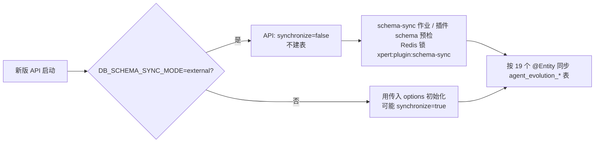
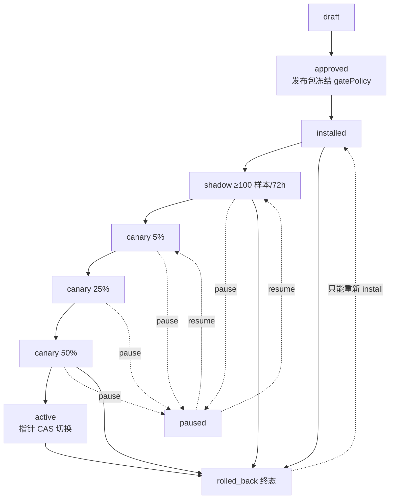

# Agent 演进专家 · 运维说明（07）

**本文引用的文件**（路径均相对仓库根 `/root/xpert`）

- [packages/server-ai/src/agent-evolution/agent-evolution.module.ts](file://packages/server-ai/src/agent-evolution/agent-evolution.module.ts)
- [packages/server-ai/src/agent-evolution/controllers/agent-evolution.controller.ts](file://packages/server-ai/src/agent-evolution/controllers/agent-evolution.controller.ts)
- [packages/server-ai/src/agent-evolution/changes/lifecycle.controller.ts](file://packages/server-ai/src/agent-evolution/changes/lifecycle.controller.ts)
- [packages/server-ai/src/agent-evolution/applications/agent-evolution-release-gate-policy.service.ts](file://packages/server-ai/src/agent-evolution/application/agent-evolution-release-gate-policy.service.ts)
- [packages/server-ai/src/agent-evolution/application/agent-evolution-queue.service.ts](file://packages/server-ai/src/agent-evolution/application/agent-evolution-queue.service.ts)
- [packages/server-ai/src/agent-evolution/application/agent-evolution-queue.processor.ts](file://packages/server-ai/src/agent-evolution/application/agent-evolution-queue.processor.ts)
- [packages/server-ai/src/agent-evolution/application/agent-evolution-governance.service.ts](file://packages/server-ai/src/agent-evolution/application/agent-evolution-governance.service.ts)
- [packages/server-ai/src/agent-evolution/application/evolution-runtime.store.ts](file://packages/server-ai/src/agent-evolution/application/evolution-runtime.store.ts)
- [packages/server-ai/src/agent-evolution/changes/change.service.ts](file://packages/server-ai/src/agent-evolution/changes/change.service.ts)
- [packages/server-ai/src/agent-evolution/changes/change.processor.ts](file://packages/server-ai/src/agent-evolution/changes/change.processor.ts)
- [packages/server-ai/src/agent-evolution/entities/evolution.entities.ts](file://packages/server-ai/src/agent-evolution/entities/evolution.entities.ts)
- [packages/server-ai/src/agent-evolution/providers/conformance-template.provider.ts](file://packages/server-ai/src/agent-evolution/providers/conformance-template.provider.ts)
- [packages/server/src/managed-queue/managed-queue.module.ts](file://packages/server/src/managed-queue/managed-queue.module.ts)
- [packages/server/src/managed-queue/constants.ts](file://packages/server/src/managed-queue/constants.ts)
- [packages/server/src/managed-queue/managed-queue.processor.ts](file://packages/server/src/managed-queue/managed-queue.processor.ts)
- [packages/server/src/database/application-data-source.ts](file://packages/server/src/database/application-data-source.ts)
- [packages/server/src/plugin/plugin-schema-sync.service.ts](file://packages/server/src/plugin/plugin-schema-sync.service.ts)
- [packages/server-ai/project.json](file://packages/server-ai/project.json)
- [package.json](file://package.json)

## 目录

1. [一、构建与运行入口](#一构建与运行入口)
2. [二、环境变量与门禁](#二环境变量与门禁)
3. [三、迁移现状（19 表、无 SQL 迁移）](#三迁移现状19-表无-sql-迁移)
4. [四、队列与 job 运维](#四队列与-job-运维)
5. [五、发布与回滚运维](#五发布与回滚运维)
6. [六、观测与审计数据运维](#六观测与审计数据运维)
7. [七、日志与排障入口](#七日志与排障入口)
8. [八、常见故障与处置](#八常见故障与处置)

## 一、构建与运行入口

| 入口 | 命令 / 配置 | 说明 |
|---|---|---|
| 构建 | `nx build server-ai`（`@nx/js:tsc` → `dist/packages/server-ai`） | `dependsOn` 含 `build-remote-components`（`node packages/server-ai/scripts/build-remote-components.mjs`） |
| 本地起后端 | `pnpm start:api`（`pnpm b:p:all && pnpm nx serve api`）、`pnpm start:api:dev`（nodemon） | 本模块随宿主启动，**无独立进程、无独立端口** |
| 路由前缀 | `/api/agent-evolution`（`RouterModule.register` 给 `/agent-evolution`，全局前缀 `api`） | 3 控制器共 48 端点 |
| 模块装配 | `AgentEvolutionModule`：`TypeOrmModule.forFeature(AGENT_EVOLUTION_ENTITIES)`、`CqrsModule`、`DiscoveryModule` | `CqrsModule` 仅为让 `PermissionGuard` 解析 `CommandBus` |
| 迁移执行 | **仓库无 agent-evolution 迁移脚本** | 根 `package.json` 仅有 `migrate:knowledge-filter-v2` 等与本域无关的脚本 |

运行形态要点：模块**不注册任何运行时能力到 Agent 执行链**，对外只暴露 HTTP ＋ 三个运行时能力 token（`platform.agent-evolution`、`…baselines`、`…changes`），其中 `EVOLUTION_RUNTIME_SERVICE_TOKEN` 以 `useExisting` 导出。

章节来源：[project.json](file://packages/server-ai/project.json)（关键符号：server-ai.targets.build / build-remote-components），[package.json](file://package.json)（关键符号：scripts.start:api / scripts.start:api:dev），[agent-evolution.module.ts](file://packages/server-ai/src/agent-evolution/agent-evolution.module.ts)（关键符号：RouterModule.register / TypeOrmModule.forFeature / EVOLUTION_RUNTIME_SERVICE_TOKEN）

## 二、环境变量与门禁

| 变量 | 读点 | 语义与风险 |
|---|---|---|
| `AGENT_EVOLUTION_ENABLE_CONFORMANCE` | `assertConformanceEnabled`（控制器）、`assertTemplateConformanceEnabled`（provider） | **仅当 `environment.production === true` 时生效**：值不为 `'true'` 即 404；设为 `'true'` 会让**生产的夹具端点可写**（`POST /simulations/conformance`、`POST /examples/…/run`、`POST /changes/conformance-template`）。注意门禁**只读 `environment.production`，不叠加 `NODE_ENV`** |
| `AGENT_EVOLUTION_GATE_PROFILE` | 闸门策略 | 值为 `manual_test`（忽略大小写、trim）**且非生产**时进入手动档：所有最小值降为 1/0 小时；生产环境该值**被静默忽略** |
| `AGENT_EVOLUTION_TEST_SHADOW_MIN_SAMPLES` / `_SHADOW_MIN_HOURS` | 闸门策略（manual_test 档） | 影子门槛样本数与最短时长；非法值回落 1 / 0 |
| `AGENT_EVOLUTION_TEST_CANARY_MIN_SAMPLES` / `_CANARY_MIN_HOURS` | 同上 | 金丝雀档门槛 |
| `AGENT_EVOLUTION_TEST_PRODUCTION_MIN_SAMPLES` / `_PRODUCTION_MIN_HOURS` | 同上 | 生产激活档门槛 |
| `AGENT_EVOLUTION_TEST_EXPERIENCE_MIN_SAMPLES` / `_EXPERIENCE_MIN_HOURS` | 同上 | 经验留档门槛 |
| `MANAGED_QUEUE_AUTORUN` | 宿主 managed-queue | `'false'` 关闭**两个逻辑池**的 worker（维护/排障用）；默认开启 |
| `MANAGED_QUEUE_PREFIX` | 宿主 managed-queue | BullMQ 键前缀，默认 `xpert:managed-queue`；只接受字母/数字/`:`/`_`/`-`，最长 160 字符，非法直接抛错 |
| `MANAGED_QUEUE_CONCURRENCY` | 宿主 managed-queue worker | 默认 10（物理队列级并发），与本模块每个 job 的 `concurrency` 相乘 |
| `DB_SCHEMA_SYNC_MODE` | 宿主数据源 | 值为 `external` 时**强制 `synchronize: false`**（见第三节） |
| `DB_HOST` / `DB_PORT` / `DB_USER` / `DB_PASS` / `DB_NAME` | 仅集成测试 | 生产无意义 |

**标准档闸门数值（冻结进发布包的默认值）**：影子 100 样本 / 72 小时、金丝雀 30 / 24、生产金丝雀 30 / 24、经验 100 / 168；标准档下请求参数只能**抬高** `shadowMinimumSamples`（取 `max`），不能降低其余任何门槛。

**门禁叠加顺序（易踩）**：① HTTP 层 `PermissionGuard` → ② 控制器/服务层 `requireHuman`（agent 主体拒绝）→ ③ 闸门数值判定（用**冻结**的 `gatePolicy`）→ ④ 管理员与 `manual_test` 限定（仅金丝雀一次性覆盖）。改 env 只影响**新建**的发布包，已冻结的发布包不受影响。

章节来源：[agent-evolution-release-gate-policy.service.ts](file://packages/server-ai/src/agent-evolution/application/agent-evolution-release-gate-policy.service.ts)（关键符号：STANDARD_GATE_POLICY / MANUAL_TEST_DEFAULTS / resolveEvolutionReleaseGatePolicy / snapshot / forRelease / manualTestProfileEnabled），[agent-evolution.controller.ts](file://packages/server-ai/src/agent-evolution/controllers/agent-evolution.controller.ts)（关键符号：assertConformanceEnabled），[conformance-template.provider.ts](file://packages/server-ai/src/agent-evolution/providers/conformance-template.provider.ts)（关键符号：assertTemplateConformanceEnabled），[constants.ts](file://packages/server/src/managed-queue/constants.ts)（关键符号：MANAGED_QUEUE_PHYSICAL_QUEUE_NAME / MANAGED_QUEUE_PREFIX）

## 三、迁移现状（19 表、无 SQL 迁移）

- **本模块没有 `migrations/` 目录**：`packages/server-ai/src/agent-evolution/**/*.sql` 不存在；全仓 `*.sql` 中检索 `agent_evolution` **0 命中** ⇒ **不存在可执行的迁移清单与执行顺序**。
- **DDL 唯一事实来源是实体注解**：`entities/evolution.entities.ts` 定义 19 个 `@Entity`（导出为 `AGENT_EVOLUTION_ENTITIES`），唯一约束如 `UX_evolution_proposal_request`、`UQ(tenant,org,targetId,channel)`、`activeKey` 等全部写在注解里；所有业务列都是 `type: 'json'`（**无 jsonb**），**无 `@VersionColumn`、无软删**。
- **建表路径取决于宿主 schema 同步模式**：`initializeApplicationDataSource` 在 `DB_SCHEMA_SYNC_MODE=external` 时给数据源强加 `synchronize: false`（多实例下由**单一** schema-sync 作业拥有 DDL）；插件侧由 `PluginSchemaSyncService.synchronize` 在插件激活/升级预检里同步实体（Redis 锁 `xpert:plugin:schema-sync`，TTL 5 分钟）。
- **结论（务必写进发布流程）**：① 本域**依赖 TypeORM 实体同步建表/改表**，没有版本化迁移可审计、可回滚；② 若部署使用 `DB_SCHEMA_SYNC_MODE=external`，必须确保 schema-sync 作业在**新版本 API 开始服务前**已同步这 19 张表，否则表现为运行期「表不存在」而不是启动失败；③ 回滚应用版本时**表结构不会自动回退**，新增列/索引会残留在库中。

图表来源：[application-data-source.ts](file://packages/server/src/database/application-data-source.ts)（关键符号：isSchemaSyncExternallyManaged / initializeApplicationDataSource / synchronize: false），[plugin-schema-sync.service.ts](file://packages/server/src/plugin/plugin-schema-sync.service.ts)（关键符号：PluginSchemaSyncService.synchronize / PLUGIN_SCHEMA_SYNC_LOCK），[evolution.entities.ts](file://packages/server-ai/src/agent-evolution/entities/evolution.entities.ts)（关键符号：AGENT_EVOLUTION_ENTITIES / 19 张表）

章节来源：[evolution.entities.ts](file://packages/server-ai/src/agent-evolution/entities/evolution.entities.ts)（关键符号：AGENT_EVOLUTION_ENTITIES / 唯一索引注解），[application-data-source.ts](file://packages/server/src/database/application-data-source.ts)（关键符号：DB_SCHEMA_SYNC_MODE / EXTERNAL_SCHEMA_SYNC_MODE），[plugin-schema-sync.service.ts](file://packages/server/src/plugin/plugin-schema-sync.service.ts)（关键符号：synchronize / PLUGIN_SCHEMA_SYNC_TTL）

## 四、队列与 job 运维

| 维度 | 实测值 |
|---|---|
| 逻辑队列 | 常量 `AGENT_EVOLUTION_QUEUE = 'agent-evolution'`，owner 常量 `'@xpert-ai/platform'` |
| job 类型 | `change_preparation`、`evaluation`、`install`、`shadow`、`canary`、`rollback`（契约 `EvolutionJobType` 同集） |
| 并发 | `change_preparation` 2、`evaluation` 2、`install` 1、`shadow` 2、`canary` 1、`rollback` 1（`@PluginJobProcessor` 声明） |
| 重试 | 入队参数 `attempts: 3`、`backoffMs: 1000` |
| 物理承载 | 宿主 `ManagedQueueModule` 的 BullMQ 物理队列 `plugin-jobs`（前缀默认 `xpert:managed-queue`），worker 并发 `MANAGED_QUEUE_CONCURRENCY`（默认 10） |
| 队列保留 | `removeOnComplete`: 24 小时 / 5000 条；`removeOnFail`: 7 天 / 5000 条 |
| 账本 | 表 `agent_evolution_job`：`jobId = EVOJOB-<uuid>`、`jobType`、`resourceId`、`status`、`queueJobId`、`errorCode/errorMessage` |

**状态流转与失败排查**：入队前先 `saveJob(status='queued')` → 入队成功后 `updateJobStatus('queued', {queueJobId})`；入队**抛错**则置 `failed` ＋ `errorCode='queue_enqueue_failed'`；worker 先置 `running`（写 `startedAt`），成功置 `completed`（写 `completedAt`），失败置 `failed` ＋ `errorCode='evolution_job_failed'`（`errorMessage` 为原异常文本）并**重抛**（交给 BullMQ 重试）。未注入 `MANAGED_QUEUE_SERVICE_TOKEN` 时入队直接 503 `Managed Queue is unavailable`。

**`GET /agent-evolution/jobs/:jobId` 的定位用法**：按租户作用域查账本，**未命中返回 `null`（HTTP 200）而非 404**；前端 `getJob` 类型即为 `EvolutionJob | null`。因此「查不到」必须与「已删除」区分：BullMQ 侧 24 小时后清 job，但 `agent_evolution_job` 账本**只保留最新一次状态，没有 TTL/清理**（见第六节），历史 job 会长期存在。

**切换与限流的注意点**：`MANAGED_QUEUE_AUTORUN=false` 会同时停掉 default 与 sandbox-browser 两个池 ⇒ 本域**所有入队端点仍返回 job，但永远停在 `queued`**；同环境多副本必须共用同一 `MANAGED_QUEUE_PREFIX`，否则 worker 与 enqueue 落在不同键空间、job 永不消费。

章节来源：[agent-evolution-queue.service.ts](file://packages/server-ai/src/agent-evolution/application/agent-evolution-queue.service.ts)（关键符号：AGENT_EVOLUTION_QUEUE / enqueue / attempts / backoffMs / getJob / queue_enqueue_failed），[agent-evolution-queue.processor.ts](file://packages/server-ai/src/agent-evolution/application/agent-evolution-queue.processor.ts)（关键符号：PluginJobProcessor / concurrency / updateJobStatus / evolution_job_failed），[change.service.ts](file://packages/server-ai/src/agent-evolution/changes/change.service.ts)（关键符号：CHANGE_QUEUE / change_preparation），[change.processor.ts](file://packages/server-ai/src/agent-evolution/changes/change.processor.ts)（关键符号：EvolutionChangeProcessor.handle / invalid_job_identity），[managed-queue.module.ts](file://packages/server/src/managed-queue/managed-queue.module.ts)（关键符号：BullModule.registerQueue / removeOnComplete / removeOnFail），[managed-queue.processor.ts](file://packages/server/src/managed-queue/managed-queue.processor.ts)（关键符号：MANAGED_QUEUE_WORKER_CONCURRENCY / managedQueuePoolAutorun）

## 五、发布与回滚运维

| 动作 | 端点 | 前置条件（服务端强校验） | 副作用 |
|---|---|---|---|
| install | `POST /releases/:id/install` | 人类主体；`release.status === 'approved'`；provider 支持 `install` | provider.install（幂等键 `<id>:install`）→ 状态 `installed` → 审计 `release.installed` |
| shadow | `POST …/shadow` | 人类主体；provider 支持 shadow；状态 `installed` 或 `paused` | 冻结 gatePolicy；建 `shadow` 部署；状态 `shadow`；审计 `deployment.shadow_started` |
| canary | `POST …/canary`（body `canaryPercent`） | 人类主体；percent ∈ {5,25,50}；**首轮必须 5%**；从 shadow 起需过影子门槛（样本/时长/零严重错误）；升档必须 5→25→50 且过金丝雀门槛 | 收尾上一档部署 → 建新 canary 部署 → 状态 `canary` ＋ 回写 `canaryPercent`；审计 `deployment.canary_started` |
| pause | `POST …/pause` | 人类主体；状态 `shadow` 或 `canary` | 状态 `paused`；审计 `deployment.paused`（**同步返回**） |
| activate | `POST …/activate` | 人类主体；状态必须 `canary`；最新 canary 部署必须 **50%** 且过生产门槛；**生产指针 `activeVersionId` 必须仍等于 `release.rollbackVersionId`** | 收尾 canary 部署 → provider.activate（幂等键带 `pointer.revision`）→ 指针 CAS 切换 → 建 `production` 部署（100%）→ 审计 |
| rollback | `POST …/rollback` | 人类主体（`agent` 主体直接 400）；provider 支持 rollback；**指针 `activeVersionId` 必须等于 `release.targetVersionId`** | provider.rollback → `rollbackPointerCas`（release 状态与指针 revision 同时前推）→ 审计 |

**操作口径**：`install/shadow/canary/rollback` 是**入队**动作（返回 `EvolutionJob`，失败在 worker 内以 `errorCode='evolution_job_failed'` 记账）；`pause/activate` 是**同步**动作（直接返回发布包 / 新指针，HTTP 报错即业务拒绝）。

**一次性金丝雀覆盖**：`POST /releases/:id/canary-test-overrides` 需**管理员** ＋ 非生产（`manual_test` profile 可启用）＋ 发布包 gatePolicy 为 `manual_test` ＋ 发布包处于 canary 阶段；同一 `(scope,subjectKey)` 已有 `pending` 覆盖会被拒；默认 30 分钟、上限 120 分钟。**一次性语义**由 `activeKey` 唯一约束 ＋ 消费翻转实现：同一执行被覆盖一次后即回落确定性 canary 路由；`pending` 超过 `expiresAt` 会被读路径批量翻为 `expired`。**残留清理**：过期行不会自动删除，只在查询时翻转状态；清理需运维手工（见第六节 SQL 思路）。

**指针切换的影响面**：发布**不改任何 Agent 运行时行为**——真正切换发生在消费方调用 `resolveExecutionPlan` 时（无部署走 production 指针；有 shadow/canary/覆盖则按 `sha256(deploymentId:subjectKey)` 的确定性百分比裁决）。因此「发布成功」≠「线上已换版本」，必须确认外部消费方在调 `resolveExecutionPlan`。指针并发由 `activatePointerCas/rollbackPointerCas` 的 `revision + activeVersionId` 条件更新兜底，`affected !== 1` 抛 CAS 冲突。

图表来源：[agent-evolution-governance.service.ts](file://packages/server-ai/src/agent-evolution/application/agent-evolution-governance.service.ts)（关键符号：installRelease / startShadow / startCanary / pauseRelease / activateProduction / rollbackProduction），[evolution-runtime.store.ts](file://packages/server-ai/src/agent-evolution/application/evolution-runtime.store.ts)（关键符号：activatePointerCas / rollbackPointerCas / 覆盖消费与过期翻转），[evolution-state.ts](file://packages/server-ai/src/agent-evolution/domain/evolution-state.ts)（关键符号：release 迁移表 / rolled_back 终态）

## 六、观测与审计数据运维

| 表 | 写入点 | 增长特征 | 现状 |
|---|---|---|---|
| `agent_evolution_runtime_observation` | 消费方回流观测（`recordRuntimeObservation`）；按 `observationId` 去重，并累加部署的 `sampleCount/severeErrors/candidateAccuracy/p95LatencyMs/averageCost` | 与**被执行次数**同阶；`severeErrors=true` 会触发系统主体的自动 pause ＋ 审计 | **无 TTL、无清理任务** |
| `agent_evolution_audit_event` | 每次发布动作、覆盖创建/消费、自动暂停、指针 CAS 都写一条 | 随治理动作线性增长（体量小） | **无 TTL、无清理任务** |
| `agent_evolution_experience` | `POST /experiences`（需 active 发布 ＋ 生产门槛） | 每个稳定发布一条量级 | 同上 |
| `agent_evolution_job` | 每次入队/执行/失败 | 与入队次数同阶 | 同上 |
| `agent_evolution_learning_event` | 运行时能力 `ingestLearningEvent`（要求 target 为 `active`，confidential 必须已 `redacted`） | 与外部信号量同阶，**最可能成为最大表** | 同上 |

**事实结论**：本模块内检索 `@Cron` / `@Interval` / `DELETE FROM` / `.delete(` / `retention` / `cleanup` / `purge` **全部 0 命中** ⇒ **没有任何自动清理或保留策略**。长期运行必须由运维自建（建议：按 `createdAt` 分片删除 `runtime_observation`/`learning_event`/`job`，`audit_event` 与 `experience` 建议长期保留以满足审计），并在清理前先确认没有正在进行中的发布/评估引用这些行。宿主的 BullMQ 侧虽配置了 `removeOnComplete/removeOnFail`，但那**只清队列 job，不清 `agent_evolution_job` 账本**，两者不可混为一谈。

章节来源：[evolution-runtime.store.ts](file://packages/server-ai/src/agent-evolution/application/evolution-runtime.store.ts)（关键符号：saveRuntimeObservation / 样本累加 / 自动 pause / 审计写入），[agent-evolution-governance.service.ts](file://packages/server-ai/src/agent-evolution/application/agent-evolution-governance.service.ts)（关键符号：audit / createExperience / listRuntimeObservations / listAuditEvents），[agent-evolution-queue.service.ts](file://packages/server-ai/src/agent-evolution/application/agent-evolution-queue.service.ts)（关键符号：saveJob / updateJobStatus），[managed-queue.module.ts](file://packages/server/src/managed-queue/managed-queue.module.ts)（关键符号：removeOnComplete / removeOnFail）

## 七、日志与排障入口

| 症状 | 观测入口 | 判据 |
|---|---|---|
| 治理动作无留痕 | `agent_evolution_audit_event`（`GET /audit-events`） | 动作成功但无审计行 ⇒ 审计写入异常（发布动作与审计在同一流程内） |
| 观测回流异常 | `agent_evolution_runtime_observation` ＋ `release_deployment.value.sampleCount/severeErrors` | 样本不涨 ⇒ 消费方未回流；严重错误被系统主体自动 pause（`actorId: 'agent-evolution-runtime'`） |
| 执行会话流失败 | 日志 `Evolution execution event could not be published: …`（`logger.warn`，**静默降级**） | 该警告不影响权威数据（消息与运行状态已持久化），SSE 只是实时通道 |
| 会话收尾失败 | 日志 `Evolution execution transcript could not be finalized: …` / `Evolution execution transcript unavailable: …` | 会话记录不可用**不会改变**模型检查或审批门结果 |
| 目标展示数据缺失 | 日志 `{ code: 'evolution_presentation_unavailable', targetId }` | 插件 `presenter` 不可用；审计数据仍可读 |
| HTTP 403 | `PermissionGuard` ＋ `@Permissions` | 读需 `EVOLUTION_VIEW` **或** `XPERT_EDIT`；写需 `EVOLUTION_MANAGE`；基线读三位任一 |
| HTTP 404（夹具） | `assertConformanceEnabled` / `assertTemplateConformanceEnabled` | 生产未开 `AGENT_EVOLUTION_ENABLE_CONFORMANCE` 时的**预期行为** |
| 队列不消费 | 宿主 `getWorkersCount()` / `MANAGED_QUEUE_AUTORUN` / `MANAGED_QUEUE_PREFIX` | worker 数为 0 或不消费 ⇒ 池未启用或前缀不一致 |

章节来源：[execution-conversation.service.ts](file://packages/server-ai/src/agent-evolution/changes/execution-conversation.service.ts)（关键符号：EvolutionExecutionConversationService / publish 失败降级日志），[change.service.ts](file://packages/server-ai/src/agent-evolution/changes/change.service.ts)（关键符号：transcript 收尾日志 / evolution_presentation_unavailable），[evolution-runtime.store.ts](file://packages/server-ai/src/agent-evolution/application/evolution-runtime.store.ts)（关键符号：system_safety_guard / 自动 pause），[managed-queue.processor.ts](file://packages/server/src/managed-queue/managed-queue.processor.ts)（关键符号：getWorkersCount / autorun）

## 八、常见故障与处置

| 故障 | 根因（结构事实） | 处置 |
|---|---|---|
| 闸门恒不过（样本永不够） | 门槛来自**冻结在发布包**里的 `gatePolicy`，改 env 无效；`manual_test` 只在非生产可用 | 生产只能等真实样本/时长；测试环境重建发布包（`POST /release-packages`）后再放开 `AGENT_EVOLUTION_GATE_PROFILE=manual_test` |
| 金丝雀升档被拒 | 跳档（如 5%→50%）、首轮非 5%、样本/时长不足或有 `severeErrors` | 对齐 5→25→50 阶梯；先确认 `deployments` 里最新一档的 `sampleCount/severeErrors/startedAt` |
| 激活被拒 `Production pointer no longer matches…` | 激活要求指针仍等于 `release.rollbackVersionId`；期间有别的发布改过指针 | 检查 `GET /active-pointers`：指针已前进 ⇒ 该发布包作废，重新走 install→shadow→canary |
| 回滚被拒 | ① agent 主体；② provider 无 `rollback` 能力；③ 该发布包**不是当前生产版本**（指针 `activeVersionId ≠ release.targetVersionId`）；④ 指针 CAS 冲突 | 逐条比对 `active-pointers` 与 `releases`；注意 `rolled_back` 是终态，**回不到原 canary 档位**，只能重新 install |
| job 卡 `queued` | worker 池未启用（`MANAGED_QUEUE_AUTORUN=false`）、`MANAGED_QUEUE_PREFIX` 与 enqueue 侧不一致、或插件 handler 未在本实例注册 | 先恢复 autorun/统一前缀，再 `GET /jobs/:jobId` 看 `queueJobId` 是否为 `null`（为 `null` 说明入队即失败） |
| job 卡 `running` | worker 进程在 `updateJobStatus('running')` 之后崩溃（账本无补偿写入） | 依赖 `attempts: 3` 重试；长期悬挂需人工把账本置 `failed`（无 HTTP 取消端点，`cancelled` 只能直接改库） |
| 一次性覆盖「未回落」 | 覆盖仅在 `manual_test` ＋ canary ＋ 管理员下可建；`pending` 到期后才翻 `expired`，且**行不会被删除** | 核对 `expiresAt`（默认 30 分钟、上限 120 分钟）与 `status`；确认消费侧 `subjectKey` 与创建时一致 |
| 权限 403 | `@Permissions` 判定（读 `EVOLUTION_VIEW｜XPERT_EDIT`、写 `EVOLUTION_MANAGE`、基线读三位任一） | 补角色权限位；注意**服务层还有一层**：`SUPER_ADMIN/ADMIN` 才具 `administrator` 审批权，agent 主体被 `requireHuman` 拒绝 |
| 生产夹具端点 404 | 预期行为，非故障 | 若确需演练，需显式设 `AGENT_EVOLUTION_ENABLE_CONFORMANCE=true`（高风险，演练后立即撤销） |
| 升级后表不存在 | 本域**无 SQL 迁移**，建表依赖实体同步/插件 schema 预检 | 确认 schema-sync 作业先于新版本 API 生效（见第三节） |

章节来源：[agent-evolution-release-gate-policy.service.ts](file://packages/server-ai/src/agent-evolution/application/agent-evolution-release-gate-policy.service.ts)（关键符号：forRelease / manualTestProfileEnabled），[agent-evolution-governance.service.ts](file://packages/server-ai/src/agent-evolution/application/agent-evolution-governance.service.ts)（关键符号：startCanary 阶梯校验 / activateProduction 指针校验 / rollbackProduction / createCanaryTestOverride），[agent-evolution-queue.service.ts](file://packages/server-ai/src/agent-evolution/application/agent-evolution-queue.service.ts)（关键符号：enqueue / queueJobId / attempts），[evolution-runtime.store.ts](file://packages/server-ai/src/agent-evolution/application/evolution-runtime.store.ts)（关键符号：rollbackPointerCas / 覆盖过期翻转），[agent-evolution.controller.ts](file://packages/server-ai/src/agent-evolution/controllers/agent-evolution.controller.ts)（关键符号：Permissions / assertConformanceEnabled）
