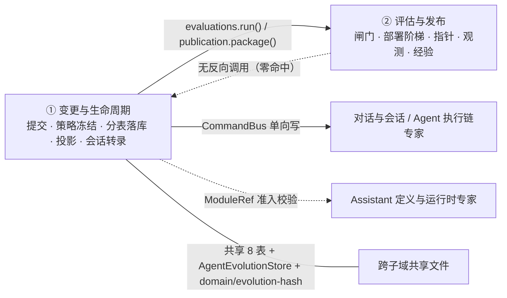

# 变更与生命周期子专家 —— C0 使用总览

> **资产基线**：`2026-10-16 · commit 80f5676fd`（批次 5 第 11 专家），继承父域 [C0-使用总览.md](file://.module-experts/后端专题/Agent 演进专家/C0-使用总览.md)。**范围**：`packages/server-ai/src/agent-evolution/changes/**`（8 个文件）＋ `controllers/agent-evolution.controller.ts` 的入口逻辑 ＋ `providers/conformance-template.provider.ts`；HTTP 面＝父域 48 端点中的 **8 条**（`EvolutionLifecycleController`，`@Controller('changes')`）。**闸门策略 / 发布执行 / 运行时 / 观测归** [子专家②](file://.module-experts/后端专题/Agent 演进专家/sub-experts/评估与发布子专家/C0-使用总览.md)。**八张表**：`learning_event` / `diagnosis` / `event_cluster` / `proposal` / `candidate` / `dataset_snapshot` / `evaluation_run` / `approval`（`release_package` 在本子域**只读**）。未证实处标 `[推测]`。

**本文引用的文件**（相对仓库根，链接均为 `file://`）

- [agent-evolution/changes/lifecycle.controller.ts](file://packages/server-ai/src/agent-evolution/changes/lifecycle.controller.ts)
- [agent-evolution/changes/lifecycle.service.ts](file://packages/server-ai/src/agent-evolution/changes/lifecycle.service.ts)
- [agent-evolution/changes/lifecycle.projection.ts](file://packages/server-ai/src/agent-evolution/changes/lifecycle.projection.ts)
- [agent-evolution/changes/change.service.ts](file://packages/server-ai/src/agent-evolution/changes/change.service.ts)
- [agent-evolution/changes/change.store.ts](file://packages/server-ai/src/agent-evolution/changes/change.store.ts)
- [agent-evolution/changes/change.processor.ts](file://packages/server-ai/src/agent-evolution/changes/change.processor.ts)
- [agent-evolution/changes/change.validation.ts](file://packages/server-ai/src/agent-evolution/changes/change.validation.ts)
- [agent-evolution/changes/change.errors.ts](file://packages/server-ai/src/agent-evolution/changes/change.errors.ts)
- [agent-evolution/changes/submission.schema.ts](file://packages/server-ai/src/agent-evolution/changes/submission.schema.ts)
- [agent-evolution/changes/strategy.service.ts](file://packages/server-ai/src/agent-evolution/changes/strategy.service.ts)
- [agent-evolution/changes/execution-conversation.service.ts](file://packages/server-ai/src/agent-evolution/changes/execution-conversation.service.ts)
- [agent-evolution/controllers/agent-evolution.controller.ts](file://packages/server-ai/src/agent-evolution/controllers/agent-evolution.controller.ts)
- [agent-evolution/providers/conformance-template.provider.ts](file://packages/server-ai/src/agent-evolution/providers/conformance-template.provider.ts)
- [agent-evolution/application/agent-evolution.store.ts](file://packages/server-ai/src/agent-evolution/application/agent-evolution.store.ts)
- [agent-evolution/domain/evolution-hash.ts](file://packages/server-ai/src/agent-evolution/domain/evolution-hash.ts)
- [agent-evolution/entities/evolution.entities.ts](file://packages/server-ai/src/agent-evolution/entities/evolution.entities.ts)
- [契约：packages/contracts/src/ai/evolution/governance.ts](file://packages/contracts/src/ai/evolution/governance.ts)

章节来源：[lifecycle.controller.ts](file://packages/server-ai/src/agent-evolution/changes/lifecycle.controller.ts)（关键符号：EvolutionLifecycleController / submit / conformance / records）、[change.service.ts](file://packages/server-ai/src/agent-evolution/changes/change.service.ts)（关键符号：EvolutionChangeService）

## 目录

1. [定位](#定位)
2. [何时找这个子专家](#何时找这个子专家)
3. [能力清单表](#能力清单表)
4. [边界](#边界)
5. [已知问题与常见坑](#已知问题与常见坑)
6. [延伸阅读](#延伸阅读)

## 定位

本子专家负责 **「一条改进从提交到发布意图的全过程记录与读投影」**：提交受理与结构校验（`evolutionSubmissionSchema`）＋业务校验（`validateChangeInput`）、策略冻结（`EvolutionStrategyService.freeze`）、提交→候选→评估记录→审批→发布意图的**分表落库**（`EvolutionChangeStore`）、异步推进（`change_preparation` 队列 ＋ `EvolutionChangeProcessor` ＋ `process()` 的幂等重入）、HTTP 读投影（`lifecycleRecord`）、以及会话/执行账本的单向联动（`EvolutionExecutionConversationService`）。

**一句话口径**：`changes/` 目录**没有任何 `@Entity`**——「① 是记录侧」不是约定而是**目录级事实**。写入只有两个面：HTTP 8 端点与一条队列作业，两者最终都进同一个 `EvolutionChangeService`；读取只有一条路——`EvolutionChange` 契约对象由 `assemble()` 跨五表拼装（**assembled, never persisted whole**），再经纯函数 `lifecycleRecord()` 投影成前端可读的 `EvolutionLifecycleRecord`。

章节来源：[change.store.ts](file://packages/server-ai/src/agent-evolution/changes/change.store.ts)（关键符号：EvolutionChangeStore.assemble / save / create）、[lifecycle.projection.ts](file://packages/server-ai/src/agent-evolution/changes/lifecycle.projection.ts)（关键符号：lifecycleRecord）、[agent-evolution.controller.ts](file://packages/server-ai/src/agent-evolution/controllers/agent-evolution.controller.ts)（关键符号：requestScope / commandContext / normalizeQuery）

## 何时找这个子专家

- 要**提一个变更**：`POST /api/agent-evolution/changes`（Zod `.strict()` 全对象校验 → 策略冻结 → 写 `proposal` → 投递 `change_preparation`）或夹具入口 `POST /changes/conformance-template`。
- 要**读生命周期与记录**：`GET /changes`（投影分页）、`GET /changes/records`（契约原文，绕过投影）、`GET /changes/:id`。
- 要看**诊断与聚类的记录语义**：`correctionSignature` 分组口径、`event_cluster.status ∈ collecting | proposal_ready` 由 `qualifiesLearning` 一次决定、`diagnosis` 表**无 status 列**。
- 要**提提案与建候选**：`requestId` 幂等（`UQ(tenant, org, targetId, requestId)`）、候选依赖 `proposalRevision`、`artifact.hash` 从此成为全链身份且不可换。
- 要**做人工审批**：候选哈希 ＋ `evaluationRunId` ＋ `strategyHash` 三元组绑定、同 actor 不可改判、quorum 由 ② 的 `reviewHumanApprovals` 判定。
- 要**处理数据集与评估记录**：`datasetSnapshotIds` 一旦随评估落库即冻结、`evaluation_run.status ∈ passed | failed` ＋ 冗余布尔列 `gatePassed`、写后不可变。
- 要**用一致性夹具（模板）**：`test_fixture` 目标的 `fixtureInput` / `validateCurrent` 硬口径（恰 1 条 `feedback`）、生产环境**空体 404**。
- 要**排查提交校验失败**：`submission.schema`（结构）与 `validateChangeInput`（业务）**两层规则叠加**，报错都从 `changeError` 出（恒 400）。
- 要**排查异步处理器**：`EvolutionChangeProcessor`（并发 2）、残留 job 收尾分支、`awaitingDataset` 静默停留、`change_preparation_failed` 后的重抛重试。
- 要**排查会话缺失**：「前端没动画」不等于状态没变——`recordConversation()` 与 SSE 都静默降级，状态以持久化记录为准。

章节来源：[lifecycle.controller.ts](file://packages/server-ai/src/agent-evolution/changes/lifecycle.controller.ts)（关键符号：submit / conformance / list / records / get / evaluate / decide / publish）、[change.service.ts](file://packages/server-ai/src/agent-evolution/changes/change.service.ts)（关键符号：prepare / process / decide / publish / recordConversation）、[conformance-template.provider.ts](file://packages/server-ai/src/agent-evolution/providers/conformance-template.provider.ts)（关键符号：fixtureInput / validateCurrent / assertTemplateConformanceEnabled）

## 能力清单表

| 能力 | 入口 | 一句话 |
|---|---|---|
| 提交变更 | `POST /api/agent-evolution/changes` | 结构 `.strict()` ＋ 业务校验两层；`tenantId`/`organizationId` 由控制器覆写 |
| 夹具提交（一致性模板） | `POST /changes/conformance-template` | body 仅 `{requestId, strategyId}`、**无 schema 校验**；生产 404 门禁 |
| 生命周期投影读 | `GET /changes`、`GET /changes/:id` | `lifecycleRecord()` 纯函数；`release.status` **优先**于 `change.status` |
| 契约原文读 | `GET /changes/records` | `assemble()` 五表拼装，`targetId` 过滤；**同名 `status` 与投影不同义** |
| 变更评估 | `POST /changes/:id/evaluations` | 事务内冻结 `datasetSnapshotIds`；执行在 ②，记录落 ① |
| 人工审批 | `POST /changes/:id/decisions`、`POST /candidates/:candidateId/approvals` | 三元组绑定；同 actor 同判幂等、改判拒绝 |
| 发布意图 | `POST /changes/:id/publication` | 状态机前置 ＋ 回执三元组；`staged_rollout` 转 ② 的 `package()` |
| 候选构建 | `POST /candidates` → `EvolutionChangeService.build()` | 依赖 `proposalRevision`；`artifactHash` 与 definition 双不可变 |
| 提案与数据集快照 | `POST /proposals`、`POST /datasets` | 提案 `requestId` 幂等；用例 `(caseId, revision)` 唯一 |
| 学习事件复核 | `PATCH /learning-events/:eventId/review` | `pending｜ignored｜golden`；入账只有运行时能力 token，无 HTTP 写 |
| 诊断与聚类 | `POST /diagnoses`、`GET /diagnoses`、`GET /clusters` | 只诊断不写提案；事件 id 数量不等即 400 |
| 异步推进 | 队列 `agent-evolution` / `change_preparation` | 并发 2、`attempts: 3`、`backoffMs: 1500`；失败重抛交队列 |
| 会话与执行账本联动 | `EvolutionExecutionConversationService` | ChatKit 转录 ＋ `XpertAgentExecution` 单向写；全部失败静默 |
| 四张权威记录表 | `proposal` / `candidate` / `evaluation_run` / `approval` | 分表权威 ＋ 四个 `immutable_*` 不可变闸 |

章节来源：[change.service.ts](file://packages/server-ai/src/agent-evolution/changes/change.service.ts)（关键符号：prepare / build / evaluate / decide / publish / enqueue / CHANGE_QUEUE）、[change.store.ts](file://packages/server-ai/src/agent-evolution/changes/change.store.ts)（关键符号：save / saveEvaluation / toCandidateStatus）、[execution-conversation.service.ts](file://packages/server-ai/src/agent-evolution/changes/execution-conversation.service.ts)（关键符号：validate / start / drafted / finish）

## 边界

**做什么**：提交受理与两层校验、策略冻结与陈旧检测、五表分表落库与三层去重、异步推进与幂等重入、HTTP 读投影、会话/执行账本的尽力而为单向写、一致性夹具 provider。

**不做什么（与 ② 及相邻专家域的分工）**

- **不含闸门策略与阈值判据**：`AgentEvolutionQualityGovernanceService.reviewGoldenReplay` / `reviewHumanApprovals` / `AgentEvolutionReleaseGatePolicyService.forRelease` 全在 ②。
- **不含评估执行与发布包生成**：`EvolutionEvaluationExecutor.run`（逐步评估与 golden replay）与 `EvolutionPublicationExecutor.package`（分配 `CapabilityVersion` 与冻结 `gatePolicy`）在 ②；① 只调 `evaluations.run()` / `publication.package()` 两个窄接口。
- **不含部署阶梯、指针与观测**：`install|shadow|canary|pause|activate|rollback`、`ActiveCapabilityPointer` CAS、`recordRuntimeObservation`、审计与经验全在 ②。
- **不含执行账本与调用**：对 `XpertAgentExecution` / `ChatConversation` / `ChatMessage` **只写不读**，无关联列、无校验 → Agent 执行链专家 / 对话与会话专家。
- **不含 Agent 定义**：对 `xpert` 只做准入校验（`PublishedXpertAccessService` / `XpertProjectAccessService.assertCanUseXpert`）→ Assistant 定义与运行时专家。
- **无实体定义、无调度器、无事件订阅**：实体在共享文件里；模块内 `@Cron`/`@Interval`/`@OnEvent` 零命中——本子域的全部异步只来自一条 Managed Queue。
- **入口文件的口径说明**：`controllers/agent-evolution.controller.ts` 的 39 条端点业务语义归 ②；本子域只拥有 `requestScope` / `commandContext` / `normalizeQuery` / `assertConformanceEnabled` 这套**接入契约与鉴权口径**，以及记录侧 8 表的字段语义。

图表来源：[lifecycle.controller.ts](file://packages/server-ai/src/agent-evolution/changes/lifecycle.controller.ts)（关键符号：@Controller('changes') / @UseGuards(PermissionGuard)）、[change.service.ts](file://packages/server-ai/src/agent-evolution/changes/change.service.ts)（关键符号：prepare / process / publish）、[agent-evolution.module.ts](file://packages/server-ai/src/agent-evolution/agent-evolution.module.ts)（关键符号：AgentEvolutionModule 的 controllers / providers）

章节来源：[01-架构.md](file://.module-experts/后端专题/Agent 演进专家/sub-experts/变更与生命周期子专家/implementation/01-架构.md)（关键符号：与 ② 的分工 / 跨子域共享文件 8 项）、[execution-conversation.service.ts](file://packages/server-ai/src/agent-evolution/changes/execution-conversation.service.ts)（关键符号：EvolutionExecutionConversationService.validate / start）

## 已知问题与常见坑

1. **权限位三分不可混用**：8 条端点的读＝`EVOLUTION_VIEW｜XPERT_EDIT`（两位并列），写＝`EVOLUTION_MANAGE`（单独一位）；类级 `@UseGuards(PermissionGuard)` 是唯一守卫，服务层不再二次鉴权。
   - 契约来源：[lifecycle.controller.ts](file://packages/server-ai/src/agent-evolution/changes/lifecycle.controller.ts)、[role-permissions.ts](file://packages/contracts/src/ai/role-permissions.ts)。
2. **两层「人主体」门不可省**：`requireHuman` 在 `actorType === 'agent'` 时直接拒（400），`approvalAuthority` 由角色名派生（`SUPER_ADMIN`/`ADMIN` → `administrator`，否则 `standard`）；`manual_test` 档另要求 `administrator`。agent 主体既不能做 R4 提案，也不能做发布回滚。
   - 契约来源：[evolution-governance.helpers.ts](file://packages/server-ai/src/agent-evolution/application/evolution-governance.helpers.ts)、[agent-evolution-governance.service.ts](file://packages/server-ai/src/agent-evolution/application/agent-evolution-governance.service.ts)。
3. **夹具端点的生产 404 是预期行为**：`environment.production && AGENT_EVOLUTION_ENABLE_CONFORMANCE !== 'true'` → **空体 `NotFoundException`**，与「路由不存在」不可区分；provider 侧另有同款 `assertTemplateConformanceEnabled()` 与逐方法 `authorizeScope`（target ＋ `scope.type==='organization'` ＋ `scope.key===organizationId`）二次校验，不符即 `identity_mismatch`。
   - 契约来源：[agent-evolution.controller.ts](file://packages/server-ai/src/agent-evolution/controllers/agent-evolution.controller.ts)、[conformance-template.provider.ts](file://packages/server-ai/src/agent-evolution/providers/conformance-template.provider.ts)。
4. **`submission.schema` 是结构边界，不是唯一真相**：`.strict()` 使 `tenantId`/`organizationId` 出现在请求体即 400；服务层**只复用 `executionContext` 子 schema**，其余由手写 `validateChangeInput` 二次判定（scope key 与租户/组织一致性、`strategy.inputs.includes(sourceKind)`、evidence 白名单）。两层缺一层就可能放过或误杀。
   - 契约来源：[submission.schema.ts](file://packages/server-ai/src/agent-evolution/changes/submission.schema.ts)、[change.validation.ts](file://packages/server-ai/src/agent-evolution/changes/change.validation.ts)。
5. **`change.processor` 的异步与幂等分四层**：① DB 唯一索引 `UX_evolution_proposal_request`；② 应用层 7 字段 `changeDigest` 对账（命中即返回**原变更**，内容不一致即 `immutable_request_changed`）；③ `prepare()` 仅凭 `record.changeId === changeId` 判断是否首建、重复提交**复用同一 `jobId`** 重投递；④ `process()` 三个事务块各自再判一次可推进状态，非可推进即**收尾残留 job 并直接返回**。
   - 契约来源：[change.store.ts](file://packages/server-ai/src/agent-evolution/changes/change.store.ts)、[change.service.ts](file://packages/server-ai/src/agent-evolution/changes/change.service.ts)、[change.processor.ts](file://packages/server-ai/src/agent-evolution/changes/change.processor.ts)。
6. **`lifecycle.projection` 是只读投影，勿当业务表改**：`lifecycleRecord()` 只 import 契约类型，**无 DataSource、无 repository、无写**；`capabilities` 四位是**建议位不是权限位**，且 `release` 存在时 `capabilities.publish` 恒 false。想在投影里加字段必须先让写侧产生对应事实，否则会掉进 `preparing` 兜底。
   - 契约来源：[lifecycle.projection.ts](file://packages/server-ai/src/agent-evolution/changes/lifecycle.projection.ts)、[lifecycle.service.ts](file://packages/server-ai/src/agent-evolution/changes/lifecycle.service.ts)。
7. **`evolution-hash` 稳定性：两套摘要并存且不可互换**：`hashEvolutionValue`（键排序的规范 JSON）是全域唯一规范哈希；但 ① 的记录侧 `digest()` / `changeDigest()` 是 `sha256(JSON.stringify(value))`——**键不排序、数组顺序敏感**，`evidenceHash` 用后者。重排 evidence 重提交会命中 `immutable_request_changed`。
   - 契约来源：[evolution-hash.ts](file://packages/server-ai/src/agent-evolution/domain/evolution-hash.ts)、[change.service.ts](file://packages/server-ai/src/agent-evolution/changes/change.service.ts)、[change.store.ts](file://packages/server-ai/src/agent-evolution/changes/change.store.ts)。
8. **`change.errors` 的错误码映射：全部是 400**：`changeError(code)` 恒抛 `BadRequestException`（i18n 键 `server-ai:Error.EvolutionChange`，`defaultValue = 'Evolution cannot proceed: {{code}}'`）。因此 `change_not_found` / `identity_mismatch` / `strategy_snapshot_stale` 与参数错误在 HTTP 上**不可区分**，调用方必须按 `code` 解析而非匹配整句。
   - 契约来源：[change.errors.ts](file://packages/server-ai/src/agent-evolution/changes/change.errors.ts)。
9. **同名 `status` 不同义，且分页上限有两个**：`/changes` 的 `status` 可能是发布包状态（`release?.status ?? change.status`），`/changes/records` 的 `status` 是变更状态机词表；分页上限 `lifecycle.service` **200**、`store.normalizePage` **100**，同一 UI 在两个端点上拿到不同深度的页。
   - 契约来源：[lifecycle.service.ts](file://packages/server-ai/src/agent-evolution/changes/lifecycle.service.ts)、[evolution-store.helpers.ts](file://packages/server-ai/src/agent-evolution/application/evolution-store.helpers.ts)。
10. **`decide()` 未加行锁、`awaitingDataset` 会静默停留**：`approval` 无 `(candidateId, actorId)` 唯一索引且 `read` 的 `lock` 未开启，「同 actor 不可改判」在并发下不封闭；缺 `golden_replay` 数据集时 `process()` 直接 return，`status` 停在 `testing` 而 `job` 已是 `completed`（本模块无 `@Cron`，无超时补偿）。
    - 契约来源：[change.service.ts](file://packages/server-ai/src/agent-evolution/changes/change.service.ts)、[03-数据流转.md](file://.module-experts/后端专题/Agent 演进专家/sub-experts/变更与生命周期子专家/implementation/03-数据流转.md)。

章节来源：[domain/evolution-state.ts](file://packages/server-ai/src/agent-evolution/domain/evolution-state.ts)（关键符号：CANDIDATE_TRANSITIONS / assertCandidateTransition）、[02-实现.md](file://.module-experts/后端专题/Agent 演进专家/sub-experts/变更与生命周期子专家/implementation/02-实现.md)（关键符号：技术债与 hack / 设计维度分析）

## 延伸阅读

- 本子专家 8 端点逐条、服务契约与投影读模型：[C1-能力契约.md](file://.module-experts/后端专题/Agent 演进专家/sub-experts/变更与生命周期子专家/C1-能力契约.md)
- 6 条端到端数据流（提交→候选、评估记录、审批、发布记录侧、投影读链、会话联动）：[03-数据流转.md](file://.module-experts/后端专题/Agent 演进专家/sub-experts/变更与生命周期子专家/implementation/03-数据流转.md)
- 结构分层、跨子域共享文件 8 项与 6 条关键不变量：[01-架构.md](file://.module-experts/后端专题/Agent 演进专家/sub-experts/变更与生命周期子专家/implementation/01-架构.md)
- 提交校验、分表去重、处理器八段、热点路径与技术债：[02-实现.md](file://.module-experts/后端专题/Agent 演进专家/sub-experts/变更与生命周期子专家/implementation/02-实现.md)
- 11＋1 个 spec 分布、运行命令与 8 条缺口（控制器 0 spec）：[06-测试.md](file://.module-experts/后端专题/Agent 演进专家/sub-experts/变更与生命周期子专家/implementation/06-测试.md)
- 父域 Recipe：提交变更并读记录 / 诊断聚类 / 提案候选审批 / 数据集与评估 / 排障合集：父域 [C2-使用流程.md](file://.module-experts/后端专题/Agent 演进专家/C2-使用流程.md) Recipe 1 / 2 / 3 / 4 / 11
- 八表逐列与消费方：[C4-数据流向与消费.md](file://.module-experts/后端专题/Agent 演进专家/C4-数据流向与消费.md) §变更与生命周期（8 张表）
- 决策证据（变更不整表＋三套状态词表 / 与执行账本只写不读）：父域 [C5-关键决策.md](file://.module-experts/后端专题/Agent 演进专家/C5-关键决策.md) D9 / D10

章节来源：[lifecycle.controller.ts](file://packages/server-ai/src/agent-evolution/changes/lifecycle.controller.ts)（关键符号：submit / conformance / list / records / get / evaluate / decide / publish）、[evolution.entities.ts](file://packages/server-ai/src/agent-evolution/entities/evolution.entities.ts)（关键符号：ImprovementProposalEntity 的唯一索引 / EvaluationRunEntity.gatePassed / ApprovalDecisionEntity）
