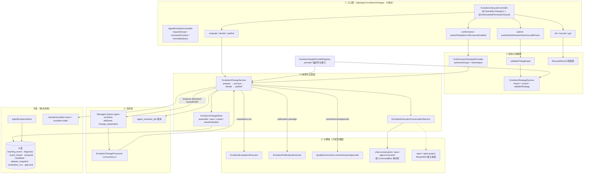

# Agent 演进域 · ① 变更与生命周期子专家 · 架构（01-架构）

> 子域根：`packages/server-ai/src/agent-evolution`；父域实测 **44 非 spec / 19 spec / 19 表 / 48 HTTP 端点**（基线 commit `80f5676fd`）
> 本子域 = 48 端点中的 **8 条**（`EvolutionLifecycleController`，`@Controller('changes')`）
> 定位：提交 → 候选 → 评估记录 → 审批 → 发布的**记录与投影**侧；② 负责闸门策略 / 发布执行 / 运行时 / 观测
> 与父级关系：本文件是父级 [01-架构.md](file://.module-experts/后端专题/Agent 演进专家/implementation/01-架构.md) §子专家划分说明 中「① 变更与生命周期」的展开口径，逐条对齐，不新增结论

**本文引用的文件**
- [agent-evolution/changes/lifecycle.controller.ts](file://packages/server-ai/src/agent-evolution/changes/lifecycle.controller.ts)
- [agent-evolution/changes/lifecycle.service.ts](file://packages/server-ai/src/agent-evolution/changes/lifecycle.service.ts)
- [agent-evolution/changes/lifecycle.projection.ts](file://packages/server-ai/src/agent-evolution/changes/lifecycle.projection.ts)
- [agent-evolution/changes/change.service.ts](file://packages/server-ai/src/agent-evolution/changes/change.service.ts)
- [agent-evolution/changes/change.store.ts](file://packages/server-ai/src/agent-evolution/changes/change.store.ts)
- [agent-evolution/changes/change.processor.ts](file://packages/server-ai/src/agent-evolution/changes/change.processor.ts)
- [agent-evolution/changes/change.validation.ts](file://packages/server-ai/src/agent-evolution/changes/change.validation.ts)
- [agent-evolution/changes/change.errors.ts](file://packages/server-ai/src/agent-evolution/changes/change.errors.ts)
- [agent-evolution/changes/submission.schema.ts](file://packages/server-ai/src/agent-evolution/changes/submission.schema.ts)
- [agent-evolution/changes/strategy.service.ts](file://packages/server-ai/src/agent-evolution/changes/strategy.service.ts)
- [agent-evolution/changes/execution-conversation.service.ts](file://packages/server-ai/src/agent-evolution/changes/execution-conversation.service.ts)
- [agent-evolution/controllers/agent-evolution.controller.ts](file://packages/server-ai/src/agent-evolution/controllers/agent-evolution.controller.ts)
- [agent-evolution/providers/conformance-template.provider.ts](file://packages/server-ai/src/agent-evolution/providers/conformance-template.provider.ts)
- [agent-evolution/application/agent-evolution.store.ts](file://packages/server-ai/src/agent-evolution/application/agent-evolution.store.ts)
- [agent-evolution/application/evolution-runtime.store.ts](file://packages/server-ai/src/agent-evolution/application/evolution-runtime.store.ts)
- [agent-evolution/application/evolution-store.helpers.ts](file://packages/server-ai/src/agent-evolution/application/evolution-store.helpers.ts)
- [agent-evolution/application/evolution-persistence-proof.ts](file://packages/server-ai/src/agent-evolution/application/evolution-persistence-proof.ts)
- [agent-evolution/domain/evolution-hash.ts](file://packages/server-ai/src/agent-evolution/domain/evolution-hash.ts)
- [agent-evolution/domain/evolution-state.ts](file://packages/server-ai/src/agent-evolution/domain/evolution-state.ts)
- [agent-evolution/entities/evolution.entities.ts](file://packages/server-ai/src/agent-evolution/entities/evolution.entities.ts)
- [agent-evolution/agent-evolution.module.ts](file://packages/server-ai/src/agent-evolution/agent-evolution.module.ts)

## 目录

1. [子域职责与边界](#1-子域职责与边界)
2. [与 ② 评估与发布的分工](#2-与--评估与发布的分工)
3. [跨子域共享文件 8 项](#3-跨子域共享文件-8-项)
4. [目录结构与分层](#4-目录结构与分层)
5. [依赖关系](#5-依赖关系)
6. [关键不变量](#6-关键不变量)
7. [架构总览](#7-架构总览)
8. [结论](#8-结论)

章节来源：[lifecycle.controller.ts](file://packages/server-ai/src/agent-evolution/changes/lifecycle.controller.ts)（关键符号：EvolutionLifecycleController）、[change.service.ts](file://packages/server-ai/src/agent-evolution/changes/change.service.ts)（关键符号：EvolutionChangeService）

## 1. 子域职责与边界

**做什么**：① **提交受理与校验**（`evolutionSubmissionSchema` + `validateChangeInput` + `identity()` 租户覆写）；② **策略冻结**（`EvolutionStrategyService.freeze` 出 `EvolutionStrategySnapshot` + `hash`，`current()` 做陈旧检测）；③ **提交→候选→评估记录→审批→发布意图的落库与拼装**（`EvolutionChangeStore` 分表双向映射，`EvolutionChange` 只装配不整表）；④ **异步推进**（`change_preparation` 队列 + `EvolutionChangeProcessor` + `EvolutionChangeService.process` 的幂等重入）；⑤ **HTTP 读投影**（`lifecycleRecord` 派生 `phase`/`publicationStatus`/`effectStatus`/`capabilities`）；⑥ **会话与执行账本联动**（`EvolutionExecutionConversationService`，单向写 ChatKit）；⑦ **夹具入口与夹具 provider**（`POST /changes/conformance-template` + `ConformanceTemplateProvider`）；⑧ `controllers/agent-evolution.controller.ts` 中**跨子域共用的入口逻辑**（`requestScope`/`commandContext`/`normalizeQuery`/`assertConformanceEnabled`）——该文件 39 条端点的业务语义归 ②，本子域只拥有其接入契约与鉴权口径。

**不做什么**：不判阈值（`reviewGoldenReplay`/`requiredHumanApprovals`/`resolveEvolutionReleaseGatePolicy` 全在 ②）；不执行评估（`EvolutionEvaluationExecutor` 在 ②）；不建发布包（`EvolutionPublicationExecutor.package` 在 ②）；不推部署阶梯、不切指针、不回流观测、不写审计的运行时部分（`AgentEvolutionGovernanceService` / `EvolutionRuntimeStore` 在 ②）；**不拥有任何实体类定义**（实体在共享文件里）；**不订阅跨域事件**（模块内 `@OnEvent` 零命中）；**无调度器**（`@Cron`/`@Interval` 零命中）——本子域的全部异步都来自一条 Managed Queue。

**边界的表达方式**：`changes/` 目录**没有任何 `@Entity`**，也没有 `DataSource` 之外的持久化设施；所有落库都经 `EvolutionChangeStore`（分表）或共享 `AgentEvolutionStore`（作业账本、版本读取）。因此「① 是记录侧」不是约定，而是**目录级事实**。

章节来源：[lifecycle.controller.ts](file://packages/server-ai/src/agent-evolution/changes/lifecycle.controller.ts)（关键符号：EvolutionLifecycleController.submit）、[change.store.ts](file://packages/server-ai/src/agent-evolution/changes/change.store.ts)（关键符号：EvolutionChangeStore.assemble）、[agent-evolution.controller.ts](file://packages/server-ai/src/agent-evolution/controllers/agent-evolution.controller.ts)（关键符号：requestScope、commandContext、assertConformanceEnabled）

## 2. 与 ② 评估与发布的分工

| 维度 | ① 变更与生命周期（本子域） | ② 评估与发布 |
|---|---|---|
| 目录 | `changes/{change,strategy,lifecycle,execution-conversation,validation,schema,errors}.*`、`controllers/agent-evolution.controller.ts`、`providers/conformance-template.provider.ts` | `application/**`、`changes/{evaluation-executor,publication-executor}.service.ts`、`controllers/evolution-baseline.controller.ts`、`providers/{conformance-field-mapping,conformance-intent-routing}.provider.ts` |
| 核心类 | `EvolutionChangeService`、`EvolutionChangeStore`、`EvolutionStrategyService`、`EvolutionLifecycleService`、`EvolutionExecutionConversationService`、`EvolutionChangeProcessor` | `AgentEvolutionGovernanceService`、`EvolutionEvaluationExecutor`、`EvolutionPublicationExecutor`、`AgentEvolutionRuntimeService`、`EvolutionBaselineService` |
| 拥有的事实 | 提案 / 候选 / 评估记录 / 审批 / 发布**意图** / 变更投影 / 会话转录 | 闸门结论 / 发布包 / 部署 / 指针 / 观测 / 审计 / 经验 |
| 交换方式 | `EvolutionChange` 契约对象 + 跨子域共享 store；**不共享可变状态** | 同左 |
| 调用方向 | ① → ②：`evaluations.run()`、`publication.package()`、`quality.reviewHumanApprovals()`、`store.findVersion/findPointer` | ② → ①：无（② 不反向调用 `changes/*`） |

**划分依据**（与父级逐字同口径）：① 是「记录与投影」侧（提交→候选→评估记录→审批→发布的**意图与事实**），② 是「闸门与生效」侧（阈值判定→部署阶梯→指针切换→观测回流→经验沉淀）。

**三处容易被越界的动作**：`decide()` 与 `publish()` 的**状态机与绑定校验**在 ①，但 `publish()` 内部对 `staged_rollout` 调的是 ② 的 `package()`；`evaluate()` 只负责冻结 `datasetSnapshotIds` 并触发 `process()`，真正的执行在 ②；`GET /changes/:id` 读发布包行但**不解释** `gatePolicy`（那是 ② 的 `forRelease`）。

章节来源：[change.service.ts](file://packages/server-ai/src/agent-evolution/changes/change.service.ts)（关键符号：EvolutionChangeService.evaluate、decide、publish）、[lifecycle.service.ts](file://packages/server-ai/src/agent-evolution/changes/lifecycle.service.ts)（关键符号：EvolutionLifecycleService.evaluate、decide、publish）、[父级 01-架构.md](file://.module-experts/后端专题/Agent 演进专家/implementation/01-架构.md)（关键符号：子专家划分说明）

## 3. 跨子域共享文件 8 项

以下 8 项被 ① 与 ② 同时读写（编号与父级 [01-架构.md §跨子域共享文件清单](file://.module-experts/后端专题/Agent 演进专家/implementation/01-架构.md) **逐条同序**），任一侧改动都必须双边复核：

1. [entities/evolution.entities.ts](file://packages/server-ai/src/agent-evolution/entities/evolution.entities.ts)：**19 表全集**（`AGENT_EVOLUTION_ENTITIES`）。① 直接持有其中 **8 张**：`learning_event` / `diagnosis` / `event_cluster` / `proposal` / `candidate` / `dataset_snapshot` / `evaluation_run` / `approval`；`release_package`（第 9 张）在 ① 里**只读**（`PUB-<changeId>`），写由 ② 负责。
2. [application/agent-evolution.store.ts](file://packages/server-ai/src/agent-evolution/application/agent-evolution.store.ts)：① 用到 `findLearningEvents`（evidence 对账）、`saveJob`/`findJob`/`updateJobStatus`（作业账本）、`findVersion`/`findLatestVersionForTarget`/`saveVersion`（候选基线与夹具自举）、`findPointer`（`assertCurrent` 的指针兜底路径）、`saveProposal`/`saveCandidate`/`saveEvaluation`/`saveApproval`。
3. [application/evolution-runtime.store.ts](file://packages/server-ai/src/agent-evolution/application/evolution-runtime.store.ts)：① **不直接调用**，但经 store 的惰性转发方法与 ② 共用同一 DataSource 事务语义。
4. [application/evolution-store.helpers.ts](file://packages/server-ai/src/agent-evolution/application/evolution-store.helpers.ts)：`tenantWhere`（`organizationId ?? IsNull()`）、`normalizePage`（`pageSize` 上限 **100**）、`persistenceTable`——① 的租户口径与分页口径都取自此处。
5. [application/evolution-persistence-proof.ts](file://packages/server-ai/src/agent-evolution/application/evolution-persistence-proof.ts)：`verifyEvolutionPersistence` 断言 13 张表逐一命中，**其中 8 张属 ①**（proposal/candidate/dataset_snapshot/evaluation_run/approval + learning_event）；唯一调用方是 `AgentEvolutionStore` 尾部。
6. [domain/evolution-hash.ts](file://packages/server-ai/src/agent-evolution/domain/evolution-hash.ts) + [domain/evolution-state.ts](file://packages/server-ai/src/agent-evolution/domain/evolution-state.ts)：前者是全域唯一**规范**哈希（键排序 + `sha256:`）；后者是候选/发布两张迁移表 + `assertCandidateTransition`/`assertReleaseTransition`。① 的 `strategy.service` 与 `conformance-template.provider` 引用 `hashEvolutionValue`，`change.service`/`change.store` 则自备一套非规范 `digest`（见 §6-⑤）。
7. [agent-evolution.module.ts](file://packages/server-ai/src/agent-evolution/agent-evolution.module.ts)：唯一装配点（`RouterModule`/`forFeature(19 表)`/`CqrsModule`/`DiscoveryModule`），控制器 3 个、provider 21 项。① 的 7 个 provider 全部登记在此：`EvolutionChangeService`、`EvolutionStrategyService`、`EvolutionChangeStore`、`EvolutionLifecycleService`、`EvolutionChangeProcessor`、`EvolutionExecutionConversationService`、`ConformanceTemplateProvider`（经 `AGENT_EVOLUTION_CONFORMANCE_PROVIDERS` 展开）。
8. 三个 barrel：[application/index.ts](file://packages/server-ai/src/agent-evolution/application/index.ts)（**不含** `changes/*`，故 `changes/` 是模块内部的私有层）、[entities/index.ts](file://packages/server-ai/src/agent-evolution/entities/index.ts)、[providers/index.ts](file://packages/server-ai/src/agent-evolution/providers/index.ts)（聚合 `AGENT_EVOLUTION_CONFORMANCE_PROVIDERS`，其中第 3 项即 ① 的夹具 provider）。

章节来源：[evolution.entities.ts](file://packages/server-ai/src/agent-evolution/entities/evolution.entities.ts)（关键符号：AGENT_EVOLUTION_ENTITIES）、[agent-evolution.store.ts](file://packages/server-ai/src/agent-evolution/application/agent-evolution.store.ts)（关键符号：findLearningEvents、saveJob、updateJobStatus、findVersion）、[evolution-persistence-proof.ts](file://packages/server-ai/src/agent-evolution/application/evolution-persistence-proof.ts)（关键符号：verifyEvolutionPersistence）、[providers/index.ts](file://packages/server-ai/src/agent-evolution/providers/index.ts)（关键符号：AGENT_EVOLUTION_CONFORMANCE_PROVIDERS）

## 4. 目录结构与分层

| 层 | 承载者 | 职责 |
|---|---|---|
| 控制器（8 端点） | `EvolutionLifecycleController`（`@Controller('changes')` + 类级 `@UseGuards(PermissionGuard)`） | zod 校验、`identity()`/`context()` 归一、转发；**不含业务判定** |
| 投影服务 | `EvolutionLifecycleService` | `list`/`get`/`evaluate`/`decide`/`publish`——除前后两处 DataSource 读（release 行）外全为转发 + 投影 |
| 协调器 | `EvolutionChangeService` | `prepare`→`build`/`evaluate`→`process`→`decide`→`publish`；唯一写者；`implements EvolutionChangeRuntimeApi` |
| 记录 store | `EvolutionChangeStore` | proposal/candidate/evaluation/approval/release **分表双向映射**（`assemble` 读侧、`save` 写侧、`create` 去重、`saveEvaluation`） |
| 异步处理器 | `EvolutionChangeProcessor`（`@PluginJobProcessor({...CHANGE_QUEUE, concurrency: 2})`） | 消费 `change_preparation`，取 `context.tenantId/organizationId` 后调 `process()` |
| 校验 + schema | `submission.schema.ts`（`zod/v3` 严格契约）、`change.validation.ts`（`validateChangeInput` / `validateChangeEvaluation`）、`change.errors.ts`（`changeError` → `BadRequestException`） | 提交与评估两处边界；统一错误出口 |
| 领域 | `strategy.service.ts`（`freeze`/`current`/`validateStrategy`/`qualifiesLearning`/`initialStages`/`setStage`）、`domain/*`（共享） | 策略快照冻结与阶段初始化 |
| 投影（纯函数） | `lifecycle.projection.ts` | `lifecycleRecord(change, release?)` → `EvolutionLifecycleRecord` |
| 会话联动 | `execution-conversation.service.ts` | 真实 ChatKit 转录 + 执行账本单向写 + SSE |
| 夹具 provider | `providers/conformance-template.provider.ts` | `test_fixture` 目标：draftBuilder / checkEvaluator / versionPublisher / presenter 四合一 |

**一个结构性事实**：`application/index.ts` 不导出 `changes/*`，因此本子域对模块外部**只经** `EvolutionChangeRuntimeApi`（`EvolutionChangeRuntimeCapability('platform.agent-evolution.changes')`）暴露，HTTP 面则只有那 8 条路径。

章节来源：[lifecycle.controller.ts](file://packages/server-ai/src/agent-evolution/changes/lifecycle.controller.ts)（关键符号：@Controller('changes')、@UseGuards(PermissionGuard)、@Permissions）、[change.processor.ts](file://packages/server-ai/src/agent-evolution/changes/change.processor.ts)（关键符号：EvolutionChangeProcessor.handle）、[application/index.ts](file://packages/server-ai/src/agent-evolution/application/index.ts)（关键符号：barrel 导出面）

## 5. 依赖关系

**出向（本子域依赖）**

| 依赖面 | 具体符号 | 用途 |
|---|---|---|
| 契约包 | `SubmitEvolutionChange`、`EvolutionChange`、`EvolutionChangeIdentity`、`EvolutionChangeOperation`、`EvolutionChangeRuntimeApi`、`EvolutionCandidateStatus`、`EvolutionChangeStatus`、`ApprovalDecision`、`EvidenceEvolutionProposal`、`ProviderEvaluationRun`、`ProviderReleasePackage`、`isEvidenceProposal`/`isPreparedCandidate`/`isProviderEvaluation`/`isProviderRelease`/`isStagedRelease`、`evidenceDrivenStrategy`/`HUMAN_PROPOSAL_STRATEGY` | 全部数据形状、行守卫与策略工厂 |
| `@xpert-ai/plugin-sdk` | `EvolutionChangeRuntimeCapability`、`EvolutionTargetProviderRegistry`、`MANAGED_QUEUE_SERVICE_TOKEN`、`PluginJobProcessor`、`RuntimeCapabilityProvider` | 运行时能力注册、目标描述符、队列 |
| `@xpert-ai/server-core` | `PermissionGuard`、`Permissions`、`RequestContext`（`currentTenantId`/`getOrganizationId`/`currentUserId`/`currentRoleId`/`currentUser().role.name`/`hasPermission`） | 鉴权与上下文 |
| `@xpert-ai/server-config` | `environment.production` | 夹具门禁 |
| 共享 store | `AgentEvolutionStore`（作业账本、学习事件、版本、指针、提案/候选/评估/审批） | 落库 |
| ② 的服务 | `AgentEvolutionQualityGovernanceService.reviewHumanApprovals`（评估执行器经 `process` 间接） | 审批 quorum 判据 |
| 跨域（经 CommandBus，**单向写**） | `ChatConversationUpsertCommand`、`ChatMessageUpsertCommand`、`XpertAgentExecutionUpsertCommand` | 会话与执行账本 |
| 跨域（经 `ModuleRef`，准入校验） | `PublishedXpertAccessService.getAccessiblePublishedXpert`、`XpertProjectAccessService.assertCanUseXpert` | 执行上下文可用性 |
| 跨域（SSE） | `RedisSseStreamService.appendEvent/appendCompleteEvent` | 转录实时片段（失败静默） |
| 同域转发 | `ChatConversationThreadService.ensurePrimary/updateRuntimeState/advanceHead` | 线程状态机 |

**入向（依赖本子域）**：HTTP 前端演进工作台（`POST|GET /api/agent-evolution/changes*`）；插件侧经 `EvolutionChangeRuntimeCapability` 消费 `EvolutionChangeRuntimeApi`（`prepare`/`get`/`list`/`build`/`evaluate`/`decide`/`publish`）；`EvolutionLifecycleController` 反向注入 `ConformanceTemplateProvider`（**控制器 → 夹具 provider 的直接依赖**，是本子域唯一的「控制器依赖 provider」连线）。

章节来源：[change.service.ts](file://packages/server-ai/src/agent-evolution/changes/change.service.ts)（关键符号：EvolutionChangeService 构造参数、@RuntimeCapabilityProvider）、[execution-conversation.service.ts](file://packages/server-ai/src/agent-evolution/changes/execution-conversation.service.ts)（关键符号：EvolutionExecutionConversationService.validate / start）、[lifecycle.controller.ts](file://packages/server-ai/src/agent-evolution/changes/lifecycle.controller.ts)（关键符号：fixture: ConformanceTemplateProvider）

## 6. 关键不变量

**① `submission.schema.ts` 是提交的**结构**边界，不是唯一真相**：`evolutionSubmissionSchema`（`zod/v3`）全对象 `.strict()`，任一多余字段 → 400 `invalid_strategy_submission`；`executionContext.input ≤ 100000`、`title ≤ 200`、`requestId ≤ 200`、`evidence ≤ 100`（每条 `.strict()`，`locator` 亦 `.strict()`）、`learningEventIds ≤ 100`、`candidateInput` 值域 `string ≤ 20000 | finite number | boolean | string[] ≤ 1000`、`scope.type ∈ {tenant, organization, workspace, project}`、`text = min(1).max(2000)`。但服务层**只复用了 `executionContext` 子 schema**（`change.validation.ts` 取 `evolutionSubmissionSchema.shape.executionContext`），其余字段由手写 `validateChangeInput` 二次判定（scope key 与租户/组织一致性、`strategy.inputs.includes(sourceKind)`、`evidence` 非空且种类在白名单内）。**两层规则叠加，缺一层就可能放过或误杀**；`tenantId`/`organizationId` 由控制器 `identity()` 从 `RequestContext` 覆写，`.strict()` 使请求体里出现这两个字段即 400。

**② `change.processor` 的异步与幂等**：`CHANGE_QUEUE = { pluginName: '@xpert-ai/platform', queueName: 'agent-evolution', jobName: 'change_preparation' }`，并发 2，`attempts: 3, backoffMs: 1500`（与发布族的 1000ms 不同）。幂等分四层：**(a)** `store.create()` 用 `insert().orIgnore()` 命中 `UQ(tenant,org,targetId,requestId)` 后 `findOneByOrFail` 复读，逐字段 `changeDigest` 比对 evidence/baseline/scope/strategy.hash/candidateInput/datasetSnapshotIds/executionContext——**内容一致则返回原变更记录**（`return this.read(..., prior.candidateId)`），**不一致即 `immutable_request_changed`**；注意源码语义是「返回原**变更**」而非「原**决策**」，决策幂等在 `decide()`（同 actor 同判返回原变更、改判 `immutable_approval_changed`）。**(b)** `prepare()` 只有 `record.changeId === changeId`（本次真的新建了 Proposal 行）时才写 job 账本；重复提交**仍会**在 `record.status ∈ {preparing, failed}` 时调 `enqueue(input, record)`，投递的是**原变更的 `jobId`**（`saveJob` 按 `jobId` upsert），是「复用同一作业标识的重投递」。**(c)** `process()` 首句在状态不在 `{preparing, testing, failed}` 时收尾残留 job（`['pending','queued','running']` → `completed`）并直接返回。**(d)** 三个事务块内部各自再判一次 `['preparing','testing','failed'].includes(change.status)`，保证「先提交 running 阶段再调外部 provider」期间的并发改动不被覆盖。失败路径：`status='failed'` + `failureReasons` + `setStage(candidate|evaluation,'failed')`，job 写 `change_preparation_failed` 后**重新抛出**交给队列重试。

**③ 状态机（三套同存，只有一套有迁移表）**：`candidate` 有完整迁移表（`building→ready→evaluating→{evaluation_failed,pending_approval}`、`evaluation_failed→expired`、`pending_approval→{approved,rejected}`、`approved→packaged`、`rejected→expired`、`packaged`/`expired` 终态）与 `assertCandidateTransition`（非法即 400 `Illegal candidate transition`）——**但 ① 的写路径不调它**：`change.store.save()` 用 `toCandidateStatus(change.status)` 直接赋值（`published→packaged`、`publishing→approved`、`test_failed|failed→evaluation_failed`、`stale→expired`、其余→`evaluating`）；迁移表在 ① 里更像契约文档。`evaluation_run` 无迁移表，列值只有 `passed | failed`（由 `result.passed` 映射）+ 冗余布尔列 `gatePassed`，**写后不可变**。`approval` 无枚举列约束、**无 `(candidateId, actorId)` 唯一索引**，`decision ∈ {approved, rejected}` 由 `decide()` 前置校验，「同 actor 不可改判」是应用层不变量。变更自身是**第三套词表**（`preparing|testing|test_failed|pending_approval|approved|publishing|published|rejected|stale|failed`），与 candidate 靠 `fromCandidateStatus`/`toCandidateStatus` 双向映射。

**④ `lifecycle.projection` 是纯读侧投影**：`lifecycle.projection.ts` 只 import 契约类型，`lifecycleRecord` **无 DataSource、无 repository、无任何写**。它派生四组值：`publicationStatus`（`closed > blocked > published > publishing > review > preparing` 的优先级链）、`effectStatus`（`release.active→active`、`release.canary→partial`，否则取 `change.presentation?.effect?.status` 或按 `published && effect==='activation'` 推导）、`phase`（`closed|blocked|effective|publication|review|evaluation|preparation`）与 `capabilities.{stagedRollout,evaluate,decide,publish}`（**建议位，非权限位**）。两条硬口径：**`release` 优先于 `change`**（`release?.status ?? change.status`），且 `capabilities.publish` 在 `release` 存在时恒为 false（`... && !release`）——「已有发布包就不再建议发布」。读路径同样不写：`EvolutionLifecycleService.list/get` 只有 `find`/`findOneBy`。

**⑤ 提交 → 候选的 hash 稳定性**：全域**唯一规范哈希**是 `hashEvolutionValue`（`sha256:` + 键 `sort()` 的规范 JSON），被策略闸门、运行时与夹具 provider 使用。但 ① 的记录侧用的是**非规范**等价物：`change.service.ts` 的 `digest()` 与 `change.store.ts` 的 `changeDigest()` 都是 `sha256(JSON.stringify(value))`（**不排序键**），`strategy.service.freeze()` 的 `hash` 同样。后果是 `evidenceHash = digest(input.evidence)` **对数组顺序敏感**——重排 evidence 重提交会命中 `immutable_request_changed`，而 `hashEvolutionValue` 对同一数据是无序的。**两套摘要算法并存、不可互换**。候选身份的稳定锚点是 provider 给的 `candidate.artifact.hash`：`build()` 以 `digest(candidateInput)` 判输入是否被改、`process()` 以 `digest(candidate.baseline) === digest(change.baseline)` + `artifact.schemaVersion === descriptor.artifactSchemaVersion` 两道校验、`save()` 再以 `prior.artifactHash`/definition digest 拦一次；此后 `decide`/`publish` 全部以 `artifact.hash` 做三元组绑定。

**⑥ 通知 / 会话联动**：类注释逐字 `A real, persisted ChatKit transcript of provider execution. No extra agent or model invocation.`——只写会话与执行账本，**不发起任何 agent 或模型调用**。授权链在 `validate()`：`ModuleRef.get(PublishedXpertAccessService, {strict:false})` → 有 `projectId` 时再 `XpertProjectAccessService.assertCanUseXpert`，失败即抛且**不建任何记录**。一变更一会话：`conversationId`/`threadId` 由 `executionId(changeId, part)` 确定性派生（`sha256('evolution-chat:<changeId>:<part>')` 拼成 UUID 形状），`executionId` 每次 `randomUUID()`（注释逐字：`Queue retries are separate runs ...`）。**最关键的选择是降级**：`EvolutionChangeService.recordConversation()` 包住每次会话调用，注释逐字 `Transcript availability must never change evaluation, approval or publication outcomes.`；SSE 同理（`Persisted messages and runtime state remain authoritative when live delivery fails.`）。因此「前端没动画」不等于状态没变。

章节来源：[submission.schema.ts](file://packages/server-ai/src/agent-evolution/changes/submission.schema.ts)（关键符号：evolutionSubmissionSchema）、[change.validation.ts](file://packages/server-ai/src/agent-evolution/changes/change.validation.ts)（关键符号：validateChangeInput、validateChangeEvaluation）、[change.service.ts](file://packages/server-ai/src/agent-evolution/changes/change.service.ts)（关键符号：prepare、process、decide、digest、recordConversation）、[change.store.ts](file://packages/server-ai/src/agent-evolution/changes/change.store.ts)（关键符号：create、save、changeDigest、toCandidateStatus）、[lifecycle.projection.ts](file://packages/server-ai/src/agent-evolution/changes/lifecycle.projection.ts)（关键符号：lifecycleRecord）、[execution-conversation.service.ts](file://packages/server-ai/src/agent-evolution/changes/execution-conversation.service.ts)（关键符号：validate、start、finish、publish）

## 7. 架构总览

图表来源：[submission.schema.ts](file://packages/server-ai/src/agent-evolution/changes/submission.schema.ts)

**读法**：HTTP 8 端点分四类——提交（`submit`/`conformance`）、读投影（`list`/`records`/`get`）、三动作（`evaluate`/`decide`/`publish`）。提交走「schema → strategy.freeze → validateChangeInput → store.create → job → 队列」；三动作走「事务内绑定校验 → `process()` → ② 的执行器」。所有落库集中在 `EvolutionChangeStore`（8 张表分表映射）与共享 `AgentEvolutionStore`（作业账本 + 版本读）；所有对外副作用集中在 `EvolutionExecutionConversationService`（CommandBus 单向写，失败静默）。

图表来源：[lifecycle.controller.ts](file://packages/server-ai/src/agent-evolution/changes/lifecycle.controller.ts)（关键符号：submit、conformance、list、records、get、evaluate、decide、publish）· [change.service.ts](file://packages/server-ai/src/agent-evolution/changes/change.service.ts)（关键符号：prepare、process、decide、publish、enqueue、CHANGE_QUEUE）· [change.processor.ts](file://packages/server-ai/src/agent-evolution/changes/change.processor.ts)（关键符号：EvolutionChangeProcessor.handle）· [change.store.ts](file://packages/server-ai/src/agent-evolution/changes/change.store.ts)（关键符号：EvolutionChangeStore.assemble/save）· [lifecycle.projection.ts](file://packages/server-ai/src/agent-evolution/changes/lifecycle.projection.ts)（关键符号：lifecycleRecord）· [agent-evolution.module.ts](file://packages/server-ai/src/agent-evolution/agent-evolution.module.ts)（关键符号：AgentEvolutionModule）

章节来源：[change.service.ts](file://packages/server-ai/src/agent-evolution/changes/change.service.ts)（关键符号：EvolutionChangeService.prepare/process/decide/publish）、[change.store.ts](file://packages/server-ai/src/agent-evolution/changes/change.store.ts)（关键符号：EvolutionChangeStore）、[agent-evolution.module.ts](file://packages/server-ai/src/agent-evolution/agent-evolution.module.ts)（关键符号：controllers/providers/exports）

## 8. 结论

本子域的架构重心是「**一条单写者的记录流水线 + 一层不写库的读投影**」。写入侧把「提交」与「推进」彻底分开：提交只做 schema 校验、策略冻结、证据对账与 Proposal 落库，然后把推进交给队列；推进（`process`）用**四次独立事务 + 两段可失败的会话副作用**把「先落进度、再调 provider」固化成可观察的中间态，并用「状态不在可推进集即空操作 + 残留 job 收尾」保证重复消费无害。读取侧刻意薄：`lifecycleRecord` 是纯函数，`EvolutionLifecycleService` 只做投影与分页，前端因此完全不需要理解 8 张表。

需要长期防守四条边界：① **两套摘要算法并存**（`hashEvolutionValue` 规范 vs `digest`/`changeDigest` 顺序敏感），跨阶段绑定量必须与产生它的算法配套使用；② **三层去重口径**（DB 唯一索引 `UX_evolution_proposal_request` → 应用层 7 字段 digest → `prepare` 的 `record.changeId === changeId`），少任一层都会让重复提交变成重复作业；③ **candidate 迁移表不是写门**（`toCandidateStatus` 直接赋值），任何依赖 `assertCandidateTransition` 的假设都不成立；④ **会话是尽力而为**（`recordConversation` 与 SSE 都静默降级），排障不能以会话完整性作为状态是否推进的证据。

结构性的已知弱点见 `02-实现.md`：`change_not_found` 也走 400（`changeError` 恒 `BadRequestException`）、`['pending',...]` 分支引用契约不存在的 job 状态、以及同一资源存在两个分页上限（`lifecycle.service` 200 / `store.normalizePage` 100）。

章节来源：[change.store.ts](file://packages/server-ai/src/agent-evolution/changes/change.store.ts)（关键符号：create、save、fromCandidateStatus、toCandidateStatus）、[change.errors.ts](file://packages/server-ai/src/agent-evolution/changes/change.errors.ts)（关键符号：changeError）、[lifecycle.service.ts](file://packages/server-ai/src/agent-evolution/changes/lifecycle.service.ts)（关键符号：EvolutionLifecycleService.list 的 pageSize 上限）、[evolution-store.helpers.ts](file://packages/server-ai/src/agent-evolution/application/evolution-store.helpers.ts)（关键符号：normalizePage）
