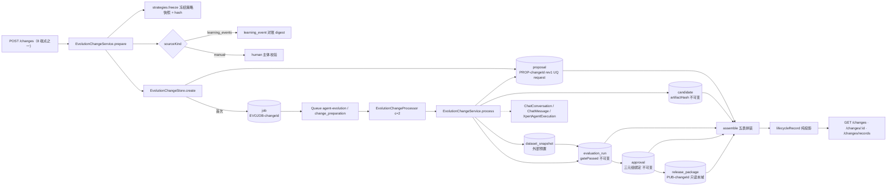
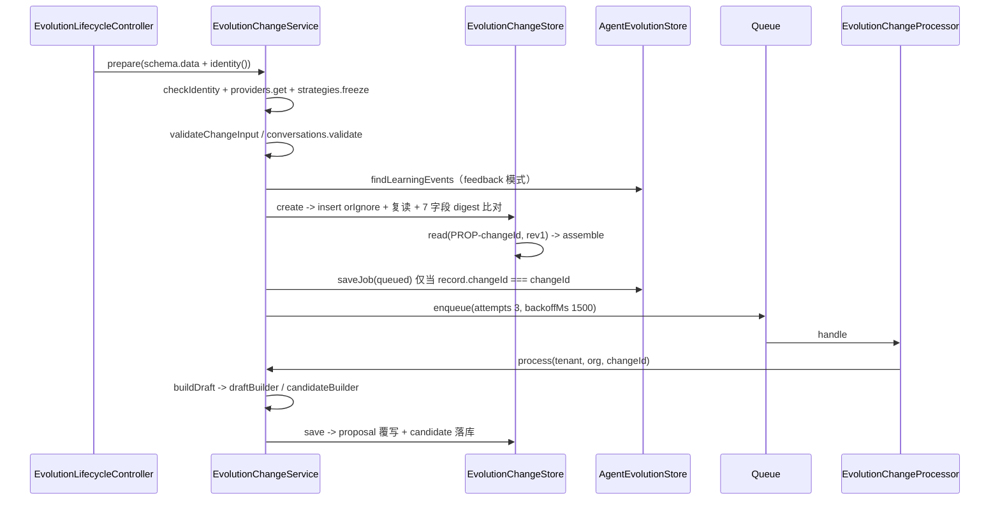
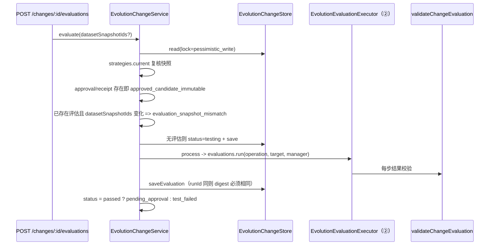
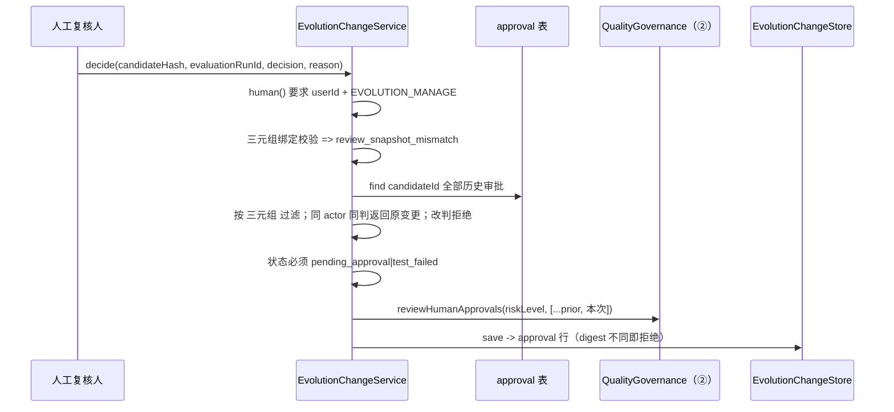
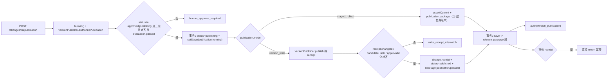
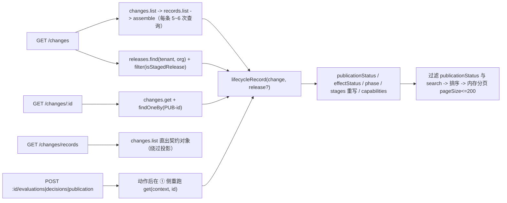
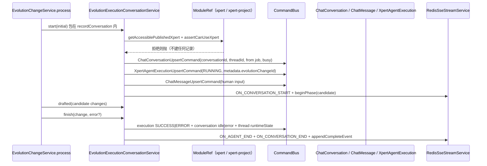

# Agent 演进域 · ① 变更与生命周期子专家 · 数据流转（03-数据流转）

> 范围：① 拥有的 **8 张表**（`learning_event`/`diagnosis`/`event_cluster`/`proposal`/`candidate`/`dataset_snapshot`/`evaluation_run`/`approval`）+ 只读的 `release_package`
> 只读梳理，基线 commit `80f5676fd`。未能取证处标 `[推测]`。路径相对仓库根 `/root/xpert`

**本文引用的文件**
- [agent-evolution/changes/lifecycle.controller.ts](file://packages/server-ai/src/agent-evolution/changes/lifecycle.controller.ts)
- [agent-evolution/changes/lifecycle.service.ts](file://packages/server-ai/src/agent-evolution/changes/lifecycle.service.ts)
- [agent-evolution/changes/lifecycle.projection.ts](file://packages/server-ai/src/agent-evolution/changes/lifecycle.projection.ts)
- [agent-evolution/changes/change.service.ts](file://packages/server-ai/src/agent-evolution/changes/change.service.ts)
- [agent-evolution/changes/change.store.ts](file://packages/server-ai/src/agent-evolution/changes/change.store.ts)
- [agent-evolution/changes/change.processor.ts](file://packages/server-ai/src/agent-evolution/changes/change.processor.ts)
- [agent-evolution/changes/change.validation.ts](file://packages/server-ai/src/agent-evolution/changes/change.validation.ts)
- [agent-evolution/changes/submission.schema.ts](file://packages/server-ai/src/agent-evolution/changes/submission.schema.ts)
- [agent-evolution/changes/strategy.service.ts](file://packages/server-ai/src/agent-evolution/changes/strategy.service.ts)
- [agent-evolution/changes/execution-conversation.service.ts](file://packages/server-ai/src/agent-evolution/changes/execution-conversation.service.ts)
- [agent-evolution/providers/conformance-template.provider.ts](file://packages/server-ai/src/agent-evolution/providers/conformance-template.provider.ts)
- [agent-evolution/application/agent-evolution.store.ts](file://packages/server-ai/src/agent-evolution/application/agent-evolution.store.ts)
- [agent-evolution/domain/evolution-hash.ts](file://packages/server-ai/src/agent-evolution/domain/evolution-hash.ts)
- [agent-evolution/domain/evolution-state.ts](file://packages/server-ai/src/agent-evolution/domain/evolution-state.ts)
- [agent-evolution/entities/evolution.entities.ts](file://packages/server-ai/src/agent-evolution/entities/evolution.entities.ts)

## 目录

1. [总览](#1-总览)
2. [链路一 提交 → 候选](#2-链路一-提交--候选)
3. [链路二 评估记录写入](#3-链路二-评估记录写入)
4. [链路三 审批](#4-链路三-审批)
5. [链路四 发布动作的记录侧](#5-链路四-发布动作的记录侧)
6. [链路五 投影读链](#6-链路五-投影读链)
7. [链路六 会话联动](#7-链路六-会话联动)
8. [状态机汇总（8 表）](#8-状态机汇总8-表)
9. [已知风险](#9-已知风险)

章节来源：[change.service.ts](file://packages/server-ai/src/agent-evolution/changes/change.service.ts)（关键符号：EvolutionChangeService）、[change.store.ts](file://packages/server-ai/src/agent-evolution/changes/change.store.ts)（关键符号：EvolutionChangeStore）

## 1. 总览

本子域只有**两个写入面**：① HTTP 8 端点 → `EvolutionChangeService` → `EvolutionChangeStore`（分表）/ 共享 `AgentEvolutionStore`（作业账本、学习事件、版本）；② Managed Queue `agent-evolution` 的 `change_preparation` 作业 → `EvolutionChangeProcessor` → 同一条 `process()`。**无事件订阅、无调度器、无 CQRS handler**；对外副作用只有会话/消息/执行账本三条 `CommandBus` 单向写。

图表来源：[change.service.ts](file://packages/server-ai/src/agent-evolution/changes/change.service.ts)（关键符号：prepare、process、CHANGE_QUEUE）· [change.store.ts](file://packages/server-ai/src/agent-evolution/changes/change.store.ts)（关键符号：create、assemble）· [change.processor.ts](file://packages/server-ai/src/agent-evolution/changes/change.processor.ts)（关键符号：EvolutionChangeProcessor.handle）· [lifecycle.projection.ts](file://packages/server-ai/src/agent-evolution/changes/lifecycle.projection.ts)（关键符号：lifecycleRecord）

章节来源：[change.service.ts](file://packages/server-ai/src/agent-evolution/changes/change.service.ts)（关键符号：EvolutionChangeService.prepare/process/enqueue）、[change.store.ts](file://packages/server-ai/src/agent-evolution/changes/change.store.ts)（关键符号：EvolutionChangeStore.create/assemble）

## 2. 链路一 提交 → 候选

图表来源：[change.service.ts](file://packages/server-ai/src/agent-evolution/changes/change.service.ts)（关键符号：prepare、enqueue、process、buildDraft）· [change.store.ts](file://packages/server-ai/src/agent-evolution/changes/change.store.ts)（关键符号：create、read、assemble、save）· [change.processor.ts](file://packages/server-ai/src/agent-evolution/changes/change.processor.ts)（关键符号：EvolutionChangeProcessor.handle）

- **入口校验三层**：`evolutionSubmissionSchema`（结构，`.strict()`）→ `validateChangeInput`（业务：scope key 与租户/组织一致、`evidence` 非空且种类在白名单、`strategy.inputs` 含 `sourceKind`）→ `conversations.validate`（跨域准入，仅当有 `executionContext`）。
- **feedback 模式的四重门**：`findLearningEvents` 取行后校验「数量相等 + `targetId` 一致 + `sameScope` + `qualifiesLearning`」（任一失败 `learning_evidence_gate_failed`）；再把事件重算成 evidence（`kind:'execution'`、`uri: evolution-event:<eventId>`、`hash: digest(value)`）排序后与入参 evidence **逐条对账**（`learning_evidence_snapshot_mismatch`）——**evidence 是学习事件的投影，不是自由文本**。
- **写入点**：`proposal`（`proposalId = PROP-<changeId>`、`revision` 恒 1、UQ `(tenant, org, targetId, requestId)`）与 `job`（`jobId = EVOJOB-<changeId>`）。**同一 `requestId` 重复提交不产生第二行、也不写第二份 job**；只有当 `record.changeId === changeId`（本次真新建）才写 job 并入队。
- **候选来源两条**：`candidate.builder === 'target_draft'` → `target.draftBuilder.prepare(operation)`；否则 `findVersion(baseline.resourceId)` 校验 `artifact.hash === change.baseline.hash` 后 `candidateBuilder.buildCandidate({idempotencyKey: '<changeId>:build'})` + `validateCandidate`。
- **候选不可换**：`build()` 以 `digest(candidateInput)` 拒绝改输入（`immutable_candidate_changed`）；`process()` 以 `artifact.uri`/`hash` 非空 + `schemaVersion` 对齐拒绝坏产物；`save()` 再以 `artifactHash`/definition digest 拦一次。`artifact.hash` 从此成为全链身份。

章节来源：[change.service.ts](file://packages/server-ai/src/agent-evolution/changes/change.service.ts)（关键符号：prepare 的 evidence 对账、buildDraft、build）、[change.validation.ts](file://packages/server-ai/src/agent-evolution/changes/change.validation.ts)（关键符号：validateChangeInput）、[strategy.service.ts](file://packages/server-ai/src/agent-evolution/changes/strategy.service.ts)（关键符号：qualifiesLearning）、[change.store.ts](file://packages/server-ai/src/agent-evolution/changes/change.store.ts)（关键符号：create、save、proposal）

## 3. 链路二 评估记录写入

图表来源：[change.service.ts](file://packages/server-ai/src/agent-evolution/changes/change.service.ts)（关键符号：evaluate、process）· [change.store.ts](file://packages/server-ai/src/agent-evolution/changes/change.store.ts)（关键符号：saveEvaluation）· [change.validation.ts](file://packages/server-ai/src/agent-evolution/changes/change.validation.ts)（关键符号：validateChangeEvaluation）

- **数据集映射先冻结**：`datasetSnapshotIds` 一旦随评估落库，再改就 `evaluation_snapshot_mismatch`；缺 `golden_replay` 步骤所需 key 时 `process()` 直接 return（**状态停在 `testing`，job 却是 `completed`**）。
- **落库口径**：`evaluation_run` 列写 `status = passed|failed`、布尔列 `gatePassed = result.passed`、`evaluatorKind: 'strategy_checks'`、`startedAt = change.createdAt`；同 `runId` 内容不同即 `immutable_evaluation_changed`。
- **目标态**：`status = evaluation.passed ? 'pending_approval' : 'test_failed'`，`setStage('evaluation', assessment === 'not_applicable' ? 'not_applicable' : passed ? 'passed' : 'failed', [runId])`——**`not_applicable` 与 `passed` 是两个不同阶段值**，前端不得混用。
- `dataset_snapshot` 由 ② 的 `POST /datasets` 预置，本链路只**引用 ID**，不创建行。

章节来源：[change.service.ts](file://packages/server-ai/src/agent-evolution/changes/change.service.ts)（关键符号：EvolutionChangeService.evaluate、process 的 awaitingDataset 分支）、[change.store.ts](file://packages/server-ai/src/agent-evolution/changes/change.store.ts)（关键符号：saveEvaluation）、[entities/evolution.entities.ts](file://packages/server-ai/src/agent-evolution/entities/evolution.entities.ts)（关键符号：EvaluationRunEntity.gatePassed / DatasetSnapshotEntity）

## 4. 链路三 审批

图表来源：[change.service.ts](file://packages/server-ai/src/agent-evolution/changes/change.service.ts)（关键符号：decide、human、audit）· [change.store.ts](file://packages/server-ai/src/agent-evolution/changes/change.store.ts)（关键符号：save 的 approval 段）· [entities/evolution.entities.ts](file://packages/server-ai/src/agent-evolution/entities/evolution.entities.ts)（关键符号：ApprovalDecisionEntity）

- **三元组绑定**：`candidate.artifact.hash === input.candidateHash`、`evaluation.runId === input.evaluationRunId`、`evaluation.strategyHash === strategy.hash`（`strategy.hash` 由 `strategies.current()` 现算，快照漂移即 `strategy_snapshot_stale`，因此**策略变更后旧审批上下文失效**）。
- **幂等语义**：历史审批按三元组过滤后，同 `actorId` 已决——同判直接 `return change`（**不写第二行**），改判 `immutable_approval_changed`。
- **写入口径**：`approvalId = APR-<uuid>`，含 `approvalAuthority`（`role.name ∈ {SUPER_ADMIN, ADMIN}` → `administrator`）、`actorRoleName`、`reason.trim()`；`save()` 侧再以 `changeDigest(prior.value) !== changeDigest(change.approval)` 拦一次。
- **终态由 quorum 决定**：`rejected` → `status = 'rejected'`；`approved` → `gate.passed ? 'approved' : 'pending_approval'`（**批准一次不一定终态**）；`setStage('approval', passed|failed|pending)`。另 `if (target.versionPublisher) await target.versionPublisher.authorizePublication(operation)` 在批准前调用（provider 可拒绝授权）。

章节来源：[change.service.ts](file://packages/server-ai/src/agent-evolution/changes/change.service.ts)（关键符号：EvolutionChangeService.decide、human、assertCurrent）、[change.store.ts](file://packages/server-ai/src/agent-evolution/changes/change.store.ts)（关键符号：save 的 approval 段与 immutable_approval_changed）

## 5. 链路四 发布动作的记录侧

图表来源：[change.service.ts](file://packages/server-ai/src/agent-evolution/changes/change.service.ts)（关键符号：publish、assertCurrent）· [change.store.ts](file://packages/server-ai/src/agent-evolution/changes/change.store.ts)（关键符号：save 的 version_write release_package 段、immutable_receipt_changed）

- **① 的边界到此为止**：`staged_rollout` 的版本分配与 `gatePolicy` 冻结发生在 ② 的 `EvolutionPublicationExecutor.package()`；`version_write` 的产物由 provider 的 `versionPublisher` 决定。① 只负责**前置状态机 + 回执校验 + 落 `release_package` 行**（`PUB-<changeId>`、`approvalIds` 四元组过滤、`status ∈ approved|publishing|published`）。
- **两段事务**：事务 1 只推 `publishing`（让读侧可见「正在发布」），事务 2 才发货；`if (change.receipt) return` 在两段各自出现一次 → **重试是幂等的**。
- **① 对 `release_package` 的读**：只在 `lifecycle.service` 的 `findOneBy({PUB-<id>})` / `find({tenant, org})` 两处，且都以 `isStagedRelease` 收窄——`version_write` 的发布包在本子域的投影中**不参与** `publicationStatus` 计算（走 `change.receipt` 分支）。

章节来源：[change.service.ts](file://packages/server-ai/src/agent-evolution/changes/change.service.ts)（关键符号：EvolutionChangeService.publish）、[change.store.ts](file://packages/server-ai/src/agent-evolution/changes/change.store.ts)（关键符号：save 的 release 段、isProviderRelease 分支）、[lifecycle.service.ts](file://packages/server-ai/src/agent-evolution/changes/lifecycle.service.ts)（关键符号：list / get 的 isStagedRelease 过滤）

## 6. 链路五 投影读链

图表来源：[lifecycle.service.ts](file://packages/server-ai/src/agent-evolution/changes/lifecycle.service.ts)（关键符号：EvolutionLifecycleService.list / get / evaluate / decide / publish）· [lifecycle.controller.ts](file://packages/server-ai/src/agent-evolution/changes/lifecycle.controller.ts)（关键符号：list、records、get）· [lifecycle.projection.ts](file://packages/server-ai/src/agent-evolution/changes/lifecycle.projection.ts)（关键符号：lifecycleRecord）

- **三读取径各不相同**：`/changes`（投影 + 过滤 + 内存分页）、`/changes/:id`（单条投影）、`/changes/records`（契约原文）。**同名 `status` 在两条链路上指向不同词表**。
- **投影纯函数**：`lifecycleRecord` 无 DataSource、无写；`release` 存在时 `status = release.status`，且 `capabilities.publish` 恒 false。
- **三动作返回同形投影**（动作后重跑 `get`），因此前端可以统一渲染，无需区分「动作响应」与「详情响应」。

章节来源：[lifecycle.service.ts](file://packages/server-ai/src/agent-evolution/changes/lifecycle.service.ts)（关键符号：EvolutionLifecycleService.list / get）、[lifecycle.projection.ts](file://packages/server-ai/src/agent-evolution/changes/lifecycle.projection.ts)（关键符号：lifecycleRecord）、[lifecycle.controller.ts](file://packages/server-ai/src/agent-evolution/changes/lifecycle.controller.ts)（关键符号：records 与 :id 的声明顺序）

## 7. 链路六 会话联动

图表来源：[execution-conversation.service.ts](file://packages/server-ai/src/agent-evolution/changes/execution-conversation.service.ts)（关键符号：validate、start、drafted、finish、beginPhase、endPhase、event、publish）· [change.service.ts](file://packages/server-ai/src/agent-evolution/changes/change.service.ts)（关键符号：process 的 recordConversation 包裹点）

- **ID 稳定策略**：`conversationId`/`threadId` 由 `executionId(changeId, part)` 确定性派生（`sha256('evolution-chat:<changeId>:<part>')`），`executionId` 每次 `randomUUID()`——**一变更一会话、一推进一执行**；注释逐字说明重试是独立 run，旧消息不被破坏。
- **单向且不可回溯**：本子域**只写不读** `ChatConversation`/`ChatMessage`/`XpertAgentExecution`；执行账本与部署统计是两套独立数据，无关联校验。
- **全部失败静默**：`recordConversation` 与 `publish`（SSE）都只 `logger.warn`；注释逐字 `Transcript availability must never change evaluation, approval or publication outcomes.` / `Persisted messages and runtime state remain authoritative when live delivery fails.`
- **权限拒绝不建记录**：`validate()` 抛错发生在任何 `UpsertCommand` 之前，spec 亦断言此行为。

章节来源：[execution-conversation.service.ts](file://packages/server-ai/src/agent-evolution/changes/execution-conversation.service.ts)（关键符号：EvolutionExecutionConversationService.start / finish / recordConversation 的调用侧、executionId）、[change.service.ts](file://packages/server-ai/src/agent-evolution/changes/change.service.ts)（关键符号：recordConversation）

## 8. 状态机汇总（8 表）

| 表 | 状态字段与取值 | 迁移校验 | 写入方与备注 |
|---|---|---|---|
| `learning_event` | `reviewStatus ∈ pending \| ignored \| golden`（默认 `pending`） | 无迁移表 | 入账在 ② 的 `ingestLearningEvent`；① 只读（`findLearningEvents` 做 evidence 对账），人工改判在 `PATCH /learning-events/:id/review` |
| `diagnosis` | **无 status 列** | — | 由 ② 的诊断一次性产出；① 只读 `correctionSignature` 无涉 |
| `event_cluster` | `status ∈ collecting \| proposal_ready` | 无（由 `qualifiesLearning` 一次决定） | 同签名重入复用 `clusterId`；① 只作为提交证据的来源语义 |
| `proposal` | 列 `status ∈ draft \| candidate_built \| rejected`；值内 `preparation ∈ queued \| completed \| failed`；`revision` 恒 1 | `save()` 只校验不可变字段，**不校验 status** | ① 写：`change.store.proposal()` 按 `change.status` 三分 status、按 `failed`/`evaluation` 三分 preparation |
| `candidate` | `building→ready→evaluating→{evaluation_failed,pending_approval}`；`evaluation_failed→expired`；`pending_approval→{approved,rejected}`；`approved→packaged`；`rejected→expired`；`packaged`/`expired` 终态 | **有迁移表**（`CANDIDATE_TRANSITIONS` + `assertCandidateTransition`）但 ① 的写路径**不调用** | ① 实写 `evaluating \| evaluation_failed \| pending_approval \| approved \| rejected \| packaged \| expired`（由 `toCandidateStatus` 翻译） |
| `dataset_snapshot` | **无 status 列**；`snapshotHash` 标识 | — | 由 ② 的 `POST /datasets` 预置；① 只在评估时引用其 ID 并冻结映射 |
| `evaluation_run` | `status ∈ passed \| failed` + 冗余布尔列 `gatePassed` | 无迁移表，**写后不可变** | ① 经 `saveEvaluation` 写；同 `runId` digest 不同 → `immutable_evaluation_changed` |
| `approval` | `decision ∈ approved \| rejected`（非枚举列，服务层前置校验） | 无迁移表，**内容不可变** | ① 写；同 actor 改判 → `immutable_approval_changed`；**无 `(candidateId, actorId)` 唯一索引** |

**跨表词表桥**：变更状态（契约第三套）`preparing|testing|test_failed|pending_approval|approved|publishing|published|rejected|stale|failed` ↔ candidate 由 `fromCandidateStatus`/`toCandidateStatus` 双向映射（`expired↔stale`、`packaged↔publishing`、`evaluation_failed↔test_failed`）；`lifecycleRecord` 再派生 `phase`/`publicationStatus`/`effectStatus` 给读侧。**同一事实最多四套表达**。

章节来源：[evolution-state.ts](file://packages/server-ai/src/agent-evolution/domain/evolution-state.ts)（关键符号：CANDIDATE_TRANSITIONS、assertCandidateTransition）、[change.store.ts](file://packages/server-ai/src/agent-evolution/changes/change.store.ts)（关键符号：proposal()、fromCandidateStatus、toCandidateStatus、saveEvaluation）、[strategy.service.ts](file://packages/server-ai/src/agent-evolution/changes/strategy.service.ts)（关键符号：qualifiesLearning、setStage）、[entities/evolution.entities.ts](file://packages/server-ai/src/agent-evolution/entities/evolution.entities.ts)（关键符号：8 张表的列与唯一索引）

## 9. 已知风险

1. **`awaitingDataset` 的静默停留**：缺 `golden_replay` 数据集时 `process()` 直接 return，`status` 停在 `testing` 而 `job` 已是 `completed`——读侧看到「评估中但无作业」，且**无超时/补偿机制**（本模块无 `@Cron`）。
2. **`decide()` 未加行锁**：`records.read(manager, input, changeId, true)` 的能力存在，但 `decide()` 未传 `lock`；「同 actor 不可改判」与「quorum 计数」都是应用层读后判断，并发下不封闭（实体亦无 `(candidateId, actorId)` 唯一索引）。
3. **两套摘要算法**：`digest`/`changeDigest`（`JSON.stringify`，数组顺序敏感）与 `hashEvolutionValue`（键排序）并存。`evidenceHash` 用前者，`correctionSignature`/`bundleHash`/`activeKey` 用后者——**同一批数据在两套算法下不可复现**；evidence 重排即 `immutable_request_changed`。
4. **`saveEvaluation` 的 `startedAt = change.createdAt`**：评估记录的开始时间被替换为变更创建时间，用它推导评估耗时得到的是端到端时长，不是评估本身的耗时。
5. **`datasetHash` 在单步/多步下语义不同**（② 侧 `replay()`，但在 ① 落库后成为评估记录的一部分）：单步沿用 provider 返回值、多步改为对 `{runId, datasetHash}` 的规范哈希——下游按「datasetHash 即数据集指纹」做缓存会在步骤数变化时失效。
6. **读链路的规模与语义风险**：`GET /changes` 全量加载变更 + 全量加载发布包后内存分页（上限 200，与 store 的 100 不一致）；且 `/changes` 与 `/changes/records` 的 `status` 同名不同义，前端极易误读。

章节来源：[change.service.ts](file://packages/server-ai/src/agent-evolution/changes/change.service.ts)（关键符号：process 的 awaitingDataset 分支、decide、digest）、[change.store.ts](file://packages/server-ai/src/agent-evolution/changes/change.store.ts)（关键符号：changeDigest、saveEvaluation、read 的 lock 参数）、[lifecycle.service.ts](file://packages/server-ai/src/agent-evolution/changes/lifecycle.service.ts)（关键符号：list 的 pageSize 与内存分页）、[domain/evolution-hash.ts](file://packages/server-ai/src/agent-evolution/domain/evolution-hash.ts)（关键符号：hashEvolutionValue、canonicalEvolutionJson）
