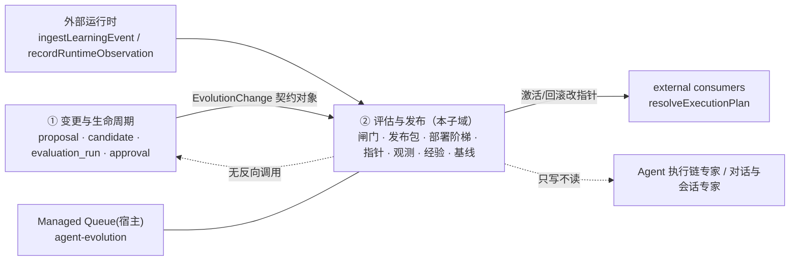

# 评估与发布子专家 —— C0 使用总览

> **资产基线**：`2026-10-16 · commit 80f5676fd`（批次 5 第 11 专家），继承父域 [C0-使用总览.md](file://.module-experts/后端专题/Agent 演进专家/C0-使用总览.md)。**范围**：`application/**`（8 个服务 ＋ 2 个 store/helpers）＋ `changes/{evaluation,publication}-executor.service.ts` ＋ `controllers/evolution-baseline.controller.ts` ＋ `controllers/agent-evolution.controller.ts` 的 39 条端点业务语义 ＋ `providers/{conformance-field-mapping,conformance-intent-routing}.provider.ts`。**主线**：闸门 → 部署 → 指针 → 观测 → 经验。**11 张表**：目标与基线 4（`target`/`capability_version`/`capability_bundle`/`active_pointer`）· 发布与部署 4（`release_package`/`release_deployment`/`canary_test_override`/`job`）· 经验·审计·观测 3（`experience`/`audit_event`/`runtime_observation`）。记录侧 8 表归 [子专家①](file://.module-experts/后端专题/Agent 演进专家/sub-experts/变更与生命周期子专家/C0-使用总览.md)。未证实处标 `[推测]`。

**本文引用的文件**（相对仓库根，链接均为 `file://`）

- [agent-evolution/application/agent-evolution-governance.service.ts](file://packages/server-ai/src/agent-evolution/application/agent-evolution-governance.service.ts)
- [agent-evolution/application/agent-evolution-release-gate-policy.service.ts](file://packages/server-ai/src/agent-evolution/application/agent-evolution-release-gate-policy.service.ts)
- [agent-evolution/application/agent-evolution-quality-governance.service.ts](file://packages/server-ai/src/agent-evolution/application/agent-evolution-quality-governance.service.ts)
- [agent-evolution/application/agent-evolution-runtime.service.ts](file://packages/server-ai/src/agent-evolution/application/agent-evolution-runtime.service.ts)
- [agent-evolution/application/agent-evolution.service.ts](file://packages/server-ai/src/agent-evolution/application/agent-evolution.service.ts)
- [agent-evolution/application/agent-evolution-queue.service.ts](file://packages/server-ai/src/agent-evolution/application/agent-evolution-queue.service.ts)
- [agent-evolution/application/agent-evolution-queue.processor.ts](file://packages/server-ai/src/agent-evolution/application/agent-evolution-queue.processor.ts)
- [agent-evolution/application/evolution-baseline.service.ts](file://packages/server-ai/src/agent-evolution/application/evolution-baseline.service.ts)
- [agent-evolution/application/evolution-runtime.store.ts](file://packages/server-ai/src/agent-evolution/application/evolution-runtime.store.ts)
- [agent-evolution/application/evolution-store.helpers.ts](file://packages/server-ai/src/agent-evolution/application/evolution-store.helpers.ts)
- [agent-evolution/changes/evaluation-executor.service.ts](file://packages/server-ai/src/agent-evolution/changes/evaluation-executor.service.ts)
- [agent-evolution/changes/publication-executor.service.ts](file://packages/server-ai/src/agent-evolution/changes/publication-executor.service.ts)
- [agent-evolution/controllers/agent-evolution.controller.ts](file://packages/server-ai/src/agent-evolution/controllers/agent-evolution.controller.ts)
- [agent-evolution/controllers/evolution-baseline.controller.ts](file://packages/server-ai/src/agent-evolution/controllers/evolution-baseline.controller.ts)
- [agent-evolution/domain/evolution-state.ts](file://packages/server-ai/src/agent-evolution/domain/evolution-state.ts)
- [agent-evolution/entities/evolution.entities.ts](file://packages/server-ai/src/agent-evolution/entities/evolution.entities.ts)
- [契约：packages/contracts/src/ai/evolution/governance.ts](file://packages/contracts/src/ai/evolution/governance.ts)

章节来源：[agent-evolution-governance.service.ts](file://packages/server-ai/src/agent-evolution/application/agent-evolution-governance.service.ts)（关键符号：installRelease / startCanary / activateProduction / rollbackProduction）、[agent-evolution-queue.processor.ts](file://packages/server-ai/src/agent-evolution/application/agent-evolution-queue.processor.ts)（关键符号：@PluginJobProcessor）

## 目录

1. [定位](#定位)
2. [何时找这个子专家](#何时找这个子专家)
3. [能力清单表](#能力清单表)
4. [边界](#边界)
5. [已知问题与常见坑](#已知问题与常见坑)
6. [延伸阅读](#延伸阅读)

## 定位

本子专家负责把 ① 侧产出的「已批准候选」推进到「生产生效版本」并留下可审计证据，五块职责：**闸门判据**（`reviewGoldenReplay` 五项阈值 ＋ `reviewHumanApprovals` quorum ＋ 六级样本/时长阈值）、**评估执行**（`EvolutionEvaluationExecutor.run` 逐步评估与 golden replay）、**发布执行**（`EvolutionPublicationExecutor.package` 在调用方事务内分配版本与 `PUB-<changeId>`）、**部署与生效**（`install→shadow→canary→pause→activate→rollback`，唯一生效点是 `ActiveCapabilityPointer` 的一次 CAS）、**运行时与回溯**（`resolveExecutionPlan` 出版本裁决、`recordRuntimeObservation` 累加部署统计、`createExperience` 沉淀经验）。

**一句话口径**：**判据外置、生效唯一、证据闭环**——「能不能上」收敛成两组纯函数；「怎么上」收敛成六个带显式前置的动作链；「真的生效了吗」收敛成 `revision + activeVersionId` 的条件更新；阈值只在**建包时**读取一次并冻结进 `ReleasePackage.gatePolicy`，此后 `forRelease()` 是唯一合法读口。

章节来源：[release-gate-policy.service.ts](file://packages/server-ai/src/agent-evolution/application/agent-evolution-release-gate-policy.service.ts)（关键符号：STANDARD_GATE_POLICY / snapshot / forRelease / manualTestProfileEnabled）、[quality-governance.service.ts](file://packages/server-ai/src/agent-evolution/application/agent-evolution-quality-governance.service.ts)（关键符号：reviewGoldenReplay / reviewHumanApprovals）、[evolution-runtime.store.ts](file://packages/server-ai/src/agent-evolution/application/evolution-runtime.store.ts)（关键符号：activatePointerCas / rollbackPointerCas）

## 何时找这个子专家

- 要**跑或看一次评估与闸门**：`POST /changes/:id/evaluations`（① 侧同步触发）、`GET|POST /evaluations`、`reviewGoldenReplay` 的 50/20/10 ＋ 零严重错误 ＋ 正收益五项判据。
- 要**改审批与质量治理**：`reviewHumanApprovals`（R3/R4 → 3 人，其余 2 人，**管理员单票放行**）、`distinct actorId` 与 `distinct actorRole` 双达标。
- 要**做发布包**：`POST /release-packages` 或 `POST /changes/:id/publication` → `EvolutionPublicationExecutor.package()`：冻结 `gatePolicy` ＋ `shadowMinimumSamples`，分配 `CapabilityVersion`（`sequence = max+1`）。
- 要**推部署阶梯**：`POST /releases/:id/{install,shadow,canary}`（**全部入队**）；金丝雀只接受 `5|25|50` 且首轮必须 5%、跳档 400。
- 要**暂停或激活生产**：`POST /releases/:id/{pause,activate}`（**同步返回**发布包 / 新指针）；激活要求 `canaryPercent === 50` ＋ 生产阈值 ＋ 指针未被他人前推。
- 要**用一次性金丝雀覆盖**：`GET|POST /releases/:id/canary-test-overrides`（管理员 ＋ `manual_test` 档 ＋ release 处于 canary ＋ 活跃 canary 部署，同一主体**只生效一次**）。
- 要**回滚**：`POST /releases/:id/rollback`（入队；拒绝 agent 主体；`rolled_back` 是终态，回不到原 canary 档）。
- 要**读或改指针与基线**：`GET /active-pointers`、`GET /baselines/:targetId`（`inspect`，读三位任一）、`EvolutionBaselineService.publish`（`expectedRevision` ＋ `expectedHash` 双预期）。
- 要**读观测 / 审计 / 经验**：`GET /runtime-observations`、`GET /audit-events`、`GET|POST /experiences`；`severeError` 且 release 处于 shadow/canary 会**自动暂停**并写审计。
- 要**轮询 job**：`GET /jobs/:jobId`（`EVOJOB-<uuid>` 账本，**未命中返回 `null` 而非 404**）；判据是 `queueJobId` 是否为 `null`、`errorCode` 是 `queue_enqueue_failed` 还是 `evolution_job_failed`。
- 要**给消费方出版本裁决**：`POST /capability-executions/resolve`（`executionMode` 依次取 `canary > shadow > production`，无生产指针直接 404）。
- 要**排查队列**：五个 `@PluginJobProcessor` 并发 2/1/2/1/1、`attempts: 3` / `backoffMs: 1000`、未注入队列时 `@Optional()` 落空走 503。

章节来源：[agent-evolution.controller.ts](file://packages/server-ai/src/agent-evolution/controllers/agent-evolution.controller.ts)（关键符号：@Post('releases/:releasePackageId/canary') / pauseRelease / activateRelease / rollbackRelease / getJob / resolveExecutionPlan）、[evolution-baseline.controller.ts](file://packages/server-ai/src/agent-evolution/controllers/evolution-baseline.controller.ts)（关键符号：inspect / Permissions）

## 能力清单表

| 能力 | 入口 | 一句话 |
|---|---|---|
| 仪表盘与目标同步 | `GET /dashboard`、`GET /targets`、`POST /targets/synchronize` | dashboard 由 store 直通不裁剪；同步会给「有 `baselineExporter` 且无指针」的目标自动铺初版版本与 `revision: 1` 指针 |
| 能力版本 / 版本束 / 生产指针（只读） | `GET /capability-versions`、`/capability-bundles`、`/active-pointers` | 版本不可变；`channel='production'` 的指针行才是生效事实 |
| 上线规则基线 | `GET /baselines/:targetId`；`inspect` / `publish` | **唯一**同时接受三位权限的端点；`inspect` 不写库、返回带 `canManage` |
| golden 数据集快照 | `GET|POST /datasets` | 用例 `(caseId, revision)` 唯一；`snapshotHash` 只哈希三字段 |
| 评估执行与入队 | `POST /changes/:id/evaluations`（同步）、`GET|POST /evaluations`（`POST` 入队） | 记录含布尔判据列 `gatePassed`；`POST /evaluations` 返回 `EvolutionJob` 不是结果 |
| 闸门判据（纯函数） | `reviewGoldenReplay`、`requiredHumanApprovals`、`reviewHumanApprovals` | 五项阻塞原因逐条收集；审批配额与「管理员单票」由纯函数决定 |
| 发布包冻结 | `POST /release-packages`、`GET /releases` | 一次性冻结 `gatePolicy`，命名固定 `PUB-<changeId>`（已存在直接返回旧值） |
| 部署阶梯 | `POST /releases/:id/{install,shadow,canary}` | **全部入队**返回 `EvolutionJob`；canary 只接受 5/25/50 且首轮必须 5% |
| 暂停与生产激活 | `POST /releases/:id/{pause,activate}` | **同步**动作；激活改指针 CAS 并要求 `canaryPercent === 50` |
| 回滚 | `POST /releases/:id/rollback` | 入队；拒绝 agent 主体；`rolled_back` 为终态 |
| 一次性金丝雀覆盖 | `GET|POST /releases/:id/canary-test-overrides` | `activeKey` 唯一索引物理保证「同主体同部署至多一条 pending」 |
| 作业账本 | `GET /jobs/:jobId` | 只回 `value` 投影；未命中 `null`（HTTP 200） |
| 观测回流与自动暂停 | `GET /runtime-observations`、`recordRuntimeObservation` | 唯一由数据触发的状态迁移（`severeError → paused`） |
| 审计与经验 | `GET /audit-events`、`GET|POST /experiences` | 审计只增；经验只能人工留档且**不改指针** |
| 运行时版本裁决 | `POST /capability-executions/resolve`、`getCapabilityBundle`/`getCapabilityVersion` | 影子出 `shadowBundle`；解析命中一次性覆盖时标 `selectionReason: 'manual_test_override'` |
| 一致性演练（夹具） | `POST /simulations/conformance`、`POST /examples/conformance-field-mapping/run` | 两条路径**同一实现**，生产默认 404 门禁 |

章节来源：[agent-evolution-governance.service.ts](file://packages/server-ai/src/agent-evolution/application/agent-evolution-governance.service.ts)（关键符号：createReleasePackage / startCanary / pauseRelease / activateProduction / rollbackProduction / createCanaryTestOverride / createExperience）、[agent-evolution-runtime.service.ts](file://packages/server-ai/src/agent-evolution/application/agent-evolution-runtime.service.ts)（关键符号：resolveExecutionPlan / getCapabilityBundle）

## 边界

**做什么**：六级闸门阈值与环境解析（含冻结读取）、评估执行与 golden replay、发布包与版本分配、六个部署动作与指针 CAS、一次性金丝雀覆盖、运行时版本裁决与观测回流、经验留档、审计台账、规则基线 `inspect/publish`、两个夹具 provider。

**不做什么（与 ① 及相邻专家域的分工）**

- **不含变更记录侧**：`proposal` / `candidate` / `evaluation_run` / `approval` / `learning_event` / `diagnosis` / `event_cluster` / `dataset_snapshot` 的写入点在 ①（`EvolutionChangeService` ＋ `EvolutionChangeStore`）；本子域只经 `EvolutionChangeService.get/publish` **读取**契约对象并调用 `package()`。
- **不含提交/策略/投影**：`submission.schema`、`strategy.service`、`lifecycle.projection`、`changes` 8 端点全在 ①。
- **不含 Agent 定义本体与执行账本**：对 `xpert` 只做准入校验；对执行账本只经由 ① 的会话服务单向写，本子域**不读**执行表 → Assistant 定义与运行时专家 / Agent 执行链专家。
- **不含计费**：模块内 `billing|credit|quota|membership` 零命中，成本只作为观测指标参与平均 → 模型访问与计费专家。
- **不含队列运行时本体**：逻辑队列 `agent-evolution` 承载在宿主 `ManagedQueueModule`（BullMQ `plugin-jobs`）上，本域只落 job 账本并发投递意图 → 宿主 platform 队列。
- **两条口径须双边复核**：`dataset_snapshot` / `evaluation_run` 的**表**归 ①，而 `POST /datasets`、`POST /evaluations` 的**入口与执行**在本子域；`ingestLearningEvent` / `diagnose` 的文件在本子域清单内，写入的却是 ① 侧两张表。

图表来源：[01-架构.md](file://.module-experts/后端专题/Agent 演进专家/sub-experts/评估与发布子专家/implementation/01-架构.md)（关键符号：架构总览 / 本子域 11 表）、[publication-executor.service.ts](file://packages/server-ai/src/agent-evolution/changes/publication-executor.service.ts)（关键符号：EvolutionPublicationExecutor.package）

章节来源：[agent-evolution-runtime.service.ts](file://packages/server-ai/src/agent-evolution/application/agent-evolution-runtime.service.ts)（关键符号：resolveExecutionPlan / ingestLearningEvent / recordRuntimeObservation）、[agent-evolution-queue.service.ts](file://packages/server-ai/src/agent-evolution/application/agent-evolution-queue.service.ts)（关键符号：AGENT_EVOLUTION_QUEUE / enqueue）

## 已知问题与常见坑

1. **入队型端点的 200 不代表动作成功**：`install|shadow|canary|rollback` 与 `POST /evaluations` 返回的都是 `EvolutionJob`（HTTP 200 仅代表**受理**），成败只能看 `GET /jobs/:jobId`；只有 `pause` / `activate` 是同步动作。且「入队失败」（`queue_enqueue_failed`，HTTP 500）与「作业失败」（`evolution_job_failed`）是**两个不同错误码**。
   - 契约来源：[agent-evolution-queue.service.ts](file://packages/server-ai/src/agent-evolution/application/agent-evolution-queue.service.ts)、[agent-evolution-queue.processor.ts](file://packages/server-ai/src/agent-evolution/application/agent-evolution-queue.processor.ts)。
2. **`job` 状态枚举契约无 `pending`**：契约 `EvolutionJobStatus = 'queued' | 'running' | 'completed' | 'failed' | 'cancelled'`；实写路径只到 `queued → running → completed | failed`，`cancelled` **未找到写入点**（无任何取消入口，只能直接改账本）。① 侧 `change.service.process` 仍判断 `['pending','queued','running']`，属**跨实现漂移/死分支**，以契约为准。
   - 契约来源：[governance.ts](file://packages/contracts/src/ai/evolution/governance.ts)、[change.service.ts](file://packages/server-ai/src/agent-evolution/changes/change.service.ts)。
3. **闸门策略与环境开关有两套判定口径**：`snapshot()` 以 `environment.production || process.env.NODE_ENV === 'production'` 定生产；而夹具门禁**只读 `environment.production`**。`manual_test` 档（`AGENT_EVOLUTION_GATE_PROFILE=manual_test`，trim ＋ lowerCase）**只在非生产生效**，阈值由 `AGENT_EVOLUTION_TEST_*` 覆盖；标准档下 `requestedShadowMinimumSamples` 只能抬高（`Math.max(100, requested)`）。
   - 契约来源：[agent-evolution-release-gate-policy.service.ts](file://packages/server-ai/src/agent-evolution/application/agent-evolution-release-gate-policy.service.ts)、[agent-evolution.controller.ts](file://packages/server-ai/src/agent-evolution/controllers/agent-evolution.controller.ts)。
4. **发布包一次性冻结 `gatePolicy`**：`package()` 在调用方事务内写入，命名固定 `PUB-<changeId>`、已存在即原样返回（发布幂等）；此后 `forRelease()` 只读冻结值，缺失即 `Release gate policy was not frozen`——**发布中途改 env 不影响已建包**，也**无法对同一变更改阈值**（id 固定）。
   - 契约来源：[publication-executor.service.ts](file://packages/server-ai/src/agent-evolution/changes/publication-executor.service.ts)、[agent-evolution-release-gate-policy.service.ts](file://packages/server-ai/src/agent-evolution/application/agent-evolution-release-gate-policy.service.ts)。
5. **金丝雀覆盖只生效一次随后回落**：`activeKey = sha256(tenant:org:deploymentId:subjectKey)` 唯一索引保证「同主体同部署至多一条 pending」；消费即翻 `consumed` ＋ 清空 `activeKey`，此后回落到 **确定性路由** `deterministicPercent = sha256(deploymentId:subjectKey) → [0,100)` 与 `deployment.canaryPercent` 的比较。已消费/已过期行**永不删除**，索引是**单列、不带租户维度**。
   - 契约来源：[evolution-runtime.store.ts](file://packages/server-ai/src/agent-evolution/application/evolution-runtime.store.ts)、[agent-evolution-runtime.service.ts](file://packages/server-ai/src/agent-evolution/application/agent-evolution-runtime.service.ts)。
6. **`active_pointer` 是唯一生效点，CAS 冲突是 5xx**：六个动作里只有 `activate` / `rollback` 改指针，走 `activatePointerCas` / `rollbackPointerCas`（以 `revision + activeVersionId` 为条件 UPDATE，`affected !== 1` 抛普通 `Error('Active Pointer CAS conflict')`）。前置于 `activate`：指针仍等于 `release.rollbackVersionId`；前置于 `rollback`：指针仍等于 `release.targetVersionId`。**前置校验与 CAS 是两步**，窗口内他人前推指针会以 5xx 结束而非业务拒绝。
   - 契约来源：[evolution-runtime.store.ts](file://packages/server-ai/src/agent-evolution/application/evolution-runtime.store.ts)、[agent-evolution-governance.service.ts](file://packages/server-ai/src/agent-evolution/application/agent-evolution-governance.service.ts)。
7. **回滚不可逆且四条前置各有独立文案**：agent 主体 → `Agents cannot initiate Production rollback`；无能力位 → `Target does not support rollback`；指针不等于本发布目标版本 → `Release is not the active Production version`；成功后 release 置 `rolled_back`（终态）＋ 指针 `revision` 前推，**回不到原 canary 档**，只能重走 `install → shadow → canary`。
   - 契约来源：[agent-evolution-governance.service.ts](file://packages/server-ai/src/agent-evolution/application/agent-evolution-governance.service.ts)、[evolution-state.ts](file://packages/server-ai/src/agent-evolution/domain/evolution-state.ts)。
8. **队列并发与重试是硬编码常量**：入队 `attempts: 3` / `backoffMs: 1000`（① 的 `change_preparation` 是 1500）；`@PluginJobProcessor` 并发 `evaluation 2 / install 1 / shadow 2 / canary 1 / rollback 1`；投递失败把账本直接置 `failed` 再上抛，worker 内异常写 `evolution_job_failed` 后**重抛**交队列重试（同一次动作可能被 provider 多次执行）。
   - 契约来源：[agent-evolution-queue.service.ts](file://packages/server-ai/src/agent-evolution/application/agent-evolution-queue.service.ts)、[agent-evolution-queue.processor.ts](file://packages/server-ai/src/agent-evolution/application/agent-evolution-queue.processor.ts)。
9. **观测 / 经验 / job 无清理策略、两条无界增长**：模块内 `@Cron`/`@Interval`/`.delete(`/`retention`/`purge` 零命中；`capability_bundle` 每次 `resolveExecutionPlan` **新增一行**（只有 `bundleHash` 普通索引），`release_deployment.value.observations[]` 逐条 append 且 `p95LatencyMs` 用 `max` 合并**只增不减**；宿主 BullMQ 的 `removeOnComplete/removeOnFail` 只清队列 job，**不清 `agent_evolution_job` 账本**。
   - 契约来源：[evolution-runtime.store.ts](file://packages/server-ai/src/agent-evolution/application/evolution-runtime.store.ts)、[07-运维.md](file://.module-experts/后端专题/Agent 演进专家/implementation/07-运维.md)。
10. **基线 `revision` 与哈希是双预期，不能只传一个**：`publish` 要求 `expectedRevision` 安全整数 ＋ `expectedHash` 匹配 `/^[a-f0-9]{64}$/` ＋ `reason` 长度 3~1000；事务内先 `pg_advisory_xact_lock`（覆盖「首次初始化还没有指针行可锁」）再 `pessimistic_write` 锁 `channel:'production'` 指针；`managed_release` 直接 **409**，精确重放（哈希一致）返回**旧指针值**而不覆盖。
   - 契约来源：[evolution-baseline.service.ts](file://packages/server-ai/src/agent-evolution/application/evolution-baseline.service.ts)、[evolution-baseline.controller.ts](file://packages/server-ai/src/agent-evolution/controllers/evolution-baseline.controller.ts)。
11. **两个「只读」端点会写库**：`GET /dashboard` 与 `GET /releases/:id/canary-test-overrides` 会把「pending 且已过期」的覆盖行就地翻 `expired`（**翻转不写审计**）——高并发下产生写竞争与审计缺口。
   - 契约来源：[agent-evolution.store.ts](file://packages/server-ai/src/agent-evolution/application/agent-evolution.store.ts)、[03-数据流转.md](file://.module-experts/后端专题/Agent 演进专家/sub-experts/评估与发布子专家/implementation/03-数据流转.md)。
12. **19 张表没有任何 SQL 迁移、`@VersionColumn` 全域缺失**：目录内无 `migrations/`，全仓 `*.sql` 检索 `agent_evolution` 零命中，DDL 唯一事实来源是实体注解；唯一乐观锁是手写的 `active_pointer.revision`——回滚应用版本**表结构不会自动回退**。
   - 契约来源：[entities/evolution.entities.ts](file://packages/server-ai/src/agent-evolution/entities/evolution.entities.ts)、[07-运维.md](file://.module-experts/后端专题/Agent 演进专家/implementation/07-运维.md)。

章节来源：[02-实现.md](file://.module-experts/后端专题/Agent 演进专家/sub-experts/评估与发布子专家/implementation/02-实现.md)（关键符号：技术债 / 设计维度）、[03-数据流转.md](file://.module-experts/后端专题/Agent 演进专家/sub-experts/评估与发布子专家/implementation/03-数据流转.md)（关键符号：已知风险 / 状态机汇总）

## 延伸阅读

- 本子专家入口索引、服务契约与「动作 × 前置 × 写入表 × 指针 × job」契约表：[C1-能力契约.md](file://.module-experts/后端专题/Agent 演进专家/sub-experts/评估与发布子专家/C1-能力契约.md)
- 闸门 → 部署 → 指针 → 观测 → 经验七条链路与 11 表状态机汇总：[03-数据流转.md](file://.module-experts/后端专题/Agent 演进专家/sub-experts/评估与发布子专家/implementation/03-数据流转.md)
- 8 条关键不变量与跨子域共享文件 8 项：[01-架构.md](file://.module-experts/后端专题/Agent 演进专家/sub-experts/评估与发布子专家/implementation/01-架构.md)
- 部署动作链、金丝雀四连门、热点路径与技术债 14 条：[02-实现.md](file://.module-experts/后端专题/Agent 演进专家/sub-experts/评估与发布子专家/implementation/02-实现.md)
- 本子域 8＋1 个 spec 覆盖点与 9 条缺口（回滚、队列、CAS 冲突无取证）：[06-测试.md](file://.module-experts/后端专题/Agent 演进专家/sub-experts/评估与发布子专家/implementation/06-测试.md)
- 父域 Recipe：闸门策略与审批 / 发布包与阶梯 / 一次性覆盖 / 回滚 / 观测与经验 / job 轮询：父域 [C2-使用流程.md](file://.module-experts/后端专题/Agent 演进专家/C2-使用流程.md) Recipe 5 / 6 / 7 / 8 / 9 / 10
- 十一表逐列与消费方：[C4-数据流向与消费.md](file://.module-experts/后端专题/Agent 演进专家/C4-数据流向与消费.md) §目标与基线 / §发布与部署 / §经验、审计与观测
- 决策证据（版本不可变 / 冻结 gatePolicy / 覆盖一次性 / 指针唯一生效 / 回滚单向前推）：父域 [C5-关键决策.md](file://.module-experts/后端专题/Agent 演进专家/C5-关键决策.md) D1 / D2 / D3 / D4 / D11

章节来源：[evolution-runtime.store.ts](file://packages/server-ai/src/agent-evolution/application/evolution-runtime.store.ts)（关键符号：EvolutionRuntimeStore 独占运行时写）、[evolution-baseline.service.ts](file://packages/server-ai/src/agent-evolution/application/evolution-baseline.service.ts)（关键符号：EvolutionBaselineService.inspect / publish）
