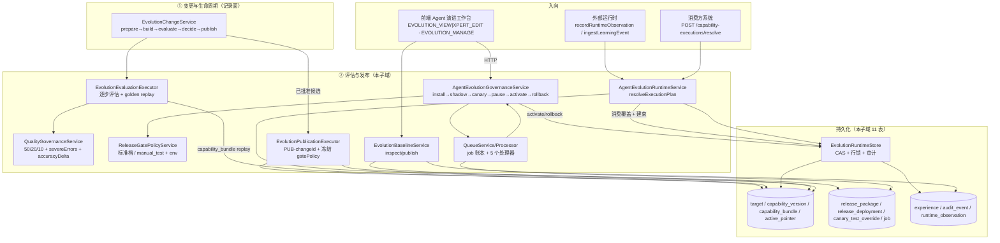

# Agent 演进 · ② 评估与发布子专家 · 架构（01-架构）

> 子域主线：**闸门 → 部署 → 指针 → 观测 → 经验**（commit `80f5676fd`）
> 覆盖文件：`application/agent-evolution-{governance,release-gate-policy,quality-governance,runtime,service,analyst,queue,queue.processor}.service.ts` · `application/evolution-baseline.service.ts` · `application/evolution-runtime.store.ts` · `changes/{evaluation,publication}-executor.service.ts` · `controllers/evolution-baseline.controller.ts` · `providers/{conformance-field-mapping,conformance-intent-routing}.provider.ts`
> 本子域独占 **11 表**：目标与基线 4（`target` / `capability_version` / `capability_bundle` / `active_pointer`）· 发布与部署 4（`release_package` / `release_deployment` / `canary_test_override` / `job`）· 经验·审计·观测 3（`experience` / `audit_event` / `runtime_observation`）
> **不含**：① 变更与生命周期子专家的记录侧 8 表（`learning_event` / `diagnosis` / `event_cluster` / `proposal` / `candidate` / `dataset_snapshot` / `evaluation_run` / `approval`）

**本文引用的文件**
- [agent-evolution.module.ts](file://packages/server-ai/src/agent-evolution/agent-evolution.module.ts)
- [application/agent-evolution-governance.service.ts](file://packages/server-ai/src/agent-evolution/application/agent-evolution-governance.service.ts)
- [application/agent-evolution-release-gate-policy.service.ts](file://packages/server-ai/src/agent-evolution/application/agent-evolution-release-gate-policy.service.ts)
- [application/agent-evolution-quality-governance.service.ts](file://packages/server-ai/src/agent-evolution/application/agent-evolution-quality-governance.service.ts)
- [application/agent-evolution-runtime.service.ts](file://packages/server-ai/src/agent-evolution/application/agent-evolution-runtime.service.ts)
- [application/agent-evolution.service.ts](file://packages/server-ai/src/agent-evolution/application/agent-evolution.service.ts)
- [application/agent-evolution-analyst.service.ts](file://packages/server-ai/src/agent-evolution/application/agent-evolution-analyst.service.ts)
- [application/agent-evolution-queue.service.ts](file://packages/server-ai/src/agent-evolution/application/agent-evolution-queue.service.ts)
- [application/agent-evolution-queue.processor.ts](file://packages/server-ai/src/agent-evolution/application/agent-evolution-queue.processor.ts)
- [application/evolution-baseline.service.ts](file://packages/server-ai/src/agent-evolution/application/evolution-baseline.service.ts)
- [application/evolution-runtime.store.ts](file://packages/server-ai/src/agent-evolution/application/evolution-runtime.store.ts)
- [application/evolution-store.helpers.ts](file://packages/server-ai/src/agent-evolution/application/evolution-store.helpers.ts)
- [application/evolution-governance.helpers.ts](file://packages/server-ai/src/agent-evolution/application/evolution-governance.helpers.ts)
- [changes/evaluation-executor.service.ts](file://packages/server-ai/src/agent-evolution/changes/evaluation-executor.service.ts)
- [changes/publication-executor.service.ts](file://packages/server-ai/src/agent-evolution/changes/publication-executor.service.ts)
- [changes/change.service.ts](file://packages/server-ai/src/agent-evolution/changes/change.service.ts)
- [changes/change.store.ts](file://packages/server-ai/src/agent-evolution/changes/change.store.ts)
- [controllers/agent-evolution.controller.ts](file://packages/server-ai/src/agent-evolution/controllers/agent-evolution.controller.ts)
- [controllers/evolution-baseline.controller.ts](file://packages/server-ai/src/agent-evolution/controllers/evolution-baseline.controller.ts)
- [entities/evolution.entities.ts](file://packages/server-ai/src/agent-evolution/entities/evolution.entities.ts)
- [domain/evolution-state.ts](file://packages/server-ai/src/agent-evolution/domain/evolution-state.ts)
- [providers/conformance-field-mapping.provider.ts](file://packages/server-ai/src/agent-evolution/providers/conformance-field-mapping.provider.ts)
- [providers/conformance-intent-routing.provider.ts](file://packages/server-ai/src/agent-evolution/providers/conformance-intent-routing.provider.ts)
- [contracts/src/ai/evolution/governance.ts](file://packages/contracts/src/ai/evolution/governance.ts)
- [contracts/src/ai/evolution/release.ts](file://packages/contracts/src/ai/evolution/release.ts)
- [contracts/src/ai/evolution/runtime.ts](file://packages/contracts/src/ai/evolution/runtime.ts)
- [plugin-sdk/src/lib/evolution/runtime-capability.ts](file://packages/plugin-sdk/src/lib/evolution/runtime-capability.ts)

## 目录
1. [子域职责与边界](#子域职责与边界)
2. [目录结构与分层](#目录结构与分层)
3. [依赖关系](#依赖关系)
4. [关键不变量](#关键不变量)
5. [架构总览](#架构总览)
6. [结论](#结论)

## 子域职责与边界
**做什么**：把 ① 侧产出的「已批准候选」推进到「生产生效版本」并留下可审计证据。五块职责：① **闸门判据**——`AgentEvolutionQualityGovernanceService` 的 golden replay 五项阈值与人工审批 quorum，`AgentEvolutionReleaseGatePolicyService` 的六级样本/时长阈值（含 env 覆盖与冻结读取）；② **评估执行**——`EvolutionEvaluationExecutor` 逐步评估与 golden replay（落 `EvaluationRun` 与能力束）；③ **发布执行**——`EvolutionPublicationExecutor` 在调用方事务内分配 `CapabilityVersion` 与 `PUB-<changeId>`；④ **部署与生效**——`AgentEvolutionGovernanceService` 的 `install|shadow|canary|pause|activate|rollback`，唯一生效点是 `ActiveCapabilityPointer` 的一次 CAS；⑤ **运行时与回溯**——`AgentEvolutionRuntimeService.resolveExecutionPlan` 出能力束、`recordRuntimeObservation` 累加部署统计、`createExperience` 沉淀经验，`EvolutionBaselineService` 维护规则基线。
**不做（与 ① 的分工）**：本子域**不拥有**任何「变更记录」——`proposal` / `candidate` / `evaluation_run` / `approval` 的写入点全部在 `EvolutionChangeService` + `EvolutionChangeStore` + `EvolutionLifecycleService`；本子域只通过 `AgentEvolutionGovernanceService` 反向调用 `EvolutionChangeService.get/publish`（`createReleasePackage`、`createExperience` 两处）读取记录侧对象。两侧交换的是 **`EvolutionChange` 契约对象**与**跨子域共享 store**，**不共享可变状态**。
**分发边界（易混）**：`agent-evolution-runtime.service.ts` 的 `ingestLearningEvent` 属本子域文件但语义上是「信号入口」——它只做脱敏/目标 active 校验后落 `learning_event`；后续诊断、聚类、提案、候选全部归 ①。同理 `agent-evolution-analyst.service.ts`（`diagnose`）在本子域文件清单内，产出的是 `diagnosis` / `event_cluster` 两张 ① 侧表。
**不做（跨域）**：不改 Agent 定义本体、不写 `shared/agent` 与 middleware-runtime、**不计费**（模块内 `billing|credit|quota|membership` 零命中，成本只作为观测指标参与平均）；对执行账本（`xpert-agent-execution`）只经 ① 的会话服务单向写，本子域不读执行表。
**入向**：前端 **Agent 演进工作台**（`/api/agent-evolution/*`，读 `EVOLUTION_VIEW | XPERT_EDIT`、写 `EVOLUTION_MANAGE`）消费 `releases` / `deployments` / `active-pointers` / `canary-test-overrides` / `jobs` / `experiences` / `dashboard` / `baselines/:targetId`；插件侧经三个运行时能力 token（`platform.agent-evolution`、`.baselines`、`.changes`）调用本子域 API。
**共享文件 8 项（双边复核清单）**：① [entities/evolution.entities.ts](file://packages/server-ai/src/agent-evolution/entities/evolution.entities.ts)（19 表全集）；② [application/agent-evolution.store.ts](file://packages/server-ai/src/agent-evolution/application/agent-evolution.store.ts)；③ [application/evolution-runtime.store.ts](file://packages/server-ai/src/agent-evolution/application/evolution-runtime.store.ts)（本子域是唯一写入者）；④ [application/evolution-store.helpers.ts](file://packages/server-ai/src/agent-evolution/application/evolution-store.helpers.ts)；⑤ [application/evolution-persistence-proof.ts](file://packages/server-ai/src/agent-evolution/application/evolution-persistence-proof.ts)；⑥ `domain/evolution-hash.ts` + `domain/evolution-state.ts`；⑦ [agent-evolution.module.ts](file://packages/server-ai/src/agent-evolution/agent-evolution.module.ts)；⑧ 三个 barrel（`application/index.ts`、`entities/index.ts`、`providers/index.ts`）。
章节来源：[agent-evolution-governance.service.ts](file://packages/server-ai/src/agent-evolution/application/agent-evolution-governance.service.ts)（关键符号：createReleasePackage、createExperience）、[agent-evolution-runtime.service.ts](file://packages/server-ai/src/agent-evolution/application/agent-evolution-runtime.service.ts)（关键符号：ingestLearningEvent、resolveExecutionPlan）、[evolution-runtime.store.ts](file://packages/server-ai/src/agent-evolution/application/evolution-runtime.store.ts)（关键符号：EvolutionRuntimeStore）、[evolution.entities.ts](file://packages/server-ai/src/agent-evolution/entities/evolution.entities.ts)（关键符号：AGENT_EVOLUTION_ENTITIES）

## 目录结构与分层
| 层 / 目录 | 承载者 | 职责 |
|---|---|---|
| governance（HTTP 治理总入口） | `AgentEvolutionGovernanceService` | `installRelease` / `startShadow` / `startCanary` / `pauseRelease` / `activateProduction` / `rollbackProduction` / `createCanaryTestOverride` / `createExperience` / `createReleasePackage` / 各类 list |
| gate-policy（纯函数阈值） | `AgentEvolutionReleaseGatePolicyService` + `resolveEvolutionReleaseGatePolicy` | `STANDARD_GATE_POLICY` / `MANUAL_TEST_DEFAULTS` / `snapshot()` / `forRelease()` / `manualTestProfileEnabled()` |
| quality-governance（纯函数判据） | `AgentEvolutionQualityGovernanceService` | `reviewGoldenReplay`（五项阻塞原因）、`requiredHumanApprovals`、`reviewHumanApprovals` |
| runtime（读侧解析 + 回流） | `AgentEvolutionRuntimeService` | `resolveExecutionPlan`、`getCapabilityBundle`、`getCapabilityVersion`、`recordRuntimeObservation`、`ingestLearningEvent` |
| queue（作业账本 + 消费） | `AgentEvolutionQueueService` / `AgentEvolutionQueueProcessor` | 先落 `job` 再投递；五个 `@PluginJobProcessor` 分派治理动作 |
| baseline（规则基线） | `EvolutionBaselineService` | `inspect` / `publish`（advisory lock + revision/hash 双预期） |
| executors（事务内执行器） | `EvolutionEvaluationExecutor` / `EvolutionPublicationExecutor` | 评估逐步执行 + golden replay；发布包与版本分配（接收调用方 `EntityManager`） |
| providers（夹具） | `ConformanceFieldMappingProvider` / `ConformanceIntentRoutingProvider` | `test_fixture` / R1 / `capabilities` 六项全开，供一致性演练 |
| service / analyst（辅助） | `AgentEvolutionService` / `AgentEvolutionAnalystService` | dashboard 透传、目标同步（含基线自动初始化）、conformance 端到端模拟；诊断与聚类 |

分层读法：**控制器薄转发 → 治理服务做前置校验编排 → 纯函数服务给判据 → 执行器在事务内落库 → `EvolutionRuntimeStore` 独占运行时写**。`AgentEvolutionService.synchronizeTargets` 是「基线初始化」的第二条路径：对「有 `baselineExporter` 且无指针」的目标自动导出 `v1`（`versionId = <targetId>:v1`、`sequence: 1`、指针 `revision: 1`），bootstrap 主体为 `agent-evolution-bootstrap`。
章节来源：[agent-evolution.service.ts](file://packages/server-ai/src/agent-evolution/application/agent-evolution.service.ts)（关键符号：synchronizeTargets、getDashboard、runConformanceSimulation）、[agent-evolution-queue.processor.ts](file://packages/server-ai/src/agent-evolution/application/agent-evolution-queue.processor.ts)（关键符号：AgentEvolutionQueueProcessor.handle）、[evolution-baseline.service.ts](file://packages/server-ai/src/agent-evolution/application/evolution-baseline.service.ts)（关键符号：EvolutionBaselineService.inspect、publish）

## 依赖关系
**出向**
| 依赖面 | 具体符号 | 用途 |
|---|---|---|
| ① 记录面（同包） | `EvolutionChangeService.get/publish`、`EvolutionChangeStore`、`changeError`、`changeIdentity` | 读变更快照、触发 staged 发布、统一错误码 |
| 契约包 | `packages/contracts/src/ai/evolution/{release,governance,runtime,provider}.ts` | `ReleasePackage`/`gatePolicy`、`EvolutionJobStatus`/`EvolutionJobType`、`CapabilityExecution*`、`EvolutionTargetProvider` |
| plugin-sdk | `EvolutionTargetProviderRegistry`、`EvolutionRuntimeCapability`、`EvolutionBaselineRuntimeCapability`、`MANAGED_QUEUE_SERVICE_TOKEN`、`PluginJobProcessor` | provider 门面、运行时能力注册、队列注入 |
| 队列物理 | 宿主 `ManagedQueueModule` 的 BullMQ 物理队列（`plugin-jobs`） | `attempts: 3` / `backoffMs: 1000` 的重试承载 |
| 观测面 | 外部运行时经 `recordRuntimeObservation` 推入 | 部署样本累加与自动暂停的数据源 |
| 持久化 | `DataSource`（`pg_advisory_xact_lock`、`pessimistic_write`、条件 UPDATE） | 基线与指针的并发控制 |
| server-core / server-config | `RequestContext`、`Permissions`、`PermissionGuard`、`environment` | 鉴权、上下文、env 判定 |
**入向**：前端工作台（`release-packages`、`releases/:id/{install,shadow,canary,pause,activate,rollback}`、`releases/:id/canary-test-overrides`、`deployments`、`active-pointers`、`jobs/:jobId`、`experiences`、`runtime-observations`、`audit-events`、`baselines/:targetId`）；`POST /capability-executions/resolve` 面向消费方系统（前端未调用）。**未找到**：仓内对 `resolveExecutionPlan` 的调用方（除自身端点与 spec）——「发布是否真影响 Agent 运行时」取决于外部域，本仓无证据。
章节来源：[agent-evolution.module.ts](file://packages/server-ai/src/agent-evolution/agent-evolution.module.ts)（关键符号：AgentEvolutionModule 的 imports/providers/exports）、[agent-evolution-runtime.service.ts](file://packages/server-ai/src/agent-evolution/application/agent-evolution-runtime.service.ts)（关键符号：createBundle、deterministicPercent）、[runtime-capability.ts](file://packages/plugin-sdk/src/lib/evolution/runtime-capability.ts)（关键符号：EvolutionRuntimeCapability）

## 关键不变量
### ① 闸门策略：阈值与 env 来源、判定顺序
`STANDARD_GATE_POLICY` 为 `shadow 100 样本/72h`、`canary 30/24h`、`productionCanary 30/24h`、`experience 100/168h`；`MANUAL_TEST_DEFAULTS` 六项降为 `1 样本 / 0h`。env 判定：`snapshot()` 以 `environment.production || process.env.NODE_ENV === 'production'` 定生产（**注意与夹具门禁只读 `environment.production` 不同口径**），并只在**非生产**且 `AGENT_EVOLUTION_GATE_PROFILE=manual_test`（trim + lowerCase）时进入测试档；测试档六项阈值由 `AGENT_EVOLUTION_TEST_*` 覆盖（样本走 `positiveInteger` 且必须 ≥1，小时走 `nonNegativeNumber` 且必须 ≥0，非法即回落默认）。标准档下 `requestedShadowMinimumSamples` 只能抬高：`Math.max(100, requested)`。运行时判定顺序（`installRelease` 为例）：`requireHuman` → `releaseOperationContext`（release 必须存在且 provider 有 `releaseProvider`）→ `freezeReleaseGatePolicy`（`forRelease` 读冻结值 + `requireGatePolicyAuthority` 校验 manual_test 需管理员）→ provider `capabilities.*` → release 状态白名单 → 阈值（样本/严重错误/最短时长）→ 指针前置 → CAS。
### ② 发布包冻结 `gatePolicy`（`PUB-<changeId>`）
`EvolutionPublicationExecutor.package()` 首行按 `releasePackageId = PUB-<changeId>` 查重，命中即原样返回（发布幂等）；随后要求「候选 + 评估 + `approval.decision === 'approved'`」（否则 `human_approval_required`），并以 `gates.snapshot()` **一次性冻结** `gatePolicy` 与 `shadowMinimumSamples` 到 `ReleasePackage`（`status: 'approved'`、`canaryPercent: 0`、`rollbackVersionId = change.baseline.resourceId`）。此后 `forRelease` 只读冻结值，缺失即抛 `Release gate policy was not frozen`——**发布中途改 env 不影响已建包**。发布包冻结值也是 `startCanary`/`activateProduction`/`createExperience` 三处阈值的唯一来源，并写回 `canaryPercent` 作为「阶梯位置」事实。
### ③ 金丝雀覆盖只生效一次，随后回落确定性路由
`EvolutionCanaryTestOverrideEntity` 以 `UQ(activeKey)`（`sha256(tenant:org:deploymentId:subjectKey)`）把「同主体同部署至多一条活跃覆盖」物理化；`consumeCanaryTestOverride` 在同事务内先按 `status:'consumed'` 查重试（`consumedByExecutionId === 本次 executionId` 直接返回），否则 `pessimistic_write` 取 `pending`：过期翻 `expired` 返回 `null`，有效则翻 `consumed` + 清空 `activeKey` + 写审计 `canary.manual_test_override_consumed`（主体 `agent-evolution-runtime` / `system_runtime_resolver`）。`resolveExecutionPlan` 的判定是 `!consumedOverride && !deterministicSelection → continue`，即覆盖消费后同一 `subjectKey` **回落到** `deterministicPercent = sha256(deploymentId:subjectKey) → [0,100)` 与 `deployment.canaryPercent` 的比较。
### ④ `active_pointer` 是唯一生效点
六个部署动作里只有 `activate` / `rollback` 改指针，且都走 `activatePointerCas` / `rollbackPointerCas`：以 `revision + activeVersionId` 为 WHERE 条件 UPDATE，`affected !== 1` 即抛 `Active Pointer CAS conflict`（回滚侧文案 `Active Pointer rollback CAS conflict`）。前置于 `activate`：指针 `activeVersionId` 必须仍等于 `release.rollbackVersionId`（否则 `Production pointer no longer matches the approved rollback version`）；前置于 `rollback`：指针必须仍等于 `release.targetVersionId`（否则 `Release is not the active Production version`）。CAS 成功同事务内把 release 置 `active` / `rolled_back` 并写审计（`AUD-<pkg>-activate`、`AUD-<pkg>-rollback-<rev+1>`）；`install|shadow|canary|pause` **不动指针**。
### ⑤ `job` 状态机（契约无 `pending`）
契约 `EvolutionJobStatus = 'queued' | 'running' | 'completed' | 'failed' | 'cancelled'`；实写路径 `queued → running → completed | failed`，`cancelled` **未找到写入点**（无 HTTP 取消入口）。`queued` 由 `AgentEvolutionQueueService.enqueue` 先落账本，`running`/`completed`/`failed` 由 `AgentEvolutionQueueProcessor.handle` 推进。① 的 `change.service.process` 补偿分支仍判断 `'pending'`（契约不存在）——**属跨实现漂移/死分支**，合法状态以契约枚举为准。
### ⑥ 队列并发与重试
队列恒定 `AGENT_EVOLUTION_QUEUE = 'agent-evolution'`、owner `@xpert-ai/platform`；`jobId = EVOJOB-<uuid>`。入队参数 `attempts: 3` / `backoffMs: 1000`，并携带 `tenantId/organizationId/userId/jobId`。`@PluginJobProcessor` 并发：`evaluation 2`、`install 1`、`shadow 2`、`canary 1`、`rollback 1`（`change_preparation` 在 ① 侧，并发 2）。投递失败把账本直接置 `failed` + `errorCode: 'queue_enqueue_failed'` 并上抛；worker 内异常写 `errorCode: 'evolution_job_failed'` 后**重抛**（交给队列重试）。`Managed Queue` 未注入时 `@Optional()` 注入落空 → 503 `Managed Queue is unavailable`。
### ⑦ 观测 → 经验 → 学习事件闭环
`recordRuntimeObservation` 按 `observationId` 幂等落 `runtime_observation`，并在同事务内对 `release_deployment` 加 `pessimistic_write` 累加 `sampleCount / severeErrors / candidateAccuracy`，`p95LatencyMs = max(上一次观测值, 本次 latency)`（单调不减），`averageCost` 按样本数加权；`observations[]` 逐条 append。`severeError === true` 且 release 处于 `shadow|canary` 时经 `assertReleaseTransition` 自动暂停（审计 `deployment.auto_paused`，主体 `agent-evolution-runtime` / `system_safety_guard`）。经验由 `createExperience`（人主体 + release `active` + 生产部署达冻结阈值 + `severeErrors === 0` + `evaluation.runId` 与 `release.evaluationRunId` 一致）产出，**不改变任何指针**。**闭环断点（如实记录）**：`experience` 与 `learning_event` 之间无任何代码连线，本仓未见「经验 → 下一轮学习事件」写入点，`ingestLearningEvent` 只接受外部推入。
### ⑧ 基线与包：`capability_version` / `capability_bundle` / `baselines/:targetId` + revision
`EvolutionBaselineService.inspect`（`GET /baselines/:targetId`，读权限三位任一）状态优先级为 `managed_release`（指针带 `releasePackageId` 或版本有 `sourceCandidateId`）> `blocked`（源未就绪）> `missing`（无指针）> `current`（哈希一致）> `update_available`，返回体内以 `canManage` 表达可写性。`publish` 要求 `expectedRevision` 安全整数 + `expectedHash` 为 64 位十六进制 + `reason` 长度 3~1000，事务内先 `pg_advisory_xact_lock(hashtextextended([tenant,org,targetId,'baseline']))`（**注释说明它覆盖「首次初始化时还没有指针行可锁」**），再 `pessimistic_write` 锁 `channel:'production'` 指针并比对 revision（`revision_changed`），成功后 `sequence = max+1`、`versionId = <targetId>:baseline:<uuid>`、指针 `revision = 上一值 + 1` 且 `rollbackVersionId` 指向前一版本；精确重放（哈希一致）直接返回**旧指针值**（注释逐字：`An exact replay after success is harmless; never overwrite a different version on retry.`）。`capability_bundle` 每次 `resolveExecutionPlan` 都新增一行（`bundleHash = hashEvolutionValue(items)`），是解析路径的写入放大点。
章节来源：[release-gate-policy.service.ts](file://packages/server-ai/src/agent-evolution/application/agent-evolution-release-gate-policy.service.ts)（关键符号：STANDARD_GATE_POLICY、MANUAL_TEST_DEFAULTS、resolveEvolutionReleaseGatePolicy、forRelease、manualTestProfileEnabled）、[publication-executor.service.ts](file://packages/server-ai/src/agent-evolution/changes/publication-executor.service.ts)（关键符号：EvolutionPublicationExecutor.package）、[evolution-runtime.store.ts](file://packages/server-ai/src/agent-evolution/application/evolution-runtime.store.ts)（关键符号：consumeCanaryTestOverride、saveRuntimeObservation、activatePointerCas、rollbackPointerCas）、[agent-evolution-runtime.service.ts](file://packages/server-ai/src/agent-evolution/application/agent-evolution-runtime.service.ts)（关键符号：resolveExecutionPlan、deterministicPercent、createBundle）、[governance.service.ts](file://packages/server-ai/src/agent-evolution/application/agent-evolution-governance.service.ts)（关键符号：startCanary、activateProduction、rollbackProduction、createExperience）、[evolution-baseline.service.ts](file://packages/server-ai/src/agent-evolution/application/evolution-baseline.service.ts)（关键符号：inspect、publish）、[governance.ts](file://packages/contracts/src/ai/evolution/governance.ts)（关键符号：EvolutionJobStatus、EvolutionJobType）

## 架构总览

图表来源：[agent-evolution-release-gate-policy.service.ts](file://packages/server-ai/src/agent-evolution/application/agent-evolution-release-gate-policy.service.ts)
**读法**：闸门是**两组纯函数**（质量 + 发布），部署是**一组显式前置条件**，生效是**一次 CAS**；队列只承载 `install|shadow|canary|rollback|evaluation` 五类动作，`pause`/`activate` 同步返回；观测回流是唯一由数据触发状态迁移（自动暂停）的路径。
图表来源：[evaluation-executor.service.ts](file://packages/server-ai/src/agent-evolution/changes/evaluation-executor.service.ts)（关键符号：EvolutionEvaluationExecutor.run、replay）· [quality-governance.service.ts](file://packages/server-ai/src/agent-evolution/application/agent-evolution-quality-governance.service.ts)（关键符号：reviewGoldenReplay、reviewHumanApprovals）· [publication-executor.service.ts](file://packages/server-ai/src/agent-evolution/changes/publication-executor.service.ts)（关键符号：package）· [governance.service.ts](file://packages/server-ai/src/agent-evolution/application/agent-evolution-governance.service.ts)（关键符号：installRelease/startShadow/startCanary/pauseRelease/activateProduction/rollbackProduction）· [evolution-runtime.store.ts](file://packages/server-ai/src/agent-evolution/application/evolution-runtime.store.ts)（关键符号：activatePointerCas、saveRuntimeObservation）· [agent-evolution-runtime.service.ts](file://packages/server-ai/src/agent-evolution/application/agent-evolution-runtime.service.ts)（关键符号：resolveExecutionPlan）· [evolution-baseline.service.ts](file://packages/server-ai/src/agent-evolution/application/evolution-baseline.service.ts)（关键符号：inspect、publish）

## 结论
本子域的架构重心是「**判据外置、生效唯一、证据闭环**」：所有「能不能上」收敛成 `QualityGovernanceService`（数据是否达标）与 `ReleaseGatePolicyService`（样本/时长是否达标，且在建包时冻结）两组纯函数；所有「怎么上」收敛成 `AgentEvolutionGovernanceService` 中六个带显式前置的动作链；所有「真的生效了吗」收敛成 `ActiveCapabilityPointer` 的一次 `revision + activeVersionId` 条件更新。三条需长期防守的边界：① **运行时写入唯一**——状态迁移、指针 CAS、覆盖消费、观测累加、审计五件事都必须经 `EvolutionRuntimeStore`，控制器与治理服务不得直写实体；② **阈值只读冻结值**——`forRelease` 是唯一合法读口，绕过它读 `snapshot()` 会让「改 env 影响在途发布」重新变成可能；③ **一次性覆盖的物理保证在 `activeKey` 唯一索引**——任何不写 `activeKey` 的创建路径都会破坏「只生效一次」。已知结构性弱点见 `02-实现.md`：`job.status` 含契约不存在的 `pending`、`saveRelease` 绕过 `assertReleaseTransition`、`capability_bundle` 与 `observations[]` 两条无界增长路径、以及无 SQL 迁移（DDL 只在实体注解）。
章节来源：[evolution-runtime.store.ts](file://packages/server-ai/src/agent-evolution/application/evolution-runtime.store.ts)（关键符号：activatePointerCas、rollbackPointerCas）、[evolution-state.ts](file://packages/server-ai/src/agent-evolution/domain/evolution-state.ts)（关键符号：assertReleaseTransition）、[release-gate-policy.service.ts](file://packages/server-ai/src/agent-evolution/application/agent-evolution-release-gate-policy.service.ts)（关键符号：forRelease）、[evolution-store.helpers.ts](file://packages/server-ai/src/agent-evolution/application/evolution-store.helpers.ts)（关键符号：canaryTestOverrideActiveKey）
