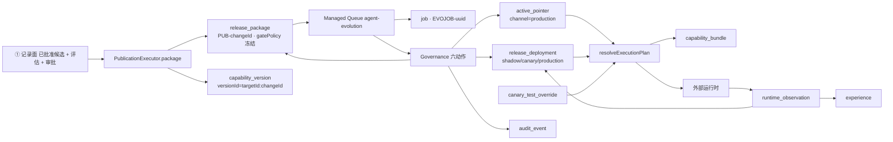
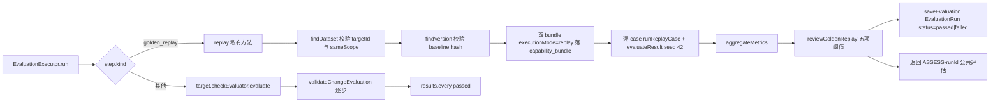
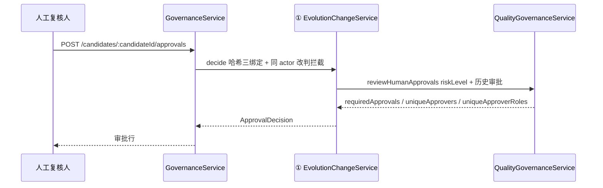
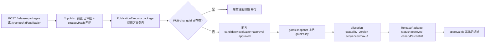
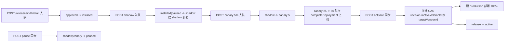
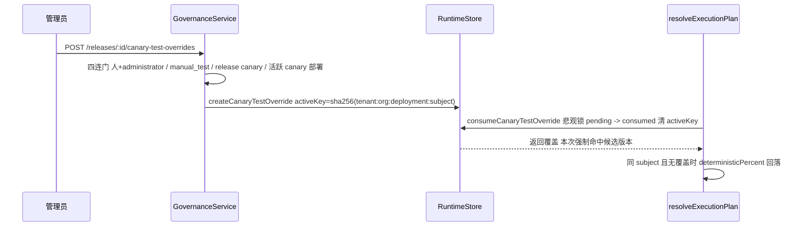
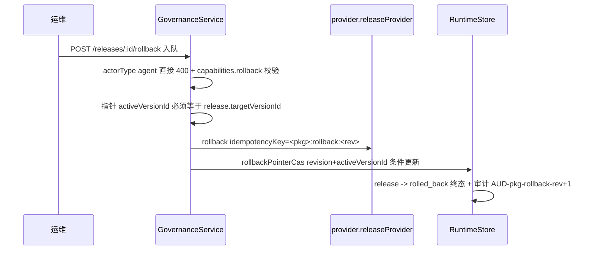
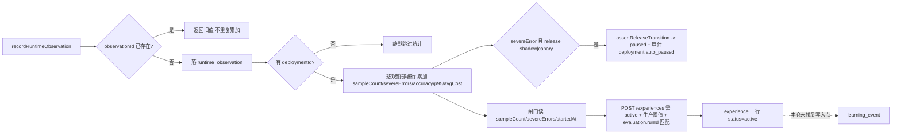

# Agent 演进 · ② 评估与发布子专家 · 数据流转（03-数据流转）

> 只读梳理（commit `80f5676fd`）。范围：闸门 → 部署 → 指针 → 观测 → 经验，覆盖本子域 11 表。引用为仓库根相对路径；未能证实处标 `[推测]`。

**本文引用的文件**
- [application/agent-evolution-governance.service.ts](file://packages/server-ai/src/agent-evolution/application/agent-evolution-governance.service.ts)
- [application/agent-evolution-release-gate-policy.service.ts](file://packages/server-ai/src/agent-evolution/application/agent-evolution-release-gate-policy.service.ts)
- [application/agent-evolution-quality-governance.service.ts](file://packages/server-ai/src/agent-evolution/application/agent-evolution-quality-governance.service.ts)
- [application/agent-evolution-runtime.service.ts](file://packages/server-ai/src/agent-evolution/application/agent-evolution-runtime.service.ts)
- [application/agent-evolution.service.ts](file://packages/server-ai/src/agent-evolution/application/agent-evolution.service.ts)
- [application/agent-evolution-analyst.service.ts](file://packages/server-ai/src/agent-evolution/application/agent-evolution-analyst.service.ts)
- [application/agent-evolution-queue.service.ts](file://packages/server-ai/src/agent-evolution/application/agent-evolution-queue.service.ts)
- [application/agent-evolution-queue.processor.ts](file://packages/server-ai/src/agent-evolution/application/agent-evolution-queue.processor.ts)
- [application/evolution-baseline.service.ts](file://packages/server-ai/src/agent-evolution/application/evolution-baseline.service.ts)
- [application/evolution-runtime.store.ts](file://packages/server-ai/src/agent-evolution/application/evolution-runtime.store.ts)
- [application/evolution-store.helpers.ts](file://packages/server-ai/src/agent-evolution/application/evolution-store.helpers.ts)
- [application/agent-evolution.store.ts](file://packages/server-ai/src/agent-evolution/application/agent-evolution.store.ts)
- [changes/evaluation-executor.service.ts](file://packages/server-ai/src/agent-evolution/changes/evaluation-executor.service.ts)
- [changes/publication-executor.service.ts](file://packages/server-ai/src/agent-evolution/changes/publication-executor.service.ts)
- [changes/change.service.ts](file://packages/server-ai/src/agent-evolution/changes/change.service.ts)
- [changes/change.store.ts](file://packages/server-ai/src/agent-evolution/changes/change.store.ts)
- [controllers/agent-evolution.controller.ts](file://packages/server-ai/src/agent-evolution/controllers/agent-evolution.controller.ts)
- [controllers/evolution-baseline.controller.ts](file://packages/server-ai/src/agent-evolution/controllers/evolution-baseline.controller.ts)
- [entities/evolution.entities.ts](file://packages/server-ai/src/agent-evolution/entities/evolution.entities.ts)
- [domain/evolution-state.ts](file://packages/server-ai/src/agent-evolution/domain/evolution-state.ts)

## 目录
1. [总览](#总览)
2. [链路一 闸门评估](#链路一-闸门评估)
3. [链路二 审批](#链路二-审批)
4. [链路三 发布包生成](#链路三-发布包生成)
5. [链路四 部署与指针切换](#链路四-部署与指针切换)
6. [链路五 金丝雀覆盖与回落](#链路五-金丝雀覆盖与回落)
7. [链路六 回滚](#链路六-回滚)
8. [链路七 观测→经验→学习事件闭环](#链路七-观测经验学习事件闭环)
9. [状态机汇总](#状态机汇总)
10. [已知风险](#已知风险)

## 总览
三条写入面并存：HTTP（`AgentEvolutionController` 的发布/部署/覆盖端点 + `EvolutionBaselineController` 的基线检视）→ 治理与基线服务 → store；Managed Queue `agent-evolution` → `AgentEvolutionQueueProcessor` → 同一批治理方法；运行时能力（`platform.agent-evolution` / `.baselines`）由外部域直接调用。**本模块不订阅跨域事件**（`@OnEvent` 零命中）、**无调度器**（`@Cron`/`@Interval` 零命中）、**无 CQRS handler**（`@CommandHandler`/`@QueryHandler` 零命中）。本子域的**唯一生效点**是 `agent_evolution_active_pointer` 的一次 CAS。

图表来源：[publication-executor.service.ts](file://packages/server-ai/src/agent-evolution/changes/publication-executor.service.ts)（关键符号：package）· [agent-evolution-queue.processor.ts](file://packages/server-ai/src/agent-evolution/application/agent-evolution-queue.processor.ts)（关键符号：handle）· [governance.service.ts](file://packages/server-ai/src/agent-evolution/application/agent-evolution-governance.service.ts)（关键符号：installRelease/startCanary/activateProduction）· [evolution-runtime.store.ts](file://packages/server-ai/src/agent-evolution/application/evolution-runtime.store.ts)（关键符号：activatePointerCas、saveRuntimeObservation）· [agent-evolution-runtime.service.ts](file://packages/server-ai/src/agent-evolution/application/agent-evolution-runtime.service.ts)（关键符号：resolveExecutionPlan）
章节来源：[agent-evolution.store.ts](file://packages/server-ai/src/agent-evolution/application/agent-evolution.store.ts)（关键符号：AgentEvolutionStore 读写门面）、[evolution-runtime.store.ts](file://packages/server-ai/src/agent-evolution/application/evolution-runtime.store.ts)（关键符号：EvolutionRuntimeStore 独占运行时写）、[agent-evolution.controller.ts](file://packages/server-ai/src/agent-evolution/controllers/agent-evolution.controller.ts)（关键符号：releases/deployments/canary-test-overrides 端点）

## 链路一 闸门评估

图表来源：[evaluation-executor.service.ts](file://packages/server-ai/src/agent-evolution/changes/evaluation-executor.service.ts)（关键符号：run、replay）· [quality-governance.service.ts](file://packages/server-ai/src/agent-evolution/application/agent-evolution-quality-governance.service.ts)（关键符号：reviewGoldenReplay）· [change.store.ts](file://packages/server-ai/src/agent-evolution/changes/change.store.ts)（关键符号：saveEvaluation）
- 阈值与阻塞原因一一对应：`totalCases < 50` / affected 切片 `< 20` / high 风险 `< 10` / `severeErrors > 0` / `accuracyDelta <= 0`，任一命中即 `decision='reject'`。
- `assessment` 只有 `tested | not_applicable` 两值，**无评估步骤时不得被当作通过**；多步时 `checkId` 加 `<step.key>:` 前缀、`datasetHash` 改为各步 runId 的合成哈希。
- 写入面：`capability_bundle`（基线束 + 候选束，`executionMode: 'replay'`）+ `evaluation_run`（`status` 由 gate 决定、`gatePassed` 是冗余布尔列、写后不可变）。本子域**不写** `candidate` / `proposal`。
章节来源：[evaluation-executor.service.ts](file://packages/server-ai/src/agent-evolution/changes/evaluation-executor.service.ts)（关键符号：run、replay、ASSESS-runId）、[quality-governance.service.ts](file://packages/server-ai/src/agent-evolution/application/agent-evolution-quality-governance.service.ts)（关键符号：reviewGoldenReplay）

## 链路二 审批

图表来源：[governance.service.ts](file://packages/server-ai/src/agent-evolution/application/agent-evolution-governance.service.ts)（关键符号：decideApproval）· [change.service.ts](file://packages/server-ai/src/agent-evolution/changes/change.service.ts)（关键符号：decide）· [quality-governance.service.ts](file://packages/server-ai/src/agent-evolution/application/agent-evolution-quality-governance.service.ts)（关键符号：reviewHumanApprovals、requiredHumanApprovals）
- 本子域只提供**判据**（`reviewHumanApprovals`）与入口转发；写入 `agent_evolution_approval` 与推进 `change.status` 属 ① 的记录侧。
- 配额：`R3|R4 → 3`，否则 `2`；**只要存在 1 名 `approvalAuthority === 'administrator'` 的批准，配额降为 1 且直接放行**（运维逃生门）。
- 非管理员路径要求 `distinct actorId` 与 `distinct actorRole` **同时**达标——同一人两个角色投两票无效；agent 主体在 ① 侧即被拒绝（`Agent identity cannot satisfy a human approval decision`）。
章节来源：[quality-governance.service.ts](file://packages/server-ai/src/agent-evolution/application/agent-evolution-quality-governance.service.ts)（关键符号：requiredHumanApprovals、reviewHumanApprovals）、[governance.service.ts](file://packages/server-ai/src/agent-evolution/application/agent-evolution-governance.service.ts)（关键符号：decideApproval）

## 链路三 发布包生成

图表来源：[publication-executor.service.ts](file://packages/server-ai/src/agent-evolution/changes/publication-executor.service.ts)（关键符号：EvolutionPublicationExecutor.package）· [release-gate-policy.service.ts](file://packages/server-ai/src/agent-evolution/application/agent-evolution-release-gate-policy.service.ts)（关键符号：snapshot）· [governance.service.ts](file://packages/server-ai/src/agent-evolution/application/agent-evolution-governance.service.ts)（关键符号：createReleasePackage）
- 命名与幂等：`releasePackageId = PUB-<changeId>`；`package()` 首行查重，命中即返回旧值，**发布天然幂等**。
- 冻结动作发生在 `package()` 内一次性完成（`gatePolicy` + `shadowMinimumSamples`）；`manual_test` 档 + 审批人非 `administrator` → `manual_test_administrator_required`。
- 版本分配：`versionId = <targetId>:<changeId>`、`sequence = max+1`（UQ(tenant,org,targetId,sequence)）、`rollbackVersionId = change.baseline.resourceId`（回滚目标在**建包时**就固定）。
- 口径提醒：一致性夹具走 `AgentEvolutionService.createRelease`，包名 `RP-<simulationId>`，**与 `PUB-` 命名不同**，统计与排障时不可混用。
章节来源：[publication-executor.service.ts](file://packages/server-ai/src/agent-evolution/changes/publication-executor.service.ts)（关键符号：package、gatePolicy 冻结、approvalIds）、[agent-evolution.service.ts](file://packages/server-ai/src/agent-evolution/application/agent-evolution.service.ts)（关键符号：createRelease）

## 链路四 部署与指针切换

图表来源：[governance.service.ts](file://packages/server-ai/src/agent-evolution/application/agent-evolution-governance.service.ts)（关键符号：installRelease、startShadow、startCanary、pauseRelease、activateProduction）· [evolution-runtime.store.ts](file://packages/server-ai/src/agent-evolution/application/evolution-runtime.store.ts)（关键符号：activatePointerCas）· [evolution-state.ts](file://packages/server-ai/src/agent-evolution/domain/evolution-state.ts)（关键符号：RELEASE_TRANSITIONS）
- **写表分布**：`install` 只改 `release_package.status`；`shadow` 新增 `release_deployment{channel:'shadow', canaryPercent:0}`；`canary` 先 `completeDeployment(上一档)` 再新增 `{channel:'canary', canaryPercent}` 并回写 `release_package.canaryPercent`；`pause` 只改 release；`activate` 改 release + 指针 + 新增 `{channel:'production', canaryPercent:100}`。
- **指针变化只有两处**：`activatePointerCas`（`activeVersionId → targetVersionId`、`rollbackVersionId → 旧 activeVersionId`、`revision + 1`）与 `rollbackPointerCas`（反向）。`affected !== 1` 即抛 `Active Pointer CAS conflict`。
- **前置顺序**：`requireHuman` → `releaseOperationContext` → `freezeReleaseGatePolicy`（manual_test 需管理员）→ provider 能力位 → release 状态白名单 → 阈值（样本/严重错误/最短时长）→ 指针前置 → CAS。
- `install|shadow|canary|rollback` 是入队动作（HTTP 200 仅代表入队成功），`pause|activate` 同步返回（发布包 / 新指针）。
章节来源：[governance.service.ts](file://packages/server-ai/src/agent-evolution/application/agent-evolution-governance.service.ts)（关键符号：releaseOperationContext、freezeReleaseGatePolicy、createDeployment）、[evolution-runtime.store.ts](file://packages/server-ai/src/agent-evolution/application/evolution-runtime.store.ts)（关键符号：activatePointerCas）

## 链路五 金丝雀覆盖与回落

图表来源：[governance.service.ts](file://packages/server-ai/src/agent-evolution/application/agent-evolution-governance.service.ts)（关键符号：createCanaryTestOverride）· [evolution-runtime.store.ts](file://packages/server-ai/src/agent-evolution/application/evolution-runtime.store.ts)（关键符号：createCanaryTestOverride、consumeCanaryTestOverride）· [agent-evolution-runtime.service.ts](file://packages/server-ai/src/agent-evolution/application/agent-evolution-runtime.service.ts)（关键符号：resolveExecutionPlan、deterministicPercent）
- 参数：`subjectKey ≤ 200`、`reason ≤ 500`、`expiresInMinutes ∈ [1,120]`（缺省 30）；同部署同主体已有 `pending` 即 `…AlreadyPending`。
- 一次性语义由 `activeKey` 单列唯一索引 + 消费/过期时置空共同保证；同一 `executionId` 重试直接返回已消费结果（不重复消费）。
- 回落公式：`deterministicPercent = sha256(deploymentId:subjectKey).readUInt32BE(0)/2^32*100 < deployment.canaryPercent`；命中覆盖的分配项带 `selectionReason: 'manual_test_override'` 与 `manualTestOverrideId`。
- 惰性过期：`GET /releases/:id/canary-test-overrides` 与 `GET /dashboard` 会把过期 `pending` 就地翻 `expired`（**读路径写库**）；翻转**不写审计**。
章节来源：[governance.service.ts](file://packages/server-ai/src/agent-evolution/application/agent-evolution-governance.service.ts)（关键符号：createCanaryTestOverride）、[evolution-runtime.store.ts](file://packages/server-ai/src/agent-evolution/application/evolution-runtime.store.ts)（关键符号：consumeCanaryTestOverride、审计 `AUD-<overrideId>-consumed`）、[evolution-store.helpers.ts](file://packages/server-ai/src/agent-evolution/application/evolution-store.helpers.ts)（关键符号：canaryTestOverrideActiveKey）

## 链路六 回滚

图表来源：[governance.service.ts](file://packages/server-ai/src/agent-evolution/application/agent-evolution-governance.service.ts)（关键符号：rollbackProduction）· [evolution-runtime.store.ts](file://packages/server-ai/src/agent-evolution/application/evolution-runtime.store.ts)（关键符号：rollbackPointerCas）· [evolution-state.ts](file://packages/server-ai/src/agent-evolution/domain/evolution-state.ts)（关键符号：RELEASE_TRANSITIONS 中 `rolled_back` 为终态）
- 四条前置各有独立文案：agent 主体 → `Agents cannot initiate Production rollback`；provider 无能力 → `Target does not support rollback`；指针不等于本发布目标版本 → `Release is not the active Production version`；CAS 失败 → `Active Pointer rollback CAS conflict`（5xx 语义）。
- **不可逆点**：成功后指针 `revision` 与 release 状态同时前推，`rolled_back` 在迁移表中是终态——**回不到原 canary 档位**，只能重新走 `install → shadow → canary`。
- 回滚后 `activeVersionId` 指回 `release.rollbackVersionId`（即建包时记录的基线版本），生产部署行不回收，`resolveExecutionPlan` 对 `rolled_back` 的 release 直接跳过。
章节来源：[governance.service.ts](file://packages/server-ai/src/agent-evolution/application/agent-evolution-governance.service.ts)（关键符号：rollbackProduction）、[evolution-runtime.store.ts](file://packages/server-ai/src/agent-evolution/application/evolution-runtime.store.ts)（关键符号：rollbackPointerCas）、[agent-evolution-runtime.service.ts](file://packages/server-ai/src/agent-evolution/application/agent-evolution-runtime.service.ts)（关键符号：resolveExecutionPlan 跳过 paused/rolled_back）

## 链路七 观测→经验→学习事件闭环

图表来源：[agent-evolution-runtime.service.ts](file://packages/server-ai/src/agent-evolution/application/agent-evolution-runtime.service.ts)（关键符号：recordRuntimeObservation、ingestLearningEvent）· [evolution-runtime.store.ts](file://packages/server-ai/src/agent-evolution/application/evolution-runtime.store.ts)（关键符号：saveRuntimeObservation、自动 pause）· [governance.service.ts](file://packages/server-ai/src/agent-evolution/application/agent-evolution-governance.service.ts)（关键符号：createExperience）
- 累加口径：`candidateAccuracy` 增量平均、`p95LatencyMs = max(上一次观测 p95, 本次 latencyMs)`（**单调不减**）、`averageCost` 用「上一次观测均值 × 上一轮样本数」续算、`observations[]` 逐条 append（无界）。
- 自动暂停是本子域**唯一由数据触发**的 release 状态迁移（主体 `agent-evolution-runtime` / `system_safety_guard`，审计 `deployment.auto_paused`）；`active` 不会被自动降级。
- 经验生成：`release.status === 'active'` + 存在 `channel:'production' && status:'active'` 部署 + 冻结阈值（样本/零严重错误/时长）+ `change.evaluation.passed && evaluation.runId === release.evaluationRunId`；产出**不改变任何指针**。
- **闭环断点（如实记录）**：`experience` → 下一轮 `learning_event` 在本仓**没有任何代码连线**；`learning_event` 只能由外部运行时经 `ingestLearningEvent` 推入，故闭环目前只成立于数据形状。
章节来源：[evolution-runtime.store.ts](file://packages/server-ai/src/agent-evolution/application/evolution-runtime.store.ts)（关键符号：saveRuntimeObservation）、[governance.service.ts](file://packages/server-ai/src/agent-evolution/application/agent-evolution-governance.service.ts)（关键符号：createExperience）、[agent-evolution-runtime.service.ts](file://packages/server-ai/src/agent-evolution/application/agent-evolution-runtime.service.ts)（关键符号：ingestLearningEvent）

## 状态机汇总
| # | 表 | 状态与流转 | 迁移校验 |
|---|---|---|---|
| 1 | `agent_evolution_target` | `active|disabled|provider_unavailable`，值来自 provider 描述符快照（`upsertTarget` / 基线 publish 的 upsert） | **无迁移函数**，无代码内自动流转 |
| 2 | `agent_evolution_capability_version` | **无 status 列**；不可变（`artifactHash` 变即抛错）；`sequence` 单调（UQ(targetId,sequence)） | 唯一性是索引，不是状态机 |
| 3 | `agent_evolution_capability_bundle` | **无 status 列**；`executionMode ∈ production|shadow|canary|replay`；只增不删 | 无校验（`bundleHash` 仅普通索引） |
| 4 | `agent_evolution_active_pointer` | **无 status 词表**；`channel='production'` 即生效点；`revision` 单调递增，`rollbackVersionId` 记录上一版本 | `revision + activeVersionId` 条件 UPDATE（CAS） |
| 5 | `agent_evolution_release_package` | `draft → pending_approval → approved → installed → shadow → {canary,paused,rolled_back}`；`canary → {active,paused,rolled_back}`；`active → {superseded,rolled_back}`；`paused → {shadow,canary,rolled_back}` | `assertReleaseTransition`（`transitionRelease` 与 CAS 内调用）；**`saveRelease` 绕过** |
| 6 | `agent_evolution_release_deployment` | `channel ∈ shadow|canary|production`，`status` 由 channel 推导；`value.completedAt` 作终态标记（双轨） | 无迁移校验；`completeDeployment` 只追加 `completedAt` |
| 7 | `agent_evolution_canary_test_override` | `pending → consumed`（消费）或 `pending → expired`（到期，含读路径惰性翻转）；`activeKey` 随之置空 | 一次性由 `UQ(activeKey)` 物理保证 |
| 8 | `agent_evolution_job` | `queued → running → completed|failed`；`cancelled` **未找到写入点** | 无迁移校验；契约 `EvolutionJobStatus` 无 `pending` |
| 9 | `agent_evolution_experience` | 实写只有 `active`；按 `sourceReleasePackageId` 去重复用 id 与 createdAt | 无迁移校验 |
| 10 | `agent_evolution_audit_event` | **无状态**；`action` 词表：`release.installed` / `deployment.shadow_started` / `deployment.canary_started` / `deployment.paused` / `deployment.auto_paused` / `active_pointer.cas_activated` / `active_pointer.cas_rolled_back` / `canary.manual_test_override_created|_consumed` / `baseline_initialize|baseline_update` | 无校验；审计 id 混用随机与确定性两种形态 |
| 11 | `agent_evolution_runtime_observation` | **无状态**；`severeError` 布尔是唯一副作用触发器（→ 自动 pause） | 无迁移校验；按 `observationId` 幂等 |
章节来源：[evolution.entities.ts](file://packages/server-ai/src/agent-evolution/entities/evolution.entities.ts)（关键符号：19 表列定义与唯一索引）、[evolution-state.ts](file://packages/server-ai/src/agent-evolution/domain/evolution-state.ts)（关键符号：RELEASE_TRANSITIONS、assertReleaseTransition）、[evolution-runtime.store.ts](file://packages/server-ai/src/agent-evolution/application/evolution-runtime.store.ts)（关键符号：activatePointerCas、rollbackPointerCas、saveRuntimeObservation、consumeCanaryTestOverride）、[evolution-baseline.service.ts](file://packages/server-ai/src/agent-evolution/application/evolution-baseline.service.ts)（关键符号：publish 的 upsert target）

## 已知风险
1. **指针竞态**：`activate` 与 `rollback` 的并发保护只有 `revision + activeVersionId` 条件 UPDATE，冲突时抛普通 `Error`（HTTP 500，非 409），调用方无法据状态码做重试语义；前置校验（激活要求指针仍等于 `rollbackVersionId`、回滚要求指针仍等于 `targetVersionId`）与 CAS 之间是**两步**，窗口内他人前推指针会以 5xx 结束而不是业务拒绝。
2. **覆盖残留**：`canary_test_override` 的已消费/已过期行**永不删除**，`activeKey` 唯一索引是**单列、不带租户维度**；`[推测]` 多轮部署后「同 executionId 重试」分支（按 `releasePackageId + deploymentId + targetId + subjectKey + status='consumed'` 取 `createdAt DESC` 的最新一行）在大历史量下可能匹配到非预期行。此外读路径惰性翻转不写审计，`pending` 超时后状态变化无痕。
3. **经验表增长**：`experience` 每个稳定发布一条且无 TTL；`runtime_observation` 与「被执行次数」同阶、`job` 账本与入队次数同阶，`capability_bundle` 与解析次数同阶——本子域**没有任何自动清理或保留策略**（模块内 `@Cron`/`delete(`/`retention`/`purge` 零命中），长期运行必须由运维自建，且 `capability_bundle` / `observations[]` 是两条最典型的无界增长路径。
章节来源：[evolution-runtime.store.ts](file://packages/server-ai/src/agent-evolution/application/evolution-runtime.store.ts)（关键符号：activatePointerCas、rollbackPointerCas、consumeCanaryTestOverride、saveRuntimeObservation）、[governance.service.ts](file://packages/server-ai/src/agent-evolution/application/agent-evolution-governance.service.ts)（关键符号：activateProduction 指针前置、rollbackProduction 指针前置）、[agent-evolution.store.ts](file://packages/server-ai/src/agent-evolution/application/agent-evolution.store.ts)（关键符号：listCanaryTestOverrides 的写回、getDashboard）
