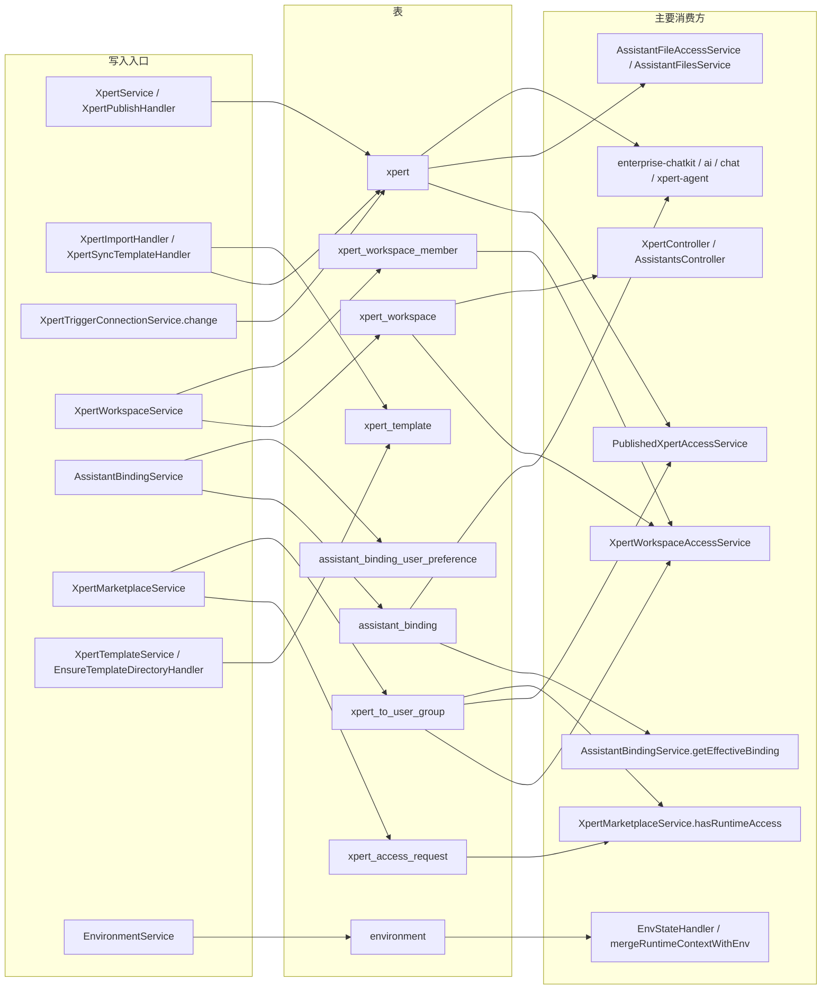

# Assistant 定义与运行时专家 —— C4 数据流向与消费

> 契约层第 4 篇。按子域分组列出本域数据实体，每实体给：实体类型 / 结构 / 生产方 / 主要消费方 / 业务用途 / 详细流向（指向本文件对应链路）。
> 表名、列名、唯一索引取自实体源码；跨模块消费方由 `.fe-index/xpert-server/tables.md` 反查后**归纳**，凡未逐文件验证的概括一律标注 `[基于引用扫描，未深入验证]`。引用写 `file://` 相对仓库根，不写行号。

---

## 0 数据流总览（写入入口 → 表 → 主要消费方）

图表来源：本文件各节 `章节来源`

**图表来源**：`file://packages/server-ai/src/xpert/xpert.entity.ts`（关键符号：`Xpert.userGroups` / `@JoinTable({ name: 'xpert_to_user_group' })`）、`file://packages/server-ai/src/xpert-workspace/workspace.entity.ts`（关键符号：`XpertWorkspace.members` / `@JoinTable({ name: 'xpert_workspace_member' })`）、`file://packages/server-ai/src/xpert-workspace/workspace-access.service.ts`（关键符号：`hasPublishedXpertRunAccess` / `applyCurrentReadScope`）、`file://.fe-index/xpert-server/tables.md`。

---

## 1 子域：定义与版本

### 1.1 `xpert`（定义 + 发布图 + 版本行）

- **实体类型**：`Xpert`，`WorkspaceBaseEntity` 子类（因此自带 `workspaceId` / `publishAt` / `deletedAt`）。
- **结构**：表 `xpert`。关键列 `tenantId`、`organizationId`、`type`、`slug`、`version`、`latest`、`publishAt`、`workspaceId`、`workspaceDataScope`、`draft`(json)、`graph`(json)、`userId`、`environmentId`、`businessAreaId`。唯一索引 `(tenantId, organizationId, type, slug, version, latest)`；因 `organizationId`/`version`/`latest` 可空，PG 下 NULL 互不相等，DB 层**拦不住**多行 `latest = null` 草稿与并发双 `latest`，去重靠应用逻辑。
- **生产方**：`XpertService.create/updateXpert/saveDraft/updateDraft/setAsLatest/createVersionBackup/deleteXpert`；`XpertPublishHandler.execute/publish/saveTeamVersion`；`XpertImportHandler.importAsNewXpert/overwriteExistingXpertDraft`；`XpertSyncTemplateHandler`（只改 `draft`）；`XpertTriggerConnectionService.change` 与 `AssistantTriggerService.mutate`（事务内同时写 `graph` 与 `draft`，`pessimistic_write` 行锁）；`AssistantAppearanceService.save`（只写 `title/titleCN/avatar`）；`AssistantConfigurationService.save`（`saveDraft` + `publish(newVersion=true)`）。
- **主要消费方**：`PublishedXpertAccessService`（准入查询基线，含 `publishAt IS NOT NULL` 与原生 `app->>'public'` / `app->channels->...` 片段）；`AssistantFileAccessService`（读 `workspaceDataScope` 定卷）；`XpertWorkspaceAccessService.hasPublishedXpertRunAccess`（原生 SQL join `xpert_to_user_group`）；`XpertMarketplaceService` 发现面与 `buildXpertMarketplaceProfileSnapshot`；`AssistantsController` / `XpertProfileController` / `XpertAccessController` 的出参投影；`assistant-binding`（6 处 `forFeature`）、`enterprise-chatkit`（21 处 `@InjectRepository`）、`membership`、`prompt-workflow`、`file-memory`、`plugin-resource`、`xpert-marketplace`、`xpert-project-access`、`knowledgebase`、`xpert-project`、`chat-group`、`xpert-agent` 共 13 个模块引用该表 `[基于引用扫描，未深入验证]`。
- **业务用途**：Assistant 的「户籍 + 版本 + 发布态」唯一载体，同族多行即版本历史。
- **详细流向**：见本文「2 定义与发布链」「3 运行时准入链」「5 触发链」。

---

## 2 子域：工作区

### 2.1 `xpert_workspace`（创作容器）

- **实体类型**：`XpertWorkspace`，`TenantOrganizationBaseEntity` 子类。（注意：`EnvironmentController` 所在的 `EnvironmentModule` 与 `xpert` 侧 `forFeature` 集合不同，实体归属易误判。）
- **结构**：表 `xpert_workspace`。关键列 `name`、`description`、`status`（`active | deprecated | archived`，**无 DB 默认值**，NULL 视为未归档）、`settings`(json，`{ access?: { visibility? }, system?: { kind?, userId?, pluginName?, appName? } }`)、`ownerId`、`tenantId`、`organizationId`。成员关系走连接表 `xpert_workspace_member`（无实体类、无角色列）。
- **生产方**：`XpertWorkspaceService.createWorkspace/updateWorkspace/updateMembers/updateVisibility/archiveWorkspace/softRemoveWorkspace/recoverWorkspace/deleteWorkspace`；`EnsurePersonalDefaultWorkspaceHandler.execute`（幂等建个人私有工作区）；`removeMemberFromOrganizationWorkspaces`（组织成员移除连带）。
- **主要消费方**：`XpertWorkspaceAccessService.getCapabilities/applyCurrentReadScope/findAccessibleWorkspaces`（能力面 + SQL 镜像）；`XpertWorkspaceBaseService`（把 read/write/authoring 检查织入 CRUD）；`XpertWorkspaceController`；`XpertService`（`assertWorkspaceWriteAccess` 与 `applyWorkspaceScope` 反填租户/组织）；`assistant-binding`、`xpert-marketplace`、`xpert-table`、`xpert-toolset`、`xpert-template`、`environment`、`connector`、`artifacts`、`file-memory`、`plugin-resource`、`prompt-workflow`、`chat-group`、`skill-package`、`knowledgebase`、`initialization` 等 16 个模块引用该表 `[基于引用扫描，未深入验证]`（tables.md 反查到 5 个模块显式 `forFeature`/`getRepository`，其余为间接依赖）。
- **业务用途**：Assistant / 技能 / 连接器的**创作资源容器**；其 `canRead/canRun/canWrite/canManage` **不是** Assistant 文件权限。
- **详细流向**：见本文「4 工作区能力链」。

### 2.2 `xpert_workspace_member`（工作区成员连接表）

- **实体类型**：无实体类的 `@ManyToMany` 连接表，列名由 TypeORM 生成。
- **结构**：表 `xpert_workspace_member`；声明处 `@ManyToMany(() => User)` + `@JoinTable({ name: 'xpert_workspace_member' })`；**无角色列**——成员即等价权限。
- **生产方**：`XpertWorkspaceService.updateMembers`（覆盖式）、`ensureMember`（幂等加人）、`removeMemberFromOrganizationWorkspaces`。
- **主要消费方**：`XpertWorkspaceAccessService.getCapabilities`（`workspace.members` 命中即 `canRead/canWrite`）、`applyMemberReadCondition`（列表 SQL 镜像）、`PublishedXpertAccessService.buildAccessibleQuery`（`leftJoin('workspace.members', ...)` 参与用户分支），以及 `xpert-marketplace` 的 `hasRuntimeAccess` `[基于引用扫描，未深入验证]`。
- **业务用途**：决定谁能进创作容器；**不**授予 Assistant 运行权，也不授予文件权。
- **详细流向**：见本文「4 工作区能力链」与「3 运行时准入链」。

---

## 3 子域：绑定（系统槽位 + 用户偏好）

### 3.1 `assistant_binding`（系统槽位绑定）

- **实体类型**：`AssistantBinding`，`TenantOrganizationBaseEntity` 子类。
- **结构**：表 `assistant_binding`。关键列 `code`（varchar(64)，`AssistantCode`：`chat_common`/`xpert_shared`/`clawxpert`）、`scope`（`tenant`/`organization`/`user`）、`assistantId`（varchar(64)，**无外键**，指向 `xpert.id`）、`enabled`(bool)、`userId`、`desktopBootstrap`(json，`@Exclude({ toPlainOnly: true })`)、`desktopOnboarding`(json)。三条**部分唯一索引**：`IDX_assistant_binding_tenant_unique`(`tenantId, code` where `"scope" = 'tenant'`)、`IDX_assistant_binding_org_unique`(`tenantId, organizationId, code` where `= 'organization'`)、`IDX_assistant_binding_user_unique`(`tenantId, organizationId, userId, code` where `= 'user'`)——`where` 是字符串 SQL，列名必须带双引号匹配 TypeORM 生成的驼峰列。
- **生产方**：`AssistantBindingService.upsertBinding/deleteBinding`（经 `explicitWhere` 分层校验）、`backfillLegacySystemBindings` 与 `backfillLegacyUserBindings`（`onModuleInit` 内，探测旧表 `assistant_config` / `assistant_user_preference` 后回填）、`BosiBootstrapService.create`（完成安装后写绑定）。
- **主要消费方**：`AssistantBindingService.getEffectiveBinding`（唯一回落入口：organization → tenant → `sourceScope: NONE`）、`BosiBootstrapService` / `BosiOnboardingService`、`assistant-binding` 控制器族；`assistant_binding` 在 tables.md 中只有 1 个模块显式引用（`assistant-binding`，9 处 `forFeature`），但 `mobile` / 桌面端经 HTTP 面消费 `[基于引用扫描，未深入验证]`。
- **业务用途**：把系统槽位（如 `chat_common`、`clawxpert`）与具体 Assistant 在租户/组织/用户三层之一上解绑绑定；`assistantId` 无外键意味着可指向已删助手。
- **详细流向**：见本文「6 绑定与分发链」。

### 3.2 `assistant_binding_user_preference`（绑定级用户偏好）

- **实体类型**：`AssistantBindingUserPreference`，`TenantOrganizationBaseEntity` 子类。
- **结构**：表 `assistant_binding_user_preference`。关键列 `assistantBindingId`（varchar NOT NULL，M:1 `AssistantBinding`，`onDelete: CASCADE`）、`userId`、`soul`/`profile`(text)、`toolPreferences`/`conversationPreferences`(json)。唯一索引 `IDX_assistant_binding_user_preference_unique` = `(tenantId, organizationId, assistantBindingId, userId)`（**非部分索引**）。
- **生产方**：`AssistantBindingService.upsertBindingPreference`（绑定不存在时 400；按 `hasOwnPreferenceField` 逐字段合并，未传字段不清空）。
- **主要消费方**：`assistant-binding` 控制器族的 `:code/preference` 端点；`assistant-binding` 在 tables.md 中 3 处 `forFeature` 引用该表 `[基于引用扫描，未深入验证]`。
- **业务用途**：存「某个用户对某个系统槽位绑定」的人格/工具/会话偏好，与 `assistantId` 解耦（换绑助手不丢偏好）。
- **详细流向**：见本文「6 绑定与分发链」。

---

## 4 子域：模板与市场

### 4.1 `xpert_template`（模板访问计数）

- **实体类型**：`XpertTemplate`，`TenantBaseEntity` 子类（**无组织维度**）。
- **结构**：表 `xpert_template`。关键列 `key`（varchar NOT NULL）、`name`、`visitCount`（int NOT NULL，默认 0）、`lastVisitedAt`。**无唯一索引**——`key` 去重依赖服务层，`getMCPTemplate`/`getKnowledgePipeline` 的「先查后建」在并发下可写出重复 `key`。
- **生产方**：`XpertTemplateService` 的访问计数与目录登记；模板内容本体**不在库里**，走 `XPERT_TEMPLATE_DIR` 下的文件系统 + `templates.json`。
- **主要消费方**：`xpert-template` 模块（tables.md 中唯一显式引用方，4 处 `forFeature`）；`XpertTemplateService.getCatalog/getTemplateDetail/getAll` 读取 `templates.json` 与插件贡献 `[基于引用扫描，未深入验证]`。
- **业务用途**：DB 侧只留模板访问计数，目录展示源是磁盘 `templates.json`（双写、无事务）。
- **详细流向**：见本文「7 模板装配链」。

### 4.2 `xpert_access_request`（市场访问申请）

- **实体类型**：`XpertAccessRequest`，`TenantOrganizationBaseEntity` 子类。
- **结构**：表 `xpert_access_request`。关键列 `xpertId`(uuid NOT NULL，M:1 `Xpert`，`onDelete: CASCADE`)、`requesterId`(NOT NULL，CASCADE)、`reviewerId`(可空，`SET NULL`)、`accessGroupId`(uuid 可空，M:1 `UserGroup`，`onDelete: SET NULL`)、`status`(varchar(20) NOT NULL，默认 `requested`；`requested|approved|rejected`，**无 DB CHECK**)、`reason`/`response`(text，服务层截断 500)、`reviewedAt`。唯一索引 `(tenantId, organizationId, xpertId, requesterId)`——一个用户对一个助手只有一行，重申是原地复用。
- **生产方**：`XpertMarketplaceService.requestAccess`（`owned/accessible` 直接 400；`REQUESTED`/`APPROVED` 原样返回；否则原地重置并清空 `response`/`reviewerId`/`reviewedAt`/`accessGroupId`）、`approveRequest`、`rejectRequest`（不写 `accessGroupId`）。
- **主要消费方**：`XpertMarketplaceService.findMyRequests/findReviewableRequests/findRequestForDecision/resolveAccessStatus`；`xpert-marketplace` 模块（tables.md 中唯一显式引用方，3 处 `forFeature`）`[基于引用扫描，未深入验证]`。
- **业务用途**：市场授权的申请单与审批结果指针；`accessGroupId` 与 `xpert_to_user_group` **没有任何同步机制**。
- **详细流向**：见本文「8 市场授权链」。

### 4.3 `xpert_to_user_group`（授权落地连接表）

- **实体类型**：`@ManyToMany` 连接表，无实体类（列名由 TypeORM 生成，`xpertId` / `userGroupId`）。
- **结构**：表 `xpert_to_user_group`；声明处 `@JoinTable({ name: 'xpert_to_user_group' })`，`onUpdate: 'CASCADE'`，**无 `onDelete`**。
- **生产方**：`XpertMarketplaceService.approveRequest`（`ensureAccessGroup` 建/复用 UserGroup → requester 入组 → 组入 `xpert.userGroups`）；`XpertController` 的 `PUT :id/user-groups`（显式成员关系读/写）。
- **主要消费方**：`XpertWorkspaceAccessService.hasPublishedXpertRunAccess`（**原生 SQL** innerJoin `xpert_to_user_group` + `user_group` + `user_group_to_user`，注释要求别名小写）；`PublishedXpertAccessService` 用户分支 `leftJoin('xpert.userGroups', ...)`；`XpertMarketplaceService.hasRuntimeAccess`；`xpert-marketplace` 与 `xpert-workspace` 两个模块 `[基于引用扫描，未深入验证]`。
- **业务用途**：把「市场授权」变成准入查询里的一条 `userGroups` 命中，是授权面与运行面唯一的收敛点；表名/列名属隐式契约，改名不会编译报错。
- **详细流向**：见本文「8 市场授权链」与「3 运行时准入链」。

---

## 5 子域：环境

### 5.1 `environment`（环境变量集）

- **实体类型**：`Environment`，`WorkspaceBaseEntity` 子类（因此带 `workspaceId` / `publishAt` / `deletedAt`）。
- **结构**：表 `environment`。关键列 `name`（varchar NOT NULL + `@Index`，`@IsNotEmpty`）、`variables`(json，`TEnvironmentVariable[]`)、`isDefault`(bool)、`isArchived`(bool)、`workspaceId`。无唯一索引；「同 workspace 内唯一默认集」由 `EnvironmentService.setAsDefault` 在应用层保证。
- **生产方**：`EnvironmentController`（继承 server-core `CrudController<Environment>` 的标准 CRUD，未覆写）、`EnvironmentService.setAsDefault`、`XpertWorkspaceBaseService` 的读写前置检查。
- **主要消费方**：`EnvStateQuery` → `EnvStateHandler` → `toEnvState`（压成 `{ env: Record<string, string> }`）；`environment/utils.ts` 的 `mergeRuntimeContextWithEnv`（环境值在前、请求 ctx 覆盖在后）、`getContextEnvState`、`mergeEnvironmentWithEnvState`（无环境时合成名为 `Request Environment` 的临时环境）；`XpertController` 的 `:id/variables` 系列；`Xpert.environmentId` 指向它（发布时把空串归 NULL）。tables.md 显示只有 `environment` 模块（3 处 `forFeature`）显式引用该表——**`XpertModule` 的 `forFeature` 未含 `Environment`** `[基于引用扫描，未深入验证]`。
- **业务用途**：工作区级变量注入面；业务语境的「环境变量」是这张表的 json 列，属数据而非进程环境，改它不需要重启进程。
- **详细流向**：见本文「9 环境变量链」。

---

## 6 关联表速查（本域声明、无实体类）

| 连接表 | 主实体 → 目标 | 关键点 |
|---|---|---|
| `xpert_workspace_member` | `XpertWorkspace` → `User` | 成员授权，无角色列 |
| `xpert_to_user_group` | `Xpert` → `UserGroup` | 市场授权与运行时准入都读它 |
| `xpert_to_executor` | `Xpert` → `Xpert`（自引用） | `joinColumn: leaderId` / `inverseJoinColumn: executorId` |
| `xpert_to_knowledgebase` | `Xpert` → `Knowledgebase` | CASCADE |
| `xpert_to_toolset` | `Xpert` → `XpertToolset` | 发布时 `uniq(toolsetIds).map(id => ({ id }))` 覆盖 |
| `tag_xpert` | `Xpert` → `Tag` | `cascade: true` + `eager: true` |
| `xpert_to_integration` | `Xpert` → `Integration` | CASCADE |
| `user_group_to_user` | `UserGroup` → `User` | 由 `hasPublishedXpertRunAccess` 原生 SQL 手工 join |

**说明**：上表全部由 `@JoinTable` 声明，列名由 TypeORM 生成；`hasPublishedXpertRunAccess` 以**原生 SQL** 直接引用 `xpert_to_user_group` / `user_group` / `user_group_to_user`，因此这些表名与列名属隐式契约，改名不会编译报错。

---

## 7 补充链路（本文档内数据流向索引）

1. **定义与发布链**：`XpertService.create` → `draft` 写入 → `XpertPublishCommand` → 版本行 + `graph` + `draft = null` → `ensurePrincipalUser` → `XpertPublishTriggersCommand` → `emitAsync(EventName_XpertPublished)`。
2. **运行时准入链**：请求 → `RequestContext.currentApiPrincipal()` → public / enterprise / workspace api-key / 用户四分支短路 → 各 `build*Query` 尾部统一 `applyPublishedFilters` 与 `applySearchFilter`；`publishAt IS NOT NULL` 由各 `build*Query` 自带（**不在** `applyPublishedFilters` 内）。
3. **工作区能力链**：`getCapabilities(workspace, { includePublishedRunAccess })` → 同租户 + 非归档短路 → api-key 绑定分支（`currentApiKeyBoundWorkspaceIdForUser`）→ 组织工作区 / tenant-shared / tenantScope 分支 → `can()` 动作映射。
4. **触发链**：编辑期 `AssistantTriggerService.mutate`、运行期 `XpertTriggerConnectionService.change`、启动期 `XpertTriggerBootstrapRecoveryService.onApplicationBootstrap`（分页 50 + Redis 锁 `job:trigger:v2:<xpertId>` + `replay_publish`）。
5. **绑定与分发链**：`getEffectiveBinding(code)` org → tenant → NONE；Bosi 链在 `pg_try_advisory_lock` 下用 `PluginTemplateInstallCommand` 的 `bootstrap` 通道安装助手。
6. **模板装配链**：`EnsureTemplateDirectoryHandler` 播种 externalRoot → `getCatalog` / `getTemplateDetail` → `PluginTemplateInstallCommand` → `XpertImportCommand` → `XpertTemplateWorkspaceInitializer.initializeByTemplateId`。
7. **环境变量链**：`Environment.variables` → `EnvStateQuery` → `toEnvState` → `mergeRuntimeContextWithEnv` → 运行时 ctx。
