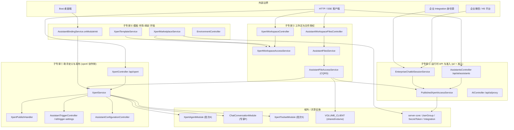

# Assistant 定义与运行时域 —— 架构

**本文引用的文件**

- [packages/server-ai/src/xpert/xpert.module.ts](file://packages/server-ai/src/xpert/xpert.module.ts)
- [packages/server-ai/src/xpert/enterprise-chatkit.module.ts](file://packages/server-ai/src/xpert/enterprise-chatkit.module.ts)
- [packages/server-ai/src/xpert/xpert.controller.ts](file://packages/server-ai/src/xpert/xpert.controller.ts)
- [packages/server-ai/src/xpert/xpert.service.ts](file://packages/server-ai/src/xpert/xpert.service.ts)
- [packages/server-ai/src/xpert/xpert.entity.ts](file://packages/server-ai/src/xpert/xpert.entity.ts)
- [packages/server-ai/src/xpert/published-xpert-access.service.ts](file://packages/server-ai/src/xpert/published-xpert-access.service.ts)
- [packages/server-ai/src/xpert/xpert-access.controller.ts](file://packages/server-ai/src/xpert/xpert-access.controller.ts)
- [packages/server-ai/src/xpert/xpert-profile.controller.ts](file://packages/server-ai/src/xpert/xpert-profile.controller.ts)
- [packages/server-ai/src/xpert/trigger-connection.controller.ts](file://packages/server-ai/src/xpert/trigger-connection.controller.ts)
- [packages/server-ai/src/xpert/trigger-connection.service.ts](file://packages/server-ai/src/xpert/trigger-connection.service.ts)
- [packages/server-ai/src/xpert/configuration/assistant-trigger.service.ts](file://packages/server-ai/src/xpert/configuration/assistant-trigger.service.ts)
- [packages/server-ai/src/xpert/assistant-files/assistant-files.service.ts](file://packages/server-ai/src/xpert/assistant-files/assistant-files.service.ts)
- [packages/server-ai/src/xpert/assistant-files/assistant-file-access.service.ts](file://packages/server-ai/src/xpert/assistant-files/assistant-file-access.service.ts)
- [packages/server-ai/src/xpert/assistant-files/resolve-assistant-file-access.command.ts](file://packages/server-ai/src/xpert/assistant-files/resolve-assistant-file-access.command.ts)
- [packages/server-ai/src/xpert/commands/handlers/publish.handler.ts](file://packages/server-ai/src/xpert/commands/handlers/publish.handler.ts)
- [packages/server-ai/src/xpert/jobs/trigger-bootstrap-recovery.service.ts](file://packages/server-ai/src/xpert/jobs/trigger-bootstrap-recovery.service.ts)
- [packages/server-ai/src/xpert/enterprise-chatkit-session.service.ts](file://packages/server-ai/src/xpert/enterprise-chatkit-session.service.ts)
- [packages/server-ai/src/ai/ai.module.ts](file://packages/server-ai/src/ai/ai.module.ts)
- [packages/server-ai/src/ai/assistant-workspace-files.controller.ts](file://packages/server-ai/src/ai/assistant-workspace-files.controller.ts)
- [packages/server-ai/src/xpert-workspace/workspace-access.service.ts](file://packages/server-ai/src/xpert-workspace/workspace-access.service.ts)
- [packages/server-ai/src/xpert-workspace/workspace.controller.ts](file://packages/server-ai/src/xpert-workspace/workspace.controller.ts)
- [packages/server-ai/src/xpert-workspace/guards/workspace-authoring.guard.ts](file://packages/server-ai/src/xpert-workspace/guards/workspace-authoring.guard.ts)
- [packages/server-ai/src/assistant-binding/assistant-binding.service.ts](file://packages/server-ai/src/assistant-binding/assistant-binding.service.ts)
- [packages/server-ai/src/xpert-marketplace/xpert-marketplace.service.ts](file://packages/server-ai/src/xpert-marketplace/xpert-marketplace.service.ts)
- [packages/server-ai/src/xpert-marketplace/xpert-marketplace.controller.ts](file://packages/server-ai/src/xpert-marketplace/xpert-marketplace.controller.ts)
- [packages/server-ai/src/xpert-template/xpert-template.service.ts](file://packages/server-ai/src/xpert-template/xpert-template.service.ts)
- [packages/server-ai/src/environment/environment.module.ts](file://packages/server-ai/src/environment/environment.module.ts)
- [AGENTS.md](file://AGENTS.md)

## 目录

- [1 专家域职责边界](#1-专家域职责边界)
- [2 子专家划分说明](#2-子专家划分说明)
- [3 子模块清单](#3-子模块清单)
- [4 分层结构](#4-分层结构)
- [5 依赖关系](#5-依赖关系)
- [6 关键设计约束与不变量](#6-关键设计约束与不变量)
- [7 架构总览](#7-架构总览)
- [8 组件详细分析](#8-组件详细分析)
- [9 结论](#9-结论)

## 1 专家域职责边界

本域负责「Assistant 这个可发布产品实体」的**全生命周期与运行时对外开放面**：定义（DSL 草稿）、发布（版本行）、准入（谁能跑）、文件授权（能碰哪些文件）、承载容器（工作区）、分发渠道（模板 / 市场 / 系统槽位绑定 / 企业 H5）。一句话：**本域是 Assistant 的"户籍 + 门禁 + 分发"，不是它的"大脑"**。

| 归属 | 内容 | 证据锚点 |
|---|---|---|
| 做 | Xpert 实体的 CRUD、草稿/发布/版本/导入导出/复制/模板同步 | `XpertService`、`XpertPublishHandler` |
| 做 | 运行时可见性判定与多受众准入 | `PublishedXpertAccessService` |
| 做 | Assistant 文件卷授权（runtime / authoring 双入口） | `AssistantFilesService`、`AssistantFileAccessService` |
| 做 | 创作容器 `XpertWorkspace` 与 four-action 能力面 | `XpertWorkspaceAccessService` |
| 做 | 模板目录、市场授权申请、系统槽位绑定、环境变量 | `XpertTemplateService`、`XpertMarketplaceService`、`AssistantBindingService` |
| 做 | `ai/**` 运行时**适配器层**（HTTP 对外面、ChatKit 兼容层、工作台文件端点） | `AIModule` 控制器族 |
| 不做 | Agent 编译与执行链、多智能体调度 | → 批次 4 |
| 不做 | 对话 / 会话 / 线程**本体**（消息、分支、产物、群聊） | → 专家 F |
| 不做 | 工具、MCP、知识库内容本体 | → 批次 5 |
| 不做 | 项目 `xpert-project`、任务调度 `xpert-task` | → 批次 4 |
| 外挂 | `shared/stream`（SSE 流设施）、`shared/runtime/workspace-files-runtime.module` | 仅依赖，不并入 |

**与专家 F 的交叉引用（必须写明）**：`ai/` 包在本域，但其下 `thread.controller.ts`、`conversation.controller.ts`、`conversation-branch.controller.ts`、`conversation-artifacts.controller.ts` 承载的是**对话本体**，其领域归属是专家 F。本域只对 `ai/assistant.controller.ts`、`ai/ai.controller.ts`、`ai/ai-v1.controller.ts`、`ai/assistant-workspace-files.controller.ts` 等**准入/适配**端点负责。二者共用同一个 `RouterModule.register([{ path: '/ai', module: AIModule }])` 前缀，因此"模块归属"与"领域归属"在此**不等价**。

章节来源：[ai/ai.module.ts](file://packages/server-ai/src/ai/ai.module.ts)（关键符号：AIModule、RouterModule.register）、[AGENTS.md](file://AGENTS.md)（关键符号：XpertWorkspace 边界说明）

## 2 子专家划分说明

| 编号 | 子专家 | 目录范围 | 核心入口 | 一句话职责 |
|---|---|---|---|---|
| ① | **助手定义与发布** | `xpert/` 创作侧 | `XpertService`、`XpertController`、`commands/handlers/publish.handler.ts` | 草稿、发布、版本、导入导出、复制、模板同步、configuration / appearance / trigger-settings |
| ② | **运行时 API 与准入** | `ai/` 对外面 + `PublishedXpertAccessService` + `EnterpriseChatkitModule` | `AssistantsController`、`AIController`、`AIV1Controller`、`EnterpriseChatkitSessionService` | 多受众准入判定、API-Key / client-secret 受众、公共 App ChatKit 会话、企业 H5 会话 |
| ③ | **工作区与文件授权** | `xpert-workspace/` + `xpert/assistant-files/` + `ai/assistant-workspace-files.controller.ts` | `XpertWorkspaceAccessService`、`AssistantFilesService` | 创作容器能力面；Assistant 文件卷的 runtime / authoring 双入口授权 |
| ④ | **模板·市场·绑定·环境** | `xpert-template/`、`xpert-marketplace/`、`assistant-binding/`、`environment/` | `XpertTemplateService`、`XpertMarketplaceService`、`AssistantBindingService` | 装配与安装、市场授权申请与审批（落 UserGroup）、系统槽位绑定、环境变量 |

切分理由：①②③ 分别对应**三元权限面**的三个独立入口（创作 / 运行 / 文件），任一入口混用即越权，因此按权限面切分而非按目录切分；④ 是"把已定义的 Assistant 分发出去"的外围面，与权限三面无交叉写路径。

章节来源：[xpert/xpert.module.ts](file://packages/server-ai/src/xpert/xpert.module.ts)（关键符号：XpertModule、PublishedXpertAccessService）、[xpert/published-xpert-access.service.ts](file://packages/server-ai/src/xpert/published-xpert-access.service.ts)（关键符号：PublishedXpertAccessService.buildAccessibleQuery）

## 3 子模块清单

| 模块 / 入口 | 控制器（真实前缀） | 说明 |
|---|---|---|
| `XpertModule` | `@Controller()` → `/api/xpert`；`@Controller('accessible')` → `/api/xpert/accessible`；`@Controller(':id/trigger-connections')`；`@Controller(':id/trigger-settings')` | 注册 `RouterModule.register([{ path: '/xpert', module: XpertModule }])`，8 个控制器，~85 端点 |
| `EnterpriseChatkitModule` | `@Controller('xpert')` → `/api/xpert/:identifier/enterprise-h5/:platform/*` | **无 RouterModule.register**，2 个 `@Public()` 端点；URL 首段与 XpertModule 同名但路径更深，接口无重叠 |
| `AIModule` | `/api/ai`（`assistants`、`threads`、`conversations`、`contexts`、`knowledges`、`store`、`groups/*`、`mcp-apps`、`sandbox`、`workspace-files/view-sessions`…） | 注册 `path: '/ai'`；22 个控制器文件 |
| `XpertWorkspaceModule` | `@Controller()` → `/api/xpert-workspace` | 工作区 CRUD + members + visibility + 软删/归档 |
| `XpertTemplateModule` | `/api/xpert-template` | 模板目录、技能市场、导出模板装配 |
| `XpertMarketplaceModule` | `@Controller()` 自带路径 → `/api/xpert-marketplace`、`/api/xpert-access-requests` | **无 RouterModule.register** |
| `AssistantBindingModule` | `/api/assistant-binding`（+ `@Controller('bosi')` → `/api/assistant-binding/bosi`） | 系统槽位绑定 + Bosi 桌面引导 |
| `EnvironmentModule` | `/api/environment` | 环境变量 CRUD |

章节来源：[xpert/xpert.module.ts](file://packages/server-ai/src/xpert/xpert.module.ts)（关键符号：XpertModule.controllers）、[xpert/enterprise-chatkit.module.ts](file://packages/server-ai/src/xpert/enterprise-chatkit.module.ts)（关键符号：EnterpriseChatkitModule）

## 4 分层结构

- **Controller 层**：`XpertController`、`XpertAccessController`、`XpertProfileController`、`XpertTagUsageController`、`XpertTriggerConnectionController`、`AssistantTriggerController`、`AssistantConfigurationController`、`AssistantAppearanceController`、`AssistantWorkspaceFilesController`、`AssistantsController` 等；仅做参数校验 + 委派，无业务判定。
- **Service 层**：`XpertService`（extends `XpertWorkspaceBaseService<Xpert>`）、`XpertWorkspaceAccessService`、`PublishedXpertAccessService`、`AssistantFilesService`、`AssistantBindingService`、`XpertMarketplaceService`、`XpertTemplateService`、`XpertPrincipalService`。
- **CQRS 层**：`xpert/commands/*`（52 个文件，含 `handlers/`）+ `xpert/queries/handlers`；跨服务副作用（发布、导入、导出、触发发布、记忆总结）皆为 Command。
- **Guard 层**：`XpertGuard`、`WorkspaceAuthoringGuard`、`WorkspaceOwnerGuard`、`AssistantFileAccessGuard`、`ApiKeyOrClientSecretAuthGuard`、`AnonymousXpertAuthGuard`、`GroupScopeGuard`（群聊侧）。
- **Job / Bootstrap 层**：`XpertTriggerBootstrapRecoveryService implements OnApplicationBootstrap`（触发启动补偿）、`XpertTemplateService implements OnApplicationBootstrap`、`AssistantBindingService implements OnModuleInit`（旧表回填）。
- **View-extension 层**：`AgentViewHostDefinition`、`ViewMiddlewareRuntimeService`、`XpertAuthoringMiddleware` / `XpertAuthoringService`（创作态中间件）。
- **Entity 层**：`Xpert`、`XpertWorkspace`、`AssistantBinding`、`AssistantBindingUserPreference`、`XpertTemplate`、`XpertAccessRequest`、`Environment`、`AssistantUserPreference`、`XpertFrequentQuestionCache`。

章节来源：[xpert/xpert.module.ts](file://packages/server-ai/src/xpert/xpert.module.ts)（关键符号：XpertModule.providers）、[xpert/jobs/trigger-bootstrap-recovery.service.ts](file://packages/server-ai/src/xpert/jobs/trigger-bootstrap-recovery.service.ts)（关键符号：XpertTriggerBootstrapRecoveryService）

## 5 依赖关系

**出向（本域 import 的其他域）**：`ChatConversationModule` / `ChatMessageModule` / `ChatGroupModule`（会话，专家 F）；`KnowledgebaseModule` / `KnowledgeDocumentModule`（批次 5）；`XpertAgentModule`、`XpertProjectModule`（批次 4）；`XpertToolsetModule`（批次 5）；`WorkspaceFileAccessModule` + `shared/runtime/workspace-files-runtime.module`（文件查看会话）；`SandboxModule`、`HandlerQueue`（`HandoffQueueModule`）；`Copilot*Module`、`ModelAccessModule`；`SkillPackageModule`、`PromptWorkflowModule`；`server-core`：`TenantModule`、`UserModule`、`UserGroupModule`、`IntegrationModule`、`SecretTokenModule`、`StorageFileModule`、`AccountBindingModule`、`RedisModule`。

**入向（被谁依赖）**：`XpertModule` 被 **16 个模块** + `app.module.ts` 依赖（`chat`、`chat-group`、`chat-conversation/conversation-branch`、`conversation-map`、`file-memory`、`file-understanding`、`initialization`、`knowledgebase`、`mobile`、`model-execution`、`plugin-resource`、`xpert-agent`、`xpert-project`、`xpert-task`、`ai`、`assistant-binding`）。`XpertWorkspaceModule` 同样被 **16 个模块** 依赖（`xpert`、`assistant-binding`、`xpert-marketplace`、`xpert-table`、`xpert-toolset`、`xpert-template`、`environment`、`connector`、`artifacts`、`file-memory`、`plugin-resource`、`prompt-workflow`、`chat-group`、`skill-package`、`knowledgebase`、`initialization`）。

**循环依赖处理**：`XpertModule` 对 `KnowledgebaseModule`、`XpertAgentModule`、`XpertToolsetModule`、`UserGroupModule`、`UserModule`、`XpertWorkspaceModule`、`EnvironmentModule`、`AssistantBindingModule`、`ChatConversationModule`、`XpertProjectModule` 全部使用 `forwardRef`；`XpertPublishHandler` 注释明写"`forwardRef` 会拷到原型占位符上，JS 私有字段无法跟随该拷贝"。

章节来源：[xpert/xpert.module.ts](file://packages/server-ai/src/xpert/xpert.module.ts)（关键符号：XpertModule.imports）、[xpert/commands/handlers/publish.handler.ts](file://packages/server-ai/src/xpert/commands/handlers/publish.handler.ts)（关键符号：XpertPublishHandler）

## 6 关键设计约束与不变量

1. **三元权限面不可互换**：创作侧 `WorkspaceAuthoringGuard` / `XpertService.assertCanAuthorById`、运行侧 `PublishedXpertAccessService`、文件侧 `AssistantFilesService.forRuntime/forAuthoring`。AGENTS.md 明写：运行时文件必须经 `ResolveAssistantFileAccessCommand` 授权"确切的已发布 Assistant"，**禁止**把 `XpertService.findOne()`、工作区 `canRead/canRun/canWrite/canManage` 当文件 ACL。
2. **绝不接受 HTTP 传入 authoring 模式**：`ResolveAssistantFileAccessCommand` 的注释为 "entry is chosen by trusted server code, never request data"；入口由服务端代码选择，不来自请求体/查询串。
3. **运行时被拒后不得回退 authoring**：`assistant-file-access.service.ts` 文件头明写 "authoring access is explicit and never a fallback after runtime denial"；`entry === 'authoring'` 分支若存在 api principal 直接拒绝（"Delegated credentials cannot select the Studio authority"）。
4. **每次操作重授权**：`AssistantFilesService.bind()` 注释 "Reauthorize each operation, including after a previously successful list or capability lookup."，`capabilities/list/read/save/upload/delete` 每次都重新走 CommandBus。
5. **白名单而非实体序列化**：`XpertProfileController.getProfile` 手工构造返回字段（含 tags/workspace/creator 的三字段裁剪），注释明写 "Construct a whitelist instead of serializing the entity and its loaded relations"。
6. **企业 bootstrap 在身份校验之前**：`EnterpriseChatkitSessionService.getBootstrap` 只回白名单字段 + `platform` + `clientConfig`，属"identity verification 之前"的响应；`createSession` 才走 `resolveContext` → `assertIdentity` → `resolveBoundUser`。
7. **草稿 / 发布态同表双列**：`Xpert` 单表内 `draft` 与 `graph` 双列 + `version/latest` 多行版本，唯一索引 `(tenantId, organizationId, type, slug, version, latest)`；写路径必须经 `trigger-connection.service.change()` 一类事务入口，以免草稿与已发布图分叉。
8. **多受众准入集中在一个查询构造器**：`buildAccessibleQuery` 按 public → enterprise → workspace-api-key → user 顺序短路，所有分支最终经 `applyPublishedFilters` 强制 `publishAt` 非空 + `latest`。

章节来源：[AGENTS.md](file://AGENTS.md)（关键符号：Assistant 文件授权不变量）、[xpert/assistant-files/assistant-file-access.service.ts](file://packages/server-ai/src/xpert/assistant-files/assistant-file-access.service.ts)（关键符号：AssistantFileAccessService.execute）

## 7 架构总览

图表来源：[xpert/xpert.module.ts](file://packages/server-ai/src/xpert/xpert.module.ts)（关键符号：XpertModule）、[xpert/published-xpert-access.service.ts](file://packages/server-ai/src/xpert/published-xpert-access.service.ts)（关键符号：PublishedXpertAccessService.buildAccessibleQuery）

## 8 组件详细分析

### 8.1 定义与版本组件

`XpertService extends XpertWorkspaceBaseService<Xpert>` 承载全部定义面：`create` / `update`（浅层 `updateXpert`）/ `saveDraft` / `updateDraft` / `allVersions` / `setAsLatest` / `createVersionBackup` / `deleteXpert` / `validateName` / `assertCanAuthorById`。发布不在 service 而在命令层（`XpertPublishCommand` → `XpertPublishHandler`）；导入导出复制同样在 `xpert/commands/`（`XpertImportCommand`、`XpertExportCommand`、`XpertExportTemplateCommand`、`XpertSyncTemplateCommand`）。控制器侧 `duplicate` = export DSL → import DSL 的组合拳。`update` 只能浅层更新，`updateXpert` 的注释明写 TypeORM 递归更新的类型隔离与 OneToOne 无法创建的既有限制。

章节来源：[xpert/xpert.service.ts](file://packages/server-ai/src/xpert/xpert.service.ts)（关键符号：XpertService.updateXpert、XpertService.assertCanAuthorById）

### 8.2 运行时准入组件

`PublishedXpertAccessService` 是本域**唯一的运行时可见性权威**。凭证受众由 5 个私有方法判定（`currentPublicXpertId`、`currentUserXpertId`、`currentWorkspaceApiKeyWorkspaceId`、`currentEnterpriseXpertScope`、`currentOrganizationId`），再由 `buildAccessibleQuery` 顺序短路到 `buildPublicXpertBoundQuery` / `buildEnterpriseXpertBoundQuery` / `buildWorkspaceBoundQuery` / 用户分支，最终一律经 `applyPublishedFilters` 施加 `publishAt` 非空 + `latest` 过滤。单条入口 `getAccessiblePublishedXpert` 在加载目标之前**先强制 token audience**（"Enforce the token audience before loading the requested assistant"），再由 `assertCurrentUserAccess` 复查。对外的 `/api/xpert/accessible/:id` 只返回 `{id, avatar}`。

章节来源：[xpert/published-xpert-access.service.ts](file://packages/server-ai/src/xpert/published-xpert-access.service.ts)（关键符号：PublishedXpertAccessService.getAccessiblePublishedXpert、PublishedXpertAccessService.assertCurrentUserAccess）

### 8.3 文件授权组件

文件权限**不在**工作区能力面里。`AssistantFilesService.forRuntime(id)` / `forAuthoring(id)` 只是两个入口选择器，二者共同落到 `bind()`；每次操作都 `commandBus.execute(new ResolveAssistantFileAccessCommand(assistantId, operation, entry))`。处理器 `AssistantFileAccessService.execute()` 做三件事：`entry === 'authoring'` 时先拒绝 api principal 再 `assertCanAuthorById`；否则走 `getAccessiblePublishedXpertForCurrentUser`；最后 `resolveXpertDataVolumeScope` 得出卷范围并返回 `canList/canRead/canWrite/canDelete` 全开的能力集。文件头注释把三条不变量写在源码里："Assistant files belong to a data volume, not an XpertWorkspace entity"。

章节来源：[xpert/assistant-files/assistant-files.service.ts](file://packages/server-ai/src/xpert/assistant-files/assistant-files.service.ts)（关键符号：AssistantFilesService.forRuntime、AssistantFilesService.bind）

### 8.4 工作区组件

`XpertWorkspaceAccessService` 提供四动作能力面 `'read'|'run'|'write'|'manage'`：`getAccess` → `getCapabilities` → `can`，并有 `assertCan` 及 `assertCanRead/Run/Write/Author/Manage` 语法糖（`assertCanAuthor` 直接复用 `assertCanWrite`）。`getCapabilities` 先做同租户 + 非归档短路，再叠加 `hasPublishedXpertRunAccess`（受 `includePublishedRunAccess` 开关控制）；`isTenantSharedWorkspace` 读 `settings.access.visibility`。控制器把所有变更收敛到 `WorkspaceAuthoringGuard`（读）与 `WorkspaceOwnerGuard`（写）两个 Guard 上。

章节来源：[xpert-workspace/workspace-access.service.ts](file://packages/server-ai/src/xpert-workspace/workspace-access.service.ts)（关键符号：XpertWorkspaceAccessService.getCapabilities、XpertWorkspaceAccessService.assertCanAuthor）

### 8.5 模板·市场·绑定·环境组件

`XpertTemplateService extends TenantAwareCrudService<XpertTemplate> implements OnApplicationBootstrap`：模板只记录 `key/visitCount/lastVisitedAt`，真正的"安装"是创建 Assistant + 工作区（`XpertTemplateWorkspaceInitializer`）。`XpertMarketplaceService` 实现申请-审批闭环，`approveRequest` 会 `ensureAccessGroup` 动态建/复用 `UserGroup` 并回写 `XpertAccessRequest.accessGroupId`，`canReviewXpert` 反过来复用 `XpertWorkspaceAccessService.getCapabilities` 判定审批权——即**市场授权最终落在 UserGroup 成员关系上**，与准入查询同源。`AssistantBindingService` 以 `code` + 三层 `scope`（tenant/organization/user）把系统槽位绑定到 Xpert，`getEffectiveBinding` 按 organization 优先回落 tenant，`onModuleInit` 执行 `backfillLegacySystemBindings` / `backfillLegacyUserBindings` 回填旧 `assistant_config` 表。`EnvironmentController extends CrudController<Environment>` 为薄壳 CRUD。

章节来源：[xpert-marketplace/xpert-marketplace.service.ts](file://packages/server-ai/src/xpert-marketplace/xpert-marketplace.service.ts)（关键符号：XpertMarketplaceService.approveRequest、XpertMarketplaceService.ensureAccessGroup）、[assistant-binding/assistant-binding.service.ts](file://packages/server-ai/src/assistant-binding/assistant-binding.service.ts)（关键符号：AssistantBindingService.getEffectiveBinding）

## 9 结论

本域架构的核心张力不是"功能多少"，而是**同一条数据被三种权限面同时看护**：工作区能力面看创作容器，准入服务看已发布 Assistant，文件命令看数据卷。三者以"入口由服务端选择、每次操作重授权、拒绝不回退"三条硬约束划清边界，任何新端点只要选错入口就构成越权（历史上 2026-10-09 验收修的就是这类问题）。第二层张力是**"同表双列 + 多受众"带来的隐式耦合**：`draft`/`graph` 同表要求所有写路径走事务入口，`settings` json 与原生长 SQL 片段要求 schema 改名时同步检查可见性判定。第三层是**分发面的生命周期外溢**：市场授权依赖 UserGroup 的存续，系统槽位绑定依赖启动期回填，企业准入依赖 Integration 身份能力——三者都不在本域的强一致范围内，只能靠运行时复查兜底。

章节来源：[AGENTS.md](file://AGENTS.md)（关键符号：权限面不变量）、[xpert-workspace/workspace-access.service.ts](file://packages/server-ai/src/xpert-workspace/workspace-access.service.ts)（关键符号：XpertWorkspaceAccessService.can）
