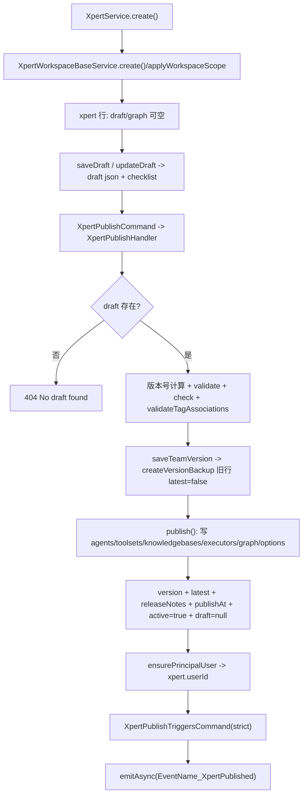
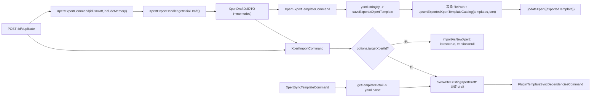
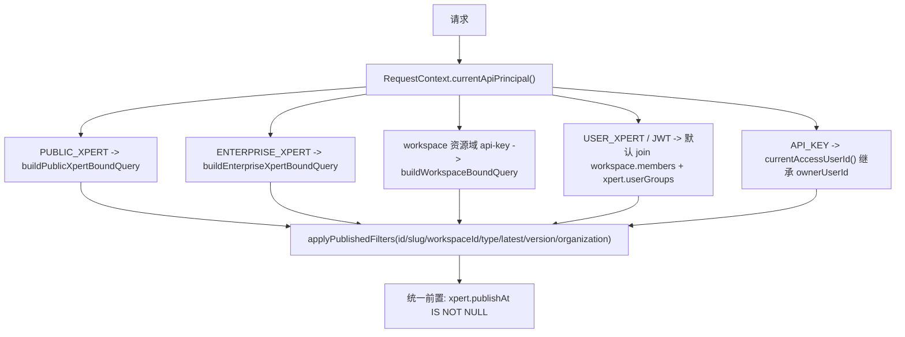
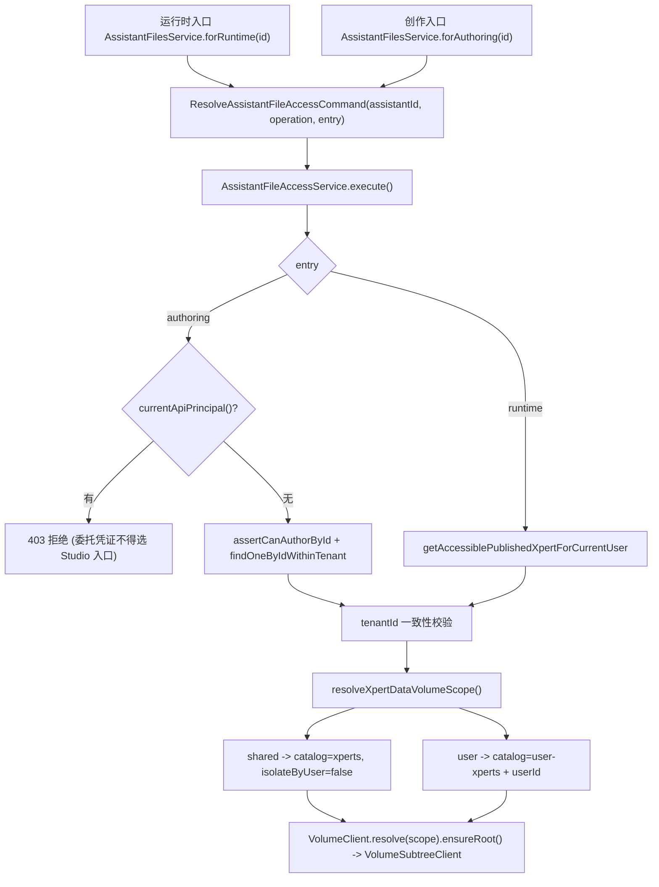
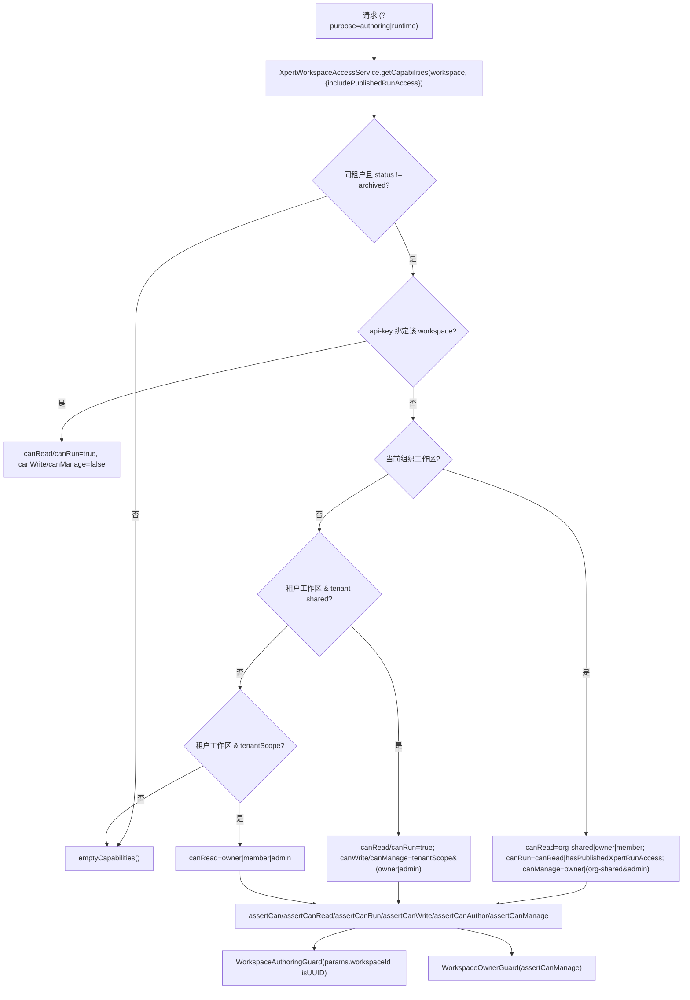
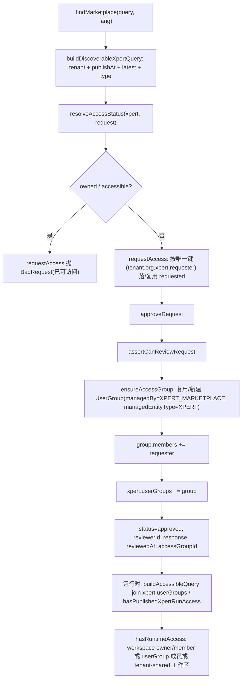

# Assistant 定义与运行时域 — 数据流转

**本文引用的文件**
- [xpert.entity.ts](file://packages/server-ai/src/xpert/xpert.entity.ts)
- [xpert.service.ts](file://packages/server-ai/src/xpert/xpert.service.ts)
- [published-xpert-access.service.ts](file://packages/server-ai/src/xpert/published-xpert-access.service.ts)
- [publish.handler.ts](file://packages/server-ai/src/xpert/commands/handlers/publish.handler.ts)
- [export.handler.ts](file://packages/server-ai/src/xpert/commands/handlers/export.handler.ts)
- [export-template.handler.ts](file://packages/server-ai/src/xpert/commands/handlers/export-template.handler.ts)
- [import.handler.ts](file://packages/server-ai/src/xpert/commands/handlers/import.handler.ts)
- [sync-template.handler.ts](file://packages/server-ai/src/xpert/commands/handlers/sync-template.handler.ts)
- [resolve-assistant-file-access.command.ts](file://packages/server-ai/src/xpert/assistant-files/resolve-assistant-file-access.command.ts)
- [assistant-file-access.service.ts](file://packages/server-ai/src/xpert/assistant-files/assistant-file-access.service.ts)
- [assistant-files.service.ts](file://packages/server-ai/src/xpert/assistant-files/assistant-files.service.ts)
- [volume.ts](file://packages/server-ai/src/shared/volume/volume.ts)
- [workspace-access.service.ts](file://packages/server-ai/src/xpert-workspace/workspace-access.service.ts)
- [workspace-base.service.ts](file://packages/server-ai/src/xpert-workspace/workspace-base.service.ts)
- [workspace.service.ts](file://packages/server-ai/src/xpert-workspace/workspace.service.ts)
- [workspace-authoring.guard.ts](file://packages/server-ai/src/xpert-workspace/guards/workspace-authoring.guard.ts)
- [workspace-owner.guard.ts](file://packages/server-ai/src/xpert-workspace/guards/workspace-owner.guard.ts)
- [xpert-marketplace.service.ts](file://packages/server-ai/src/xpert-marketplace/xpert-marketplace.service.ts)
- [xpert-template.service.ts](file://packages/server-ai/src/xpert-template/xpert-template.service.ts)
- [template-workspace-initializer.service.ts](file://packages/server-ai/src/xpert/template-workspace-initializer.service.ts)
- [assistant-trigger.service.ts](file://packages/server-ai/src/xpert/configuration/assistant-trigger.service.ts)
- [trigger-connection.service.ts](file://packages/server-ai/src/xpert/trigger-connection.service.ts)
- [trigger-bootstrap-recovery.service.ts](file://packages/server-ai/src/xpert/jobs/trigger-bootstrap-recovery.service.ts)
- [assistant-binding.service.ts](file://packages/server-ai/src/assistant-binding/assistant-binding.service.ts)
- [environment.service.ts](file://packages/server-ai/src/environment/environment.service.ts)
- [xpert-workspace.model.ts](file://packages/contracts/src/ai/xpert-workspace.model.ts)
- [xpert-marketplace.model.ts](file://packages/contracts/src/ai/xpert-marketplace.model.ts)

## 目录

- [1. 定义与发布链](#1-定义与发布链)
- [2. 导入导出链](#2-导入导出链)
- [3. 运行时准入链](#3-运行时准入链)
- [4. 文件访问链](#4-文件访问链)
- [5. 工作区能力链](#5-工作区能力链)
- [6. 触发链](#6-触发链)
- [7. 市场授权链](#7-市场授权链)
- [8. 状态流转汇总](#8-状态流转汇总)
- [9. 异步流与外部依赖](#9-异步流与外部依赖)
- [10. 数据变换关键节点](#10-数据变换关键节点)
- [11. 已知风险与坑](#11-已知风险与坑)

## 1. 定义与发布链

`xpert` 行同时承载「草稿」「已发布运行图」「版本元数据」，因此创作链的每一步都落在同一张表上。

图表来源：本文件各节 `章节来源`

文字说明：
1. 创建：`XpertService.create()` 先跑 `validateTagAssociations`，再补 `workspaceDataScope`（缺省 `shared`）与标准化 `agentConfig`，交给 `XpertWorkspaceBaseService.create()`；后者要求 `workspaceId` 存在时通过 `assertWorkspaceWriteAccess`，并用 `applyWorkspaceScope` 从 workspace 反填 `workspaceId/tenantId/organizationId`。
2. 草稿：`saveDraft()` 规范化 `normalizeMiddlewareNodes`、写入 `team.workspaceDataScope/updatedAt/updatedById`，把 `validate()` 结果挂到 `draft.checklist`；`updateDraft()` 做 team 浅合并后再校验。
3. 发布：`XpertPublishHandler.execute()` 依次做 businessArea 归属校验、`userGroups` 非空校验（创建者本人豁免）、版本号计算（`newVersion` 时对最后一段 +1，冲突则追加 `.<index>`）、`snapshotCommandProfile`、`validate`+`check`（游离节点/重名）、`validateTagAssociations`、备份旧版本、追加 `releaseNotes`、`environmentId` 空串归零。
4. 落图：`publish()` 由 `draft.nodes/connections` 增删改 `XpertAgent`，回写 `xpert.toolsets/knowledgebases/executors`，逐节点写 `options[type][key].position|size`，最后 `xpert.graph = pick(draft, 'nodes', 'connections')`，并置 `draft = null`、`publishAt = new Date()`、`active = true`。
5. 版本历史/回滚：`allVersions(id)` 以 `workspaceId + type + slug` 找同族行并返回 `id/version/latest/publishAt/releaseNotes`；`setAsLatest(id)` 把同族既有 `latest=true` 行全部置 false 再置当前行；`createVersionBackup(entity, sourceId)` 负责复制旧壳。`deleteXpert(id)` 在行 `latest=true` 时按 `name` 族软删，否则只软删当前行。

章节来源：[publish.handler.ts](file://packages/server-ai/src/xpert/commands/handlers/publish.handler.ts)（关键符号：`XpertPublishHandler` / 表 `xpert`）、[xpert.service.ts](file://packages/server-ai/src/xpert/xpert.service.ts)（关键符号：`XpertService.saveDraft` / `setAsLatest` / `allVersions` / `createVersionBackup`）、[workspace-base.service.ts](file://packages/server-ai/src/xpert-workspace/workspace-base.service.ts)（关键符号：`XpertWorkspaceBaseService.applyWorkspaceScope`）

## 2. 导入导出链

图表来源：[publish.handler.ts](file://packages/server-ai/src/xpert/commands/handlers/publish.handler.ts)

文字说明：
1. 导出：`XpertExportHandler` 按 `isDraft` 切换 relations；无 `graph` 时用 `createXpertNodes`/`makeConnections` 合成初始草稿，输出 `XpertDraftDslDTO`；`includeMemory` 再补 `MemoryDslDTO[]`。
2. 导出为模板：`XpertExportTemplateHandler` = 导出 DSL → `yaml.stringify` → `XpertTemplateService.saveExportedXpertTemplate()`（落盘 + 目录登记），最后把描述符回写 `xpert.exportedTemplate`。删除时 `deleteExportedXpertTemplate()` 做 unlink + 目录移除，`resolveExternalRelativePath` 拒绝绝对路径与 `..` 越界。
3. 导入：`XpertImportHandler` 先 `resolveImportTemplateSource` 归一 `templateSource`；无 `targetXpertId` 走 `importAsNewXpert`（`validateImportedName`、`latest: true`、`version: null`），有则走 `overwriteExistingXpertDraft`（要求 `draft.team.type` 与现网一致，仅替换 agent 与合并 options 后写 `draft`）。
4. 同步模板：`XpertSyncTemplateHandler` 从 `xpert.options.templateSource` 取模板 → 覆盖 `parsed.team.name = xpert.name` → `preserveInstalledExternalXpertBindings`（保留本实例的 xpert 节点与边，且草稿优先于上次发布）→ 复用 `XpertImportCommand({targetXpertId})`；有 `skills/mcpServers/hooks/apps` 依赖时追加依赖同步。
5. 复制：控制器 `duplicate` 即 export→import 组合，仅以 `body.basic` 覆盖 `team`，`workspaceDataScope` 必须先校验为 `shared|user`，缺省继承源助手。

章节来源：[export.handler.ts](file://packages/server-ai/src/xpert/commands/handlers/export.handler.ts)（关键符号：`XpertExportHandler`）、[export-template.handler.ts](file://packages/server-ai/src/xpert/commands/handlers/export-template.handler.ts)（关键符号：`XpertExportTemplateHandler`）、[import.handler.ts](file://packages/server-ai/src/xpert/commands/handlers/import.handler.ts)（关键符号：`XpertImportHandler.importAsNewXpert` / `overwriteExistingXpertDraft`）、[sync-template.handler.ts](file://packages/server-ai/src/xpert/commands/handlers/sync-template.handler.ts)（关键符号：`XpertSyncTemplateHandler`）、[xpert.controller.ts](file://packages/server-ai/src/xpert/xpert.controller.ts)（关键符号：`XpertController.duplicate`）

## 3. 运行时准入链

图表来源：[export.handler.ts](file://packages/server-ai/src/xpert/commands/handlers/export.handler.ts)

文字说明：
1. 受众判定全部在 `PublishedXpertAccessService` 的私有方法里：`currentPublicXpertId()`、`currentUserXpertId()`、`currentEnterpriseXpertScope()`（要求 `resourceScope.kind === 'assistant'`，enterprise 还要求 `platform` 与 `integrationId`）、`currentWorkspaceApiKeyWorkspaceId()`（要求 `resourceScope.kind === 'workspace'`）。凭证与目标助手不匹配时直接抛 403，而不是退化为「查不到」。
2. `buildAccessibleQuery()` 的分支优先级为 public → enterprise（无 `resourceParentId` 时）→ workspace api-key（无 `requestedUserId` 时）→ 默认（JWT/用户级）。默认分支 join `workspace.members`、`xpert.userGroups`、`userGroup.members`，并同样强制 `xpert.publishAt IS NOT NULL`。
3. `applyPublishedFilters()` 只负责拼 `id/slug/workspaceId/type/latest/version/organizationId` 条件；「已发布」这个硬约束由各 `build*Query` 自己先加上，因此任何新增入口都必须显式重复该条件。
4. 消费端：`AssistantsController`（`@Public()` + `ApiKeyOrClientSecretAuthGuard` + `AllowClientSecretBindings(ENTERPRISE_XPERT)`）的 `search/count/getOne/getRuntimeCapabilities/getModels` 走 `findAccessiblePublishedXperts` / `getAccessiblePublishedXpert`；对外分享态只回 `{id, avatar}`（`XpertAccessController.getAccessiblePublishedXpert`），`XpertProfileController.getProfile` 用白名单字段而非实体序列化。

章节来源：[published-xpert-access.service.ts](file://packages/server-ai/src/xpert/published-xpert-access.service.ts)（关键符号：`PublishedXpertAccessService.buildAccessibleQuery` / `applyPublishedFilters` / `currentPublicXpertId` / `currentUserXpertId` / `currentEnterpriseXpertScope`）

## 4. 文件访问链

图表来源：[published-xpert-access.service.ts](file://packages/server-ai/src/xpert/published-xpert-access.service.ts)

文字说明：
1. 两条入口在服务层被硬编码（`forRuntime`/`forAuthoring`），注释明写「每次操作重新授权，包括在先前成功的 list 或 capabilities 查询之后」——`bind()` 里每个操作都重新派发命令。
2. authoring 分支额外挡掉带 `RequestContext.currentApiPrincipal()` 的请求（含内部调用者），避免委托凭证拿到草稿卷权限；runtime 分支只认「当前用户可访问的已发布助手」。
3. `resolveXpertDataVolumeScope()`：`workspaceDataScope !== 'user'` → `{ catalog: 'xperts', isolateByUser: false }`；`'user'` → `{ catalog: 'user-xperts', userId, xpertId }`，缺 `userId` 直接抛错。注意该字段 `update: false`，创建后不可改。
4. 能力位是显式策略：`capabilities: { canList, canRead, canWrite, canDelete }` 全部为 true——共享卷内授权用户全 CRUD，user 卷由卷目录隔离同一用户根。
5. 另一条平行卷入口是 `XpertService.createVolumeHandle/createWorkspaceVolumeClient`（记忆文件 `:id/memory*` 等），同样经 `resolveXpertDataVolumeScope`，与文件 ACL 不共用检查点。

章节来源：[assistant-files.service.ts](file://packages/server-ai/src/xpert/assistant-files/assistant-files.service.ts)（关键符号：`AssistantFilesService.forRuntime` / `forAuthoring`）、[assistant-file-access.service.ts](file://packages/server-ai/src/xpert/assistant-files/assistant-file-access.service.ts)（关键符号：`AssistantFileAccessService.execute`）、[volume.ts](file://packages/server-ai/src/shared/volume/volume.ts)（关键符号：`resolveXpertDataVolumeScope` / `XpertDataVolumeScope`）

## 5. 工作区能力链

图表来源：[assistant-files.service.ts](file://packages/server-ai/src/xpert/assistant-files/assistant-files.service.ts)

文字说明：
1. 实际签名是 `getCapabilities(workspace, options?)`，**没有** `user` 形参（用户从 `RequestContext.currentUser()` 取）；`{ purpose }` 出现在列表入口 `findAccessibleWorkspaces(orderBy, { purpose })` 与控制器查询参数，`authoring` 会剔除「跨组织 tenant-shared 只读」这一支。
2. `assertCanAuthor` 等价于 `assertCanWrite`；动作到能力位的映射集中在私有 `can(capabilities, action)`，未知动作落到 `canManage`。
3. 列表侧有 SQL 镜像 `applyCurrentReadScope()`，注释明写「在 SQL 中镜像 getCapabilities，使列表结果不能超过点读权限」；`TENANT_SHARED_WORKSPACE_FILTER` 用原生片段 `COALESCE((workspace.settings)::jsonb -> 'access' ->> 'visibility', 'private')`。
4. 守卫只做参数校验 + 转发：`WorkspaceAuthoringGuard` 要求 `params.workspaceId` 是 UUID 后调 `assertCanAuthor`；`WorkspaceOwnerGuard` 调 `assertCanManage`。
5. 基底服务 `XpertWorkspaceBaseService` 把 read/write/authoring 检查织入 `findOne/findOneForRuntime/create/save/update/delete/softDelete`，并区分 `findOne` 与 `findOneForRuntime`（后者允许仅持 `canRun` 的已被授权用户读取）。

章节来源：[workspace-access.service.ts](file://packages/server-ai/src/xpert-workspace/workspace-access.service.ts)（关键符号：`XpertWorkspaceAccessService.getCapabilities` / `assertCanAuthor` / `hasPublishedXpertRunAccess` / `TENANT_SHARED_WORKSPACE_FILTER`）、[workspace-base.service.ts](file://packages/server-ai/src/xpert-workspace/workspace-base.service.ts)（关键符号：`XpertWorkspaceBaseService.findOneForRuntime`）、[workspace-authoring.guard.ts](file://packages/server-ai/src/xpert-workspace/guards/workspace-authoring.guard.ts)（关键符号：`WorkspaceAuthoringGuard`）、[workspace-owner.guard.ts](file://packages/server-ai/src/xpert-workspace/guards/workspace-owner.guard.ts)（关键符号：`WorkspaceOwnerGuard`）

## 6. 触发链

```mermaid
flowchart TD
    subgraph 编辑期
      T1["AssistantTriggerController :id/trigger-settings"] --> T2["AssistantTriggerService.list/mutate/validate"]
      T2 --> T3["read(id, write) -> assertCanAuthor | assertCanRead"]
      T3 --> T4["transaction + pessimistic_write 行锁"]
      T4 --> T5["check(): 拒 password 字段 + Ajv schema + registry.validate"]
      T5 --> T6["XpertPublishTriggersCommand(strict)"]
      T6 -.失败回滚.-> T7["以 previous 图重放 publish-triggers"]
    end
    subgraph 发布期
      P1["XpertPublishHandler.publish()"] --> P2["XpertPublishTriggersCommand(strict, previousGraph)"]
    end
    subgraph 运行期
      C1["XpertTriggerConnectionController :id/trigger-connections"] --> C2["XpertTriggerConnectionService.begin/poll/complete/cancel/disconnect"]
      C2 --> C3["change(): transaction + pessimistic_write 锁行"]
      C3 --> C4["assertCanAuthor(xpert.workspaceId)"]
      C4 --> C5["同步 graph 与 draft (previousGraph/providers/strict)"]
    end
    S1["XpertTriggerBootstrapRecoveryService.onApplicationBootstrap"] --> S2["分页扫 latest=true & publishAt IS NOT NULL"]
    S2 --> S3["RedisLockService(job:trigger:v2) -> replay publish-triggers"]
```

图表来源：[workspace-access.service.ts](file://packages/server-ai/src/xpert-workspace/workspace-access.service.ts)

文字说明：
1. `trigger-settings` 是编辑期声明（MCP/工作流触发器配置）：读路径按 `assertCanRead`，写路径按 `assertCanAuthor`，写前用 `jxt` 事务 + `pessimistic_write` 锁 Xpert 行，并拒绝把 provider schema 里 `x-ui.component === 'password'` 的字段写进 graph JSON；失败时用旧图重放 `publish-triggers` 恢复运行时。
2. `trigger-connections` 是运行期外部连接（扫码/QR 会话）：所有变更都收敛到私有 `change(id, provider, integrationId)`，在同一事务内先 `pessimistic_write` 锁行、再鉴权、再改 `graph` 与 `draft`，因此草稿与已发布图不会在该路径下分叉。
3. 发布链尾部固定执行 `XpertPublishTriggersCommand(_xpert, { strict: true, previousGraph })`，`previousGraph` 用于计算增量（下线已删除的触发器）。
4. 启动补偿：`XpertTriggerBootstrapRecoveryService` 在 `onApplicationBootstrap` 分页（批量 50）扫描 `latest = true` 且 `publishAt IS NOT NULL` 的助手，按 provider 的 `TWorkflowTriggerBootstrapConfig`（默认 `{ mode: 'replay_publish', critical: false }`）重放，并用 `RedisLockService` + 前缀 `job:trigger:v2` 防多实例并发。

章节来源：[assistant-trigger.service.ts](file://packages/server-ai/src/xpert/configuration/assistant-trigger.service.ts)（关键符号：`AssistantTriggerService.mutate` / `check`）、[trigger-connection.service.ts](file://packages/server-ai/src/xpert/trigger-connection.service.ts)（关键符号：`XpertTriggerConnectionService.change`）、[trigger-bootstrap-recovery.service.ts](file://packages/server-ai/src/xpert/jobs/trigger-bootstrap-recovery.service.ts)（关键符号：`XpertTriggerBootstrapRecoveryService`）

## 7. 市场授权链

图表来源：[assistant-trigger.service.ts](file://packages/server-ai/src/xpert/configuration/assistant-trigger.service.ts)

文字说明：
1. 发现面 `buildDiscoverableXpertQuery` 已固化为「同租户 + `publishAt IS NOT NULL` + `latest = true` + 允许的 `type`」，再 join `workspace/businessArea/workspace.members/createdBy/userGroups(+members)`，`findMarketplace` 用 `resolveAccessStatus` 把每项映射到 `not_requested|requested|approved|rejected|accessible|owned`。
2. `requestAccess` 先拒绝 `owned/accessible`；已存在记录若处于 `REQUESTED/APPROVED` 直接原样返回；否则重置 `status/reason/response/reviewerId/reviewedAt/accessGroupId`（即「被拒后可重申」会清掉旧 `accessGroupId`）。
3. `approveRequest` 的三步副作用：`ensureAccessGroup` 建/复用 UserGroup（`managedBy = UserGroupManagedByEnum.XPERT_MARKETPLACE`、`managedEntityType = XPERT`、`managedEntityId = xpert.id`，名字 `Xpert access - {label}` 截断 100）→ 把申请人加入 `group.members` → 把该组加入 `xpert.userGroups`；最后写 `status=APPROVED`、`reviewerId`、`response`、`reviewedAt`、`accessGroupId`。
4. `hasRuntimeAccess` 与运行时准入同源：无组织的 tenant-shared 工作区直接 true；`workspace.ownerId`/`members` 命中 true；否则要求同 tenant + 同 organization 的 `userGroups` 成员命中——也就是「市场授权 = UserGroup 成员关系」。
5. 审核权：`canReviewXpert` 在有 `workspace` 时等价 `getCapabilities(workspace).canManage`，无工作区时回落 `createdById === 当前用户`；`rejectRequest` 不写 `accessGroupId`。

章节来源：[xpert-marketplace.service.ts](file://packages/server-ai/src/xpert-marketplace/xpert-marketplace.service.ts)（关键符号：`XpertMarketplaceService.requestAccess` / `approveRequest` / `ensureAccessGroup` / `hasRuntimeAccess` / `resolveAccessStatus`）、[workspace-access.service.ts](file://packages/server-ai/src/xpert-workspace/workspace-access.service.ts)（关键符号：`XpertWorkspaceAccessService.hasPublishedXpertRunAccess`）

## 8. 状态流转汇总

| 载体 | 状态/字段 | 迁移 | 触发点 |
|---|---|---|---|
| `xpert`（草稿态） | `draft` 非空、`graph` 可为空、`publishAt` 为 NULL | 创建/导入 → 首次发布 | `saveDraft` / `updateDraft` / `XpertImportHandler` |
| `xpert`（发布态） | `draft = NULL`、`publishAt` 非空、`latest`、`version`、`active = true` | 发布 → 新版本（旧行 `latest = false`） | `XpertPublishHandler.publish` + `saveTeamVersion` |
| `xpert`（版本指针回滚） | `latest` 在同族行间唯一为真 | 任意版本行 → `latest = true` | `XpertService.setAsLatest` |
| `xpert_access_request.status` | `requested → approved \| rejected` | 重申会把 `approved/rejected` 重置为 `requested` 并清空 `accessGroupId` | `requestAccess` / `approveRequest` / `rejectRequest` |
| `xpert_workspace.status` | `active \| deprecated \| archived` | `updateWorkspace({status:'archived'})`；另有独立软删路径 | `archiveWorkspace` / `softRemoveWorkspace` / `recoverWorkspace` |
| `xpert_workspace.settings.access.visibility` | `private \| tenant-shared \| organization-shared` | 非法值/缺省回落 `private`；`tenant-shared` 要求无 organizationId，`organization-shared` 要求有 | `updateVisibility` + `applyVisibility` |
| `assistant_binding` | `scope = tenant \| organization \| user` + `enabled` | 同 code 在三层内唯一（部分唯一索引） | `upsertBinding` / `deleteBinding` |

章节来源：[xpert.entity.ts](file://packages/server-ai/src/xpert/xpert.entity.ts)（关键符号：`Xpert.draft` / `graph` / `publishAt` / `latest`）、[xpert-marketplace.model.ts](file://packages/contracts/src/ai/xpert-marketplace.model.ts)（关键符号：`XpertAccessRequestStatusEnum`）、[workspace.service.ts](file://packages/server-ai/src/xpert-workspace/workspace.service.ts)（关键符号：`archiveWorkspace` / `updateVisibility` / `applyVisibility`）、[xpert-workspace.model.ts](file://packages/contracts/src/ai/xpert-workspace.model.ts)（关键符号：`TXpertWorkspaceStatus` / `TXpertWorkspaceVisibility`）

## 9. 异步流与外部依赖

1. 域内事件：发布结束 `emitAsync(EventName_XpertPublished, _xpert)`（同步等待监听者完成，非 fire-and-forget）。
2. 触发器运行时：`XpertPublishTriggersCommand`（发布期/编辑期回滚）+ `XpertTriggerBootstrapRecoveryService`（启动期），后者依赖 `RedisLockService`；无 Redis 时该补偿不可用。
3. 模板依赖：`XpertSyncTemplateHandler` 在模板声明 `skills/mcpServers/hooks/apps` 时发 `PluginTemplateSyncDependenciesCommand`（跨模块、落盘式依赖安装）。
4. 启动回填：`AssistantBindingService.onModuleInit → backfillLegacyBindings()`，先用 `information_schema` 探测旧表 `assistant_config` 与 `assistant_user_preference`，再批量写回绑定/偏好；多实例并发启动存在竞争面（仓库另有 `docs/plans/PLAN_multi_instance_remediation.md` 记录）。
5. 会话运行侧：本域 `xpert/commands/handlers/chat.handler.ts` 经 `HandoffMessage` + `redis-pubsub` 回调把流式回复交回请求（不属于本次定义/发布链，仅在链尾出现）。
6. 本域**无 Bull 队列**；调度类队列（Bull + `ActorTokenModule`）属于域外的 `xpert-task`，此处不并入。

章节来源：[publish.handler.ts](file://packages/server-ai/src/xpert/commands/handlers/publish.handler.ts)（关键符号：`XpertPublishHandler` / `EventName_XpertPublished`）、[assistant-binding.service.ts](file://packages/server-ai/src/assistant-binding/assistant-binding.service.ts)（关键符号：`AssistantBindingService.onModuleInit` / `backfillLegacySystemBindings`）、[trigger-bootstrap-recovery.service.ts](file://packages/server-ai/src/xpert/jobs/trigger-bootstrap-recovery.service.ts)（关键符号：`XpertTriggerBootstrapRecoveryService`）

## 10. 数据变换关键节点

1. DSL 边界：导出走 `XpertDraftDslDTO`（+`MemoryDslDTO`），导入把它们 `yaml.parse` 回 `XpertDraftDslDTO`；导入时用 `SYSTEM_FIELDS` / `OVERWRITE_PROTECTED_TEAM_FIELDS` 剥离系统字段，防止跨租户覆盖。
2. 草稿规范化：`normalizeMiddlewareNodes`（节点数组）、`normalizeXpertAgentConfig`（agentConfig）、`pickXpertAgent`（发布时按白名单挑 agent 字段）、`normalizeAssistantAllowedModels`（把主模型并入 `options.modelSelection.allowedModels`）。
3. 发布快照：`promptWorkflowService.snapshotCommandProfile()` 把命令档案固化成版本内快照；`buildXpertMarketplaceProfileSnapshot(marketplace ?? xpert.marketplace, draft)` 把市场描述写进 `xpert.marketplace`。
4. 导出模板落盘与登记：`getExportedXpertTemplateId` → `getExportedXpertTemplateFilePath` → `EnsureTemplateDirectoryCommand` 下写文件，再 `upsertExportedXpertTemplateCatalog` 写 `templates.json`（各语言 `recommendedApps` 前置 + `details[templateId]`）；删除反向执行。
5. 模板安装装配：`XpertTemplateWorkspaceInitializer.initializeByTemplateId(templateId, workspaceId, language, xpertId)` 实际职责是「在既有工作区按模板补默认 prompt workflow」（`promptWorkflowService.initializeDefaultsInWorkspace`），**不**创建 Assistant 本体；创建 Assistant + 工作区的完整安装由模板控制器/服务侧组合完成，失败只记日志并返回 `status: 'failed'`，不回滚已建工作区。
6. 卷作用域变换：`resolveXpertDataVolumeScope` 是「助手 → 卷目录」的唯一映射点，`shared` 与 `user` 分别映射到 `xperts` 与 `user-xperts` 目录。
7. 模板计数：`XpertTemplate`（`key/name/visitCount/lastVisitedAt`）与磁盘 `templates.json` 双写，前者是 DB 侧访问计数，后者是目录展示源。

章节来源：[import.handler.ts](file://packages/server-ai/src/xpert/commands/handlers/import.handler.ts)（关键符号：`SYSTEM_FIELDS` / `XpertImportHandler.resolveImportTemplateSource`）、[xpert-template.service.ts](file://packages/server-ai/src/xpert-template/xpert-template.service.ts)（关键符号：`saveExportedXpertTemplate` / `upsertExportedXpertTemplateCatalog` / `resolveExternalRelativePath`）、[template-workspace-initializer.service.ts](file://packages/server-ai/src/xpert/template-workspace-initializer.service.ts)（关键符号：`XpertTemplateWorkspaceInitializer.initializeByTemplateId`）、[volume.ts](file://packages/server-ai/src/shared/volume/volume.ts)（关键符号：`resolveXpertDataVolumeScope`）

## 11. 已知风险与坑

1. **草稿与运行图同表双列**：`draft`/`graph` 并存 + `version/latest` 多行；只有 `trigger-connection.change()` 与 `assistant-trigger.mutate()` 在同事务内同时改两列，任何旁路直写 json 列都会让草稿与已发布图分叉（未发现专门校验）。
2. **准入受众分散**：受众判定在 `PublishedXpertAccessService`，工作区反查在 `XpertWorkspaceAccessService.currentApiKeyBoundWorkspaceIdForUser`；`AssistantsController` 顶层 `@Public()` 只靠 `ApiKeyOrClientSecretAuthGuard` + `AllowClientSecretBindings(ENTERPRISE_XPERT)` 兜底，新增端点漏加即越权面。
3. **原生 SQL 与 json 强耦合**：`TENANT_SHARED_WORKSPACE_FILTER` 及各 `applyCurrentReadScope` 分支读 `settings->access->visibility`，缺省回落 `'private'`；字段改名会静默放宽可见性而非报错。
4. **权限三轨不可互换**（`AGENTS.md` 明写）：工作区 `canRead/canRun/canWrite/canManage` ≠ Assistant 文件权限 ≠ 运行时已发布准入；文件必须经 `AssistantFilesService.forRuntime/forAuthoring`。
5. **市场授权后置耦合**：`approveRequest` 动态建 UserGroup 并回写 `accessGroupId`，但 `xpert.userGroups` 与 `xpert_access_request.accessGroupId` 没有反向同步；UserGroup 被删（外键 `SET NULL`）或改名后已审批访问的状态描述会与实际权限不一致。
6. **发布前置条件**：非创建者发布时 `xpert.userGroups` 必须非空，否则 400；模板安装/导入生成的助手若未挂用户组，发布会在最后一步失败（且此前已做的备份/agent 写入不回滚）。
7. **`deleteXpert` 的族删语义**：对 `latest = true` 的行执行 `softDelete({ name, deletedAt: IsNull() })`，会连带删除同名的**所有**版本；仅非 latest 行才单删。
8. **启动期扫描与回填**：`XpertTriggerBootstrapRecoveryService` 全量分页扫描已发布助手并在启动时 replay；`AssistantBindingService.onModuleInit` 依赖 `information_schema` 探测旧表回填，多实例并发启动存在竞争（已有独立治理计划文档）。
9. **前缀假象**：`EnterpriseChatkitModule` 无 `RouterModule.register`，但 controller 自带 `'xpert'`，与 `XpertModule` 前缀同名不同深度，其 `bootstrap/session` 两个端点均为 `@Public()`。

章节来源：[trigger-connection.service.ts](file://packages/server-ai/src/xpert/trigger-connection.service.ts)（关键符号：`XpertTriggerConnectionService.change`）、[workspace-access.service.ts](file://packages/server-ai/src/xpert-workspace/workspace-access.service.ts)（关键符号：`TENANT_SHARED_WORKSPACE_FILTER`）、[xpert.service.ts](file://packages/server-ai/src/xpert/xpert.service.ts)（关键符号：`XpertService.deleteXpert`）、[publish.handler.ts](file://packages/server-ai/src/xpert/commands/handlers/publish.handler.ts)（关键符号：`XpertPublishHandler.execute`）
