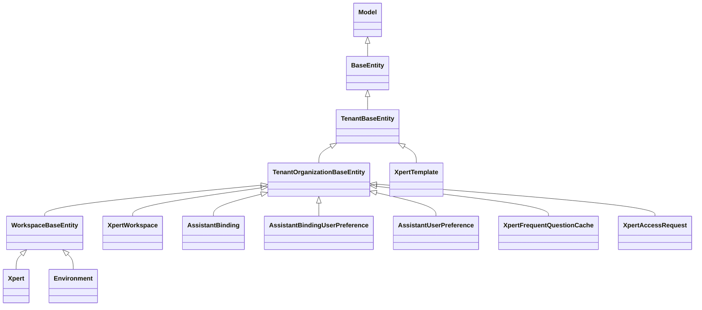

# Assistant 定义与运行时域 — 模型（表与实体）

**本文引用的文件**
- [base.entity.ts (server-ai)](file://packages/server-ai/src/core/entities/base.entity.ts)
- [base.entity.ts (server)](file://packages/server/src/core/entities/base.entity.ts)
- [tenant-base.entity.ts](file://packages/server/src/core/entities/tenant-base.entity.ts)
- [tenant-organization-base.entity.ts](file://packages/server/src/core/entities/tenant-organization-base.entity.ts)
- [xpert.entity.ts](file://packages/server-ai/src/xpert/xpert.entity.ts)
- [xpert-workspace/workspace.entity.ts](file://packages/server-ai/src/xpert-workspace/workspace.entity.ts)
- [assistant-binding.entity.ts](file://packages/server-ai/src/assistant-binding/assistant-binding.entity.ts)
- [assistant-binding-user-preference.entity.ts](file://packages/server-ai/src/assistant-binding/assistant-binding-user-preference.entity.ts)
- [xpert-template.entity.ts](file://packages/server-ai/src/xpert-template/xpert-template.entity.ts)
- [xpert-access-request.entity.ts](file://packages/server-ai/src/xpert-marketplace/xpert-access-request.entity.ts)
- [assistant-user-preference.entity.ts](file://packages/server-ai/src/xpert/assistant-user-preference.entity.ts)
- [xpert-frequent-question-cache.entity.ts](file://packages/server-ai/src/xpert/xpert-frequent-question-cache.entity.ts)
- [environment.entity.ts](file://packages/server-ai/src/environment/environment.entity.ts)
- [xpert.module.ts](file://packages/server-ai/src/xpert/xpert.module.ts)
- [xpert.service.ts](file://packages/server-ai/src/xpert/xpert.service.ts)
- [workspace-base.service.ts](file://packages/server-ai/src/xpert-workspace/workspace-base.service.ts)
- [20261003-bosi-bootstrap.sql](file://packages/server-ai/src/assistant-binding/migrations/20261003-bosi-bootstrap.sql)
- [20261004-bosi-onboarding.sql](file://packages/server-ai/src/assistant-binding/migrations/20261004-bosi-onboarding.sql)
- [20260922-conversation-branch.sql](file://packages/server-ai/src/chat-conversation/migrations/20260922-conversation-branch.sql)
- [tables.md](file://.fe-index/xpert-server/tables.md)

## 目录

- [1. 实体基类分层](#1-实体基类分层)
- [2. xpert 表](#2-xpert-表)
- [3. xpert_workspace 与成员表](#3-xpert_workspace-与成员表)
- [4. assistant_binding 与用户偏好表](#4-assistant_binding-与用户偏好表)
- [5. xpert_template 与 xpert_access_request](#5-xpert_template-与-xpert_access_request)
- [6. 用户偏好、FAQ 缓存与 environment](#6-用户偏好faq-缓存与-environment)
- [7. 多对多连接表](#7-多对多连接表)
- [8. 迁移与 seed 惯例](#8-迁移与-seed-惯例)
- [9. 校验规则](#9-校验规则)
- [10. 已知风险与坑](#10-已知风险与坑)

## 1. 实体基类分层

图表来源：本文件各节 `章节来源`

| 基类 | 提供的列/关系 | 备注 |
|---|---|---|
| `Model` | 无列；构造函数按键值赋属性 | `instanceOf?` 标注 `@deprecated` |
| `BaseEntity` | `id`（uuid 主键，`@PrimaryGeneratedColumn`）、`createdById`（uuid 可空）、`createdBy`（`User`，`onDelete: RESTRICT`）、`updatedById`、`updatedBy`、`createdAt`/`updatedAt`（`timestamptz`） | `createdBy/updatedBy` 用 `@Transform` 转 `UserPublicDTO` |
| `TenantBaseEntity` | `tenant`（`Tenant`，`onDelete: CASCADE`）、`tenantId`（可空 + `@Index`） | 租户隔离的最低层 |
| `TenantOrganizationBaseEntity` | `organization`（`Organization`，`onDelete: CASCADE`）、`organizationId`（可空 + `@Index`） | 组织可空即「租户级」行 |
| `WorkspaceBaseEntity`（本域自有） | `workspace`（`XpertWorkspace`，`onDelete: CASCADE`）、`workspaceId`（可空 + `@Index`）、`publishAt`（`timestamptz` 可空）、`deletedAt`（`@DeleteDateColumn`） | **`publishAt` 与软删列都定义在这一层**，所以 `Xpert`/`Environment` 天生带发布态语义 |

章节来源：[base.entity.ts (server-ai)](file://packages/server-ai/src/core/entities/base.entity.ts)（关键符号：`WorkspaceBaseEntity`）、[base.entity.ts (server)](file://packages/server/src/core/entities/base.entity.ts)（关键符号：`Model` / `BaseEntity`）、[tenant-base.entity.ts](file://packages/server/src/core/entities/tenant-base.entity.ts)（关键符号：`TenantBaseEntity`）、[tenant-organization-base.entity.ts](file://packages/server/src/core/entities/tenant-organization-base.entity.ts)（关键符号：`TenantOrganizationBaseEntity`）

## 2. xpert 表

实体 `Xpert` → 表 `xpert`，`WorkspaceBaseEntity` 子类；同一 `(tenantId, organizationId, type, slug)` 的**多行**分别代表不同版本。

关键列（其余见实体）：

| 列 | 类型/长度 | 可空/默认 | 说明 |
|---|---|---|---|
| `slug` | varchar(100) | NOT NULL | 由 name 转换，`validateName` 要求长度 ≥ 5 |
| `name` | varchar(100) | NOT NULL | 业务名，`AiBusinessRole \| string` |
| `type` | varchar(10) | NOT NULL | `XpertTypeEnum`（`agent`/`copilot`(deprecated)/`knowledge`…） |
| `title` / `titleCN` | varchar(100) | 可空 | 展示名（中英） |
| `description` | text | 可空 | |
| `workspaceDataScope` | varchar(16) | 默认 `'shared'`，**`update: false`** | `'shared' \| 'user'`，决定文件卷目录 |
| `active` | boolean | 可空 | 发布时置 `true` |
| `avatar` / `starters` / `options` / `agentConfig` / `summarize` / `memory` / `features` / `commandProfile` / `marketplace` | json | 可空 | `marketplace` 是 `TXpertMarketplaceProfile` 快照 |
| `businessAreaId` | uuid | 可空 | 多对一 `BusinessArea`，`onDelete: SET NULL`（publish 侧校验同 tenant/org 归属） |
| `version` | varchar(20) | 可空 | 形如 `1`、`2`、`2.1` |
| `latest` | boolean | 可空 | 同族唯一真值（应用层维护，**无 DB 约束**） |
| `releaseNotes` | text | 可空 | 发布时追加而非覆盖 |
| `exportedTemplate` | json | 可空 | 落盘模板描述符（`filePath/exportedAt/isDraft/includeMemory`） |
| `draft` | json | 可空 | `TXpertTeamDraft`，未发布内容 |
| `graph` | json | 可空 | `TXpertGraph`，仅 `{nodes, connections}` |
| `api` / `app` | json | 可空 | `TChatApi` / `TChatApp`，与 principal user 语义耦合 |
| `userId` | varchar | 可空 | **助手自身的外部服务账号**（非终端用户），发布时 `ensurePrincipalUser` |
| `environmentId` | uuid | 可空 | 多对一 `Environment`，发布时把空串归一为 NULL |

唯一约束：`@Index(['tenantId','organizationId','type','slug','version','latest'], { unique: true })`。注意 `version` 与 `latest` 都可空，而 PostgreSQL 将 NULL 视为互不相等——因此「同一 slug 多行草稿/多行 `latest = null`」在 DB 层不被唯一索引拦住，去重只能靠应用逻辑。

关系与级联：

| 关系 | 类型 | 级联/外键 |
|---|---|---|
| `agent`（主 Agent） | 1:1 → `XpertAgent`（inverse `agent.xpert`） | `cascade: true` |
| `agents` | 1:N → `XpertAgent`（inverse `agent.team`） | 无 cascade，发布时手工增删 |
| `copilotModel` / `copilotModelId` | 1:1 → `CopilotModel`（`@JoinColumn`） | `cascade: ['insert','update','remove','soft-remove','recover']` |
| `knowledgebase` | 1:1 → `Knowledgebase`（inverse `knowledgebase.pipeline`） | `cascade: true`、`onDelete/onUpdate: CASCADE` |
| `executors` / `leaders` | 自引用 M:N（`xpert_to_executor`，列 `leaderId`/`executorId`） | `onUpdate/onDelete: CASCADE`；`leaders` 侧 `cascade: true` |
| `knowledgebases` | M:N（`xpert_to_knowledgebase`） | CASCADE；读取时 `@Transform` 成 `KnowledgebasePublicDTO` |
| `toolsets` | M:N（`xpert_to_toolset`） | CASCADE |
| `userGroups` | M:N（`xpert_to_user_group`） | `onUpdate: CASCADE`（**无 onDelete**） |
| `tags` | M:N（`tag_xpert`） | `cascade: true`、**`eager: true`**（默认查询即带上） |
| `integrations` | M:N（`xpert_to_integration`） | CASCADE |
| `user` / `environment` | M:1 | `@JoinColumn()`，无 onDelete 声明 |

业务约束：发布要求 `draft` 非空；非创建者发布要求 `userGroups` 至少一个；`slug` 长度 ≥ 5（`validateName`）；`workspaceDataScope` 创建后不可改。

章节来源：[xpert.entity.ts](file://packages/server-ai/src/xpert/xpert.entity.ts)（关键符号：`Xpert` / 表 `xpert`）、[xpert.service.ts](file://packages/server-ai/src/xpert/xpert.service.ts)（关键符号：`XpertService.validateName` / `createVersionBackup`）

## 3. xpert_workspace 与成员表

`XpertWorkspace` → `xpert_workspace`（`TenantOrganizationBaseEntity`）。

| 列 | 类型 | 可空/默认 | 说明 |
|---|---|---|---|
| `name` | varchar | NOT NULL | |
| `description` | varchar(500) | 可空 | |
| `status` | varchar | 可空 | `'active' \| 'deprecated' \| 'archived'`（**无 DB 默认值**，NULL 视为未归档） |
| `settings` | json | 可空 | `{ access?: { visibility? }, system?: { kind?, userId?, pluginName?, appName? } }` |
| `ownerId` | varchar | 可空 | `@RelationId` + `@ManyToOne(User)`，无 onDelete 声明 |

关系：`members` M:N → `User`，连接表 **`xpert_workspace_member`**（无实体类）；`environments` 1:N → `'Environment'`（字符串关系，`cascade: ['insert','update','remove','soft-remove','recover']`，反向字段 `Environment.workspace`）。

业务约束：`visibility` 三值互斥且与 `organizationId` 绑定——`tenant-shared` 要求 `organizationId` 为空、`organization-shared` 要求非空，非法值由 `applyVisibility` 抛 `BadRequestException`；持久化后由 `getXpertWorkspaceVisibility()` 把未知值规范化为 `'private'`。`archived` 在 `getCapabilities` 中直接被判为无权限。

章节来源：[xpert-workspace/workspace.entity.ts](file://packages/server-ai/src/xpert-workspace/workspace.entity.ts)（关键符号：`XpertWorkspace` / 表 `xpert_workspace`）、[xpert-workspace.model.ts](file://packages/contracts/src/ai/xpert-workspace.model.ts)（关键符号：`TXpertWorkspaceSettings` / `getXpertWorkspaceVisibility`）

## 4. assistant_binding 与用户偏好表

`AssistantBinding` → `assistant_binding`（`TenantOrganizationBaseEntity`）。三个**部分唯一索引**（PostgreSQL `WHERE` 谓词）：

| 索引名 | 列 | 条件 | 语义 |
|---|---|---|---|
| `IDX_assistant_binding_tenant_unique` | `tenantId, code` | `"scope" = 'tenant'` | 租户级每个 code 一行 |
| `IDX_assistant_binding_org_unique` | `tenantId, organizationId, code` | `"scope" = 'organization'` | 组织级每 code 一行 |
| `IDX_assistant_binding_user_unique` | `tenantId, organizationId, userId, code` | `"scope" = 'user'` | 用户级每 code 一行 |

列：`code`（varchar(64) NOT NULL，`AssistantCode`：`chat_common`/`xpert_shared`/`clawxpert`）、`scope`（varchar(64) NOT NULL，`tenant`/`organization`/`user`）、`assistantId`（varchar(64) 可空，**无外键**，指向 `xpert.id`）、`enabled`（boolean 可空）、`userId`/`user`（M:1 `User`，`onUpdate/onDelete: CASCADE`）、`desktopBootstrap`（json 可空，**`@Exclude({ toPlainOnly: true })`**）、`desktopOnboarding`（json 可空）。关系：`preferences` 1:N → `AssistantBindingUserPreference`。

`AssistantBindingUserPreference` → `assistant_binding_user_preference`（`TenantOrganizationBaseEntity`）：唯一索引 `IDX_assistant_binding_user_preference_unique` = `(tenantId, organizationId, assistantBindingId, userId)`（**非部分索引**）；列 `assistantBindingId`（varchar NOT NULL，M:1 `AssistantBinding`，`onDelete: CASCADE`）、`userId`/`user`（M:1 `User`，CASCADE）、`soul`/`profile`（text 可空）、`toolPreferences`/`conversationPreferences`（json 可空）。

业务约束：`assistantId` 无外键意味着绑定可以指向被删/未发布的助手，一致性由 `upsertBinding` 的 `getAccessiblePublishedXpert` + `type === Agent && latest === true` 校验保证。

章节来源：[assistant-binding.entity.ts](file://packages/server-ai/src/assistant-binding/assistant-binding.entity.ts)（关键符号：`AssistantBinding` / 表 `assistant_binding`）、[assistant-binding-user-preference.entity.ts](file://packages/server-ai/src/assistant-binding/assistant-binding-user-preference.entity.ts)（关键符号：`AssistantBindingUserPreference`）

## 5. xpert_template 与 xpert_access_request

`XpertTemplate` → `xpert_template`（`TenantBaseEntity`，**无组织维度**）：`key`（varchar NOT NULL）、`name`（varchar 可空）、`visitCount`（integer NOT NULL，默认 0）、`lastVisitedAt`（可空）。无唯一索引——`key` 的去重依赖服务层。

`XpertAccessRequest` → `xpert_access_request`（`TenantOrganizationBaseEntity`）：

| 列 | 类型 | 可空/默认 | 关系/约束 |
|---|---|---|---|
| `xpertId` | uuid | NOT NULL | M:1 `Xpert`，`onDelete: CASCADE` |
| `requesterId` | uuid | NOT NULL | M:1 `User`，`onDelete: CASCADE` |
| `reviewerId` | uuid | 可空 | M:1 `User`，`onDelete: **SET NULL**` |
| `accessGroupId` | uuid | 可空 | M:1 `UserGroup`，`onDelete: **SET NULL**` |
| `status` | varchar(20) | NOT NULL，默认 `'requested'` | `requested｜approved｜rejected` |
| `reason` / `response` | text | 可空 | 服务层截断 500 字符 |
| `reviewedAt` | timestamptz | 可空 | |

唯一约束：`@Index(['tenantId','organizationId','xpertId','requesterId'], { unique: true })` —— 一个用户对一个助手只能有一行申请记录（重申是原地复用而非插入新行）。

业务约束：`status` 无 DB CHECK 约束（仅 `IsString` + 默认值），语义合法集由 `XpertAccessRequestStatusEnum` 在应用层保证；`accessGroupId` 与 `xpert_to_user_group` 没有任何同步机制。

章节来源：[xpert-template.entity.ts](file://packages/server-ai/src/xpert-template/xpert-template.entity.ts)（关键符号：`XpertTemplate` / 表 `xpert_template`）、[xpert-access-request.entity.ts](file://packages/server-ai/src/xpert-marketplace/xpert-access-request.entity.ts)（关键符号：`XpertAccessRequest` / 表 `xpert_access_request`）

## 6. 用户偏好、FAQ 缓存与 environment

`AssistantUserPreference` → `xpert_assistant_user_preference`（`TenantOrganizationBaseEntity`）。采用**两个互补部分唯一索引**处理「组织内」与「租户级」两种作用域（源码注释明写：PostgreSQL 把 NULL 视作互不相等，故必须拆成两个部分索引）：

| 索引名 | 列 | 条件 |
|---|---|---|
| `IDX_xpert_assistant_user_preference_organization_unique` | `tenantId, organizationId, assistantId, userId` | `"organizationId" IS NOT NULL` |
| `IDX_xpert_assistant_user_preference_tenant_unique` | `tenantId, assistantId, userId` | `"organizationId" IS NULL` |

列：`assistantId`（varchar NOT NULL，M:1 `Xpert`，`onDelete: CASCADE`）、`userId`（varchar NOT NULL，M:1 `User`，CASCADE）、`preferences`（**jsonb NOT NULL**，默认 `'{"version": ASSISTANT_USER_PREFERENCES_VERSION}'::jsonb`）。

`XpertFrequentQuestionCache` → `xpert_frequent_question_cache`（`TenantOrganizationBaseEntity`）：唯一索引 `(tenantId, organizationId, xpertId, locale)`；列 `xpertId`（varchar NOT NULL，**无外键**）、`locale`（varchar(32) NOT NULL）、`questions`（json 可空，string[]）、`sample`（json 可空）、`generatedAt`/`expiresAt`（timestamptz NOT NULL）。**无过期清理任务**在本域内可见。

`Environment` → `environment`（`WorkspaceBaseEntity`，因此带 `workspaceId`/`publishAt`/`deletedAt`）：`name`（varchar NOT NULL + `@Index`，`@IsNotEmpty`）、`variables`（json 可空，`TEnvironmentVariable[]`）、`isDefault`（boolean 可空）、`isArchived`（boolean 可空）。反向关系由 `XpertWorkspace.environments` 以字符串 `'Environment'` 声明；`EnvironmentService extends XpertWorkspaceBaseService` 提供 `setAsDefault`（同 workspace 内互斥）。该表仅由 `EnvironmentModule` 注册（`XpertModule` 的 `forFeature` 未含 `Environment`）。

章节来源：[assistant-user-preference.entity.ts](file://packages/server-ai/src/xpert/assistant-user-preference.entity.ts)（关键符号：`AssistantUserPreference`）、[xpert-frequent-question-cache.entity.ts](file://packages/server-ai/src/xpert/xpert-frequent-question-cache.entity.ts)（关键符号：`XpertFrequentQuestionCache`）、[environment.entity.ts](file://packages/server-ai/src/environment/environment.entity.ts)（关键符号：`Environment` / 表 `environment`）、[xpert.module.ts](file://packages/server-ai/src/xpert/xpert.module.ts)（关键符号：`TypeOrmModule.forFeature`）

## 7. 多对多连接表

本域不定义连接表实体，全部由 `@JoinTable` 声明（列名由 TypeORM 生成）：

| 连接表 | 主实体 | 目标 | 声明位置要点 |
|---|---|---|---|
| `xpert_to_executor` | `Xpert` | `Xpert`（自引用） | `joinColumn: leaderId` / `inverseJoinColumn: executorId`（显式命名）；反向 `leaders` 不建表 |
| `xpert_to_knowledgebase` | `Xpert` | `Knowledgebase` | 反向 `Knowledgebase.xperts` |
| `xpert_to_toolset` | `Xpert` | `XpertToolset` | 发布时 `uniq(toolsetIds).map(id => ({id}))` 覆盖 |
| `xpert_to_user_group` | `Xpert` | `UserGroup` | 市场审批与运行时准入都读它（`hasPublishedXpertRunAccess` 直接手工 join） |
| `tag_xpert` | `Xpert` | `Tag` | `cascade: true` + `eager: true` |
| `xpert_to_integration` | `Xpert` | `Integration` | CASCADE |
| `xpert_workspace_member` | `XpertWorkspace` | `User` | 成员授权，无角色列（成员即等价权限） |

与运行时的强耦合：`hasPublishedXpertRunAccess` 用**原生 SQL** join `xpert_to_user_group` + `user_group` + `user_group_to_user`，并在源码注释中要求别名小写（PostgreSQL 折叠未加引号标识符）；因此这些连接表的表名/列名属于隐式契约，改名不会编译报错。

章节来源：[xpert.entity.ts](file://packages/server-ai/src/xpert/xpert.entity.ts)（关键符号：`Xpert.executors` / `toolsets` / `userGroups` / `tags`）、[xpert-workspace/workspace.entity.ts](file://packages/server-ai/src/xpert-workspace/workspace.entity.ts)（关键符号：`XpertWorkspace.members`）、[workspace-access.service.ts](file://packages/server-ai/src/xpert-workspace/workspace-access.service.ts)（关键符号：`hasPublishedXpertRunAccess`）

## 8. 迁移与 seed 惯例

1. 本仓**无全局 `migrations/` 目录**；TypeORM 数据源默认 `synchronize`（`packages/server/src/database/application-data-source.ts` 在非 external 模式保留配置的 `synchronize` 行为，external 模式强制 `synchronize: false`）。
2. 本域确实存在少量**手写 SQL 迁移**，但只用于「加可空列」这类 `synchronize` 之外的历史补丁：`assistant-binding/migrations/20261003-bosi-bootstrap.sql`（`ALTER TABLE assistant_binding ADD COLUMN IF NOT EXISTS "desktopBootstrap" json NULL`）与 `20261004-bosi-onboarding.sql`（同款 `desktopOnboarding`）。写法特征：`IF NOT EXISTS` + 双引号驼峰列名。
3. 同惯例也出现在邻域：`chat-conversation/migrations/20260922-conversation-branch.sql`（步 `assistant-binding` 同类）。本域其余实体（`xpert`/`xpert_workspace`/`xpert_template`/`xpert_access_request`/`xpert_assistant_user_preference`/`xpert_frequent_question_cache`/`environment`）**没有**对应 SQL 文件，依赖 `synchronize`。
4. seed：本域目录内检索不到任何 seed/Seeder 实现（`xpert`/`xpert-workspace`/`xpert-template`/`xpert-marketplace`/`assistant-binding`/`environment` 均无命中），因此**该模块无此项**；本域的数据「初始化」全部走运行时回填与命令链——`AssistantBindingService.onModuleInit` 的 `backfillLegacyBindings()`（探测 `assistant_config` / `assistant_user_preference` 后写绑定）、`XpertTriggerBootstrapRecoveryService.onApplicationBootstrap`（重放触发器）。

章节来源：[20261003-bosi-bootstrap.sql](file://packages/server-ai/src/assistant-binding/migrations/20261003-bosi-bootstrap.sql)（关键符号：`assistant_binding.desktopBootstrap`）、[20261004-bosi-onboarding.sql](file://packages/server-ai/src/assistant-binding/migrations/20261004-bosi-onboarding.sql)（关键符号：`assistant_binding.desktopOnboarding`）、[20260922-conversation-branch.sql](file://packages/server-ai/src/chat-conversation/migrations/20260922-conversation-branch.sql)（关键符号：`chat_conversation_thread`）、[assistant-binding.service.ts](file://packages/server-ai/src/assistant-binding/assistant-binding.service.ts)（关键符号：`backfillLegacySystemBindings`）、[trigger-bootstrap-recovery.service.ts](file://packages/server-ai/src/xpert/jobs/trigger-bootstrap-recovery.service.ts)（关键符号：`XpertTriggerBootstrapRecoveryService`）

## 9. 校验规则

| 层 | 规则 | 位置/载体 |
|---|---|---|
| class-validator（实体） | `Xpert`：`slug`/`name`/`type` `@IsString`，`workspaceDataScope` `@IsIn(['shared','user'])`，json 列 `@IsJSON`/`@IsObject`；`Environment.name` `@IsNotEmpty`；`AssistantBinding.code`/`scope` `@IsEnum` + `@IsNotEmpty` | 各 `*.entity.ts` |
| DB 唯一索引 | `xpert` 六列复合唯一（含可空列）；`assistant_binding` 三个 partial unique；`assistant_binding_user_preference` 四列唯一；`xpert_access_request` 四列唯一；`xpert_assistant_user_preference` 两个互补 partial unique；`xpert_frequent_question_cache` 四列唯一 | 实体装饰器 |
| DB 外键 | 级联分三档：`CASCADE`（agent/knowledgebase/toolsets 等）、`SET NULL`（`businessAreaId`、`reviewerId`、`accessGroupId`）、`RESTRICT`（`createdBy`/`updatedBy`） | 实体装饰器 |
| 服务级 | `XpertService.validateName`（slug ≥ 5 且同 slug 不存在 `latest = true` 行）；`validateTagAssociations`（创建/save/版本备份都调用）；`assertCanAuthorById`（有 workspaceId 走 `assertCanAuthor`，否则要求 `createdById` 为本人**且** organizationId 与上下文一致）；`XpertWorkspaceBaseService` 的 read/write/authoring 前置检查 | 服务层 |
| 业务前置 | 发布要求 `draft` 非空、非创建者必须有 `userGroups`、`businessAreaId` 必须同 tenant+org；DSL 导入剥离 `SYSTEM_FIELDS`；`EnvironmentService.setAsDefault` 保证 workspace 内唯一默认 | 命令/服务层 |
| 输出白名单 | `XpertProfileController.getProfile` 构造白名单字段而非序列化实体；`AssistantBinding.desktopBootstrap` 用 `@Exclude({ toPlainOnly: true })` | 控制器/实体 |

章节来源：[xpert.service.ts](file://packages/server-ai/src/xpert/xpert.service.ts)（关键符号：`XpertService.validateName` / `assertCanAuthorById` / `validateTagAssociations`）、[xpert.entity.ts](file://packages/server-ai/src/xpert/xpert.entity.ts)（关键符号：`Xpert.workspaceDataScope`）、[workspace-base.service.ts](file://packages/server-ai/src/xpert-workspace/workspace-base.service.ts)（关键符号：`XpertWorkspaceBaseService.assertWorkspaceWriteAccess`）

## 10. 已知风险与坑

1. **`xpert` 同表双列 + 多版本行**：`draft`/`graph` 并存；`slug` 只是 varchr 列，族查询必须显式带 `tenantId + organizationId + type + slug + version + latest`。任何只按 `slug` 或只按 `latest` 的查询都会误命中历史版本或跨组织同名助手。
2. **唯一索引对 NULL 失效**：`xpert` 的复合唯一索引包含可空列 `organizationId`/`version`/`latest`，PG 中 NULL 互不相等 → 「同租户同组织同 slug 两行 `latest = null` 草稿」不会被拦截；`latest` 唯一真值完全靠应用逻辑（`setAsLatest`、`saveTeamVersion`）维护，并发发布可产生双 `latest`。
3. **`TENANT_SHARED_WORKSPACE_FILTER` 与 `settings` json 强耦合**：可见性判定在 SQL 里读 `settings -> 'access' ->> 'visibility'` 且 `COALESCE(..., 'private')`；重命名 `settings.access.visibility` 不会报错，而是把全部工作区静默降级/放宽。
4. **partial unique 的写法很敏感**：`assistant_binding` 三条索引的 `where` 是**字符串 SQL**（如 `` `"scope" = 'tenant'` ``），列名必须带双引号匹配 TypeORM 生成的驼峰列；改动 `scope` 取值或列名会让索引条件失配（索引仍在，但不再约束新语义）。`xpert_assistant_user_preference` 的两个索引则用 `"organizationId" IS NOT NULL/IS NULL` 互补，新增第三作用域时必须同步补索引。
5. **`@Exclude` 列的读取**：`desktopBootstrap` 只在序列化方向被排除（`toPlainOnly`），DB 里仍是完整 json；任何把实体直接交给 `plainToInstance`/`instanceToPlain` 之外的路径（例如 GraphQL/自定义 mapper）都可能把服务端恢复态泄漏给客户端。
6. **`marketplace` json 与 `xpert_access_request.accessGroupId` 的生命周期不等长**：`marketplace` 是发布时 `buildXpertMarketplaceProfileSnapshot` 的快照（随版本走），`accessGroupId` 是**逐申请记录**的指针且外键为 `SET NULL`；UserGroup 删除后已审批记录仍显示 `approved`，但 `hasRuntimeAccess` 已为 false。
7. **`assistantId`/`xpertId` 无外键的引用面**：`assistant_binding.assistantId` 与 `xpert_frequent_question_cache.xpertId` 都是普通 varchar 无外键，助手删除后这两张表会留下悬挂引用（缓存表有 `expiresAt` 但本域未见清理任务）。
8. **`environment` 表归属易误判**：`Environment` 是 `WorkspaceBaseEntity`（带 `workspaceId`/`publishAt`/`deletedAt`），但只由 `EnvironmentModule` 注册、`XpertModule` 未 `forFeature` 它；`Xpert.environmentId` 又是 `uuid` 列指向它，跨模块查询时容易忘记租户过滤。
9. **`xpert_workspace.status` 无默认值且无 CHECK**：NULL 在能力判定里等价 `active`（`Qb.where("workspace.status <> 'archived'").orWhere("workspace.status IS NULL")`），写入方若写错枚举值会被当成「非归档」而非拒绝。

章节来源：[xpert.entity.ts](file://packages/server-ai/src/xpert/xpert.entity.ts)（关键符号：`Xpert` / 索引 `(tenantId, organizationId, type, slug, version, latest)`）、[assistant-binding.entity.ts](file://packages/server-ai/src/assistant-binding/assistant-binding.entity.ts)（关键符号：`IDX_assistant_binding_tenant_unique`）、[assistant-user-preference.entity.ts](file://packages/server-ai/src/xpert/assistant-user-preference.entity.ts)（关键符号：`IDX_xpert_assistant_user_preference_tenant_unique`）、[workspace-access.service.ts](file://packages/server-ai/src/xpert-workspace/workspace-access.service.ts)（关键符号：`TENANT_SHARED_WORKSPACE_FILTER` / `findAccessibleWorkspaces`）
