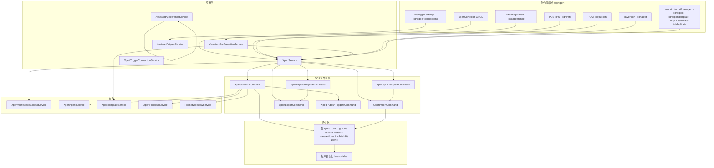

# 助手定义与发布子专家 —— 架构

**本文引用的文件**

- [packages/server-ai/src/xpert/xpert.module.ts](file://packages/server-ai/src/xpert/xpert.module.ts)
- [packages/server-ai/src/xpert/xpert.controller.ts](file://packages/server-ai/src/xpert/xpert.controller.ts)
- [packages/server-ai/src/xpert/xpert.service.ts](file://packages/server-ai/src/xpert/xpert.service.ts)
- [packages/server-ai/src/xpert/xpert.entity.ts](file://packages/server-ai/src/xpert/xpert.entity.ts)
- [packages/server-ai/src/xpert/commands/handlers/index.ts](file://packages/server-ai/src/xpert/commands/handlers/index.ts)
- [packages/server-ai/src/xpert/commands/publish.command.ts](file://packages/server-ai/src/xpert/commands/publish.command.ts)
- [packages/server-ai/src/xpert/commands/import.command.ts](file://packages/server-ai/src/xpert/commands/import.command.ts)
- [packages/server-ai/src/xpert/commands/handlers/publish.handler.ts](file://packages/server-ai/src/xpert/commands/handlers/publish.handler.ts)
- [packages/server-ai/src/xpert/commands/handlers/import.handler.ts](file://packages/server-ai/src/xpert/commands/handlers/import.handler.ts)
- [packages/server-ai/src/xpert/commands/handlers/export.handler.ts](file://packages/server-ai/src/xpert/commands/handlers/export.handler.ts)
- [packages/server-ai/src/xpert/commands/handlers/export-template.handler.ts](file://packages/server-ai/src/xpert/commands/handlers/export-template.handler.ts)
- [packages/server-ai/src/xpert/commands/handlers/sync-template.handler.ts](file://packages/server-ai/src/xpert/commands/handlers/sync-template.handler.ts)
- [packages/server-ai/src/xpert/commands/handlers/publish-triggers.handler.ts](file://packages/server-ai/src/xpert/commands/handlers/publish-triggers.handler.ts)
- [packages/server-ai/src/xpert/configuration/assistant-configuration.controller.ts](file://packages/server-ai/src/xpert/configuration/assistant-configuration.controller.ts)
- [packages/server-ai/src/xpert/configuration/assistant-configuration.service.ts](file://packages/server-ai/src/xpert/configuration/assistant-configuration.service.ts)
- [packages/server-ai/src/xpert/configuration/assistant-trigger.controller.ts](file://packages/server-ai/src/xpert/configuration/assistant-trigger.controller.ts)
- [packages/server-ai/src/xpert/configuration/assistant-trigger.service.ts](file://packages/server-ai/src/xpert/configuration/assistant-trigger.service.ts)
- [packages/server-ai/src/xpert/assistant-appearance/assistant-appearance.controller.ts](file://packages/server-ai/src/xpert/assistant-appearance/assistant-appearance.controller.ts)
- [packages/server-ai/src/xpert/assistant-appearance/assistant-appearance.service.ts](file://packages/server-ai/src/xpert/assistant-appearance/assistant-appearance.service.ts)
- [packages/server-ai/src/xpert/trigger-connection.controller.ts](file://packages/server-ai/src/xpert/trigger-connection.controller.ts)
- [packages/server-ai/src/xpert/trigger-connection.service.ts](file://packages/server-ai/src/xpert/trigger-connection.service.ts)
- [packages/server-ai/src/xpert/jobs/trigger-bootstrap-recovery.service.ts](file://packages/server-ai/src/xpert/jobs/trigger-bootstrap-recovery.service.ts)
- [packages/server-ai/src/xpert/xpert-principal.service.ts](file://packages/server-ai/src/xpert/xpert-principal.service.ts)
- [packages/server-ai/src/xpert/guards/xpert.guard.ts](file://packages/server-ai/src/xpert/guards/xpert.guard.ts)
- [packages/server-ai/src/xpert/dto/xpert-dsl.dto.ts](file://packages/server-ai/src/xpert/dto/xpert-dsl.dto.ts)
- [packages/server-ai/src/xpert-workspace/workspace-access.service.ts](file://packages/server-ai/src/xpert-workspace/workspace-access.service.ts)
- [packages/server-ai/src/xpert-workspace/workspace-base.service.ts](file://packages/server-ai/src/xpert-workspace/workspace-base.service.ts)
- [AGENTS.md](file://AGENTS.md)

## 目录

- [1 子域职责边界](#1-子域职责边界)
- [2 内部分层](#2-内部分层)
- [3 依赖关系](#3-依赖关系)
- [4 关键不变量](#4-关键不变量)
- [5 架构总览](#5-架构总览)
- [6 结论](#6-结论)

## 1 子域职责边界

本子域负责 **Assistant 的创作侧**：把一个 `xpert` 行从「空壳」推到「可运行版本」，并在推出后仍能改草稿、换版本、导入导出。它不执行对话、不判定运行时准入、不管理文件卷、不装配模板市场。

| 归属 | 内容 | 主要落点 |
|---|---|---|
| 做 | 定义 CRUD（`create` / `update` / `updateXpert` / 软删）、`validateName`、`validateTagAssociations` | `XpertService` |
| 做 | 草稿保存 `POST/PUT :id/draft`（**仅草稿**写入 `draft` 列） | `XpertController.saveDraft` / `XpertService.saveDraft` |
| 做 | 发布 `POST :id/publish`：写 `version` / `latest` / `releaseNotes` / `publishAt` / `active` / `graph`，并 `draft = null` | `XpertPublishHandler` |
| 做 | 版本历史与回滚 `:id/version`、`:id/latest`、`createVersionBackup` | `XpertService.allVersions` / `setAsLatest` |
| 做 | 导入导出与复制：`:id/export`、`import`、`import/managed`、`:id/export/template`、`:id/sync-template`、`:id/duplicate` | `XpertExportHandler` / `XpertImportHandler` / `XpertSyncTemplateHandler` |
| 做 | 配置与外观：`:id/configuration`（含 `capabilities` / `previewCapabilities` 的 64 位 revision 校验）、`:id/appearance` | `AssistantConfigurationService` / `AssistantAppearanceService` |
| 做 | 触发设置编辑期声明：`:id/trigger-settings` 的 `list` / `validate` / `save` | `AssistantTriggerService` |
| 做（邻接） | 触发运行期连接的写路径 `:id/trigger-connections`（扫码 QR 的落库与回滚） | `XpertTriggerConnectionService.change` |
| 不做 | 运行时准入与对外 `/api/ai` 面 | → 子专家②（`PublishedXpertAccessService`） |
| 不做 | 工作区实体与文件卷授权 | → 子专家③（`xpert-workspace/`、`assistant-files/`） |
| 不做 | 模板目录装配、市场审批、系统槽位绑定 | → 子专家④（`xpert-template/`、`xpert-marketplace/`、`assistant-binding/`） |
| 不做 | Agent 编译与执行、会话本体、项目与任务调度 | → 批次 4 / 专家 F |

边界要点：`AssistantAppearanceService` 虽读 `PublishedXpertAccessService`，但**写路径只走 `assertCanAuthor` + 行锁**，因此归属创作侧；`XpertTriggerConnectionService` 属运行期绑定，但因其在同一事务内改写 `graph` 与 `draft`（正是本子域的核心数据），故作为邻接一并说明。

章节来源：[xpert/xpert.service.ts](file://packages/server-ai/src/xpert/xpert.service.ts)（关键符号：XpertService.updateXpert、XpertService.saveDraft、XpertService.setAsLatest / 表 xpert）、[xpert/xpert.controller.ts](file://packages/server-ai/src/xpert/xpert.controller.ts)（关键符号：XpertController.importManagedDSL、XpertController.duplicate）

## 2 内部分层

- **Controller 层（8 个）**：`XpertController`（`@Controller()` + `RouterModule.register([{ path: '/xpert', module: XpertModule }])`）、`AssistantConfigurationController`、`AssistantTriggerController`（`@Controller(':id/trigger-settings')`）、`AssistantAppearanceController`、`XpertTriggerConnectionController`（`@Controller(':id/trigger-connections')`）、`XpertProfileController`、`XpertTagUsageController`、`XpertAccessController`。创作侧控制器只做参数解析（`ParseJsonPipe`、`UUIDValidationPipe`、`ZodValidationPipe`、`parse*` 校验函数）与委派。
- **Service / 应用层**：`XpertService extends XpertWorkspaceBaseService<Xpert>` 是定义与版本的唯一服务入口；`AssistantConfigurationService`、`AssistantAppearanceService`、`AssistantTriggerService`、`XpertTriggerConnectionService`、`XpertPrincipalService` 各自持有独立写路径。
- **CQRS 命令层**：`commands/*.command.ts` + `commands/handlers/index.ts` 导出的 `CommandHandlers` 19 个处理器；创作链相关为 `XpertPublishHandler`、`XpertImportHandler`、`XpertExportHandler`、`XpertExportTemplateHandler`、`XpertDeleteExportedTemplateHandler`、`XpertSyncTemplateHandler`、`XpertPublishTriggersHandler`、`XpertCreateHandler`、`XpertDeleteHandler`、`XpertPublishIntegrationHandler`、`XpertDelIntegrationHandler`。
- **Job / Bootstrap 层**：`XpertTriggerBootstrapRecoveryService implements OnApplicationBootstrap` 在启动期分页扫描 `latest = true` 且 `publishAt` 非空的行并重放触发器；它是发布链的**补偿面**而非发起面。
- **Guard 层**：创作侧端点大量复用 `XpertGuard`（按 `createdById` 或 `workspace.canAccess` 判定，结果缓存 5 分钟），`WorkspaceAuthoringGuard` / `WorkspaceOwnerGuard` 用于工作区维度端点。
- **Entity 层**：`Xpert`（表 `xpert`）单行承载 `draft` / `graph` / `version` / `latest` / `releaseNotes` / `publishAt` / `exportedTemplate` / `marketplace` / `api` / `app` / `userId`。
- **DTO / 序列化层**：`XpertDraftDslDTO` 家族（`XpertDslDTO`、`XpertAgentDslDTO`、`CopilotModelDslDTO`、`XpertToolsetDslDTO`、`KnowledgebaseDslDTO`、`MemoryDslDTO`）用 `@Exclude()` + `@Expose()` 白名单定义 DSL 边界。

章节来源：[xpert/xpert.module.ts](file://packages/server-ai/src/xpert/xpert.module.ts)（关键符号：XpertModule.controllers、XpertModule.providers、RouterModule.register）、[xpert/commands/handlers/index.ts](file://packages/server-ai/src/xpert/commands/handlers/index.ts)（关键符号：CommandHandlers）、[xpert/guards/xpert.guard.ts](file://packages/server-ai/src/xpert/guards/xpert.guard.ts)（关键符号：XpertGuard.canActivate）

## 3 依赖关系

**出向（创作链实际调用到的外部能力）**：

- `XpertWorkspaceAccessService.assertCanAuthor/assertCanRead/assertCanWrite` —— 所有创作写路径的准入闸门（`XpertService.assertCanAuthorById`、`AssistantConfigurationService.load`、`AssistantAppearanceService.save`、`AssistantTriggerService.read`、`XpertTriggerConnectionService.read`）。
- `XpertAgentService`（`create`/`update`/`delete`）—— 发布时按 `draft.nodes` 增删改 agent，由 `forwardRef` 注入以打断循环。
- `XpertWorkspaceBaseService` —— 提供 `findOne` / `save` / `softDelete` 与工作区作用域写入。
- `XpertTemplateService` —— `getTemplateDetail`（同步模板、能力合成）、导出模板的落盘与目录登记。
- `XpertPrincipalService.ensurePrincipalUser` —— 发布期与 `:id/api`、`:id/app` 开关期的隐式账号创建。
- `PromptWorkflowService.snapshotCommandProfile` —— 发布前的命令档案快照。
- `WorkflowTriggerRegistry` —— `getTriggerProviders` 与触发设置/连接策略解析。
- `EventEmitter2` —— `EventNameXpertValidate`（草稿校验插件化）与 `EventName_XpertPublished`（发布异步事件）。

**入向（谁依赖本子域）**：`XpertModule` 导出 `XpertService`、`XpertPrincipalService`、`PublishedXpertAccessService`、`AssistantUserPreferenceService`、`AssistantModelSelectionService` 等；`AssistantConfigurationService` 反向依赖 `XpertTemplateService` 与 `AssistantCapabilityService`（同模块 `XpertTemplateModule` 导入，非 `forwardRef`），形成 `xpert → xpert-template → capabilities` 的装配链。

**循环依赖**：`XpertModule` 对 `KnowledgebaseModule`、`XpertAgentModule`、`XpertToolsetModule`、`UserGroupModule`、`UserModule`、`XpertWorkspaceModule`、`EnvironmentModule`、`AssistantBindingModule`、`ChatConversationModule`、`XpertProjectModule` 使用 `forwardRef`；`AssistantConfigurationService` 亦以 `forwardRef` 注入 `XpertService`。`XpertPublishHandler` 注释明写 `forwardRef` 会拷到原型占位符上、JS 私有字段无法跟随该拷贝，因此其 logger 用 `private readonly` 而非 `#logger`。

章节来源：[xpert/xpert.module.ts](file://packages/server-ai/src/xpert/xpert.module.ts)（关键符号：XpertModule.imports、XpertModule.exports）、[xpert/commands/handlers/publish.handler.ts](file://packages/server-ai/src/xpert/commands/handlers/publish.handler.ts)（关键符号：XpertPublishHandler 构造函数、forwardRef）

## 4 关键不变量

1. **草稿与发布态隔离**：`draft` 列是编辑器唯一写入目标，`graph` 列是运行时唯一读取目标；发布是「`draft` → `graph` → `draft = null`」的单向提升，发布后 `draft` 为空即代表「已发布且无未保存修改」。`AssistantConfigurationService.load` 的注释即为此：`Publishing clears the draft; the persisted graph is the editable baseline in that case.`
2. **版本行语义**：同族由 `(tenantId, organizationId, type, slug, version, latest)` 唯一索引约束；`allVersions` 以 `workspaceId + type + slug` 取同族，`setAsLatest` 先把族内 `latest = true` 全部置 false 再置当前行，`latest` 在族内唯一为真。
3. **`validateName` 与 slug 唯一性**：`validateName` 用 `convertToUrlPath(name)` 生成 slug，长度 < 5 直接返回 false，再以 `slug + latest: true` 计数判重；导入侧 `validateImportedName` 在 `nextSlug === currentXpert.slug` 时短路放行（覆盖写自身不报重名）。
4. **浅层 `update` 的限制**：`XpertService.update` 只把参数转交 `updateXpert`，后者 `findOne` → 剔除/校验 `workspaceDataScope`（不可变）→ `assign` → `validateTagAssociations` → `super.save`。源码注释明写「Isolate TypeORM's recursive update type; business callers use the shallow method to keep ts-node inference bounded」，即不为递归关系更新负责。
5. **`ensurePrincipalUser` 幂等**：先 `resolveExistingPrincipalUser`（`xpert.user.id` → `xpert.userId` 查租户内用户），命中即返回；未命中才 `userService.ensureCommunicationUser({ thirdPartyId: 'xpert:<id>' })` 并回写 `user` + `userId`。
6. **revision 乐观锁**：`configuration` 用 `sha256(JSON.stringify([xpert.updatedAt, draft, graph]))`，`appearance` 用 `sha256(JSON.stringify([title, titleCN, avatar]))`，`trigger-settings` 用 `sha256(JSON.stringify([graph, draft]))`；三者都要求 `^[a-f0-9]{64}$` 才进入业务层，不匹配即 409 `*Stale`。
7. **`workspaceDataScope` 不可变**：`@Column({ update: false })` + `updateXpert` 内显式抛 `XpertWorkspaceDataScopeImmutable`，导入/复制的 scope 只由入口参数（HTTP 查询串或 body）决定，**不从 DSL 读**（DSL DTO 也不导出该字段）。
8. **发布前置**：`draft` 必须存在（否则 404），非创建者发布时 `xpert.userGroups` 必须非空（否则 400），`draft.team.tags` 先过 `validateTagAssociations` 再备份版本。

章节来源：[xpert/xpert.entity.ts](file://packages/server-ai/src/xpert/xpert.entity.ts)（关键符号：Xpert.draft、Xpert.graph、Xpert.latest、@Index / 表 xpert）、[xpert/xpert.service.ts](file://packages/server-ai/src/xpert/xpert.service.ts)（关键符号：XpertService.update、XpertService.validateName、XpertService.assertCanAuthorById）、[xpert/xpert-principal.service.ts](file://packages/server-ai/src/xpert/xpert-principal.service.ts)（关键符号：XpertPrincipalService.ensurePrincipalUser）

## 5 架构总览

图表来源：[xpert/xpert.controller.ts](file://packages/server-ai/src/xpert/xpert.controller.ts)（关键符号：XpertController.publish、XpertController.duplicate、XpertController.syncFromTemplate）、[xpert/commands/handlers/publish.handler.ts](file://packages/server-ai/src/xpert/commands/handlers/publish.handler.ts)（关键符号：XpertPublishHandler.publish）

## 6 结论

本子域不是「一套 CRUD」，而是**一条单行状态机**：`xpert` 行同时是草稿容器、发布产物、版本索引与外部服务账号宿主。因此它有四个结构性特征值得记住：其一，写路径被刻意切成「草稿」与「发布」两段，前端只需 POST 草稿、发布固化为版本，二者绝不互相隐式触发；其二，跨边界副作用（发布、导入、导出、模板同步、触发发布）一律 CQRS 化，唯一例外是 `AssistantConfigurationService.save` 的「先 `saveDraft` 再 `publish`」显式组合；其三，所有并发敏感端点都用 `sha256` revision 或行锁保护，而不是靠字段级 diff；其四，`workspaceDataScope` 与 `userId` 这类「创建后不再变」的字段被写成硬约束（`update: false` + 显式抛错），避免静默改变隔离语义。最脆弱的一点是「`update` 只做浅层赋值」——任何期望递归更新关系的调用方都会得到不符预期的结果，这一点没有类型层面的保护。

章节来源：[xpert/xpert.service.ts](file://packages/server-ai/src/xpert/xpert.service.ts)（关键符号：XpertService.updateXpert）、[xpert/configuration/assistant-configuration.service.ts](file://packages/server-ai/src/xpert/configuration/assistant-configuration.service.ts)（关键符号：AssistantConfigurationService.save）、[AGENTS.md](file://AGENTS.md)（关键符号：Xpert 创作侧边界说明）
