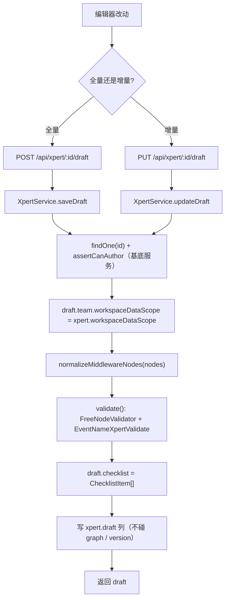
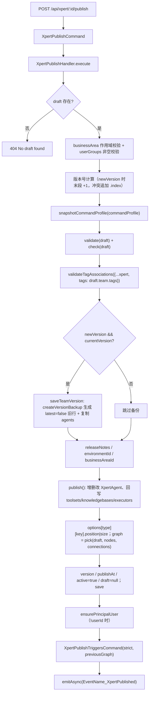
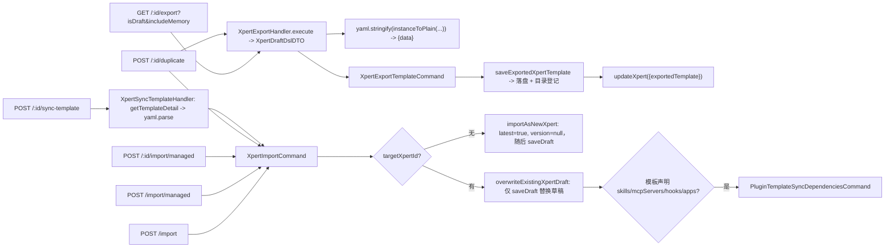

# 助手定义与发布子专家 —— 数据流转

**本文引用的文件**

- [packages/server-ai/src/xpert/xpert.entity.ts](file://packages/server-ai/src/xpert/xpert.entity.ts)
- [packages/server-ai/src/xpert/xpert.service.ts](file://packages/server-ai/src/xpert/xpert.service.ts)
- [packages/server-ai/src/xpert/xpert.controller.ts](file://packages/server-ai/src/xpert/xpert.controller.ts)
- [packages/server-ai/src/xpert/commands/handlers/publish.handler.ts](file://packages/server-ai/src/xpert/commands/handlers/publish.handler.ts)
- [packages/server-ai/src/xpert/commands/handlers/import.handler.ts](file://packages/server-ai/src/xpert/commands/handlers/import.handler.ts)
- [packages/server-ai/src/xpert/commands/handlers/export.handler.ts](file://packages/server-ai/src/xpert/commands/handlers/export.handler.ts)
- [packages/server-ai/src/xpert/commands/handlers/export-template.handler.ts](file://packages/server-ai/src/xpert/commands/handlers/export-template.handler.ts)
- [packages/server-ai/src/xpert/commands/handlers/sync-template.handler.ts](file://packages/server-ai/src/xpert/commands/handlers/sync-template.handler.ts)
- [packages/server-ai/src/xpert/commands/handlers/publish-triggers.handler.ts](file://packages/server-ai/src/xpert/commands/handlers/publish-triggers.handler.ts)
- [packages/server-ai/src/xpert/configuration/assistant-configuration.service.ts](file://packages/server-ai/src/xpert/configuration/assistant-configuration.service.ts)
- [packages/server-ai/src/xpert/configuration/assistant-trigger.service.ts](file://packages/server-ai/src/xpert/configuration/assistant-trigger.service.ts)
- [packages/server-ai/src/xpert/assistant-appearance/assistant-appearance.service.ts](file://packages/server-ai/src/xpert/assistant-appearance/assistant-appearance.service.ts)
- [packages/server-ai/src/xpert/trigger-connection.service.ts](file://packages/server-ai/src/xpert/trigger-connection.service.ts)
- [packages/server-ai/src/xpert/trigger-connection.graph.ts](file://packages/server-ai/src/xpert/trigger-connection.graph.ts)
- [packages/server-ai/src/xpert/jobs/trigger-bootstrap-recovery.service.ts](file://packages/server-ai/src/xpert/jobs/trigger-bootstrap-recovery.service.ts)
- [packages/server-ai/src/xpert/xpert-principal.service.ts](file://packages/server-ai/src/xpert/xpert-principal.service.ts)
- [packages/server-ai/src/xpert/dto/xpert-dsl.dto.ts](file://packages/server-ai/src/xpert/dto/xpert-dsl.dto.ts)
- [packages/server-ai/src/xpert-workspace/workspace-base.service.ts](file://packages/server-ai/src/xpert-workspace/workspace-base.service.ts)
- [packages/server-ai/src/xpert-template/xpert-template.service.ts](file://packages/server-ai/src/xpert-template/xpert-template.service.ts)

## 目录

- [1 草稿保存链](#1-草稿保存链)
- [2 发布与版本链](#2-发布与版本链)
- [3 导入导出与复制链](#3-导入导出与复制链)
- [4 触发设置的声明与发布链](#4-触发设置的声明与发布链)
- [5 状态流转](#5-状态流转)
- [6 数据变换关键节点](#6-数据变换关键节点)
- [7 已知风险](#7-已知风险)

## 1 草稿保存链

图表来源：本文件各节 `章节来源`

文字说明：

1. 两条入口都只写 `draft` 列，`graph`、`version`、`latest`、`publishAt` 在这一步完全不变——这是「仅草稿保存」的数据学表达。
2. `saveDraft` 会额外处理模板血缘：`draft.team.options.templateSource` 存在时并进 `xpert.options.templateSource`，保证「草稿里声明的模板来源」与实例选项同步。
3. `updateDraft` 只做 `team` 浅合并；`nodes`/`connections` 仅在 body 显式携带对应键时才被替换，且校验用 `nextDraft.nodes ?? xpert.graph.nodes` 兜底。
4. 两条路径都把 `workspaceDataScope` 从**实例字段**回填进草稿 team，因此客户端伪造的草稿级 scope 会被覆盖（有专门 spec 覆盖）。
5. 校验是建议式的：`validate()` 的结果挂到 `draft.checklist` 而不阻断保存。

章节来源：[xpert/xpert.service.ts](file://packages/server-ai/src/xpert/xpert.service.ts)（关键符号：XpertService.saveDraft、XpertService.updateDraft、XpertService.validate / 表 xpert）、[xpert/xpert.controller.ts](file://packages/server-ai/src/xpert/xpert.controller.ts)（关键符号：XpertController.saveDraft、XpertController.updateDraft）

## 2 发布与版本链

图表来源：[xpert.service.ts](file://packages/server-ai/src/xpert/xpert.service.ts)

文字说明：

1. **备份先于覆盖**：`saveTeamVersion` 先 `omit(team, 'id','copilotModelId')` 造出旧壳（`latest=false`、`draft=null`、`agent/agents=null`），`createVersionBackup` 落新行，再逐个 `xpertAgentService.create` 复制 agent；`workspaceDataScope` 在备份中被保留（有 spec 断言）。
2. **图落库是增量对账而非整体替换**：agent 节点按 `draft.connections` 计算 `toolsetIds`/`knowledgebaseIds`/`collaboratorNames`，旧 agent `update`、新节点 `create`、未出现的旧 agent `delete`，最后才 `xpert.graph = pick(draft, 'nodes', 'connections')`。
3. **发布即清空草稿**：`draft = null` 是「已发布且无未保存修改」的唯一标记；`AssistantConfigurationService` 因此在无草稿时用 `graph` 当可编辑基线。
4. **触发器发布是同步尾步骤**：`previousGraph` 用于计算需要下线的旧触发器；`strict: true` 让运行时失败上抛。
5. **事件是同步等待**：`emitAsync` 会等所有监听者完成，所以「发布完成」的语义包含事件处理器耗时。

章节来源：[xpert/commands/handlers/publish.handler.ts](file://packages/server-ai/src/xpert/commands/handlers/publish.handler.ts)（关键符号：XpertPublishHandler.execute、XpertPublishHandler.saveTeamVersion、XpertPublishHandler.publish、XpertPublishHandler.ensurePrincipalUser）

## 3 导入导出与复制链

图表来源：[publish.handler.ts](file://packages/server-ai/src/xpert/commands/handlers/publish.handler.ts)

文字说明：

1. **导出是投影**：`XpertDraftDslDTO` 用 `@Exclude()/@Expose()` 白名单控制出口，`XpertDslDTO.copilotModel` 经 `CopilotModelDslDTO` 只保留模型标识；`workspaceDataScope` **不在** DSL 内（有 spec 断言）。
2. **无图时的合成**：`getInitialDraft` 用 `createXpertNodes(xpert, {x:0,y:0})` 与 `makeConnections` 从关系反推节点与边，因此老助手也能导出结构完整的 DSL。
3. **模板导出是「导出 + 落盘 + 回写」**：`saveExportedXpertTemplate` 之后把描述符写回 `xpert.exportedTemplate` json 列，形成「实例 ↔ 磁盘模板」的双向可追溯。
4. **导入的两条落地路径**：`importAsNewXpert` 创建新行（`latest: true`、`version: null`）后立刻 `saveDraft`；`overwriteExistingXpertDraft` 只 `saveDraft`，`type` 必须一致，`OVERWRITE_PROTECTED_TEAM_FIELDS` 保证 `slug/version/latest/publishAt/workspaceDataScope/workspaceId` 不被 DSL 覆盖。
5. **模板同步复用导入**：`preserveInstalledExternalXpertBindings` 先把本实例的 `xpert` 类型节点与边补回解析结果（`xpert.draft ?? xpert.graph` 为权威），再走 `overwriteExistingXpertDraft`，所以「模板换版」不会丢组织级外部助手绑定。
6. **复制 = 导出 + 导入**：`duplicate` 用 `body.basic` 覆盖 `team`，`workspaceDataScope` 缺省继承源助手；因为是「导出当前态（可含草稿）再导入为新实例」，源助手的 `version` 不会被复制成新版本号。

章节来源：[xpert/commands/handlers/export.handler.ts](file://packages/server-ai/src/xpert/commands/handlers/export.handler.ts)（关键符号：XpertExportHandler.getInitialDraft、XpertExportHandler.makeConnections）、[xpert/commands/handlers/import.handler.ts](file://packages/server-ai/src/xpert/commands/handlers/import.handler.ts)（关键符号：XpertImportHandler.importAsNewXpert、XpertImportHandler.overwriteExistingXpertDraft、OVERWRITE_PROTECTED_TEAM_FIELDS）、[xpert/commands/handlers/sync-template.handler.ts](file://packages/server-ai/src/xpert/commands/handlers/sync-template.handler.ts)（关键符号：XpertSyncTemplateHandler.execute、preserveInstalledExternalXpertBindings）

## 4 触发设置的声明与发布链

```mermaid
flowchart TD
    subgraph E1["编辑期 :id/trigger-settings"]
      T1["GET list"] --> T2["read(id) + assertCanRead"]
      T3["POST validate"] --> T4["read(id, true) + check"]
      T5["POST save/toggle/delete"] --> T6["mutate: transaction + pessimistic_write"]
      T6 --> T7["check(): ready + password 拒写 + Ajv + registry.validate"]
      T7 --> T8["patchConnectionGraph 同步 graph 与 draft（savedAt）"]
      T8 --> T9["XpertPublishTriggersCommand(strict, providers=[p])"]
      T9 -.失败.-> T10["以 previous 图反向重放"]
    end
    subgraph E2["运行期 :id/trigger-connections"]
      C1["begin/poll/cancel/complete/disconnect"] --> C2["change(id, provider, integrationId)"]
      C2 --> C3["transaction + pessimistic_write + assertCanAuthor + ready"]
      C3 --> C4["patchConnectionGraph -> graph + draft"]
      C4 --> C5["XpertPublishTriggersCommand -> status() 复核"]
      C5 -.失败.-> C6["反向重放 + 记录恢复失败日志"]
    end
    subgraph E3["启动补偿"]
      S1["XpertTriggerBootstrapRecoveryService.onApplicationBootstrap"] --> S2["分页扫 latest=true & publishAt 非空"]
      S2 --> S3["replay publish-triggers"]
    end
```

图表来源：[export.handler.ts](file://packages/server-ai/src/xpert/commands/handlers/export.handler.ts)

文字说明：

1. 编辑期与运行期是**同一数据模式的两次实现**：都在一个事务里 `pessimistic_write` 锁行、都调 `patchConnectionGraph` 同时改 `graph` 与 `draft`、都在提交后调 `XpertPublishTriggersCommand`，失败都反向重放。
2. 两者的差异在鉴权与前置条件：编辑期写路径要求 `graph && draft` 语义下的 revision 匹配 + `hasConnectionDraftConflict` 为假；运行期要求「已发布（`publishAt` 非空 + `agent.key` 存在）」且同样不能有草稿冲突。
3. 编辑期 `list` 的读投影是**字段级白名单**：只回 provider schema 中 `string/number/integer/boolean` 的标量字段，password 字段与嵌套配置永远留在服务端 `graph`。
4. 运行期 `change()` 有一处刻意重复的动作：`integrationId && !(await this.status(...)).connected` 时把原节点从 `previousGraph` 里剔除，从而让重试也能重新注册运行时绑定（注释：Replay this provider on retries too）。
5. 启动补偿只扫已发布行并按 provider 的 `TWorkflowTriggerBootstrapConfig` 重放，属「发布已落库、运行时可能未起」的兜底面。

章节来源：[xpert/configuration/assistant-trigger.service.ts](file://packages/server-ai/src/xpert/configuration/assistant-trigger.service.ts)（关键符号：AssistantTriggerService.list、AssistantTriggerService.mutate、AssistantTriggerService.check）、[xpert/trigger-connection.service.ts](file://packages/server-ai/src/xpert/trigger-connection.service.ts)（关键符号：XpertTriggerConnectionService.change）、[xpert/commands/handlers/publish-triggers.handler.ts](file://packages/server-ai/src/xpert/commands/handlers/publish-triggers.handler.ts)（关键符号：XpertPublishTriggersHandler.execute）

## 5 状态流转

| 载体 | 字段 / 状态 | 迁移 | 触发点 |
|---|---|---|---|
| `xpert`（草稿态） | `draft` 非空、`graph` 首次发布前可为空、`publishAt` 为 NULL | 创建 → 首次发布 | `XpertService.saveDraft` / `updateDraft` |
| `xpert`（发布态） | `draft = NULL`、`publishAt` 非空、`version`/`latest` 就位、`active = true` | 发布 | `XpertPublishHandler.publish` |
| `xpert`（新版本） | 旧行 `latest = false` + 新行 `latest = true` | `newVersion` 发布 | `XpertPublishHandler.saveTeamVersion` → `XpertService.createVersionBackup` |
| `xpert`（版本指针） | 同族内 `latest` 唯一为真 | 任意版本行 → `latest = true` | `XpertService.setAsLatest` |
| `xpert`（删除） | `deletedAt` 置位 | `latest = true` 行按 `name` 族删；否则单行删 | `XpertService.deleteXpert` |
| `xpert.exportedTemplate` | `null` ↔ 描述符 | 导出为模板 / 删除导出模板 | `XpertExportTemplateHandler` / `XpertDeleteExportedTemplateHandler` |
| `xpert.workspaceDataScope` | `shared` \| `user` | **不可迁移**（`update: false` + 显式抛错） | `XpertService.updateXpert` |
| `xpert.userId` | NULL → 服务账号 id | 幂等创建，无反向清理 | `XpertPrincipalService.ensurePrincipalUser` |

章节来源：[xpert/xpert.entity.ts](file://packages/server-ai/src/xpert/xpert.entity.ts)（关键符号：Xpert.draft、Xpert.graph、Xpert.publishAt、Xpert.latest、Xpert.workspaceDataScope / 表 xpert）、[xpert/xpert.service.ts](file://packages/server-ai/src/xpert/xpert.service.ts)（关键符号：XpertService.setAsLatest、XpertService.deleteXpert）

## 6 数据变换关键节点

1. **DSL 出口边界**：`XpertDraftDslDTO` 的 `nodes[].entity` 按 `agent|toolset|knowledge|xpert` 四种类型分别套 `XpertAgentDslDTO` / `XpertToolsetDslDTO` / `KnowledgebaseDslDTO` / `XpertDslDTO`，未知类型原样透传；`XpertDslDTO.agent` 只导出 `{ key }`，实体在节点里。
2. **草稿规范化**：`normalizeMiddlewareNodes`（节点数组）、`normalizeXpertAgentConfig`（`create`/`save`/`createVersionBackup` 三处统一调用）、发布侧 `pickXpertAgent`（白名单挑 agent 字段）、`normalizeAssistantAllowedModels`（把主模型并入 `options.modelSelection.allowedModels`）。
3. **托管导入的模型替换**：`prepareManagedLlmModelSyncContext` 解析「当前可用 LLM + 组织主模型」，`syncImportDraftLlmModels` 用它改写草稿里的模型引用，并返回主 agent。
4. **受保护字段剥离**：`SYSTEM_FIELDS`（`tenantId/organizationId/id/createdById/updatedById`）、`OVERWRITE_PROTECTED_TEAM_FIELDS`（再含 `createdAt/updatedAt/workspaceId/type/agent/slug/latest/version/publishAt/workspaceDataScope`）、`OVERWRITE_PROTECTED_AGENT_FIELDS`（再含 `xpertId/key`）是「跨实例数据不得覆盖本地身份」的三道过滤。
5. **模板血缘装配**：`resolveImportTemplateSource` 决定 `templateSource`（显式 `templateId` 优先，仅当嵌入 DSL 的 `templateId` 与之一致时才补 locale/revision 元数据），`withTemplateSource` 把它写进 `team.options`；`installedAt`/`lastSyncedAt` 缺失时补当前时间。
6. **revision 的三种哈希口径**：`configuration` = `[updatedAt, saved draft, graph]`；`appearance` = `[title, titleCN, avatar]`；`trigger-settings` = `[graph, draft]`。它们都是「读时算、写时比」，不落库。
7. **外观字段白名单写入**：`appearance.save` 只 `update({ title, titleCN, avatar })`（`titleCN` 与 `title` 同值），注释明写 publishing and Studio drafts are intentionally independent。
8. **触发节点 key 生成**：无既有节点时用 `Trigger_${randomUUID().replace(/-/g, '')}`，并在 `patchConnectionGraph` 内与主 agent key 连边。
9. **`workspaceDataScope` 的传递路径**：`create`/`createVersionBackup` 缺省 `DEFAULT_XPERT_WORKSPACE_DATA_SCOPE` → 草稿 team 回填 → 发布时 `xpert.workspaceDataScope` 不变；导入时只由入口参数决定，绝不来自 DSL。

章节来源：[xpert/dto/xpert-dsl.dto.ts](file://packages/server-ai/src/xpert/dto/xpert-dsl.dto.ts)（关键符号：XpertDraftDslDTO、XpertDslDTO、CopilotModelDslDTO）、[xpert/commands/handlers/import.handler.ts](file://packages/server-ai/src/xpert/commands/handlers/import.handler.ts)（关键符号：SYSTEM_FIELDS、XpertImportHandler.resolveImportTemplateSource、XpertImportHandler.withTemplateSource）

## 7 已知风险

1. **草稿与 `graph` 双列一致性靠约定**：只有 `assistant-trigger.mutate` 与 `trigger-connection.change` 在同事务内写两列；`hasConnectionDraftConflict` 只覆盖触发节点，**非触发节点**的草稿/已发布差异不会被任何校验发现。
2. **发布无回滚**：`saveTeamVersion`（备份行 + 复制 agent）与 `publish()` 内的 agent 增删改都发生在最终 `save` 之前，校验或写库中途失败会留下半成品版本行/agent，而「非创建者必须挂用户组」这类前置校验在备份之后才生效的历史位置也放大了该风险。
3. **发布/权限检查分散**：`validateName` 只看 `slug + latest`，不同租户同 slug 可并存；`getAllByWorkspace(published=true)` 用 `version` 非空判已发布，而 `countMy`/`getMyAll` 用 `publishAt` 非空，两套语义并存。
4. **`ensurePrincipalUser` 不可逆**：`xpert.userId` 一旦写入不会被回收；`PUT :id/api` 与 `PUT :id/app` 的「先落库、后建账号」顺序会让失败时留下「已启用但没有服务账号」的状态。
5. **配置页会隐式发布**：`POST :id/configuration` 的 `saveDraft` + `publish(newVersion=true)` 组合与「仅草稿保存」的总体取向相反，失败时（422）草稿已落库但版本未出，界面必须能分辨这两种状态。
6. **revision 覆盖不完整**：三处哈希各自只看少数字段，新增可编辑字段若未并入哈希，并发编辑会静默覆盖。
7. **启动补偿依赖 Redis 锁**：`XpertTriggerBootstrapRecoveryService` 的多实例安全依赖 `RedisLockService`，无 Redis 时补偿面不可用。
8. **模板同步的草稿权威性**：`preserveInstalledExternalXpertBindings` 以 `xpert.draft ?? xpert.graph` 为权威，因此「未发布的删除意图」会被保留（注释明确这是有意为之），但也意味着模板作者无法通过模板删除实例上的外部绑定。

章节来源：[xpert/trigger-connection.graph.ts](file://packages/server-ai/src/xpert/trigger-connection.graph.ts)（关键符号：hasConnectionDraftConflict、patchConnectionGraph）、[xpert/commands/handlers/sync-template.handler.ts](file://packages/server-ai/src/xpert/commands/handlers/sync-template.handler.ts)（关键符号：preserveInstalledExternalXpertBindings）、[xpert/configuration/assistant-configuration.service.ts](file://packages/server-ai/src/xpert/configuration/assistant-configuration.service.ts)（关键符号：AssistantConfigurationService.save）
