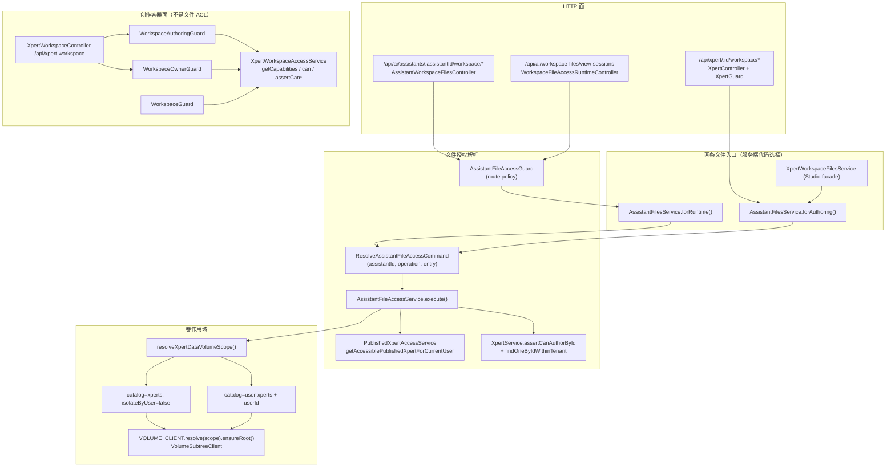

# 工作区与文件授权 —— 架构

**本文引用的文件**

- [AGENTS.md](file://AGENTS.md)
- [packages/server-ai/src/xpert-workspace/workspace.module.ts](file://packages/server-ai/src/xpert-workspace/workspace.module.ts)
- [packages/server-ai/src/xpert-workspace/workspace.entity.ts](file://packages/server-ai/src/xpert-workspace/workspace.entity.ts)
- [packages/server-ai/src/xpert-workspace/workspace-access.service.ts](file://packages/server-ai/src/xpert-workspace/workspace-access.service.ts)
- [packages/server-ai/src/xpert-workspace/workspace.service.ts](file://packages/server-ai/src/xpert-workspace/workspace.service.ts)
- [packages/server-ai/src/xpert-workspace/workspace.controller.ts](file://packages/server-ai/src/xpert-workspace/workspace.controller.ts)
- [packages/server-ai/src/xpert-workspace/workspace-base.service.ts](file://packages/server-ai/src/xpert-workspace/workspace-base.service.ts)
- [packages/server-ai/src/xpert-workspace/guards/workspace-authoring.guard.ts](file://packages/server-ai/src/xpert-workspace/guards/workspace-authoring.guard.ts)
- [packages/server-ai/src/xpert-workspace/guards/workspace-owner.guard.ts](file://packages/server-ai/src/xpert-workspace/guards/workspace-owner.guard.ts)
- [packages/server-ai/src/xpert-workspace/guards/workspace.guard.ts](file://packages/server-ai/src/xpert-workspace/guards/workspace.guard.ts)
- [packages/server-ai/src/xpert-workspace/types.ts](file://packages/server-ai/src/xpert-workspace/types.ts)
- [packages/server-ai/src/xpert-workspace/commands/ensure-personal-default-workspace.command.ts](file://packages/server-ai/src/xpert-workspace/commands/ensure-personal-default-workspace.command.ts)
- [packages/server-ai/src/xpert-workspace/commands/handlers/ensure-personal-default-workspace.handler.ts](file://packages/server-ai/src/xpert-workspace/commands/handlers/ensure-personal-default-workspace.handler.ts)
- [packages/server-ai/src/xpert/assistant-files/assistant-files.service.ts](file://packages/server-ai/src/xpert/assistant-files/assistant-files.service.ts)
- [packages/server-ai/src/xpert/assistant-files/assistant-file-access.service.ts](file://packages/server-ai/src/xpert/assistant-files/assistant-file-access.service.ts)
- [packages/server-ai/src/xpert/assistant-files/resolve-assistant-file-access.command.ts](file://packages/server-ai/src/xpert/assistant-files/resolve-assistant-file-access.command.ts)
- [packages/server-ai/src/xpert/xpert-workspace-files.service.ts](file://packages/server-ai/src/xpert/xpert-workspace-files.service.ts)
- [packages/server-ai/src/xpert/xpert.controller.ts](file://packages/server-ai/src/xpert/xpert.controller.ts)
- [packages/server-ai/src/ai/assistant-workspace-files.controller.ts](file://packages/server-ai/src/ai/assistant-workspace-files.controller.ts)
- [packages/server-ai/src/ai/assistant-file-access.guard.ts](file://packages/server-ai/src/ai/assistant-file-access.guard.ts)
- [packages/server-ai/src/ai/workspace-file-access-runtime.controller.ts](file://packages/server-ai/src/ai/workspace-file-access-runtime.controller.ts)
- [packages/server-ai/src/shared/volume/volume.ts](file://packages/server-ai/src/shared/volume/volume.ts)
- [packages/contracts/src/ai/xpert-workspace.model.ts](file://packages/contracts/src/ai/xpert-workspace.model.ts)
- [docs/plans/VERIFY_assistant_file_workspace_access_2026-10-09.md](file://docs/plans/VERIFY_assistant_file_workspace_access_2026-10-09.md)

## 目录

- [1 子域职责边界](#1-子域职责边界)
- [2 三元权限面不可互换](#2-三元权限面不可互换)
- [3 内部分层](#3-内部分层)
- [4 依赖关系](#4-依赖关系)
- [5 关键不变量](#5-关键不变量)
- [6 架构总览](#6-架构总览)
- [7 结论](#7-结论)

## 1 子域职责边界

本子域只承担两件事：**创作容器**（`XpertWorkspace` 及其成员/可见性/能力面）与**文件授权**（Assistant 文件卷的 runtime / authoring 双入口解析）。它既不定义 Assistant 本体（属"助手定义与发布"），也不实现对话与消息（属专家 F），更不实现卷的物理读写（属 `shared/volume`）。

| 归属 | 内容 | 证据锚点 |
|---|---|---|
| 做 | `XpertWorkspace` 实体与表、CRUD、归档/软删/恢复 | `workspace.entity.ts`、`XpertWorkspaceService` |
| 做 | 四动作能力面 `canRead/canRun/canWrite/canManage` 与 `assertCan*` | `XpertWorkspaceAccessService.getCapabilities` |
| 做 | 成员与可见性写路径（`updateMembers` / `updateVisibility`） | `XpertWorkspaceService` |
| 做 | 创作/读/管理三档 HTTP 守卫 | `WorkspaceAuthoringGuard`、`WorkspaceOwnerGuard`、`WorkspaceGuard` |
| 做 | 文件授权解析命令与处理器 | `ResolveAssistantFileAccessCommand`、`AssistantFileAccessService` |
| 做 | 文件入口选择器与卷客户端绑定 | `AssistantFilesService.forRuntime/forAuthoring` |
| 做 | 卷作用域映射（`shared` / `user`） | `resolveXpertDataVolumeScope` |
| 做 | Studio 侧创作 façade | `XpertWorkspaceFilesService` |
| 做 | 运行时文件 HTTP 面与委派凭证守卫 | `AssistantWorkspaceFilesController`、`AssistantFileAccessGuard` |
| 不做 | 卷内物理读写、路径包含与符号链接防护 | → `shared/volume`（`VolumeSubtreeClient`） |
| 不做 | Assistant 发布态与多受众准入本体 | → `PublishedXpertAccessService`（仅被调用） |
| 不做 | 对话附件（FileAsset）与 Workbench 会话文件本体 | → `ai/file-understanding`、`ChatConversationService` |

**边界的一个易错点**：`XpertWorkspace` 是 Assistant / skills / connectors 的**创作资源容器**，其 `canRead/canRun/canWrite/canManage` **不是** Assistant 文件权限——两者共享"workspace"这个词，但前者约束创作对象，后者约束数据卷。

章节来源：[AGENTS.md](file://AGENTS.md)（关键符号：Authoring workspace versus Assistant file workspace）、[xpert-workspace/workspace-access.service.ts](file://packages/server-ai/src/xpert-workspace/workspace-access.service.ts)（关键符号：XpertWorkspaceAccessService.getCapabilities）

## 2 三元权限面不可互换

本子域内部同时存在三个**独立**的权限面，任一入口混用即越权：

| 权限面 | 载体 | 判定对象 | 能力位 |
|---|---|---|---|
| 创作面 | `XpertWorkspaceAccessService` + 三个 Workspace 守卫 | 创作容器 `xpert_workspace` | `canRead/canRun/canWrite/canManage` |
| 运行准入面 | `PublishedXpertAccessService` | "确切的已发布 Assistant" | 可访问 / 不可访问 |
| 文件面 | `ResolveAssistantFileAccessCommand` + `AssistantFileAccessService` | Assistant 数据卷 | `canList/canRead/canWrite/canDelete` |

AGENTS.md 对三者关系有逐条明写：运行时文件必须经 `ResolveAssistantFileAccessCommand` / `AssistantFilesService.forRuntime()` 授权"确切的已发布 Assistant"；**禁止**用 `XpertService.findOne()`、`XpertWorkspaceService.canAccess()`、workspace 级 `canRun` 当文件 ACL；UserGroup 授权必须能在**无创作工作区成员资格**时生效。源码也把同一句写进注释：`AssistantFileAccessService` 文件头声明 "Assistant files belong to a data volume, not an XpertWorkspace entity"。2026-10-09 真机验收用一条断言钉住了这个边界：B 通过用户组获得 Assistant 使用权时读取文件能力为全 true，而访问 A 的创作工作区或 Studio 文件入口为 403。

章节来源：[AGENTS.md](file://AGENTS.md)（关键符号：Assistant 文件授权不变量）、[xpert/assistant-files/assistant-file-access.service.ts](file://packages/server-ai/src/xpert/assistant-files/assistant-file-access.service.ts)（关键符号：AssistantFileAccessService.execute）、[docs/plans/VERIFY_assistant_file_workspace_access_2026-10-09.md](file://docs/plans/VERIFY_assistant_file_workspace_access_2026-10-09.md)（关键符号：用户组授权与创作工作区 403 断言）

## 3 内部分层

- **Controller 层**：`XpertWorkspaceController`（`/api/xpert-workspace`）、`AssistantWorkspaceFilesController`（`/api/ai/assistants/:assistantId/workspace/*`）、`WorkspaceFileAccessRuntimeController`（`/api/ai/workspace-files/view-sessions`）、`XpertController` 的 `:id/workspace/*` 段（Studio 文件）。控制器只做参数校验（`UUIDValidationPipe`、Zod schema）与委派。
- **Guard 层**：`WorkspaceAuthoringGuard`（UUID 校验 + `assertCanAuthor`）、`WorkspaceOwnerGuard`（`assertCanManage`）、`WorkspaceGuard`（`assertCanRead`，供其他模块如 connector / mcp-consumer 复用）、`AssistantFileAccessGuard`（委派凭证与 route policy 校验）。
- **Workspace Service 层**：`XpertWorkspaceService`（CRUD、成员、可见性、默认工作区）、`XpertWorkspaceBaseService<T>`（把 read/write/authoring 检查织入 `findOne/create/save/update/delete/softDelete`，并区分 `findOne` 与 `findOneForRuntime`）。
- **Access Service 层**：`XpertWorkspaceAccessService` —— 唯一的能力计算权威（点读 `getCapabilities` + 列表 SQL 镜像 `applyCurrentReadScope`）。
- **文件授权解析层**：`ResolveAssistantFileAccessCommand`（命令载体）→ `AssistantFileAccessService`（handler）。
- **运行时文件服务层**：`AssistantFilesService`（`forRuntime/forAuthoring` 入口选择器 + 卷客户端绑定）、`XpertWorkspaceFilesService`（Studio façade，全部走 `forAuthoring`）。
- **卷映射层（域外共享）**：`resolveXpertDataVolumeScope` + `VOLUME_CLIENT.resolve(scope).ensureRoot()` → `VolumeSubtreeClient`。
- **CQRS 层**：`EnsurePersonalDefaultWorkspaceCommand` → `EnsurePersonalDefaultWorkspaceHandler`（个人默认工作区幂等创建）、`queries/handlers/{get-one,my}.handler.ts`。

章节来源：[xpert-workspace/workspace.module.ts](file://packages/server-ai/src/xpert-workspace/workspace.module.ts)（关键符号：XpertWorkspaceModule.controllers / providers）、[xpert-workspace/workspace-base.service.ts](file://packages/server-ai/src/xpert-workspace/workspace-base.service.ts)（关键符号：XpertWorkspaceBaseService.findOneForRuntime）

## 4 依赖关系

**出向（本子域 import 的其他域）**：
- `xpert/assistant-files/**` 依赖 `PublishedXpertAccessService`（运行时准入）与 `XpertService`（`assertCanAuthorById` / `findOneByIdWithinTenant`），两者以 `Pick<...>` 收窄注入面。
- `AssistantFilesService` 依赖 `CommandBus` 与 `VOLUME_CLIENT`（均为 `Pick<>` 收窄）。
- `XpertWorkspaceModule` 依赖 `TenantModule`、`UserOrganizationModule`、`CqrsModule`，并 `forFeature([XpertWorkspace, User, UserOrganization])`。
- `AssistantFileAccessGuard` 依赖 `WorkspaceFileAccessService`（会话宿主解析，`getAuthenticatedSessionHost`）。
- `types.ts` 的 `getWorkspaceRoot` 走 `resolveRuntimeVolume({catalog:'workspaces'})`——注意它解析的是**创作工作区卷**，与 Assistant 数据卷（`catalogs: xperts / user-xperts`）是两套目录。

**入向（被谁依赖）**：
- `XpertWorkspaceModule` 被 16 个模块依赖（`xpert`、`assistant-binding`、`xpert-marketplace`、`xpert-table`、`xpert-toolset`、`xpert-template`、`environment`、`connector`、`artifacts`、`file-memory`、`plugin-resource`、`prompt-workflow`、`chat-group`、`skill-package`、`knowledgebase`、`initialization`）。
- 三个 Workspace 守卫被跨域复用：`WorkspaceAuthoringGuard` 出现在 `xpert.controller.ts`、`environment.controller.ts`、`prompt-workflow.controller.ts`、`skill-package.controller.ts`；`WorkspaceGuard` / `WorkspaceOwnerGuard` 出现在 `connector.controller.ts`、`mcp-consumer-oauth.controller.ts`、`mcp-consumer-capabilities.controller.ts`。
- `XpertWorkspaceAccessService` 被 `XpertMarketplaceService.canReviewXpert`、`agent-plugin.service.ts`、`plugin-application-toolsets.service.ts` 等复用（后两者用 `{ purpose: 'authoring' }` 过滤可用列表）。

**循环依赖处理**：`types.ts` 头部注释明写，直接 import 拥有模块而非共享 barrel，以避开 `AgentMiddlewareRuntimeModule -> ArtifactsModule -> XpertWorkspaceModule -> shared -> AgentMiddlewareRuntimeModule` 运行时环。

章节来源：[xpert-workspace/workspace.module.ts](file://packages/server-ai/src/xpert-workspace/workspace.module.ts)（关键符号：XpertWorkspaceModule.imports）、[xpert-workspace/types.ts](file://packages/server-ai/src/xpert-workspace/types.ts)（关键符号：getWorkspaceRoot）、[ai/assistant-file-access.guard.ts](file://packages/server-ai/src/ai/assistant-file-access.guard.ts)（关键符号：AssistantFileAccessGuard.canActivate）

## 5 关键不变量

1. **创作容器能力不是文件权限**：`XpertWorkspace` 是 Assistant/skills/connectors 的创作资源容器，其 `canRead/canRun/canWrite/canManage` **不是** Assistant 文件权限。（出处：AGENTS.md "Authoring workspace versus Assistant file workspace"；`workspace-access.service.ts` 中 `getCapabilities` 注释 "A published Xpert grant unlocks execution only; it must not expose workspace authoring resources."）
2. **运行时文件必须授权"确切的已发布 Assistant"**：必须经 `ResolveAssistantFileAccessCommand` / `AssistantFilesService.forRuntime()`；**禁止**用 `XpertService.findOne()`、`XpertWorkspaceService.canAccess()`、workspace `canRun` 当文件 ACL；UserGroup 授权必须能在无创作工作区成员资格时生效。（出处：AGENTS.md；`AssistantFileAccessService.execute` 的 runtime 分支只调 `published.getAccessiblePublishedXpertForCurrentUser`）
3. **共享与用户隔离的语义**：共享 Assistant 文件是显式协作（授权用户可读、上传、修改、删除）；`user` 隔离文件仅限当前用户自己的卷；**文件访问永不授予工作区成员资格或编辑权**。（出处：AGENTS.md；`AssistantFileAccessService.execute` 返回的 `capabilities` 注释）
4. **入口由可信服务端代码选择，且拒绝后不回退**：Studio 用 `forAuthoring()` 且保留显式创作检查（含草稿）；绝不接受来自 HTTP 的 authoring 模式；运行时被拒后不得回退到 authoring。（出处：AGENTS.md；`resolve-assistant-file-access.command.ts` 注释 "entry is chosen by trusted server code, never request data"；`assistant-files.service.ts` 文件头 "authoring access is explicit and never a fallback after runtime denial"）
5. **每次操作重新授权**：`AssistantFilesService.bind()` 注释 "Reauthorize each operation, including after a previously successful list or capability lookup." —— `capabilities/list/read/download/save/saveBinary/uploadToFolder/delete/upload` 每次都重新派发命令。（出处：`assistant-files.service.ts`）

另有一条伴随不变量：卷作用域只能由 `resolveXpertDataVolumeScope` 映射（`shared` = tenant + Assistant 身份；`user` = 再绑认证用户），**不得**用创建者替代用户身份，也**不得**接受客户端传入的 owner / catalog / root 覆盖。2026-10-09 验收中 `..` 越界返回 400、移出用户组后原 JWT 与原 ChatKit 会话立即 403，均是该条与第 2、5 条的机器化验证。

章节来源：[packages/server-ai/src/xpert/assistant-files/assistant-files.service.ts](file://packages/server-ai/src/xpert/assistant-files/assistant-files.service.ts)（关键符号：AssistantFilesService.bind）、[packages/server-ai/src/xpert/assistant-files/resolve-assistant-file-access.command.ts](file://packages/server-ai/src/xpert/assistant-files/resolve-assistant-file-access.command.ts)（关键符号：ResolveAssistantFileAccessCommand.constructor）

## 6 架构总览

图表来源：[xpert/assistant-files/assistant-files.service.ts](file://packages/server-ai/src/xpert/assistant-files/assistant-files.service.ts)（关键符号：AssistantFilesService.forRuntime / forAuthoring / bind）、[xpert/assistant-files/assistant-file-access.service.ts](file://packages/server-ai/src/xpert/assistant-files/assistant-file-access.service.ts)（关键符号：AssistantFileAccessService.execute）

## 7 结论

本子域的架构张力只有一个：**"workspace" 一个词被三处复用**——创作容器（`xpert_workspace`）、Assistant 数据卷（Volume 目录）、运行时会话文件目录（Workbench）。三者的正确性都靠同一条纪律维持：**入口在服务端代码里选定，权限每次操作重算，拒绝不回退**。工作区面用"能力计算 + 三档守卫"实现，文件面用"命令化授权（`ResolveAssistantFileAccessCommand`）+ 卷作用域映射"实现，两者在代码上刻意不共享任何判定函数——这不是重复，而是防止某一面的放宽自动泄漏到另一面。

历史证据支持这一取舍：2026-10-09 的多账号验收专门测了"用户组授权 ≠ 创作工作区成员（403）"、"未发布草稿对运行接口 404"、"移出用户组后原 JWT / ChatKit 会话立即 403"、"`..` 越界 400"，并在同一轮里修掉了 `GET /ai/conversations/:id/files` 的路由双注册冲突（FileAsset 保留原路径，Workbench 改用 `/ai/conversations/:id/workspace/*`）。这四类失败模式都不是"功能缺失"，而是权限面被混用或路由归属被误判——因此本子域的架构结论是：**新增任何文件端点，先回答"入口是谁选的、卷是谁的、路由是否唯一"三个问题，再写业务逻辑**。

章节来源：[docs/plans/VERIFY_assistant_file_workspace_access_2026-10-09.md](file://docs/plans/VERIFY_assistant_file_workspace_access_2026-10-09.md)（关键符号：实测结果与路由冲突修法）、[ai/assistant-workspace-files.controller.ts](file://packages/server-ai/src/ai/assistant-workspace-files.controller.ts)（关键符号：AssistantWorkspaceFilesController）
