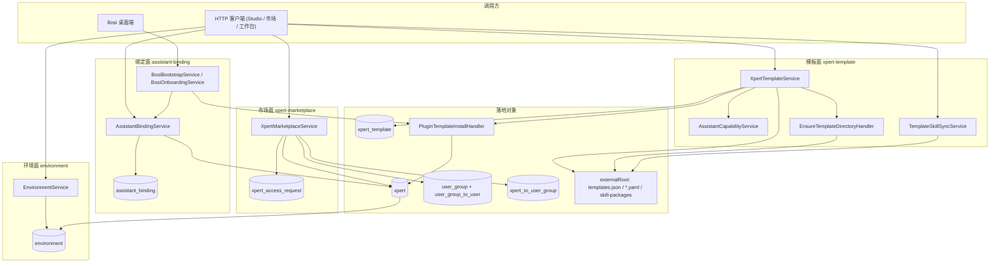

# 模板·市场·绑定·环境子专家 —— 架构

> 覆盖 `packages/server-ai/src/xpert-template`（33 个源文件）、`xpert-marketplace`（5 个）、`assistant-binding`（12 个）、`environment`（12 个），均不含 `*.spec.ts` 与 `*.json`/`*.yaml` 资产。四者合起来构成 **Assistant 的「配套供给面」**：给已定义/已发布的 Assistant 提供可安装内容、可申请授权、可绑定系统槽位与可注入的环境变量。

**本文引用的文件**

- [packages/server-ai/src/xpert-template/xpert-template.service.ts](file://packages/server-ai/src/xpert-template/xpert-template.service.ts)
- [packages/server-ai/src/xpert-template/xpert-template.controller.ts](file://packages/server-ai/src/xpert-template/xpert-template.controller.ts)
- [packages/server-ai/src/xpert-template/xpert-template.module.ts](file://packages/server-ai/src/xpert-template/xpert-template.module.ts)
- [packages/server-ai/src/xpert-template/capabilities/assistant-capability.service.ts](file://packages/server-ai/src/xpert-template/capabilities/assistant-capability.service.ts)
- [packages/server-ai/src/xpert-template/template-skill-sync.service.ts](file://packages/server-ai/src/xpert-template/template-skill-sync.service.ts)
- [packages/server-ai/src/xpert-template/commands/handlers/ensure-template-directory.handler.ts](file://packages/server-ai/src/xpert-template/commands/handlers/ensure-template-directory.handler.ts)
- [packages/server-ai/src/xpert/template-workspace-initializer.service.ts](file://packages/server-ai/src/xpert/template-workspace-initializer.service.ts)
- [packages/server-ai/src/plugin-resource/commands/install-template.handler.ts](file://packages/server-ai/src/plugin-resource/commands/install-template.handler.ts)
- [packages/server-ai/src/xpert-marketplace/xpert-marketplace.service.ts](file://packages/server-ai/src/xpert-marketplace/xpert-marketplace.service.ts)
- [packages/server-ai/src/xpert-marketplace/xpert-marketplace.controller.ts](file://packages/server-ai/src/xpert-marketplace/xpert-marketplace.controller.ts)
- [packages/server-ai/src/xpert-marketplace/xpert-access-request.entity.ts](file://packages/server-ai/src/xpert-marketplace/xpert-access-request.entity.ts)
- [packages/server-ai/src/assistant-binding/assistant-binding.service.ts](file://packages/server-ai/src/assistant-binding/assistant-binding.service.ts)
- [packages/server-ai/src/assistant-binding/assistant-binding.entity.ts](file://packages/server-ai/src/assistant-binding/assistant-binding.entity.ts)
- [packages/server-ai/src/assistant-binding/bosi/bosi-bootstrap.service.ts](file://packages/server-ai/src/assistant-binding/bosi/bosi-bootstrap.service.ts)
- [packages/server-ai/src/environment/environment.controller.ts](file://packages/server-ai/src/environment/environment.controller.ts)
- [packages/server-ai/src/environment/environment.entity.ts](file://packages/server-ai/src/environment/environment.entity.ts)
- [packages/contracts/src/ai/assistant-binding.model.ts](file://packages/contracts/src/ai/assistant-binding.model.ts)
- [packages/server-ai/src/xpert/xpert.module.ts](file://packages/server-ai/src/xpert/xpert.module.ts)

## 目录

- [1 子域职责边界](#1-子域职责边界)
- [2 为何合并为一个子专家](#2-为何合并为一个子专家)
- [3 内部分层](#3-内部分层)
- [4 依赖关系](#4-依赖关系)
- [5 关键不变量](#5-关键不变量)
- [6 架构总览](#6-架构总览)
- [7 结论](#7-结论)

## 1 子域职责边界

| 小域 | 做什么 | 不做什么 |
|---|---|---|
| 模板 `xpert-template/` | 模板目录与分页（`XpertTemplateService.getAll` / `getCatalog`）、模板详情与能力装配（`getTemplateDetail` → `AssistantCapabilityService.compose`）、市场推荐位（`getMarketplaceRecommendedTemplates`）、MCP 模板（`getMCPTemplates` / `getMCPTemplate`）、知识流水线（`getKnowledgePipelines` / `getKnowledgePipeline`）、技能市场（`getSkillsMarket`）、导出模板落盘与目录登记（`saveExportedXpertTemplate` / `deleteExportedXpertTemplate`）、技能资产同步（`TemplateSkillSyncService.syncSkillAssets`）、外部模板根初始化（`EnsureTemplateDirectoryCommand`） | 不创建 Assistant 本体（在域外的 `PluginTemplateInstallHandler` → `XpertImportCommand`）；不创建**工作区本体**；不判定运行/文件权限；不持有模板内容（内容在 `templates.json` 与 `templates/*.yaml` 文件系统） |
| 市场 `xpert-marketplace/` | 发现与过滤（`findMarketplace`）、单条详情（`getMarketplaceItem`）、申请（`requestAccess`）、审批与驳回（`approveRequest` / `rejectRequest`）、我的/待审列表（`findMyRequests` / `findReviewableRequests`）、授权落地到 UserGroup（私有 `ensureAccessGroup`）、审批权判定（私有 `canReviewXpert` 复用 `XpertWorkspaceAccessService.getCapabilities`） | 不创建/发布 Xpert；不写 `xpert.marketplace` 快照（由发布链 `buildXpertMarketplaceProfileSnapshot` 写入）；不做运行时准入（运行时读 `xpert_to_user_group`） |
| 系统绑定 `assistant-binding/` | 三层槽位读写（`getScopedBindings` / `getBinding` / `upsertBinding` / `deleteBinding`）、可选助手清单（`getAvailableXperts`）、有效绑定回落（`getEffectiveBinding`）、用户偏好（`getBindingPreference` / `upsertBindingPreference` / `getUserPreferenceByAssistantId`）、系统助手判定（`isEffectiveSystemAssistantId`）、启动回填（`onModuleInit` → `backfillLegacyBindings`）、Bosi 桌面引导（`BosiBootstrapService` / `BosiOnboardingService` / `BosiConversationInitializer`） | 不自建权限模型：唯一的准入复用是 `PublishedXpertAccessService.getAccessiblePublishedXpert`，其余靠 `type === Agent && latest === true && publishAt IS NOT NULL` 过滤；除 Bosi 外不创建 Assistant |
| 环境 `environment/` | 环境变量集 CRUD（`EnvironmentService` extends `XpertWorkspaceBaseService`）、默认集切换与读取（`setAsDefault` / `getDefaultByWorkspace`）、查询侧状态投影（`EnvStateQuery` → `EnvStateHandler` → `toEnvState`）、请求态合并工具（`mergeRuntimeContextWithEnv` / `mergeEnvironmentWithEnvState` / `getContextEnvState`）、公开 DTO（`EnvironmentPublicDTO` 用 `Transform` 剔除变量值） | 不做变量注入（合并函数由调用方执行）；无独立权限面（复用 `WorkspaceAuthoringGuard` 与 `XpertWorkspaceBaseService` 前置检查） |

章节来源：[xpert-template.service.ts](file://packages/server-ai/src/xpert-template/xpert-template.service.ts)（关键符号：XpertTemplateService.getCatalog、XpertTemplateService.saveExportedXpertTemplate / 表 xpert_template）、[xpert-marketplace.service.ts](file://packages/server-ai/src/xpert-marketplace/xpert-marketplace.service.ts)（关键符号：XpertMarketplaceService.approveRequest、XpertMarketplaceService.canReviewXpert）

## 2 为何合并为一个子专家

1. **同一「供给」语义**：四条入口都在为 Assistant 提供**声明式配置数据**（模板内容、访问授权、槽位映射、环境变量），都不写创作草稿（`xpert.draft`）、不改发布态（`xpert.graph`/`publishAt`）、不碰文件 ACL。因此与①②③ 三条权限面无写路径交叉。
2. **被同一条运行时链反向读取**：运行时准入读 `xpert_to_user_group`（市场审批的产物）；桌面端读 `assistant_binding` 的 `code`/`scope` 决定用哪个 Xpert；模板安装产物就是 `xpert` 行；环境变量经 `EnvStateQuery` 进入运行时上下文。四者是**同一条链的四个供给位**。
3. **共同的失败模式**：四者的失效都不立即报错，而是延迟到运行时——授权组被删、绑定指向已下线助手、模板路径越界、默认环境变量被归档。合并后才能在架构层统一记录这些「延迟失效」。

章节来源：[xpert-marketplace.service.ts](file://packages/server-ai/src/xpert-marketplace/xpert-marketplace.service.ts)（关键符号：XpertMarketplaceService.hasRuntimeAccess）、[assistant-binding.service.ts](file://packages/server-ai/src/assistant-binding/assistant-binding.service.ts)（关键符号：AssistantBindingService.getEffectiveBinding）

## 3 内部分层

| 层 | 模板 | 市场 | 绑定 | 环境 |
|---|---|---|---|---|
| Controller | `XpertTemplateController`（空 `@Controller()`，模块前缀 `/xpert-template`） | `XpertMarketplaceController`（空 `@Controller()` + 方法级路径，**无 RouterModule**） | `AssistantBindingController` + `BosiBootstrapController`（`@Controller('bosi')`） | `EnvironmentController extends CrudController<Environment>` |
| Service | `XpertTemplateService` extends `TenantAwareCrudService<XpertTemplate>`；`TemplateSkillSyncService`；`AssistantCapabilityService` | `XpertMarketplaceService`（无基类，直接注入 4 个 Repository） | `AssistantBindingService` extends `TenantOrganizationAwareCrudService<AssistantBinding>` | `EnvironmentService` extends `XpertWorkspaceBaseService<Environment>` |
| CQRS | `EnsureTemplateDirectoryCommand`、`ResolveTemplateSkillRefsCommand`（`CommandHandlers` 两项） | 无 | 无（Bosi 用 `CommandBus` 执行 `ThreadCreateCommand`、`RunCreateStreamCommand`） | `EnvStateQuery` → `EnvStateHandler`（`QueryHandlers`） |
| Registry / Provider | `AssistantCapabilityProviderRegistry` + `DesktopShellCapabilityProvider` + `RealtimeVoiceCapabilityProvider` | 无 | 无 | 无 |
| Entity | `XpertTemplate` | `XpertAccessRequest` | `AssistantBinding`、`AssistantBindingUserPreference` | `Environment` |
| 文件资产 | `templates.json`、`templates/*.yaml`、`pipelines/*.yaml`、`skills-market.yaml`、`skill-repositories.yaml`、`workspace-defaults.yaml`、`skill-packages/` | 无 | 无 | 无 |
| 启动期 | `XpertTemplateService implements OnApplicationBootstrap` | 无 | `AssistantBindingService implements OnModuleInit` | 无 |

章节来源：[xpert-template.module.ts](file://packages/server-ai/src/xpert-template/xpert-template.module.ts)（关键符号：XpertTemplateModule.providers）、[assistant-binding.module.ts](file://packages/server-ai/src/assistant-binding/assistant-binding.module.ts)（关键符号：AssistantBindingModule.controllers）

## 4 依赖关系

**出向（本子域 import 其他域）**

- 模板 → `SkillPackageModule`、`SkillRepositoryModule`、`SkillRepositoryIndexModule`（`forwardRef`）、`DiscoveryModule`、`TenantModule`/`UserModule`；运行时经 `CommandBus` 调 `PluginTemplateInstallCommand`（`plugin-resource/`）。
- 市场 → `XpertWorkspaceModule`（审批权）、`XpertTemplateModule`（`getMarketplaceRecommendedTemplates`）、`server-core` 的 `User`/`UserGroup`。
- 绑定 → `forwardRef(XpertModule)`（`PublishedXpertAccessService`）、`forwardRef(XpertTemplateModule)`、`forwardRef(XpertWorkspaceModule)`、`ConnectorModule`、`SharedModule`、`TenantModule`；Bosi 额外用 `ThreadCreateCommand`/`RunCreateStreamCommand`（`ai/`）、`AgentPluginService`、`ConnectorService`。
- 环境 → `forwardRef(XpertWorkspaceModule)`、`view-extension` 的 `SandboxViewHostDefinition`。

**入向（谁依赖本子域）**：`XpertTemplateModule` ← `XpertModule`（直接）、`XpertMarketplaceModule`、`AssistantBindingModule`、`PluginResourceModule`、`SkillPackageModule`、`InitializationModule`、`app.module`；`AssistantBindingModule` ← `XpertModule`、`AIModule`、`MobileModule`、`InitializationModule`、`app.module`；`EnvironmentModule` ← `XpertModule`、`PluginResourceModule`、`XpertAgentModule`、`AIModule`、`InitializationModule`、`app.module`；`XpertMarketplaceModule` ← 仅 `app.module`。

章节来源：[xpert.module.ts](file://packages/server-ai/src/xpert/xpert.module.ts)（关键符号：XpertModule.imports 中的 forwardRef(EnvironmentModule)、forwardRef(AssistantBindingModule)）、[xpert-marketplace.module.ts](file://packages/server-ai/src/xpert-marketplace/xpert-marketplace.module.ts)（关键符号：XpertMarketplaceModule.imports）

## 5 关键不变量

1. **市场授权 = UserGroup 成员关系**。`approveRequest` 调 `ensureAccessGroup` 以 `managedBy = UserGroupManagedByEnum.XPERT_MARKETPLACE`、`managedEntityType = XPERT`、`managedEntityId = xpert.id` 建/复用组，把申请人加入 `group.members`，再把组挂进 `xpert.userGroups`，最后回写 `request.accessGroupId`；`hasRuntimeAccess` 读的正是 `xpert.userGroups[].members`。因此授权状态与 `UserGroup` 实体同生共死。
2. **`assistant_binding` 三个 partial unique 索引**：`IDX_assistant_binding_tenant_unique`(tenantId, code) WHERE `"scope" = 'tenant'`；`IDX_assistant_binding_org_unique`(tenantId, organizationId, code) WHERE `"scope" = 'organization'`；`IDX_assistant_binding_user_unique`(tenantId, organizationId, userId, code) WHERE `"scope" = 'user'`。`getEffectiveBinding` 在 organization 命中时立即返回（`sourceScope: ORGANIZATION`），否则回落 tenant，都无则返回 `sourceScope: NONE` + `enabled: false`。
3. **模板安装不建工作区本体**。`PluginTemplateInstallHandler.execute` 第一步即 `workspaceAccess.assertCanAuthor(command.workspaceId)`——工作区必须已存在且当前用户可创作；随后 `XpertImportCommand` 建 Assistant，再由 `XpertTemplateWorkspaceInitializer.initializeByTemplateId` 在**该工作区**补默认 prompt workflow（`promptWorkflowService.initializeDefaultsInWorkspace`）。失败时仅 `rollbackTemplateXpert` 删 Assistant，**不回滚**已建 prompt workflow。
4. **`desktopBootstrap` 是服务端恢复态**。实体上标 `@Exclude({ toPlainOnly: true })`，HTTP 出口只经 `BosiBootstrapService.publicProgress()` 暴露 `phase`/`capabilities`/`modelId`/`threadId` 四字段；`desktopOnboarding` 不排除但只存 `workspaceId`/`packages`/`connectorIds`/`revision`。
5. **系统槽位只接受可发布的 Agent**。`upsertBinding` 的 user 分支要求 `xpert.type === Agent && xpert.latest === true`；system 分支用 `buildSystemXpertWhere` 施加 `publishAt IS NOT NULL` + 组织维度的 tenant/org 双分支。
6. **模板文件系统是内容唯一真相源**。`VisitCount` 之类计数落在 `xpert_template`，内容落在 externalRoot 下的 json/yaml；`key` 无唯一索引，去重靠服务层 `findOneOrFailByWhereOptions` 先查后写。

章节来源：[assistant-binding.entity.ts](file://packages/server-ai/src/assistant-binding/assistant-binding.entity.ts)（关键符号：IDX_assistant_binding_tenant_unique、AssistantBinding.desktopBootstrap / 表 assistant_binding）、[install-template.handler.ts](file://packages/server-ai/src/plugin-resource/commands/install-template.handler.ts)（关键符号：PluginTemplateInstallHandler.execute、PluginTemplateInstallHandler.rollbackTemplateXpert）

## 6 架构总览

图表来源：[xpert-template.service.ts](file://packages/server-ai/src/xpert-template/xpert-template.service.ts)（关键符号：XpertTemplateService.onApplicationBootstrap、XpertTemplateService.getTemplateSkillBundles）、[bosi-bootstrap.service.ts](file://packages/server-ai/src/assistant-binding/bosi/bosi-bootstrap.service.ts)（关键符号：BosiBootstrapService.create）

## 7 结论

四条入口的共同点不是「功能相似」，而是**它们都只生产被运行时读取的声明式数据，且都不参与三条权限面（创作 / 运行 / 文件）的写路径**——这正是把它们与①②③ 切开、又互相合并的依据。第二层结构性事实是**授权落点只有一个**：市场审批把授权写进 UserGroup 并由 `xpert_to_user_group` 供运行时读取，绑定面与环境面因此完全不需要自己的权限模型。第三层是**外部存储与事务边界**：模板内容在文件系统（无事务、无唯一约束）、绑定与申请在 DB（partial unique + SET NULL 外键）、Bosi 引导在 advisory lock 保护的绑定行上——三者的失败语义完全不同，这是本子域大部分技术债的根源（详见 02-实现 与 04-模型）。

章节来源：[assistant-binding.model.ts](file://packages/contracts/src/ai/assistant-binding.model.ts)（关键符号：AssistantCode、AssistantBindingScope、AssistantBindingSourceScope）、[xpert-access-request.entity.ts](file://packages/server-ai/src/xpert-marketplace/xpert-access-request.entity.ts)（关键符号：XpertAccessRequest.accessGroupId / 表 xpert_access_request）
