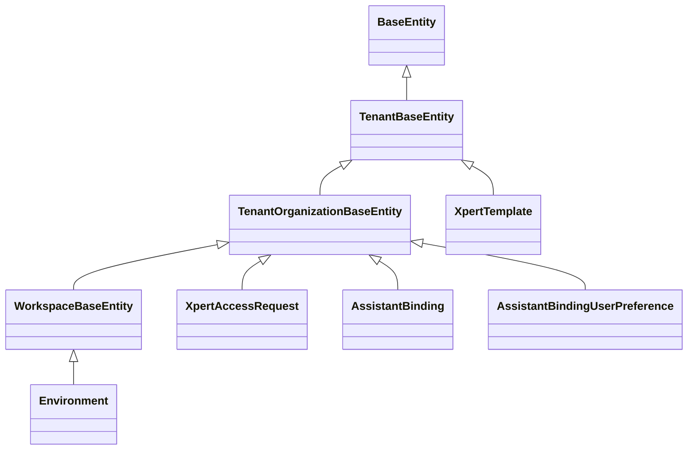

# 模板·市场·绑定·环境子专家 —— 模型（表与实体）

> 本子域共 5 张表：`xpert_template`、`xpert_access_request`、`assistant_binding`、`assistant_binding_user_preference`、`environment`。表名与列名均取自实体装饰器原文；迁移与 seed 惯例取自仓库实际存在的 SQL 文件与目录检索结果。

**本文引用的文件**

- [packages/server/src/core/entities/base.entity.ts](file://packages/server/src/core/entities/base.entity.ts)
- [packages/server/src/core/entities/tenant-base.entity.ts](file://packages/server/src/core/entities/tenant-base.entity.ts)
- [packages/server/src/core/entities/tenant-organization-base.entity.ts](file://packages/server/src/core/entities/tenant-organization-base.entity.ts)
- [packages/server-ai/src/core/entities/base.entity.ts](file://packages/server-ai/src/core/entities/base.entity.ts)
- [packages/server-ai/src/xpert-template/xpert-template.entity.ts](file://packages/server-ai/src/xpert-template/xpert-template.entity.ts)
- [packages/server-ai/src/xpert-marketplace/xpert-access-request.entity.ts](file://packages/server-ai/src/xpert-marketplace/xpert-access-request.entity.ts)
- [packages/server-ai/src/assistant-binding/assistant-binding.entity.ts](file://packages/server-ai/src/assistant-binding/assistant-binding.entity.ts)
- [packages/server-ai/src/assistant-binding/assistant-binding-user-preference.entity.ts](file://packages/server-ai/src/assistant-binding/assistant-binding-user-preference.entity.ts)
- [packages/server-ai/src/environment/environment.entity.ts](file://packages/server-ai/src/environment/environment.entity.ts)
- [packages/server-ai/src/environment/environment.module.ts](file://packages/server-ai/src/environment/environment.module.ts)
- [packages/server-ai/src/assistant-binding/migrations/20261003-bosi-bootstrap.sql](file://packages/server-ai/src/assistant-binding/migrations/20261003-bosi-bootstrap.sql)
- [packages/server-ai/src/assistant-binding/migrations/20261004-bosi-onboarding.sql](file://packages/server-ai/src/assistant-binding/migrations/20261004-bosi-onboarding.sql)
- [packages/contracts/src/ai/assistant-binding.model.ts](file://packages/contracts/src/ai/assistant-binding.model.ts)
- [packages/contracts/src/ai/xpert-marketplace.model.ts](file://packages/contracts/src/ai/xpert-marketplace.model.ts)

## 目录

- [1 实体基类与归属](#1-实体基类与归属)
- [2 xpert_template](#2-xpert_template)
- [3 xpert_access_request](#3-xpert_access_request)
- [4 assistant_binding](#4-assistant_binding)
- [5 assistant_binding_user_preference](#5-assistant_binding_user_preference)
- [6 environment](#6-environment)
- [7 迁移与 seed 惯例](#7-迁移与-seed-惯例)
- [8 已知风险与坑](#8-已知风险与坑)
- [9 结论](#9-结论)

## 1 实体基类与归属

图表来源：本文件各节 `章节来源`

| 基类 | 提供的列 | 对本子域的含义 |
|---|---|---|
| `BaseEntity` | `id`（uuid 主键）、`createdById`/`updatedById`（uuid 可空，`createdBy`/`updatedBy` 为 `onDelete: RESTRICT` 的 `User` 关系）、`createdAt`/`updatedAt`（timestamptz） | 5 张表统一带审计列 |
| `TenantBaseEntity` | `tenant`（`onDelete: CASCADE`）、`tenantId`（可空 + `@Index`） | `xpert_template` **无组织维度**，是唯一的租户级表 |
| `TenantOrganizationBaseEntity` | `organization`（CASCADE）、`organizationId`（可空 + `@Index`） | `organizationId` 可空即「租户级」行——`assistant_binding` 的三层 scope 与 `xpert_access_request` 的组织隔离都依赖这一点 |
| `WorkspaceBaseEntity`（server-ai 自有） | `workspace`（CASCADE）、`workspaceId`（可空 + `@Index`）、`publishAt`（timestamptz 可空）、`deletedAt`（`@DeleteDateColumn`） | `environment` 因此带工作区归属与软删；本子域其余 4 表**不含**这些列 |

章节来源：[base.entity.ts (server)](file://packages/server/src/core/entities/base.entity.ts)（关键符号：BaseEntity）、[base.entity.ts (server-ai)](file://packages/server-ai/src/core/entities/base.entity.ts)（关键符号：WorkspaceBaseEntity）、[environment.entity.ts](file://packages/server-ai/src/environment/environment.entity.ts)（关键符号：Environment / 表 environment）

## 2 xpert_template

实体 `XpertTemplate` → 表 `xpert_template`（`TenantBaseEntity`，**无 organizationId**）。

| 列 | 类型 | 可空/默认 | 约束与校验 |
|---|---|---|---|
| `key` | varchar | NOT NULL | `@IsString`；**无唯一索引**，服务层用 `key: In(ids)` 批量回填 visitCount |
| `name` | varchar | 可空 | `@IsString` |
| `visitCount` | integer | NOT NULL，默认 0 | `@IsNumber`；`getMCPTemplate`/`getKnowledgePipeline` 命中时 `+1` |
| `lastVisitedAt` | timestamptz | 可空 | 与 `visitCount` 同写同更新 |

本表只承担**访问热度**：模板内容（`export_data`、分类、推荐位）全部来自 externalRoot 的 `templates.json` / `templates-market.yaml` / `mcp-templates.json` / `knowledge-pipelines.json` / `pipelines/*.yaml`。排序规则也由服务层给出——`visitCount < 20` 视为「冷」，排在 `Number.MAX_SAFE_INTEGER` 组。

章节来源：[xpert-template.entity.ts](file://packages/server-ai/src/xpert-template/xpert-template.entity.ts)（关键符号：XpertTemplate.key、XpertTemplate.visitCount / 表 xpert_template）

## 3 xpert_access_request

实体 `XpertAccessRequest` → 表 `xpert_access_request`（`TenantOrganizationBaseEntity`）。

| 列 | 类型 | 可空/默认 | 关系 / 约束 |
|---|---|---|---|
| `xpertId` | uuid | NOT NULL | M:1 `Xpert`，`onDelete: CASCADE` |
| `requesterId` | uuid | NOT NULL | M:1 `User`，`onDelete: CASCADE` |
| `reviewerId` | uuid | 可空 | M:1 `User`，`onDelete: **SET NULL**` |
| `accessGroupId` | uuid | 可空 | M:1 `UserGroup`（`@RelationId` + `@JoinColumn`），`onDelete: **SET NULL**` |
| `status` | varchar(20) | NOT NULL，默认 `XpertAccessRequestStatusEnum.REQUESTED` | 应用层合法集 `requested｜approved｜rejected`，**无 DB CHECK** |
| `reason` | text | 可空 | 服务层 `normalizeText` 截断 500 |
| `response` | text | 可空 | 服务层 `normalizeText` 截断 500 |
| `reviewedAt` | timestamptz | 可空 | 审批/驳回时写 |

唯一约束：`@Index(['tenantId','organizationId','xpertId','requesterId'], { unique: true })` —— 一个用户对一个助手**只有一行**，重申是原地复用。

状态流转（全部由 `XpertMarketplaceService` 驱动）：

| 迁移 | 触发点 | 副作用 |
|---|---|---|
| `— → requested` | `requestAccess` | `response`/`reviewerId`/`reviewedAt`/`accessGroupId` 一并置 `null` |
| `requested → approved` | `approveRequest` | 建/复用 UserGroup、加成员、挂 `xpert.userGroups`、回写 `accessGroupId` |
| `requested → rejected` | `rejectRequest` | 只写 `reviewerId`/`response`/`reviewedAt`，**不写 `accessGroupId`** |
| `approved｜rejected → requested` | 再次 `requestAccess` | 清空上一轮 `accessGroupId`（旧授权指针丢失） |
| `requested｜approved` 再申请 | `requestAccess` | 原样返回，不做任何写入 |

章节来源：[xpert-access-request.entity.ts](file://packages/server-ai/src/xpert-marketplace/xpert-access-request.entity.ts)（关键符号：XpertAccessRequest.accessGroupId、XpertAccessRequest.status / 表 xpert_access_request）、[xpert-marketplace.model.ts](file://packages/contracts/src/ai/xpert-marketplace.model.ts)（关键符号：XpertAccessRequestStatusEnum）

## 4 assistant_binding

实体 `AssistantBinding` → 表 `assistant_binding`（`TenantOrganizationBaseEntity`）。三个 **partial unique**（PostgreSQL `WHERE` 字符串谓词）：

| 索引名 | 列 | `where` | 语义 |
|---|---|---|---|
| `IDX_assistant_binding_tenant_unique` | `tenantId, code` | `"scope" = 'tenant'` | 租户级每个 code 一行 |
| `IDX_assistant_binding_org_unique` | `tenantId, organizationId, code` | `"scope" = 'organization'` | 组织级每个 code 一行 |
| `IDX_assistant_binding_user_unique` | `tenantId, organizationId, userId, code` | `"scope" = 'user'` | 用户级每个 code 一行 |

| 列 | 类型 | 可空/默认 | 说明 |
|---|---|---|---|
| `desktopBootstrap` | json | 可空 | 服务端恢复态；`@Exclude({ toPlainOnly: true })`，注释明写 “Server recovery state; Bosi setup exposes a separate, minimal progress snapshot.” |
| `desktopOnboarding` | json | 可空 | `BosiOnboardingPreferences`（`workspaceId`/`packages`/`connectorIds`/`revision`），**未排除** |
| `code` | varchar(64) | NOT NULL | `AssistantCode`：`chat_common`｜`xpert_shared`｜`clawxpert`；`@IsEnum` + `@IsNotEmpty` |
| `scope` | varchar(64) | NOT NULL | `AssistantBindingScope`：`tenant`｜`organization`｜`user`；`@IsEnum` + `@IsNotEmpty` |
| `assistantId` | varchar(64) | 可空 | 指向 `xpert.id`，**无外键** |
| `enabled` | boolean | 可空 | system scope 必填；user scope 一律写 `null` |
| `userId` | varchar | 可空 | `@RelationId` + M:1 `User`（`onUpdate/onDelete: CASCADE`） |
| `preferences` | 关系 | — | 1:N → `AssistantBindingUserPreference`（inverse `preference.assistantBinding`） |

`code` 的管理归属由 contracts 固定：`isSystemManagedAssistant(code)` ⟺ code ≠ `clawxpert`；`isUserManagedAssistant(code)` ⟺ code === `clawxpert`。这决定了「谁能通过 HTTP 写哪个槽位」，也决定了回填时哪些旧行会被采纳。

章节来源：[assistant-binding.entity.ts](file://packages/server-ai/src/assistant-binding/assistant-binding.entity.ts)（关键符号：IDX_assistant_binding_tenant_unique、AssistantBinding.desktopBootstrap / 表 assistant_binding）、[assistant-binding.model.ts](file://packages/contracts/src/ai/assistant-binding.model.ts)（关键符号：AssistantCode、AssistantBindingScope、isSystemManagedAssistant）

## 5 assistant_binding_user_preference

实体 `AssistantBindingUserPreference` → 表 `assistant_binding_user_preference`（`TenantOrganizationBaseEntity`）。

| 列 | 类型 | 可空/默认 | 约束 |
|---|---|---|---|
| `assistantBindingId` | varchar | NOT NULL | `@RelationId` + M:1 `AssistantBinding`（`onUpdate/onDelete: CASCADE`） |
| `userId` | varchar | 可空 | `@RelationId` + M:1 `User`（CASCADE） |
| `soul` | text | 可空 | `@IsString`，服务层 `normalizeMarkdownValue` 直通（`null` 表示清空） |
| `profile` | text | 可空 | 同 `soul` |
| `toolPreferences` | json | 可空 | `IAssistantBindingToolPreferences`，经 `normalizeAssistantBindingToolPreferences` 归一 |
| `conversationPreferences` | json | 可空 | 归一后固定写 `version: 2`，含 `defaultThreadId`/`lastThreadId`/`defaultFollowUpBehavior`(`queue`｜`steer`) |

唯一约束：`IDX_assistant_binding_user_preference_unique` = `(tenantId, organizationId, assistantBindingId, userId)`，**非部分索引**（与 `assistant_binding` 的三条 partial unique 不同）。因此该表的「用户级唯一」依赖 `assistantBindingId` 已隐含 scope 与 userId，任何跨 scope 复用同一 bindingId 的写法都会撞索引。

章节来源：[assistant-binding-user-preference.entity.ts](file://packages/server-ai/src/assistant-binding/assistant-binding-user-preference.entity.ts)（关键符号：IDX_assistant_binding_user_preference_unique、AssistantBindingUserPreference.conversationPreferences / 表 assistant_binding_user_preference）

## 6 environment

实体 `Environment` → 表 `environment`（`WorkspaceBaseEntity`，因此带 `workspaceId`/`publishAt`/`deletedAt`）。

| 列 | 类型 | 可空/默认 | 约束 |
|---|---|---|---|
| `name` | varchar | NOT NULL | `@IsString` + `@IsNotEmpty` + `@Index` |
| `variables` | json | 可空 | `@IsJSON`；元素为 `TEnvironmentVariable`（`name`/`value`/`type`/`owner`） |
| `isDefault` | boolean | 可空 | 工作区内唯一性由 `EnvironmentService.setAsDefault` 保证，**无 partial unique** |
| `isArchived` | boolean | 可空 | `getDefaultByWorkspace` 用 `false` 与 `IsNull()` 两分支；`null` 视为未归档 |

反向关系：`XpertWorkspace.environments` 以**字符串 `'Environment'`** 声明 1:N（`cascade: ['insert','update','remove','soft-remove','recover']`），跨文件字符串引用意味着改名不会编译报错。本表只由 `EnvironmentModule` 的 `TypeOrmModule.forFeature([Environment])` 注册；`environment/index.ts` 只导出 module/service/queries/utils，**不导出实体与 DTO**。

章节来源：[environment.entity.ts](file://packages/server-ai/src/environment/environment.entity.ts)（关键符号：Environment.variables、Environment.isDefault / 表 environment）、[environment.module.ts](file://packages/server-ai/src/environment/environment.module.ts)（关键符号：EnvironmentModule.imports、TypeOrmModule.forFeature）

## 7 迁移与 seed 惯例

1. **本子域只有两个手写 SQL 迁移**，都在 `assistant-binding/migrations/`，内容各一行：
   - `20261003-bosi-bootstrap.sql`：`ALTER TABLE assistant_binding ADD COLUMN IF NOT EXISTS "desktopBootstrap" json NULL;`
   - `20261004-bosi-onboarding.sql`：`ALTER TABLE assistant_binding ADD COLUMN IF NOT EXISTS "desktopOnboarding" json NULL;`
   写法特征：`IF NOT EXISTS` + **双引号驼峰列名**（匹配 TypeORM 生成的列名），只用于「补 `synchronize` 管不到的历史列」。
2. `xpert_template`、`xpert_access_request`、`assistant_binding_user_preference`、`environment` **没有**对应 SQL 文件，依赖 TypeORM `synchronize`（external 模式强制关闭时需另行处理）。
3. **seed：该模块无此项**。`xpert-template/`、`xpert-marketplace/`、`assistant-binding/`、`environment/` 目录内均无 Seeder 实现；本子域的「初始化」全部是运行时行为——`AssistantBindingService.onModuleInit → backfillLegacyBindings`、`XpertTemplateService.onApplicationBootstrap → EnsureTemplateDirectoryCommand`（文件系统补种而非 DB 写入）。
4. 唯一索引全部由实体装饰器声明，没有额外的索引迁移文件；`check:typeorm-column-types` 脚本（根 `package.json`）用于守住列类型约定。

章节来源：[20261003-bosi-bootstrap.sql](file://packages/server-ai/src/assistant-binding/migrations/20261003-bosi-bootstrap.sql)（关键符号：assistant_binding.desktopBootstrap）、[20261004-bosi-onboarding.sql](file://packages/server-ai/src/assistant-binding/migrations/20261004-bosi-onboarding.sql)（关键符号：assistant_binding.desktopOnboarding）

## 8 已知风险与坑

1. **`xpert_template` 无唯一索引**：`key` 去重靠 `findOneOrFailByWhereOptions` 先查后建；`getMCPTemplate`/`getKnowledgePipeline` 并发调用可写出两行同 `key`，之后计数与 `lastVisitedAt` 会分裂在两条记录上（`getMCPTemplates` 的 `items.find` 只取第一条）。
2. **partial unique 的 `where` 是字符串 SQL**：三条 `assistant_binding` 索引的谓词 `` `"scope" = 'tenant'` `` 等必须与实体列名逐字符匹配；改 `scope` 取值、改列名或改引号风格都会让索引条件「仍在但不再约束新语义」，而 TypeORM 不会报错。
3. **`assistantId` 无外键**：绑定可以指向已删除或已下线的助手。一致性完全由 `upsertBinding` 的 `getAccessiblePublishedXpert`（user 分支）与 `buildSystemXpertWhere` 的 `type/latest/publishAt`（system 分支）在**写入时**保证；删除助手不会级联清理绑定。
4. **`desktopBootstrap` 只做序列化方向排除**：`@Exclude({ toPlainOnly: true })` 不影响 DB 内容，也不影响任何绕过 `instanceToPlain` 的自定义 mapper；`desktopOnboarding` 则完全对外可见。
5. **`accessGroupId` 与 `status` 生命周期不等长**：外键 `SET NULL`，UserGroup 被删后 `status = 'approved'` 仍成立，但 `hasRuntimeAccess` 已为 false——「已批准」不再是「可运行」的充分条件。
6. **`environment.isDefault` 无数据库约束**：工作区内唯一默认靠 `setAsDefault` 的「先关其它再置真」两步写；并发或直写 DB 会产生多个默认值，而 `getDefaultByWorkspace` 只取 `items[0]`，结果随查询顺序漂移。
7. **`environment` 归属易误判**：实体带 `workspaceId`/`publishAt`/`deletedAt` 且反向关系写在 `XpertWorkspace` 上，但只由 `EnvironmentModule` 注册、`environment/index.ts` 也不导出实体——跨模块引用时容易漏掉租户/工作区过滤。
8. **`xpert_access_request.status` 无 CHECK 约束**：合法集只由 `XpertAccessRequestStatusEnum` 在应用层保证，历史数据或直写 DB 可以产生 `resolveAccessStatus` 无法映射的值，此时 `findMarketplace` 会把它当 `not_requested` 处理（`matchesFilters` 仍可能按 `status` 过滤掉）。

章节来源：[xpert-template.service.ts](file://packages/server-ai/src/xpert-template/xpert-template.service.ts)（关键符号：XpertTemplateService.getMCPTemplate、XpertTemplateService.getKnowledgePipeline）、[assistant-binding.service.ts](file://packages/server-ai/src/assistant-binding/assistant-binding.service.ts)（关键符号：AssistantBindingService.buildSystemXpertWhere、AssistantBindingService.upsertBinding）

## 9 结论

5 张表的职责划分是清晰的：**内容不进库**（`xpert_template` 只记热度）、**授权不新建体系**（`xpert_access_request.accessGroupId` 指向既有 `UserGroup`）、**槽位与偏好分离**（`assistant_binding` 存「绑到哪」+ 恢复态，`assistant_binding_user_preference` 存「怎么用」）、**环境变量带工作区归属**（`environment` 走 `WorkspaceBaseEntity`）。风险则集中在一处：**唯一性与引用的强度不一致**——`xpert_template.key` 无唯一索引、`assistant_binding.assistantId` 无外键、`environment.isDefault` 无部分唯一、`accessGroupId` 为 `SET NULL`。这四处都要求写入方（服务层）承担数据库没有兜住的一致性，因此任何绕过 `XpertTemplateService`/`AssistantBindingService`/`XpertMarketplaceService`/`EnvironmentService` 的直接仓储写入都是真正的高危改动。

章节来源：[xpert-access-request.entity.ts](file://packages/server-ai/src/xpert-marketplace/xpert-access-request.entity.ts)（关键符号：XpertAccessRequest / 表 xpert_access_request）、[assistant-binding.entity.ts](file://packages/server-ai/src/assistant-binding/assistant-binding.entity.ts)（关键符号：AssistantBinding / 表 assistant_binding）
