# Assistant 定义与运行时域 · ② 运行时 API 与准入子专家 —— 架构

**本文引用的文件**

- [packages/server-ai/src/ai/ai.module.ts](file://packages/server-ai/src/ai/ai.module.ts)
- [packages/server-ai/src/ai/assistant.controller.ts](file://packages/server-ai/src/ai/assistant.controller.ts)
- [packages/server-ai/src/ai/ai.controller.ts](file://packages/server-ai/src/ai/ai.controller.ts)
- [packages/server-ai/src/ai/ai-v1.controller.ts](file://packages/server-ai/src/ai/ai-v1.controller.ts)
- [packages/server-ai/src/ai/thread.controller.ts](file://packages/server-ai/src/ai/thread.controller.ts)
- [packages/server-ai/src/ai/conversation.controller.ts](file://packages/server-ai/src/ai/conversation.controller.ts)
- [packages/server-ai/src/ai/context.controller.ts](file://packages/server-ai/src/ai/context.controller.ts)
- [packages/server-ai/src/ai/assistant-file-access.guard.ts](file://packages/server-ai/src/ai/assistant-file-access.guard.ts)
- [packages/server-ai/src/ai/assistant-thread-scope.guard.ts](file://packages/server-ai/src/ai/assistant-thread-scope.guard.ts)
- [packages/server-ai/src/ai/workbench-files-auth.guard.ts](file://packages/server-ai/src/ai/workbench-files-auth.guard.ts)
- [packages/server-ai/src/ai/assistant-audience.ts](file://packages/server-ai/src/ai/assistant-audience.ts)
- [packages/server-ai/src/ai/groups/index.ts](file://packages/server-ai/src/ai/groups/index.ts)
- [packages/server-ai/src/ai/groups/group-scope.guard.ts](file://packages/server-ai/src/ai/groups/group-scope.guard.ts)
- [packages/server-ai/src/xpert/published-xpert-access.service.ts](file://packages/server-ai/src/xpert/published-xpert-access.service.ts)
- [packages/server-ai/src/xpert/xpert-access.controller.ts](file://packages/server-ai/src/xpert/xpert-access.controller.ts)
- [packages/server-ai/src/xpert/enterprise-chatkit-session.service.ts](file://packages/server-ai/src/xpert/enterprise-chatkit-session.service.ts)
- [packages/server-ai/src/xpert/enterprise-chatkit.controller.ts](file://packages/server-ai/src/xpert/enterprise-chatkit.controller.ts)
- [packages/server-ai/src/xpert/enterprise-chatkit.module.ts](file://packages/server-ai/src/xpert/enterprise-chatkit.module.ts)
- [packages/server-ai/src/xpert/xpert.controller.ts](file://packages/server-ai/src/xpert/xpert.controller.ts)
- [packages/contracts/src/secret-token.model.ts](file://packages/contracts/src/secret-token.model.ts)
- [AGENTS.md](file://AGENTS.md)

## 目录

- [1 子域职责边界](#1-子域职责边界)
- [2 与对话域的适配器交叉引用](#2-与对话域的适配器交叉引用)
- [3 ai/ 内部分层](#3-ai-内部分层)
- [4 依赖关系](#4-依赖关系)
- [5 关键不变量](#5-关键不变量)
- [6 架构总览](#6-架构总览)
- [7 端点族与准入归属](#7-端点族与准入归属)
- [8 结论](#8-结论)

## 1 子域职责边界

本子域只负责「Assistant 已发布之后，谁能通过 HTTP 跑到它」——即**运行时对外面 + 多受众准入**。它不定义 Assistant，也不实现文件卷与工作区能力。

| 归属 | 内容 | 证据锚点 |
|---|---|---|
| 做 | `ai/` 下全部 `@Public()` 运行时代理端点（assistants / threads / conversations / contexts / knowledges / store / sandbox / mcp-apps / voice / workspace-files / connector） | `AIModule.controllers` |
| 做 | 多受众准入判定与可见性查询构造 | `PublishedXpertAccessService` |
| 做 | 公共 App ChatKit 会话签发（匿名 cookie + `PUBLIC_XPERT`） | `XpertController.createPublicChatkitSession` |
| 做 | 企业 H5 bootstrap / session（`ENTERPRISE_XPERT` 短期 client secret） | `EnterpriseChatkitSessionService` |
| 做 | 运行时侧 Guard 族（file / thread / workbench / group scope） | `AssistantFileAccessGuard`、`AssistantThreadScopeGuard`、`WorkbenchFilesAuthGuard`、`GroupScopeGuard` |
| 做 | 模型供应商代理与 LangGraph Platform v1 兼容层 | `AIController.proxy`、`AIV1Controller` |
| 不做 | 创作侧草稿 / 发布 / 版本（→ 子专家①） | `XpertService`、`XpertPublishHandler` |
| 不做 | 文件卷授权实现与工作区四动作能力面（→ 子专家③） | `AssistantFilesService`、`XpertWorkspaceAccessService` |
| 不做 | 模板 / 市场 / 环境 / 系统槽位（→ 子专家④） | `XpertTemplateService`、`XpertMarketplaceService` |
| 不做 | 对话 / 会话 / 线程 / 群聊**本体逻辑**（→ 对话与会话域） | `ConversationsController`、`GroupsController` 的 service 落到 `ChatConversationModule`、`ChatGroupModule` |

**与创作面的关键差别**：创作面靠 `XpertGuard` 与 `WorkspaceAuthoringGuard` 做「是否可编辑」，运行时面靠 `PublishedXpertAccessService` 做「是否已发布且受众匹配」。两者绝不互相代替。

章节来源：[ai/ai.module.ts](file://packages/server-ai/src/ai/ai.module.ts)（关键符号：AIModule.controllers）、[xpert/published-xpert-access.service.ts](file://packages/server-ai/src/xpert/published-xpert-access.service.ts)（关键符号：PublishedXpertAccessService.getAccessiblePublishedXpert）

## 2 与对话域的适配器交叉引用

`ai/` 目录的**模块归属在本子域，领域归属不全是**。`RouterModule.register([{ path: '/ai', module: AIModule }])` 让 25 个控制器共享同一前缀，因此「HTTP 路径」不能用来判断逻辑归属。

| 控制器 | HTTP 归属 | 逻辑归属 | 本子域职责 |
|---|---|---|---|
| `AIController`、`AIV1Controller`、`AssistantsController`、`ContextsController`、`KnowledgesController`、`StoreController` | 本子域 | 本子域（准入 / 凭证 / 兼容层） | 全责 |
| `AssistantWorkspaceFilesController`、`WorkspaceFileAccessRuntimeController`、`WorkbenchFilesController` | 本子域 | 子专家③（文件与工作区能力） | 只保证鉴权前置与路由不冲突 |
| `ThreadsController`、`ConversationsController`、`ConversationBranchController`、`ConversationArtifactsController` | 本子域 | 对话与会话域 | 只保证 `AiService` / 命令入口与凭证受众一致 |
| `GroupProjectController`、`GroupsController`、`GroupComposerController`、`GroupViewsController`、`GroupWorkbenchContextController`、`GroupViewFilesController` | 本子域（`GROUP_CONTROLLERS` 数组装配） | 对话与会话域 | 只写清 `GroupScopeGuard` 的边界语义 |
| `SandboxRuntimeController`、`McpAppsRuntimeController`、`VoiceController`、`ConnectorRuntimeController`、`RuntimeResourceController` | 本子域 | 批次 5 工具/知识域 + 沙箱域 | 只保证凭证受众与线程范围 |

`GroupScopeGuard` 的源码注释是本边界最精确的写法：**共享 ChatKit 鉴权先跑，此守卫只把 conversation grant 收紧到单群路由**（`request.user.principalType` 非 `client_secret`/`api_key` 时直接放行，由领域服务继续判定）。

章节来源：[ai/groups/group-scope.guard.ts](file://packages/server-ai/src/ai/groups/group-scope.guard.ts)（关键符号：GroupScopeGuard.canActivate）、[ai/groups/index.ts](file://packages/server-ai/src/ai/groups/index.ts)（关键符号：GROUP_CONTROLLERS）

## 3 ai/ 内部分层

- **Controller 层（25 个类）**：19 个直接列出 + 6 个经 `GROUP_CONTROLLERS` 展开；风格统一为「类级守卫 + 方法级业务委派」，无业务判定。
- **Guard 层（6 个）**：`ApiKeyOrClientSecretAuthGuard`（来自 server-core，全部运行时类级挂载）、`AssistantFileAccessGuard`、`AssistantThreadScopeGuard`、`WorkbenchFilesAuthGuard`、`GroupScopeGuard`、`GroupWorkbenchGuard`。后四者由 `AIModule.providers` 提供。
- **Service 层**：准入侧 `PublishedXpertAccessService`（在 `xpert/` 包内，被 `AIModule` 经 `forwardRef(() => XpertModule)` 注入）、会话签发侧 `EnterpriseChatkitSessionService`、模型偏好侧 `AssistantModelSelectionService`、线程活动侧 `ThreadActivityService`、运行汇总侧 `ConversationAgentRunsService`、AI 辅助 `AiService`。
- **请求上下文适配层**：`assistant-request-context.ts`（`resolveAssistantForRequest` / `applyAssistantScope`）、`assistant-audience.ts`（`assertAssistantAudience`）、`public-xpert-principal.ts`（`getPublicXpertSessionConversationScope`）。这一层不是 middleware，而是「在 handler 内改写当前请求的 organization scope 与 principal」，是本子域最独特的结构。
- **命令 / 查询层**：`ai/commands/*`（`ThreadCreateCommand`、`ThreadDeleteCommand`、`RunCreateStreamCommand`）与 `ai/queries/*`（`FindThreadQuery`、`SearchThreadsQuery`）。
- **Schema 层**：`schemas/agent-protocol-schema.d.ts`（LangGraph SDK 风格类型来源）、`chatkit-session.schema.ts`、`assistant-workspace-files.schema.ts`。
- **注册表（registry）**：本子域**没有**独立的运行时服务注册表，唯一抽出的数组是 `GROUP_CONTROLLERS`；其余控制器/守卫以字面量内联在 `ai.module.ts`。

章节来源：[ai/ai.module.ts](file://packages/server-ai/src/ai/ai.module.ts)（关键符号：AIModule.controllers、AIModule.providers）、[ai/assistant-request-context.ts](file://packages/server-ai/src/ai/assistant-request-context.ts)（关键符号：applyAssistantScope）

## 4 依赖关系

**出向（本子域 import 的其他模块）**：`ChatGroupModule`、`WorkspaceFileAccessModule`、`SandboxModule`、`ConnectorModule`、`CopilotModule` / `CopilotUserModule` / `CopilotOrganizationModule` / `CopilotCheckpointModule`、`KnowledgebaseModule` / `KnowledgeDocumentModule`、`XpertModule` / `XpertAgentModule` / `XpertProjectModule` / `XpertToolsetModule` / `SkillPackageModule` / `PromptWorkflowModule` / `AssistantBindingModule` / `EnvironmentModule`、`ChatConversationModule` / `ChatMessageModule` / `ChatMessageFeedbackModule`、`FileUnderstandingModule` / `XpertAgentExecutionModule`、`SseStreamModule`、`SuperAdminOrganizationScopeModule`；server-core 侧 `TenantModule`、`SecretTokenModule`、`StorageFileModule`、`RedisModule`（`SecretTokenService`、`Public`、`AllowClientSecretBindings`、`ApiKeyOrClientSecretAuthGuard`、`TransformInterceptor` 均来自 `@xpert-ai/server-core`）。

**循环依赖处理**：`KnowledgebaseModule`、`KnowledgeDocumentModule`、`StorageFileModule`、`XpertModule`、`XpertAgentModule`、`SkillPackageModule`、`PromptWorkflowModule`、`AssistantBindingModule`、`EnvironmentModule`、`ChatConversationModule`、`ChatMessageModule`、`ChatMessageFeedbackModule`、`FileUnderstandingModule`、`XpertAgentExecutionModule`、`XpertToolsetModule` 全部用 `forwardRef` 包裹——即**本子域几乎与整条 AI 域双向耦合**，这是运行时适配层的结构性代价。

**入向**：`EnterpriseChatkitModule` 完全不依赖 `AIModule`，它自成一体（`imports` 只需 `AccountBindingModule` / `IntegrationModule` / `SecretTokenModule`），是无 RouterModule 的独立模块。

章节来源：[ai/ai.module.ts](file://packages/server-ai/src/ai/ai.module.ts)（关键符号：AIModule.imports）、[xpert/enterprise-chatkit.module.ts](file://packages/server-ai/src/xpert/enterprise-chatkit.module.ts)（关键符号：EnterpriseChatkitModule.imports）

## 5 关键不变量

1. **准入查询必须带 `publishAt` 非空**。三个受众分支（workspace / public / enterprise）与主查询分支都在 `createQueryBuilder` 后硬编码 `xpert.publishAt IS NOT NULL`；单条读取 `getPublishedXpertInTenant` 用 `publishAt: Not(IsNull())`。**源码校正**：`applyPublishedFilters` 本身只负责 `where` 字段与可选的 `latest` / `version` 叠加，`publishAt` 约束不在其中——父级「`applyPublishedFilters` 强制 `publishAt`」的说法与源码不符。
2. **凭证受众与目标 assistant 必须匹配**。`getAccessiblePublishedXpert` 在加载实体**之前**先做 audience 断言（public / enterprise / user 三处 `!== id` 即 403）；运行期再由 `assertPublicChatAppXpert` / `assertEnterpriseChatAppXpert` / `assertCurrentUserAccess` 复查应用开关与组织。
3. **`@Public()` 端点全靠守卫兜底**。`AssistantsController` 类上同时挂 `@Public()`、`@AllowClientSecretBindings(SecretTokenBindingType.ENTERPRISE_XPERT)`、`@UseGuards(ApiKeyOrClientSecretAuthGuard)`；`@Public()` 只关闭全局 JWT，不产生匿名可用性。
4. **Enterprise bootstrap 是身份校验之前**的白名单响应。`getBootstrap` 只回 `toEnterpriseH5PublicXpert(...)` 的 12 个白名单字段 + `platform` + `clientConfig`；`createSession` 才走 `resolveContext` → `exchangeIdentity` → `assertIdentity` → `resolveBoundUser`。
5. **文件端点必须声明策略**。`AssistantFileAccessGuard` 未取到 `@AssistantFileAccess(policy)` 元数据时直接 `denied()`；`workspace` 策略只接受 `USER_XPERT`，view-session 策略接受 `USER_XPERT`/`ENTERPRISE_XPERT`，且强制 `host.hostId === resourceScope.xpertId`。
6. **线程凭证不得跨线程/跨会话复用**。`AssistantThreadScopeGuard` 要求 `conversation.tenantId`、`organizationId`、`xpertId` 三项与凭证 scope 完全一致，且 public/enterprise 会话还要求 `conversation.createdById === principal.id`。
7. **凭证不可自我复制**。`AIV1Controller.createChatkitSession` 内显式拒绝 `USER_CONVERSATION` 主体再签发新凭证（"A conversation credential cannot mint another credential"）。

章节来源：[xpert/published-xpert-access.service.ts](file://packages/server-ai/src/xpert/published-xpert-access.service.ts)（关键符号：PublishedXpertAccessService.applyPublishedFilters、PublishedXpertAccessService.getPublishedXpertInTenant）、[ai/assistant-file-access.guard.ts](file://packages/server-ai/src/ai/assistant-file-access.guard.ts)（关键符号：AssistantFileAccessGuard.canActivate）

## 6 架构总览

```mermaid
graph TB
    subgraph AUD["六类请求受众"]
        A1["① 登录用户 jwt"]
        A2["② 租户/工作区 API Key"]
        A3["③ client secret API_KEY"]
        A4["④ USER_XPERT（ChatKit 用户委派）"]
        A5["⑤ ENTERPRISE_XPERT（企业 H5）"]
        A6["⑥ PUBLIC_XPERT（公共 App 匿名）"]
    end

    subgraph ADMIT["准入层 xpert/published-xpert-access.service.ts"]
        PXA["PublishedXpertAccessService"]
        C1["currentAccessUserId"]
        C2["currentWorkspaceApiKeyWorkspaceId"]
        C3["currentUserXpertId"]
        C4["currentEnterpriseXpertScope"]
        C5["currentPublicXpertId"]
        BQ["buildAccessibleQuery"]
        B1["buildWorkspaceBoundQuery"]
        B2["buildPublicXpertBoundQuery"]
        B3["buildEnterpriseXpertBoundQuery"]
        F1["applyPublishedFilters + applySearchFilter"]
        F2["TENANT_SHARED_WORKSPACE_FILTER"]
    end

    subgraph RT["ai/ 运行时对外面"]
        AC["AssistantsController /api/ai/assistants"]
        TC["ThreadsController /api/ai/threads"]
        CC["ConversationsController /api/ai/conversations"]
        XC["ContextsController /api/ai/contexts"]
        KC["KnowledgesController /api/ai/knowledges"]
        SC["StoreController /api/ai/store"]
        SA["SandboxRuntimeController /api/ai/sandbox/*"]
        WF["AssistantWorkspaceFilesController + WorkspaceFileAccessRuntimeController"]
        MA["McpAppsRuntimeController /api/ai/mcp-apps"]
        VO["VoiceController /api/ai/threads/:id/voice"]
        GC["GROUP_CONTROLLERS /api/ai/groups/*"]
        PC["AIController /api/ai/proxy/*"]
        V1["AIV1Controller /api/ai/v1/*"]
    end

    subgraph EXT["账号与凭证签发"]
        PUB["XpertController.createPublicChatkitSession"]
        ENT["EnterpriseChatkitSessionService"]
        ACC["XpertAccessController /api/xpert/accessible/:id"]
    end

    A1 --> PXA
    A2 --> C2
    A3 --> C1
    A4 --> C3
    A5 --> C4
    A6 --> C5
    C1 --> BQ
    C2 --> BQ
    C3 --> BQ
    C4 --> BQ
    C5 --> BQ
    BQ --> B1
    BQ --> B2
    BQ --> B3
    B1 --> F1
    B2 --> F1
    B3 --> F1
    BQ --> F1
    F1 --> F2
    PXA --> AC
    PXA --> ACC
    AC --> TC
    AC --> CC
    TC --> V1
    CC --> XC
    A6 --> PUB
    A5 --> ENT
    PUB --> PXA
    ENT --> PXA
    WF --> PXA
    GC --> GC
    KC --> PC
    SC --> MA
    VO --> SA
```

图表来源：[xpert/published-xpert-access.service.ts](file://packages/server-ai/src/xpert/published-xpert-access.service.ts)（关键符号：PublishedXpertAccessService.buildAccessibleQuery、TENANT_SHARED_WORKSPACE_FILTER）、[ai/ai.module.ts](file://packages/server-ai/src/ai/ai.module.ts)（关键符号：AIModule.controllers）

## 7 端点族与准入归属

| 端点族 | 完整前缀 | 准入判定落点 | 子域归属 |
|---|---|---|---|
| 助手读取 | `/api/ai/assistants/*` | `PublishedXpertAccessService`（多受众） | 本子域 |
| 线程与运行 | `/api/ai/threads/*` | 准入服务 + `AssistantThreadScopeGuard`（voice/sandbox 侧） | 本子域（HTTP） |
| 会话与消息 | `/api/ai/conversations/*` | 准入服务 + 领域 `assertPublicXpertSessionConversationAccess` | 对话域逻辑 |
| 上下文上传 | `/api/ai/contexts/*` | 凭证绑定 + 公共会话 scope 限制（storage 目标） | 本子域 + 子专家③ |
| 知识库 | `/api/ai/knowledges/*` | `KnowledgebaseOwnerGuard` + 服务层写权限 | 批次 5 |
| Store | `/api/ai/store/*` | 凭证受众 + namespace 首段视为 xpertId | 本子域 |
| 沙箱 | `/api/ai/sandbox/threads/:threadId/services/*` | `AssistantThreadScopeGuard` | 沙箱域 |
| 文件与查看会话 | `/api/ai/assistants/:id/workspace/*`、`/api/ai/workspace-files/view-sessions/*`、`/api/ai/conversations/:id/workspace/*` | `AssistantFileAccessGuard` / `WorkbenchFilesAuthGuard` | 子专家③ |
| MCP Apps | `/api/ai/mcp-apps/*` | 凭证受众 | 批次 5 |
| 群聊 | `/api/ai/groups/*` | `GroupScopeGuard`（+`GroupWorkbenchGuard`） | 对话域逻辑 |
| 模型代理 | `/api/ai/proxy/:copilotId/:m[/:f]` | 仅登录态（`@ApiBearerAuth`，无 `@Public`） | 本子域 |
| v1 兼容层 | `/api/ai/v1/*` | `ApiKeyOrClientSecretAuthGuard`（kb 写叠加 `KnowledgebaseOwnerGuard`） | 本子域 |

章节来源：[ai/ai-v1.controller.ts](file://packages/server-ai/src/ai/ai-v1.controller.ts)（关键符号：AIV1Controller.createChatkitSession）、[ai/sandbox-runtime.controller.ts](file://packages/server-ai/src/ai/sandbox-runtime.controller.ts)（关键符号：SandboxRuntimeController）

## 8 结论

本子域的架构张力集中在一点：**同一个 `/api/ai` 前缀下，混装着「准入面」「凭证签发面」「对话/文件/工具领域面」三类端点，而它们共享同一套 `@Public()` + `ApiKeyOrClientSecretAuthGuard` 鉴权外壳**。因此判断一个端点的真实安全边界，不能看路径，必须看三件事：类级 `@AllowClientSecretBindings` 声明了哪种受众、是否叠加了范围守卫（file / thread / group）、以及 service 内部是否再调 `PublishedXpertAccessService`。第二层张力是「受众判定与控制流耦合」：`currentPublicXpertId` 等私有方法既做识别又做拒绝（scope 不合法即 403），使准入服务同时是解析器与守卫。第三层是凭证签发面的双轨：公共 App 与用户委派走 `createHashed`（哈希存储），企业 H5 走 `create`（明文 token 行 + `enterpriseH5Scope`），两个入口的 TTL 策略也不同（600/3600 与固定 600）。

章节来源：[xpert/published-xpert-access.service.ts](file://packages/server-ai/src/xpert/published-xpert-access.service.ts)（关键符号：PublishedXpertAccessService.currentPublicXpertId）、[xpert/enterprise-chatkit-session.service.ts](file://packages/server-ai/src/xpert/enterprise-chatkit-session.service.ts)（关键符号：EnterpriseChatkitSessionService.createSession）
