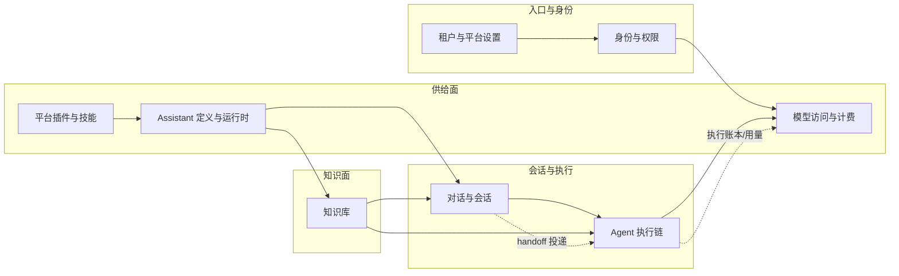

# 后端专题总览（T0）

> ⚠️ **重建版**（原版随 2026-10-16 工作区事故丢失）。能力清单与边界按 8 个已建专家的契约层归纳；批次 5 候选来自 `.fe-index/xpert` 的未指认模块。

## 1. 能力清单（按业务域）

| 业务域 | 专家 | 一句话能力 | 主要入口 |
|---|---|---|---|
| 租户与平台设置 | 租户与平台设置专家 | 租户生命周期与 onboarding、租户级键值设置（含请求级缓存）、功能开关（含组织级覆盖）、返利码与注册绑定、自定义 SMTP、邮件模板与发信 | `/api/tenant*` `/api/tenant-setting` `/api/feature*` `/api/referral*` `/api/smtp*` `/api/email*` |
| 身份与权限 | 身份与权限专家 | 认证与凭据、用户/组织/成员、角色与权限、邀请、API Key 与 secret token、账户绑定、actor token | `/api/auth*` `/api/user*` `/api/organization*` `/api/role*` `/api/invite*` `/api/api-key*` |
| 模型访问与计费 | 模型访问与计费专家 | 模型访问授权与执行、模型网关与限流、会员与积分账本、Copilot 配置与用量与检查点 | `/api/model-execution/*` `/api/openai/*` `/api/membership*` `/api/copilot*` |
| 平台插件与技能 | 平台插件与技能专家 | 插件准入（市场/本地/归档）与动态装配、插件资源与模板安装、技能包与技能仓库索引 | `/api/plugin*` `/api/plugin-resource*` `/api/skill-package*` `/api/skill-repository-indexes` |
| Assistant 定义与运行时 | Assistant 定义与运行时专家 | Assistant 定义/草稿/发布/版本、运行时 API 与多受众准入、工作区与文件授权、模板市场绑定与环境 | `/api/xpert*` `/api/ai/*` `/api/xpert-workspace*` `/api/assistant-binding*` `/api/xpert-template*` |
| 对话与会话 | 对话与会话专家 | 会话与消息、分支与脉络地图、群聊协作、投递队列与运行时消息（handoff） | `/api/chat-conversation*` `/api/chat` `/api/chat-message*` `/api/ai/groups*` |
| 知识库与 RAG | 知识库专家 | 知识库聚合与检索（三路召回+融合+重排）、文档摄取流水线、GraphRAG 图谱与知识身份、知识 Wiki 与组织 | `/api/knowledgebase*` `/api/knowledge-document*` |
| Agent 编排与执行 | Agent 执行链专家 | Agent 定义与图编译、统一调用运行时与执行账本、中间件受控运行时、Prompt 工作流、协作 CRDT | `/api/xpert-agent*` `/api/agent-invocations*` `/api/prompt-workflow*` WS `/api/collaboration` |

## 2. 边界（跨专家不可互换）

- **三元权限面不可互换**：创作（`WorkspaceAuthoringGuard`/`assertCanAuthorById`）· 运行（`PublishedXpertAccessService`）· 文件（`AssistantFilesService.forRuntime/forAuthoring`）；运行时被拒后**不得**回退 authoring
- **逻辑归本域、HTTP 适配器可能在别家**：`/api/ai/conversations|threads|groups/*` 逻辑属对话与会话专家、代码在 `ai/`（Assistant 定义与运行时专家的目录）；`/api/agent-invocations/:id/delivery{,/redrive}` 逻辑属对话与会话专家、注册在 `agent-invocation.module.ts`
- **注册方 ≠ 物理归属**：`agent_runtime_delivery`/`agent_runtime_inbox` 物理在 `handoff/`、被 `agent-invocation` 注册；`user`/`user_organization` 被数十模块共同注册，不能作为归属依据
- **不含**：`packages/plugin-sdk`（已发布 SDK）与 `packages/plugins/*`

## 3. 跨专家架构图（数据与控制的骨干）

图表来源：各专家 `C0-使用总览.md` 的边界与依赖小节（`file://.module-experts/后端专题/*/C0-使用总览.md`）

## 4. 批次 5（**划分已定案**，2026-10-16）

> 依据：`.fe-index/xpert` 实测规模 + 模块依赖证据（组内/跨簇耦合）。详见 [创建计划.md §5.3](file://.module-experts/后端专题/创建计划.md)。

| # | 专家 | 模块（非 spec） | 建议子专家 | 合计 |
|---|---|---|---|---|
| 9 | 项目与任务协作专家 ✅ | `xpert-project`(122) · `xpert-task`(35) · `business-area`(5) | 2 | 162 |
| 10 | 工具与 MCP 专家 ✅ | `xpert-toolset`(104) · `agent-plugin`(50) · `mcp-publication`(43) · `mcp`(14) · `xpert-tool`(13) | 3 | 224 |
| 11 | Agent 演进专家 ✅ | `agent-evolution`(44 / 19 表 / 48 端点) | 2 | 44 |
| 12 | 运行时·沙箱·产物专家 ✅ | `sandbox`(74) · `runtime-control`(22) · `artifacts`(10) · `workspace-file-access`(8) · `health`(5) | 3 | 119 |
| 13 | **文件理解与记忆专家** ✅ | `file-understanding`(88) · `file-memory`(24) · `storage-file`(21) | 2 | 133 |
| 14 | **平台底座与集成专家** ✅ | `data-source`(34) · `aimodel`(28) · `integration`(24) · `xpert-table`(18) · `view-extension`(14) · 字典/客户端(53) | 3 | 171 |

**定案要点**：原方案把后两类合成「平台基础与集成」（309 非 spec / 17 模块），但其**内部零跨簇耦合**（文件族、扩展·集成、数据源·表格三簇互不依赖 + 9 个零边模块）→ 拆为两个专家；专家总数 13 → **14**。索引中无独立模块行的 `tags` / `export-import` 留待建站扫描时确认归属。

## 5. 专家导航

| 专家 | 契约入口 | 实现入口 |
|---|---|---|
| 租户与平台设置专家 | [C0](file://.module-experts/后端专题/租户与平台设置专家/C0-使用总览.md) · [C1](file://.module-experts/后端专题/租户与平台设置专家/C1-能力契约.md) | [01-架构](file://.module-experts/后端专题/租户与平台设置专家/implementation/01-架构.md) |
| 身份与权限专家 | [C0](file://.module-experts/后端专题/身份与权限专家/C0-使用总览.md) · [C1](file://.module-experts/后端专题/身份与权限专家/C1-能力契约.md) | [01-架构](file://.module-experts/后端专题/身份与权限专家/implementation/01-架构.md) |
| 模型访问与计费专家 | [C0](file://.module-experts/后端专题/模型访问与计费专家/C0-使用总览.md) · [C1](file://.module-experts/后端专题/模型访问与计费专家/C1-能力契约.md) | [01-架构](file://.module-experts/后端专题/模型访问与计费专家/implementation/01-架构.md) |
| 平台插件与技能专家 | [C0](file://.module-experts/后端专题/平台插件与技能专家/C0-使用总览.md) · [C1](file://.module-experts/后端专题/平台插件与技能专家/C1-能力契约.md) | [01-架构](file://.module-experts/后端专题/平台插件与技能专家/implementation/01-架构.md) |
| Assistant 定义与运行时专家 | [C0](file://.module-experts/后端专题/Assistant 定义与运行时专家/C0-使用总览.md) · [C1](file://.module-experts/后端专题/Assistant 定义与运行时专家/C1-能力契约.md) | [01-架构](file://.module-experts/后端专题/Assistant 定义与运行时专家/implementation/01-架构.md) |
| 对话与会话专家 | [C0](file://.module-experts/后端专题/对话与会话专家/C0-使用总览.md) · [C1](file://.module-experts/后端专题/对话与会话专家/C1-能力契约.md) | [01-架构](file://.module-experts/后端专题/对话与会话专家/implementation/01-架构.md) |
| 知识库专家 | [C0](file://.module-experts/后端专题/知识库专家/C0-使用总览.md) · [C1](file://.module-experts/后端专题/知识库专家/C1-能力契约.md) | [01-架构](file://.module-experts/后端专题/知识库专家/implementation/01-架构.md) |
| Agent 执行链专家 | [C0](file://.module-experts/后端专题/Agent 执行链专家/C0-使用总览.md) · [C1](file://.module-experts/后端专题/Agent 执行链专家/C1-能力契约.md) | [01-架构](file://.module-experts/后端专题/Agent 执行链专家/implementation/01-架构.md) |
| **工具与 MCP 专家** ✅ | [C0](file://.module-experts/后端专题/工具与 MCP 专家/C0-使用总览.md) · [C1](file://.module-experts/后端专题/工具与 MCP 专家/C1-能力契约.md) | [01-架构](file://.module-experts/后端专题/工具与 MCP 专家/implementation/01-架构.md) |
| **运行时·沙箱·产物专家** ✅ | [C0](file://.module-experts/后端专题/运行时·沙箱·产物专家/C0-使用总览.md) · [C1](file://.module-experts/后端专题/运行时·沙箱·产物专家/C1-能力契约.md) | [01-架构](file://.module-experts/后端专题/运行时·沙箱·产物专家/implementation/01-架构.md) |
| **文件理解与记忆专家** ✅ | [C0](file://.module-experts/后端专题/文件理解与记忆专家/C0-使用总览.md) · [C1](file://.module-experts/后端专题/文件理解与记忆专家/C1-能力契约.md) | [01-架构](file://.module-experts/后端专题/文件理解与记忆专家/implementation/01-架构.md) |
| **平台底座与集成专家** ✅ | [C0](file://.module-experts/后端专题/平台底座与集成专家/C0-使用总览.md) · [C1](file://.module-experts/后端专题/平台底座与集成专家/C1-能力契约.md) | [01-架构](file://.module-experts/后端专题/平台底座与集成专家/implementation/01-架构.md) |
| **Agent 演进专家** ✅ | [C0](file://.module-experts/后端专题/Agent 演进专家/C0-使用总览.md) · [C1](file://.module-experts/后端专题/Agent 演进专家/C1-能力契约.md) | [01-架构](file://.module-experts/后端专题/Agent 演进专家/implementation/01-架构.md) |
| **项目与任务协作专家** ✅ | [C0](file://.module-experts/后端专题/项目与任务协作专家/C0-使用总览.md) · [C1](file://.module-experts/后端专题/项目与任务协作专家/C1-能力契约.md) | [01-架构](file://.module-experts/后端专题/项目与任务协作专家/implementation/01-架构.md) |
