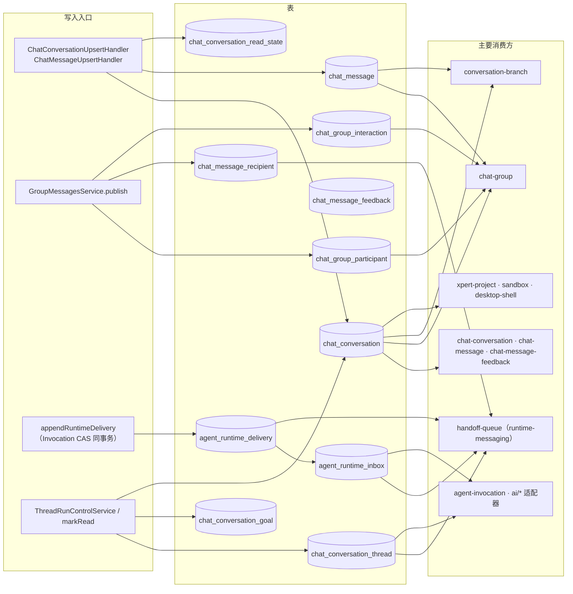

# 对话与会话域 · 数据流向与消费（C4）

> 记录本域 11 张持久化表的数据实体视角：谁写、谁读、为什么存在、详细流向在哪。
> 「主要消费方」为模块级概括，来自 `/root/xpert/.fe-index/xpert-server/tables.md` 的反向索引扫描结果，标 `[基于引用扫描，未深入验证]`；精确到 handler 的影响面需现场 grep。
> 基类说明：全部 11 张表继承 `TenantOrganizationBaseEntity`（`id`/`createdAt`/`updatedAt`/`createdById`/`updatedById`/`tenantId`/`organizationId`），本域**不使用** `WorkspaceBaseEntity`。

## 目录

- [总览](#总览)
- [会话族（4 张）](#会话族4-张)
- [消息与反馈（2 张）](#消息与反馈2-张)
- [群聊协作（3 张）](#群聊协作3-张)
- [运行时投递（2 张）](#运行时投递2-张)
- [无表实体：conversation-map](#无表实体conversation-map)
- [跨实体不变量](#跨实体不变量)

## 总览

图表来源：[conversation.entity.ts](file://packages/server-ai/src/chat-conversation/conversation.entity.ts)、[chat-message.entity.ts](file://packages/server-ai/src/chat-message/chat-message.entity.ts)、[group.entity.ts](file://packages/server-ai/src/chat-group/group.entity.ts)、[runtime-message.entity.ts](file://packages/server-ai/src/handoff/runtime-messaging/runtime-message.entity.ts)、[tables.md](file://.fe-index/xpert-server/tables.md)（反查索引）

## 会话族（4 张）

### 1. `chat_conversation`

- **实体类型**：聚合根（会话），本域唯一的 `purpose` 判别载体（`private | group | group_assistant_runtime`）。
- **结构**：`chat_conversation` — 关键列 `purpose`（默认 `private`）、`revision`（int 默认 0，"Public snapshot version, including changes that do not append a message"）、`lastMessageSequence`（int 默认 0，"Last allocated message position; allocated under the conversation row lock"）、`threadId`（varchar 可空，默认 `gen_random_uuid()`）、`branchSource`（jsonb 可空）；索引 `['tenantId','organizationId','id']`、`IDX_chat_conversation_profile_activity(tenantId,organizationId,xpertId,createdAt)`、部分唯一索引 `IDX_chat_conversation_branch_request(createdById, branchSource->>'threadId', branchSource->>'requestId') WHERE branchSource IS NOT NULL`。
- **生产方**：`ChatConversationUpsertHandler`（`ChatConversationService.create` 隐式初始化读状态）、`ConversationBranchService.branch`（新会话）、`GroupMembersService.create`（群会话与助手运行时会话）、`ThreadRunControlService.finish` / `recoverExpiredRun`（`status`/`error` 列，仅 `repository.update`）。
- **主要消费方**：`chat-conversation`（31）、`chat-group`（27）、`xpert`（12）、`enterprise-chatkit`（9）、`xpert-project`（9）、`xpert-project-access`（8）、`sandbox`（7）、`ai`（6）、`xpert-task`（5）等 15 个模块 `[基于引用扫描，未深入验证]`。
- **业务用途**：一段对话的可寻址容器与访问授权判定对象。
- **详细流向**：见本文件「会话族」与 [C2 Recipe ①/②/③](file://.module-experts/后端专题/对话与会话专家/C2-使用流程.md)。

### 2. `chat_conversation_thread`

- **实体类型**：运行控制载体（一线程一运行态）。
- **结构**：`chat_conversation_thread` — 关键列 `threadId`（varchar(100) 非空）、`conversationId`（uuid 非空）、`status`（varchar 默认 `idle`）、`runControl`（jsonb，`TChatThreadRunControl`）、`runtimeContinuationBlockedAt`（timestamptz 可空，用户 stop 的持久时间戳）；唯一 `['threadId']`，索引 `['conversationId','updatedAt']`。
- **生产方**：`GroupMembersService.create/add`（助手私有线程）、`ConversationBranchService.branch`、`ThreadRunControlService.start/requestPause/finish/claimResume/cancel`、`ChatExecutionAdmissionService.lockRuntimeThread`（`orIgnore` 补建）。
- **主要消费方**：`handoff-queue`（15）、`chat-conversation`（14）、`chat-group`（9）、`agent-invocation`（3）、`ai`（3）、`desktop-shell`（3）、`sandbox`（3）等 10 个模块 `[基于引用扫描，未深入验证]`。
- **业务用途**：让「谁能推进这段对话」成为可加锁、可校验的持久事实。
- **详细流向**：见 [C2 Recipe ⑥](file://.module-experts/后端专题/对话与会话专家/C2-使用流程.md) 与 [C5 决策 ⑧](file://.module-experts/后端专题/对话与会话专家/C5-关键决策.md)。

### 3. `chat_conversation_goal`

- **实体类型**：线程级目标（每线程一个）。
- **结构**：`chat_conversation_goal` — 关键列 `conversationId`（uuid）、`threadId`（varchar）、`objective`（text）、`status`（varchar 默认 `active`）、`tokensUsed`（bigint 默认 0）、`continuationCount`（int 默认 0）；唯一 `['conversationId','threadId']`，查询索引 `['tenantId','organizationId','conversationId']`。
- **生产方**：`ChatConversationGoalService`（经 `/api/ai/conversations/:id/goal`；`/api/chat-conversation/:id/goal` 为已弃用兼容路由，每次访问打 `warn`）。
- **主要消费方**：`chat-conversation`（5），单一模块 `[基于引用扫描，未深入验证]`。
- **业务用途**：把长任务的目标与累计度量锚定在线程上（`token/elapsed` 是累计度量，不是消息计数）。
- **详细流向**：见本文件「会话族」；跨域读取归 `ai/*` 适配器。

### 4. `chat_conversation_read_state`

- **实体类型**：查看者视角的已读游标。
- **结构**：`chat_conversation_read_state` — 关键列 `conversationId`（非空）、`userId`（可空）、`lastReadAt`（timestamptz 非空）、`lastReadMessageId`（可空）；唯一 `IDX_chat_conversation_read_state_unique(tenantId,organizationId,conversationId,userId)`。
- **生产方**：`ChatConversationService.create` → `ensureInitialReadState`（失败仅 `logger.warn`，不阻断）、`markRead` → `resolveLastReadMessage` → `normalizeReadAt` → `saveConversationReadState`。
- **主要消费方**：`chat-conversation`（3），单一模块 `[基于引用扫描，未深入验证]`。
- **业务用途**：普通会话（非群聊）的未读语义载体。
- **详细流向**：见 [C2 Recipe ①](file://.module-experts/后端专题/对话与会话专家/C2-使用流程.md)；群聊未读走另一套（`lastMessageSequence > participant.readSequence`）。

## 消息与反馈（2 张）

### 5. `chat_message`

- **实体类型**：消息（含闭包表树形结构）。
- **结构**：`chat_message` — 关键列 `sequence`（int 可空，"未排序消息为空"）、`groupPublicationId`（varchar 可空，群发布幂等键）、`parentId`（可空）、`messageEnvelope`（jsonb 可空，唯一 provenance/presentation 契约）、`inputCheckpoint`/`outputCheckpoint`（jsonb）；唯一 `['conversationId','sequence']`、唯一 `['conversationId','groupPublicationId']`，索引 `['conversationId']`、`['createdInThreadId']`，另有 `@Tree('closure-table')` 闭包表；`conversation`/`execution` 均 `onDelete:'CASCADE'`。
- **生产方**：`ChatMessageUpsertHandler`（唯一写入口，含 `extractChatMessageTaskSummary` 二次 `save`）、`GroupMessagesService.publish`（分配 `sequence`、`groupPublicationId`）、`ConversationBranchService.branch`（复制谱系并重算 `messageHash`/`messagePathHash`）。
- **主要消费方**：`chat-group`（30）、`chat-conversation`（8）、`ai`（7）、`xpert-agent`（7）、`server-ai`（5）、`chat-message`（3）、`file-memory`（3）、`xpert`（3）、`conversation-branch`（2）、`enterprise-chatkit`（2）等 13 个模块 `[基于引用扫描，未深入验证]`。
- **业务用途**：会话的业务账本，同时承担分支锚点与祖先路径读取。
- **详细流向**：见 [C2 Recipe ①/②/③/⑨](file://.module-experts/后端专题/对话与会话专家/C2-使用流程.md) 与 [C5 决策 ⑦/⑪](file://.module-experts/后端专题/对话与会话专家/C5-关键决策.md)。

### 6. `chat_message_feedback`

- **实体类型**：用户反馈（对消息的评分与文本）。
- **结构**：`chat_message_feedback` — 关键列 `rating`（varchar 可空）、`content`（可空）、`conversationId`/`messageId`（可空）；除主键外**未声明额外索引或唯一约束**（同一用户可对同一消息留多条记录）；`conversation`/`message` 均 `onDelete:'CASCADE'`。
- **生产方**：`ChatMessageFeedbackService.createAuthorized/updateAuthorized/deleteAuthorized`（写入前必须过 `assertTargetAccess`/`assertMessageBelongsToConversation`）。
- **主要消费方**：`chat-message-feedback`（3），单一模块 `[基于引用扫描，未深入验证]`。
- **业务用途**：反馈回流到摘要（增改删后异步 `triggerSummary`，失败仅 `warn`）。
- **详细流向**：见本文件「消息与反馈」；HTTP 入口 `POST/PUT/DELETE /api/chat-message-feedback`。

## 群聊协作（3 张）

### 7. `chat_group_participant`

- **实体类型**：群成员（人 / 助手），承载助手私有运行时绑定。
- **结构**：`chat_group_participant` — 关键列 `groupId`/`subjectId`（uuid 非空）、`kind`（`user|assistant`）、`active`（布尔默认 `true`）、`runtimeConversationId`/`runtimeThreadId`/`principalUserId`（uuid 可空）、`contextSequence`/`readSequence`（int 默认 0）、`pinned`/`archived`；唯一 `['groupId','kind','subjectId']`，**实体未声明任何外键**，无数据库级级联。
- **生产方**：`GroupMembersService.create/add/remove`（`add` 命中既有成员则 `active=true`，活跃成员 `>=32` 抛 409；`remove` 置 `active=false` 并取消其相关收据与交互）、`GroupRuntimeService.finish`（推进 `contextSequence`）、`GroupMessagesService.preferences`（`readSequence` 用 `GREATEST` 且被封顶）。
- **主要消费方**：`chat-group`（32）、`ai`（1），共 2 个模块 `[基于引用扫描，未深入验证]`。
- **业务用途**：一条消息「发给了谁、谁被唤醒、谁的私有运行时会话是哪个」的绑定真相。
- **详细流向**：见 [C2 Recipe ③](file://.module-experts/后端专题/对话与会话专家/C2-使用流程.md) 与 [C5 决策 ⑩](file://.module-experts/后端专题/对话与会话专家/C5-关键决策.md)。

### 8. `chat_message_recipient`

- **实体类型**：逐成员投递收据（outbox 账本）。
- **结构**：`chat_message_recipient` — 关键列 `groupId`/`messageId`/`participantId`（uuid）、`status`（varchar 默认 `pending`）、`wake`（布尔默认 `false`）、`phase`（可空，`reserved|started|finalized`）、`nextAttemptAt`（timestamptz 默认 `now()`）、`leaseToken`/`leaseUntil`、`control`（jsonb）；唯一 `['messageId','participantId']`，扫描索引 `['status','nextAttemptAt']`；无 FK 声明。
- **生产方**：`GroupMessagesService.publish`（fan-out）、`GroupOutboxService.reconcile/deliver/route`（租约与状态）、`GroupRuntimeService.prepare/finish`（`starting`/`steering`/终态与 `phase`）、`GroupInteractionsService.respond`（恢复 `pending`）。
- **主要消费方**：`chat-group`（25），单一模块 `[基于引用扫描，未深入验证]`。
- **业务用途**：可见性投影与投递进度共用同一账本；源码注释原文："recipient rows are durable delivery receipts, not a second queue."
- **详细流向**：见 [C2 Recipe ③/④](file://.module-experts/后端专题/对话与会话专家/C2-使用流程.md)；`failed` 只在传输重试耗尽时出现（`attempts>=9`）。

### 9. `chat_group_interaction`

- **实体类型**：HITL 交互（人工审批）。
- **结构**：`chat_group_interaction` — 关键列 `groupId`（uuid）、`interactionId`（varchar）、`participantId`/`assignedUserId`/`recipientId`/`runId`（uuid 非空）、`claimedBy`/`claimId`（uuid 可空）、`status`（varchar 默认 `pending`）、`payload`（jsonb 非空）；唯一 `['groupId','interactionId']`；无 FK 声明，`recipientId`/`runId` 为应用级关联。
- **生产方**：`GroupInteractionsService.register`（`interactionId = "{executionId}:{sha256(JSON.stringify(requests))}"`，`insert().orIgnore()` 幂等）、`claim`/`respond`（事务内悲观锁定交互行）。
- **主要消费方**：`chat-group`（6），单一模块 `[基于引用扫描，未深入验证]`。
- **业务用途**：把「人类必须在场才能推进」变成可认领、可去重的持久事实；`payload` 永不进入公开投影。
- **详细流向**：见本文件「群聊协作」；HTTP 入口 `POST /api/ai/groups/:groupId/interactions/:interactionId/claim|respond`。

## 运行时投递（2 张）

### 10. `agent_runtime_delivery`

- **实体类型**：投递意图（outbox）。
- **结构**：`agent_runtime_delivery` — 关键列 `messageId`（varchar 非空，**唯一**）、`invocationId`（uuid 非空）、`event`（jsonb 非空）、`state`（varchar 默认 `pending`）、`attempts`（int 默认 0）、`nextAttemptAt`（timestamptz 默认 `now()`）、`leaseToken`/`leaseUntil`、`lastError`（varchar 可空）；索引 `['state','nextAttemptAt']`（SQL 名 `IDX_runtime_delivery_due`）；SQL 迁移对 `tenant/organization` 与 `agent_invocation(id)` 均 `ON DELETE CASCADE`。
- **生产方**：`appendRuntimeDelivery(manager, invocation)` —— 由 `TypeOrmAgentInvocationStore` 在 Invocation CAS 事务内调用（`orIgnore()` 幂等）。
- **主要消费方**：`handoff-queue`（19）、`agent-invocation`（7）、`xpert-project-access`（1）、`xpert-project`（1），共 4 个模块 `[基于引用扫描，未深入验证]`。
- **业务用途**：把「已提交的 Invocation 事实」转成可重试的传输意图；投递状态故意与 Task/Invocation 状态解耦。
- **详细流向**：见 [C2 Recipe ④/⑦](file://.module-experts/后端专题/对话与会话专家/C2-使用流程.md) 与 [C5 决策 ②/③/④](file://.module-experts/后端专题/对话与会话专家/C5-关键决策.md)。

### 11. `agent_runtime_inbox`

- **实体类型**：消费收据（inbox）。
- **结构**：`agent_runtime_inbox` — 关键列 `consumptionKey`/`messageId`/`ownerId`（varchar）、`invocationId`（uuid）、`event`（jsonb 非空）、`state`（varchar 默认 `pending`）、`claim`（jsonb 可空）、`phase`（可空，`reserved|started`）、`nextAttemptAt`、`leaseToken`/`leaseUntil`、`lastError`、`attempts`；唯一 `(tenantId,organizationId,ownerId,consumptionKey)`，索引 `['state','nextAttemptAt']`；级联同 delivery。
- **生产方**：`RuntimeMessageInboxService.receive` → `lockInbox`（`orIgnore()` 插入 + `pessimistic_write` 读回）、`claimWait`（有界等待认领）、`RuntimeMessageContinuationService.reserve`（与 inbox 认领**同事务**预留新 execution）。
- **主要消费方**：`handoff-queue`（42）、`agent-invocation`（11）、`chat-group`（3）、`xpert-project-access`（1）、`xpert-project`（1），共 5 个模块 `[基于引用扫描，未深入验证]`。
- **业务用途**：保证「同一消费键只被处理一次」，并把结果与等待/续跑归属到具体 execution。
- **详细流向**：见 [C2 Recipe ④/⑨](file://.module-experts/后端专题/对话与会话专家/C2-使用流程.md)；`reserved` 可复用同一 execution ID，`started` 后只查该执行；`consumer_outcome_unknown` 不重放。

## 无表实体：conversation-map

**`conversation-map` 无表、无 entity、无迁移**（`ConversationMapModule` 的 `providers` 只有 `ConversationMapService` 与 `ConversationMapViewProvider`，无 `TypeOrmModule.forFeature`）。它是**只读视图**：能力通过 `@ViewExtensionProvider('platform.conversation-map')` 注册到宿主 Discovery，仅在 slot `AGENT_WORKBENCH_SLOT` 与 `activation.requiredFeatures=[CONVERSATION_MAP_FEATURE]` 满足时暴露 key `topics`（「对话脉络」）；`dataSource.mode='platform'`、`cache.enabled=false`，每次查询重算。

- **读取路径**：`getViewData` → `ConversationMapService.read` → `scope()`（host context 与 `RequestContext` 三重比对）→ `conversation()` → 线程/会话页投影（`turnNodes` 跳过 runtime 消息与非法角色，搜索只在纯文本块上匹配）。
- **写入路径**：`executeViewAction(key='act')` → `ConversationMapService.act`：`create` 用 `pg_advisory_xact_lock(hashtext('conversation-map:{userId}:{requestId}'))` + `requestId` 作会话 ID 实现幂等后走 `ChatConversationUpsertCommand`；`rename` 用原子 JSONB update；`branch` 转 `ConversationBranchCommand`；`side-chat` 走 `ChatConversationThreadService.copyThread`。
- **因此**：地图不产生新的数据实体，它的数据全部来自 `chat_conversation` / `chat_message` / `chat_conversation_thread`；「分支=写模型 / 地图=只读视图」这一对分工见 [C5 决策 ⑥](file://.module-experts/后端专题/对话与会话专家/C5-关键决策.md)。

章节来源：[conversation-map.module.ts](file://packages/server-ai/src/chat-conversation/conversation-map/conversation-map.module.ts)、[provider.ts](file://packages/server-ai/src/chat-conversation/conversation-map/provider.ts)、[service.ts（地图）](file://packages/server-ai/src/chat-conversation/conversation-map/service.ts)

## 跨实体不变量

| 不变量 | 落点 |
|---|---|
| 幂等靠唯一索引兜底 | `(conversationId,sequence)`、`(conversationId,groupPublicationId)`、`(groupId,kind,subjectId)`、`(messageId,participantId)`、`(groupId,interactionId)`、delivery `messageId` 唯一、inbox `(tenant,org,owner,consumptionKey)` 唯一 |
| 级联语义不对称 | `chat_conversation → message/thread/goal/read_state/feedback` 与 `chat_message → feedback/execution` 走数据库级联；群聊三表与 `branchSource` **无 FK**，跨表清理靠应用层（删除会话时遗漏即产生孤儿收据/交互） |
| 软删只在两处 | `ChatMessage.deletedAt`（`@DeleteDateColumn`）与 `ChatConversationSubscriber.beforeSoftRemove`（软删会话时清理 `McpAppHistory`）；其余硬删 + 级联 |
| `revision` 不是游标 | `revision` 既用于公开快照版本，也会因投递失败推进，不能当消息计数或回放游标 |
| 本域无 seed | 仓库 seed 在 `packages/server/src/core/seeds/`，只覆盖用户/角色/租户等系统默认数据，不含对话、群聊或投递表 |

章节来源：[conversation.entity.ts](file://packages/server-ai/src/chat-conversation/conversation.entity.ts)、[chat-message.entity.ts](file://packages/server-ai/src/chat-message/chat-message.entity.ts)、[group.entity.ts](file://packages/server-ai/src/chat-group/group.entity.ts)、[runtime-message.entity.ts](file://packages/server-ai/src/handoff/runtime-messaging/runtime-message.entity.ts)、[20261006-runtime-reliable-replies.sql](file://packages/server-ai/src/handoff/runtime-messaging/migrations/20261006-runtime-reliable-replies.sql)
