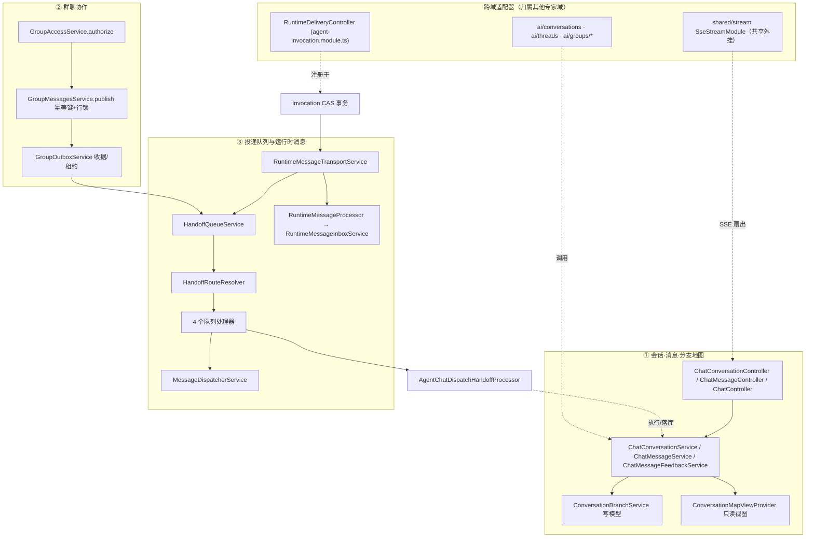

# 对话与会话域 · 架构（01-架构）

**本文引用的文件**
- [packages/server-ai/src/chat-conversation/conversation.module.ts](file://packages/server-ai/src/chat-conversation/conversation.module.ts)
- [packages/server-ai/src/chat-conversation/conversation.controller.ts](file://packages/server-ai/src/chat-conversation/conversation.controller.ts)
- [packages/server-ai/src/chat-conversation/conversation.service.ts](file://packages/server-ai/src/chat-conversation/conversation.service.ts)
- [packages/server-ai/src/chat-conversation/conversation.entity.ts](file://packages/server-ai/src/chat-conversation/conversation.entity.ts)
- [packages/server-ai/src/chat-conversation/thread-run-control.service.ts](file://packages/server-ai/src/chat-conversation/thread-run-control.service.ts)
- [packages/server-ai/src/chat-conversation/conversation-branch/conversation-branch.service.ts](file://packages/server-ai/src/chat-conversation/conversation-branch/conversation-branch.service.ts)
- [packages/server-ai/src/chat-conversation/conversation-branch/conversation-branch.module.ts](file://packages/server-ai/src/chat-conversation/conversation-branch/conversation-branch.module.ts)
- [packages/server-ai/src/chat-conversation/conversation-branch/branch.command.ts](file://packages/server-ai/src/chat-conversation/conversation-branch/branch.command.ts)
- [packages/server-ai/src/chat-conversation/conversation-map/service.ts](file://packages/server-ai/src/chat-conversation/conversation-map/service.ts)
- [packages/server-ai/src/chat-conversation/conversation-map/provider.ts](file://packages/server-ai/src/chat-conversation/conversation-map/provider.ts)
- [packages/server-ai/src/chat-conversation/conversation-map/conversation-map.module.ts](file://packages/server-ai/src/chat-conversation/conversation-map/conversation-map.module.ts)
- [packages/server-ai/src/chat-message/chat-message.entity.ts](file://packages/server-ai/src/chat-message/chat-message.entity.ts)
- [packages/server-ai/src/chat-message/chat-message.service.ts](file://packages/server-ai/src/chat-message/chat-message.service.ts)
- [packages/server-ai/src/chat-message/chat-message.module.ts](file://packages/server-ai/src/chat-message/chat-message.module.ts)
- [packages/server-ai/src/chat-message/commands/handlers/upsert.handler.ts](file://packages/server-ai/src/chat-message/commands/handlers/upsert.handler.ts)
- [packages/server-ai/src/chat-message-feedback/feedback.service.ts](file://packages/server-ai/src/chat-message-feedback/feedback.service.ts)
- [packages/server-ai/src/chat-message-feedback/feedback.module.ts](file://packages/server-ai/src/chat-message-feedback/feedback.module.ts)
- [packages/server-ai/src/chat/chat.module.ts](file://packages/server-ai/src/chat/chat.module.ts)
- [packages/server-ai/src/chat/chat.controller.ts](file://packages/server-ai/src/chat/chat.controller.ts)
- [packages/server-ai/src/chat-group/chat-group.module.ts](file://packages/server-ai/src/chat-group/chat-group.module.ts)
- [packages/server-ai/src/chat-group/group-messages.service.ts](file://packages/server-ai/src/chat-group/group-messages.service.ts)
- [packages/server-ai/src/chat-group/group-outbox.service.ts](file://packages/server-ai/src/chat-group/group-outbox.service.ts)
- [packages/server-ai/src/chat-group/group-access.service.ts](file://packages/server-ai/src/chat-group/group-access.service.ts)
- [packages/server-ai/src/handoff/message-queue.module.ts](file://packages/server-ai/src/handoff/message-queue.module.ts)
- [packages/server-ai/src/handoff/constants.ts](file://packages/server-ai/src/handoff/constants.ts)
- [packages/server-ai/src/handoff/message-queue.service.ts](file://packages/server-ai/src/handoff/message-queue.service.ts)
- [packages/server-ai/src/handoff/message-queue.processor.ts](file://packages/server-ai/src/handoff/message-queue.processor.ts)
- [packages/server-ai/src/handoff/message-dispatcher.service.ts](file://packages/server-ai/src/handoff/message-dispatcher.service.ts)
- [packages/server-ai/src/handoff/dispatcher/handoff-route-resolver.service.ts](file://packages/server-ai/src/handoff/dispatcher/handoff-route-resolver.service.ts)
- [packages/server-ai/src/handoff/README.md](file://packages/server-ai/src/handoff/README.md)
- [packages/server-ai/src/handoff/runtime-messaging/runtime-message-outbox.ts](file://packages/server-ai/src/handoff/runtime-messaging/runtime-message-outbox.ts)
- [packages/server-ai/src/handoff/runtime-messaging/runtime-message-transport.service.ts](file://packages/server-ai/src/handoff/runtime-messaging/runtime-message-transport.service.ts)
- [packages/server-ai/src/handoff/runtime-messaging/runtime-message-inbox.service.ts](file://packages/server-ai/src/handoff/runtime-messaging/runtime-message-inbox.service.ts)
- [packages/server-ai/src/handoff/runtime-messaging/runtime-message.entity.ts](file://packages/server-ai/src/handoff/runtime-messaging/runtime-message.entity.ts)
- [packages/server-ai/src/handoff/runtime-messaging/runtime-delivery.controller.ts](file://packages/server-ai/src/handoff/runtime-messaging/runtime-delivery.controller.ts)
- [packages/server-ai/src/agent-invocation/agent-invocation.module.ts](file://packages/server-ai/src/agent-invocation/agent-invocation.module.ts)
- [packages/server-ai/src/agent-invocation/typeorm-invocation.store.ts](file://packages/server-ai/src/agent-invocation/typeorm-invocation.store.ts)
- [packages/server-ai/src/ai/groups/group-scope.guard.ts](file://packages/server-ai/src/ai/groups/group-scope.guard.ts)
- [packages/contracts/src/ai/chat-activity.model.ts](file://packages/contracts/src/ai/chat-activity.model.ts)

## 目录
1. [专家域职责边界](#专家域职责边界)
2. [子专家划分说明](#子专家划分说明)
3. [子模块清单](#子模块清单)
4. [分层结构](#分层结构)
5. [依赖关系](#依赖关系)
6. [关键设计约束与不变量](#关键设计约束与不变量)
7. [架构总览](#架构总览)
8. [组件详细分析](#组件详细分析)
9. [结论](#结论)

## 专家域职责边界
**做什么**：会话/线程/目标/已读状态的持久化与访问授权（`ChatConversationService.assertAccess`）；消息落库、authorized 读取与反馈（`ChatMessageService`、`ChatMessageFeedbackService`）；分支（写模型，含检查点复制）与地图（只读导航视图）；群聊协作（成员、composer、发布幂等、收据、交互）；handoff 投递队列（4 队列/4 消费者/路由/取消/死信）与运行时消息闭环（delivery→inbox→续跑）。

**不做什么**：不执行模型、不拥有 Assistant 定义与版本、不拥有线程运行控制之外的执行器；不执行投递（消费者只调用本域服务）。

**跨域交叉引用（避免双计）**：
- `ai/conversations`、`ai/threads`、`ai/groups/*` 的 HTTP 适配器（`ConversationsController`、`ThreadsController`、`GroupsController` 等）按目录归属「Assistant 定义与运行时专家」；其调用的服务/命令/守卫逻辑在本域（`chat-group.module.ts` 注释明写 AIModule 仅托管已鉴权 HTTP 适配器）。
- handoff 的 `delivery/redrive`（`RuntimeDeliveryController`）物理注册在 `agent-invocation.module.ts` 的 controllers 中，按目录归属执行链域；inbox/delivery 实体与服务仍在本域源码树。
- `shared/stream`（`SseStreamModule` + `RedisSseStreamService`）是运行时可复用共享设施，本域仅作「共享依赖外挂」列出，不计入本域源码范围。

章节来源：[chat-group.module.ts](file://packages/server-ai/src/chat-group/chat-group.module.ts)（关键符号：ChatGroupModule）、[agent-invocation.module.ts](file://packages/server-ai/src/agent-invocation/agent-invocation.module.ts)（关键符号：AgentInvocationModule）、[group-scope.guard.ts](file://packages/server-ai/src/ai/groups/group-scope.guard.ts)（关键符号：GroupScopeGuard.canActivate）

## 子专家划分说明
① **会话·消息·分支地图**：`chat-conversation/`（含 `conversation-branch/`、`conversation-map/`、`goal/`、`commands/`、`queries/`）+ `chat-message/` + `chat-message-feedback/` + `chat/`。核心：`ChatConversationService`、`ChatConversationThreadService`、`ThreadRunControlService`、`ConversationBranchService`、`ConversationMapService`、`ChatMessageService`、`ChatMessageFeedbackService`、`ChatController`。
② **群聊协作**：`chat-group/`（含 `group-project/`）。核心：`GroupMessagesService`、`GroupOutboxService` + `GroupMessageProcessor`、`GroupMembersService`、`GroupAccessService`、`GroupComposerService`、`GroupInteractionsService`、`GroupRuntimeService`、`GroupStreamService`。
③ **投递队列与运行时消息**：`handoff/`（含 `dispatcher/`、`plugins/`、`runtime-messaging/`）。核心：`HandoffQueueService`、`HandoffRouteResolver`、`HandoffRoutingConfigService`、`HandoffQueueGatewayService`、`MessageDispatcherService`、4 个队列处理器、`RuntimeMessageTransportService`、`RuntimeMessageInboxService`、`RuntimeMessageContinuationService`。

章节来源：[conversation.module.ts](file://packages/server-ai/src/chat-conversation/conversation.module.ts)（关键符号：ChatConversationModule）、[chat-group.module.ts](file://packages/server-ai/src/chat-group/chat-group.module.ts)（关键符号：ChatGroupModule）、[message-queue.module.ts](file://packages/server-ai/src/handoff/message-queue.module.ts)（关键符号：HandoffQueueModule）

## 子模块清单
| 目录 | 模块类 | 入口 | 对外接口 |
|---|---|---|---|
| `chat-conversation/` | `ChatConversationModule` | `conversation.module.ts` | `/api/chat-conversation`（RouterModule） |
| `chat-conversation/conversation-branch/` | `ConversationBranchModule` | `conversation-branch.module.ts` | 仅命令 `ConversationBranchCommand`，无 controller |
| `chat-conversation/conversation-map/` | `ConversationMapModule` | `conversation-map.module.ts` | View 扩展 provider，无 controller、无 entity |
| `chat-message/` | `ChatMessageModule` | `chat-message.module.ts` | `/api/chat-message` |
| `chat-message-feedback/` | `ChatMessageFeedbackModule` | `feedback.module.ts` | `/api/chat-message-feedback` |
| `chat/` | `ChatModule` | `chat.module.ts` | `/api/chat`（`ChatController`，无 RouterModule） |
| `chat-group/` | `ChatGroupModule` | `chat-group.module.ts` | 无 HTTP；由 `ai/groups` 适配器暴露 |
| `handoff/` | `HandoffQueueModule`（`@Global`） | `message-queue.module.ts` | 无自身 RouterModule；管理 4 个 Bull 队列 |

章节来源：[chat-message.module.ts](file://packages/server-ai/src/chat-message/chat-message.module.ts)（关键符号：ChatMessageModule）、[feedback.module.ts](file://packages/server-ai/src/chat-message-feedback/feedback.module.ts)（关键符号：ChatMessageFeedbackModule）、[chat.module.ts](file://packages/server-ai/src/chat/chat.module.ts)（关键符号：ChatModule）

## 分层结构
- **Controller**：`ChatConversationController`（`findMyAllPublic`/`getUnreadByXperts`/`findOneByThreadId`/`findOneById`/`resolveWorkbenchNavigation`/`updateConversation`/`deleteConversation`/`getThreadState`/goal CRUD/`markRead`/`cancelConversation`/附件与工作区文件）、`ChatConversationSidebarController`、`ChatMessageController.suggestedQuestions`、`ChatMessageFeedbackController`、`ChatController`（POST `@Sse`、`synthesize`、`speech-to-text`）。
- **Service**：`ChatConversationService`、`ChatConversationThreadService`、`ChatConversationGoalService`、`ThreadRunControlService`、`ConversationBranchService`、`ConversationMapService`、`ChatMessageService`、`ChatMessageFeedbackService`、群聊 8 个服务、handoff 队列/路由/网关/死信/取消/续跑服务。
- **CQRS Handler**：`chat-conversation/commands/handlers`（13 个）、`queries/handlers`（11 个）、`chat-message/commands/handlers`（4 个）、`handoff/commands/handlers`（2 个）、`runtime-messaging` 的 `ClaimAgentRuntimeResultsHandler`。
- **Processor**：`HandoffQueueProcessor`/`HandoffQueueRealtimeProcessor`/`HandoffQueueBatchProcessor`/`HandoffQueueIntegrationProcessor`、`ConversationSummaryProcessor`（Bull `conversation-summary`）、`GroupMessageProcessor`、`RuntimeMessageProcessor`、`AgentChatDispatchHandoffProcessor`。
- **Guard**：本域无自有守卫（`GroupScopeGuard` 位于 `ai/groups`，按目录归适配器域）；授权由 `ChatConversationService.assertAccess` 与 `GroupAccessService.authorize` 承担。
- **View Extension Provider**：`ConversationMapViewProvider`（`@ViewExtensionProvider('platform.conversation-map')`，slot `AGENT_WORKBENCH_SLOT`）。
- **Entity**：`ChatConversation`、`ChatConversationThread`、`ChatConversationGoal`、`ChatConversationReadState`、`ChatMessage`、`ChatMessageFeedback`、`GroupParticipant`、`GroupMessageRecipient`、`GroupInteraction`、`AgentRuntimeDelivery`、`AgentRuntimeInbox`。

章节来源：[conversation.controller.ts](file://packages/server-ai/src/chat-conversation/conversation.controller.ts)（关键符号：ChatConversationController）、[message-queue.processor.ts](file://packages/server-ai/src/handoff/message-queue.processor.ts)（关键符号：HandoffQueueProcessor.process）、[runtime-message.entity.ts](file://packages/server-ai/src/handoff/runtime-messaging/runtime-message.entity.ts)（关键符号：AgentRuntimeDelivery、AgentRuntimeInbox）

## 依赖关系
**出向（本域依赖）**：`@xpert-ai/server-core`（`TenantOrganizationBaseEntity`/`SharedModule`/`RedisModule`/`StorageFileModule`）、`@xpert-ai/plugin-sdk`、`@xpert-ai/contracts`；`copilot-checkpoint` —— `conversation.module.ts` 用 `TypeOrmModule.forFeature` **直引实体** `CopilotCheckpoint`/`CopilotCheckpointWrites`；`xpert-project`(+`XpertProjectAccessModule`)、`chat-message`、`file-understanding`（`FileAsset`）、`xpert-agent`(`XpertAgent`)/`xpert-agent-execution`、`artifacts`、`sandbox/volume`（`VOLUME_CLIENT` 会话工作区文件）、`assistant-binding`（`AssistantUserPreference`）、`knowledgebase`/`xpert-toolset`（经 `chat.module.ts`）、`shared/stream`（SSE 外挂）。
**入向（依赖本域）**：`ai`（会话/线程/群聊 HTTP 适配器与 `ConversationAgentRunsService`）、`chat`、`chat-message`、`chat-message-feedback`、`chat-group`、`sandbox`（会话沙箱上下文）、`xpert`/`xpert-task`/`xpert-project`（会话统计与任务会话）、`realtime-voice`、`agent-evolution`、`copilot`。

章节来源：[conversation.module.ts](file://packages/server-ai/src/chat-conversation/conversation.module.ts)（关键符号：ChatConversationModule）、[chat.module.ts](file://packages/server-ai/src/chat/chat.module.ts)（关键符号：ChatModule）、[conversation-branch.module.ts](file://packages/server-ai/src/chat-conversation/conversation-branch/conversation-branch.module.ts)（关键符号：ConversationBranchModule）

## 关键设计约束与不变量
1. **消息不可变与信封边界**：`messageEnvelope` JSONB 是唯一 provenance/presentation 契约（`MessageEnvelopes` 文档口径：信封不是命令/权限授予，不得写入 prompt、凭据、授权声明；分支复制保留原 envelope）。
2. **sequence 由会话行锁分配**：`ChatConversation.lastMessageSequence` 注释明写「allocated under the conversation row lock」，配合唯一索引 `(conversationId, sequence)`；实测当前唯一推进点是群聊 `publish`（`locked.lastMessageSequence++`），私有会话消息 `sequence` 可为空。
3. **分支复制含检查点**：事务内复制消息谱系 + `fileAssets` 链接 + `inputCheckpoint`/`outputCheckpoint`/`CopilotCheckpoint`，`requestId` 幂等。
4. **地图只读无表**：`ConversationMapService` 不落表，仅以 host context 与 `RequestContext` 三重比对后投影。
5. **群发布幂等键**：`groupPublicationId` + 唯一索引 `(conversationId, groupPublicationId)`，重复发布复用同一 messageId。
6. **inbox/outbox 与 Invocation CAS 同事务**：`appendRuntimeDelivery` 必须在 Invocation CAS 事务内执行（队列抖动不得丢弃已提交结果）。
7. **取消是协作式**：`AbortSignal` 传递，`dead(canceled:...)` 不进死信、不重试；active 取消 best-effort 且对竞态敏感。
8. **`enqueueAndWait` 仅本进程 best-effort**：跨实例不回调。
9. **租约防并发**：delivery/recipient 用 `leaseToken`+`leaseUntil` 的 UPDATE-claim，inbox 用悲观写锁 + `consumptionKey` 唯一索引。
10. **授权唯一入口**：会话侧必须经 `assertAccess(id,'read'|'contribute'|'manage')`，群侧必须经 `GroupAccessService.authorize`；绕过服务直查仓库即越权。

章节来源：[conversation.entity.ts](file://packages/server-ai/src/chat-conversation/conversation.entity.ts)（关键符号：ChatConversation.lastMessageSequence）、[chat-message.entity.ts](file://packages/server-ai/src/chat-message/chat-message.entity.ts)（关键符号：ChatMessage.sequence）、[runtime-message-outbox.ts](file://packages/server-ai/src/handoff/runtime-messaging/runtime-message-outbox.ts)（关键符号：appendRuntimeDelivery）、[README.md](file://packages/server-ai/src/handoff/README.md)（关键符号：Cancellation Principles）

## 架构总览

图表来源：[conversation.module.ts](file://packages/server-ai/src/chat-conversation/conversation.module.ts)（关键符号：ChatConversationModule）、[group-outbox.service.ts](file://packages/server-ai/src/chat-group/group-outbox.service.ts)（关键符号：GroupOutboxService.route）、[message-queue.module.ts](file://packages/server-ai/src/handoff/message-queue.module.ts)（关键符号：HandoffQueueModule）、[agent-invocation.module.ts](file://packages/server-ai/src/agent-invocation/agent-invocation.module.ts)（关键符号：AgentInvocationModule）

## 组件详细分析
### 会话与消息
`ChatConversationService` 继承 `TenantOrganizationAwareCrudService`，`create` 后容错初始化已读状态，`update` 对 `options` 做白名单（保留 `runtimeResources`、经 `mergeConversationOptionsSql` 合并）并拒绝 `projectId` 迁移；`assertAccess` 拒绝 `purpose==='group'`、仅放行 `isGroupRuntime` 的 `group_assistant_runtime`、Project 会话转 `assertCanRead/assertCanUse`。消息写入统一走 `ChatMessageUpsertCommand` → `ChatMessageUpsertHandler`（`applicationTracing.traceAsync('message.persist')` + taskSummary 抽取），读取统一经 `ChatMessageService.findOneAuthorized`。
章节来源：[conversation.service.ts](file://packages/server-ai/src/chat-conversation/conversation.service.ts)（关键符号：ChatConversationService.assertAccess）、[upsert.handler.ts](file://packages/server-ai/src/chat-message/commands/handlers/upsert.handler.ts)（关键符号：ChatMessageUpsertHandler.execute）

### 分支与地图
分支是**写模型**：`ConversationBranchService.branch` 在 `dataSource.transaction` 内对源线程 `pessimistic_write` 行锁，复制消息（含 `parentId`/`messageEnvelope`/checkpoints/`fileAssets`）并写 `branchSource`/`forkGraphRevision`，`requestId` 幂等（`findExistingBranch`）；`prepareBranch` 先校验路径与资产授权，`loadBranchPath` 供只读导航。地图是**只读视图**：`ConversationMapService` 无 entity，`scope()` 校验 host context 与 `RequestContext` 一致后 `read/projectOptions/act`，由 `ConversationMapViewProvider` 注册到 workbench slot。
章节来源：[conversation-branch.service.ts](file://packages/server-ai/src/chat-conversation/conversation-branch/conversation-branch.service.ts)（关键符号：ConversationBranchService.branch）、[service.ts](file://packages/server-ai/src/chat-conversation/conversation-map/service.ts)（关键符号：ConversationMapService.scope）、[provider.ts](file://packages/server-ai/src/chat-conversation/conversation-map/provider.ts)（关键符号：ConversationMapViewProvider）

### 群聊协作
`GroupMessagesService.publish` 在事务内锁 `purpose='group'` 的群会话行与运行线程行，写消息 + `groupPublicationId` 幂等键 + 逐成员 `chat_message_recipient` 收据；`snapshot` 按收据投影成员可见视图，`preferences` 以 `readSequence ≤ lastMessageSequence` 落库。投递侧 `GroupOutboxService` 实现 `HandoffOutboxAdapter`（`onModuleInit` 注册，复用 handoff 扫描），`deliver` 用租约 claim 后 enqueue，`route` 校验收据/成员并改写为 `AGENT_CHAT_DISPATCH_MESSAGE_TYPE`。
章节来源：[group-messages.service.ts](file://packages/server-ai/src/chat-group/group-messages.service.ts)（关键符号：GroupMessagesService.publish）、[group-outbox.service.ts](file://packages/server-ai/src/chat-group/group-outbox.service.ts)（关键符号：GroupOutboxService.route）、[group-access.service.ts](file://packages/server-ai/src/chat-group/group-access.service.ts)（关键符号：GroupAccessService.authorize）

### 投递队列与运行时消息
handoff 是 `@Global` 模块，注册 4 个 Bull 队列（`handoff`/`handoff:realtime`/`handoff:batch`/`handoff:integration`，job 名 `dispatch`，默认 `maxAttempts=3`，并发由 `XPERT_HANDOFF_DISPATCHER_CONCURRENCY` 与 `XPERT_HANDOFF_CONCURRENCY_{REALTIME,BATCH,INTEGRATION}` 控制）。运行时消息闭环：`appendRuntimeDelivery`（与 Invocation CAS 同事务）→ `RuntimeMessageTransportService`（`@Interval(5000)` 扫描 + 租约 + enqueue）→ `RuntimeMessageInboxService`（校验 delivery/事件/收件人一致，`lockInbox` 幂等入库，`claimWait` 认领结果）→ `RuntimeMessageContinuationService` 续跑（`reserve`/`run`/`recover`/`releaseUnusedReservation`）。
章节来源：[message-queue.module.ts](file://packages/server-ai/src/handoff/message-queue.module.ts)（关键符号：HandoffQueueModule）、[runtime-message-transport.service.ts](file://packages/server-ai/src/handoff/runtime-messaging/runtime-message-transport.service.ts)（关键符号：RuntimeMessageTransportService.deliver）、[runtime-message-inbox.service.ts](file://packages/server-ai/src/handoff/runtime-messaging/runtime-message-inbox.service.ts)（关键符号：RuntimeMessageInboxService.lockInbox）

## 结论
本域以「会话/消息持久化 + 幂等投递」为骨架：读侧坚持单一授权入口（`assertAccess`/`GroupAccessService`），写侧坚持幂等键 + 行锁/租约，取消坚持协作式语义。三种投影语义（`messageEnvelope`、`sequence`、群收据）构成跨子专家的一致契约。需要警惕的是适配器分散在 `ai/**` 与 `agent-invocation.module.ts`（装配与查找成本）、`sequence` 在私有路径未推进（跨路径语义不一致），以及 canceled 不进死信带来的失败可见性缺口。`TChatConversationStatus` 已核实为 `'idle' | 'busy' | 'pausing' | 'paused' | 'interrupted' | 'error'`。
章节来源：[chat-activity.model.ts](file://packages/contracts/src/ai/chat-activity.model.ts)（关键符号：TChatConversationStatus）、[README.md](file://packages/server-ai/src/handoff/README.md)（关键符号：Design Tradeoffs）
