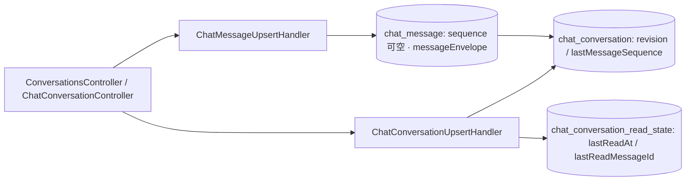
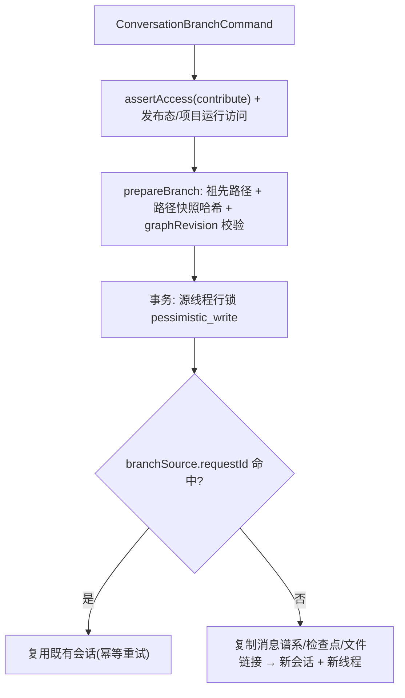
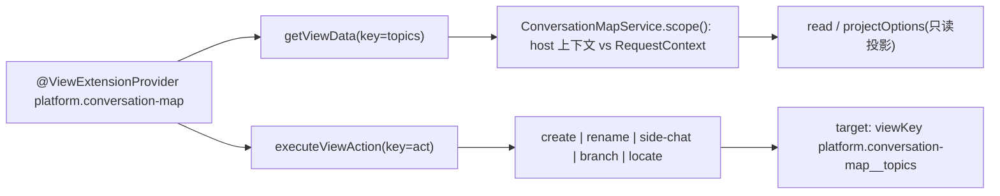
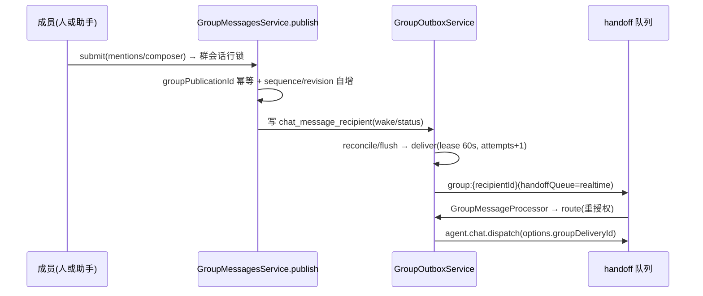
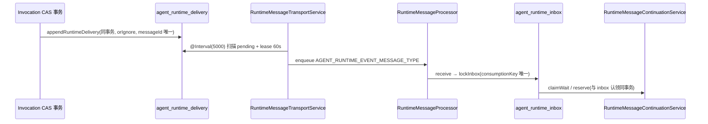
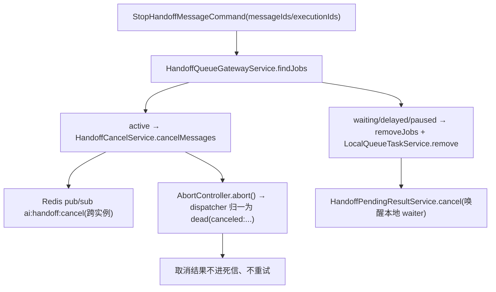
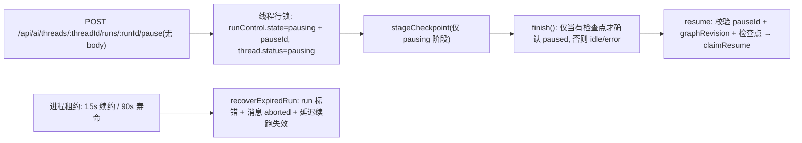

# 对话与会话域 · 数据流转

**本文引用的文件**

- [conversation.entity.ts](file://packages/server-ai/src/chat-conversation/conversation.entity.ts)（`ChatConversation`、`chat_conversation`）
- [conversation.service.ts](file://packages/server-ai/src/chat-conversation/conversation.service.ts)（`ChatConversationService.markRead/ensureInitialReadState/upsertConversationReadState`）
- [upsert.handler.ts（会话）](file://packages/server-ai/src/chat-conversation/commands/handlers/upsert.handler.ts)（`ChatConversationUpsertHandler`）
- [upsert.handler.ts（消息）](file://packages/server-ai/src/chat-message/commands/handlers/upsert.handler.ts)（`ChatMessageUpsertHandler`）
- [chat-message.entity.ts](file://packages/server-ai/src/chat-message/chat-message.entity.ts)（`ChatMessage`、`chat_message`）
- [message-envelope.schema.ts](file://packages/server-ai/src/chat-message/message-envelope.schema.ts)、[MESSAGE-ENVELOPES.md](file://packages/server-ai/src/chat-message/MESSAGE-ENVELOPES.md)
- [conversation-branch.service.ts](file://packages/server-ai/src/chat-conversation/conversation-branch/conversation-branch.service.ts)（`ConversationBranchService.branch`）
- [service.ts（地图）](file://packages/server-ai/src/chat-conversation/conversation-map/service.ts)、[provider.ts](file://packages/server-ai/src/chat-conversation/conversation-map/provider.ts)、[presentation.ts](file://packages/server-ai/src/chat-conversation/conversation-map/presentation.ts)
- [group-messages.service.ts](file://packages/server-ai/src/chat-group/group-messages.service.ts)、[group-outbox.service.ts](file://packages/server-ai/src/chat-group/group-outbox.service.ts)、[group-runtime.service.ts](file://packages/server-ai/src/chat-group/group-runtime.service.ts)
- [runtime-message-outbox.ts](file://packages/server-ai/src/handoff/runtime-messaging/runtime-message-outbox.ts)、[runtime-message-transport.service.ts](file://packages/server-ai/src/handoff/runtime-messaging/runtime-message-transport.service.ts)、[runtime-message.processor.ts](file://packages/server-ai/src/handoff/runtime-messaging/runtime-message.processor.ts)
- [runtime-message-inbox.service.ts](file://packages/server-ai/src/handoff/runtime-messaging/runtime-message-inbox.service.ts)、[runtime-message-continuation.service.ts](file://packages/server-ai/src/handoff/runtime-messaging/runtime-message-continuation.service.ts)、[README.md（runtime-messaging）](file://packages/server-ai/src/handoff/runtime-messaging/README.md)
- [README.md（handoff）](file://packages/server-ai/src/handoff/README.md)、[stop-handoff-message.handler.ts](file://packages/server-ai/src/handoff/commands/handlers/stop-handoff-message.handler.ts)、[handoff-cancel.service.ts](file://packages/server-ai/src/handoff/handoff-cancel.service.ts)、[constants.ts](file://packages/server-ai/src/handoff/constants.ts)
- [thread-run-control.service.ts](file://packages/server-ai/src/chat-conversation/thread-run-control.service.ts)、[thread-run-lease.ts](file://packages/server-ai/src/chat-conversation/thread-run-lease.ts)、[thread-run-control.md](file://packages/server-ai/src/chat-conversation/thread-run-control.md)、[chat-execution-admission.service.ts](file://packages/server-ai/src/chat-conversation/chat-execution-admission.service.ts)
- [chat-activity.model.ts](file://packages/contracts/src/ai/chat-activity.model.ts)、[chat-group.model.ts](file://packages/contracts/src/ai/chat-group.model.ts)、[agent-runtime-message.contract.ts](file://packages/plugin-sdk/src/lib/agent/handoff/agent-runtime-message.contract.ts)

## 目录

- [链路总览](#链路总览)
- [会话与消息写入链](#会话与消息写入链)
- [分支链](#分支链)
- [地图（脉络）链](#地图脉络链)
- [群聊发布链](#群聊发布链)
- [运行时消息链](#运行时消息链)
- [取消链](#取消链)
- [线程运行控制链](#线程运行控制链)
- [状态流转](#状态流转)
- [异步流与外部依赖](#异步流与外部依赖)
- [数据变换关键节点](#数据变换关键节点)
- [已知风险](#已知风险)

章节来源：[conversation.module.ts](file://packages/server-ai/src/chat-conversation/conversation.module.ts)、[chat-message.module.ts](file://packages/server-ai/src/chat-message/chat-message.module.ts)、[chat-group.module.ts](file://packages/server-ai/src/chat-group/chat-group.module.ts)（关键符号：`ChatConversationModule` / `ChatMessageModule` / `ChatGroupModule`）

## 链路总览

```mermaid
flowchart LR
    H["HTTP: /api/chat-conversation · /api/chat-message · /api/ai/*"] --> C["ChatConversationUpsertCommand"]
    H --> M["ChatMessageUpsertCommand"]
    C --> CT[("chat_conversation")]
    M --> MT[("chat_message")]
    CT --> RS[("chat_conversation_read_state")]
    MT --> GP["GroupMessagesService.publish"]
    GP --> RC[("chat_message_recipient")]
    RC --> GO["GroupOutboxService.route"]
    GO --> Q["handoff · handoff:realtime · handoff:batch · handoff:integration"]
    Q --> RD[("agent_runtime_delivery")]
    RD --> IN[("agent_runtime_inbox")]
    IN --> CO["RuntimeMessageContinuationService"]
    CO --> C
```

图表来源：[conversation.entity.ts](file://packages/server-ai/src/chat-conversation/conversation.entity.ts)（关键符号：`chat_conversation`）、[group-outbox.service.ts](file://packages/server-ai/src/chat-group/group-outbox.service.ts)（关键符号：`GroupOutboxService`）

- 写入侧只有两类持久化权威：会话/消息表（业务账本）与 `agent_runtime_delivery/inbox`、`chat_message_recipient`（投递与消费收据）；Handoff 队列始终是唯一执行队列。
- 读侧全部为投影：脉络视图、群快照、线程历史、未读统计都不产生新表。

章节来源：[constants.ts](file://packages/server-ai/src/handoff/constants.ts)、[runtime-messaging/README.md](file://packages/server-ai/src/handoff/runtime-messaging/README.md)（关键符号：`XPERT_HANDOFF_QUEUES`、`appendRuntimeDelivery`）

## 会话与消息写入链

图表来源：[upsert.handler.ts（会话）](file://packages/server-ai/src/chat-conversation/commands/handlers/upsert.handler.ts)（关键符号：`ChatConversationUpsertHandler`）、[upsert.handler.ts（消息）](file://packages/server-ai/src/chat-message/commands/handlers/upsert.handler.ts)（关键符号：`ChatMessageUpsertHandler`）

- 会话 upsert 先做 tenant/organization 归属匹配，再 `assertImmutableBindings`（`projectId`/`xpertId` 不可改）与 `pickMutableFields` 写白名单；创建路径经 `ChatConversationService.create` 隐式初始化本人读状态，失败仅告警不阻断。
- 消息 upsert 是 `ChatMessageService.create/save` 加任务摘要抽取；`sequence` 列可空，**只有群发布路径**在群会话行锁内分配，普通会话消息不分配（契约注释：更新复用原 sequence）。
- 因此普通会话的转录顺序由 `parentId` 父链与 `createdAt` 决定（订阅者 `afterLoad` 按 `createdAt` 排序），而群聊顺序由 `sequence` 定义；`revision` 在群发布事务内自增，并会因不追加消息的更新前进。
- 未读语义分两套：普通会话用 `chat_conversation_read_state`（`markRead` 解析最后已读消息），群聊用 `lastMessageSequence > participant.readSequence`。

章节来源：[conversation.service.ts](file://packages/server-ai/src/chat-conversation/conversation.service.ts)、[conversation.subscriber.ts](file://packages/server-ai/src/chat-conversation/conversation.subscriber.ts)（关键符号：`ensureInitialReadState`、`markRead`、`ChatConversationSubscriber`）

## 分支链

图表来源：[conversation-branch.service.ts](file://packages/server-ai/src/chat-conversation/conversation-branch/conversation-branch.service.ts)（关键符号：`ConversationBranchService.branch/prepareBranch/loadBranchPath`）

- 幂等键是 `(createdById, branchSource->>threadId, branchSource->>requestId)` 的部分索引；命中但参数不一致抛 `request_conflict`，事务内二次查询兜住并发。
- 复制按父先子后插入以重建闭包表，保留 `messageEnvelope` 原值，复制 `fileAssets`/`ConversationFileLink`（复制前重授权），并重算 `messageHash`/`messagePathHash`；线程 `metadata.forkGraphRevision` 记录锚定图版本。
- `branchSource` 只是审计数据、无外键级联：源会话删除不牵连目标会话。

章节来源：[conversation-branch.service.ts](file://packages/server-ai/src/chat-conversation/conversation-branch/conversation-branch.service.ts)、[message-path.ts](file://packages/server-ai/src/chat-conversation/message-path.ts)、[20260922-conversation-branch.sql](file://packages/server-ai/src/chat-conversation/migrations/20260922-conversation-branch.sql)（关键符号：`branchSource`、`messageAncestorPath`）

## 地图（脉络）链

图表来源：[provider.ts](file://packages/server-ai/src/chat-conversation/conversation-map/provider.ts)（关键符号：`ConversationMapViewProvider`）、[service.ts（地图）](file://packages/server-ai/src/chat-conversation/conversation-map/service.ts)（关键符号：`ConversationMapService.read/act`）

- 视图清单：slot `AGENT_WORKBENCH_SLOT`、key `topics`（"对话脉络"）、`requiredFeatures=[CONVERSATION_MAP_FEATURE]`、远端 iframe 组件、`cache.enabled=false`；数据源为平台模式，无自有实体与表。
- 读写动作不落新表：`act.create` 用 `pg_advisory_xact_lock(hashtext('conversation-map:{userId}:{requestId}'))` 加 `requestId` 作会话 ID 实现幂等，再走 `ChatConversationUpsertCommand`；`branch` 转 `ConversationBranchCommand`；`side-chat` 走 `ChatConversationThreadService.copyThread`。
- 投影只保留可见内容：`turnNodes`/`humanMessageSummary` 丢弃 `isRuntimeChatMessage` 与非法角色，搜索只在纯文本块上匹配。

章节来源：[service.ts（地图）](file://packages/server-ai/src/chat-conversation/conversation-map/service.ts)、[presentation.ts](file://packages/server-ai/src/chat-conversation/conversation-map/presentation.ts)（关键符号：`ConversationMapService.projectOptions`、`turnNodes`）

## 群聊发布链

图表来源：[group-messages.service.ts](file://packages/server-ai/src/chat-group/group-messages.service.ts)（关键符号：`GroupMessagesService.publish`）、[group-outbox.service.ts](file://packages/server-ai/src/chat-group/group-outbox.service.ts)（关键符号：`GroupOutboxService.deliver/route`）

- 发布事务：锁 `purpose='group'` 会话行；助手工具发布额外锁其运行时线程并校验 `runControl.executionId` 前缀 `tool:{executionId}:`；`key = publicationId ?? "{authorId}:{clientMessageId}"` 命中既有 `groupPublicationId` 时按内容一致返回既有消息（否则 `groupConflict`）。
- 反爆炸：`hop >= 8` 或同根消息数 `>= 32` 拒绝；`reply` 必须命中原请求、且该收据未被回复/未 blocked/canceled/failed；回复时回填 `replyMessageId`。
- 收据语义：`wake` 与 `status` 决定是否真正唤醒助手（`pending` 仅用于可唤醒投递，其余 `consumed`）；`deliver` 用 lease 抢占，失败按 `5000*2^n` 退避至 300s，`attempts>=9` 置 `failed` 并给会话 `revision` 加一。
- dispatch 阶段头：接收方线程 `busy` 则 `handoffQueue=realtime`，否则 `handoff`，`policyTimeoutMs=3600000`；`route` 会重查成员 `active`，成员被移除置 `blocked(member_removed)`。收尾由 `FinishGroupChatCommand` 对账（`GroupRuntimeService.finish`）。

章节来源：[group-messages.service.ts](file://packages/server-ai/src/chat-group/group-messages.service.ts)、[group-runtime.service.ts](file://packages/server-ai/src/chat-group/group-runtime.service.ts)、[group-dispatch.commands.ts](file://packages/server-ai/src/chat-group/group-dispatch.commands.ts)（关键符号：`GroupMessageRecipient`、`FinishGroupChatCommand`）

## 运行时消息链

图表来源：[runtime-message-outbox.ts](file://packages/server-ai/src/handoff/runtime-messaging/runtime-message-outbox.ts)（关键符号：`appendRuntimeDelivery`）、[runtime-message-inbox.service.ts](file://packages/server-ai/src/handoff/runtime-messaging/runtime-message-inbox.service.ts)（关键符号：`RuntimeMessageInboxService.lockInbox/claimWait`）

- 事件只由 Invocation 事实派生：终态出 `result`，`waiting` 且有 interaction 出 `input_request`，其余（含 progress）不产出；`messageId = runtime-{invocationId}-{kind}-{revision}`，`orIgnore()` 保幂等。
- 传输只做重授权 + 入队，`nextAttemptAt=+30s` 是"重发节流"而非回执：enqueue 成功不等于送达，lost ack 会重发同一通知（消费必须幂等）。
- inbox 认领：`consumptionKey = agentRuntimeResultConsumptionKey(invocationId, replyTo)`（输入请求另加 `:input:{interactionId}`），insert-or-ignore 后 `pessimistic_write` 锁定；`result` 落定后同事务把既有 `input_request` 行标 `processed/superseded`，并把 delivery 置 `received`。
- `claimWait` 要求消费者执行仍为 RUNNING 且同线程，写入 `claim{invocationId,resultRevision,recipient,consumer{type:'wait',executionId,callId}}`；续跑 `reserve/run` 与 inbox 认领同事务预留新 execution，busy 线程挂起，paused/interrupted/审批/显式 stop 阻断自动续跑（`runtimeContinuationBlockedAt`），模糊结果 `consumer_outcome_unknown` 不重放。

章节来源：[README.md（runtime-messaging）](file://packages/server-ai/src/handoff/runtime-messaging/README.md)、[runtime-message-transport.service.ts](file://packages/server-ai/src/handoff/runtime-messaging/runtime-message-transport.service.ts)、[runtime-message-continuation.service.ts](file://packages/server-ai/src/handoff/runtime-messaging/runtime-message-continuation.service.ts)（关键符号：`RuntimeMessageContinuationService.reserve/run`）

## 取消链

图表来源：[stop-handoff-message.handler.ts](file://packages/server-ai/src/handoff/commands/handlers/stop-handoff-message.handler.ts)（关键符号：`StopHandoffMessageHandler.execute`）、[handoff-cancel.service.ts](file://packages/server-ai/src/handoff/handoff-cancel.service.ts)（关键符号：`HandoffCancelService`）

- 匹配口径：`message.id` 或 `payload.executionId`；返回结构化摘要 `requested/matched/removed/aborted/notFound` 供调用方决策。
- 取消是协作式：只发 `AbortSignal`，不强杀 CPU 密集代码；队列查找用扫描而非 Redis 索引（低频、简单、成本随 job 量增长）。
- 会话侧集成：`CancelConversationHandler` 先取消执行，再 best-effort 发 `StopHandoffMessageCommand`，失败仅告警；SSE 客户端断开也会带 `reason='SSE client disconnected'` 触发同一命令。

章节来源：[README.md（handoff）](file://packages/server-ai/src/handoff/README.md)、[handoff/message-queue.processor.ts](file://packages/server-ai/src/handoff/message-queue.processor.ts)、[cancel-reason.ts](file://packages/server-ai/src/handoff/cancel-reason.ts)（关键符号：`buildCanceledReason`、`isCanceledReason`）

## 线程运行控制链

图表来源：[thread-run-control.service.ts](file://packages/server-ai/src/chat-conversation/thread-run-control.service.ts)（关键符号：`ThreadRunControlService.requestPause/finish/recoverExpiredRun`）、[thread-run-lease.ts](file://packages/server-ai/src/chat-conversation/thread-run-lease.ts)（关键符号：`RUN_LEASE_KEY`、`RUN_LEASE_MS`）

- 受理 ≠ 检查点完成：202 + `pauseId` 只表示 `pausing`；重复请求同一次活跃暂停返回同一 token；旧执行无法暂停替代它的新 run。
- 每个根式入口经 `ChatExecutionAdmissionService.run` 取得线程写者资格：`automatic` 续跑要求 `runControl.executionId/state` 与 `status='busy'` 完全匹配，否则抛 `RuntimeMessageBlocked`。
- 进程丢失：租约写在线程 `metadata[chatkitRunLease]`（公开 DTO 不含），到期由替代进程在一个事务内把未收尾 run 置 `error`、执行置 INTERRUPTED、思考中消息置 `aborted`、等待记录置 `stale`；无租约的旧 run 不按时长猜死，只能显式 stop。

章节来源：[thread-run-control.md](file://packages/server-ai/src/chat-conversation/thread-run-control.md)、[chat-execution-admission.service.ts](file://packages/server-ai/src/chat-conversation/chat-execution-admission.service.ts)（关键符号：`lockRuntimeThread`、`ChatExecutionAdmissionService.run`）

## 状态流转

| 状态机 | 取值 | 驱动点 |
| --- | --- | --- |
| `TChatConversationStatus` | `idle · busy · pausing · paused · interrupted · error` | 会话 `status` 与线程 `status`（线程默认 `idle`） |
| `TChatThreadRunControl.state` | `running · pausing · paused` | `start`/`requestPause`/`finish`/`cancel` |
| participant | `active` 布尔（移除成员保留记录用于署名） | `GroupMembersService` |
| recipient `status` | `pending · starting · steering · consumed · blocked · canceled · failed` | 发布与 runtime/dispatch 对账 |
| recipient `phase` | `reserved · started · finalized` | 运行前准备与收尾（独立于公开状态） |
| `agent_runtime_delivery.state` | `pending · received · blocked · failed` | 传输扫描与 inbox 确认 |
| `agent_runtime_inbox.state` | `pending · processing · processed · blocked · failed` | 认领、等待、结果消费 |

- 线程终态收敛：`finish` 在 `pausing` 且有检查点时转 `paused`，否则清空 `runControl` 落 `idle/interrupted/error`；`cancel` 直接 `interrupted` 并写 `runtimeContinuationBlockedAt`。

章节来源：[chat-activity.model.ts](file://packages/contracts/src/ai/chat-activity.model.ts)、[chat-group.model.ts](file://packages/contracts/src/ai/chat-group.model.ts)、[agent-runtime-message.contract.ts](file://packages/plugin-sdk/src/lib/agent/handoff/agent-runtime-message.contract.ts)（关键符号：`TChatConversationStatus`、`ChatGroupDeliveryStatus`、`agentRuntimeDeliveryStateSchema`）

## 异步流与外部依赖

- 队列：`handoff`、`handoff:realtime`、`handoff:batch`、`handoff:integration`，job 名统一 `dispatch`，默认 `maxAttempts=3`；并发默认 20（`XPERT_HANDOFF_DISPATCHER_CONCURRENCY`，实时/批处理/集成分别由 `XPERT_HANDOFF_CONCURRENCY_REALTIME|BATCH|INTEGRATION` 覆盖）。
- 摘要：Bull 队列 `conversation-summary` + `ConversationSummaryProcessor`，由 `ChatConversationService.triggerSummary` 投递、`ScheduleSummaryJobCommand`/`CancelSummaryJobCommand` 调度。
- 出站轮询：`RuntimeMessageTransportService.@Interval(5000)` 扫描 `agent_runtime_delivery` 并调用 `HandoffOutboxAdapters.reconcile()`，后者驱动 `GroupOutboxService.reconcile`（活跃收据轮转 take 100、待投递 take 20）。
- 跨实例信号：Redis pub/sub `ai:handoff:cancel`（取消）与 `ai:handoff:agent-chat:` 前缀（实时 SSE 回调）；`enqueueAndWait` 只等本进程回调，跨实例不会回调（注释明写 best-effort）。
- 数据库协调：会话行锁/线程行锁（`pessimistic_write`）、`orIgnore()` 幂等插入、唯一索引兜底、advisory lock（地图 create）。

章节来源：[constants.ts](file://packages/server-ai/src/handoff/constants.ts)、[message-queue.processor.ts](file://packages/server-ai/src/handoff/message-queue.processor.ts)、[summary.job.ts](file://packages/server-ai/src/chat-conversation/summary.job.ts)、[message-queue.service.ts](file://packages/server-ai/src/handoff/message-queue.service.ts)（关键符号：`enqueueAndWait`）

## 数据变换关键节点

- 信封生成与校验：可信生产者写 `options.messageEnvelope`，命令/队列入队处经 `parseChatMessageEnvelope` 一次校验（失败 400），持久化到 `ChatMessage.messageEnvelope`；读取侧 `readChatMessageEnvelope` 容错返回 `undefined`。
- 非法版本策略：`version` 只接受字面量 `1`；非法/未知持久化版本的展示对公开历史隐藏，但运行时水合仍保留用于执行与诊断；公开 mutation 白名单不含该字段，分支复制保留原信封。
- 群快照投影：`snapshot` 按 `sequence` 倒序取 `limit+1` 判定 `hasMore`，附成员、收据、运行状态与交互（HITL）后再反转为正序。
- 线程/脉络读投影：`projectThreadTurns` 剔除 runtime 消息、pending/canceled 追单、未完成 AI 状态，并按字符预算截断；`READ_THREAD_PATH_SQL` 沿 `parentId` 递归并按人类轮次限深。
- 摘要抽取：消息 upsert 后按内容/引用/文件变化触发 `extractChatMessageTaskSummary` 二次保存。

章节来源：[message-envelope.schema.ts](file://packages/server-ai/src/chat-message/message-envelope.schema.ts)、[MESSAGE-ENVELOPES.md](file://packages/server-ai/src/chat-message/MESSAGE-ENVELOPES.md)、[thread-read-projection.ts](file://packages/server-ai/src/chat-conversation/thread-read-projection.ts)、[thread-history.query.ts](file://packages/server-ai/src/chat-conversation/thread-history.query.ts)（关键符号：`parseChatMessageEnvelope`、`projectThreadTurns`、`READ_THREAD_PATH_SQL`）

## 已知风险

1. **写入序列只覆盖群聊**：`sequence` 由群发布在群会话行锁内分配，普通会话消息可长期为 `NULL`；若后续要按游标翻页，需要新增分配点并回填。
2. **写热点**：单会话（群）行锁串行化发布，`revision/lastMessageSequence` 自增；高并发单群是热点，跨群无冲突。
3. **取消语义**：协作式 + 扫描式；扫描与 abort 之间完成的作业可能正常结束（明写竞态）；`dead(canceled:...)` 不进死信、不重试，可能掩盖真实失败。
4. **投递/消费双写**：enqueue 不构成回执，lost ack 会重发；消费必须幂等，`consumer_outcome_unknown` 只能人工 redrive 同一执行身份，不自动重放。
5. **隐藏 ≠ 未参与推理**：`presentation='runtime'` 或非法版本消息不进公开历史，但仍在模型祖先与重试路径中。
6. **群 outbox 恢复靠轮询**：5000ms 扫描 + 30s 节流 + 指数退避（上限 300s），9 次后 `failed` 且会话 `revision++`，需人工介入。
7. **租约与僵尸 run**：投递/收据共享 60s 数据库租约；线程进程租约 15s/90s，多实例续约失败会把 run 标错；无租约旧 run 不会被自动回收。
8. **权限边界**：`ConversationMapService.scope()` 与 `GroupAccessService.authorize` 是视图/群聊的越权闸门；`GroupScopeGuard` 对 JWT 用户直接放行，仅收紧 client_secret/api_key 并强制 `USER_CONVERSATION` 绑定——群路由守卫覆盖需逐控制器核对。
9. **`enqueueAndWait` 跨实例不回调**（best-effort），调用方可能挂起到超时；`assertAccess`/`withReply` 之外直查仓库即越权。

章节来源：[group-scope.guard.ts](file://packages/server-ai/src/ai/groups/group-scope.guard.ts)、[README.md（handoff）](file://packages/server-ai/src/handoff/README.md)、[group-outbox.service.ts](file://packages/server-ai/src/chat-group/group-outbox.service.ts)（关键符号：`GroupScopeGuard`、`GroupOutboxService.deliver`）
