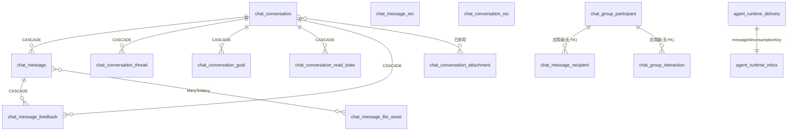

# 对话与会话域 · 模型

**本文引用的文件**

- [conversation.entity.ts](file://packages/server-ai/src/chat-conversation/conversation.entity.ts)（`ChatConversation`）
- [conversation-thread.entity.ts](file://packages/server-ai/src/chat-conversation/conversation-thread.entity.ts)（`ChatConversationThread`）
- [conversation-read-state.entity.ts](file://packages/server-ai/src/chat-conversation/conversation-read-state.entity.ts)（`ChatConversationReadState`）
- [conversation-goal.entity.ts](file://packages/server-ai/src/chat-conversation/goal/conversation-goal.entity.ts)（`ChatConversationGoal`）
- [chat-message.entity.ts](file://packages/server-ai/src/chat-message/chat-message.entity.ts)（`ChatMessage`）
- [feedback.entity.ts](file://packages/server-ai/src/chat-message-feedback/feedback.entity.ts)（`ChatMessageFeedback`）
- [group.entity.ts](file://packages/server-ai/src/chat-group/group.entity.ts)（`GroupParticipant`、`GroupMessageRecipient`、`GroupInteraction`）
- [runtime-message.entity.ts](file://packages/server-ai/src/handoff/runtime-messaging/runtime-message.entity.ts)（`AgentRuntimeDelivery`、`AgentRuntimeInbox`）
- [conversation-file-link.entity.ts](file://packages/server-ai/src/file-understanding/entities/conversation-file-link.entity.ts)、[file-asset.entity.ts](file://packages/server-ai/src/file-understanding/entities/file-asset.entity.ts)
- [20260922-conversation-branch.sql](file://packages/server-ai/src/chat-conversation/migrations/20260922-conversation-branch.sql)、[20261005-message-envelope.sql](file://packages/server-ai/src/chat-message/migrations/20261005-message-envelope.sql)、[20261006-runtime-reliable-replies.sql](file://packages/server-ai/src/handoff/runtime-messaging/migrations/20261006-runtime-reliable-replies.sql)
- [message-envelope.schema.ts](file://packages/server-ai/src/chat-message/message-envelope.schema.ts)、[upsert.handler.ts（会话）](file://packages/server-ai/src/chat-conversation/commands/handlers/upsert.handler.ts)
- [conversation.service.ts](file://packages/server-ai/src/chat-conversation/conversation.service.ts)、[conversation-branch.service.ts](file://packages/server-ai/src/chat-conversation/conversation-branch/conversation-branch.service.ts)
- [chat-group-entity.model.ts](file://packages/contracts/src/ai/chat-group-entity.model.ts)、[chat-activity.model.ts](file://packages/contracts/src/ai/chat-activity.model.ts)、[chat.model.ts](file://packages/contracts/src/ai/chat.model.ts)
- [core/seeds/seed.ts](file://packages/server/src/core/seeds/seed.ts)、[README.md（runtime-messaging）](file://packages/server-ai/src/handoff/runtime-messaging/README.md)

## 目录

- [实体基类分层](#实体基类分层)
- [表与关系总览](#表与关系总览)
- [chat_conversation](#chat_conversation)
- [chat_conversation_thread](#chat_conversation_thread)
- [chat_conversation_goal](#chat_conversation_goal)
- [chat_conversation_read_state](#chat_conversation_read_state)
- [chat_message](#chat_message)
- [chat_message_feedback](#chat_message_feedback)
- [chat_group_participant](#chat_group_participant)
- [chat_message_recipient](#chat_message_recipient)
- [chat_group_interaction](#chat_group_interaction)
- [agent_runtime_delivery](#agent_runtime_delivery)
- [agent_runtime_inbox](#agent_runtime_inbox)
- [会话文件族与联结表](#会话文件族与联结表)
- [迁移与 seed 惯例](#迁移与-seed-惯例)
- [校验规则](#校验规则)
- [已知风险与坑](#已知风险与坑)

章节来源：[conversation.module.ts](file://packages/server-ai/src/chat-conversation/conversation.module.ts)、[20261006-runtime-reliable-replies.sql](file://packages/server-ai/src/handoff/runtime-messaging/migrations/20261006-runtime-reliable-replies.sql)（关键符号：`ChatConversationModule`、`agent_runtime_delivery`）

## 实体基类分层

- 全部 11 张表继承 `TenantOrganizationBaseEntity`（`@xpert-ai/server-core`）：主键 `id`、`createdAt/updatedAt`、`createdById/updatedById`、`tenantId/organizationId`（收发件与投递表在 SQL 迁移里显式声明为 `NOT NULL` 并对 `tenant/organization` 做 `ON DELETE CASCADE`）。
- 本域不使用 `WorkspaceBaseEntity`（工作区/`publishAt`/软删基类）——该基类存在于 `core/entities/base.entity.ts`，仅用于工作区域实体。
- 软删仅出现在两处：`ChatMessage.deletedAt`（`@DeleteDateColumn`）与订阅者 `ChatConversationSubscriber.beforeSoftRemove`（软删会话时清理 `McpAppHistory`）；其余表是硬删 + 级联。
- 对外契约分层：`IGroupParticipant`/`IGroupMessageRecipient`/`IGroupInteraction`（持久化契约）与 `ChatGroupMessage` 等公开投影分离，公开 DTO 不含技术主体与运行时绑定。

章节来源：[core/entities/base.entity.ts](file://packages/server-ai/src/core/entities/base.entity.ts)、[conversation.subscriber.ts](file://packages/server-ai/src/chat-conversation/conversation.subscriber.ts)（关键符号：`WorkspaceBaseEntity`、`ChatConversationSubscriber`）

## 表与关系总览

图表来源：[group.entity.ts](file://packages/server-ai/src/chat-group/group.entity.ts)（关键符号：`GroupParticipant`、`GroupMessageRecipient`）、[runtime-message.entity.ts](file://packages/server-ai/src/handoff/runtime-messaging/runtime-message.entity.ts)（关键符号：`AgentRuntimeDelivery`、`AgentRuntimeInbox`）

- 域内无真正的外键闭环：群聊三表只有唯一索引、无 `ManyToOne`；`agent_runtime_*` 的 `invocationId` 外键指向 `agent_invocation`（跨域，`ON DELETE CASCADE`，由 SQL 迁移建立）。

章节来源：[group.entity.ts](file://packages/server-ai/src/chat-group/group.entity.ts)、[20261006-runtime-reliable-replies.sql](file://packages/server-ai/src/handoff/runtime-messaging/migrations/20261006-runtime-reliable-replies.sql)（关键符号：`chat_group_participant`、`agent_runtime_inbox`）

## chat_conversation

- 关键列：`purpose` varchar 默认 `private`（`private|group|group_assistant_runtime`）；`revision` int 默认 0（公开快照版本）；`lastMessageSequence` int 默认 0（行锁内分配）；`branchSource` jsonb 可空；`threadId` varchar 可空 默认 `gen_random_uuid()`；`title`/`error`/`fromEndUserId` 可空；`status` varchar 可空（`TChatConversationStatus`）；`options`/`sourceAudit`/`operation` 为 `json` 可空（`options.bosiDefaultsApplied` 为服务端标记）；`from` varchar 可空；其余列见实体。
- 索引：`['tenantId','organizationId','id']`、`IDX_chat_conversation_profile_activity(tenantId,organizationId,xpertId,createdAt)`；迁移追加部分索引 `IDX_chat_conversation_branch_request(createdById, branchSource->>'threadId', branchSource->>'requestId') WHERE branchSource IS NOT NULL`。
- 关系与级联：`xpert`/`project` 为 `ManyToOne ... onDelete:'CASCADE'`，`task` 为 `onDelete:'SET NULL'`；`messages` OneToMany（cascade insert/update/remove/soft-remove/recover）；`threads` OneToMany（cascade insert/update）；`attachments` ManyToMany → `chat_conversation_attachment`（已 `@deprecated`）。
- 业务约束：`projectId`/`xpertId` 不可变更（upsert 处理器断言）；实体无归档字段，归档/置顶由用户偏好承载；`options` 更新有白名单与 `ignoredOptions` 保护。

章节来源：[conversation.entity.ts](file://packages/server-ai/src/chat-conversation/conversation.entity.ts)、[chat.model.ts](file://packages/contracts/src/ai/chat.model.ts)（关键符号：`ChatConversation`、`branchSource`、`revision`）

## chat_conversation_thread

- 关键列：`threadId` varchar(100) 非空（唯一）；`conversationId` uuid 非空；`parentThreadId`/`headMessageId`/`forkedFromMessageId` 可空；`status` varchar 默认 `idle`（`TChatConversationStatus`）；`runControl` jsonb 可空（`TChatThreadRunControl`）；`runtimeContinuationBlockedAt` timestamptz 可空（用户 stop 的持久时间戳）；`encryptedRunContext` text 可空且 `select:false` + `@Exclude`；`error` text、`operation` jsonb；`metadata` jsonb 默认 `'{}'`（含 `title`/`primary`/`purpose`/`forkGraphRevision`/`forkRequestId` 与私有租约键）。
- 索引：`['threadId']` 唯一、`['conversationId','updatedAt']`。
- 关系与级联：`conversation` `onDelete:'CASCADE'`；`headMessage` `onDelete:'SET NULL'`（删消息不断线程）。
- 业务约束：线程是运行控制的唯一载体（`runControl` + 进程租约），公开 DTO 不返回租约与加密上下文。

章节来源：[conversation-thread.entity.ts](file://packages/server-ai/src/chat-conversation/conversation-thread.entity.ts)、[thread-run-lease.ts](file://packages/server-ai/src/chat-conversation/thread-run-lease.ts)（关键符号：`ChatConversationThread`、`RUN_LEASE_KEY`）

## chat_conversation_goal

- 关键列：`conversationId` uuid 非空；`threadId` varchar 非空；`objective` text；`goalSpec` jsonb 可空；`status` varchar 默认 `active`；`tokensUsed` bigint 默认 0（transformer 转 number）；`elapsedSeconds`/`continuationCount` int 默认 0；`statusUpdatedAt`/`completedAt`/`blockedAt` timestamptz 可空。
- 索引与唯一：`['conversationId','threadId']` 唯一（每线程一个目标）；`['tenantId','organizationId','conversationId']` 查询索引。
- 关系与级联：`conversation` `onDelete:'CASCADE'`。
- 业务约束：目标按线程隔离，`token/elapsed` 是累计度量，不是消息计数。

章节来源：[conversation-goal.entity.ts](file://packages/server-ai/src/chat-conversation/goal/conversation-goal.entity.ts)（关键符号：`ChatConversationGoal`、`chat_conversation_goal`）

## chat_conversation_read_state

- 关键列：`conversationId` 非空；`userId` 可空；`lastReadAt` timestamptz 非空；`lastReadMessageId` 可空。
- 索引与唯一：`IDX_chat_conversation_read_state_unique(tenantId,organizationId,conversationId,userId)` 唯一。
- 关系与级联：`conversation` 与 `user` 均 `onUpdate:'CASCADE', onDelete:'CASCADE'`。
- 业务约束：读状态属于查看者（包括助手所有或共享项目会话的读者）；`chat_message` 删除不回落已读位置，未读仅比较时间戳/最后已读消息。

章节来源：[conversation-read-state.entity.ts](file://packages/server-ai/src/chat-conversation/conversation-read-state.entity.ts)、[conversation.service.ts](file://packages/server-ai/src/chat-conversation/conversation.service.ts)（关键符号：`ChatConversationReadState`、`markRead`）

## chat_message

- 关键列：`sequence` int 可空（未排序消息为空）；`groupPublicationId` varchar 可空；`groupCommunication` jsonb 可空；`parentId` 可空；`inputCheckpoint`/`outputCheckpoint`（后者 `@Exclude`）/`historicalAgentRuns` jsonb；`role` varchar；`content`/`reasoning`/`references`/`taskSummary`/`summaryJob`/`thirdPartyMessage`/`events` 为 `json`；`status` varchar；`messageEnvelope` jsonb 可空；`deletedAt` timestamptz（软删）。
- 关键列（续）：`conversationId`/`executionId`/`createdInThreadId` varchar(100)；`followUpMode`（`queue|steer`）、`followUpStatus`（`pending|consumed|canceled`）、`targetExecutionId`、`visibleAt` timestamptz——追单可见性与投递门控。
- 索引与唯一：`['conversationId','sequence']` 唯一、`['conversationId','groupPublicationId']` 唯一、`['conversationId']`、`['createdInThreadId']`；`@Tree('closure-table')` 额外维护闭包表。
- 关系与级联：`conversation` 与 `execution` 均 `onDelete:'CASCADE'`；`attachments` ManyToMany → `chat_message_attachment`（已 `@deprecated`）；`fileAssets` ManyToMany → `chat_message_file_asset`。
- 业务约束：公开 mutation 白名单不含 `messageEnvelope`；`sequence` 更新复用原值；树形结构支撑分支锚点与祖先路径读取。

章节来源：[chat-message.entity.ts](file://packages/server-ai/src/chat-message/chat-message.entity.ts)（关键符号：`ChatMessage`、`chat_message_file_asset`）

## chat_message_feedback

- 关键列：`rating` varchar 可空（`ChatMessageFeedbackRatingEnum`）；`content` 可空；`conversationId`/`messageId` 可空。
- 索引与唯一：除主键外未声明额外索引或唯一约束（同一用户可对同一消息留多条记录）。
- 关系与级联：`conversation` 与 `message` 均 `onDelete:'CASCADE'`。
- 业务约束：写入前必须校验目标可见性（`assertTargetAccess`/`assertMessageBelongsToConversation`）。

章节来源：[feedback.entity.ts](file://packages/server-ai/src/chat-message-feedback/feedback.entity.ts)、[feedback.service.ts](file://packages/server-ai/src/chat-message-feedback/feedback.service.ts)（关键符号：`ChatMessageFeedback`、`chat_message_feedback`）

## chat_group_participant

- 关键列：`groupId`/`subjectId` uuid 非空；`kind` varchar（`user|assistant`）；`name` varchar；`role` varchar 默认 `member`；`active` 布尔默认 `true`；`runtimeConversationId`/`runtimeThreadId`/`principalUserId` uuid 可空；`contextSequence`/`readSequence` int 默认 0；`pinned`/`archived` 布尔默认 `false`。
- 索引与唯一：`['groupId','kind','subjectId']` 唯一（同群同主体只一条成员）。
- 关系与级联：实体未声明任何 `ManyToOne`/外键，因此**无数据库级级联**，成员记录随会话清理由应用层负责。
- 业务约束：`active=false` 表示已移除但保留署名；`name` 只是展示，身份与授权一律用 `subjectId`；助手运行时绑定必须与公开群线程分离。

章节来源：[group.entity.ts](file://packages/server-ai/src/chat-group/group.entity.ts)、[chat-group-entity.model.ts](file://packages/contracts/src/ai/chat-group-entity.model.ts)（关键符号：`GroupParticipant`、`IGroupParticipant`）

## chat_message_recipient

- 关键列：`groupId`/`messageId`/`participantId` uuid；`status` varchar 默认 `pending`；`wake` 布尔默认 `false`；`replyMessageId`/`executionId`/`inputMessageId` uuid 可空；`phase` varchar 可空；`error` varchar；`attempts`/`contextSequence` int 默认 0；`nextAttemptAt` timestamptz 默认 `now()`；`startedAt`/`leaseToken`/`leaseUntil` 可空；`control` jsonb 可空（保存暂停恢复所需的授权命令）。
- 索引与唯一：`['messageId','participantId']` 唯一（一人一收据）；`['status','nextAttemptAt']` 扫描索引。
- 关系与级联：同样无 FK 声明，靠应用层与群会话清理保持一致。
- 业务约束：收据是投递账本而非第二个执行队列；`failed` 只在传输重试耗尽时出现，恢复扫描只处理 `pending+wake` 与 `starting/steering`。

章节来源：[group.entity.ts](file://packages/server-ai/src/chat-group/group.entity.ts)、[group-outbox.service.ts](file://packages/server-ai/src/chat-group/group-outbox.service.ts)（关键符号：`GroupMessageRecipient`、`GroupOutboxService.reconcile`）

## chat_group_interaction

- 关键列：`groupId` uuid、`interactionId` varchar；`participantId`/`assignedUserId`/`recipientId`/`runId` uuid 非空；`claimedBy`/`claimId` uuid 可空；`status` varchar 默认 `pending`；`payload` jsonb 非空。
- 索引与唯一：`['groupId','interactionId']` 唯一（去重键独立于主键）。
- 关系与级联：无 FK 声明；`recipientId`/`runId` 为应用级关联。
- 业务约束：认领与响应都在事务内悲观锁定交互行（`claim`/`respond`），指定人类处理 HITL 审批；payload 不得进入公开投影。

章节来源：[group.entity.ts](file://packages/server-ai/src/chat-group/group.entity.ts)、[group-interactions.service.ts](file://packages/server-ai/src/chat-group/group-interactions.service.ts)（关键符号：`GroupInteraction`、`GroupInteractionsService.claim/respond`）

## agent_runtime_delivery

- 关键列：`messageId` varchar 非空（唯一）；`invocationId` uuid 非空；`ownerId` varchar；`event` jsonb 非空；`state` varchar 默认 `pending`；`attempts` int 默认 0；`nextAttemptAt` timestamptz 默认 `now()`；`leaseToken` uuid 可空；`leaseUntil` timestamptz 可空；`lastError` varchar 可空。
- 索引与唯一：`['messageId']` 唯一；`['state','nextAttemptAt']`（SQL 中名 `IDX_runtime_delivery_due`）。
- 关系与级联：SQL 迁移对 `tenant/organization` 与 `agent_invocation(id)` 均 `ON DELETE CASCADE`。
- 业务约束：只有 Invocation 事实能产出事件（`result`/`input_request`）；投递状态故意与 Task/Invocation 状态解耦；`messageId` 由 `invocationId+kind+revision` 派生，重复插入用 `orIgnore`。

章节来源：[runtime-message.entity.ts](file://packages/server-ai/src/handoff/runtime-messaging/runtime-message.entity.ts)、[20261006-runtime-reliable-replies.sql](file://packages/server-ai/src/handoff/runtime-messaging/migrations/20261006-runtime-reliable-replies.sql)（关键符号：`AgentRuntimeDelivery`、`agent_runtime_delivery`）

## agent_runtime_inbox

- 关键列：`consumptionKey`/`messageId`/`ownerId` varchar；`invocationId` uuid；`event` jsonb 非空；`state` varchar 默认 `pending`；`claim` jsonb 可空；`phase` varchar 可空（`reserved|started`）；`nextAttemptAt` timestamptz 默认 `now()`；`leaseToken`/`leaseUntil` 可空；`lastError` varchar；`attempts` int 默认 0。
- 索引与唯一：`(tenantId,organizationId,ownerId,consumptionKey)` 唯一；`['state','nextAttemptAt']`。
- 关系与级联：同 `agent_runtime_delivery`（`invocationId` → `agent_invocation` CASCADE）。
- 业务约束：`reserved` 可复用同一 execution ID，`started` 后只查该执行；最终结果会把既有 `input_request` 行标为 `processed/superseded`；等待与异步追单共用同一 `consumptionKey`。

章节来源：[runtime-message.entity.ts](file://packages/server-ai/src/handoff/runtime-messaging/runtime-message.entity.ts)、[runtime-message-inbox.service.ts](file://packages/server-ai/src/handoff/runtime-messaging/runtime-message-inbox.service.ts)（关键符号：`AgentRuntimeInbox`、`lockInbox`）

## 会话文件族与联结表

- `file_asset`（`FileAsset`）：`storageFileId`/`conversationId`/`threadId`/`projectId`/`xpertId`/`userId` 可空，`originalName`/`fileName`/`mimeType`/`sha256`/`summary`/`error` 可空，`size` bigint 可空，`purpose` 默认 `chat_attachment`、`parseMode` 默认 `auto`、`status` 默认 `uploaded`，`capabilities`/`metadata` json，`parsedAt`/`failedAt` timestamptz；索引覆盖 `storageFileId`、`conversationId`、`(tenantId,organizationId,projectId)`、`threadId`、`sha256`。
- `conversation_file_link`（`ConversationFileLink`）：`conversationId`、`fileAssetId` uuid、`storageFileId` uuid 可空、`threadId` 可空、`metadata` json；唯一 `['conversationId','fileAssetId']` + `['storageFileId']` 索引。
- 联接表：`chat_conversation_attachment`（已弃用）、`chat_message_attachment`（已弃用）、`chat_message_file_asset`（新路径）。
- 业务约束：新上传走 `FileAsset` + `ConversationFileLink`，旧 `StorageFile` 关系只服务历史记录；分支复制会同时复制 `ConversationFileLink` 并重授权。

章节来源：[file-asset.entity.ts](file://packages/server-ai/src/file-understanding/entities/file-asset.entity.ts)、[conversation-file-link.entity.ts](file://packages/server-ai/src/file-understanding/entities/conversation-file-link.entity.ts)、[conversation-branch.service.ts](file://packages/server-ai/src/chat-conversation/conversation-branch/conversation-branch.service.ts)（关键符号：`FileAsset`、`ConversationFileLink`）

## 迁移与 seed 惯例

- 本域 SQL 迁移共 3 个：`chat-conversation/migrations/20260922-conversation-branch.sql`（加 `chat_message.outputCheckpoint/historicalAgentRuns`、`chat_conversation.branchSource` 及部分索引，注释说明"既有消息保持未锚定"）、`chat-message/migrations/20261005-message-envelope.sql`（加 `chat_message.messageEnvelope` jsonb）、`handoff/runtime-messaging/migrations/20261006-runtime-reliable-replies.sql`（建 `agent_runtime_delivery`/`agent_runtime_inbox`、加 `chat_conversation_thread.runtimeContinuationBlockedAt`、`agent_invocation` 观测列与 `xpert_project_task_execution` 派发列）。
- 执行方式：无 ORM 迁移器，是在 **TypeORM schema 同步关闭的部署**里手工按序执行（psql）文件；三个文件都是 `IF NOT EXISTS` 的加性、可重复执行迁移，其中本域两文件用 `BEGIN/COMMIT` 包裹；`20261006` 要求先应用 `xpert-project/migrations/20261006-project-task-runtime.sql`，再启动更新后的宿主。
- 参数与顺序约束：`20261005` 必须在启用信封特性前应用（`MESSAGE-ENVELOPES.md`）；`20261006` 需先部署消费者再部署生产者（滚动策略）。
- seed：本域**无 seed 文件**；仓库 seed 惯例在 `packages/server/src/core/seeds/`（`SeederModule`/`SeedDataService.runDefaultSeed`，入口 `packages/server/src/seed.ts`），仅覆盖用户/角色/租户等系统默认数据，不含对话、群聊或投递表。

章节来源：[20260922-conversation-branch.sql](file://packages/server-ai/src/chat-conversation/migrations/20260922-conversation-branch.sql)、[20261005-message-envelope.sql](file://packages/server-ai/src/chat-message/migrations/20261005-message-envelope.sql)、[20261006-runtime-reliable-replies.sql](file://packages/server-ai/src/handoff/runtime-messaging/migrations/20261006-runtime-reliable-replies.sql)、[core/seeds/seed.ts](file://packages/server/src/core/seeds/seed.ts)（关键符号：`SeedDataService`、`apply-before-deploy`）

## 校验规则

- class-validator：实体上只有轻量装饰器（`IsString`/`IsOptional`/`IsJSON`/`IsObject`/`IsDate`），它们不构成授权或业务校验，仅约束 DTO 形状。
- Zod 边界校验：`chatMessageEnvelopeSchema`（`version` 字面量 1、`source` 严格判别联合、invocation 关联必须匹配，失败抛 `Error.ChatMessageEnvelopeInvalid`）；`ConversationBranchService` 的 `requestSchema`（UUID/长度）；`mapQuerySchema`/`mapActionSchema`；`groupJobSchema`、`agentRuntimeEventSchema`。
- 数据库约束：唯一/部分唯一索引承担幂等与去重（`(conversationId,sequence)`、`(conversationId,groupPublicationId)`、`(groupId,kind,subjectId)`、`(messageId,participantId)`、`(groupId,interactionId)`、`messageId` 唯一、`(tenant,org,owner,consumptionKey)` 唯一），配合 `orIgnore()` 插入与悲观行锁保证并发安全。
- 服务级授权：`ChatConversationService.assertAccess(id,'read'|'contribute'|'manage')`、`ChatMessageService.findOneAuthorized`、`GroupAccessService.authorize`、`RuntimeMessageAccessService.withReply`、`ConversationMapService.scope()`（宿主上下文 vs `RequestContext` 三元比对）；`ChatConversationUpsertHandler` 的 `assertImmutableBindings` + `pickMutableFields` 写白名单拒绝改 `projectId/xpertId` 与保留列。

章节来源：[message-envelope.schema.ts](file://packages/server-ai/src/chat-message/message-envelope.schema.ts)、[upsert.handler.ts（会话）](file://packages/server-ai/src/chat-conversation/commands/handlers/upsert.handler.ts)、[service.ts（地图）](file://packages/server-ai/src/chat-conversation/conversation-map/service.ts)（关键符号：`parseChatMessageEnvelope`、`assertImmutableBindings`、`ConversationMapService.scope`）

## 已知风险与坑

1. **`sequence` 行锁与写热点**：唯一索引 `(conversationId,sequence)` 允许大量 `NULL`；只有群发布在群会话行锁内自增 `lastMessageSequence`，普通会话消息常驻 `NULL`，排序依赖 `createdAt`——跨域读取方不能假定 `sequence` 恒存在。
2. **envelope 版本兼容**：写入端只接受 `version=1`，历史非法版本对公开投影隐藏却仍参与运行时水合；`readChatMessageEnvelope` 静默吞错，读侧无法区分"无信封"与"损坏信封"。
3. **附件双路径一致性与弃用**：`chat_conversation_attachment`/`chat_message_attachment` 仍在实体上保留 `cascade: true`，与 `file_asset`/`conversation_file_link` 并存；写入新路径、读取两路径容易产生可见性差异，分支复制显式复制两套关系。
4. **投递/收据双写与 lost ack**：`agent_runtime_delivery` 与 `agent_runtime_inbox` 是"至少一次"语义（enqueue 不确认），同一 `messageId` 会重发；接收端依赖 `consumptionKey` 唯一 + `orIgnore` 才能去重，模糊结果只能人工 redrive。
5. **lease 过期与僵尸 run**：投递/收据共享 60s 数据库租约，线程进程租约 15s 续约/90s 寿命；到期会把 run 直接标错（不制造假 pause），而无租约的旧 run 永远不会被时长推断回收，需显式 stop。
6. **级联语义不对称**：`chat_conversation→chat_message/thread/goal/read_state/feedback` 与 `chat_message→feedback/execution` 走数据库级联；但群聊三表与 `branchSource` 无 FK，跨表清理只能靠应用层——删除会话时遗漏即产生孤儿收据/交互。
7. **群会话反爆炸阈值**：`hop>=8` 与同根消息 `>=32` 是硬拒绝条件，调整需同步更新测试与文档；`revision` 既用于快照版本也会因投递失败推进，不能当消息计数或回放游标。

章节来源：[chat-message.entity.ts](file://packages/server-ai/src/chat-message/chat-message.entity.ts)、[group-messages.service.ts](file://packages/server-ai/src/chat-group/group-messages.service.ts)、[thread-run-control.md](file://packages/server-ai/src/chat-conversation/thread-run-control.md)、[README.md（runtime-messaging）](file://packages/server-ai/src/handoff/runtime-messaging/README.md)（关键符号：`ChainSize`/`hop` 阈值、`consumer_outcome_unknown`）
