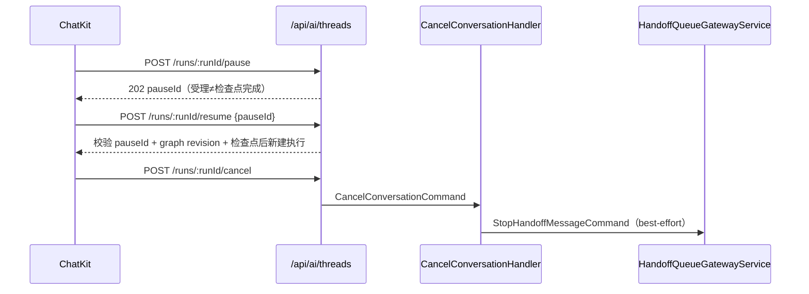

# 对话与会话域 · 接口说明（05）

**本文引用的文件**

- [packages/server-ai/src/chat-conversation/conversation.controller.ts](file://packages/server-ai/src/chat-conversation/conversation.controller.ts)
- [packages/server-ai/src/chat-conversation/conversation-sidebar.controller.ts](file://packages/server-ai/src/chat-conversation/conversation-sidebar.controller.ts)
- [packages/server-ai/src/chat-conversation/conversation.module.ts](file://packages/server-ai/src/chat-conversation/conversation.module.ts)
- [packages/server-ai/src/chat-conversation/conversation.service.ts](file://packages/server-ai/src/chat-conversation/conversation.service.ts)
- [packages/server-ai/src/chat-conversation/commands/index.ts](file://packages/server-ai/src/chat-conversation/commands/index.ts)
- [packages/server-ai/src/chat-conversation/queries/index.ts](file://packages/server-ai/src/chat-conversation/queries/index.ts)
- [packages/server-ai/src/chat/chat.controller.ts](file://packages/server-ai/src/chat/chat.controller.ts)
- [packages/server-ai/src/chat-message/chat-message.controller.ts](file://packages/server-ai/src/chat-message/chat-message.controller.ts)
- [packages/server-ai/src/chat-message/MESSAGE-ENVELOPES.md](file://packages/server-ai/src/chat-message/MESSAGE-ENVELOPES.md)
- [packages/server-ai/src/chat-message-feedback/feedback.controller.ts](file://packages/server-ai/src/chat-message-feedback/feedback.controller.ts)
- [packages/server-ai/src/ai/conversation.controller.ts](file://packages/server-ai/src/ai/conversation.controller.ts)
- [packages/server-ai/src/ai/thread.controller.ts](file://packages/server-ai/src/ai/thread.controller.ts)
- [packages/server-ai/src/ai/conversation-artifacts.controller.ts](file://packages/server-ai/src/ai/conversation-artifacts.controller.ts)
- [packages/server-ai/src/ai/workbench-files.controller.ts](file://packages/server-ai/src/ai/workbench-files.controller.ts)
- [packages/server-ai/src/handoff/runtime-messaging/runtime-delivery.controller.ts](file://packages/server-ai/src/handoff/runtime-messaging/runtime-delivery.controller.ts)
- [packages/server-ai/src/handoff/runtime-messaging/runtime-message.errors.ts](file://packages/server-ai/src/handoff/runtime-messaging/runtime-message.errors.ts)
- [packages/server-ai/src/ai/groups/group-scope.guard.ts](file://packages/server-ai/src/ai/groups/group-scope.guard.ts)
- [packages/server-ai/src/ai/groups/group-workbench.guard.ts](file://packages/server-ai/src/ai/groups/group-workbench.guard.ts)
- [packages/server-ai/src/ai/assistant-file-access.guard.ts](file://packages/server-ai/src/ai/assistant-file-access.guard.ts)
- [packages/server-ai/src/shared/super-admin-organization-scope.service.ts](file://packages/server-ai/src/shared/super-admin-organization-scope.service.ts)
- [packages/server-ai/src/handoff/constants.ts](file://packages/server-ai/src/handoff/constants.ts)
- [packages/server-ai/src/handoff/README.md](file://packages/server-ai/src/handoff/README.md)
- [packages/server-ai/src/chat-conversation/thread-run-control.md](file://packages/server-ai/src/chat-conversation/thread-run-control.md)
- [packages/server/src/bootstrap/index.ts](file://packages/server/src/bootstrap/index.ts)

## 目录

1. [一、会话与侧边栏接口](#一会话与侧边栏接口)
2. [二、聊天主流程接口](#二聊天主流程接口)
3. [三、消息与反馈接口](#三消息与反馈接口)
4. [四、跨域适配器接口](#四跨域适配器接口)
5. [五、非 HTTP 入口](#五非-http-入口)
6. [六、鉴权约定](#六鉴权约定)
7. [七、消息 envelope 契约](#七消息-envelope-契约)
8. [八、错误语义](#八错误语义)

## 一、会话与侧边栏接口

全局前缀 `api`（`bootstrap/index.ts` 的 `app.setGlobalPrefix('api')`），模块前缀 `/chat-conversation`（`RouterModule.register`），因此实际路径为 `/api/chat-conversation/*`。控制器自身不挂 `@UseGuards`，仅 `@ApiBearerAuth()`；授权由全局鉴权 + `SuperAdminOrganizationScopeService.run` + `ChatConversationService.assertAccess` 共同承担。

| 方法 | 路径 | 鉴权 | 用途 | 关键参数与行为 | 主要错误 |
|---|---|---|---|---|---|
| GET | `/my` | 登录态 | `findMyAllPublic` 我的会话 | `data`(JSON) / `search`；强制 `createdById=当前用户` 且 `purpose='private'`；`assertSafeChatConversationRelations` | 403 `Error.ConversationUserContextRequired` |
| POST | `/unread/xperts` | 登录态 | `getUnreadByXperts` 未读汇总 | body `{xpertIds}`；`organizationId` 包裹 | 403（组织域越权） |
| GET | `/by-thread` | 登录态 | `findOneByThreadId` | `threadId`；`assertAccess` 后返回 PublicDTO | 403 `Error.ConversationAccessDenied` |
| GET | `/entry-by-thread` | 登录态 | `findEntryByThreadId` | `threadId` 走 `navigationThreadSchema`；`purpose='group'` 转 `GetGroupConversationEntryCommand` | 400 `ConversationMap.InvalidQuery`；403 |
| GET | `/:id` | 登录态 | `findOneById` 详情 | `UUIDValidationPipe`；`$relations`/`$select` | 403；404 |
| GET | `/:id/workbench-navigation` | 登录态 | 工作台导航解析 | `requesterXpertId`、`threadId`/`messageId` 走 Zod 校验 | 400 `ConversationMap.InvalidQuery` |
| PUT | `/:id` | `manage` | `updateConversation` | 仅白名单 `title/status/options`；`xpertId` 不可变更、首次绑定需 `FindXpertQuery` 校验归属 | 403 `ConversationXpertImmutable` / `AssistantAccessForbidden`；400 `InvalidThreadAssistantId` |
| DELETE | `/:id` | `manage` | `deleteConversation` | 直接删会话 | 403 |
| GET | `/:id/state` | `read` | `getThreadState` 线程态 | 返回 `ChatConversationService.getThreadState` | 403 |
| GET/PUT/PATCH/DELETE | `/:id/goal` | `read`/`contribute` | 目标读取与增改清 | **已弃用兼容路由**，写 `warnLegacyGoalRoute` 警告并指向 `/ai/conversations/{id}/goal` | 403 |
| POST | `/:id/read-state` | `read` | `markRead` 已读回执 | body `lastReadMessageId` | 403 |
| POST | `/:id/cancel` | `contribute` | `cancelConversation` 取消执行 | 转 `CancelConversationCommand({conversationId})`；失败原样抛出 | 403 |
| GET | `/xpert/:id` | 登录态 | `findByXpert` | 强制当前用户 + `purpose='private'` | 403 |
| GET | `/:id/attachments` | 登录态 | 旧附件族 | 返回 `StorageFilePublicDTO[]`（`chat_conversation_attachment` 已弃用路径） | 403 |
| GET | `/:id/files` | 登录态 | 工作区列表 | `path`、`deepth` | 403 |
| GET | `/:id/file` | 登录态 | 读工作区文件 | `path`、`fileAssetId`、`metadataOnly=true` | 403；文件不存在 |
| GET | `/:id/file/download` | 登录态 | 下载/打包 | 目录走 `archiver('zip')` 流式打包，含 `close`/`error` 中止清理 | 403 |
| PUT | `/:id/file` | `contribute` | 保存文件 | body `{path, content}` | 403 |
| POST | `/:id/file/upload` | `contribute` | 上传文件 | `FileInterceptor('file')` + body `path` | 403 |
| DELETE | `/:id/file` | `contribute` | 删除文件 | query `path` | 403 |
| GET | `/my/sidebar` | 登录态 | `ChatConversationSidebarService.list` | `xpertId`(UUID)、`take=10`、`skip=0`、`archived=false` | 400（管道） |
| PATCH | `/:id/sidebar` | 登录态 | 侧边栏状态更新 | body `Partial<TChatConversationSidebarState>` | 400/403 |

章节来源：[conversation.controller.ts](file://packages/server-ai/src/chat-conversation/conversation.controller.ts)（关键符号：ChatConversationController.findMyAllPublic / findEntryByThreadId / updateConversation / cancelConversation / markRead / downloadFile），[conversation-sidebar.controller.ts](file://packages/server-ai/src/chat-conversation/conversation-sidebar.controller.ts)（关键符号：ChatConversationSidebarController.list / update），[conversation.module.ts](file://packages/server-ai/src/chat-conversation/conversation.module.ts)（关键符号：ChatConversationModule.RouterModule.register）

## 二、聊天主流程接口

`ChatController` 的 `@Controller('chat')`，实际路径 `/api/chat`。

| 方法 | 路径 | 鉴权 | 用途 | 关键参数与行为 | 主要错误 |
|---|---|---|---|---|---|
| POST | `''`（`@Sse`） | 登录态 | 主聊天流 | body `{request, options}`；命令 `ChatCommand` 注入 `language/timeZone/tenantId/organizationId/user/from:'platform'`；`keepAlive(30000)` + `takeUntilClose`；响应头 `text/event-stream` | 由命令内部校验决定 |
| GET | `/synthesize`（`@Sse`） | 登录态 | 语音合成流 | `conversation_id`、`message_id`、`voice`、`language`、`draft=true`；连接关闭触发 `AbortController.abort()` | 同上 |
| POST | `/speech-to-text` | 登录态 | 语音转写 | `LazyFileInterceptor('file')` + body `xpertId` / `isDraft='true'`；`SpeechToTextCommand` | 400（上传校验） |

章节来源：[chat.controller.ts](file://packages/server-ai/src/chat/chat.controller.ts)（关键符号：ChatController.chat / synthesize / speechToText）

## 三、消息与反馈接口

| 方法 | 路径 | 鉴权 | 用途 | 关键参数与行为 | 主要错误 |
|---|---|---|---|---|---|
| GET | `/api/chat-message/:id/suggested-questions` | 登录态 | 建议问题 | 先 `findOneInOrganizationOrTenant`，再 `AssertChatConversationAccessQuery`，最后 `SuggestedQuestionsCommand` | 403；404 |
| GET | `/api/chat-message-feedback` | 登录态 | 反馈分页 | `data`/`$where`/`$relations`/`$order`/`$take`/`$skip`；`findAllAuthorized` | 403 |
| GET | `/api/chat-message-feedback/my` | 登录态 | 我的反馈 | 无 `userId` 直接 403 拒绝 | 403 |
| GET | `/api/chat-message-feedback/:id` | 登录态 | 单条反馈 | `$relations` 经安全断言 | 403；404 |
| POST | `/api/chat-message-feedback` | 登录态 | 创建反馈 | 201；`createAuthorized`，成功后异步 `triggerSummary`（失败仅 warn） | 403（缺 id） |
| PUT | `/api/chat-message-feedback/:id` | 登录态 | 更新反馈 | 202；`updateAuthorized` + `triggerSummary` | 403；404 |
| DELETE | `/api/chat-message-feedback/:id` | 登录态 | 删除反馈 | 202；先 `deleteSummary` 再 `deleteAuthorized` | 403；404 |

章节来源：[chat-message.controller.ts](file://packages/server-ai/src/chat-message/chat-message.controller.ts)（关键符号：ChatMessageController.suggestedQuestions），[feedback.controller.ts](file://packages/server-ai/src/chat-message-feedback/feedback.controller.ts)（关键符号：ChatMessageFeedbackController.create / update / delete / findMyAll）

## 四、跨域适配器接口

以下前缀的控制器物理注册在 AIModule / agent-invocation 模块，**不是本域拥有的 HTTP**；本域只提供被它们调用的命令、查询与服务。它们统一使用 `@Public()` + `@AllowClientSecretBindings(...)` + `ApiKeyOrClientSecretAuthGuard`。

| 方法 | 路径 | 归属 | 用途 | 关键行为 |
|---|---|---|---|---|
| POST/GET | `/api/ai/conversations`、`/search`、`/:conversation_id`(GET/PATCH/DELETE) | `ConversationsController` | 会话 CRUD/检索 | 会话/消息读写与产物接口均在此 |
| GET/PUT/PATCH/DELETE | `/api/ai/conversations/:conversation_id/goal` | 同上 | 目标正式路由（替代 `chat-conversation` 弃用路由） | 走 `ChatConversationGoalService` |
| GET | `/api/ai/conversations/:conversation_id/threads`、`/task-summary`、`/task-summary/:section` | 同上 | 线程列表、任务摘要 | 读侧投影 |
| POST/GET/PATCH/DELETE | `/api/ai/conversations/:conversation_id/messages[/search|/:message_id|/file-changes]` | 同上 | 消息检索与 CRUD | 写入走 `ChatMessageUpsertCommand`；envelope 字段不在写白名单 |
| POST/GET/PATCH/DELETE | `.../messages/:message_id/feedbacks[/search|/:feedback_id]` | 同上 | 会话内反馈 CRUD 与检索 | 授权经会话 `assertAccess` |
| POST | `/api/ai/threads`、`/search`、`/copy`、`/:thread_id/history`、`/:thread_id/state`、`/:thread_id/runs` | `ThreadsController` | 线程与 run 创建 | 每次先 `ensureThreadAccess` |
| POST | `/api/ai/threads/:thread_id/runs/stream`、`/runs/wait` | 同上 | `runStream` / `runWait` | 流式与有界等待 |
| GET | `/api/ai/threads/:thread_id/runs/:run_id/stream`（`@Sse`）、`/:run_id` | 同上 | `joinRunStream` / run 摘要 | SSE 连接释放 `releaseConnection` |
| POST | `/api/ai/threads/:thread_id/runs/:run_id/cancel` | 同上 | `cancelThreadRun` | `invocationKind='external_assistant'` 时转 `CancelExternalAssistantCommand` |
| POST | `/api/ai/threads/:thread_id/runs/:run_id/pause` | 同上 | `pauseRun` | 无 body；`202 Accepted`；忽略旧请求体 |
| DELETE | `/api/ai/threads/:thread_id/display-pause/:pause_id` | 同上 | `releaseDisplayPause` | `204 No Content`，兼容旧 SDK |
| POST | `/api/ai/threads/:thread_id/runs/:run_id/resume` | 同上 | `resumeRun` | 必须携带 `pauseId`，转 `RunCreateStreamCommand` |
| GET | `/api/ai/threads/:thread_id/context-usage`、`/usage` | 同上 | `getThreadContextUsage` / 用量 | 只读查询 |
| GET | `/api/ai/conversations/:conversationId/artifacts/:artifactId/versions/:artifactVersionId/content` | `ConversationArtifactsController` | 产物读 | `@AllowClientSecretBindings(ENTERPRISE_XPERT)` |
| GET/PUT/POST/DELETE | `/api/ai/conversations/:conversationId/workspace/files`、`[workspace/file\|file]`、`/download`、`/upload` | `WorkbenchFilesController` | 工作台文件族 | `WorkbenchFilesAuthGuard`；上传限制 100MB |
| GET/POST/PATCH/DELETE | `/api/ai/groups/*`（`/:groupId`、`/:groupId/members`、`/:groupId/messages`、`/:groupId/preferences`、`/:groupId/interactions/*`） | `GroupsController` 等 | 群快照、成员、消息、控制、HITL | 群 HTTP 全部注册在 `ai/groups/` |
| GET/POST | `/api/ai/groups/:groupId/workbench/context`、`/workbench/*`、`/workbench/workspace-files/view-sessions` | 群工作台控制器族 | 群工作台上下文/视图/文件会话 | 叠 `GroupWorkbenchGuard` |
| GET | `/api/agent-invocations/:id/delivery` | `RuntimeDeliveryController` | 交付/消费回执 | 绑定/撤销后仍可由有效组织成员查看，不含执行结果正文 |
| POST | `/api/agent-invocations/:id/delivery/redrive` | 同上 | 阻塞/失败投递重驱 | body 必须为 `{}`；不修改 Invocation、不清除用户 stop |

章节来源：[conversation.controller.ts](file://packages/server-ai/src/ai/conversation.controller.ts)（关键符号：ConversationsController.createMessage / updateMessage / createFeedback），[thread.controller.ts](file://packages/server-ai/src/ai/thread.controller.ts)（关键符号：ThreadsController.runStream / pauseRun / resumeRun / releaseDisplayPause / getThreadContextUsage），[runtime-delivery.controller.ts](file://packages/server-ai/src/handoff/runtime-messaging/runtime-delivery.controller.ts)（关键符号：RuntimeDeliveryController.inspect / redrive）

图表来源：[packages/server-ai/src/ai/thread.controller.ts](file://packages/server-ai/src/ai/thread.controller.ts)（关键符号：ThreadsController.pauseRun / resumeRun / cancelThreadRun），[packages/server-ai/src/chat-conversation/thread-run-control.md](file://packages/server-ai/src/chat-conversation/thread-run-control.md)

## 五、非 HTTP 入口

**handoff 处理器（`@HandoffProcessorStrategy`）**：`handoff/` 目录共 4 个策略注册器——`AgentChatHandoffProcessor`（`AGENT_CHAT_MESSAGE_TYPE`）、`AgentChatCallbackNoopProcessor`（`AGENT_CHAT_CALLBACK_NOOP_MESSAGE_TYPE`）、`AgentChatDispatchHandoffProcessor`（`AGENT_CHAT_DISPATCH_MESSAGE_TYPE`）、`RuntimeMessageProcessor`（`AGENT_RUNTIME_EVENT_MESSAGE_TYPE`）。群投递消费者 `GroupMessageProcessor`（`GROUP_MESSAGE_TYPE`）注册在 `chat-group/group-outbox.service.ts`；`voice-task.processor.ts` 属 realtime-voice 域，不属本域。

**CQRS**：命令 13 个（`chat-conversation/commands/index.ts` 导出 `upsert`、`bind-xpert`、`bind-project`、`conversation-delete`、`schedule-summary`、`cancel-summary`、`file-get-by-path`、`upsert-file`、`delete-file`、`list-files`、`cancel-conversation`、`read-conversation-artifact` 共 12 个，另有 `cancel-external-assistant.command.ts`）；分支写入 `conversation-branch/branch.command.ts`。查询 12 个（`queries/index.ts` 导出 `conversation-find/assert-access/get/logs` + 7 个 `statistics-*`），另有根级 `thread-history.query.ts`。归类：会话生命周期 / 摘要 / 会话文件 / 消息 / 分支 / 运行控制 / 统计。

**队列**：Bull 队列 `conversation-summary`（`BullModule.registerQueue`），消费者 `ConversationSummaryProcessor`（`@Process({concurrency: 5})`）；群 outbox 无独立队列，走 handoff 4 队列 + 共享扫描（见 07）。

章节来源：[conversation.module.ts](file://packages/server-ai/src/chat-conversation/conversation.module.ts)（关键符号：ChatConversationModule.imports.BullModule.registerQueue），[commands/index.ts](file://packages/server-ai/src/chat-conversation/commands/index.ts)，[queries/index.ts](file://packages/server-ai/src/chat-conversation/queries/index.ts)

## 六、鉴权约定

- **会话侧**：`ChatConversationService.assertAccess(conversationOrId, 'read'|'contribute'|'manage')`。`purpose='group'` 一律拒绝；`group_assistant_runtime` 仅对 `isGroupRuntime(id)` 的私有运行时放行；`projectId` 存在时按 `XpertProjectAccessService.assertCanRead/assertCanUse` 判定，`manage` 还要求本人创建或 `owner/manager` 角色；否则要求 `createdById === 当前用户`（或 Xpert 所有者代访问）。拒绝统一 `403 Error.ConversationAccessDenied`。绕过 service 直查仓库即越权。
- **组织域覆盖**：`SuperAdminOrganizationScopeService.run(organizationId, cb)` 在 `organizationId` 为空时直接执行；与当前 scope 相同则直通；否则要求 `RolesEnum.SUPER_ADMIN` + tenant scope，校验组织存在后在捕获请求上下文中执行（写入 `organization-id`、`x-scope-level: organization`）。
- **群路由守卫 `GroupScopeGuard`（已知缺口）**：`request.user.principalType` 不是 `client_secret`/`api_key` 时**直接 `return true`**，即 JWT 登录用户不受该守卫约束；仅当凭据为 client_secret/api_key 时要求 `clientSecretBindingType === SecretTokenBindingType.USER_CONVERSATION` 且存在 `params.groupId`，否则 `groupDenied()`，通过后调 `GroupAccessService.authorize(groupId)`。控制器侧另有 `@AllowClientSecretBindings(USER_CONVERSATION)` 与 `ApiKeyOrClientSecretAuthGuard` 先跑。
- **群工作台守卫 `GroupWorkbenchGuard`**：解析已发布主 Assistant 与其私有运行时（参与者 `kind='assistant'`、`runtimeConversationId/runtimeThreadId` 齐全、会话 `purpose='group_assistant_runtime'` 且 xpert/thread 匹配），并校验路由 `hostType='agent'`、`hostId=assistantId`、`isDraft` 为假，以及 `x-xpert-view-conversation-id`/`x-xpert-view-project-id` 头与解析结果一致，否则一律 `groupDenied()`。
- **文件守卫 `AssistantFileAccessGuard`**：无 `user.id` 抛 401；无 `ai:file-access-policy` 元数据抛 403；登录用户直接放行（由领域服务复核）；client_secret 需满足 assistant 资源范围、租户一致、绑定类型属于 `workspace`→`USER_XPERT` / 其余→`USER_XPERT|ENTERPRISE_XPERT`、组织上下文一致，且 host 必须为 `agent` 且等于 `xpertId`。

章节来源：[conversation.service.ts](file://packages/server-ai/src/chat-conversation/conversation.service.ts)（关键符号：ChatConversationService.assertAccess / conversationAccessDenied），[super-admin-organization-scope.service.ts](file://packages/server-ai/src/shared/super-admin-organization-scope.service.ts)（关键符号：SuperAdminOrganizationScopeService.run），[group-scope.guard.ts](file://packages/server-ai/src/ai/groups/group-scope.guard.ts)（关键符号：GroupScopeGuard.canActivate），[group-workbench.guard.ts](file://packages/server-ai/src/ai/groups/group-workbench.guard.ts)（关键符号：GroupWorkbenchGuard.canActivate），[assistant-file-access.guard.ts](file://packages/server-ai/src/ai/assistant-file-access.guard.ts)（关键符号：AssistantFileAccessGuard.canActivate）

## 七、消息 envelope 契约

`TChatMessageEnvelope` 描述「谁产生了输入、它在会话中如何呈现」，**不是命令、模型角色、运行时主体、路由请求或授权凭证**；执行仍归 `XpertChatCommand`、handoff 队列与既有 Agent 调用/任务运行时。

- `version` 当前为 `1`；非法或未知版本对公开历史隐藏，对运行时保留用于执行与诊断。
- `source`：`user`/`voice`/`assistant`/`agent`/`runtime`/`automation`；Agent 键限定其 `xpertId`，外部 Runtime 用 `provider`/`bindingId`/`invocationId`，`target` 仅为主机解析快照，真实目的地由已授权命令决定。
- `presentation`：`message`（普通正文）/`event`（可见活动）/`runtime`（排除于公开历史）。**呈现策略不把输入从模型祖先或重试中移除**；标为 `event` 也不会变成纯展示或阻止运行。
- 可信生产者写 `options.messageEnvelope`，命令入口（含队列投递）校验一次并落到 `ChatMessage.messageEnvelope` JSONB。
- **不要把 prompt 文本、凭据或授权声明放进 envelope**；第三方 payload 不决定 host provenance/presentation；公开变更的白名单**不含**该字段；**分支复制保留原 envelope**（含已审计的目的地与关联）。

章节来源：[MESSAGE-ENVELOPES.md](file://packages/server-ai/src/chat-message/MESSAGE-ENVELOPES.md)

## 八、错误语义

- **取消**：协作式（`AbortSignal`），不强杀同步 CPU 代码；等待/延迟/暂停态移除 Bull job，运行中态尽力 abort，扫描与 abort 之间存在「已完成」竞态；结果统一记为 `dead(canceled:...)`，**不进死信、不重试**；`CancelConversationHandler` 先取消执行，再 best-effort 发 `StopHandoffMessageCommand`，失败仅告警。
- **暂停/恢复**：pause 无 body、返回 202 与 pauseId，受理含义是 `pausing` 而非检查点完成；同一活跃暂停重复请求返回同一 token；resume 缺少 `pauseId` 抛 400 `Error.PauseTokenRequired`，并校验 graph revision 与检查点；run 与 thread 不匹配一律 403；`releaseDisplayPause` 为 204 的旧 SDK 兼容通道。
- **跨租户拒绝**：群会话在 `assertAccess` 直接 403；群凭据错误绑定/缺 groupId 走 `groupDenied()`；组织域覆盖仅 SUPER_ADMIN 可跨组织，否则 403（非 tenant scope 为 400，组织不存在为 400）。
- **唯一索引冲突**：`(conversationId, sequence)` 保证消息顺序（在会话行锁内分配）、`(conversationId, groupPublicationId)` 兜底群重复发布、`(tenantId, organizationId, ownerId, consumptionKey)` 兜底运行时结果重复消费——重复投递/发布必须靠这些约束保持幂等。
- **`consumer_outcome_unknown`**：消费结果模糊时**不会自动重放或重启 CLI**，需按 `GET /delivery` 的回执检查同一执行身份后人工 redrive；redrive 保留 claim/phase 与用户 stop 屏障，显式 stop 应改在手工轮次读取结果。

章节来源：[README.md](file://packages/server-ai/src/handoff/README.md)（关键符号：MessageDispatcherService.dispatch / HandoffQueueGatewayService / HandoffCancelService），[thread-run-control.md](file://packages/server-ai/src/chat-conversation/thread-run-control.md)（关键符号：ThreadsController.pauseRun / resumeRun），[runtime-message.errors.ts](file://packages/server-ai/src/handoff/runtime-messaging/runtime-message.errors.ts)（关键符号：runtimeMessageError）
